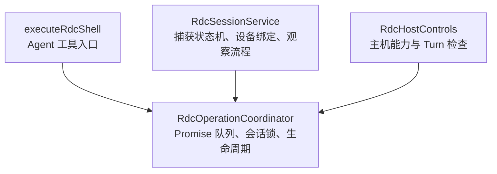
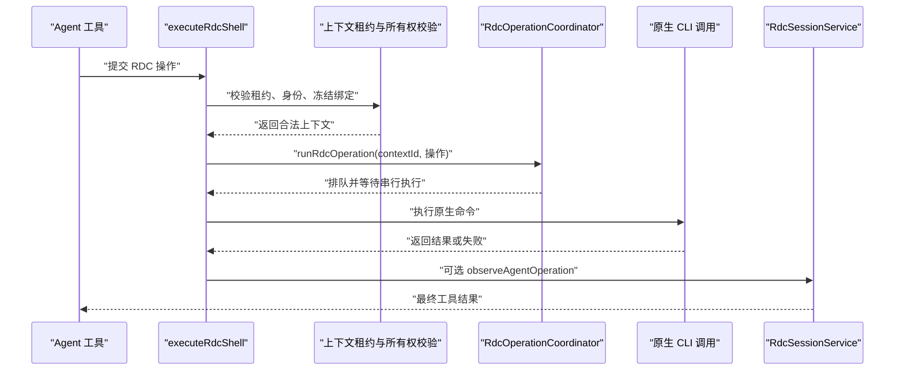
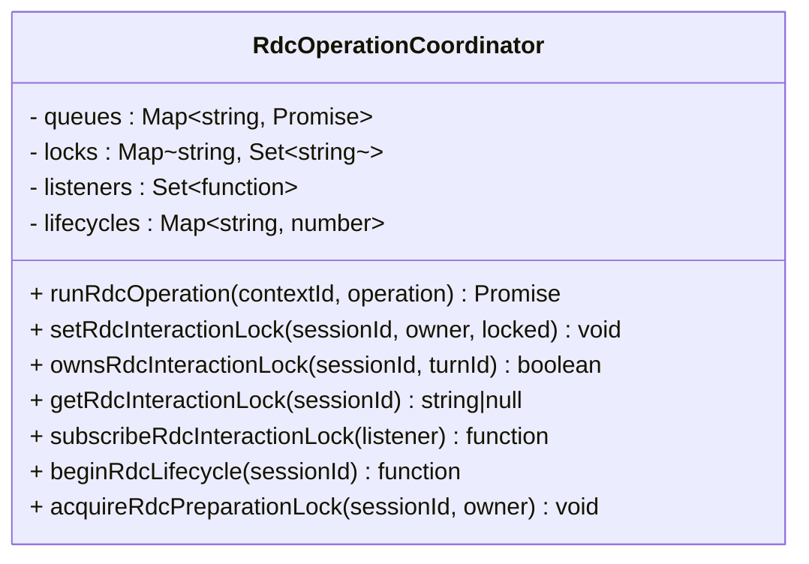
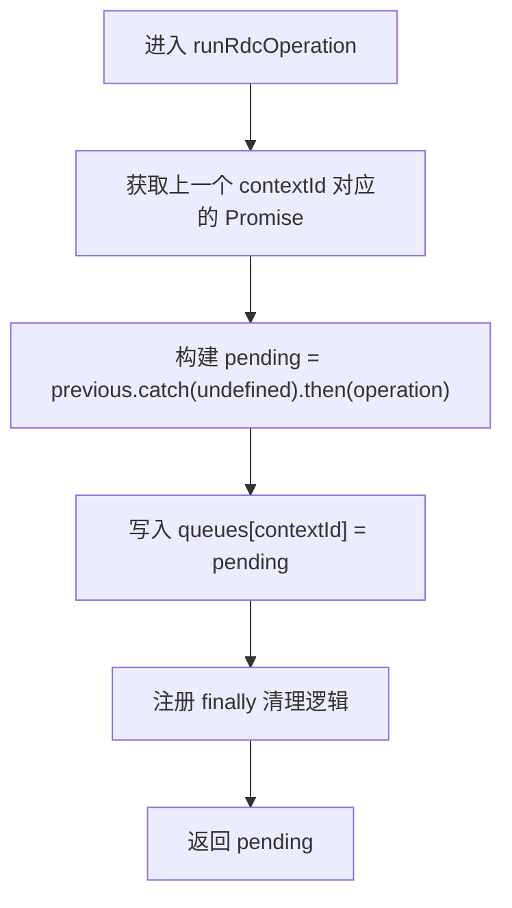
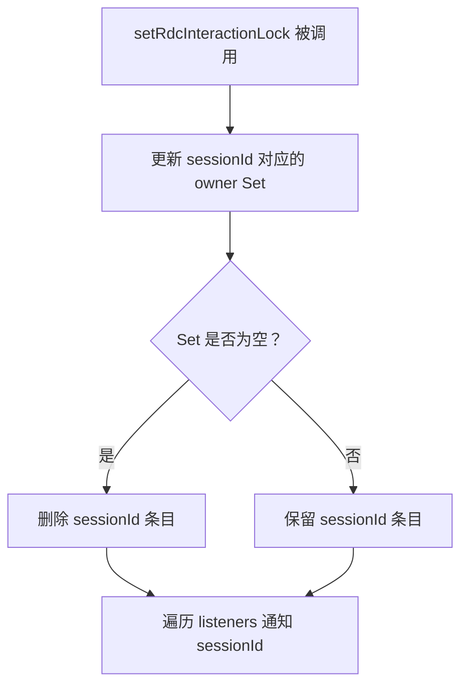
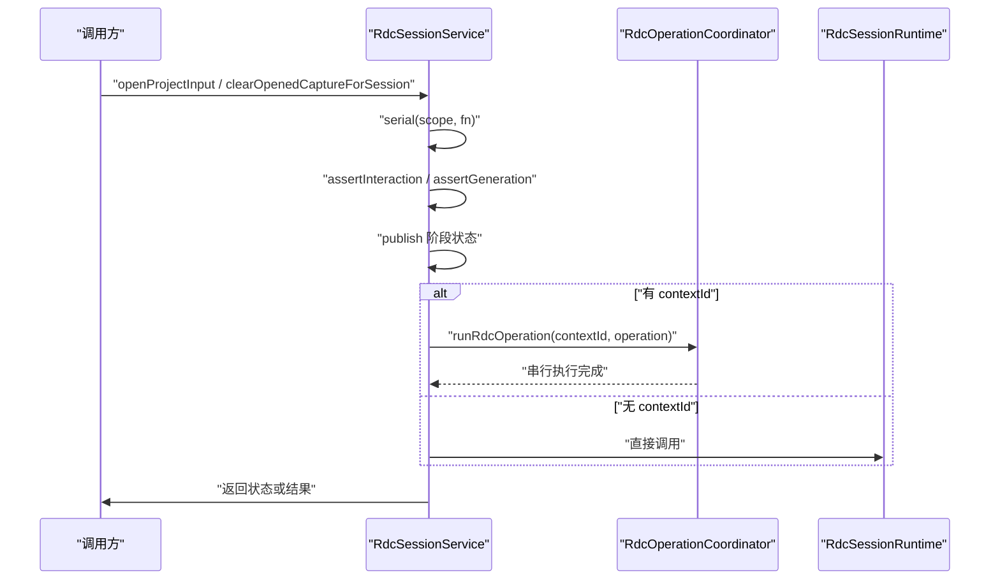
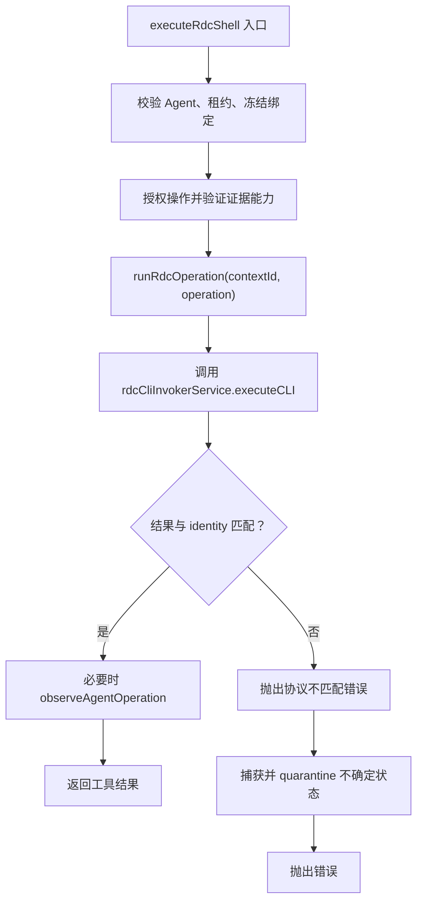
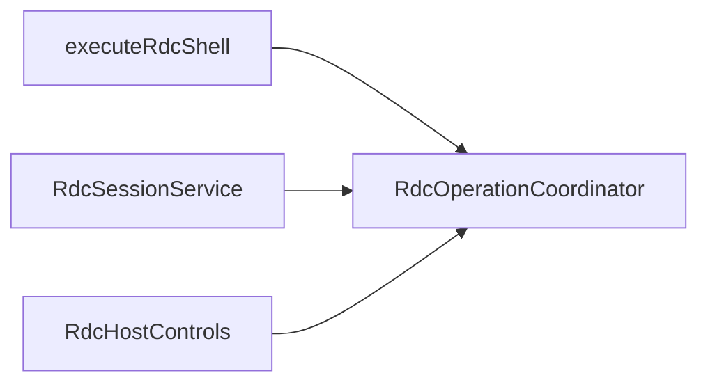

# 操作协调与锁机制

<cite>
**本文引用的文件**   
- [RdcOperationCoordinator.ts](file://src/main/sessions/RdcOperationCoordinator.ts)
- [RdcSessionService.ts](file://src/main/sessions/RdcSessionService.ts)
- [executeRdcShell.ts](file://src/main/tools/executeRdcShell.ts)
- [RdcHostControls.ts](file://src/main/tools/RdcHostControls.ts)
- [RdcSessionService.test.ts](file://src/main/sessions/RdcSessionService.test.ts)
</cite>

## 目录
1. [引言](#引言)
2. [项目结构定位](#项目结构定位)
3. [核心组件总览](#核心组件总览)
4. [架构概览](#架构概览)
5. [详细组件分析](#详细组件分析)
6. [依赖关系分析](#依赖关系分析)
7. [并发安全与死锁预防](#并发安全与死锁预防)
8. [性能与超时特性](#性能与超时特性)
9. [故障排查指南](#故障排查指南)
10. [结论](#结论)

## 引言
本文件聚焦 RDC（RenderDoc Capture）主进程中的“操作协调与锁机制”，目标是解释以下问题：
- `RdcOperationCoordinator` 如何通过 Promise 队列实现跨会话的操作串行化。
- `beginRdcLifecycle` 的生命周期计数如何保护捕获回放生命周期。
- `acquireRdcPreparationLock` 如何在准备阶段防止录制中执行。
- `setRdcInteractionLock` / `ownsRdcInteractionLock` 如何实现 agent turn 级别的互斥访问控制。
- `locks` Map 的数据结构设计与 listener 通知机制。
- `contextId` 级别队列隔离、`sessionId` 级别操作锁定、以及 owner 标识符的作用。
- 并发安全保证、死锁预防、超时处理策略，并给出多会话并发场景与最佳实践。

## 项目结构定位
RDC 操作协调相关代码主要分布在主进程的会话层和工具执行层：
- 会话服务负责捕获打开、关闭、事件应用、观察刷新等高层状态机。
- 操作协调器提供全局的上下文级 Promise 队列、会话级交互锁、生命周期计数器及订阅广播。
- RDC Shell 工具在 Agent 调用路径上接入协调器，确保对同一原生 context 的命令串行执行。
- Host Controls 暴露给 Agent 的工具能力检查，也使用 turn 级互斥判断。

**图表来源**
- [RdcOperationCoordinator.ts:1-38](file://src/main/sessions/RdcOperationCoordinator.ts#L1-L38)
- [RdcSessionService.ts:1-120](file://src/main/sessions/RdcSessionService.ts#L1-L120)
- [executeRdcShell.ts:1-120](file://src/main/tools/executeRdcShell.ts#L1-L120)
- [RdcHostControls.ts:1-63](file://src/main/tools/RdcHostControls.ts#L1-L63)

**章节来源**
- [RdcOperationCoordinator.ts:1-38](file://src/main/sessions/RdcOperationCoordinator.ts#L1-L38)
- [RdcSessionService.ts:1-120](file://src/main/sessions/RdcSessionService.ts#L1-L120)
- [executeRdcShell.ts:1-120](file://src/main/tools/executeRdcShell.ts#L1-L120)
- [RdcHostControls.ts:1-63](file://src/main/tools/RdcHostControls.ts#L1-L63)

## 核心组件总览
- **RdcOperationCoordinator**：提供三类核心能力
  - `runRdcOperation(contextId, operation)`：按 `contextId` 建立 Promise 队列，串行执行异步操作。
  - `setRdcInteractionLock(sessionId, owner, locked)` / `ownsRdcInteractionLock(sessionId, turnId)`：维护会话级 owner 集合，支持 turn 级互斥查询。
  - `beginRdcLifecycle(sessionId)` / `acquireRdcPreparationLock(sessionId, owner)`：会话级生命周期计数与录制期保护。
- **RdcSessionService**：封装捕获生命周期、设备占用、观察与刷新、错误隔离，并在多处调用协调器。
- **executeRdcShell**：Agent 工具执行入口，在强校验后通过 `runRdcOperation(lease.contextId, ...)` 串行调用原生命令。
- **RdcHostControls**：面向 Agent 的能力探测，验证当前 turn 是否持有会话交互锁，避免非拥有者执行受保护能力。

**章节来源**
- [RdcOperationCoordinator.ts:1-38](file://src/main/sessions/RdcOperationCoordinator.ts#L1-L38)
- [RdcSessionService.ts:1-291](file://src/main/sessions/RdcSessionService.ts#L1-L291)
- [executeRdcShell.ts:1-286](file://src/main/tools/executeRdcShell.ts#L1-L286)
- [RdcHostControls.ts:1-63](file://src/main/tools/RdcHostControls.ts#L1-L63)

## 架构概览
下图展示一次典型的 Agent 工具调用如何进入协调层：

**图表来源**
- [executeRdcShell.ts:120-286](file://src/main/tools/executeRdcShell.ts#L120-L286)
- [RdcOperationCoordinator.ts:12-23](file://src/main/sessions/RdcOperationCoordinator.ts#L12-L23)
- [RdcSessionService.ts:200-291](file://src/main/sessions/RdcSessionService.ts#L200-L291)

## 详细组件分析

### RdcOperationCoordinator：Promise 队列、会话锁与生命周期
该模块导出以下关键 API：
- `runRdcOperation(contextId, operation)`
- `setRdcInteractionLock(sessionId, owner, locked)`
- `ownsRdcInteractionLock(sessionId, turnId)`
- `getRdcInteractionLock(sessionId)`
- `subscribeRdcInteractionLock(listener)`
- `beginRdcLifecycle(sessionId)`
- `acquireRdcPreparationLock(sessionId, owner)`

#### 数据模型
- `queues`：`Map<string, Promise<unknown>>`，以 `contextId` 为键，保存当前待执行的最后一个 Promise。
- `locks`：`Map<string, Set<string>>`，以 `sessionId` 为键，值为当前被加锁的 owner 集合。
- `listeners`：`Set<(sessionId: string) => void>`，当会话锁变化时通知订阅者。
- `lifecycles`：`Map<string, number>`，记录每个 sessionId 的活跃生命周期数量。

**图表来源**
- [RdcOperationCoordinator.ts:1-38](file://src/main/sessions/RdcOperationCoordinator.ts#L1-L38)

#### runRdcOperation 的 Promise 队列机制
- 每次调用会读取 `queues.get(contextId)` 作为前一个任务；若不存在则使用已 resolved 的 Promise 作为起点。
- 新任务先接住上一个任务的异常（`.catch(() => undefined)`），再 `.then(operation)`，保证后续任务仍会被调度。
- 将新 Promise 写入 `queues.set(contextId, pending)`。
- 在 `finally` 中清理自身：只有当队列中当前值仍等于该 pending 时才删除，避免覆盖更新导致泄漏。
- 如果 operation 抛出或拒绝，Promise 链会继续传播错误，但不会阻止下一个 queued 任务入队。

时间复杂度方面，每次入队是 O(1)，出队与清理也是 O(1)。空间复杂度随并发上下文数线性增长。

**图表来源**
- [RdcOperationCoordinator.ts:12-23](file://src/main/sessions/RdcOperationCoordinator.ts#L12-L23)

#### beginRdcLifecycle 的生命周期计数
- `beginRdcLifecycle(sessionId)` 增加对应 sessionId 的计数，并返回释放函数。
- 释放时递减计数；计数归零才删除条目，否则保留非零计数。
- `RdcSessionService.serial` 使用该机制，为每个 session binding 建立串行化的生命周期作用域，确保同一 session 的多个高成本操作顺序执行。

注意：该计数器用于“会话级串行化边界”，不等同于 `locks` 中的交互锁。

#### acquireRdcPreparationLock 的准备阶段锁定
- 如果 sessionId 已有活跃生命周期，直接抛出错误，表示录制生命周期仍在进行，不允许准备阶段操作。
- 否则调用 `setRdcInteractionLock(sessionId, owner, true)`，将该 owner 标记为处于交互锁定状态。

该设计把“录制期不可变”与“agent turn 级独占”统一在同一个 lock 语义下：录制期间任何 owner 尝试准备都会失败；正常业务中，owner 可主动设置交互锁来阻止 UI 或其他调用方操作。

#### setRdcInteractionLock 与 ownsRdcInteractionLock 的互斥语义
- `setRdcInteractionLock(sessionId, owner, locked)`：
  - 若 `locked=true`，将 owner 加入 `locks.get(sessionId)` 的 Set；
  - 若 `locked=false`，从 Set 中移除 owner；
  - 若 Set 为空，删除该 sessionId 条目；
  - 最后遍历 `listeners`，广播 sessionId 变更。
- `ownsRdcInteractionLock(sessionId, turnId)`：仅判断该 sessionId 的 owner Set 中是否包含 turnId。
- `getRdcInteractionLock(sessionId)`：若存在任意 owner，返回 `'agent_running'`，否则返回 `null`。

这使 UI 层可通过订阅锁变化来显示“agent 正在运行”，同时业务方法可在需要时拒绝交互。

**图表来源**
- [RdcOperationCoordinator.ts:24-33](file://src/main/sessions/RdcOperationCoordinator.ts#L24-L33)

**章节来源**
- [RdcOperationCoordinator.ts:1-38](file://src/main/sessions/RdcOperationCoordinator.ts#L1-L38)

### RdcSessionService：会话状态机与协调器集成
RdcSessionService 管理每个 project/session 绑定的运行时、捕获状态、设备占用、阻塞输入集合、观察者等。它不是简单的门面，而是协调层之上的业务状态机。

#### 关键职责
- 维护 `bindings`：每个 scope 对应的 runtime 与状态。
- 维护 `devices`：远程设备到 binding key 的所有权映射。
- 维护 `blockedInputs`：在删除输入操作期间阻塞新的 open/close。
- 维护 `lifecycle`：同 `RdcOperationCoordinator` 一样，用 Promise 链实现 per-binding 串行化。
- 发布 `state`：通过 `publish` 更新 generation、revision、phase、error、interactionLock，并触发订阅者。

#### 与协调器的集成点
- `openProjectInput`：
  - 使用 `serial(scope, ...)` 包装整个打开流程；
  - 内部多次调用 `assertInteraction`，依赖 `getRdcInteractionLock` 判断 UI 或 agent turn 是否锁定；
  - 在 image loading 阶段使用 `runRdcOperation(owner.contextId, ...)` 串行读取 replay events 与 final output observation。
- `closeBinding`：
  - 如果存在 contextId，则通过 `runRdcOperation(contextId, close)` 串行关闭；
  - 否则直接同步关闭。
- `applyEventForSession` / `refreshFrameForSession`：
  - 先做 interaction 与 generation 校验；
  - 然后通过 `observe` 执行观察；
  - `observe` 在非 alreadySerialized 模式下调用 `runRdcOperation(owner.contextId, operation)`。
- `blockInputOperations`：
  - 阻塞指定 input 的新 open/close；
  - 等待所有当前 `lifecycle` Promise 完成后执行传入操作，再清理阻塞。

**图表来源**
- [RdcSessionService.ts:40-120](file://src/main/sessions/RdcSessionService.ts#L40-L120)
- [RdcSessionService.ts:120-200](file://src/main/sessions/RdcSessionService.ts#L120-L200)
- [RdcOperationCoordinator.ts:12-23](file://src/main/sessions/RdcOperationCoordinator.ts#L12-L23)

**章节来源**
- [RdcSessionService.ts:1-291](file://src/main/sessions/RdcSessionService.ts#L1-L291)

### executeRdcShell：Agent 工具与原生调用的串行入口
该工具是 Agent 执行 RDC 操作的入口之一，承担以下职责：
- 校验调用方必须是 owned General turn。
- 校验租约、冻结绑定、定义指纹、参数签名。
- 在成功授权后，通过 `runRdcOperation(lease.contextId, async () => {...})` 串行执行原生命令。
- 对可能改变 replay position 或 shader replacement 的操作，调用 `observeAgentOperation` 记录观察结果。
- 对原生失败进行结构化包装，必要时 quarantine 上下文。

**图表来源**
- [executeRdcShell.ts:120-286](file://src/main/tools/executeRdcShell.ts#L120-L286)
- [RdcOperationCoordinator.ts:12-23](file://src/main/sessions/RdcOperationCoordinator.ts#L12-L23)

**章节来源**
- [executeRdcShell.ts:1-286](file://src/main/tools/executeRdcShell.ts#L1-L286)

### RdcHostControls：Turn 级能力检查
`readRdcHostControls` 暴露给 Agent 的能力探测接口，其中 `readReplayIsolation` 明确检查：
- Agent 必须为 `general`；
- 不能排除 RDC lease tools；
- 必须有 `turnId`；
- 必须 `ownsRdcInteractionLock(sessionId, context.turnId)`；
- 还必须满足租约版本、replaySessionId、captureFileId 等多重一致性检查。

这说明“turn 级互斥”不仅是锁集合成员判断，还结合上下文身份、租约版本、replay 会话与捕获文件一致性，共同决定某个 agent turn 是否可以独占访问 RDC 上下文。

**章节来源**
- [RdcHostControls.ts:1-63](file://src/main/tools/RdcHostControls.ts#L1-L63)

## 依赖关系分析

- `RdcOperationCoordinator` 是底层设施，没有反向依赖。
- `RdcSessionService` 依赖协调器的队列、锁与生命周期。
- `executeRdcShell` 依赖协调器的 `runRdcOperation`，并通过 `RdcSessionService.observeAgentOperation` 间接影响会话状态。
- `RdcHostControls` 依赖 `ownsRdcInteractionLock` 作为能力开关。

**图表来源**
- [RdcOperationCoordinator.ts:1-38](file://src/main/sessions/RdcOperationCoordinator.ts#L1-L38)
- [RdcSessionService.ts:1-60](file://src/main/sessions/RdcSessionService.ts#L1-L60)
- [executeRdcShell.ts:1-30](file://src/main/tools/executeRdcShell.ts#L1-L30)
- [RdcHostControls.ts:1-20](file://src/main/tools/RdcHostControls.ts#L1-L20)

**章节来源**
- [RdcOperationCoordinator.ts:1-38](file://src/main/sessions/RdcOperationCoordinator.ts#L1-L38)
- [RdcSessionService.ts:1-60](file://src/main/sessions/RdcSessionService.ts#L1-L60)
- [executeRdcShell.ts:1-30](file://src/main/tools/executeRdcShell.ts#L1-L30)
- [RdcHostControls.ts:1-20](file://src/main/tools/RdcHostControls.ts#L1-L20)

## 并发安全与死锁预防

### contextId 级别的队列隔离
- 每个 `contextId` 对应独立的 Promise 队列。
- 不同 `contextId` 之间完全并行；相同 `contextId` 之间严格串行。
- 这是 RDC 原生上下文的核心不变式：同一 native context 的状态变更不应交错。

### sessionId 级别的操作锁定
- `locks` 以 `sessionId` 为键，维护 owner 集合。
- `setRdcInteractionLock(sessionId, owner, locked)` 由上层业务显式调用，例如测试中模拟 agent turn 加锁。
- `getRdcInteractionLock` 对外暴露“是否被 agent 占用”的简略视图。
- `ownsRdcInteractionLock(sessionId, turnId)` 精确判断某个 turn 是否持有锁。

### owner 标识符的作用
- owner 可以是字符串标识，如测试中的 `"test"` 或 agent turn 的 `turnId`。
- 它允许多个 owner 共存于同一个 sessionId 的锁集合中，但只有显式拥有者才能通过 `ownsRdcInteractionLock` 证明自己的合法性。
- 在 `RdcHostControls.readReplayIsolation` 中，turnId 必须匹配当前上下文，才能认为当前 agent turn 具备独占访问资格。

### 并发安全保证
- Promise 队列基于单线程 Event Loop，不存在 JavaScript 层的竞态条件。
- 队列清理使用“比较当前队列值是否仍为 pending”的方式，避免重复删除或误删后续任务。
- `locks` 的 Set 操作是原子性的 JavaScript 对象操作；listener 广播发生在锁集合更新之后，保证订阅者看到一致状态。
- `lifecycles` 计数使用递增/递减模式，仅在归零时删除，避免未初始化或过度释放。

### 死锁预防
- `runRdcOperation` 的 `.catch(() => undefined)` 确保前一个失败的 Promise 不会阻断后续任务入队。
- `finally` 清理只在“当前队列值仍等于 pending”时删除，避免清理早于或晚于预期。
- `RdcSessionService.serial` 同样采用相同的 Promise 链模式，避免生命周期释放与队列清理互相干扰。
- `acquireRdcPreparationLock` 在录制期直接抛错，而不是尝试等待，避免长时间阻塞导致的死锁。
- `blockInputOperations` 先添加阻塞标记，再 `await Promise.allSettled([...this.lifecycle.values()])`，确保旧操作完成后才执行删除逻辑，避免边删边开的竞态。

### 超时处理策略
- 协调器本身不提供超时。
- `RdcHostControls` 暴露 `cliProcess.timeoutMs`，表示冻结 turn CLI 的超时能力；但这属于工具能力描述，不代表 `runRdcOperation` 自动中断。
- `executeRdcShell` 接收外部 `AbortSignal`，并在关键位置调用 `signal?.throwIfAborted()`，用于取消上层请求。
- 原生调用由 `rdcCliInvokerService.executeCLI` 处理具体进程与超时行为；协调层只负责串行化。
- 对于不确定原生状态，系统倾向于 quarantine 上下文，而不是假设操作成功或失败。

**章节来源**
- [RdcOperationCoordinator.ts:1-38](file://src/main/sessions/RdcOperationCoordinator.ts#L1-L38)
- [RdcSessionService.ts:40-200](file://src/main/sessions/RdcSessionService.ts#L40-L200)
- [executeRdcShell.ts:120-286](file://src/main/tools/executeRdcShell.ts#L120-L286)
- [RdcHostControls.ts:1-63](file://src/main/tools/RdcHostControls.ts#L1-L63)

## 性能与超时特性

### 队列性能
- `runRdcOperation` 每次入队、取队、清理都是 O(1)。
- 队列长度取决于活跃 `contextId` 数量，而非全局并发量。
- 失败操作不会堆积，因为 `.catch(() => undefined)` 会把失败转化为中性节点继续传递。

### 锁广播性能
- 每次 `setRdcInteractionLock` 都遍历 `listeners`。
- 如果订阅者较多，应确保监听器回调轻量，避免长耗时逻辑放在锁变更回调中。
- `RdcSessionService` 订阅锁变更后只发布空 patch，让 UI 重新计算 `interactionLock`，符合轻通知、重快照的模式。

### 超时与取消
- `runRdcOperation` 不感知超时。
- 超时与取消应由调用方通过 `AbortSignal`、CLI 配置、进程终止策略控制。
- 对于不确定原生状态，系统选择 quarantine 上下文，避免错误恢复造成更大不一致。

**章节来源**
- [RdcOperationCoordinator.ts:1-38](file://src/main/sessions/RdcOperationCoordinator.ts#L1-L38)
- [RdcSessionService.ts:1-60](file://src/main/sessions/RdcSessionService.ts#L1-L60)
- [RdcHostControls.ts:20-63](file://src/main/tools/RdcHostControls.ts#L20-L63)

## 故障排查指南

### 常见错误码与含义
- `RDC_REPLAY_BUSY`：捕获回放处于 busy 状态，或录制生命周期未完成。
- `RDC_INTERACTION_LOCKED`：当前 sessionId 被 agent turn 或代理执行锁定。
- `RDC_BINDING_CHANGED`：binding generation 过期，需要刷新当前捕获状态。
- `RDC_CONTEXT_QUARANTINED`：上下文因原生操作结果不确定而被隔离。
- `RDC_EXECUTION_DENIED`：租约、身份、冻结绑定或能力不满足。
- `RDC_CLI_PROTOCOL`：原生 CLI 返回的身份或 replay 位置不匹配。
- `RDC_OBSERVE_FAILED`：观察刷新失败。
- `RDC_CLOSE_FAILED`：关闭资源失败。
- `RDC_INPUT_REMOVING`：输入正被删除，禁止新 open/close。

### 典型排查路径
1. 如果 UI 一直显示 agent 正在运行：
   - 检查是否有未释放的 `setRdcInteractionLock(sessionId, owner, true)`。
   - 确认测试或业务逻辑是否在适当时机调用 `setRdcInteractionLock(sessionId, owner, false)`。
2. 如果 Agent 工具无法执行：
   - 检查 `ownsRdcInteractionLock(sessionId, turnId)` 是否返回 true。
   - 检查租约版本、contextId、ownerSessionId、replaySessionId、captureFileId 是否一致。
3. 如果原生操作失败但上下文仍可用：
   - 查看是否命中 `nativeStateVerifiedSafe` 分支，从而保留上下文。
   - 如果无法验证原生状态恢复，上下文会被 quarantine，需要先关闭并重开捕获。
4. 如果 apply event 看似被忽略：
   - 检查 `args.event_id` 是否与当前 `binding.state.requestedEventId` 一致；
   - 检查是否已被更新的 slider 请求覆盖。

**章节来源**
- [RdcSessionService.ts:60-291](file://src/main/sessions/RdcSessionService.ts#L60-L291)
- [executeRdcShell.ts:120-286](file://src/main/tools/executeRdcShell.ts#L120-L286)
- [RdcSessionService.test.ts:1-200](file://src/main/sessions/RdcSessionService.test.ts#L1-L200)

## 结论
RDC 操作协调与锁机制围绕三个层次展开：
- **contextId 级 Promise 队列**：保证同一原生上下文的所有操作串行执行。
- **sessionId 级交互锁**：表达 agent turn 或业务 owner 对会话的独占意图，并通过 listener 通知 UI 与其他消费者。
- **会话级生命周期计数**：保护录制与回放生命周期，防止准备阶段与录制期冲突。

该设计的关键优势在于：
- 使用 JavaScript 单线程 Promise 链实现简单可靠的串行化。
- 将“谁可以执行”（owner/turn/lease）与“何时可以执行”（队列、生命周期、交互锁）解耦。
- 对原生不确定性保持保守：宁可 quarantine，也不盲目恢复。

最佳实践包括：
- 始终通过 `runRdcOperation(contextId, ...)` 包装涉及原生上下文的异步操作。
- 在 agent turn 开始时申请 turn 级锁，结束时释放。
- 在捕获打开、关闭、事件应用等关键路径检查 `assertInteraction` 与 `assertGeneration`。
- 对可能改变原生状态的失败进行 quarantine，并通过 UI 引导用户重新打开捕获。
- 在多会话场景中，利用 `contextId` 隔离不同原生上下文，利用 `sessionId` 隔离 UI 与 agent turn 的互斥语义。