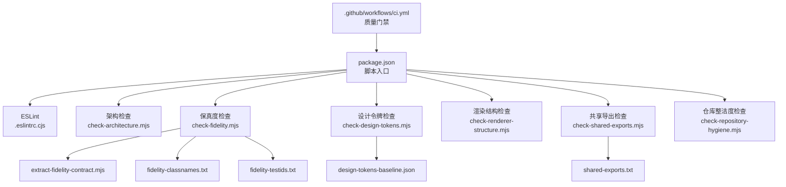
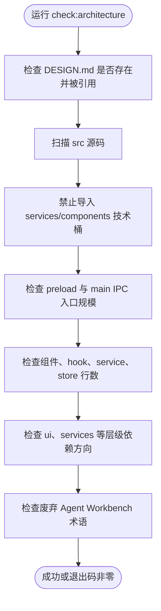
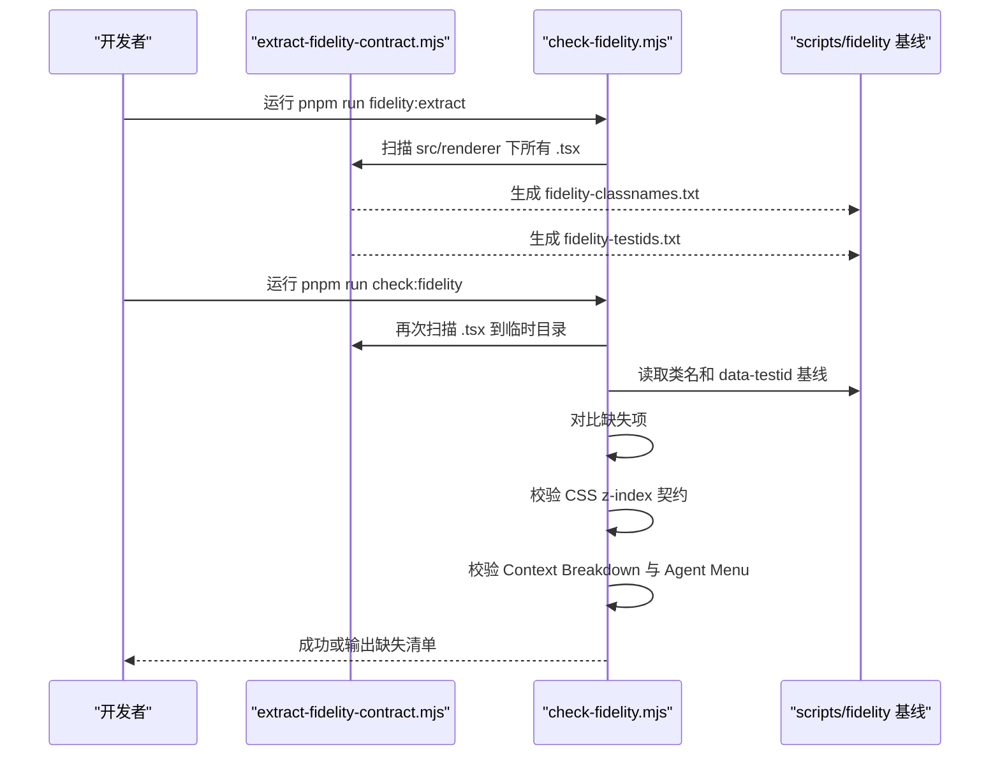
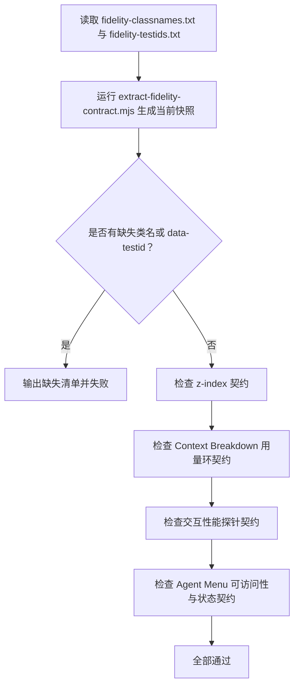
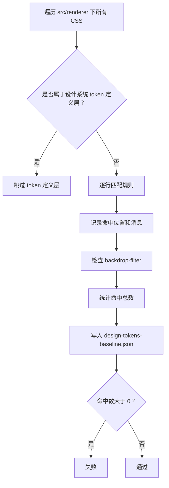
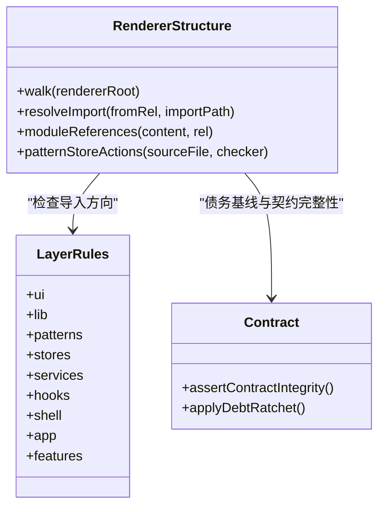
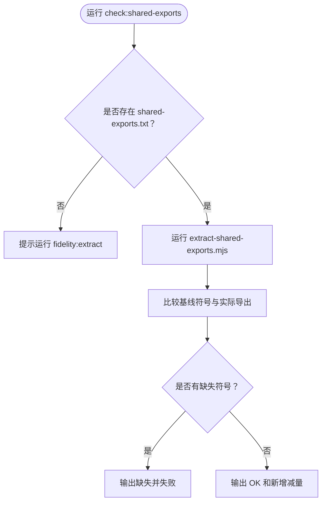
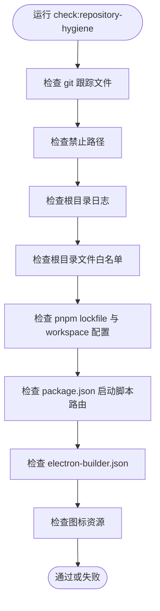
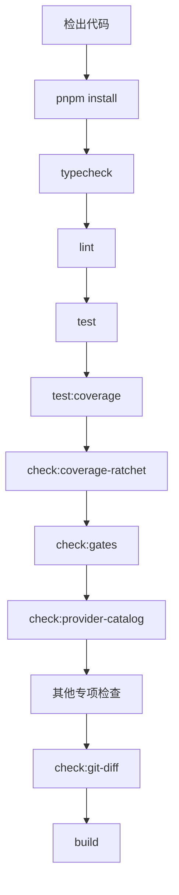

# 代码质量工具

<cite>
**本文引用的文件**   
- [package.json](file://package.json)
- [.eslintrc.cjs](file://.eslintrc.cjs)
- [scripts/check-architecture.mjs](file://scripts/check-architecture.mjs)
- [scripts/check-fidelity.mjs](file://scripts/check-fidelity.mjs)
- [scripts/check-renderer-structure.mjs](file://scripts/check-renderer-structure.mjs)
- [scripts/check-repository-hygiene.mjs](file://scripts/check-repository-hygiene.mjs)
- [scripts/check-design-tokens.mjs](file://scripts/check-design-tokens.mjs)
- [scripts/check-shared-exports.mjs](file://scripts/check-shared-exports.mjs)
- [scripts/extract-fidelity-contract.mjs](file://scripts/extract-fidelity-contract.mjs)
- [DESIGN.md](file://DESIGN.md)
- [docs/ui/design-system.md](file://docs/ui/design-system.md)
- [.github/workflows/ci.yml](file://.github/workflows/ci.yml)
- [scripts/fidelity/design-tokens-baseline.json](file://scripts/fidelity/design-tokens-baseline.json)
- [scripts/fidelity/fidelity-classnames.txt](file://scripts/fidelity/fidelity-classnames.txt)
- [scripts/fidelity/shared-exports.txt](file://scripts/fidelity/shared-exports.txt)
</cite>

## 目录

1. [引言](#引言)
2. [项目结构与质量入口](#项目结构与质量入口)
3. [ESLint 配置与代码风格规范](#eslint-配置与代码风格规范)
4. [check:* 脚本总览](#check-script-总览)
5. [架构检查：check:architecture](#架构检查checkarchitecture)
6. [保真度检查：Fidelity 系统](#保真度检查fidelity-系统)
7. [设计令牌检查：check:design-tokens](#设计令牌检查checkdesigntokens)
8. [渲染层结构检查：check:renderer-structure](#渲染层结构检查checkrenderer-structure)
9. [共享导出检查：check:shared-exports](#共享导出检查checkshared-exports)
10. [仓库整洁度检查：check:repository-hygiene](#仓库整洁度检查checkrepository-hygiene)
11. [持续集成中的质量门禁](#持续集成中的质量门禁)
12. [代码审查清单](#代码审查清单)
13. [常见问题修复指南](#常见问题修复指南)
14. [性能分析与调试建议](#性能分析与调试建议)
15. [结论](#结论)

## 引言

RDC-Agent 是一个基于 Electron 的桌面应用，围绕 RenderDoc `.rdc` 捕获分析以及通用 Agent 工作台展开。其代码质量体系不是单一 ESLint 规则集合，而是由“编辑器内静态检查 + Node 脚本契约检查 + 基线比对 + 持续集成门禁”组成的多层质量门。

核心思路是：

- 用 TypeScript、ESLint 和 React Hooks 插件保证基础语法、类型与常见 React 错误。
- 用 `scripts/check-*` 脚本强制执行产品边界、模块依赖方向、设计系统和 UI 保真度。
- 用 `scripts/fidelity` 下的基线文件锁定类名、测试标识符、设计令牌债务和共享导出。
- 在 GitHub Actions 中统一执行类型检查、测试、覆盖率、构建和质量门禁。

这套机制适合需要长期演进的大型前端工程：它允许渐进式迁移，但明确禁止退化；新增功能通常需要同步更新契约或基线，而不是绕过检查。

## 项目结构与质量入口

质量相关的主要位置如下：

| 位置 | 职责 |
|---|---|
| `package.json` | 定义所有 `check:*`、`test:*`、`lint`、`typecheck` 等脚本入口 |
| `.eslintrc.cjs` | ESLint 解析器、插件、全局规则和渲染层导入限制 |
| `scripts/check-*.mjs` | 架构、保真度、设计令牌、渲染结构、仓库整洁度等检查脚本 |
| `scripts/extract-*.mjs` | 从源码提取类名、测试标识符、共享导出等运行时契约 |
| `scripts/fidelity/*` | 保真度基线和债务基线 |
| `DESIGN.md` | 产品边界、架构原则和权威裁决文档 |
| `docs/ui/design-system.md` | UI 设计系统、Token 使用规范和组件约定 |
| `.github/workflows/ci.yml` | 持续集成流水线 |

**图表来源**  
- [package.json:1-120](file://package.json#L1-L120)  
- [.eslintrc.cjs:1-101](file://.eslintrc.cjs#L1-L101)  
- [scripts/check-fidelity.mjs:1-60](file://scripts/check-fidelity.mjs#L1-L60)  
- [scripts/check-design-tokens.mjs:1-40](file://scripts/check-design-tokens.mjs#L1-L40)  
- [.github/workflows/ci.yml:1-40](file://.github/workflows/ci.yml#L1-L40)

**章节来源**  
- [package.json:1-120](file://package.json#L1-L120)  
- [.eslintrc.cjs:1-101](file://.eslintrc.cjs#L1-L101)  
- [DESIGN.md:1-73](file://DESIGN.md#L1-L73)

## ESLint 配置与代码风格规范

### 基本设置

ESLint 以 `.eslintrc.cjs` 为根配置，启用以下能力：

| 维度 | 配置含义 |
|---|---|
| 运行环境 | 同时支持浏览器、Node.js 和 ES2022 |
| 解析器 | 使用 `@typescript-eslint/parser`，启用 JSX |
| 插件 | `@typescript-eslint`、`react-hooks` |
| 扩展规则 | `eslint:recommended`、`plugin:react-hooks/recommended` |
| 忽略路径 | `out/`、`release/`、`test-results/`、`node_modules/` |

这意味着 TypeScript 语法、React Hooks 常用规则会在编辑器中和 CI 中同时生效，而不是只在某一边运行。

### TypeScript 语法检查与未使用变量

ESLint 关闭了原生 `no-unused-vars`，改用 `@typescript-eslint/no-unused-vars`，并允许以下命名约定：

- 以下划线开头的参数、变量和捕获的错误会被忽略。
- 这适合处理回调中不使用的参数，例如 `(event, _unused)` 或 `try { ... } catch (_err) {}`。

TypeScript 的类型检查本身由独立的 `typecheck` 脚本负责，命令为 `tsc --noEmit`，不会生成编译产物。

### React Hooks 规则

当前启用的关键规则是 `react-hooks/exhaustive-deps: error`。该规则会检查 Hook 依赖数组是否完整，防止因遗漏状态变化导致渲染不一致。

建议在编写自定义 Hook 时遵循以下习惯：

- 将稳定函数放入依赖数组。
- 将外部传入的回调通过 `useCallback` 包装后再放入依赖。
- 对不需要参与重渲染的值使用 `useRef`，而不是直接放在依赖数组中。
- 如果确实需要忽略某个依赖，应注释说明原因，而不是禁用整条规则。

### 渲染层导入组织规则

`.eslintrc.cjs` 对 `src/renderer` 的多个目录设置了 `no-restricted-imports`，用于在编辑器阶段提示依赖方向问题。实际强制力主要由 `scripts/check-renderer-structure.mjs` 提供。

| 目录 | 被禁止导入的目录 |
|---|---|
| `src/renderer/ui/**` | `features`、`patterns`、`stores`、`services`、`platform`、`hooks`、`app`、`shell` |
| `src/renderer/patterns/**` | `features`、`platform`、`app`、`shell` |
| `src/renderer/{stores,services,hooks}/**` | `features`、`ui`、`patterns`、`app`、`shell` |
| `src/renderer/lib/**` | 除共享库外的几乎所有业务目录 |

这些规则的核心思想是：UI 基础控件不应反向依赖业务特性；patterns 是组合层，可读取 store，但不能直接读写 feature 内部状态；lib 应是低耦合工具。

### 命名约定与样式约定

根据设计系统文档，UI 状态类必须使用 `is-*` 前缀，例如 `is-active`、`is-selected`、`is-running`、`is-disabled`、`is-error`。渲染结构检查还会拒绝裸的 `.active`、`.current` 这类语义不清的状态类。

此外，交互选择器若定义了 `:hover`，还必须定义 `:focus-visible`；焦点环统一使用语义 token，不能简单 `outline: none`。

**章节来源**  
- [.eslintrc.cjs:1-101](file://.eslintrc.cjs#L1-L101)  
- [docs/ui/design-system.md:120-176](file://docs/ui/design-system.md#L120-L176)  
- [scripts/check-renderer-structure.mjs:120-160](file://scripts/check-renderer-structure.mjs#L120-L160)

## check:* 脚本总览

`package.json` 中定义了丰富的 `check:*` 脚本。它们可以单独运行，也可以由 `check:gates` 串联成完整质量门禁。

| 脚本 | 主要作用 | 是否属于 gates |
|---|---|---|
| `check:architecture` | 检查权威文档、技术桶、IPC 组成、文件行数预算和 forbidden agent workbench 术语 | 是 |
| `check:fidelity` | 比对类名、data-testid、CSS z-index 契约、上下文用量环和 Agent 菜单行为 | 是 |
| `check:design-tokens` | 检查 CSS 是否使用语义 token，并锁定设计令牌债务 | 是 |
| `check:renderer-structure` | 检查渲染层依赖方向、feature 隔离、IPC 访问层和 CSS 就近原则 | 是 |
| `check:shared-exports` | 检查共享导出符号缺失 | 是 |
| `check:work-process*` | 检查工作过程展示和工具覆盖 | 是 |
| `check:conversation-branch` | 检查对话分支相关契约 | 是 |
| `check:reasoning-delivery` | 检查推理交付相关契约 | 是 |
| `check:agent-runtime` | 检查 Agent 运行时相关契约 | 是 |
| `check:tool-system` | 检查工具系统契约 | 是 |
| `check:browser-capability` | 检查浏览器能力契约 | 是 |
| `check:provider-system` | 检查 Provider 系统契约 | 是 |
| `check:settings-agents` | 检查 Agent 设置契约 | 是 |
| `check:appearance` | 检查外观主题契约 | 是 |
| `check:session-projection` | 检查会话投影契约 | 是 |
| `check:right-rail` | 检查右侧栏契约 | 是 |
| `check:knowledge-system` | 检查知识系统契约 | 是 |
| `check:investigation-system` | 检查调查系统契约 | 是 |
| `check:legacy-residue` | 检查遗留残留 | 是 |
| `check:acceptance-ledger` | 检查验收账本 | 是 |
| `check:git-diff` | 检查 Git diff 空白字符等问题 | 否 |
| `check:repository-hygiene` | 检查仓库根目录、lockfile、打包配置和运行脚本 | 是 |
| `check:coverage-ratchet` | 检查覆盖率门槛 | 是 |
| `check:release-config` | 检查发布配置 | 是 |
| `check:identity` / `check:secrets` | 检查身份和敏感信息 | 是 |

```mermaid
flowchart TD
    Gates["check:gates"] --> Arch["check:architecture"]
    Gates --> Fidelity["check:fidelity"]
    Gates --> SharedExports["check:shared-exports"]
    Gates --> WorkProcess["check:work-process-presentation"]
    Gates --> ToolCoverage["check:work-process-tool-coverage"]
    Gates --> Conversation["check:conversation-branch"]
    Gates --> Reasoning["check:reasoning-delivery"]
    Gates --> AgentRuntime["check:agent-runtime"]
    Gates --> ToolSystem["check:tool-system"]
    Gates --> BrowserCap["check:browser-capability"]
    Gates --> Appearance["check:appearance"]
    Gates --> SessionProj["check:session-projection"]
    Gates --> RightRail["check:right-rail"]
    Gates --> Knowledge["check:knowledge-system"]
    Gates --> Investigation["check:investigation-system"]
    Gates --> Legacy["check:legacy-residue"]
    Gates --> Acceptance["check:acceptance-ledger"]
    Gates --> SettingsAgents["check:settings-agents"]
    Gates --> ProviderSys["check:provider-system"]
    Gates --> ReleaseCfg["check:release-config"]
    Gates --> DesignTokens["check:design-tokens"]
    Gates --> RendererStruct["check:renderer-structure"]
    Gates --> Identity["check:identity"]
    Gates --> Secrets["check:secrets"]
```

**图表来源**  
- [package.json:15-110](file://package.json#L15-L110)

**章节来源**  
- [package.json:15-110](file://package.json#L15-L110)

## 架构检查：check:architecture

`check:architecture` 是 RDC-Agent 的“产品边界守护脚本”。它不只检查代码能否编译，还检查代码是否遵守 `DESIGN.md` 和 UI 设计系统的结构性约束。

### 权威文档检查

脚本要求：

- 根目录存在 `DESIGN.md`。
- `AGENTS.md` 引用 `DESIGN.md`。
- `README.md` 和 `docs/README.md` 都引用 `DESIGN.md`。

这确保产品权威文档不会被孤立，且开发者能在 README 和 Agent 工作流中找到权威来源。

### 技术桶与导入边界

脚本扫描 `src` 下所有源码，并阻止以下行为：

- 从 `src/main/services` 导入。
- `src/main` 中从 `/services/` 导入。
- 从 `src/renderer/components` 或 `/components/` 导入。
- 重新创建已废弃的 `src/renderer/components` 目录。

这是为了维持主进程与渲染层的领域分层，避免把历史 `services`、`components` 等技术桶再次扩散。

### IPC 入口规模约束

脚本对两个 IPC 入口做了规模限制：

- `src/preload/index.ts` 中 `ipcRenderer.invoke` 调用不能超过 5 个。
- `src/main/ipc/handlers.ts` 中 `ipcMain.handle` 调用不能超过 10 个。
- `src/main/ipc/workbenchHandlers.ts` 应保持为组合根，不再新增处理器。

目的是让 IPC 保持“薄通道”，具体逻辑委托给领域模块。

### 文件行数预算（R1）

脚本对渲染层文件施加行数预算：

| 文件类型 | 最大行数 |
|---|---:|
| `.tsx` 组件 | 300 |
| Hook 文件 | 200 |
| 以 `useXxx.ts` 命名的 feature hook | 200 |
| `src/renderer/services/` 下的服务文件 | 200 |
| `src/renderer/stores/` 下的 store 文件 | 200 |

超出预算会触发失败。该规则鼓励把大组件拆分为子组件、把复杂状态拆分为多个 store 或 service。

### 依赖方向（R2）

脚本使用正则匹配 `from '...'`，判断导入路径是否违反层级。例如：

- `src/renderer/ui/` 不得导入 `features`、`stores`、`platform`、`hooks`、`app`、`shell`。
- `src/renderer/services/` 不得直接 import React 或 react-dom。
- UI 层违反依赖方向时会报告具体导入路径。

**图表来源**  
- [scripts/check-architecture.mjs:1-200](file://scripts/check-architecture.mjs#L1-L200)

**章节来源**  
- [scripts/check-architecture.mjs:1-200](file://scripts/check-architecture.mjs#L1-L200)  
- [DESIGN.md:1-73](file://DESIGN.md#L1-L73)

## 保真度检查：Fidelity 系统

Fidelity 系统是 RDC-Agent 的 UI 保真度契约。它保证用户界面不会因为重构、替换实现或增量修改而丢失可见类名、测试标识符、样式顺序和重要交互标记。

### Fidelity 工作流程

**图表来源**  
- [scripts/check-fidelity.mjs:1-120](file://scripts/check-fidelity.mjs#L1-L120)  
- [scripts/extract-fidelity-contract.mjs:1-109](file://scripts/extract-fidelity-contract.mjs#L1-L109)

### 类名与测试标识符提取

`extract-fidelity-contract.mjs` 会扫描 `src/renderer` 下所有 `.tsx` 文件，提取：

- `className="..."`
- `className={'...'}`
- 模板字符串首段 className
- `cn('foo', cond && 'bar')` 中的字面量类名
- `data-testid`、`dataTestId` 等测试标识符
- `TaskStatusMarker` 中封闭状态映射的类名
- `ResizeHandle` 中左右两侧的稳定类名和测试断言

提取结果按字典序排序后写入 `scripts/fidelity/fidelity-classnames.txt` 和 `scripts/fidelity/fidelity-testids.txt`。

### 基线比对逻辑

`check-fidelity.mjs` 的工作流程是：

1. 读取基线中的类名集合和 data-testid 集合。
2. 如果基线文件不存在，提示运行 `pnpm run fidelity:extract`。
3. 调用 `extract-fidelity-contract.mjs` 在当前提交中提取最新类名和 testId。
4. 计算基线中存在但当前缺失的项目。
5. 如果存在缺失，打印最多 50 项并返回失败。
6. 统计新增的类名和 testId 数量，供开发者评估变更范围。

### CSS 保真度契约

除了类名和 testId，`check-fidelity.mjs` 还检查关键 CSS 契约：

| 契约 | 目的 |
|---|---|
| Composer 输入栏使用 `--z-sticky` | 保证 Settings 弹窗能完全覆盖输入区域 |
| Settings 遮罩使用 `--z-modal-backdrop` | 统一模态背景层级 |
| Settings 中心使用 `--z-modal` | 保证模态内容在遮罩之上 |
| z-index 顺序 | 固定 `sticky < modal-backdrop < modal < tooltip < notification` |
| Context Usage Indicator | 保持百分比优先，Preparing / Current request / Last actual / Projected 只出现在标题和气泡中 |
| Interaction Performance Probe | 使用 Event Timing 和 long task，不使用 `requestAnimationFrame` 或 `setTimeout` 代理 |
| Agent Menu | 选中态与运行态分离，具备可访问性属性，紧凑尺寸，无减少动效开关 |

这些检查不是泛泛的 lint，而是针对特定产品界面的“不可变契约”。

**图表来源**  
- [scripts/check-fidelity.mjs:1-219](file://scripts/check-fidelity.mjs#L1-L219)

**章节来源**  
- [scripts/check-fidelity.mjs:1-219](file://scripts/check-fidelity.mjs#L1-L219)  
- [scripts/extract-fidelity-contract.mjs:1-109](file://scripts/extract-fidelity-contract.mjs#L1-L109)  
- [scripts/fidelity/fidelity-classnames.txt:1-40](file://scripts/fidelity/fidelity-classnames.txt#L1-L40)

## 设计令牌检查：check:design-tokens

`check:design-tokens.mjs` 负责保证渲染层 CSS 遵循设计系统。它的目标是逐步消除硬编码颜色、像素字号、像素间距和随意 `!important`。

### 检查规则

| 规则编号 | 检测内容 | 处理方式 |
|---|---|---|
| `primitive-color-var` | 使用 `--color-*` 原始 token | 必须改为 `--token-*` 语义 token |
| `hex-literal` | 使用十六进制颜色字面量 | 必须使用设计 token |
| `font-size-px` | 使用 `px` 字体大小 | 必须使用 `var(--text-*)` |
| `spacing-px` | 使用 `px` 间距 | 必须使用 `var(--space-*)` |
| `radius-px` | 使用 `px` 圆角 | 必须使用 `var(--radius-*)` 或组件半径变量 |
| `important` | 使用 `!important` | 不允许 |
| backdrop-filter | backdrop-filter 值不是 `var(--modal-backdrop-filter)` | 必须在 token 定义层集中管理 |

唯一豁免的是 `src/renderer/styles/design-system.css`，因为它是 token 定义层，可以引用 primitive。

### 债务基线机制

`applyDebtRatchet` 会将当前命中数写入 `scripts/fidelity/design-tokens-baseline.json`。当前基线设置为 `hits: 0`，意味着 B1 已清零：任何新增命中都会失败。

**图表来源**  
- [scripts/check-design-tokens.mjs:1-126](file://scripts/check-design-tokens.mjs#L1-L126)

**章节来源**  
- [scripts/check-design-tokens.mjs:1-126](file://scripts/check-design-tokens.mjs#L1-L126)  
- [docs/ui/design-system.md:120-176](file://docs/ui/design-system.md#L120-L176)  
- [scripts/fidelity/design-tokens-baseline.json:1-4](file://scripts/fidelity/design-tokens-baseline.json#L1-L4)

## 渲染层结构检查：check:renderer-structure

`check-renderer-structure.mjs` 是比 ESLint 更严格的渲染层结构检查。它使用 TypeScript 程序 API 分析 patterns 中的 store action 访问，并结合目标依赖图检查导入方向。

### 层级依赖规则

脚本定义了每层禁止导入的其他层：

| 当前层 | 禁止导入的层 |
|---|---|
| `ui` | `features`、`stores`、`platform`、`app`、`shell`、`hooks`、`services`、`patterns` |
| `lib` | `features`、`stores`、`platform`、`app`、`shell`、`ui`、`patterns`、`services` |
| `patterns` | `features`、`platform`、`app`、`shell` |
| `stores` | `features`、`app`、`shell`、`ui`、`patterns` |
| `services` | `features`、`app`、`shell`、`ui`、`patterns` |
| `hooks` | `features`、`app`、`shell`、`ui`、`patterns` |
| `shell` | `features` |
| `app` | 无 |
| `features` | `app`、`shell` |

此外，不同 feature 之间禁止互相导入，除非是同一 feature。

### IPC 访问控制

只有以下层可以直接访问 Electron API：

- `platform`
- `stores`
- `services`
- `hooks`
- `app`
- 非 `.tsx` 的 `features` 数据模块

这意味着 `.tsx` 组件不能直接读写 `window.electronAPI` 或 `getElectronApi`，必须由 store、service 或 feature data hook 封装。

### 其他结构约束

脚本还会检查：

- 已废弃 bucket：`src/renderer/pages`、`src/renderer/components`、`src/renderer/styles/base` 不得恢复。
- 全局 CSS 不得包含 feature 专属选择器前缀，如 `.composer-`、`.settings-`、`.context-breakdown` 等。
- shell 所需的 CSS 必须能从真实渲染入口到达，不能被当作死代码保留。
- 状态类必须使用 `is-*`，不能退回裸 `.active`、`.current`。

**图表来源**  
- [scripts/check-renderer-structure.mjs:1-176](file://scripts/check-renderer-structure.mjs#L1-L176)

**章节来源**  
- [scripts/check-renderer-structure.mjs:1-176](file://scripts/check-renderer-structure.mjs#L1-L176)

## 共享导出检查：check:shared-exports

`check-shared-exports.mjs` 用于防止公共 API 意外删除。它会比较基线 `scripts/fidelity/shared-exports.txt` 与实际导出的符号集合。

### 工作机制

1. 如果基线文件不存在，提示运行 `pnpm run fidelity:extract`。
2. 调用 `scripts/extract-shared-exports.mjs` 扫描当前源码并生成临时检查文件。
3. 比较基线符号是否仍存在于当前导出中。
4. 如果缺少符号，列出最多 40 个缺失项并失败。
5. 如果没有缺失，输出基线大小和新增符号数量。

### 适用场景

这个检查特别适合：

- 共享类型定义。
- Provider catalog 导出。
- Agent 模型、模式、描述等跨模块共享常量。
- 对外暴露的 API 类型。

当需要删除一个已被消费的类型或常量时，应先确认没有消费者，再同步更新基线，而不是静默破坏下游模块。

**图表来源**  
- [scripts/check-shared-exports.mjs:1-39](file://scripts/check-shared-exports.mjs#L1-L39)

**章节来源**  
- [scripts/check-shared-exports.mjs:1-39](file://scripts/check-shared-exports.mjs#L1-L39)  
- [scripts/fidelity/shared-exports.txt:1-30](file://scripts/fidelity/shared-exports.txt#L1-L30)

## 仓库整洁度检查：check:repository-hygiene

`check-repository-hygiene.mjs` 是最接近“仓库治理”的检查。它关注 git 跟踪文件、根目录文件、锁文件、包管理器、启动脚本、打包配置和图标资源。

### 主要检查项

| 检查项 | 规则 |
|---|---|
| 生成的运行时文件 | 禁止跟踪 `node_modules`、`out`、`dist`、`release`、`build`、`coverage`、`tmp`、日志、缓存等 |
| 禁止路径 | 禁止跟踪或存在 `cli`、`e2e`、`docs/handover` |
| 根目录日志 | 根目录不允许 `.log` 文件 |
| 根目录文件白名单 | 仅允许 `AGENTS.md`、`DESIGN.md`、`README.md`、`package.json`、`tsconfig.json`、`electron-builder.json` 等 |
| designs 目录 | 只允许 `rdc-agent-design-system` |
| lockfile | 只能有 `pnpm-lock.yaml`，不能出现 `package-lock.json`、`npm-shrinkwrap.json`、`yarn.lock` |
| pnpm-workspace.yaml | 必须使用 per-user pnpm store、preferOffline 和指定 yauzl 版本 |
| packageManager | 必须是 `pnpm@11.7.0` |
| 启动脚本 | `start`、`dev`、`start:human`、`start:agent-browser` 等必须走 `scripts/launch-rdc-agent.mjs` |
| electron-builder.json | 只打包 `out/**/*`，不包含开发路径，不包含 Browser QA 入口 |
| 图标 | 必须存在 Windows 图标资源 |

### 为什么需要这个脚本

很多仓库会把临时文件、构建产物、旧脚本或本地调试文件误提交。随着时间推移，这些文件会污染搜索、拖慢 CI、误导新贡献者。`check-repository-hygiene` 把这些规则变成可执行的契约。

**图表来源**  
- [scripts/check-repository-hygiene.mjs:1-181](file://scripts/check-repository-hygiene.mjs#L1-L181)

**章节来源**  
- [scripts/check-repository-hygiene.mjs:1-181](file://scripts/check-repository-hygiene.mjs#L1-L181)

## 持续集成中的质量门禁

GitHub Actions 的 CI 流水线定义了 PR 和 main 分支的质量门。主要阶段包括：

1. 安装依赖：使用 pnpm 11.7.0 和 Node 22.13.0。
2. 类型检查：`pnpm run typecheck`。
3. 代码检查：`pnpm run lint`。
4. 单元测试：`pnpm run test`。
5. 覆盖率收集：`pnpm run test:coverage`。
6. 覆盖率门槛：`pnpm run check:coverage-ratchet`。
7. 质量门禁：`pnpm run check:gates`。
8. Provider catalog 检查：`pnpm run check:provider-catalog`。
9. 更多专项检查：scoped resources、project instructions、prompt plan snapshot、skills、hooks、memory policy、contracts。
10. Git diff 空白检查：`pnpm run check:git-diff`。
11. 构建：`pnpm run build`。

此外，CI 还有：

- `macos-shell`：在非 Windows 平台运行 Electron 相关测试。
- `launcher-fresh-checkout`：验证 Windows 和 POSIX launcher 的 prepare-only 行为。
- `browser-smoke`：在 Windows 上运行 Browser QA smoke。
- `desktop-smoke`：在 Windows 上打包并运行桌面健康 smoke。

**图表来源**  
- [.github/workflows/ci.yml:1-120](file://.github/workflows/ci.yml#L1-L120)

**章节来源**  
- [.github/workflows/ci.yml:1-185](file://.github/workflows/ci.yml#L1-L185)  
- [package.json:15-120](file://package.json#L15-L120)

## 代码审查清单

在进行代码审查时，可以按以下维度核对：

### 基础质量

- [ ] 是否通过 `pnpm run typecheck`？
- [ ] 是否通过 `pnpm run lint`？
- [ ] 是否通过 `pnpm run test`？
- [ ] 是否避免新增 ESLint 未使用的变量，或使用 `_` 前缀表达“有意忽略”？
- [ ] 是否满足 `react-hooks/exhaustive-deps`？

### 架构边界

- [ ] 是否避免了从 `src/main/services`、`src/renderer/components` 等历史技术桶导入？
- [ ] 是否保持 `src/renderer/ui` 不反向依赖 `features`、`stores`、`platform`？
- [ ] 是否避免在不同 feature 之间直接导入？
- [ ] 是否避免组件直接访问 `window.electronAPI`？
- [ ] 是否避免 IPC handler 集中在一个超大文件中？

### UI 与设计系统

- [ ] 是否使用 `is-*` 状态类，而不是 `.active`、`.current`？
- [ ] 是否使用 `--token-*`、`--text-*`、`--space-*`、`--radius-*`？
- [ ] 是否避免在组件 CSS 中使用 `px` 字号、间距和圆角？
- [ ] 是否避免在组件 CSS 中使用十六进制颜色？
- [ ] 是否避免使用 `!important`？
- [ ] 是否避免新增第三套按钮类名？
- [ ] 是否避免在全局 CSS 中维护 feature 专属选择器？

### Fidelity 契约

- [ ] 是否需要新增或修改类名、data-testid？
- [ ] 是否运行 `pnpm run fidelity:extract` 更新基线？
- [ ] 是否运行 `pnpm run check:fidelity` 验证契约？
- [ ] 是否保持 Context Breakdown、Agent Menu、Settings z-index 等契约不变？

### 共享导出

- [ ] 是否删除了仍被消费的共享导出？
- [ ] 是否运行 `pnpm run check:shared-exports`？
- [ ] 是否理解新增导出可能成为公共 API？

### 仓库整洁度

- [ ] 是否提交了构建产物、日志或临时文件？
- [ ] 是否引入了 npm/yarn lockfile？
- [ ] 是否在根目录放置了未白名单的文件？
- [ ] 是否修改了启动脚本，使其绕过 `scripts/launch-rdc-agent.mjs`？

**章节来源**  
- [.eslintrc.cjs:1-101](file://.eslintrc.cjs#L1-L101)  
- [scripts/check-renderer-structure.mjs:1-176](file://scripts/check-renderer-structure.mjs#L1-L176)  
- [scripts/check-design-tokens.mjs:1-126](file://scripts/check-design-tokens.mjs#L1-L126)  
- [scripts/check-fidelity.mjs:1-219](file://scripts/check-fidelity.mjs#L1-L219)  
- [scripts/check-repository-hygiene.mjs:1-181](file://scripts/check-repository-hygiene.mjs#L1-L181)

## 常见问题修复指南

### 问题一：ESLint 报未使用变量

**现象：** 回调参数或未捕获错误报未使用变量。

**修复方式：**

- 将未使用参数命名为 `_` 开头，例如 `_event`。
- 将未使用错误命名为 `_err` 或 `_error`。
- 不要直接关闭 `no-unused-vars`。

**依据：** ESLint 使用 `argsIgnorePattern`、`varsIgnorePattern`、`caughtErrorsIgnorePattern` 匹配下划线前缀。

**章节来源**  
- [.eslintrc.cjs:18-35](file://.eslintrc.cjs#L18-L35)

### 问题二：React Hooks 依赖不完整

**现象：** `react-hooks/exhaustive-deps` 报错。

**修复方式：**

- 把真正影响渲染的结果加入依赖数组。
- 对稳定函数使用 `useCallback`。
- 对不需要参与依赖的对象使用 `useMemo`。
- 对副作用中只读但不参与渲染的值使用 `useRef`。

**章节来源**  
- [.eslintrc.cjs:36-40](file://.eslintrc.cjs#L36-L40)

### 问题三：UI 组件导入违规

**现象：** `src/renderer/ui` 或 `src/renderer/features` 中出现非法导入。

**修复方式：**

- 把业务状态移到 `stores` 或 `services`。
- 把交互组合放到 `patterns`。
- 让 `ui` 只保留受控基础控件。
- 让 `features` 协调状态和 UI，但不直接跨 feature 导入。

**章节来源**  
- [.eslintrc.cjs:41-101](file://.eslintrc.cjs#L41-L101)  
- [scripts/check-renderer-structure.mjs:40-120](file://scripts/check-renderer-structure.mjs#L40-L120)

### 问题四：Fidelity 报缺失类名或 data-testid

**现象：** `check:fidelity` 输出 “Missing class names” 或 “Missing data-testid values”。

**修复方式：**

1. 确认是否需要保留该类名或 testId。
2. 如果是必要变更，运行 `pnpm run fidelity:extract`。
3. 查看生成的 `scripts/fidelity/fidelity-classnames.txt` 和 `scripts/fidelity/fidelity-testids.txt`。
4. 提交更新的基线。
5. 重新运行 `pnpm run check:fidelity`。

**注意：** 如果只是内部实现类名变化，而测试不依赖它，应考虑改用稳定的测试标识符，而不是盲目扩大基线。

**章节来源**  
- [scripts/check-fidelity.mjs:1-60](file://scripts/check-fidelity.mjs#L1-L60)  
- [scripts/extract-fidelity-contract.mjs:1-109](file://scripts/extract-fidelity-contract.mjs#L1-L109)

### 问题五：设计令牌检查报硬编码颜色或 px

**现象：** `check:design-tokens` 报 `primitive-color-var`、`hex-literal`、`font-size-px`、`spacing-px`、`radius-px`。

**修复方式：**

- 颜色：改为 `--token-bg-*`、`--token-text-*`、`--token-border-*`、`--token-accent-primary`、`--token-status-*`。
- 字号：改为 `var(--text-xs/sm/base/lg/xl)`。
- 间距：改为 `var(--space-*)`，避免奇数像素。
- 圆角：改为 `var(--radius-sm/md/lg/xl/full)`。
- backdrop-filter：统一使用 `var(--modal-backdrop-filter)`。

**章节来源**  
- [scripts/check-design-tokens.mjs:40-126](file://scripts/check-design-tokens.mjs#L40-L126)  
- [docs/ui/design-system.md:120-176](file://docs/ui/design-system.md#L120-L176)

### 问题六：渲染结构检查报 layer 导入违规

**现象：** 报告 `layer "xxx" must not import "yyy"`。

**修复方式：**

- 把被导入逻辑下沉到更底层的 `lib`、`stores`、`services` 或 `shared`。
- 把上层依赖提升到调用方。
- 如果是 pattern 读取 store action，应改为由 owner 注入回调。
- 如果是组件直接访问 IPC，应改为通过 store、service 或 feature data hook。

**章节来源**  
- [scripts/check-renderer-structure.mjs:40-140](file://scripts/check-renderer-structure.mjs#L40-L140)

### 问题七：共享导出缺失

**现象：** `check:shared-exports` 报 “Missing export symbols”。

**修复方式：**

1. 搜索缺失符号的使用处。
2. 如果仍有使用者，恢复导出或显式迁移消费者。
3. 如果确实不再使用，移除消费者后重新运行 `pnpm run fidelity:extract`。
4. 提交更新的 `scripts/fidelity/shared-exports.txt`。

**章节来源**  
- [scripts/check-shared-exports.mjs:1-39](file://scripts/check-shared-exports.mjs#L1-L39)

### 问题八：仓库整洁度检查报根目录文件或 lockfile 问题

**现象：** 报告 unexpected root files、non-pnpm lockfile、forbidden tracked files。

**修复方式：**

- 删除或忽略构建产物、日志、临时文件。
- 删除 `package-lock.json`、`yarn.lock`。
- 使用 `pnpm` 安装依赖。
- 不要手动修改 `package.json` 中的标准启动脚本。
- 不要把 Browser QA 入口放进 `electron-builder.json`。

**章节来源**  
- [scripts/check-repository-hygiene.mjs:1-181](file://scripts/check-repository-hygiene.mjs#L1-L181)

## 性能分析与调试建议

RDC-Agent 的代码质量体系并不直接提供 CPU 火焰图或内存分析，但它提供了几个有助于定位性能相关问题的入口：

| 工具或脚本 | 用途 |
|---|---|
| `pnpm run test` | 运行单元测试 |
| `pnpm run test:watch` | 交互式测试 |
| `pnpm run test:coverage` | 生成覆盖率 |
| `pnpm run test:coverage:renderer` | 渲染端覆盖率 |
| `pnpm run check:coverage-ratchet` | 防止覆盖率回退 |
| `scripts/smoke-desktop-health.mjs` | 桌面健康 smoke |
| `scripts/smoke-agent-browser-qa.mjs` | 浏览器 QA smoke |
| `check-fidelity.mjs` 中的性能探针契约 | 约束交互性能测量实现 |

建议的性能调试流程：

1. 先用 `pnpm run test:watch` 快速验证交互行为。
2. 用 `pnpm run test:coverage` 观察哪些模块未被测试。
3. 对于渲染层交互，结合 Chrome DevTools 的 Performance 面板分析长任务、Event Timing 和布局抖动。
4. 不要绕过 `check:fidelity` 中对性能探针的限制；脚本明确要求使用 `PerformanceObserver` 的 Event Timing 和 long task，而不是用 `requestAnimationFrame` 或 `setTimeout` 代理。
5. 如果发现频繁重渲染，优先检查 Hook 依赖数组、store 更新粒度和组件 props 稳定性。
6. 如果问题是样式导致的回流，优先检查是否使用了过多 inline style、动态 style 注入或全局 CSS 中过宽的选择器。

**章节来源**  
- [package.json:100-143](file://package.json#L100-L143)  
- [scripts/check-fidelity.mjs:150-219](file://scripts/check-fidelity.mjs#L150-L219)

## 结论

RDC-Agent 的代码质量工具不是一个简单的 ESLint 配置文件，而是一个围绕“产品边界、模块结构、设计系统和 UI 保真度”展开的工程纪律体系。

核心经验如下：

- **基础质量**由 TypeScript、ESLint 和 React Hooks 规则提供。
- **架构质量**由 `check:architecture` 和 `check:renderer-structure` 维护。
- **视觉质量**由 `check:design-tokens` 和设计系统文档维护。
- **UI 契约**由 Fidelity 系统锁定类名、data-testid 和关键样式行为。
- **公共 API**由 `check:shared-exports` 防止静默删除。
- **仓库健康**由 `check:repository-hygiene` 防止垃圾文件和错误包管理器混入。
- **持续集成**通过 `check:gates` 把所有检查串起来，作为合并门禁。

对于日常开发，最实用的操作顺序是：

1. 编写代码前先阅读 `DESIGN.md` 和 `docs/ui/design-system.md`。
2. 在编辑器中使用 ESLint 发现语法、Hook 和导入问题。
3. 修改 UI 时考虑是否需要更新 Fidelity 基线。
4. 提交前运行相关 `check:*` 脚本。
5. 如果改动涉及公共导出，运行 `check:shared-exports`。
6. 在 PR 中信任 CI 的 `check:gates`，并把失败的检查视为必须修复的问题，而不是可以忽略的噪音。