# 发布与打包

<cite>
**本文引用的文件**   
- [electron-builder.json](file://electron-builder.json)
- [package.json](file://package.json)
- [scripts/release/generate-checksums.mjs](file://scripts/release/generate-checksums.mjs)
- [scripts/release/generate-sbom.mjs](file://scripts/release/generate-sbom.mjs)
- [scripts/release/verify-package.mjs](file://scripts/release/verify-package.mjs)
- [scripts/check-release-config.mjs](file://scripts/check-release-config.mjs)
- [.github/workflows/ci.yml](file://.github/workflows/ci.yml)
</cite>

## 目录
1. [简介](#简介)
2. [项目结构与发布边界](#项目结构与发布边界)
3. [核心发布组件](#核心发布组件)
4. [架构总览](#架构总览)
5. [详细组件分析](#详细组件分析)
6. [依赖关系分析](#依赖关系分析)
7. [性能与体积考量](#性能与体积考量)
8. [故障排除指南](#故障排除指南)
9. [结论](#结论)
10. [附录：发布检查清单与最佳实践](#附录发布检查清单与最佳实践)

## 简介
本文面向 RDC-Agent 的构建、打包、签名、校验和发布流程，重点解释以下方面：
- electron-builder.json 中的应用标识、输出目录、文件打包规则、asar 配置。
- Windows NSIS 安装包行为和卸载策略。
- ZIP 包生成与分发方式。
- 代码签名开关 signAndEditExecutable 及证书管理约束。
- SBOM（软件物料清单）生成过程、依赖分析和可追溯性。
- SHA-256 校验和生成与包验证流程。
- 版本管理策略、回滚机制建议与 CI/CD 自动化发布参考。

RDC-Agent 是 Electron + Vite 桌面应用，使用 pnpm 管理依赖，通过 electron-builder 在 Windows 上产出 NSIS 安装器和 ZIP 包，并通过自定义脚本完成 SBOM、校验和与打包完整性验证。

## 项目结构与发布边界
发布产物集中在 `release` 目录，由 electron-builder 的 `directories.output` 控制。应用主入口为 `out/main/index.js`，渲染层资源位于 `out` 下，运行时资源和品牌图标位于 `resources` 下。

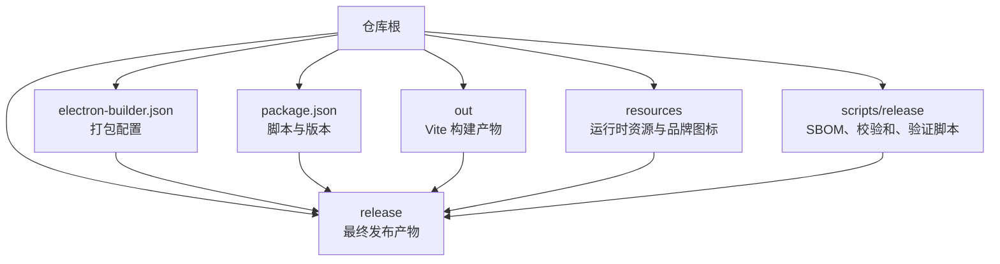

**图表来源**
- [electron-builder.json:1-54](file://electron-builder.json#L1-L54)
- [package.json:1-143](file://package.json#L1-L143)

**章节来源**
- [electron-builder.json:1-54](file://electron-builder.json#L1-L54)
- [package.json:1-143](file://package.json#L1-L143)

## 核心发布组件
本节按职责划分，说明每个关键文件的用途与交互关系。

| 组件 | 职责 | 关键行为 |
|---|---|---|
| electron-builder.json | 定义应用标识、打包目标、asar 策略、NSIS 行为、Windows 签名开关 | 指定 appId、productName、files、extraResources、asarUnpack、win/nsis 配置 |
| package.json | 暴露构建、打包、校验和、SBOM、包验证等 npm 脚本 | dist、pack、release:*、check:* 脚本驱动发布流水线 |
| generate-checksums.mjs | 扫描 release 目录并生成 SHA-256SUMS.txt | 过滤本地 unpacked 目录，仅对发行工件计算摘要 |
| generate-sbom.mjs | 从 pnpm-lock.yaml 生成 CycloneDX SBOM | 记录 git SHA、lockfile 摘要、平台信息，输出 sbom.cdx.json |
| verify-package.mjs | 校验 asar 内容、资源一致性、禁止开发文件泄露 | 比对 packaged version、主入口、资源哈希、外部 hook 文件 |
| check-release-config.mjs | 发布前配置门禁 | 校验 electron-builder.json 合法性、禁用 mac/linux、强制 windows zip+nsis、拒绝硬编码密钥 |
| .github/workflows/ci.yml | CI 构建、测试、预发布健康检查 | 触发 build、macos-shell、launcher-fresh-checkout、browser-smoke、desktop-smoke |

**章节来源**
- [electron-builder.json:1-54](file://electron-builder.json#L1-L54)
- [package.json:1-143](file://package.json#L1-L143)
- [scripts/release/generate-checksums.mjs:1-84](file://scripts/release/generate-checksums.mjs#L1-L84)
- [scripts/release/generate-sbom.mjs:1-107](file://scripts/release/generate-sbom.mjs#L1-L107)
- [scripts/release/verify-package.mjs:1-62](file://scripts/release/verify-package.mjs#L1-L62)
- [scripts/check-release-config.mjs:1-158](file://scripts/check-release-config.mjs#L1-L158)
- [.github/workflows/ci.yml:1-185](file://.github/workflows/ci.yml#L1-L185)

## 架构总览
下图展示发布相关组件的调用关系和数据流向。

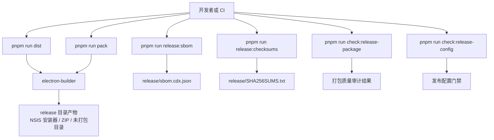

**图表来源**
- [package.json:1-143](file://package.json#L1-L143)
- [electron-builder.json:1-54](file://electron-builder.json#L1-L54)
- [scripts/release/generate-sbom.mjs:1-107](file://scripts/release/generate-sbom.mjs#L1-L107)
- [scripts/release/generate-checksums.mjs:1-84](file://scripts/release/generate-checksums.mjs#L1-L84)
- [scripts/release/verify-package.mjs:1-62](file://scripts/release/verify-package.mjs#L1-L62)
- [scripts/check-release-config.mjs:1-158](file://scripts/check-release-config.mjs#L1-L158)

## 详细组件分析

### electron-builder.json 配置详解
该文件是打包系统的核心配置，定义了应用元数据、文件白名单、asar 解包规则、额外资源复制以及 Windows 目标产物。

- 应用标识与元数据
  - appId：用于标识应用身份，便于系统注册表、更新服务和沙箱隔离。
  - productName：用于文件名、窗口标题等用户可见名称。
  - copyright：版权信息，嵌入到二进制元数据中。
  - directories.output：发布产物输出目录。
  - directories.buildResources：构建期资源目录。

- 文件打包规则
  - files：白名单模式，当前包含 out 下的全部构建产物，以及 resources/agent-runtime 和 resources/knowledge 下的资源。
  - extraResources：将 hooks 目录中的 mjs 文件复制到 release 产物中的 agent-runtime/hooks，避免被 asar 压缩影响运行期加载；同时复制品牌 logo 到 brand 目录。
  - asarUnpack：针对特定路径进行解包，确保 hooks 中的 mjs 以可执行脚本形式存在。

- Windows 打包目标
  - target：同时产出 nsis 安装器和 zip 压缩包，均为 x64 架构。
  - executableName：设置 Windows 主程序名。
  - icon：应用图标。
  - artifactName：默认产物命名模板，包含产品名称、版本和架构。
  - signAndEditExecutable：启用 Windows 可执行文件编辑和签名能力，实际是否签名受环境变量和渠道控制。

- NSIS 安装器行为
  - oneClick：关闭一键安装，提供交互式向导。
  - perMachine：关闭全局安装，默认为用户级安装。
  - allowToChangeInstallationDirectory：允许用户选择安装目录。
  - deleteAppDataOnUninstall：卸载时不清除用户数据，避免误删用户配置。

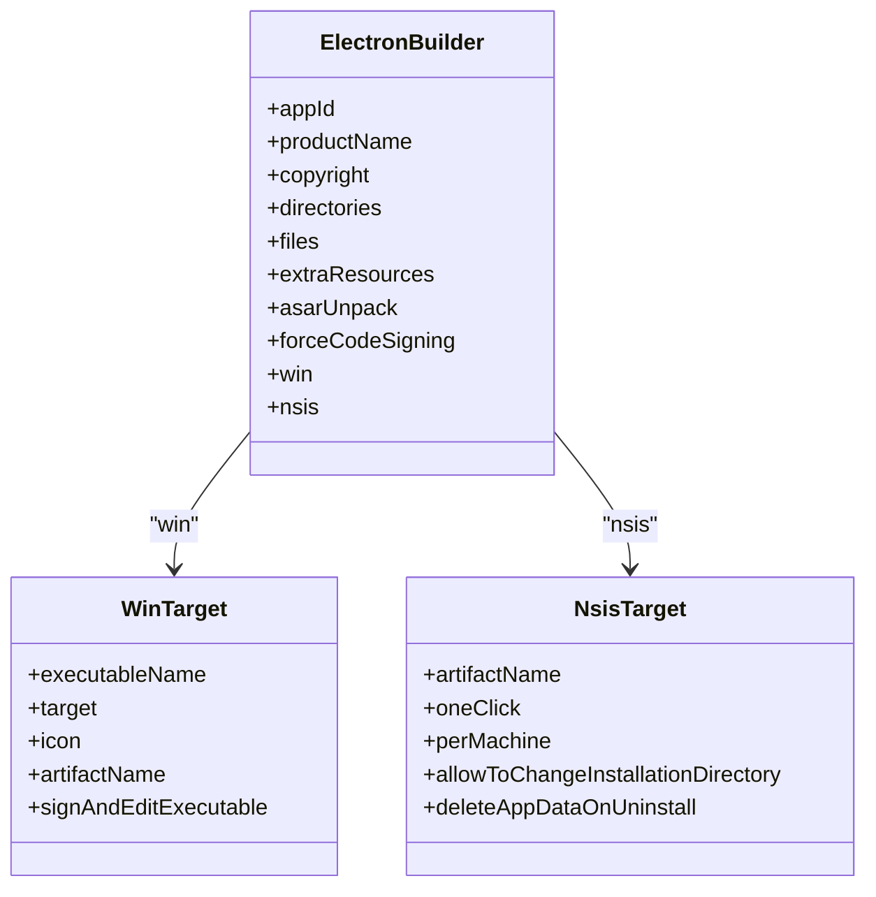

**图表来源**
- [electron-builder.json:1-54](file://electron-builder.json#L1-L54)

**章节来源**
- [electron-builder.json:1-54](file://electron-builder.json#L1-L54)

### Windows NSIS 安装包配置
NSIS 配置决定安装器的交互方式、权限模型和用户数据保留策略：

- 安装器交互
  - oneClick=false：不启用静默一键安装，适合需要用户确认的安装场景。
  - allowToChangeInstallationDirectory=true：允许用户自定义安装路径，提升灵活性。
  - perMachine=false：默认按当前用户安装，降低管理员权限需求。

- 卸载策略
  - deleteAppDataOnUninstall=false：卸载不会删除应用数据，保证用户会话、缓存和设置不被误删。

- 产物命名
  - artifactName 使用 `-setup` 后缀区分安装器与 ZIP 包，便于下游识别。

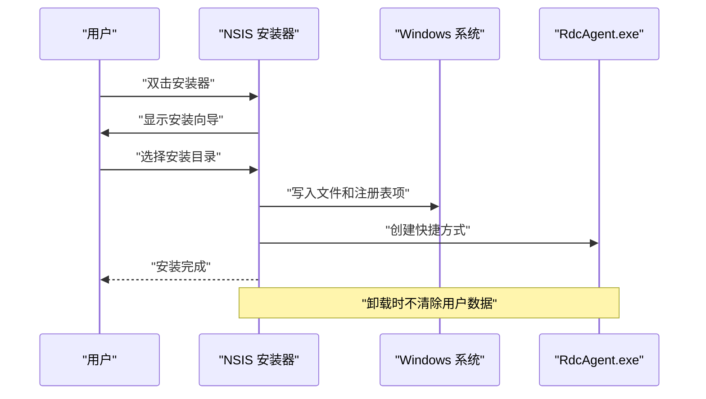

**图表来源**
- [electron-builder.json:1-54](file://electron-builder.json#L1-L54)

**章节来源**
- [electron-builder.json:1-54](file://electron-builder.json#L1-L54)

### ZIP 包生成与分发
Windows 目标同时包含 zip 类型，用于快速分发和部署。ZIP 包包含已编译的 out 目录和资源文件，但不包含安装器引导逻辑。

- 适用场景
  - 内部测试环境直接解压运行。
  - 容器化或脚本化部署。
  - 作为临时快照分发给评审人员。

- 注意事项
  - ZIP 包不包含 NSIS 安装器功能，需手动处理快捷方式和注册表。
  - 如需自动更新，应结合更新服务配置；当前配置未启用自动更新。

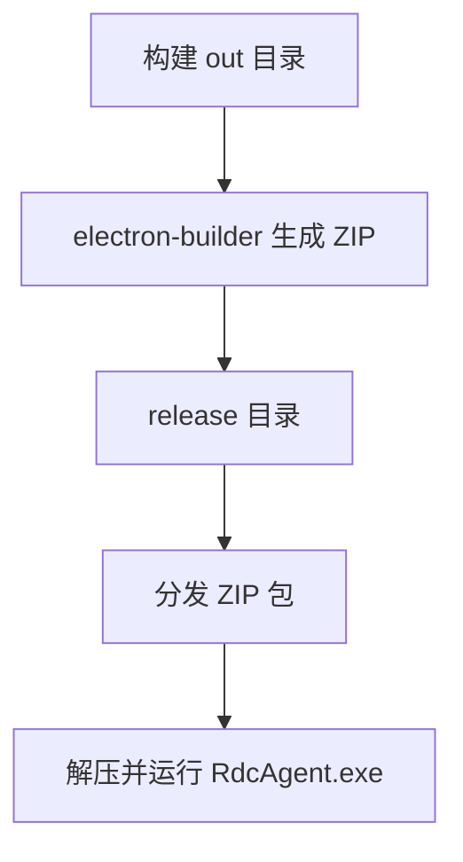

**图表来源**
- [electron-builder.json:1-54](file://electron-builder.json#L1-L54)

**章节来源**
- [electron-builder.json:1-54](file://electron-builder.json#L1-L54)

### 代码签名与证书管理
- signAndEditExecutable：设置为 true，表示启用 Windows 可执行文件编辑与签名能力。
- 实际签名行为由 check-release-config.mjs 和 CI 环境变量控制：
  - 当 RDC_AGENT_RELEASE_CHANNEL=release 或存在 tag 且非无符号预发布时，必须提供 WIN_CSC_LINK 或 CSC_LINK，以及对应密码。
  - 本地 pack 或非 release 渠道可保持无签名状态。
  - 预发布通道若为 prerelease 且版本号符合预发布格式，则允许无签名，但需在 GitHub 上明确标记为预发布。

- 安全约束
  - electron-builder.json 中禁止提交明文证书密码。
  - 证书链接和密码必须通过 CI 环境变量注入，不得写死在配置文件中。

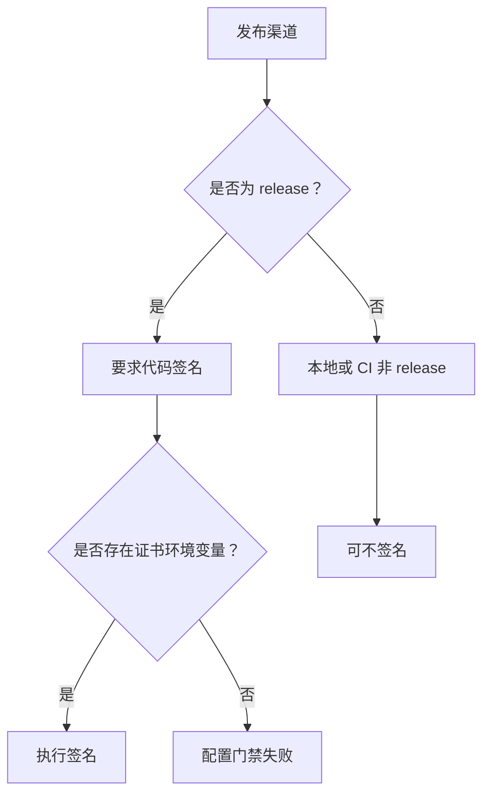

**图表来源**
- [electron-builder.json:1-54](file://electron-builder.json#L1-L54)
- [scripts/check-release-config.mjs:1-158](file://scripts/check-release-config.mjs#L1-L158)

**章节来源**
- [electron-builder.json:1-54](file://electron-builder.json#L1-L54)
- [scripts/check-release-config.mjs:1-158](file://scripts/check-release-config.mjs#L1-L158)

### SBOM 生成过程
SBOM 基于 pnpm-lock.yaml 的完整传递依赖图生成 CycloneDX 格式的物料清单，输出到 release/sbom.cdx.json，并附带 SHA-256 摘要。

- 输入
  - pnpm-lock.yaml：锁定所有依赖及其传递依赖。
  - package.json：获取应用名称和版本。
  - Git HEAD：用于记录源码提交哈希。

- 处理逻辑
  - 解析 lockfile 的 packages 段落，提取 npm 包名和版本。
  - 去重并按名称和版本排序。
  - 生成 CycloneDX 文档，包含 metadata.properties 中的 rdc:gitSha、rdc:lockfile、rdc:lockfileSha256、rdc:platform。
  - 如果组件数量过少，视为异常并报错。

- 输出
  - release/sbom.cdx.json：CycloneDX SBOM。
  - release/sbom.cdx.json.sha256：SBOM 文件摘要。

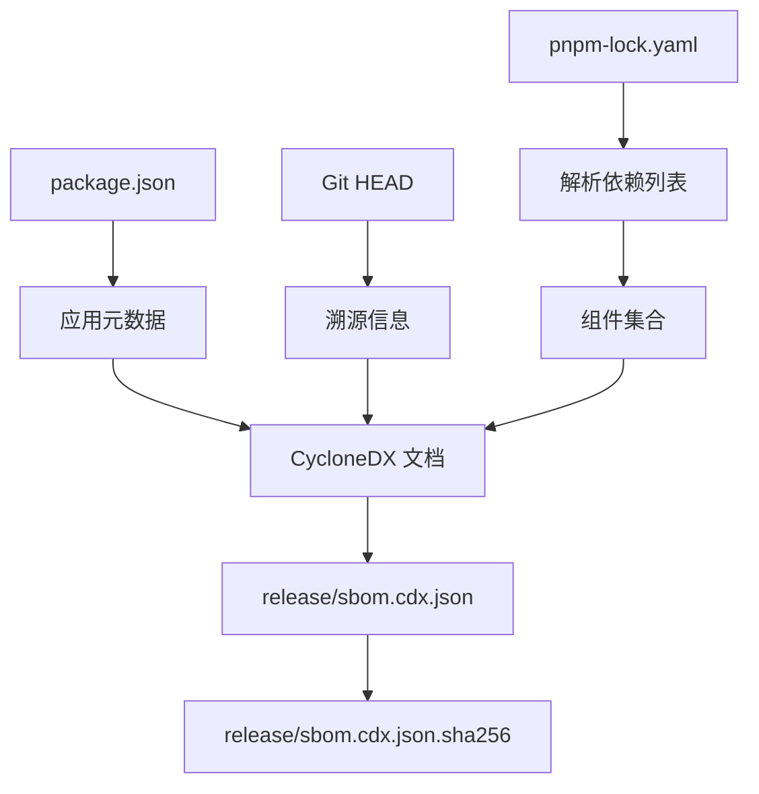

**图表来源**
- [scripts/release/generate-sbom.mjs:1-107](file://scripts/release/generate-sbom.mjs#L1-L107)

**章节来源**
- [scripts/release/generate-sbom.mjs:1-107](file://scripts/release/generate-sbom.mjs#L1-L107)

### 校验和生成与包验证
校验和生成脚本扫描 release 目录，对所有发行工件计算 SHA-256，并生成 GNU coreutils 风格的 SHA256SUMS.txt。

- 过滤规则
  - 跳过 release/SHA256SUMS.txt、*.sha256、sbom.cdx.json、builder-debug.yml。
  - 对 win-unpacked、linux-unpacked、mac-arm64、mac 等本地 unpacked 目录，在有正式发行工件时跳过，避免把本地临时文件混入公共校验列表。
  - 对 --dir 模式，会尝试捕获主可执行文件。

- 包验证脚本
  - verify-package.mjs 读取 release/win-unpacked/resources/app.asar，列出包内文件。
  - 校验 packaged package.json 的版本和 main 字段是否与仓库一致。
  - 校验 out/main/index.js、out/preload/index.js、out/renderer/index.html 是否被打包。
  - 禁止 src、scripts、node_modules/pnpm/npm/yarn 等开发文件进入发布包。
  - 校验 resources/agent-runtime 下资源与 asar 内资源哈希一致，并对 .mjs hook 文件比较外部副本与 asar 内副本。
  - 校验教程图片和品牌 logo 的唯一性和一致性。

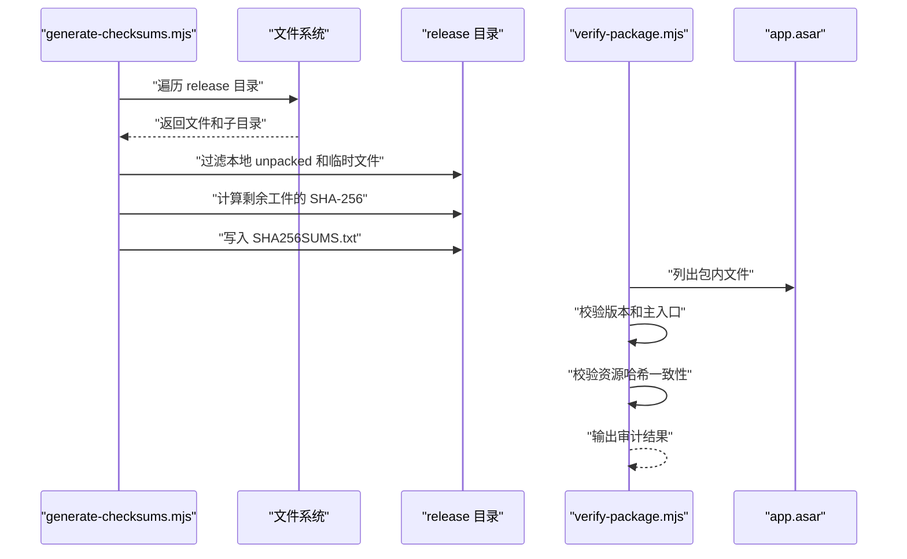

**图表来源**
- [scripts/release/generate-checksums.mjs:1-84](file://scripts/release/generate-checksums.mjs#L1-L84)
- [scripts/release/verify-package.mjs:1-62](file://scripts/release/verify-package.mjs#L1-L62)

**章节来源**
- [scripts/release/generate-checksums.mjs:1-84](file://scripts/release/generate-checksums.mjs#L1-L84)
- [scripts/release/verify-package.mjs:1-62](file://scripts/release/verify-package.mjs#L1-L62)

### 发布配置门禁
check-release-config.mjs 在构建前后强制执行以下规则：

- 必须声明 appId、files 数组且包含 out/**/*。
- 必须声明 win 平台配置，禁止 mac 或 linux 目标。
- Windows 必须包含 zip 和 nsis 两种目标。
- NSIS 安装器 artifactName 必须包含 -setup，其他产物不得使用。
- 禁止在 electron-builder.json 中提交私钥、证书密码等敏感信息。
- 根据 RDC_AGENT_RELEASE_CHANNEL 和环境变量决定是否要求签名。
- 必须存在 release 脚本文件，并在 package.json 中绑定正确命令。

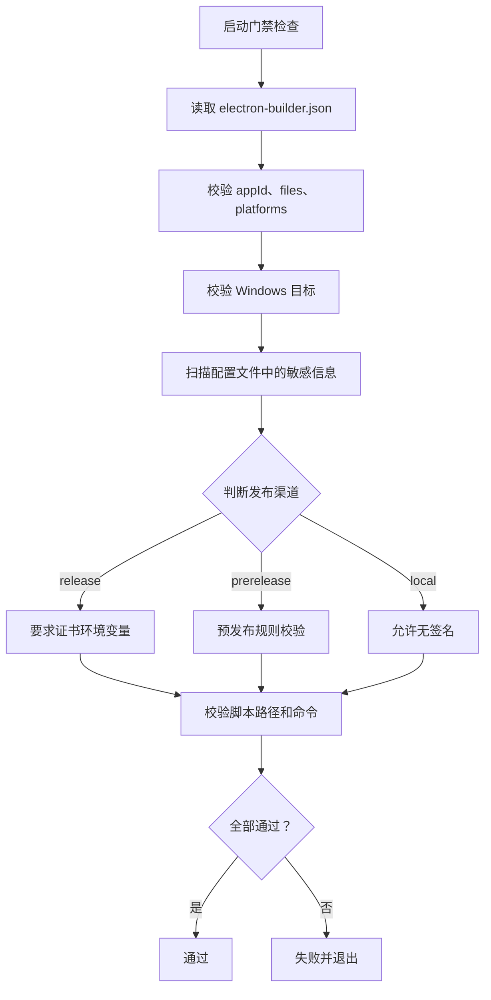

**图表来源**
- [scripts/check-release-config.mjs:1-158](file://scripts/check-release-config.mjs#L1-L158)

**章节来源**
- [scripts/check-release-config.mjs:1-158](file://scripts/check-release-config.mjs#L1-L158)

### CI/CD 自动化发布参考
CI 工作流包含多个阶段：常规构建、macOS 单进程测试、跨平台 launcher 准备检查、浏览器冒烟测试和桌面冒烟测试。

- 常规构建
  - 安装依赖、类型检查、Lint、单元测试、覆盖率门槛。
  - 运行 check:gates 聚合多项质量门禁。
  - 构建前端和主进程。

- 预发布健康检查
  - launcher-fresh-checkout 在 Windows 和 Linux 上验证启动准备流程。
  - Windows 上使用 scripts/start-rdc-agent.cmd --prepare-only 做条件缓存。
  - 运行 pack 生成未打包目录，然后执行 check:release-config、release:sbom、release:checksums。

- 桌面冒烟
  - 在 Windows 上执行 desktop-smoke，验证 unpacked 产物健康。
  - 再次运行 release:sbom 和 release:checksums。

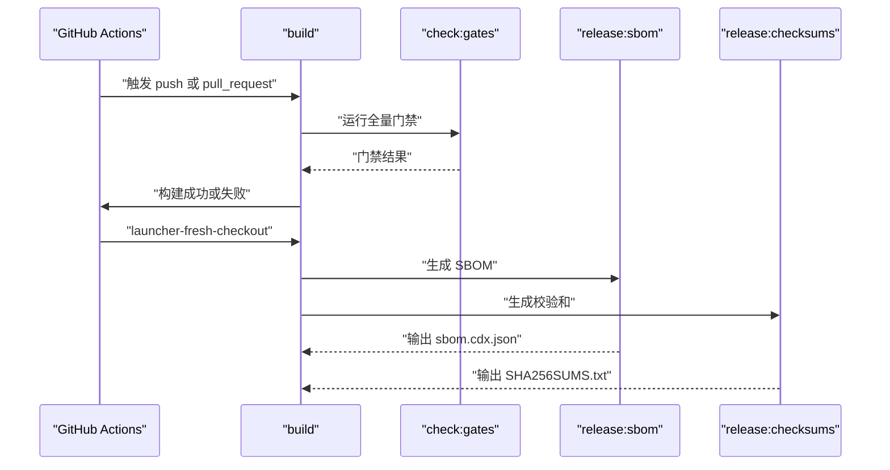

**图表来源**
- [.github/workflows/ci.yml:1-185](file://.github/workflows/ci.yml#L1-L185)
- [package.json:1-143](file://package.json#L1-L143)

**章节来源**
- [.github/workflows/ci.yml:1-185](file://.github/workflows/ci.yml#L1-L185)
- [package.json:1-143](file://package.json#L1-L143)

## 依赖关系分析
发布相关脚本与配置的依赖关系如下：

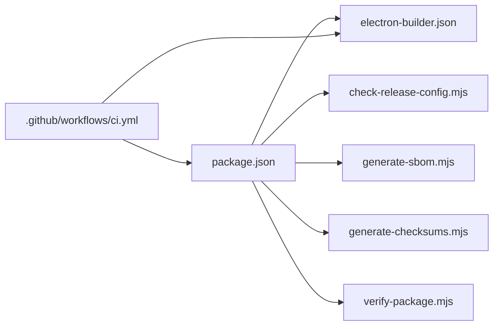

**图表来源**
- [package.json:1-143](file://package.json#L1-L143)
- [electron-builder.json:1-54](file://electron-builder.json#L1-L54)
- [.github/workflows/ci.yml:1-185](file://.github/workflows/ci.yml#L1-L185)

**章节来源**
- [package.json:1-143](file://package.json#L1-L143)
- [electron-builder.json:1-54](file://electron-builder.json#L1-L54)
- [.github/workflows/ci.yml:1-185](file://.github/workflows/ci.yml#L1-L185)

## 性能与体积考量
- asar 压缩可减少大量小文件 I/O 开销，提升 Electron 启动速度。
- asarUnpack 和 extraResources 针对运行时需要动态加载的 .mjs hook 文件，避免运行时解包延迟。
- files 白名单限制打包范围，减少产物体积。
- ZIP 包适合快速分发，NSIS 安装器适合标准安装体验。
- 在 CI 中优先使用 --dir 模式进行健康检查，可加速反馈循环。

[本节为通用指导，不涉及具体文件分析]

## 故障排除指南

常见问题与定位步骤：

| 现象 | 可能原因 | 处理建议 |
|---|---|---|
| 构建失败，提示缺少 appId 或 files | electron-builder.json 配置不完整 | 检查 appId 和 files 白名单，确保包含 out/**/* |
| 打包产物中没有 NSIS 安装器或 ZIP | Windows target 配置缺失 | 确认 win.target 同时包含 nsis 和 zip |
| 安装器无法安装或权限不足 | perMachine 或 oneClick 配置不符合预期 | 调整 NSIS 配置，按需开启用户级安装 |
| 运行时报钩子加载失败 | hooks 未被解包或复制 | 检查 asarUnpack 和 extraResources 配置 |
| 发布门禁失败，提示硬编码密钥 | electron-builder.json 中包含敏感信息 | 移除明文证书密码，改用 CI 环境变量 |
| 签名失败 | 缺少证书环境变量或渠道配置错误 | 设置 WIN_CSC_LINK 和 WIN_CSC_KEY_PASSWORD，或切换到非 release 渠道 |
| SBOM 组件数量过少 | pnpm-lock.yaml 未完整生成 | 重新执行 pnpm install --frozen-lockfile 后再生成 SBOM |
| 校验和为空或校验失败 | release 目录不存在或工件被清理 | 先执行 dist 或 pack，再执行 release:checksums |
| 包验证失败，提示开发文件泄露 | files 白名单或构建产物污染 | 检查构建脚本，清理 src、scripts、pnpm-lock.yaml 等 |
| 资源不一致 | 资源文件或图片被修改但未重新构建 | 重新执行构建并运行 verify-package |

**章节来源**
- [scripts/check-release-config.mjs:1-158](file://scripts/check-release-config.mjs#L1-L158)
- [scripts/release/generate-checksums.mjs:1-84](file://scripts/release/generate-checksums.mjs#L1-L84)
- [scripts/release/generate-sbom.mjs:1-107](file://scripts/release/generate-sbom.mjs#L1-L107)
- [scripts/release/verify-package.mjs:1-62](file://scripts/release/verify-package.mjs#L1-L62)

## 结论
RDC-Agent 的发布体系围绕 electron-builder.json 构建，通过 CI 门禁、SBOM、校验和与包验证脚本形成闭环。Windows 平台聚焦 NSIS 安装器和 ZIP 分发，签名策略与环境变量强绑定，避免敏感信息泄露。SBOM 提供依赖可追溯性，校验和与包验证确保发布包完整性。建议在正式发布前严格遵循检查清单，并在 CI 中固化构建、签名、SBOM 和校验流程。

[本节为总结性内容，不涉及具体文件分析]

## 附录：发布检查清单与最佳实践

### 发布前检查清单
- 确认 package.json 中的版本号符合发布策略。
- 确认 electron-builder.json 中 appId、files、win.target 正确。
- 确认没有硬编码证书密码或私钥。
- 确认 NSIS artifactName 包含 -setup，其他产物不使用该后缀。
- 确认只声明 Windows 目标，禁止 mac/linux。
- 确认 release:checksums、release:sbom、check:release-package 脚本可用。
- 在 release 渠道下配置 WIN_CSC_LINK 和 WIN_CSC_KEY_PASSWORD。
- 在 CI 中运行 check:gates 并通过所有门禁。
- 生成 SBOM 并归档。
- 生成 SHA256SUMS.txt 并归档。
- 运行 verify-package 确保 asar 内容和资源一致。

### 版本管理策略
- 使用 package.json 的 version 字段作为单一版本源。
- 预发布版本使用语义化预发布标签，如 0.6.0-rc.8。
- 正式 release 渠道要求签名；预发布渠道可按策略允许无签名。
- 在 GitHub 上通过 tag 和 release 页面归档产物。

### 回滚机制建议
- 保留最近若干版本的 NSIS 安装器、ZIP、SBOM 和 SHA256SUMS.txt。
- 将 SBOM 和校验和与发布版本一一对应，便于快速回溯。
- 在发布页面提供旧版本下载链接。
- 如遇安全问题，立即撤销新版本并提供修复版本。

### CI/CD 最佳实践
- 固定 Node 和 pnpm 版本，使用 frozen-lockfile 安装依赖。
- 在 PR 阶段运行完整门禁和冒烟测试。
- 在 release 渠道下启用代码签名，并将证书保存在 CI 密钥库。
- 将 SBOM 和校验和作为构建产物上传。
- 对 Windows 和 macOS 分别执行平台相关测试。
- 对 unpacked 产物执行健康检查，再产出正式安装包。

[本节为通用指导，不涉及具体文件分析]