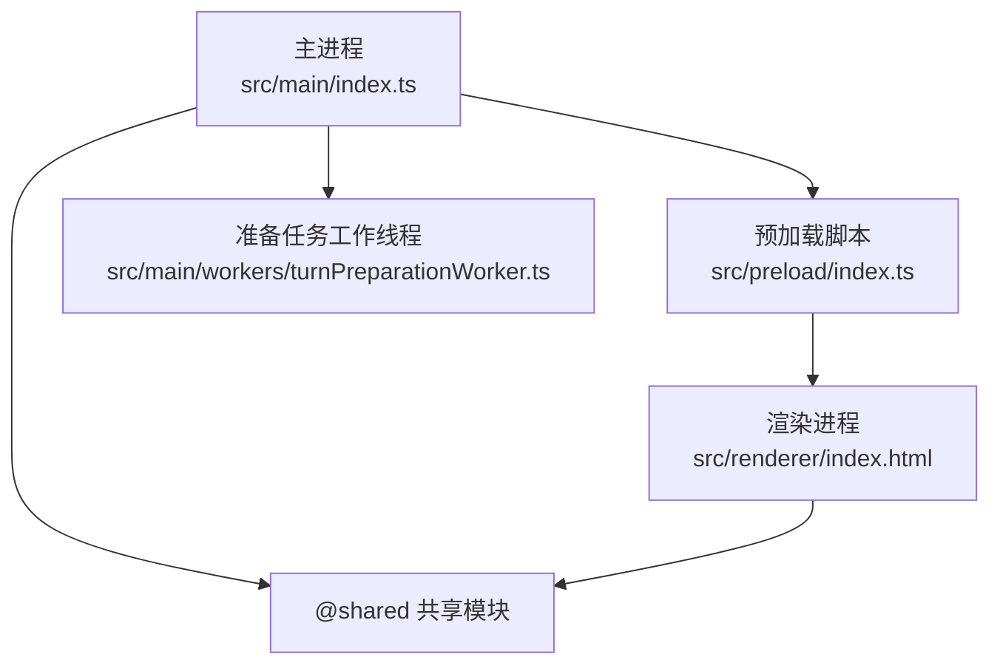
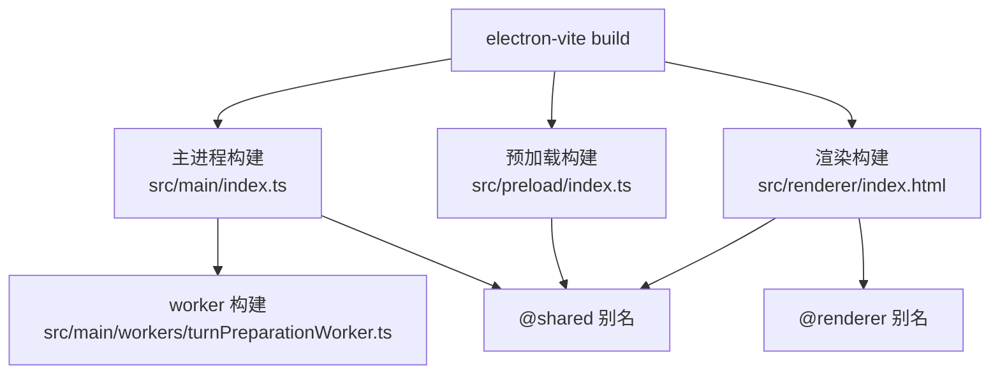
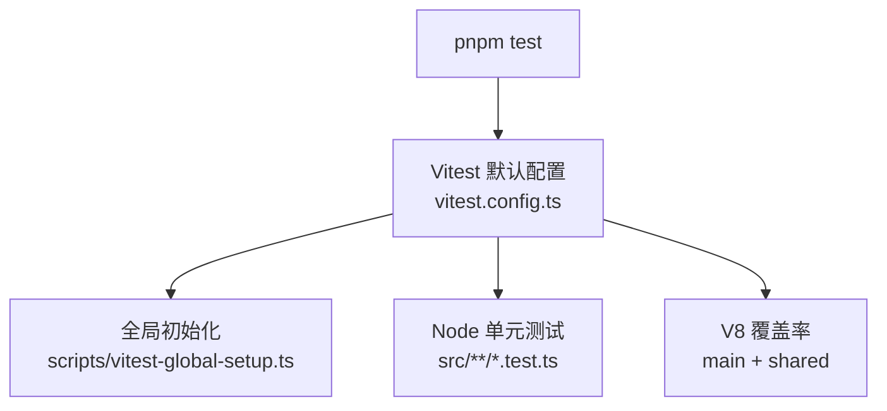
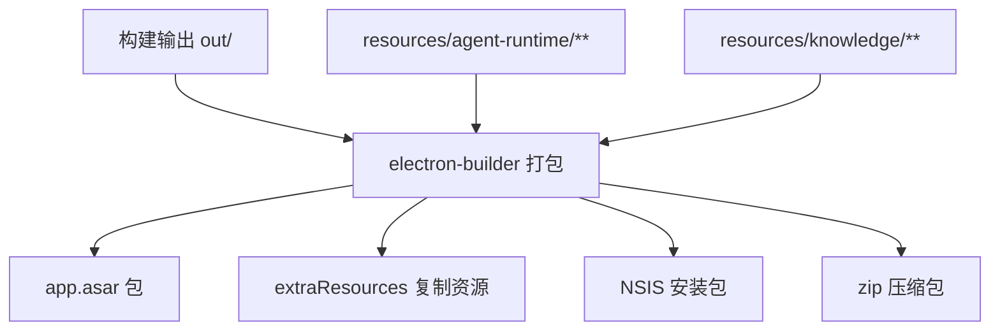
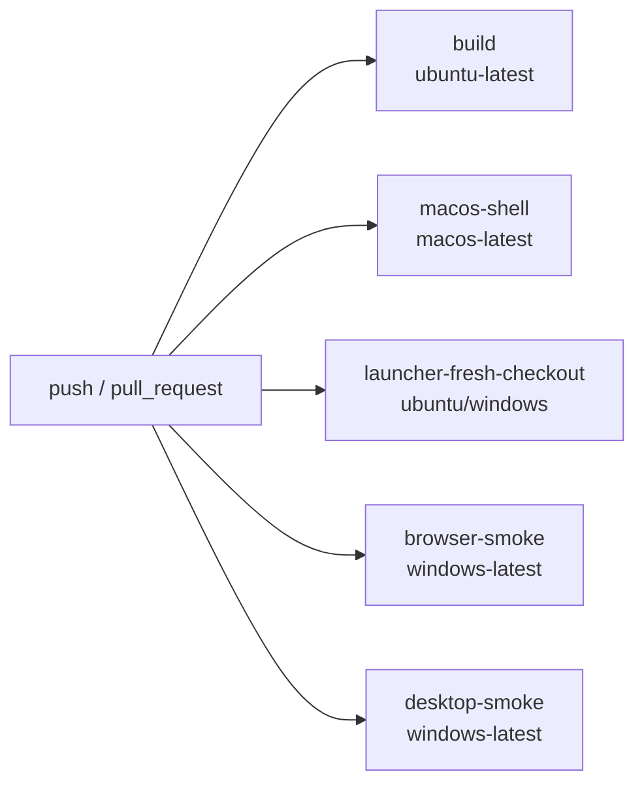

# 开发与部署

<cite>
**本文引用的文件**   
- [package.json](file://package.json)
- [electron.vite.config.ts](file://electron.vite.config.ts)
- [vite.renderer.config.ts](file://vite.renderer.config.ts)
- [tsconfig.json](file://tsconfig.json)
- [vitest.config.ts](file://vitest.config.ts)
- [scripts/vitest-renderer.config.ts](file://scripts/vitest-renderer.config.ts)
- [.eslintrc.cjs](file://.eslintrc.cjs)
- [electron-builder.json](file://electron-builder.json)
- [scripts/launch-rdc-agent.mjs](file://scripts/launch-rdc-agent.mjs)
- [scripts/vitest-global-setup.ts](file://scripts/vitest-global-setup.ts)
- [scripts/check-release-config.mjs](file://scripts/check-release-config.mjs)
- [scripts/release/generate-sbom.mjs](file://scripts/release/generate-sbom.mjs)
- [scripts/release/generate-checksums.mjs](file://scripts/release/generate-checksums.mjs)
- [scripts/release/verify-package.mjs](file://scripts/release/verify-package.mjs)
- [.github/workflows/ci.yml](file://.github/workflows/ci.yml)
</cite>

## 目录
1. [引言](#引言)
2. [项目结构](#项目结构)
3. [本地开发环境搭建](#本地开发环境搭建)
4. [构建流程](#构建流程)
5. [测试策略](#测试策略)
6. [代码质量检查](#代码质量检查)
7. [发布与打包](#发布与打包)
8. [CI/CD 管道与自动化脚本](#cicd-管道与自动化脚本)
9. [常见问题排查](#常见问题排查)
10. [性能优化建议](#性能优化建议)
11. [结论](#结论)

## 引言
本仓库是一个基于 Electron、Vite、TypeScript 和 Vitest 的桌面应用工程。主进程、预加载脚本与渲染进程由 `electron-vite` 统一编排；浏览器调试模式使用独立的 Vite 配置；测试以 Vitest 为主，辅以大量领域专用检查脚本；发布侧使用 `electron-builder`，并配套签名校验、SBOM 生成和产物校验脚本。

## 项目结构
工程采用多入口 Electron 架构：
- 主进程入口位于 `src/main/index.ts`，并通过 worker 入口 `src/main/workers/turnPreparationWorker.ts` 启动后台任务。
- 预加载脚本入口为 `src/preload/index.ts`。
- 渲染进程根 HTML 为 `src/renderer/index.html`，React 通过 `@vitejs/plugin-react` 处理 JSX。
- 共享类型和资源放在 `src/shared`，并通过路径别名和 Vite alias 在三个进程中复用。

**图表来源**
- [electron.vite.config.ts:1-62](file://electron.vite.config.ts#L1-L62)

**章节来源**
- [electron.vite.config.ts:1-62](file://electron.vite.config.ts#L1-L62)

## 本地开发环境搭建
### 环境与依赖
- Node.js 版本要求不低于 `22.13.0`。
- 包管理器固定为 pnpm `11.7.0`。
- 引擎约束和包管理声明位于 [package.json](file://package.json)。

### 安装依赖
推荐先通过 pnpm 安装依赖，再执行开发命令。若系统未安装指定版本的 pnpm，启动器会尝试解析并使用兼容版本。

### 启动方式
| 命令 | 用途 | 说明 |
|---|---|---|
| `pnpm dev` | 桌面开发模式 | 调用启动器并以 `desktop-dev` 模式运行，通常用于正常桌面调试。 |
| `pnpm start` | 桌面生产模式 | 通过启动器以 `desktop` 模式运行已构建的主进程。 |
| `pnpm dev:renderer` | 单独启动渲染进程开发服务器 | 使用独立 Vite 配置，端口为 `127.0.0.1:5173`，适用于浏览器 QA 场景。 |
| `pnpm start:agent-browser` / `start:agent-browser:dev` | 浏览器模式 | 启动浏览器代理相关流程。 |
| `pnpm start:prepare` | 仅准备环境 | 触发依赖缓存、Electron 二进制恢复和构建输出检查。 |

启动器负责 Node 版本校验、pnpm 解析、Electron 可执行文件定位、平台二进制恢复以及不同模式的参数分发。它还会将自身所在目录加入运行时 PATH，以保证子进程能够找到正确的工具链。

**章节来源**
- [package.json:1-60](file://package.json#L1-L60)
- [scripts/launch-rdc-agent.mjs:1-200](file://scripts/launch-rdc-agent.mjs#L1-L200)

## 构建流程
### Vite 与 Electron-Vite 配置
主构建由 `electron-vite` 驱动，配置文件为 `electron.vite.config.ts`。该配置定义了三个构建目标：

| 构建目标 | 入口或根 | 关键行为 |
|---|---|---|
| `main` | `src/main/index.ts` | 外部化依赖，注册 provider catalog 插件，添加 `@shared` 别名，并额外打包 worker 入口。 |
| `preload` | `src/preload/index.ts` | 外部化依赖，添加 `@shared` 别名。 |
| `renderer` | `src/renderer/index.html` | 启用 React 插件，设置 `@renderer` 和 `@shared` 别名，开发服务器监听 `127.0.0.1:5173`。 |

**图表来源**
- [electron.vite.config.ts:1-62](file://electron.vite.config.ts#L1-L62)

### 浏览器渲染开发配置
独立渲染开发配置 `vite.renderer.config.ts` 主要用于浏览器 QA 场景：
- 根目录指向 `src/renderer`。
- 使用 React 插件。
- 通过自定义插件在 serve 阶段替换 Vite HMR CSS 更新逻辑，使其走桥接开发样式模块。
- 开发服务器同样绑定 `127.0.0.1:5173`，HMR 使用 WebSocket。
- 注意：文档注释强调不应直接访问 Vite，而应通过桥接 `/qa` URL。

**章节来源**
- [electron.vite.config.ts:1-62](file://electron.vite.config.ts#L1-L62)
- [vite.renderer.config.ts:1-39](file://vite.renderer.config.ts#L1-L39)

### TypeScript 编译设置
TypeScript 配置位于 `tsconfig.json`，关键特性如下：
- 目标为 ES2022，模块系统为 ESNext。
- 启用严格模式、`noUnusedLocals`、`noUnusedParameters`、`noFallthroughCasesIn Switch`。
- 关闭 emit，仅做类型检查。
- 模块解析采用 bundler 模式，支持 `.ts` 扩展导入、JSON 模块和 JSX。
- 定义 `@main/*`、`@renderer/*`、`@shared/*` 路径映射。
- 包含 `src/**/*`，排除 `node_modules`、`dist`、`release`。

**章节来源**
- [tsconfig.json:1-27](file://tsconfig.json#L1-L27)

## 测试策略
### 测试框架与入口
项目使用 Vitest 作为测试框架，默认入口为 `vitest.config.ts`。默认测试命令 `pnpm test` 会运行所有匹配 `src/**/*.test.ts` 的文件。

| 命令 | 行为 |
|---|---|
| `pnpm test` | 运行默认 Node 环境下的单元测试。 |
| `pnpm test:watch` | 开启 watch 模式。 |
| `pnpm test:coverage` | 运行单元测试并生成覆盖率报告。 |
| `pnpm test:coverage:renderer` | 运行渲染层测试并生成独立渲染覆盖率。 |

### 默认测试配置
默认 Vitest 配置的关键点：
- 全局 API 可用，环境为 `node`。
- 使用 `providerCatalogVitePlugin` 确保 provider catalog 相关逻辑在测试中可用。
- 全局初始化脚本为 `scripts/vitest-global-setup.ts`。
- 覆盖率提供者为 v8，输出 text、lcov、json-summary，报告目录为 `./coverage`。
- 默认覆盖率范围覆盖 `src/main` 和 `src/shared`，并显式排除大量 Electron 进程边界、IPC 胶水、browser bridge、daemon、sdk、reports、testing fixtures、commands 等不适合 Node 单元测试的表面。
- 设置最低覆盖率阈值：行、函数、语句至少 40%，分支至少 30%。
- 路径别名包括 `@shared`、`@main`、`@renderer`。

**图表来源**
- [vitest.config.ts:1-81](file://vitest.config.ts#L1-L81)
- [scripts/vitest-global-setup.ts:1-32](file://scripts/vitest-global-setup.ts#L1-L32)

### 渲染层测试配置
渲染层测试使用 `scripts/vitest-renderer.config.ts`，继承基础 Vitest 配置，但：
- 测试范围改为 `src/renderer/**/*.test.ts`。
- 覆盖率范围改为 `src/renderer/**/*.{ts,tsx}`。
- 报告目录改为 `./coverage/renderer`。
- 不强制覆盖率阈值，避免影响 main/shared 覆盖率基线。

### 全局隔离与环境清理
全局初始化脚本确保测试不会写入开发者真实用户目录：
- 在操作系统临时目录创建唯一测试根目录。
- 重写 `TMP`、`TEMP`、`TMPDIR` 环境变量。
- 设置 `RDC_AGENT_HOME`、`RDC_AGENT_USER_DATA`、`RDC_AGENT_QA_INSTANCE_ID`。
- 测试结束后删除整个临时根目录。

这使安全相关的路径测试能够操作真实用户路径形式，同时保证测试间隔离。

**章节来源**
- [vitest.config.ts:1-81](file://vitest.config.ts#L1-L81)
- [scripts/vitest-renderer.config.ts:1-17](file://scripts/vitest-renderer.config.ts#L1-L17)
- [scripts/vitest-global-setup.ts:1-32](file://scripts/vitest-global-setup.ts#L1-L32)

## 代码质量检查
### ESLint 规则
ESLint 配置位于 `.eslintrc.cjs`，主要特点：
- 同时启用 browser、node、ES2022 环境。
- 使用 `@typescript-eslint/parser` 和 `@typescript-eslint/eslint-plugin`。
- 启用 `react-hooks/recommended`。
- 关闭原生 `no-unused-vars`，改用 TS ESLint 规则，并忽略以下划线开头的参数、变量和捕获错误。
- 强制 React hooks 依赖完整。
- 针对渲染层不同目录增加受限导入规则，限制 UI 组件、patterns、stores、services、platform、hooks、app、shell 之间的循环和越界依赖。

| 文件范围 | 受限导入模式 | 目的 |
|---|---|---|
| `src/renderer/ui/**` | features、patterns、stores、services、platform、hooks、app、shell | 防止 UI 组件直接依赖高层业务模块。 |
| `src/renderer/patterns/**` | features、platform、app、shell | 保持 patterns 处于稳定复用层。 |
| `src/renderer/{stores,services,hooks}/**` | features、ui、patterns、app、shell | 阻止状态与服务层反向依赖 UI 展示层。 |
| `src/renderer/lib/**` | 全部高层模块 | 保持纯工具库无业务耦合。 |

**章节来源**
- [.eslintrc.cjs:1-101](file://.eslintrc.cjs#L1-L101)

### TypeScript 检查
TypeScript 检查通过 `pnpm typecheck` 执行，对应 `tsc --noEmit`。它依赖 `tsconfig.json` 中的严格模式和路径别名，适合在 CI 和本地提交前进行静态类型校验。

### 覆盖率检查
默认覆盖率检查通过 `pnpm test:coverage` 执行；覆盖率基线检查通过 `pnpm check:coverage-ratchet` 执行，该脚本会强制覆盖率只能上升，不能下降。

**章节来源**
- [package.json:1-143](file://package.json#L1-L143)

## 发布与打包
### Electron Builder 配置
打包配置位于 `electron-builder.json`，核心要点：
- 应用 ID 为 `com.rdc-agent.app`，产品名为 `RDC-Agent`。
- 输出目录为 `release`，构建资源目录为 `resources`。
- 打包文件白名单包含 `out/**/*` 以及 agent-runtime 和 knowledge 资源。
- `resources/agent-runtime/hooks/**/*.mjs` 被设为 `asarUnpack`，以便运行时可直接执行这些 hook。
- extraResources 将 hooks 和品牌 logo 复制到可查找位置。
- Windows 目标包含 NSIS 安装包和 zip 压缩包，均为 x64。
- NSIS 安装器允许选择安装目录，卸载时不清除用户数据。
- 默认不强制代码签名，签名由 CI 和环境变量控制。

**图表来源**
- [electron-builder.json:1-54](file://electron-builder.json#L1-L54)

### 本地打包与发行包
| 命令 | 行为 |
|---|---|
| `pnpm pack` | 使用 `electron-builder --dir` 生成解压后的产物树。 |
| `pnpm dist` | 执行完整打包。 |
| `pnpm release:sbom` | 从 `pnpm-lock.yaml` 生成 CycloneDX SBOM。 |
| `pnpm release:checksums` | 为 `release/` 下产物生成 SHA-256 校验列表。 |
| `pnpm check:release-package` | 校验打包产物结构和内容一致性。 |

### 签名策略
签名不是本地无条件执行的。发布配置检查脚本会判断：
- 如果是 `release` 频道，或存在非 prerelease 的 tag 构建，则要求提供 Windows 代码签名凭据。
- 如果频道为 `prerelease`，且 package 版本是 prerelease 且标签完全匹配，则允许不签名。
- 本地 `pnpm run pack` 默认保持未签名状态。
- 禁止在配置文件中提交证书密码、发布者名称等明文密钥。

需要签名的环境变量包括：
- `WIN_CSC_LINK` 或 `CSC_LINK`
- `WIN_CSC_KEY_PASSWORD` 或 `CSC_KEY_PASSWORD`

**章节来源**
- [electron-builder.json:1-54](file://electron-builder.json#L1-L54)
- [scripts/check-release-config.mjs:1-158](file://scripts/check-release-config.mjs#L1-L158)

### SBOM 生成
SBOM 生成脚本 `scripts/release/generate-sbom.mjs` 的行为：
- 读取 `pnpm-lock.yaml`，解析其 `packages:` 段中的所有依赖条目。
- 去重后生成 CycloneDX 1.5 格式的组件列表，并记录 purl 和 bom-ref。
- 在 metadata 中记录 Git SHA、lockfile 名称及 lockfile SHA-256。
- 输出到 `release/sbom.cdx.json` 和对应的 `.sha256` 文件。
- 如果锁文件缺少 packages 段或组件数量过少，会拒绝生成。

**章节来源**
- [scripts/release/generate-sbom.mjs:1-107](file://scripts/release/generate-sbom.mjs#L1-L107)

### 产物校验
产物校验脚本 `scripts/release/verify-package.mjs` 会：
- 读取传入的 unpacked 目录，默认值为 `release/win-unpacked`。
- 使用 `@electron/asar` 列出 `resources/app.asar` 内容。
- 校验打包后 `package.json` 的版本和 main 字段是否与源码一致。
- 校验主进程、预加载、渲染入口是否存在。
- 拒绝开发源码、脚本、git 目录、测试覆盖率目录等进入产物。
- 拒绝 `pnpm-lock.yaml`、`pnpm-workspace.yaml` 和常见包管理器目录。
- 对比 `resources/agent-runtime` 下资源与 asar 内资源的哈希值。
- 校验可执行 hook 是否被正确外置到 `resources/agent-runtime/hooks`。
- 校验教程图片和品牌 logo 的唯一性与一致性。

**章节来源**
- [scripts/release/verify-package.mjs:1-62](file://scripts/release/verify-package.mjs#L1-L62)

## CI/CD 管道与自动化脚本
### CI 流水线概览
GitHub Actions 配置文件 `.github/workflows/ci.yml` 定义了多个并行 job：

| Job | 平台 | 主要职责 |
|---|---|---|
| `build` | ubuntu-latest | 安装依赖、类型检查、ESLint、单元测试、覆盖率、gates、provider catalog、scoped resources、project instructions、prompt plan snapshot、skills、hooks、memory policy、contracts、git diff whitespace、最终构建。 |
| `macos-shell` | macos-latest | 在 macOS 上单文件顺序执行可能触发 Electron 初始化的 runtime 测试，避免并发提取 Electron 二进制冲突。 |
| `launcher-fresh-checkout` | ubuntu-latest、windows-latest | 验证启动器在不同平台上的 prepare-only 行为、pnpm store 路径、条件跳过逻辑，并在 Windows 上执行 `pack`、release config、SBOM 和 checksums。 |
| `browser-smoke` | windows-latest | 启动浏览器 QA smoke 测试，支持 full access 矩阵。 |
| `desktop-smoke` | windows-latest | 执行桌面 unpacked 健康 smoke 测试，并再次运行 release config、SBOM、checksums。 |

**图表来源**
- [.github/workflows/ci.yml:1-185](file://.github/workflows/ci.yml#L1-L185)

### 关键 Gate 脚本
`check:gates` 聚合了大量仓库卫生、架构、fidelity、work process、conversation branch、reasoning delivery、agent runtime、tool system、browser capability、appearance、session projection、right rail、knowledge system、investigation system、legacy residue、acceptance ledger、settings agents、provider system、release config、design tokens、renderer structure、identity、secrets 等检查。

此外，发布配置检查脚本 `scripts/check-release-config.mjs` 还强制：
- electron-builder.json 必须包含 `appId`、`files`、`win` 配置。
- 不允许同时声明 mac/linux 目标。
- Windows 目标必须包含 zip 和 nsis。
- NSIS artifactName 必须包含 `-setup`，其他 target 不得包含。
- 禁止在配置中嵌入私有密钥、证书密码等明文。
- 必须存在 `generate-checksums.mjs`、`generate-sbom.mjs`、`verify-package.mjs`、`check-release-config.mjs`。
- `package.json` 中相关 script 必须与脚本定义的命令完全一致。

**章节来源**
- [.github/workflows/ci.yml:1-185](file://.github/workflows/ci.yml#L1-L185)
- [scripts/check-release-config.mjs:1-158](file://scripts/check-release-config.mjs#L1-L158)

## 常见问题排查
### Node 版本不满足要求
启动器会检查当前 Node 版本是否不低于 `22.13.0`，否则直接失败并提示实际运行时路径和版本。若本地安装了多个 Node 版本，请确认命令行使用的 Node 路径是否正确。

**章节来源**
- [scripts/launch-rdc-agent.mjs:1-200](file://scripts/launch-rdc-agent.mjs#L1-L200)

### pnpm store 路径异常
Windows 和 POSIX 平台的 launcher fresh checkout 检查都会验证 pnpm store 路径是否符合预期。如果 CI 或本地报告 unexpected pnpm store，通常是因为 pnpm 全局配置或缓存目录被修改。

**章节来源**
- [.github/workflows/ci.yml:60-120](file://.github/workflows/ci.yml#L60-L120)

### 测试污染用户目录
如果测试意外写入真实用户目录，应检查是否绕过了 Vitest 全局初始化脚本。默认配置会通过 `globalSetup` 设置 `RDC_AGENT_HOME`、`RDC_AGENT_USER_DATA` 等环境变量，并在测试结束后清理临时目录。

**章节来源**
- [scripts/vitest-global-setup.ts:1-32](file://scripts/vitest-global-setup.ts#L1-L32)

### 渲染 HMR 在桥接模式下异常
浏览器 QA 场景中，Vite 开发服务器不应直接访问，而应通过桥接页面打开。独立渲染配置会替换 CSS 更新导入来源，使 HMR 走桥接开发样式模块。

**章节来源**
- [vite.renderer.config.ts:1-39](file://vite.renderer.config.ts#L1-L39)

### 打包产物不符合预期
如果校验失败，常见原因包括：
- 打包后 `package.json` 版本或 main 字段不一致。
- 主进程、预加载或渲染入口缺失。
- 开发源码或包管理器文件被误打包。
- agent-runtime 资源与 asar 内资源哈希不一致。
- 可执行 hook 未正确外置。
- 教程图片或品牌 logo 数量或内容不一致。

**章节来源**
- [scripts/release/verify-package.mjs:1-62](file://scripts/release/verify-package.mjs#L1-L62)

### 发布配置检查失败
常见失败原因：
- 缺少 `appId`、`files` 或 `win` 配置。
- 同时声明了 mac/linux 目标。
- Windows 目标缺少 zip 或 nsis。
- NSIS artifactName 不符合 `-setup` 约定。
- 配置文件中出现证书密码、发布者名称等明文密钥。
- 发布频道要求签名但未提供凭据。
- 相关 script 命令与检查脚本期望不一致。

**章节来源**
- [scripts/check-release-config.mjs:1-158](file://scripts/check-release-config.mjs#L1-L158)

## 性能优化建议
- **依赖外部化**：主进程和预加载构建都使用 `externalizeDepsPlugin()`，可减少打包体积并提升冷启动速度。
- **按需构建 renderer**：渲染进程通过独立 Vite 配置和 React 插件处理，浏览器 QA 模式可单独启动，减少无关模块参与开发热更新。
- **测试隔离**：Vitest 全局初始化只创建临时目录，避免 I/O 竞争和用户数据污染。
- **覆盖率基线**：使用覆盖率 ratchet 防止覆盖率退化，避免引入回归风险。
- **资源外置**：hook 文件通过 `asarUnpack` 和 extraResources 保留可执行性，避免 asar 解包带来的额外开销。
- **CI 缓存**：CI 使用 pnpm cache，减少依赖安装时间。

[本节为通用指导，不直接分析具体文件]

## 结论
该工程围绕 Electron-Vite 构建体系组织，使用 TypeScript 进行强类型约束，Vitest 承担单元和渲染层测试，ESLint 维护渲染层边界，electron-builder 负责 Windows 发布，并通过一系列专用脚本保障发布安全、SBOM 完整性与产物一致性。CI 管道覆盖了跨平台构建、测试、gate 检查和 smoke 测试，适合作为复杂桌面应用的开发与部署参考。