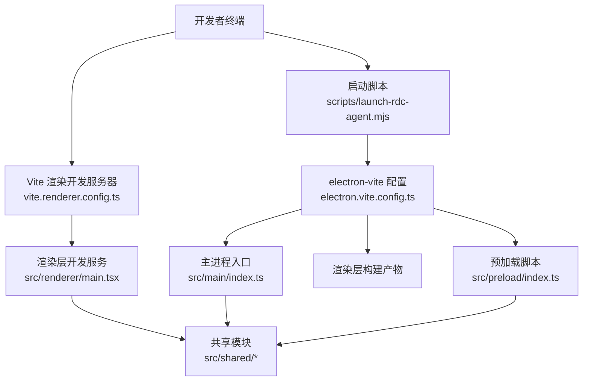
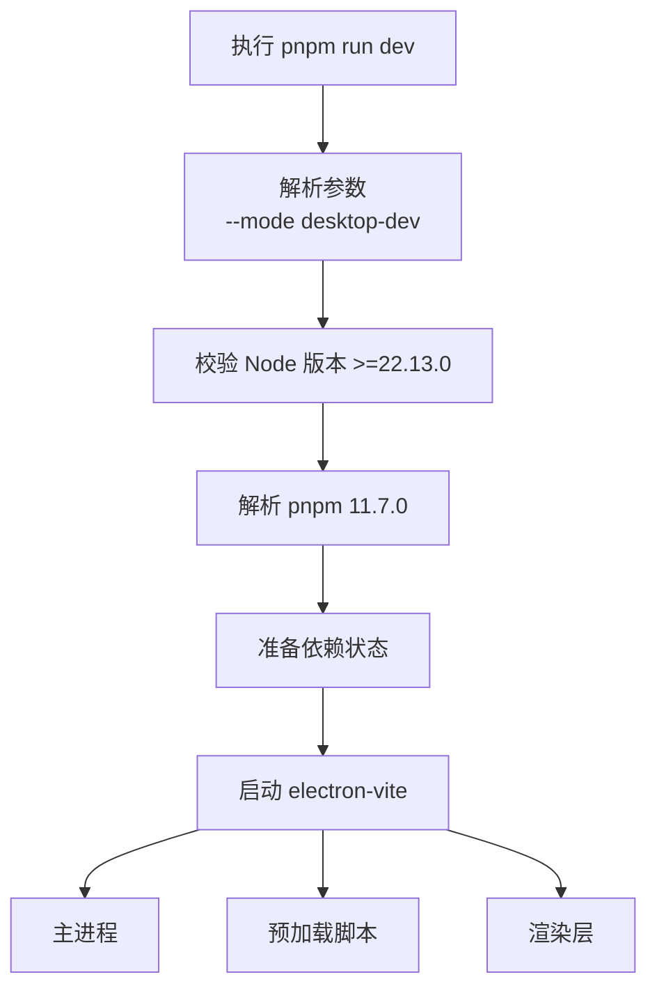
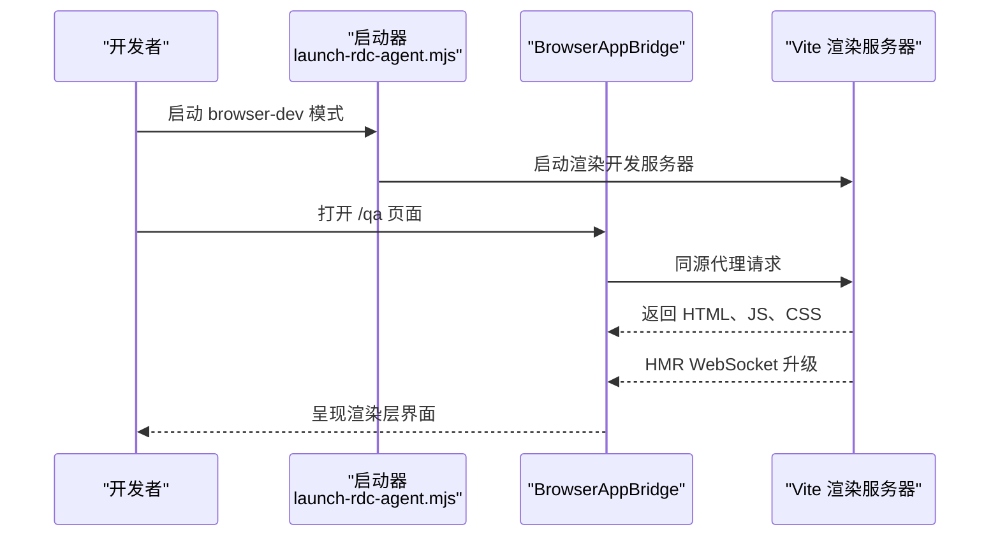
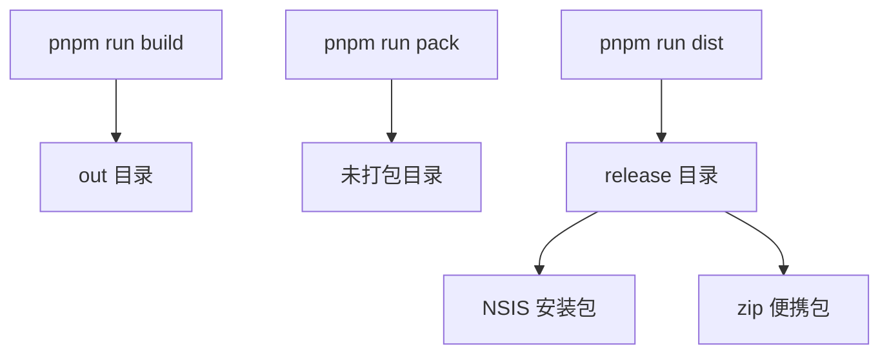
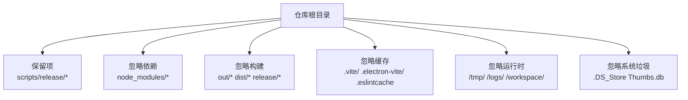

# 开发环境搭建

<cite>
**本文引用的文件**   
- [package.json](file://package.json)
- [README.en.md](file://README.en.md)
- [.gitignore](file://.gitignore)
- [electron.vite.config.ts](file://electron.vite.config.ts)
- [vite.renderer.config.ts](file://vite.renderer.config.ts)
- [tsconfig.json](file://tsconfig.json)
- [.eslintrc.cjs](file://.eslintrc.cjs)
- [pnpm-workspace.yaml](file://pnpm-workspace.yaml)
- [scripts/launch-rdc-agent.mjs](file://scripts/launch-rdc-agent.mjs)
- [scripts/run-rdc-launcher.cmd](file://scripts/run-rdc-launcher.cmd)
- [scripts/start-rdc-agent.cmd](file://scripts/start-rdc-agent.cmd)
- [scripts/start-rdc-agent.sh](file://scripts/start-rdc-agent.sh)
- [scripts/run-rdc-launcher.sh](file://scripts/run-rdc-launcher.sh)
- [electron-builder.json](file://electron-builder.json)
</cite>

## 目录
1. [简介](#简介)
2. [项目结构概览](#项目结构概览)
3. [核心依赖与版本兼容性](#核心依赖与版本兼容性)
4. [开发环境安装要求](#开发环境安装要求)
5. [依赖安装与初始配置](#依赖安装与初始配置)
6. [开发模式与启动命令](#开发模式与启动命令)
7. [构建、打包与发布目标](#构建打包与发布目标)
8. [忽略规则与临时文件管理](#忽略规则与临时文件管理)
9. [IDE 与编辑器集成建议](#ide-与编辑器集成建议)
10. [常见环境问题排查](#常见环境问题排查)
11. [结论](#结论)

## 简介
RDC-Agent 是一个基于 Electron 的 Windows 桌面应用，面向 RenderDoc `.rdc` 捕获分析，并结合可审计的 Agent 工作流。仓库同时包含主进程、预加载脚本、渲染层、共享模块、测试、构建脚本和文档。对开发者而言，最关键的本地目标是正确安装 Node.js 与 pnpm，完成依赖安装，并理解 `dev` 与 `dev:renderer` 两种开发模式的差异。

该项目的说明文档明确将“Windows、Node.js `>=22.13.0`、pnpm `11.7.0`”列为源码开发要求，并在包元数据中通过引擎字段和包管理器字段锁定最低 Node 版本与 pnpm 版本。Electron、React、TypeScript 等核心依赖在 `devDependencies` 中以范围或精确值声明，构成当前版本的兼容基线。

**章节来源**
- [README.en.md:113-136](file://README.en.md#L113-L136)
- [package.json:1-18](file://package.json#L1-L18)

## 项目结构概览
仓库采用多进程 Electron 架构：
- `src/main`：Electron 主进程逻辑。
- `src/preload`：预加载脚本，桥接主进程与渲染进程。
- `src/renderer`：基于 React 的渲染层。
- `src/shared`：主进程与渲染进程共享的类型、常量、工具与 API。
- `scripts`：启动器、检查脚本、构建辅助脚本。
- `resources`：应用资源、Agent Runtime、品牌图标等。
- `test`：测试场景与验收材料。
- `docs`：架构、产品、UI、契约与工作流文档。



**图表来源**
- [electron.vite.config.ts:1-62](file://electron.vite.config.ts#L1-L62)
- [vite.renderer.config.ts:1-39](file://vite.renderer.config.ts#L1-L39)
- [package.json:12-30](file://package.json#L12-L30)

**章节来源**
- [electron.vite.config.ts:1-62](file://electron.vite.config.ts#L1-L62)
- [vite.renderer.config.ts:1-39](file://vite.renderer.config.ts#L1-L39)

## 核心依赖与版本兼容性
| 类别 | 依赖项 | 版本或范围 | 作用说明 |
|---|---|---:|---|
| 运行时引擎 | `node` | `>=22.13.0` | 由 `engines.node` 强制；启动器也校验该版本。 |
| 包管理器 | `pnpm` | `11.7.0` | 由 `packageManager` 字段固定。 |
| Electron | `electron` | `^42.2.0` | Electron 桌面端运行框架。 |
| Electron 构建 | `electron-builder` | `^26.16.1` | 生成 Windows NSIS 安装包和 zip。 |
| Electron 开发构建 | `electron-vite` | `^5.0.0` | 驱动 Electron + Vite 开发/构建流程。 |
| 前端框架 | `react` | `^18.2.0` | 渲染层 UI 框架。 |
| DOM 绑定 | `react-dom` | `^18.2.0` | React 的 DOM 渲染实现。 |
| 类型系统 | `typescript` | `^5.3.0` | TypeScript 编译器与类型检查。 |
| 前端构建 | `vite` | `^7.3.3` | 渲染层开发与构建工具。 |
| React 插件 | `@vitejs/plugin-react` | `^5.1.4` | Vite 中的 React JSX/JS 支持。 |
| 测试 | `vitest` | `^4.1.8` | 单元测试与覆盖率。 |

需要注意：
- `electron` 使用 `^42.2.0`，表示 42.x 范围内兼容更新，而不是固定到某个小版本。
- `react` 和 `react-dom` 使用 `^18.2.0`，对应 React 18.x。
- `typescript` 使用 `^5.3.0`，对应 TypeScript 5.3.x。
- `pnpm-workspace.yaml` 额外通过 `overrides.yauzl` 修复 electron 安装链在较新 Node 上的已知问题，表明 Electron 二进制下载与解压过程可能受 Node 版本影响。

**章节来源**
- [package.json:1-18](file://package.json#L1-L18)
- [package.json:92-143](file://package.json#L92-L143)
- [pnpm-workspace.yaml:1-20](file://pnpm-workspace.yaml#L1-L20)

## 开发环境安装要求
### Node.js 要求
- 最低版本：**Node.js >=22.13.0**。
- 项目根 `package.json` 的 `engines.node` 字段声明该要求。
- `scripts/launch-rdc-agent.mjs` 在启动时解析当前 Node 版本并与 `[22, 13, 0]` 比较，低于要求会直接报错退出。
- Windows 下 `scripts/run-rdc-launcher.cmd` 会尝试从环境变量 `RDC_AGENT_NODE`、系统 PATH 或 Codex 内置路径定位 Node；找不到时会提示安装 Node.js 或设置 `RDC_AGENT_NODE`。
- POSIX 启动脚本 `scripts/run-rdc-launcher.sh` 也有类似行为，优先使用 `RDC_AGENT_NODE`，再回退到系统 `node` 或 Codex 缓存路径。

### pnpm 要求
- 包管理器版本：**pnpm 11.7.0**。
- `package.json` 的 `packageManager` 字段锁定该版本。
- 启动器会调用 `scripts/pnpm-resolver.mjs` 解析 pnpm，并使用其 store path 输出 pnpm 运行时信息和缓存位置。
- `pnpm-workspace.yaml` 将 pnpm 仓库目录设置为 `~/.cache/rdc-agent/pnpm-store`，并启用 `preferOffline: true`，有助于减少重复下载。

### Windows 平台注意事项
- README 明确指出 RDC-Agent 是 **Windows 桌面应用**，发布面为 Windows-only。
- Electron 构建仅配置 `win` 目标，输出 x64 架构的 NSIS 安装包和 zip。
- Windows 上建议使用 PowerShell 执行 `pnpm install` 和 `pnpm run dev`。
- 如果系统安装了多个 Node.js 版本，请确保命令行中的 `node` 指向满足 `>=22.13.0` 的版本，或通过 `RDC_AGENT_NODE` 指定可执行路径。
- Electron 二进制下载失败时，启动器提供恢复逻辑：通过 `@electron/get` 重新下载对应平台与架构的压缩包，再用系统 `tar` 解压到 `node_modules/electron/dist`。

**章节来源**
- [package.json:10-18](file://package.json#L10-L18)
- [scripts/launch-rdc-agent.mjs:1-120](file://scripts/launch-rdc-agent.mjs#L1-L120)
- [scripts/run-rdc-launcher.cmd:1-28](file://scripts/run-rdc-launcher.cmd#L1-L28)
- [scripts/run-rdc-launcher.sh:1-21](file://scripts/run-rdc-launcher.sh#L1-L21)
- [electron-builder.json:1-54](file://electron-builder.json#L1-L54)

## 依赖安装与初始配置
### 安装步骤
1. 安装 Node.js，确保版本不低于 22.13.0。
2. 安装 pnpm 11.7.0，或使用项目指定的包管理器协议自动安装。
3. 在项目根目录执行依赖安装：
   ```powershell
   pnpm install
   ```
4. 首次运行开发模式：
   ```powershell
   pnpm run dev
   ```

### 安装行为说明
- `pnpm install` 会根据 `pnpm-lock.yaml` 安装所有依赖，包括 Electron 二进制、Vite、React、TypeScript、ESLint、测试工具等。
- `pnpm-workspace.yaml` 中的 `storeDir` 将依赖存储放在用户缓存目录下，避免污染项目目录。
- `allowBuilds` 允许 `@swc/core`、`electron-winstaller`、`esbuild` 等需要原生编译的依赖在本地构建。
- `patchedDependencies.style-mod@4.1.3` 应用了补丁，用于适配桌面 CSP 下的样式注入行为。

### 初始配置
- 源码开发不需要先安装 RDC-Tool；普通 agent 功能可在未配置 RDC 的情况下运行。
- 如果需要打开 `.rdc` 捕获、回放和诊断，应在 Settings → Tools 中配置 RDC-Tool CLI。
- README 强调 RDC-Tool 应指向包含 Python 与 CLI 的根目录，而不是单独指向 Python 可执行文件。
- 用户资源位于 `~/.rdc-agent`，项目资源位于 `<project-root>/.rdc-agent`。

**章节来源**
- [README.en.md:113-136](file://README.en.md#L113-L136)
- [pnpm-workspace.yaml:1-20](file://pnpm-workspace.yaml#L1-L20)
- [package.json:12-30](file://package.json#L12-L30)

## 开发模式与启动命令
### 常用命令
| 命令 | 含义 |
|---|---|
| `pnpm install` | 安装项目依赖。 |
| `pnpm run dev` | 启动桌面开发模式。 |
| `pnpm run dev:renderer` | 仅启动渲染层 Vite 开发服务器。 |
| `pnpm run build` | 构建主进程、预加载脚本和渲染层。 |
| `pnpm run start` | 以生产桌面模式启动已构建产物。 |
| `pnpm run typecheck` | 执行 TypeScript 类型检查。 |
| `pnpm test` | 运行测试。 |

### `dev` 与 `dev:renderer` 的区别
- `dev` 实际执行的是：
  ```text
  node scripts/launch-rdc-agent.mjs --mode desktop-dev
  ```
  它会校验 Node 版本、解析 pnpm、准备依赖状态，并通过 `electron-vite` 启动 Electron 桌面开发模式。
- `dev:renderer` 直接执行：
  ```text
  vite --config vite.renderer.config.ts
  ```
  它只启动渲染层的 Vite 开发服务器，不启动 Electron 主进程。

### `--mode desktop-dev` 的工作方式
`scripts/launch-rdc-agent.mjs` 将 `desktop-dev` 视为有效模式之一，其行为包括：
1. 校验 Node 版本是否满足 `>=22.13.0`。
2. 解析并验证 pnpm 版本是否为 `11.7.0`。
3. 计算依赖状态，必要时执行依赖准备。
4. 调用 `electron-vite` 启动 Electron 开发模式。
5. Electron 主进程、预加载脚本和渲染层按 `electron.vite.config.ts` 构建。



**图表来源**
- [package.json:12-16](file://package.json#L12-L16)
- [scripts/launch-rdc-agent.mjs:1-120](file://scripts/launch-rdc-agent.mjs#L1-L120)
- [electron.vite.config.ts:1-62](file://electron.vite.config.ts#L1-L62)

### `--mode browser-dev` 的工作方式
`start:agent-browser:dev` 会执行：
```text
node scripts/launch-rdc-agent.mjs --mode browser-dev
```
该模式用于启动独立 Browser QA 表面。渲染层 Vite 配置 `vite.renderer.config.ts` 中包含注释说明：browser-dev 模式下，Vite 处于 BrowserAppBridge 的同源反向代理之后的私有 origin，不应直接浏览 Vite 地址，而应通过桥接 `/qa` URL 访问。

浏览器开发模式的渲染层配置特点：
- 使用 `vite.renderer.config.ts`。
- 开发服务器监听 `127.0.0.1:5173`。
- HMR 使用 WebSocket 协议，并由桥接页面升级连接。
- 自定义插件会将 CSS 热更新的导入替换为平台开发样式模块，以满足桌面 CSP 限制。



**图表来源**
- [package.json:28-30](file://package.json#L28-L30)
- [vite.renderer.config.ts:1-39](file://vite.renderer.config.ts#L1-L39)

**章节来源**
- [package.json:12-30](file://package.json#L12-L30)
- [scripts/launch-rdc-agent.mjs:1-120](file://scripts/launch-rdc-agent.mjs#L1-L120)
- [vite.renderer.config.ts:1-39](file://vite.renderer.config.ts#L1-L39)

## 构建、打包与发布目标
### 构建命令
- `pnpm run build`：使用 `electron-vite build` 构建主进程、预加载脚本和渲染层。
- `pnpm run pack`：使用 `electron-builder --dir` 生成未打包的安装目录，便于调试。
- `pnpm run dist`：使用 `electron-builder` 生成正式安装包。

### 构建产物
- 主入口为 `out/main/index.js`。
- 构建输出目录为 `out`。
- 打包输出目录为 `release`。
- Electron 构建使用 `node_modules/electron/dist` 作为 Electron 分发目录。
- Windows 目标输出：
  - NSIS 安装包：`RdcAgent-*-*-setup.exe`
  - zip 便携包：`RDC-Agent-*-*-win-x64.zip`

### 发布限制
- `electron-builder.json` 仅配置 `win` 目标。
- 默认关闭强制代码签名，但 Windows 发行目标仍期望签名配置。
- README 说明稳定正式版需要签名，预发布通道可能为未签名 prerelease。



**图表来源**
- [package.json:16-20](file://package.json#L16-L20)
- [electron-builder.json:1-54](file://electron-builder.json#L1-L54)

**章节来源**
- [package.json:16-20](file://package.json#L16-L20)
- [electron-builder.json:1-54](file://electron-builder.json#L1-L54)

## 忽略规则与临时文件管理
`.gitignore` 主要忽略以下目录和文件：
- 依赖与构建输出：`node_modules/`、`out/`、`dist/`、`release/`。
- 缓存与 IDE 元数据：`.eslintcache`、`.vite/`、`.electron-vite/`、`.vscode/`、`.idea/`、`.codex/`。
- 临时文件：`*.log`、`*.tmp`、`*.temp`、`*.bak`、`*.orig`、`*.tsbuildinfo`。
- 运行时目录：`/tmp/`、`/browser-session-tmp/`、`/workspace/`、`/logs/`、`/settings.json`、`/projects/`、`/knowledge/`。
- Python 环境：`.venv`、`.pytest_cache`、`__pycache__`、`*.pyc`。
- 测试报告：`test-results/`、`playwright-report/`。
- 操作系统垃圾文件：`.DS_Store`、`Thumbs.db`、`desktop.ini`。

注意：
- `scripts/release/` 被显式保留，因此发布相关脚本不会被忽略。
- `.vscode/` 通常用于存放 IDE 配置，但被忽略；若希望团队统一配置，可将关键设置提交到仓库并使用 `include` 或 workspace 配置覆盖。
- 用户级数据如 `~/.rdc-agent` 不在仓库内，属于运行时目录，不应提交。



**图表来源**
- [.gitignore:1-63](file://.gitignore#L1-L63)

**章节来源**
- [.gitignore:1-63](file://.gitignore#L1-L63)

## IDE 与编辑器集成建议
### VS Code
推荐安装以下扩展：
- ESLint
- TypeScript 语言服务（随 TypeScript 安装）
- Prettier（可选，若团队约定格式化规则）
- GitLens（可选，用于查看变更历史）

VS Code 会自动读取项目中的 `tsconfig.json` 和 `.eslintrc.cjs`。由于 `.gitignore` 忽略 `.vscode/`，建议仅在本地 workspace 配置中启用必要设置，避免把个人偏好提交到仓库。

### TypeScript 集成
`tsconfig.json` 的关键设置：
- 目标：`ES2022`。
- 模块：`ESNext`。
- 模块解析：`bundler`。
- 严格模式：开启。
- JSX：`react-jsx`。
- 路径别名：
  - `@main/*` → `src/main/*`
  - `@renderer/*` → `src/renderer/*`
  - `@shared/*` → `src/shared/*`
- 类型定义：包含 `node`。
- 排除：`node_modules`、`dist`、`release`。

建议在 VS Code 中启用：
- `editor.formatOnSave`（配合 ESLint 或 Prettier）。
- `typescript.tsc.autoDetect` 使用项目 `tsconfig.json`。
- `eslint.enable` 和 `eslint.validate` 启用 TS/TSX 检查。

### ESLint 集成
`.eslintrc.cjs` 启用了：
- Node 与 Browser 环境。
- `@typescript-eslint/parser`。
- `@typescript-eslint/eslint-plugin`。
- `eslint-plugin-react-hooks`。
- 基础规则：`eslint:recommended`、`plugin:react-hooks/recommended`。
- 忽略 `out/`、`release/`、`test-results/`、`node_modules/`。
- 渲染层 UI 目录存在严格的受限导入规则，防止跨层引用 features、stores、services、platform、app、shell 等模块。

重要规则：
- `no-unused-vars` 关闭，改用 `@typescript-eslint/no-unused-vars`，允许以下划线开头的变量和参数不被当作错误。
- `react-hooks/exhaustive-deps` 设为 error，帮助发现 React Hooks 依赖缺失。
- `src/renderer/ui/**`、`src/renderer/patterns/**`、`src/renderer/{stores,services,hooks}/**`、`src/renderer/lib/**` 都有独立的 `no-restricted-imports` 规则，用于维护渲染层内部边界。

**章节来源**
- [tsconfig.json:1-27](file://tsconfig.json#L1-L27)
- [.eslintrc.cjs:1-101](file://.eslintrc.cjs#L1-L101)

## 常见环境问题排查
### Node 版本不匹配
**现象**
- 启动时报错，提示 Node.js 版本过低。
- `scripts/run-rdc-launcher.cmd` 提示缺少 Node.js。

**原因**
- 当前 Node 版本低于 `22.13.0`。
- 系统 PATH 中存在多个 Node.js，命令行未使用正确版本。

**解决**
- 升级 Node.js 至 22.13.0 或更高版本。
- Windows 下可通过环境变量 `RDC_AGENT_NODE` 指定 Node 可执行路径。
- 确认 `node -v` 输出符合项目要求。
- 如果使用 nvm、fnm、 volta 等版本管理工具，请在项目目录激活正确版本。

**章节来源**
- [package.json:14-18](file://package.json#L14-L18)
- [scripts/launch-rdc-agent.mjs:1-L120](file://scripts/launch-rdc-agent.mjs#L1-L120)
- [scripts/run-rdc-launcher.cmd:1-28](file://scripts/run-rdc-launcher.cmd#L1-L28)

### pnpm 版本或缓存问题
**现象**
- `pnpm install` 报版本不匹配。
- pnpm store 路径异常。
- 依赖状态不一致。

**解决**
- 使用 pnpm 11.7.0。
- 清理 pnpm 缓存后重试：
  ```powershell
  pnpm store prune
  pnpm install
  ```
- 检查 pnpm store 路径是否落在 `~/.cache/rdc-agent/pnpm-store`。
- 如果 Node 版本过新导致 Electron 安装链异常，确认 `pnpm-workspace.yaml` 中的 `yauzl` override 是否生效。

**章节来源**
- [package.json:10-18](file://package.json#L10-L18)
- [pnpm-workspace.yaml:1-20](file://pnpm-workspace.yaml#L1-L20)
- [scripts/launch-rdc-agent.mjs:1-L120](file://scripts/launch-rdc-agent.mjs#L1-L120)

### Electron 下载或解压失败
**现象**
- 启动时 Electron 二进制缺失。
- Electron 下载未完成。
- 解压后找不到 `electron.exe`。

**解决**
- 删除 `node_modules/electron` 后重新安装：
  ```powershell
  rmdir /s /q node_modules\electron
  pnpm install
  ```
- 检查网络是否能访问 Electron 官方镜像或 GitHub releases。
- 在 Windows 上确认系统 `tar` 可用；启动器会通过系统 `tar` 解压 Electron 压缩包。
- 如果仍失败，可手动下载对应平台的 Electron 二进制，并按 `node_modules/electron/dist` 结构放置。

**章节来源**
- [scripts/launch-rdc-agent.mjs:1-L200](file://scripts/launch-rdc-agent.mjs#L1-L200)
- [package.json:122-143](file://package.json#L122-L143)

### 端口占用或渲染层无法启动
**现象**
- `dev:renderer` 启动失败。
- Vite 无法绑定端口。

**原因**
- `vite.renderer.config.ts` 将渲染层开发服务器绑定到 `127.0.0.1:5173`。
- 其他进程占用了该端口。

**解决**
- 关闭占用 5173 端口的进程。
- 重启终端后再次执行 `pnpm run dev:renderer`。
- 如果是 browser-dev 模式，不要直接访问 Vite 地址，应通过 BrowserAppBridge 的 `/qa` URL 访问。

**章节来源**
- [vite.renderer.config.ts:1-39](file://vite.renderer.config.ts#L1-L39)

### TypeScript 类型检查失败
**现象**
- `pnpm run typecheck` 报错。
- VS Code 中标记大量 TS 错误。

**解决**
- 确认 Node.js 和 TypeScript 版本由项目依赖管理。
- 清理构建信息后重试：
  ```powershell
  rmdir /s /q out
  pnpm run typecheck
  ```
- 检查路径别名是否正确引入。
- 确认没有误改 `tsconfig.json` 中的严格规则。

**章节来源**
- [package.json:22-26](file://package.json#L22-L26)
- [tsconfig.json:1-27](file://tsconfig.json#L1-L27)

### ESLint 规则冲突或忽略文件
**现象**
- ESLint 检查 `out/` 或 `release/` 报错。
- 渲染层 UI 目录出现受限导入错误。

**解决**
- 确保 `out/`、`release/`、`test-results/`、`node_modules/` 未被意外纳入检查。
- 遵守渲染层分层规则：UI 组件不得随意引入 features、stores、services、platform、app、shell。
- 如需新增模块，请放在合适的层级并遵循现有 `no-restricted-imports` 规则。

**章节来源**
- [.eslintrc.cjs:1-101](file://.eslintrc.cjs#L1-L101)

## 结论
RDC-Agent 的开发环境以 Node.js >=22.13.0 和 pnpm 11.7.0 为基础，围绕 Electron 42.x、React 18.x、TypeScript 5.3.x 构建。开发者只需在 Windows 上安装正确的 Node 和 pnpm 版本，执行 `pnpm install` 后即可通过 `pnpm run dev` 启动桌面开发模式，或通过 `pnpm run dev:renderer` 单独启动渲染层。

理解三种模式是关键：
- `desktop-dev`：完整 Electron 桌面开发模式。
- `browser-dev`：通过 BrowserAppBridge 访问的浏览器 QA 渲染模式。
- `desktop`：生产桌面模式。

配合 `.gitignore`、`tsconfig.json`、`.eslintrc.cjs` 和 `electron-builder.json`，可以形成稳定的本地开发、检查、构建与发布流程。遇到 Node 版本、pnpm 缓存、Electron 下载、端口占用或类型检查问题时，优先对照本指南中的排查步骤处理。