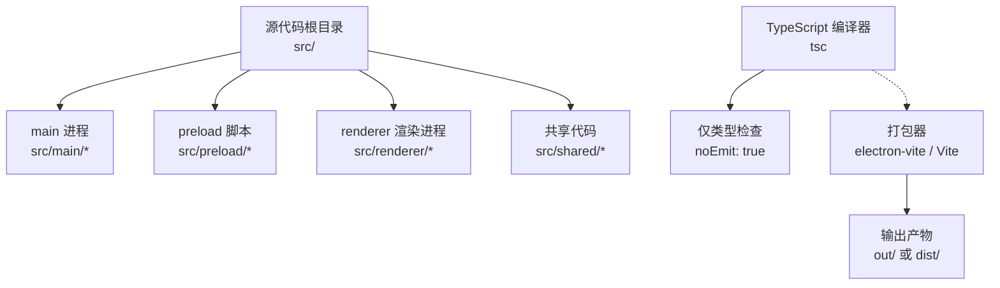
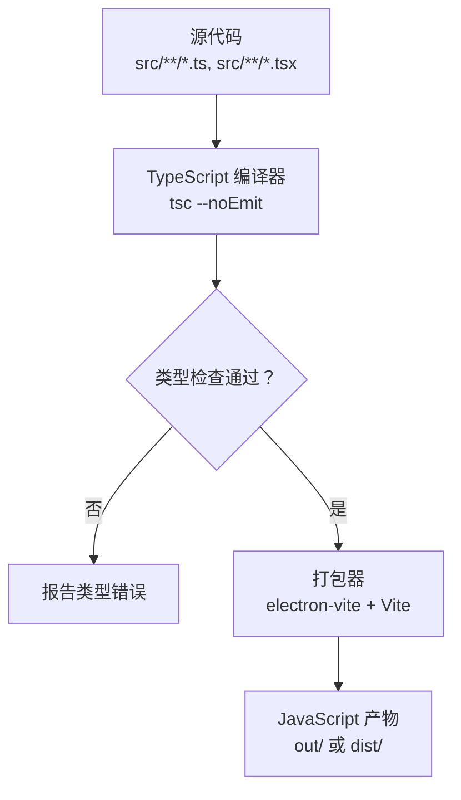
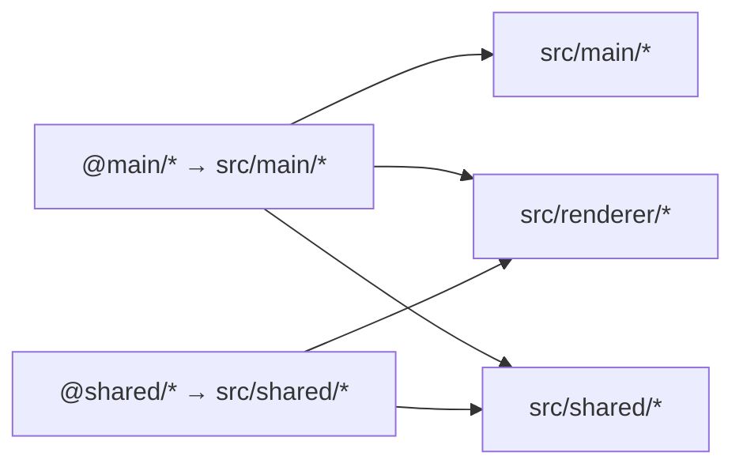
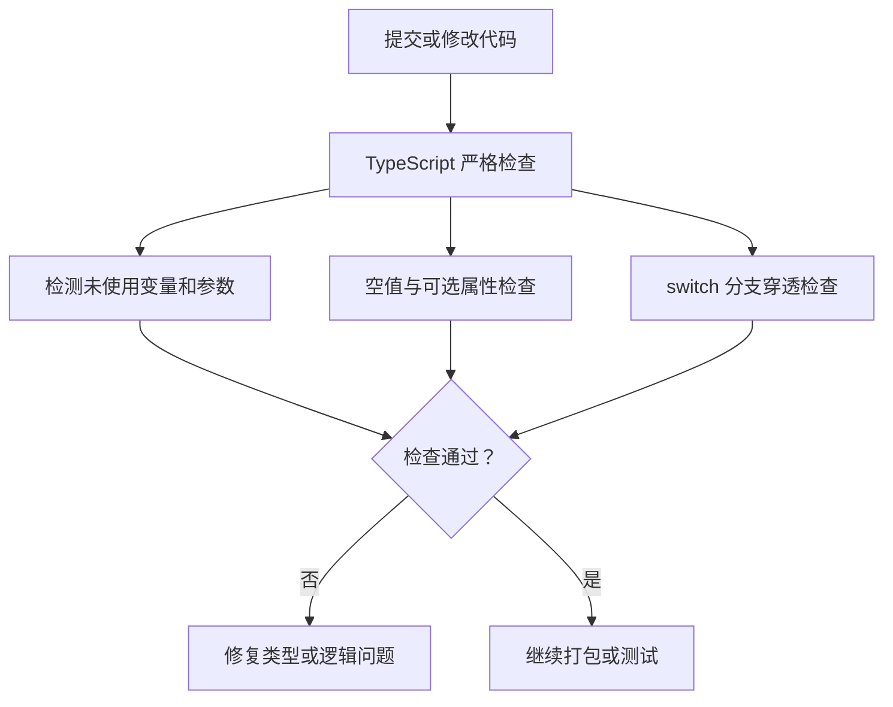
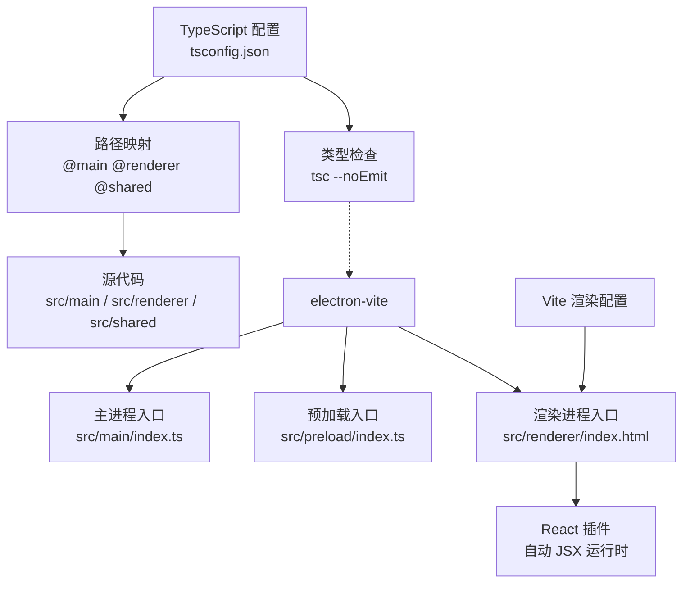
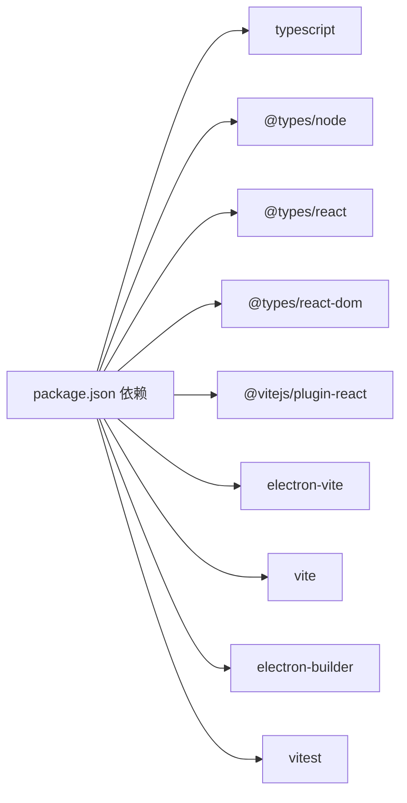

# TypeScript 编译配置

<cite>
**本文引用的文件**   
- [tsconfig.json](file://tsconfig.json)
- [package.json](file://package.json)
- [electron.vite.config.ts](file://electron.vite.config.ts)
- [vite.renderer.config.ts](file://vite.renderer.config.ts)
</cite>

## 目录
1. [简介](#简介)
2. [项目结构](#项目结构)
3. [核心编译目标与运行环境](#核心编译目标与运行环境)
4. [模块解析策略](#模块解析策略)
5. [类型检查与构建分离](#类型检查与构建分离)
6. [路径映射与 Vite 别名对应关系](#路径映射与-vite-别名对应关系)
7. [严格模式与代码质量保障](#严格模式与代码质量保障)
8. [JSX 自动运行时](#jsx-自动运行时)
9. [整体架构总览](#整体架构总览)
10. [依赖分析](#依赖分析)
11. [性能考虑](#性能考虑)
12. [常见问题与解决方案](#常见问题与解决方案)
13. [结论](#结论)

## 简介
本文面向 RDC-Agent 项目的 TypeScript 编译配置，重点解释 tsconfig.json 中的关键选项及其与 Electron、Vite、React、Node.js 运行环境的协作方式。文档同时说明路径映射、严格模式、JSX 行为、类型检查与构建分离流程，并给出常见编译错误的排查建议。

## 项目结构
RDC-Agent 是一个基于 Electron 的桌面应用，源代码按职责划分为三个主要命名空间：
- `src/main`：Electron 主进程逻辑。
- `src/preload`：预加载脚本，桥接主进程与渲染进程。
- `src/renderer`：基于 React 的浏览器端用户界面。
- `src/shared`：主进程、预加载和渲染进程共享的类型、常量与工具。

该结构中，TypeScript 编译器负责静态类型检查和源码语法校验；实际 JavaScript 产物由 electron-vite 和 Vite 生成。

**章节来源**
- [tsconfig.json:1-27](file://tsconfig.json#L1-L27)
- [electron.vite.config.ts:1-62](file://electron.vite.config.ts#L1-L62)
- [vite.renderer.config.ts:1-39](file://vite.renderer.config.ts#L1-L39)

## 核心编译目标与运行环境
tsconfig.json 的关键运行时相关配置如下：
- `target: ES2022`
- `lib: ["ES2022", "DOM", "DOM.Iterable"]`
- `module: ESNext`
- `types: ["node"]`

### target ES2022 与 Electron 42.x 的兼容性
项目使用 Electron 42.x，其内置 Node.js 版本较新，通常支持 ES2022 的大部分语言特性。将 `target` 设为 ES2022 可以：
- 保留现代语言特性，减少无意义的降级转换开销。
- 让 TypeScript 在类型层面认为宿主环境具备 ES2022 能力，从而允许更严格的类型推断。
- 与 Node.js >= 22.13.0 引擎要求保持一致，避免语言特性和运行环境不匹配。

需要注意：`target` 控制的是 TypeScript 对目标运行环境能力的假设以及部分语法降级行为，而 Electron 最终打包产物仍由 electron-vite 和 Rollup/Vite 处理。因此，Electron 是否真正运行这些 ES2022 特性，还取决于打包阶段和插件链的配置。

**章节来源**
- [tsconfig.json:2-13](file://tsconfig.json#L2-L13)
- [package.json:1-30](file://package.json#L1-L30)

### lib 配置包含 DOM 和 DOM.Iterable 的原因
`lib` 指定 TypeScript 可用的标准库类型声明：
- `ES2022`：提供 ECMAScript 2022 的标准类型，如数组、字符串、Promise、错误类型等。
- `DOM`：为渲染进程提供浏览器全局对象、事件模型、文档对象模型、Canvas、URL API 等类型。
- `DOM.Iterable`：提供 DOM 集合的可迭代类型，例如 `HTMLCollection`、`NodeList` 等可遍历结构。

由于本项目同时存在 main、preload、renderer 三类入口，且 `include` 覆盖 `src/**/*`，因此 TypeScript 需要为可能访问 DOM 的渲染进程代码提供完整类型。尽管主进程代码不应直接依赖 DOM，但统一启用 DOM 类型可以避免大量显式忽略声明的成本，同时配合路径别名和模块化边界约束实际引用范围。

**章节来源**
- [tsconfig.json:2-5](file://tsconfig.json#L2-L5)
- [tsconfig.json:24-27](file://tsconfig.json#L24-L27)

## 模块解析策略
tsconfig.json 中模块相关配置包括：
- `module: ESNext`
- `moduleResolution: bundler`
- `resolveJsonModule: true`
- `allowImportingTsExtensions: true`
- `isolatedModules: true`

### moduleResolution bundler 模式的优势
`bundler` 是 TypeScript 专为现代打包工具设计的模块解析模式，适合 Vite、Rollup、esbuild 等工具链。其优势包括：
- 优先模拟打包工具的解析行为，减少 TypeScript 解析结果与实际打包结果的差异。
- 更高效地处理包内导出、条件导出和子路径导入。
- 更好地与 `@main/*`、`@renderer/*`、`@shared/*` 这类路径映射配合。
- 减少传统 `node_modules` 查找路径带来的歧义，尤其在使用多入口 Electron 应用时。

### moduleResolution bundler 模式的限制
- 它不是完全等同于任意打包器的实现，极端情况下仍需保证 tsconfig 与打包器别名一致。
- 如果第三方库缺少类型声明，仍然需要 `skipLibCheck` 或补充声明。
- 对某些非标准导入语法，需要依赖打包器或 TypeScript 扩展选项（例如当前项目中允许 `.ts` 扩展导入）。

### allowImportingTsExtensions 的作用
该选项允许像 `import './foo.ts'` 这样直接导入 TypeScript 源文件扩展名。这有助于开发期明确模块来源，但在打包时需要打包器正确处理扩展名移除。本项目通过 electron-vite 和 Vite 完成最终转译，因此可以安全开启该选项。

**章节来源**
- [tsconfig.json:5-11](file://tsconfig.json#L5-L11)
- [electron.vite.config.ts:1-62](file://electron.vite.config.ts#L1-L62)
- [vite.renderer.config.ts:1-39](file://vite.renderer.config.ts#L1-L39)

## 类型检查与构建分离
tsconfig.json 中关键开关：
- `noEmit: true`
- `isolatedModules: true`
- package.json 中的 `typecheck` 脚本使用 `tsc --noEmit`

### noEmit 的工作流程
启用 `noEmit` 后，TypeScript 只执行类型检查，不生成任何 JavaScript 文件。RDC-Agent 的实际构建产物由以下流程产生：
1. 开发者运行构建命令。
2. electron-vite 分别处理 main、preload、renderer 入口。
3. Vite 和 Rollup 负责 JSX 转换、CSS 处理、资源打包和输出。
4. TypeScript 作为类型检查器参与，但不产出文件。

这种分离的好处是：
- 构建工具专注于打包优化，TypeScript 专注于类型安全。
- 可以在不同环境中复用同一份类型定义。
- 便于 CI 中单独执行 `typecheck`，快速发现类型问题而不触发完整打包。

**图表来源**
- [tsconfig.json:9-11](file://tsconfig.json#L9-L11)
- [package.json:10-25](file://package.json#L10-L25)

**章节来源**
- [tsconfig.json:9-11](file://tsconfig.json#L9-L11)
- [package.json:10-25](file://package.json#L10-L25)

## 路径映射与 Vite 别名对应关系
tsconfig.json 定义了三个路径映射：
- `@main/*` → `src/main/*`
- `@renderer/*` → `src/renderer/*`
- `@shared/*` → `src/shared/*`

electron-vite 和 Vite 中也配置了对应别名，但侧重点不同：

| 名称 | TypeScript 路径映射 | Vite / electron-vite 别名 | 主要用途 |
|---|---|---|---|
| `@main` | `src/main/*` | electron-vite main/preload 中未显式配置 `@main` | 用于内部约定，通常主进程代码直接以相对路径或已有别名引用 |
| `@renderer` | `src/renderer/*` | renderer 配置中指向 `src/renderer` | 渲染进程内部组件和页面引用 |
| `@shared` | `src/shared/*` | main、preload、renderer 都指向 `src/shared` | 跨进程共享类型、常量、工具函数 |

### 对应关系说明
- `@shared` 在三端保持一致，是共享代码的主要入口。
- `@renderer` 在 electron-vite 的 renderer 配置和独立 Vite 配置中都指向 `src/renderer`，确保开发和独立预览场景一致。
- `@main` 在 TypeScript 层可用于统一主进程模块路径，但 electron-vite 的 main 配置中并未显式注册该别名；若主进程代码需要引入其他主进程模块，应优先使用相对路径或通过现有别名。

**图表来源**
- [tsconfig.json:14-20](file://tsconfig.json#L14-L20)
- [electron.vite.config.ts:7-58](file://electron.vite.config.ts#L7-L58)
- [vite.renderer.config.ts:17-31](file://vite.renderer.config.ts#L17-L31)

**章节来源**
- [tsconfig.json:14-20](file://tsconfig.json#L14-L20)
- [electron.vite.config.ts:7-58](file://electron.vite.config.ts#L7-L58)
- [vite.renderer.config.ts:17-31](file://vite.renderer.config.ts#L17-L31)

## 严格模式与代码质量保障
tsconfig.json 启用了多项严格检查：
- `strict: true`
- `noUnusedLocals: true`
- `noUnusedParameters: true`
- `noFallthroughCasesInSwitch: true`

### strict 综合影响
`strict: true` 会启用一系列基础严格检查，包括：
- `strictNullChecks`：防止空值误用。
- `strictFunctionTypes`：增强函数参数协变逆变检查。
- `strictPropertyInitialization`：要求类属性正确初始化。
- `strictBindCallApply`：强化 bind/call/apply 类型。
- `strictGenericConstructorNames`：改进泛型构造函数名称。
- `strictPropertyInitialization`：避免未初始化字段被当作已赋值。

这对 Electron 应用尤其重要，因为主进程和渲染进程之间经常传递复杂数据，类型严格可以减少运行时崩溃。

### noUnusedLocals 与 noUnusedParameters
这两个选项强制清理未使用的局部变量和函数参数，有助于：
- 降低代码噪音。
- 暴露冗余逻辑。
- 减少意外副作用。

### noFallthroughCasesInSwitch
该选项禁止没有 `break`、`return`、`throw` 或注释标记的 switch 分支穿透。它特别适用于状态机、消息分发、平台判断等场景，能显著降低隐蔽 bug。

**章节来源**
- [tsconfig.json:11-16](file://tsconfig.json#L11-L16)

## JSX 自动运行时
tsconfig.json 中 JSX 配置为：
- `jsx: react-jsx`

### 自动运行时的优势
- 不需要显式导入 `react` 即可使用 JSX。
- 由打包器注入运行时调用，减少重复导入。
- 与 React 18 的自动 JSX 运行时兼容更好。
- 减小潜在冗余代码体积，提升可读性。

### 注意事项
- 虽然不需要导入 `react`，但类型声明仍需安装 `@types/react`。
- 若项目中有旧式 JSX 转换需求，需确认 Vite 插件链是否与 `react-jsx` 冲突。
- 本项目的 electron-vite 和 Vite 配置均使用 `@vitejs/plugin-react`，与自动运行时兼容。

**章节来源**
- [tsconfig.json:11](file://tsconfig.json#L11)
- [package.json:90-143](file://package.json#L90-L143)
- [electron.vite.config.ts:1-12](file://electron.vite.config.ts#L1-L12)
- [vite.renderer.config.ts:1-16](file://vite.renderer.config.ts#L1-L16)

## 整体架构总览
下图展示 TypeScript 配置、打包工具和运行环境之间的关系：

**图表来源**
- [tsconfig.json:1-27](file://tsconfig.json#L1-L27)
- [electron.vite.config.ts:1-62](file://electron.vite.config.ts#L1-L62)
- [vite.renderer.config.ts:1-39](file://vite.renderer.config.ts#L1-L39)

## 依赖分析
从 package.json 可以看出，TypeScript 生态依赖集中在开发阶段：
- TypeScript 本身用于类型检查。
- `@types/node` 提供 Node.js 类型。
- `@types/react` 和 `@types/react-dom` 提供 React 类型。
- `@vitejs/plugin-react` 提供 React JSX 支持。
- `electron-vite`、`vite`、`electron-builder` 负责打包和发布。
- `vitest` 用于测试。

**图表来源**
- [package.json:90-143](file://package.json#L90-L143)

**章节来源**
- [package.json:90-143](file://package.json#L90-L143)

## 性能考虑
- `skipLibCheck: true`：跳过 `node_modules` 中第三方库的类型检查，可显著缩短类型检查时间。
- `isolatedModules: true`：要求每个文件可独立编译，有利于未来使用更快的编译后端（如 SWC、esbuild）进行增量编译。
- `noEmit: true`：避免 tsc 生成中间文件，减少磁盘 I/O。
- `moduleResolution: bundler`：减少传统模块解析开销，更适合现代打包器。

建议在大型仓库中结合 CI 缓存和增量类型检查，进一步缩短反馈时间。

**章节来源**
- [tsconfig.json:2-11](file://tsconfig.json#L2-L11)

## 常见问题与解决方案

### 问题一：找不到模块或路径别名无法解析
**现象**：编辑器提示找不到 `@shared`、`@renderer` 等路径。  
**原因**：TypeScript 路径映射与打包器别名不一致，或未正确安装类型声明。  
**解决**：
- 确认 tsconfig.json 中的 `paths` 与 electron-vite/Vite 的 `alias` 一致。
- 确认 `include` 覆盖了需要类型检查的源码目录。
- 检查是否需要额外安装 `@types/*` 包。

**章节来源**
- [tsconfig.json:14-20](file://tsconfig.json#L14-L20)
- [electron.vite.config.ts:7-58](file://electron.vite.config.ts#L7-L58)
- [vite.renderer.config.ts:17-31](file://vite.renderer.config.ts#L17-L31)

### 问题二：TSX 文件中报 React 未定义
**现象**：使用 JSX 时报 `React is not defined`。  
**原因**：使用了 `react-jsx` 自动运行时但仍期望手动导入 React，或 JSX 模式配置不一致。  
**解决**：
- 保持 `jsx: react-jsx`。
- 不要为了 JSX 而手动导入 `react`。
- 确保安装了 `@types/react`。

**章节来源**
- [tsconfig.json:11](file://tsconfig.json#L11)
- [package.json:110-120](file://package.json#L110-L120)

### 问题三：DOM 类型不可用
**现象**：渲染进程代码中使用 `document`、`window` 或 DOM 集合时报类型错误。  
**原因**：缺少 DOM 类型声明。  
**解决**：
- 确认 `lib` 中包含 `DOM` 和 `DOM.Iterable`。
- 确认文件被 `include` 覆盖。
- 如果是测试或 Node-only 文件，可通过文件名或目录隔离避免误用 DOM。

**章节来源**
- [tsconfig.json:2-5](file://tsconfig.json#L2-L5)
- [tsconfig.json:24-27](file://tsconfig.json#L24-L27)

### 问题四：switch 分支穿透报错
**现象**：switch 语句中某个分支没有 `break` 时报错。  
**原因**：启用了 `noFallthroughCasesInSwitch`。  
**解决**：
- 显式添加 `break`、`return` 或 `throw`。
- 若确有意穿透，可在分支末尾添加注释或使用显式标记，具体取决于团队规范。

**章节来源**
- [tsconfig.json:15-16](file://tsconfig.json#L15-L16)

### 问题五：未使用的局部变量或参数报错
**现象**：声明了但未使用的变量或函数参数报错。  
**原因**：启用了 `noUnusedLocals` 或 `noUnusedParameters`。  
**解决**：
- 删除未使用变量。
- 将未使用参数改为下划线前缀，或在接口设计中消除多余参数。
- 仅在调试阶段临时关闭相应规则。

**章节来源**
- [tsconfig.json:13-15](file://tsconfig.json#L13-L15)

### 问题六：TypeScript 与打包器行为不一致
**现象**：编辑器中路径解析正常，但构建时报模块解析失败。  
**原因**：tsconfig 的模块解析策略与打包器别名不完全对齐。  
**解决**：
- 统一使用 `moduleResolution: bundler`。
- 同步 tsconfig 的 `paths` 与 electron-vite/Vite 的 `resolve.alias`。
- 避免混用相对路径和路径别名造成混淆。

**章节来源**
- [tsconfig.json:5-11](file://tsconfig.json#L5-L11)
- [electron.vite.config.ts:7-58](file://electron.vite.config.ts#L7-L58)
- [vite.renderer.config.ts:17-31](file://vite.renderer.config.ts#L17-L31)

## 结论
RDC-Agent 的 TypeScript 编译配置采用现代化工程实践：以 `ES2022` 为目标，使用 `bundler` 模块解析模式，通过 `noEmit` 实现类型检查与构建分离，并通过 `strict`、`noUnusedLocals`、`noUnusedParameters`、`noFallthroughCasesInSwitch` 等选项保障代码质量。路径映射 `@main/*`、`@renderer/*`、`@shared/*` 与 electron-vite 和 Vite 的别名共同构成清晰的模块边界，其中 `@shared` 是跨进程共享代码的核心入口。JSX 使用 `react-jsx` 自动运行时，简化 React 开发体验。只要保持 TypeScript 配置与打包器别名一致，就能获得稳定、可维护且高性能的开发体验。