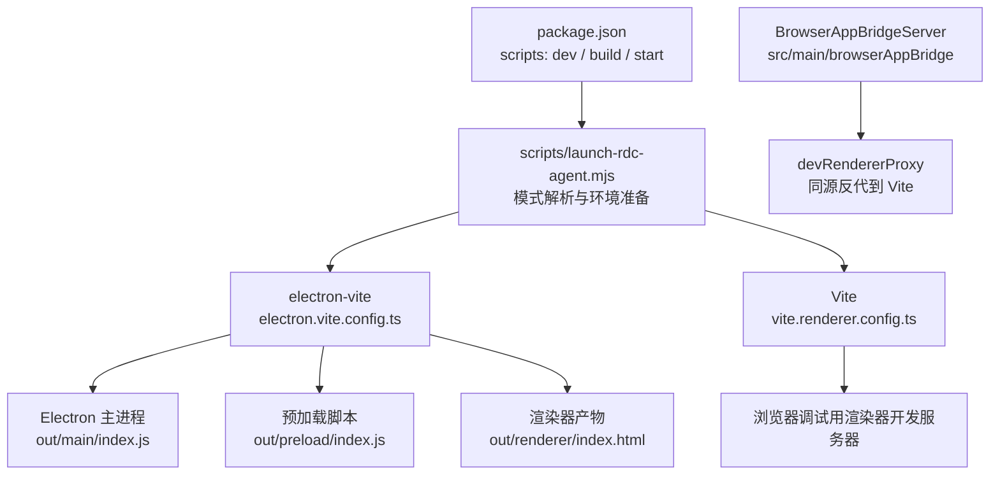
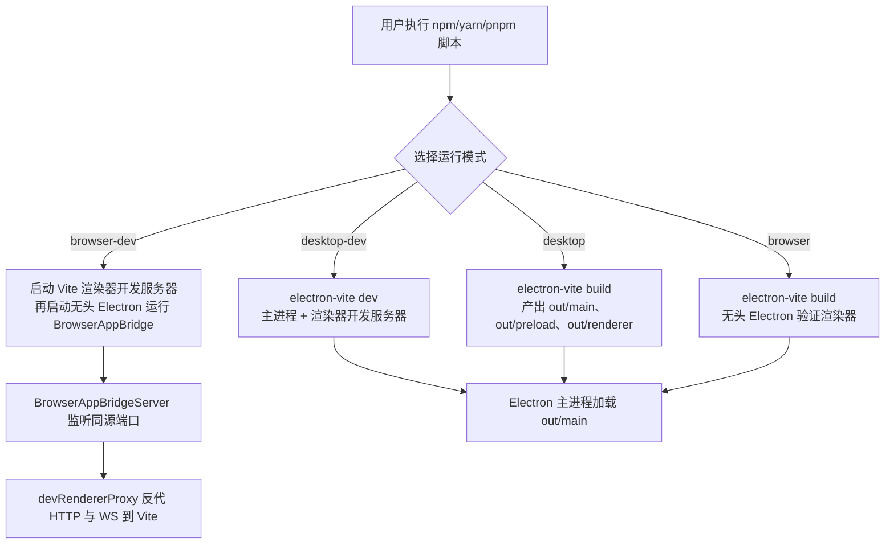
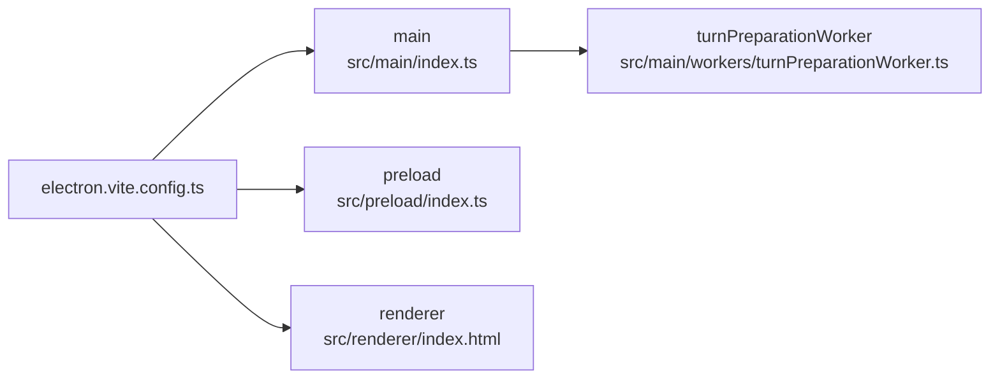
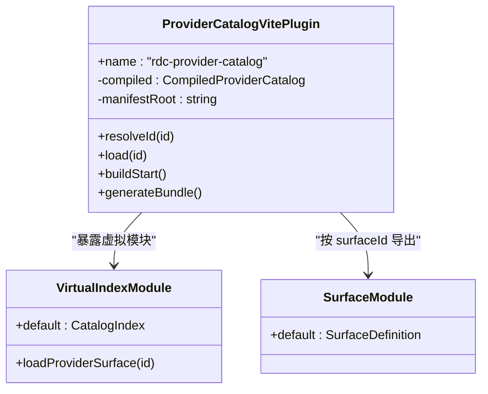
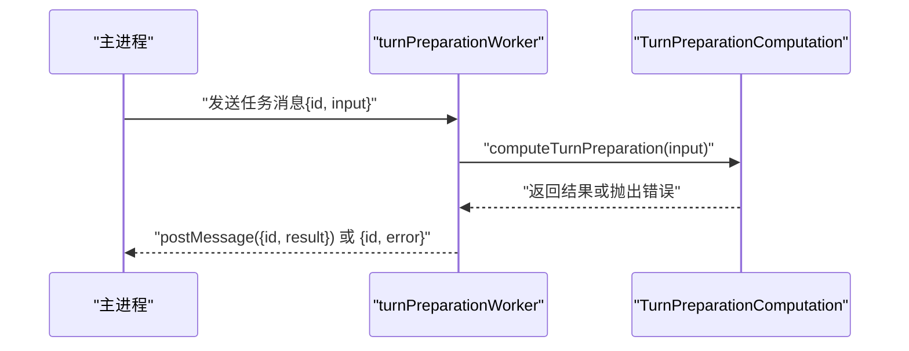
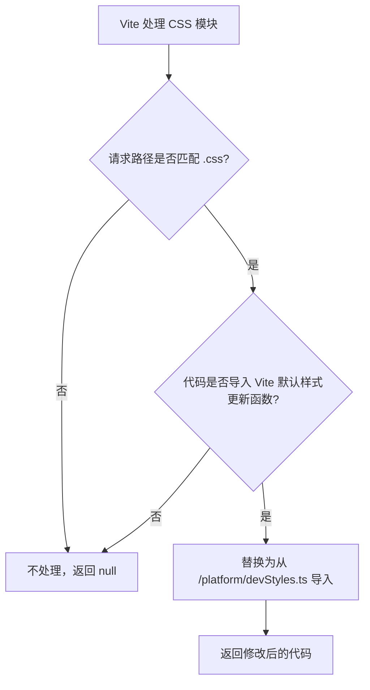
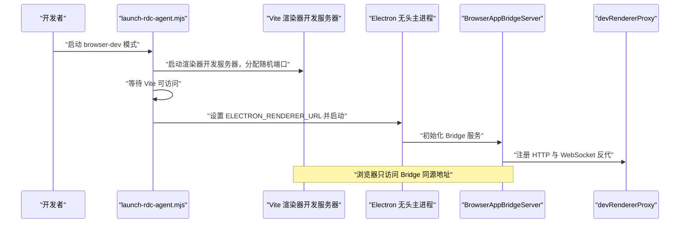
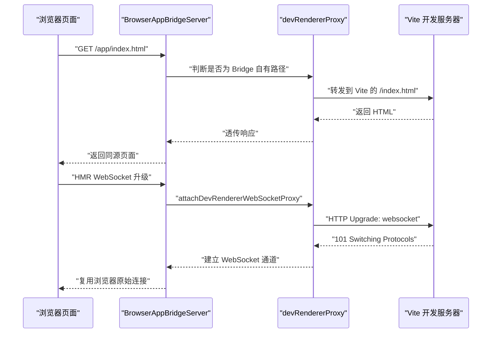
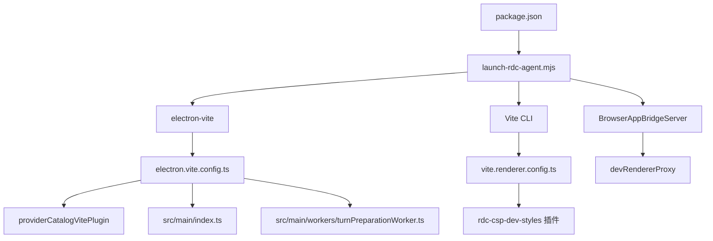

# Vite 构建配置

<cite>
**本文引用的文件**   
- [electron.vite.config.ts](file://electron.vite.config.ts)
- [vite.renderer.config.ts](file://vite.renderer.config.ts)
- [package.json](file://package.json)
- [scripts/launch-rdc-agent.mjs](file://scripts/launch-rdc-agent.mjs)
- [src/main/provider-catalog/providerCatalogVitePlugin.ts](file://src/main/provider-catalog/providerCatalogVitePlugin.ts)
- [src/main/workers/turnPreparationWorker.ts](file://src/main/workers/turnPreparationWorker.ts)
- [src/renderer/platform/devStyles.ts](file://src/renderer/platform/devStyles.ts)
- [src/renderer/platform/browserAppBridge/BrowserAppBridge.ts](file://src/renderer/platform/browserAppBridge/BrowserAppBridge.ts)
- [src/main/browserAppBridge/BrowserAppBridgeServer.ts](file://src/main/browserAppBridge/BrowserAppBridgeServer.ts)
- [src/main/browserAppBridge/devRendererProxy.ts](file://src/main/browserAppBridge/devRendererProxy.ts)
</cite>

## 目录
1. [引言](#引言)
2. [项目结构](#项目结构)
3. [核心组件](#核心组件)
4. [架构总览](#架构总览)
5. [详细组件分析](#详细组件分析)
6. [依赖关系分析](#依赖关系分析)
7. [性能考量](#性能考量)
8. [故障排查指南](#故障排查指南)
9. [结论](#结论)

## 引言
本文面向 RDC-Agent 的构建与开发运行期，系统梳理基于 `electron-vite` 的三进程构建架构，以及浏览器调试模式下的反向代理、CSP 安全样式注入和 HMR WebSocket 升级机制。文档重点解释：
- main、preload、renderer 三个入口的独立构建策略；
- 主进程的 `externalizeDepsPlugin` 与 `providerCatalogVitePlugin`；
- `turnPreparationWorker` 作为独立 Rollup 输入的意义；
- 浏览器调试模式下 `BrowserAppBridge` 反向代理如何使 Vite 成为同源后端；
- `rdc-csp-dev-styles` 插件如何通过替换 CSS 模块更新函数来适配 CSP；
- HMR WebSocket 升级协议与 Bridge 的关系；
- `@main`、`@renderer`、`@shared` 路径别名的差异；
- 浏览器调试模式的特殊处理流程和常见问题排查方法。

## 项目结构
RDC-Agent 使用两个 Vite 配置文件组织构建：
- `electron.vite.config.ts`：由 `electron-vite` 驱动，分别构建 Electron 主进程、预加载脚本和渲染器产物；
- `vite.renderer.config.ts`：仅用于浏览器调试模式下的渲染器开发服务器，启用 CSP 兼容样式更新与 HMR WebSocket。

**图示来源**
- [package.json:1-40](file://package.json#L1-L40)
- [scripts/launch-rdc-agent.mjs:120-180](file://scripts/launch-rdc-agent.mjs#L120-L180)
- [electron.vite.config.ts:1-62](file://electron.vite.config.ts#L1-L62)
- [vite.renderer.config.ts:1-39](file://vite.renderer.config.ts#L1-L39)

**章节来源**
- [package.json:1-40](file://package.json#L1-L40)
- [electron.vite.config.ts:1-62](file://electron.vite.config.ts#L1-L62)
- [vite.renderer.config.ts:1-39](file://vite.renderer.config.ts#L1-L39)

## 核心组件
本节聚焦构建系统中的关键构件：

| 构件 | 职责 | 主要位置 |
|---|---|---|
| `electron-vite` 主配置 | 定义 main、preload、renderer 三个入口及其插件、别名和输出 | [electron.vite.config.ts](file://electron.vite.config.ts) |
| `externalizeDepsPlugin` | 将主进程依赖外部化，避免打包进主进程包体 | [electron.vite.config.ts](file://electron.vite.config.ts) |
| `providerCatalogVitePlugin` | 编译 provider catalog 清单并生成虚拟模块与资源文件 | [src/main/provider-catalog/providerCatalogVitePlugin.ts](file://src/main/provider-catalog/providerCatalogVitePlugin.ts) |
| `turnPreparationWorker` | 作为独立 worker 入口参与主进程构建 | [src/main/workers/turnPreparationWorker.ts](file://src/main/workers/turnPreparationWorker.ts) |
| `rdc-csp-dev-styles` | 拦截 Vite CSS 热更新注入，改用 `CSSStyleSheet` 适配 CSP | [vite.renderer.config.ts](file://vite.renderer.config.ts) |
| `devStyles.ts` | 提供 CSP 安全的 `updateStyle` 与 `removeStyle` | [src/renderer/platform/devStyles.ts](file://src/renderer/platform/devStyles.ts) |
| `BrowserAppBridge` 客户端 | 在浏览器中通过 `/invoke` 与 `/events` 调用主进程能力 | [src/renderer/platform/browserAppBridge/BrowserAppBridge.ts](file://src/renderer/platform/browserAppBridge/BrowserAppBridge.ts) |
| `BrowserAppBridgeServer` | Electron 启动的同源 Bridge 服务，转发请求并代理 Vite | [src/main/browserAppBridge/BrowserAppBridgeServer.ts](file://src/main/browserAppBridge/BrowserAppBridgeServer.ts) |
| `devRendererProxy` | 实现 HTTP 与 WebSocket 升级到 Vite 的反向代理逻辑 | [src/main/browserAppBridge/devRendererProxy.ts](file://src/main/browserAppBridge/devRendererProxy.ts) |
| `launch-rdc-agent.mjs` | 解析 `desktop`、`desktop-dev`、`browser`、`browser-dev` 等模式，负责依赖安装、构建与进程启动 | [scripts/launch-rdc-agent.mjs](file://scripts/launch-rdc-agent.mjs) |

**章节来源**
- [electron.vite.config.ts:1-62](file://electron.vite.config.ts#L1-L62)
- [src/main/provider-catalog/providerCatalogVitePlugin.ts:1-59](file://src/main/provider-catalog/providerCatalogVitePlugin.ts#L1-L59)
- [src/main/workers/turnPreparationWorker.ts:1-24](file://src/main/workers/turnPreparationWorker.ts#L1-L24)
- [vite.renderer.config.ts:1-39](file://vite.renderer.config.ts#L1-L39)
- [src/renderer/platform/devStyles.ts:1-19](file://src/renderer/platform/devStyles.ts#L1-L19)
- [src/renderer/platform/browserAppBridge/BrowserAppBridge.ts:1-117](file://src/renderer/platform/browserAppBridge/BrowserAppBridge.ts#L1-L117)
- [src/main/browserAppBridge/BrowserAppBridgeServer.ts:1-200](file://src/main/browserAppBridge/BrowserAppBridgeServer.ts#L1-L200)
- [src/main/browserAppBridge/devRendererProxy.ts:1-200](file://src/main/browserAppBridge/devRendererProxy.ts#L1-L200)
- [scripts/launch-rdc-agent.mjs:120-530](file://scripts/launch-rdc-agent.mjs#L120-L530)

## 架构总览
RDC-Agent 的构建与运行分为两条主线：桌面模式与浏览器调试模式。

**图示来源**
- [package.json:1-40](file://package.json#L1-L40)
- [scripts/launch-rdc-agent.mjs:120-530](file://scripts/launch-rdc-agent.mjs#L120-L530)
- [electron.vite.config.ts:1-62](file://electron.vite.config.ts#L1-L62)
- [src/main/browserAppBridge/BrowserAppBridgeServer.ts:1-200](file://src/main/browserAppBridge/BrowserAppBridgeServer.ts#L1-L200)
- [src/main/browserAppBridge/devRendererProxy.ts:1-200](file://src/main/browserAppBridge/devRendererProxy.ts#L1-L200)

### 三进程构建架构
`electron-vite` 在本项目中以三进程方式组织构建：
- **主进程**：入口为 `src/main/index.ts`，并通过 `rollupOptions.input.index` 明确指定；同时包含 `turnPreparationWorker` 作为第二个输入。
- **预加载脚本**：入口为 `src/preload/index.ts`，与主进程共享 `@shared` 别名。
- **渲染器**：根目录指向 `src/renderer`，HTML 入口为 `src/renderer/index.html`，使用 React 插件与自定义别名。

**图示来源**
- [electron.vite.config.ts:1-62](file://electron.vite.config.ts#L1-L62)
- [src/main/workers/turnPreparationWorker.ts:1-24](file://src/main/workers/turnPreparationWorker.ts#L1-L24)

**章节来源**
- [electron.vite.config.ts:1-62](file://electron.vite.config.ts#L1-L62)

## 详细组件分析

### electron-vite 主进程构建与插件
#### externalizeDepsPlugin
主进程和预加载脚本都启用了 `externalizeDepsPlugin()`。它的作用是将 Node 原生依赖和 `node_modules` 中的包标记为“外部依赖”，而不是把它们内联打包进主进程或预加载脚本产物中。这样做的好处是：
- 主进程仍可直接使用 Electron、Node API 和原生模块；
- 避免把庞大的第三方依赖重复打包；
- 保持 Electron 主进程与 Node 环境一致的模块解析行为。

该插件在主进程和预加载脚本中均被启用，而渲染器没有启用，因为渲染器通常运行在浏览器环境中，需要完整的 Web 打包。

**章节来源**
- [electron.vite.config.ts:1-62](file://electron.vite.config.ts#L1-L62)

#### providerCatalogVitePlugin
`providerCatalogVitePlugin` 是主进程构建时的专用插件，其职责包括：
- 扫描 `src/shared/provider-catalog/manifests` 下的清单文件；
- 调用共享的 `compileProviderCatalog` 编译出 Provider catalog；
- 暴露虚拟模块 `virtual:rdc-provider-catalog-index`；
- 为每个 surface 暴露 `virtual:rdc-provider-catalog-surface/<surfaceId>` 形式的懒加载模块；
- 在构建阶段生成静态资源 `provider-catalog/index.json`；
- 监听清单文件变更以便重新编译。

**图示来源**
- [src/main/provider-catalog/providerCatalogVitePlugin.ts:1-59](file://src/main/provider-catalog/providerCatalogVitePlugin.ts#L1-L59)

**章节来源**
- [src/main/provider-catalog/providerCatalogVitePlugin.ts:1-59](file://src/main/provider-catalog/providerCatalogVitePlugin.ts#L1-L59)

#### turnPreparationWorker 作为独立 Rollup 输入
在 `main.build.rollupOptions.input` 中，除了 `index` 外还声明了 `turnPreparationWorker`。这意味着该文件不是普通模块，而是作为一个独立的 Worker 入口参与构建。它的主要特点是：
- 使用 Node 的 `worker_threads` 通信；
- 通过 `parentPort` 接收计算任务；
- 调用 `computeTurnPreparation` 执行耗时计算；
- 将结果或错误通过 `postMessage` 返回给父线程。

将其作为独立输入，可以让主进程构建系统识别并正确打包 worker 代码，使其可在 Electron 主进程中以 worker 线程形式运行。

**图示来源**
- [src/main/workers/turnPreparationWorker.ts:1-24](file://src/main/workers/turnPreparationWorker.ts#L1-L24)

**章节来源**
- [electron.vite.config.ts:10-25](file://electron.vite.config.ts#L10-L25)
- [src/main/workers/turnPreparationWorker.ts:1-24](file://src/main/workers/turnPreparationWorker.ts#L1-L24)

### renderer 配置与 CSP 样式注入
#### rdc-csp-dev-styles 插件
`vite.renderer.config.ts` 注册了一个名为 `rdc-csp-dev-styles` 的开发服务器插件。它的处理流程如下：

**图示来源**
- [vite.renderer.config.ts:1-39](file://vite.renderer.config.ts#L1-L39)
- [src/renderer/platform/devStyles.ts:1-19](file://src/renderer/platform/devStyles.ts#L1-L19)

该插件只在开发服务器模式下生效，并且只针对包含 Vite 默认样式更新函数的 CSS 模块。它将原本从 `@vite/client` 引入的 `updateStyle` 和 `removeStyle` 替换成从 `/platform/devStyles.ts` 引入的实现。`devStyles.ts` 使用 `document.adoptedStyleSheets` 和 `CSSStyleSheet.replaceSync` 进行样式更新，从而避免在严格 CSP 环境下直接注入 `<style>` 标签导致的违规问题。

#### 为什么需要 CSP 兼容样式
生产环境的渲染器可能启用严格的 CSP，不允许动态插入脚本或某些 DOM 操作。`devStyles.ts` 的设计目标是让开发时的 CSS 热更新行为尽量贴近生产环境的 CSP 约束，减少开发与生产之间的差异。

**章节来源**
- [vite.renderer.config.ts:1-39](file://vite.renderer.config.ts#L1-L39)
- [src/renderer/platform/devStyles.ts:1-19](file://src/renderer/platform/devStyles.ts#L1-L19)

### BrowserAppBridge 反向代理与浏览器调试模式
#### 模式入口
`scripts/launch-rdc-agent.mjs` 支持以下模式：
- `desktop`：构建后启动可见 Electron 应用；
- `desktop-dev`：进入 `electron-vite dev` 开发模式；
- `browser`：构建后以无头模式运行 Electron，用于浏览器兼容性验证；
- `browser-dev`：先启动 Vite 渲染器开发服务器，再将 Electron 作为 headless 主进程启动，由 `BrowserAppBridgeServer` 提供同源反向代理。

**图示来源**
- [scripts/launch-rdc-agent.mjs:300-530](file://scripts/launch-rdc-agent.mjs#L300-L530)
- [src/main/browserAppBridge/BrowserAppBridgeServer.ts:1-200](file://src/main/browserAppBridge/BrowserAppBridgeServer.ts#L1-L200)
- [src/main/browserAppBridge/devRendererProxy.ts:1-200](file://src/main/browserAppBridge/devRendererProxy.ts#L1-L200)

#### 同源反向代理设计
`BrowserAppBridgeServer` 是 Electron 主进程启动的 HTTP 服务。它的关键职责包括：
- 维护 Bridge 认证令牌和允许的来源；
- 处理 `/qa`、`/invoke`、`/events`、`/health` 等 Bridge 自有接口；
- 将非 Bridge 自有路径反向代理到 Vite 渲染器开发服务器；
- 在 WebSocket 升级时，将连接透传到 Vite 的 HMR WebSocket 服务。

`devRendererProxy` 实现了两个重要能力：
1. **HTTP 反代**：将 Bridge 上的资源请求转发到 Vite，但会清理 hop-by-hop 头部、Cookie、Authorization 等敏感信息，并强制缓存控制为 `no-store`。
2. **WebSocket 升级**：当 Vite 发起 HMR 连接时，Bridge 会将 `Upgrade: websocket` 请求转发到 Vite，并建立双向管道。

**图示来源**
- [src/main/browserAppBridge/devRendererProxy.ts:1-200](file://src/main/browserAppBridge/devRendererProxy.ts#L1-L200)
- [src/main/browserAppBridge/BrowserAppBridgeServer.ts:1-200](file://src/main/browserAppBridge/BrowserAppBridgeServer.ts#L1-L200)

#### HMR WebSocket 协议与 Bridge 的关系
在 `vite.renderer.config.ts` 中，HMR 客户端使用 `protocol: 'ws'`。这个设置表示 HMR 客户端不会自动根据当前页面的 `location.protocol` 选择 `wss`，而是直接使用 `ws`。在浏览器调试模式中，这是合理的，因为：
- 浏览器实际访问的是 `BrowserAppBridgeServer` 提供的同源地址；
- Bridge 负责将 WebSocket 升级请求转发到 Vite；
- Vite 开发服务器可能在任意端口上运行；
- Bridge 不需要改变 HMR 协议的语义，只需要完成协议升级透传。

因此，`protocol: 'ws'` 与 Bridge 的反向代理共同构成了一条“浏览器 → Bridge → Vite”的 HMR 链路。

**章节来源**
- [vite.renderer.config.ts:1-39](file://vite.renderer.config.ts#L1-L39)
- [src/main/browserAppBridge/devRendererProxy.ts:1-200](file://src/main/browserAppBridge/devRendererProxy.ts#L1-L200)
- [scripts/launch-rdc-agent.mjs:300-530](file://scripts/launch-rdc-agent.mjs#L300-L530)

#### 浏览器端 BrowserAppBridge 客户端
在浏览器环境中，渲染器通过 `installBrowserAppBridge()` 安装 Bridge 客户端。它实现了 `RendererApiTransport`，并通过：
- `/invoke` 发起 RPC 调用；
- `/events` 订阅事件流；
- 自动管理事件监听器的生命周期；
- 对特定通道如 `capture:readLivePreview` 做字节数组校验。

这使渲染器代码无需感知自己运行在 Electron 还是浏览器中，只需调用统一的 Electron API。

**章节来源**
- [src/renderer/platform/browserAppBridge/BrowserAppBridge.ts:1-117](file://src/renderer/platform/browserAppBridge/BrowserAppBridge.ts#L1-L117)

### 路径别名 @main、@renderer、@shared 的差异
不同配置文件中的路径别名存在明显差异：

| 别名 | electron.vite.config.ts | vite.renderer.config.ts | 说明 |
|---|---:|---:|---|
| `@shared` | 指向 `src/shared` | 指向 `src/shared` | 主进程、预加载、渲染器共享的类型、常量、工具与 Provider catalog 编译产物 |
| `@renderer` | 未定义 | 指向 `src/renderer` | 仅在渲染器构建中使用，便于渲染器内部互相引用 |
| `@main` | 未定义 | 未定义 | 当前构建配置中没有为 `@main` 设置别名；主进程源码位于 `src/main`，但没有统一别名 |

需要注意：
- `electron.vite.config.ts` 的 `main` 和 `preload` 只配置了 `@shared`；
- `renderer` 配置了 `@renderer` 和 `@shared`；
- 如果主进程或预加载脚本需要引用渲染器代码，应显式使用相对路径，而不是依赖一个并不存在的 `@main` 或 `@renderer` 别名；
- 若未来需要在主进程中引用 `src/main` 下的公共模块，可以考虑新增 `@main` 别名，但目前仓库构建配置并未提供。

**章节来源**
- [electron.vite.config.ts:1-62](file://electron.vite.config.ts#L1-L62)
- [vite.renderer.config.ts:1-39](file://vite.renderer.config.ts#L1-L39)

## 依赖关系分析
构建系统的依赖关系可以概括为：

**图示来源**
- [package.json:1-40](file://package.json#L1-L40)
- [scripts/launch-rdc-agent.mjs:120-530](file://scripts/launch-rdc-agent.mjs#L120-L530)
- [electron.vite.config.ts:1-62](file://electron.vite.config.ts#L1-L62)
- [vite.renderer.config.ts:1-39](file://vite.renderer.config.ts#L1-L39)
- [src/main/provider-catalog/providerCatalogVitePlugin.ts:1-59](file://src/main/provider-catalog/providerCatalogVitePlugin.ts#L1-L59)
- [src/main/browserAppBridge/BrowserAppBridgeServer.ts:1-200](file://src/main/browserAppBridge/BrowserAppBridgeServer.ts#L1-L200)
- [src/main/browserAppBridge/devRendererProxy.ts:1-200](file://src/main/browserAppBridge/devRendererProxy.ts#L1-L200)

**章节来源**
- [package.json:1-40](file://package.json#L1-L40)
- [scripts/launch-rdc-agent.mjs:120-530](file://scripts/launch-rdc-agent.mjs#L120-L530)
- [electron.vite.config.ts:1-62](file://electron.vite.config.ts#L1-L62)
- [vite.renderer.config.ts:1-39](file://vite.renderer.config.ts#L1-L39)

## 性能考量
- **主进程外部化依赖**：通过 `externalizeDepsPlugin` 避免将大量 Node/Electron 依赖打包进主进程，有利于缩短主进程构建时间并减小产物体积。
- **Provider catalog 编译缓存**：`providerCatalogVitePlugin` 在内存中缓存已编译的 catalog，并在清单文件变化时重新编译，避免重复工作。
- **独立 worker 计算**：将耗时计算放入 `turnPreparationWorker`，有助于避免阻塞主进程事件循环。
- **浏览器调试模式按需启动 Vite**：`launch-rdc-agent.mjs` 在 `browser-dev` 模式下才启动 Vite 开发服务器，避免不必要的开发服务器开销。
- **构建指纹与增量跳过**：启动器会对依赖状态和构建产物计算哈希，在环境未变化时跳过 pnpm 安装和 electron-vite 构建，提升重复启动速度。

[本节为通用性能分析，不直接分析具体代码行]

## 故障排查指南

### 浏览器调试模式下无法加载页面
**可能原因**
- Vite 开发服务器未成功启动；
- `launch-rdc-agent.mjs` 未能从 Vite 输出中解析出 URL；
- Vite 端口被占用或防火墙阻止；
- Bridge 尚未就绪，Electron 提前退出。

**排查建议**
- 确认控制台输出中包含 Vite 报告的可访问地址；
- 检查 `startRendererDevServer` 的超时逻辑是否在 20 秒内收到 Vite URL；
- 检查 `waitForRenderer` 是否能通过 HTTP 请求访问 Vite 根路径；
- 单独运行 `vite --config vite.renderer.config.ts` 验证渲染器开发服务器是否可独立启动。

**相关实现参考**
- [scripts/launch-rdc-agent.mjs:300-380](file://scripts/launch-rdc-agent.mjs#L300-L380)

### HMR 连接失败或样式不热更新
**可能原因**
- 浏览器访问的不是 Bridge 同源地址；
- Bridge 未正确代理 WebSocket 升级；
- `rdc-csp-dev-styles` 未命中 CSS 模块；
- Vite 开发服务器已关闭或被杀死。

**排查建议**
- 确认浏览器地址栏显示的是 Bridge 地址，而非 Vite 私有地址；
- 检查 Bridge 是否启动了 `attachDevRendererWebSocketProxy`；
- 检查 Vite 配置中 `hmr.protocol` 是否为 `ws`；
- 查看 `devRendererProxy` 是否返回 502 或代理超时错误。

**相关实现参考**
- [vite.renderer.config.ts:1-39](file://vite.renderer.config.ts#L1-L39)
- [src/main/browserAppBridge/devRendererProxy.ts:1-200](file://src/main/browserAppBridge/devRendererProxy.ts#L1-L200)

### CSP 样式报错或动态样式失效
**可能原因**
- 使用了不支持 CSP 的动态样式注入方式；
- `rdc-csp-dev-styles` 插件未生效；
- 构建目标不是开发服务器；
- 自定义样式模块未触发 CSS 模块更新逻辑。

**排查建议**
- 确认使用的是开发模式；
- 确认 CSS 文件会被 Vite 作为 CSS 模块处理；
- 确认 `devStyles.ts` 中的 `updateStyle` 与 `removeStyle` 正在被替代使用；
- 在生产环境中，确保样式构建管线同样遵循 CSP 限制。

**相关实现参考**
- [vite.renderer.config.ts:1-39](file://vite.renderer.config.ts#L1-L39)
- [src/renderer/platform/devStyles.ts:1-19](file://src/renderer/platform/devStyles.ts#L1-L19)

### Provider catalog 未更新或虚拟模块缺失
**可能原因**
- `src/shared/provider-catalog/manifests` 下清单文件未更新；
- 构建未重新运行；
- 虚拟模块 ID 编码错误；
- 生成的 `provider-catalog/index.json` 不存在。

**排查建议**
- 修改清单后重新运行构建；
- 检查 `providerCatalogVitePlugin` 是否生成了 `out/main/provider-catalog/index.json`；
- 确认虚拟模块路径前缀与 surfaceId 编码一致；
- 查看插件日志中的未知 surface 错误。

**相关实现参考**
- [src/main/provider-catalog/providerCatalogVitePlugin.ts:1-59](file://src/main/provider-catalog/providerCatalogVitePlugin.ts#L1-L59)
- [electron.vite.config.ts:1-62](file://electron.vite.config.ts#L1-L62)

### 主进程构建缺少 worker 产物
**可能原因**
- `turnPreparationWorker` 未被加入 `main.rollupOptions.input`；
- worker 入口文件路径错误；
- worker 运行时依赖不可用。

**排查建议**
- 检查 `electron.vite.config.ts` 中 `main.build.rollupOptions.input`；
- 确认 `turnPreparationWorker.ts` 存在并可被 TypeScript 编译；
- 检查主进程是否正确以 worker 线程形式加载该入口。

**相关实现参考**
- [electron.vite.config.ts:10-25](file://electron.vite.config.ts#L10-L25)
- [src/main/workers/turnPreparationWorker.ts:1-24](file://src/main/workers/turnPreparationWorker.ts#L1-L24)

## 结论
RDC-Agent 的构建配置围绕 `electron-vite` 的三进程模型展开：主进程负责 Node/Electron 能力、Provider catalog 编译与 Bridge 服务；预加载脚本桥接主进程与渲染器；渲染器在桌面模式下由 Electron 托管，在浏览器调试模式下由 Vite 开发服务器托管，并由 `BrowserAppBridgeServer` 提供同源反向代理。

关键点包括：
- 主进程通过 `externalizeDepsPlugin` 保留 Node/Electron 外部依赖；
- `providerCatalogVitePlugin` 将 Provider catalog 编译为虚拟模块与静态 JSON；
- `turnPreparationWorker` 作为独立 worker 入口参与主进程构建；
- `rdc-csp-dev-styles` 将 Vite 默认样式更新替换为 CSP 安全的 `CSSStyleSheet` 实现；
- `BrowserAppBridge` 使渲染器在浏览器中以同源方式调用主进程能力；
- HMR WebSocket 升级由 Bridge 透明转发到 Vite；
- `@shared` 是跨进程共享的核心别名，`@renderer` 仅用于渲染器，`@main` 在当前配置中不存在。

这套设计既保证了 Electron 桌面应用的完整能力，又提供了接近真实 CSP 环境的浏览器调试体验，适合在受限浏览器环境中验证 RDC-Agent 的渲染器行为。