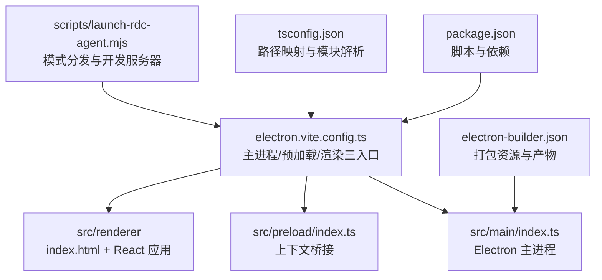
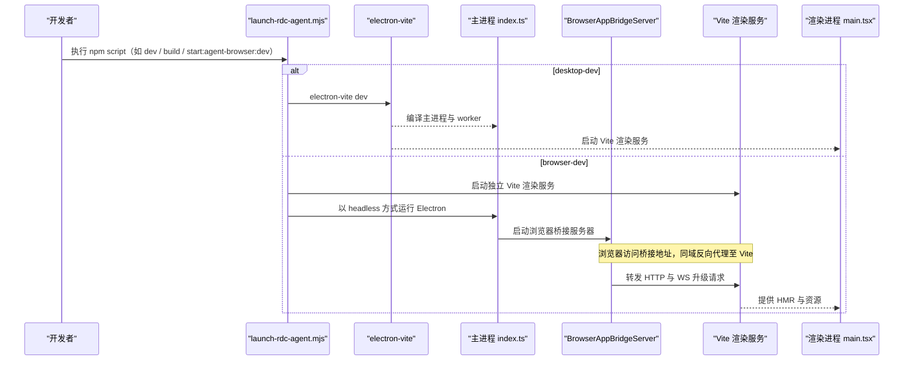
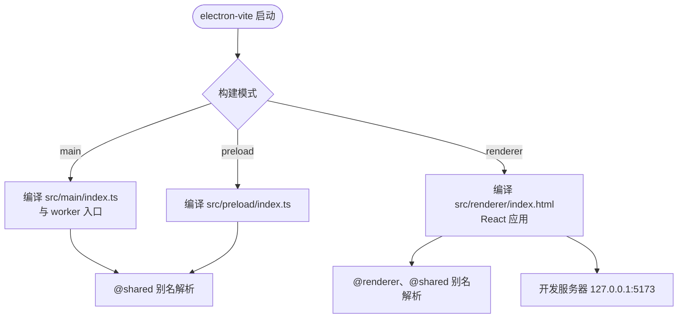
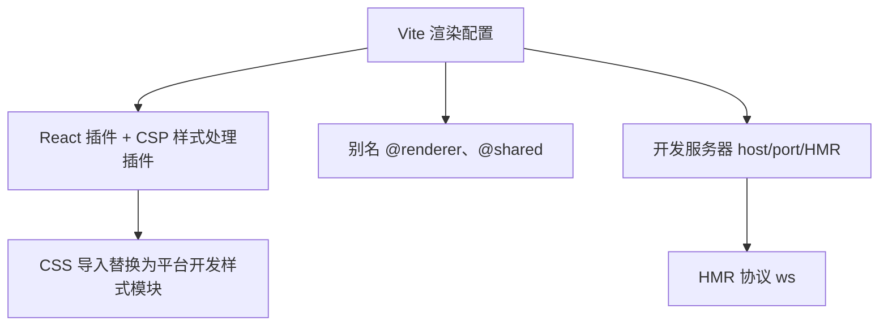
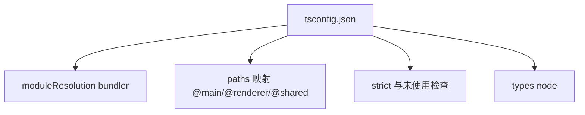
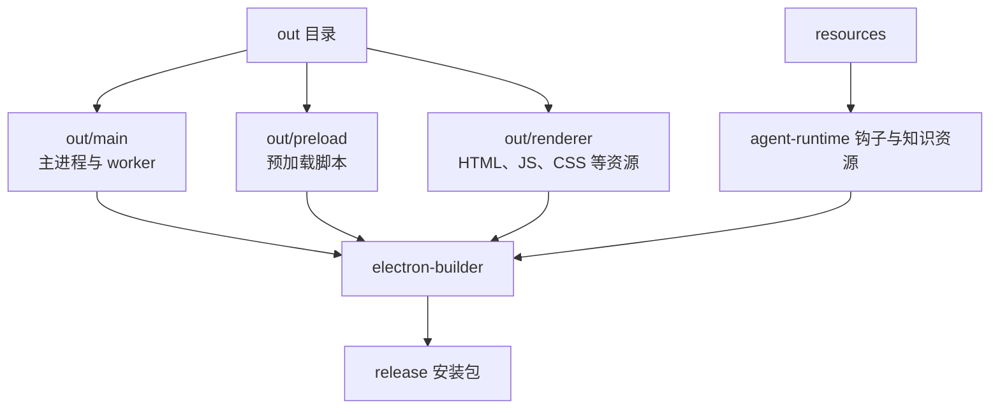
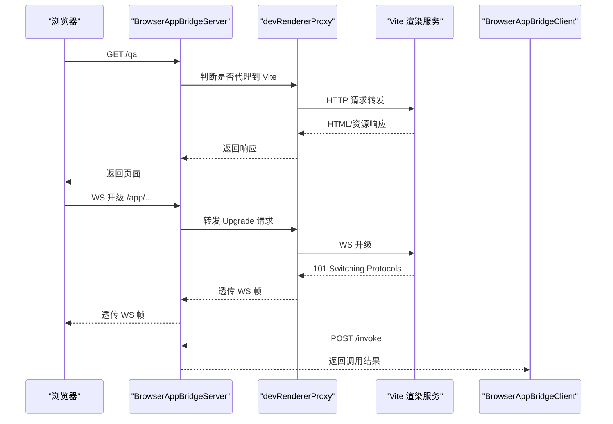
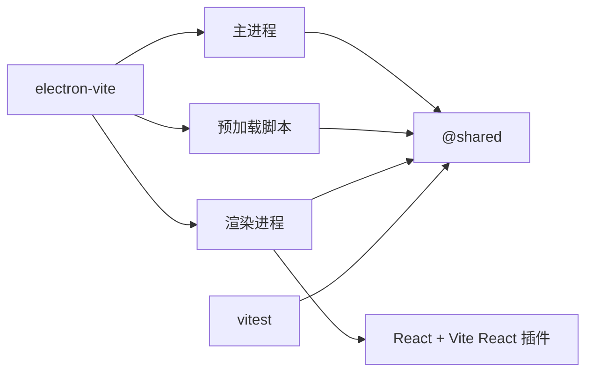

# 构建系统

<cite>
**本文引用的文件**   
- [package.json](file://package.json)
- [electron.vite.config.ts](file://electron.vite.config.ts)
- [vite.renderer.config.ts](file://vite.renderer.config.ts)
- [tsconfig.json](file://tsconfig.json)
- [vitest.config.ts](file://vitest.config.ts)
- [electron-builder.json](file://electron-builder.json)
- [scripts/launch-rdc-agent.mjs](file://scripts/launch-rdc-agent.mjs)
- [src/main/index.ts](file://src/main/index.ts)
- [src/preload/index.ts](file://src/preload/index.ts)
- [src/renderer/main.tsx](file://src/renderer/main.tsx)
- [src/main/browserAppBridge/BrowserAppBridgeServer.ts](file://src/main/browserAppBridge/BrowserAppBridgeServer.ts)
- [src/main/browserAppBridge/devRendererProxy.ts](file://src/main/browserAppBridge/devRendererProxy.ts)
- [src/renderer/platform/browserAppBridge/BrowserAppBridge.ts](file://src/renderer/platform/browserAppBridge/BrowserAppBridge.ts)
</cite>

## 目录
1. [简介](#简介)
2. [项目结构](#项目结构)
3. [核心组件](#核心组件)
4. [架构总览](#架构总览)
5. [详细组件分析](#详细组件分析)
6. [依赖关系分析](#依赖关系分析)
7. [性能考虑](#性能考虑)
8. [故障排查指南](#故障排查指南)
9. [结论](#结论)

## 简介
本文面向 RDC-Agent 的构建系统，重点说明基于 electron-vite 的主进程与渲染进程分离构建策略、Vite 渲染配置、TypeScript 编译规则、构建产物结构与打包配置，并深入解释浏览器调试模式下的 BrowserAppBridge 反向代理与 WebSocket 升级机制。文档同时给出构建优化建议与常见问题排查路径，帮助开发者理解从源码到 `out/main`、`out/renderer` 的完整构建链路。

## 项目结构
RDC-Agent 采用多入口 Electron 应用结构：
- 主进程入口位于 `src/main/index.ts`。
- 预加载脚本入口位于 `src/preload/index.ts`。
- 渲染进程入口由 Vite 管理的 HTML 模板驱动，React 应用从 `src/renderer/main.tsx` 启动。
- 共享代码位于 `src/shared`，被主进程、预加载和渲染进程共同引用。

**图表来源**
- [package.json:1-40](file://package.json#L1-L40)
- [electron.vite.config.ts:1-62](file://electron.vite.config.ts#L1-L62)
- [src/main/index.ts:1-60](file://src/main/index.ts#L1-L60)
- [src/preload/index.ts:1-25](file://src/preload/index.ts#L1-L25)
- [src/renderer/main.tsx:1-15](file://src/renderer/main.tsx#L1-L15)
- [tsconfig.json:1-27](file://tsconfig.json#L1-L27)
- [electron-builder.json:1-54](file://electron-builder.json#L1-L54)
- [scripts/launch-rdc-agent.mjs:480-530](file://scripts/launch-rdc-agent.mjs#L480-L530)

**章节来源**
- [package.json:1-40](file://package.json#L1-L40)
- [electron.vite.config.ts:1-62](file://electron.vite.config.ts#L1-L62)
- [tsconfig.json:1-27](file://tsconfig.json#L1-L27)
- [electron-builder.json:1-54](file://electron-builder.json#L1-L54)

## 核心组件
- **electron-vite 配置**：定义主进程、预加载脚本和渲染进程的构建入口、插件、别名与服务端口。
- **Vite 渲染专用配置**：在浏览器调试模式下覆盖 Vite 行为，实现 CSP 样式处理与 HMR 协议调整。
- **TypeScript 编译配置**：统一路径别名与模块解析规则，隔离类型检查与构建输出。
- **构建启动器**：根据模式选择开发或生产流程，管理依赖安装、构建缓存与 Electron 运行。
- **BrowserAppBridge**：在浏览器调试模式下提供同源反向代理、认证 Cookie、WebSocket 升级与事件流。
- **打包配置**：使用 electron-builder 将 `out/**/*` 与静态资源打包为桌面安装包。

**章节来源**
- [electron.vite.config.ts:1-62](file://electron.vite.config.ts#L1-L62)
- [vite.renderer.config.ts:1-39](file://vite.renderer.config.ts#L1-L39)
- [tsconfig.json:1-27](file://tsconfig.json#L1-L27)
- [scripts/launch-rdc-agent.mjs:480-530](file://scripts/launch-rdc-agent.mjs#L480-L530)
- [src/main/browserAppBridge/BrowserAppBridgeServer.ts:1-120](file://src/main/browserAppBridge/BrowserAppBridgeServer.ts#L1-L120)
- [electron-builder.json:1-54](file://electron-builder.json#L1-L54)

## 架构总览
构建系统围绕三个关键阶段展开：
1. **开发与构建调度**：通过 `scripts/launch-rdc-agent.mjs` 解析模式（desktop、desktop-dev、browser、browser-dev），决定是否调用 `electron-vite dev/build`，并在 browser-dev 下启动独立 Vite 渲染服务。
2. **多入口构建**：electron-vite 分别编译主进程与预加载脚本（Node 环境）和渲染进程（浏览器环境）。主进程额外包含一个 worker 入口；渲染进程由 Vite 管理 HTML 入口。
3. **运行时桥接**：在浏览器调试模式下，Electron 主进程中的 BrowserAppBridge 作为 HTTP 服务器与 WS 代理，把浏览器请求安全转发到本地 Vite 渲染服务，并保持页面同源。

**图表来源**
- [scripts/launch-rdc-agent.mjs:480-530](file://scripts/launch-rdc-agent.mjs#L480-L530)
- [electron.vite.config.ts:1-62](file://electron.vite.config.ts#L1-L62)
- [src/main/browserAppBridge/BrowserAppBridgeServer.ts:1-120](file://src/main/browserAppBridge/BrowserAppBridgeServer.ts#L1-L120)
- [src/main/browserAppBridge/devRendererProxy.ts:1-120](file://src/main/browserAppBridge/devRendererProxy.ts#L1-L120)
- [src/renderer/main.tsx:1-15](file://src/renderer/main.tsx#L1-L15)

## 详细组件分析

### electron-vite 构建配置
electron-vite 配置定义了三个构建目标：
- **main**：启用外部依赖优化插件与 provider catalog 插件，设置 `@shared` 别名；Rollup 输入包括主进程入口与 turnPreparationWorker。
- **preload**：启用外部依赖优化插件，设置 `@shared` 别名；Rollup 输入为预加载脚本入口。
- **renderer**：根目录指向 `src/renderer`，开发服务器绑定 `127.0.0.1:5173`，Rollup 输入为 `index.html`，启用 React 插件，并设置 `@renderer` 与 `@shared` 别名。

该配置体现“主进程/预加载脚本”与“渲染进程”的分离：前者面向 Node/Electron API，后者面向浏览器环境与 React。

**图表来源**
- [electron.vite.config.ts:1-62](file://electron.vite.config.ts#L1-L62)

**章节来源**
- [electron.vite.config.ts:1-62](file://electron.vite.config.ts#L1-L62)

### vite.renderer.config.ts 渲染配置
Vite 渲染专用配置用于浏览器调试场景，主要特性如下：
- **React 插件**：启用 `@vitejs/plugin-react`，支持 JSX 与快速刷新。
- **CSP 样式处理插件**：自定义 Vite 插件在 serve 模式下对 CSS 模块注入进行后处理，把 Vite 客户端样式更新函数重定向到 `/platform/devStyles.ts`，以适配 CSP 限制。
- **路径别名**：`@renderer` 指向 `src/renderer`，`@shared` 指向 `src/shared`。
- **HMR 配置**：开发服务器仍为 `127.0.0.1:5173`，但 HMR 协议设为 `ws`，以便浏览器端通过桥接服务器的 WebSocket 升级通道接收热更新。

**图表来源**
- [vite.renderer.config.ts:1-39](file://vite.renderer.config.ts#L1-L39)

**章节来源**
- [vite.renderer.config.ts:1-39](file://vite.renderer.config.ts#L1-L39)

### TypeScript 编译配置 tsconfig.json
TypeScript 配置以“仅类型检查、不生成 JS”的方式参与构建：
- **目标与库**：ES2022，DOM 与 DOM.Iterable。
- **模块解析**：bundler 模式，允许 `.ts` 扩展名导入与 JSON 模块解析。
- **严格性与清理**：strict、noUnusedLocals、noUnusedParameters、noFallthroughCasesInSwitch。
- **路径映射**：`@main/*`、`@renderer/*`、`@shared/*` 分别映射到对应源码目录。
- **类型声明**：包含 `node` 类型。

该配置与 Vite 的路径别名保持一致，保证编辑器与构建工具对同一组模块解析规则的理解一致。

**图表来源**
- [tsconfig.json:1-27](file://tsconfig.json#L1-L27)

**章节来源**
- [tsconfig.json:1-27](file://tsconfig.json#L1-L27)

### 构建产物结构与目录作用
- **主进程产物**：由 electron-vite 编译得到，默认输出目录为 `out/main`。主进程入口为 `out/main/index.js`，并由 `package.json` 的 `main` 字段指定。
- **预加载产物**：由 electron-vite 编译得到，默认输出目录为 `out/preload`。
- **渲染进程产物**：由 Vite 编译得到，默认输出目录为 `out/renderer`，入口由 `index.html` 驱动。
- **打包资源**：electron-builder 会打包 `out/**/*`，以及 `resources/agent-runtime/**/*` 与 `resources/knowledge/**/*`，并把部分资源放入 asar 或不解压目录。

**图表来源**
- [package.json:1-20](file://package.json#L1-L20)
- [electron-builder.json:1-54](file://electron-builder.json#L1-L54)

**章节来源**
- [package.json:1-20](file://package.json#L1-L20)
- [electron-builder.json:1-54](file://electron-builder.json#L1-L54)

### 构建优化策略
当前仓库中可观察到的构建优化点包括：
- **外部依赖优化**：主进程与预加载使用 `externalizeDepsPlugin()`，减少主包体积并提升冷启动速度。
- **Provider Catalog 插件**：在主进程与测试配置中注入 provider catalog 相关逻辑，确保模型目录与类型在构建期可解析。
- **React 插件**：渲染进程使用 `@vitejs/plugin-react`，启用 JSX 转换与开发时快速刷新。
- **HMR 协议调整**：浏览器调试模式下 HMR 使用 `ws` 协议，配合桥接服务器的 WebSocket 升级，使开发体验稳定。
- **CSP 样式处理**：通过自定义 Vite 插件替换样式更新注入位置，避免内联样式触发 CSP 拦截。

尚未在配置中发现显式的代码分割、压缩或 Tree Shaking 参数调整；这些通常由 electron-vite/Vite/Rollup 默认行为决定。若需进一步调优，可在 renderer 构建选项中添加 Rollup 输出配置、资源哈希、压缩器等。

**章节来源**
- [electron.vite.config.ts:1-62](file://electron.vite.config.ts#L1-L62)
- [vite.renderer.config.ts:1-39](file://vite.renderer.config.ts#L1-L39)
- [vitest.config.ts:1-81](file://vitest.config.ts#L1-L81)

### 浏览器调试模式特殊处理：BrowserAppBridge 反向代理与 WS 升级
浏览器调试模式的核心是“同源安全 + 反向代理 + WebSocket 升级”：
- **启动流程**：launcher 在 browser-dev 模式下先启动 Vite 渲染服务，再启动 headless Electron 主进程，并通过环境变量把渲染 URL 传递给主进程。
- **桥接服务器**：BrowserAppBridgeServer 提供健康检查、认证 Cookie、跨域控制、API 路由与事件流，并将非桥接路径转发到 Vite。
- **HTTP 反向代理**：devRendererProxy 复制请求头并剥离敏感头，将 `/app` 等路径映射到 Vite 路径空间，同时保留源站 Host。
- **WebSocket 升级**：当浏览器发起 WS 升级请求时，桥接服务器将 Upgrade 帧转发给 Vite，从而让 HMR 正常工作。
- **渲染端集成**：渲染进程通过 `installBrowserAppBridge()` 注入 `window.electronAPI`，在浏览器环境中走 HTTP 调用与事件流，而不是直接访问 Electron API。

**图表来源**
- [scripts/launch-rdc-agent.mjs:480-530](file://scripts/launch-rdc-agent.mjs#L480-L530)
- [src/main/browserAppBridge/BrowserAppBridgeServer.ts:1-120](file://src/main/browserAppBridge/BrowserAppBridgeServer.ts#L1-L120)
- [src/main/browserAppBridge/devRendererProxy.ts:1-212](file://src/main/browserAppBridge/devRendererProxy.ts#L1-L212)
- [src/renderer/platform/browserAppBridge/BrowserAppBridge.ts:1-117](file://src/renderer/platform/browserAppBridge/BrowserAppBridge.ts#L1-L117)

**章节来源**
- [scripts/launch-rdc-agent.mjs:480-530](file://scripts/launch-rdc-agent.mjs#L480-L530)
- [src/main/browserAppBridge/BrowserAppBridgeServer.ts:1-200](file://src/main/browserAppBridge/BrowserAppBridgeServer.ts#L1-L200)
- [src/main/browserAppBridge/devRendererProxy.ts:1-212](file://src/main/browserAppBridge/devRendererProxy.ts#L1-L212)
- [src/renderer/platform/browserAppBridge/BrowserAppBridge.ts:1-117](file://src/renderer/platform/browserAppBridge/BrowserAppBridge.ts#L1-L117)

## 依赖关系分析
- **electron-vite 与 Vite**：electron-vite 聚合主进程与渲染进程构建；渲染进程直接使用 Vite 能力。
- **React 生态**：渲染进程使用 React 与 Vite React 插件。
- **Electron 运行时**：主进程与预加载脚本直接依赖 Electron API；浏览器调试模式下通过 BrowserAppBridge 模拟 Electron API。
- **共享模块**：`src/shared` 被主进程、预加载与渲染进程共同引用，路径别名在各构建配置中保持一致。
- **测试配置**：vitest 复用 provider catalog 插件，并在 Node 环境中覆盖别名。

**图表来源**
- [electron.vite.config.ts:1-62](file://electron.vite.config.ts#L1-L62)
- [vitest.config.ts:1-81](file://vitest.config.ts#L1-L81)
- [package.json:1-143](file://package.json#L1-L143)

**章节来源**
- [electron.vite.config.ts:1-62](file://electron.vite.config.ts#L1-L62)
- [vitest.config.ts:1-81](file://vitest.config.ts#L1-L81)
- [package.json:1-143](file://package.json#L1-L143)

## 性能考虑
- **保持主依赖外置**：继续利用 `externalizeDepsPlugin()`，避免主进程捆绑大型依赖，缩短启动时间。
- **谨慎增加渲染侧依赖**：渲染进程应优先使用按需引入与轻量库，避免破坏 Vite 默认的 Tree Shaking 效果。
- **合理使用路径别名**：保持 `@main`、`@renderer`、`@shared` 的边界清晰，防止主进程误引入浏览器专属模块。
- **浏览器调试模式网络开销**：反向代理会增加一次网络跳转；在生产发布时应关闭调试代理并启用资源缓存策略。
- **构建缓存与增量构建**：electron-vite 与 Vite 均具备增量构建能力；建议在 CI 中缓存 `node_modules/.pnpm-store` 与构建中间产物。

[本节为通用指导，不涉及具体文件分析]

## 故障排查指南
- **浏览器无法连接 Vite**：确认 launcher 已正确启动 Vite 渲染服务，且 `ELECTRON_RENDERER_URL` 已传入 Electron 主进程。
- **HMR 失效**：检查浏览器调试模式下 HMR 是否为 `ws` 协议，并确认桥接服务器已启用 WebSocket 升级转发。
- **CSP 阻止样式更新**：确认自定义 CSP 样式处理插件已生效，样式更新不再依赖内联注入。
- **桥接认证失败**：检查 Cookie 与 Bearer Token 是否匹配，Origin 是否在允许列表中。
- **代理路径错误**：确认 `/app` 文档入口映射与模块路径区分逻辑，避免把真实 `/app` 资源误当作页面入口。
- **构建产物缺失**：检查 electron-builder 配置是否正确打包 `out/**/*` 与资源目录。

**章节来源**
- [scripts/launch-rdc-agent.mjs:480-530](file://scripts/launch-rdc-agent.mjs#L480-L530)
- [vite.renderer.config.ts:1-39](file://vite.renderer.config.ts#L1-L39)
- [src/main/browserAppBridge/devRendererProxy.ts:1-212](file://src/main/browserAppBridge/devRendererProxy.ts#L1-L212)
- [electron-builder.json:1-54](file://electron-builder.json#L1-L54)

## 结论
RDC-Agent 的构建系统以 electron-vite 为核心，明确区分主进程、预加载脚本与渲染进程的职责与构建产物。Vite 渲染配置针对浏览器调试场景做了 CSP 兼容与 HMR 协议调整，BrowserAppBridge 则在浏览器环境中通过同源反向代理与 WebSocket 升级机制，把 Electron 主进程能力安全暴露给 Web 页面。TypeScript 路径映射与各构建配置的别名保持一致，保障了开发体验与构建一致性。未来如需进一步优化构建体积与性能，可在渲染构建中引入更精细的代码分割与资源压缩策略，同时保持主进程外部依赖优化不变。