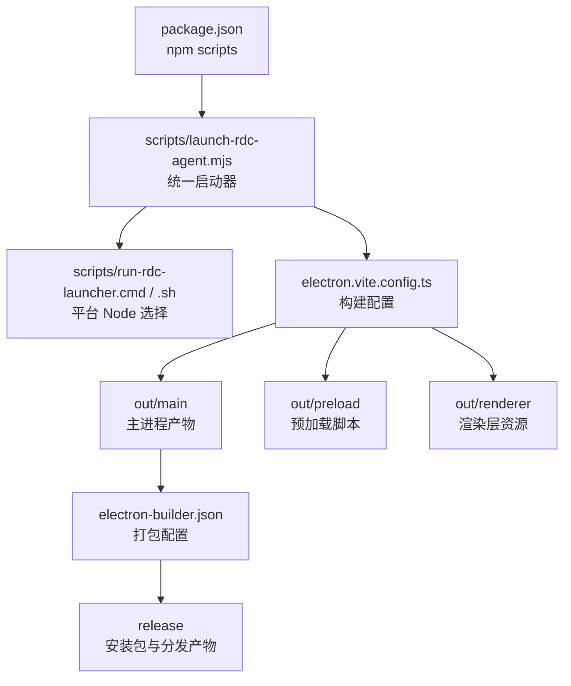
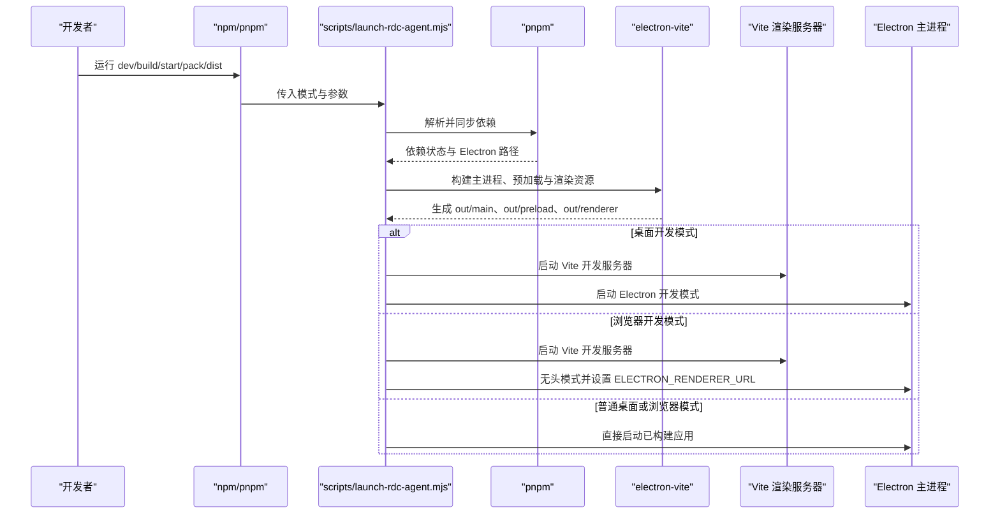
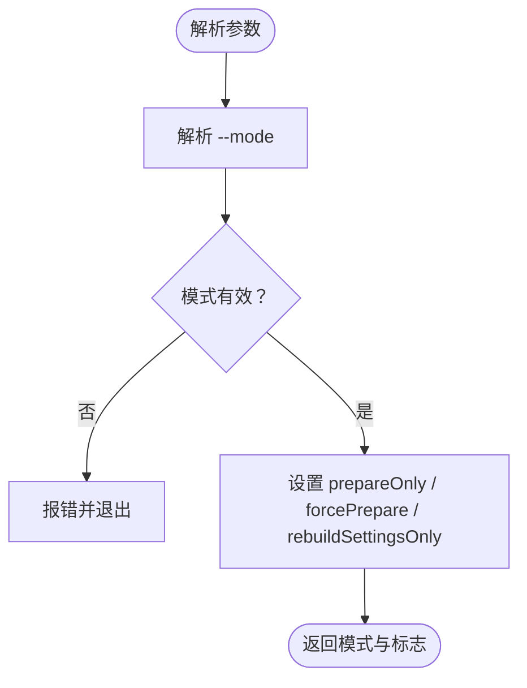
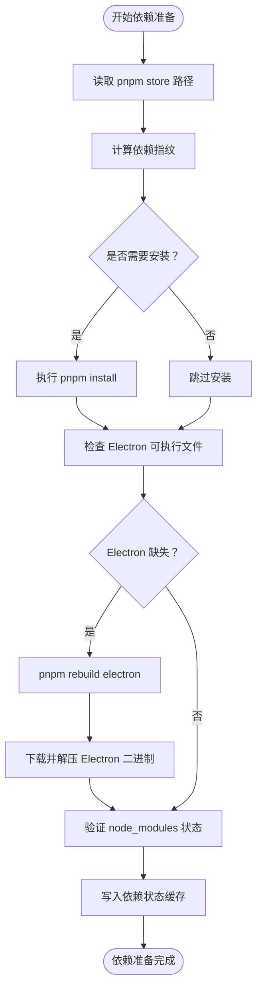
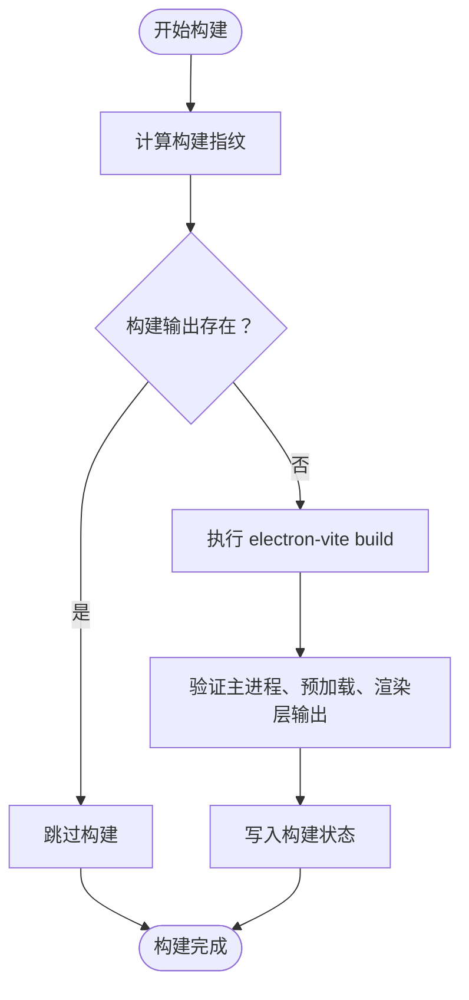
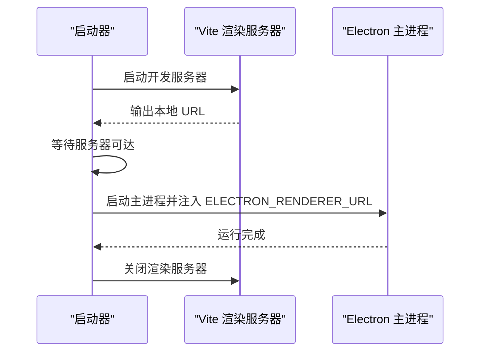
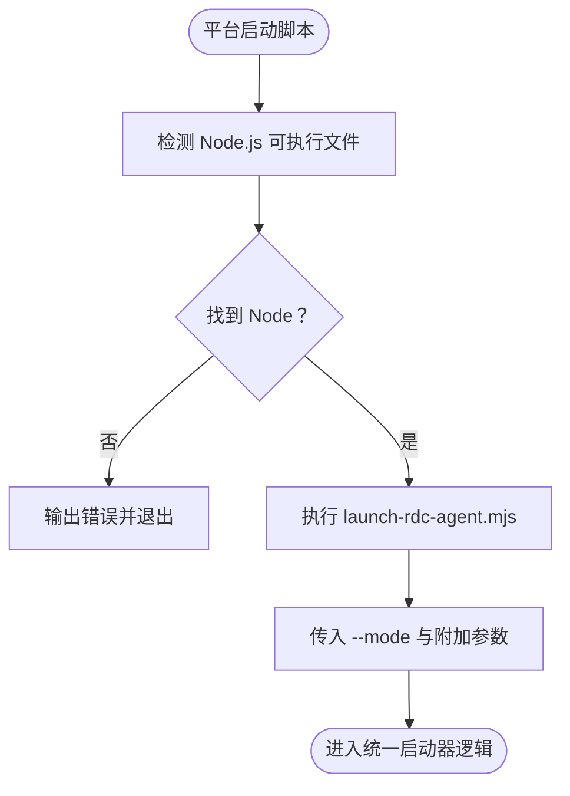
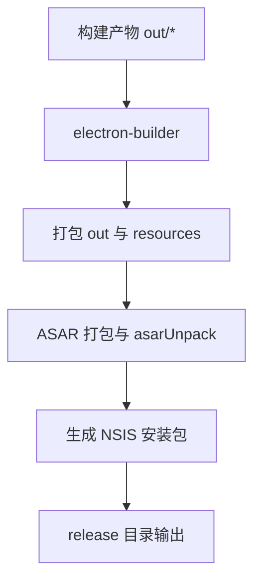
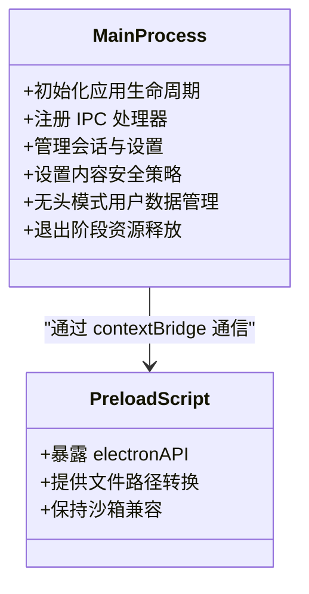
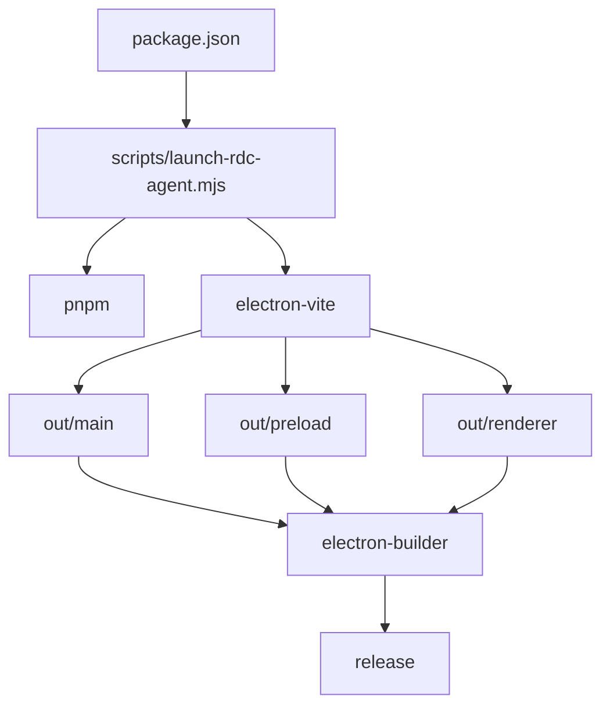

# 构建脚本与工作流

<cite>
**本文引用的文件**   
- [package.json](file://package.json)
- [scripts/launch-rdc-agent.mjs](file://scripts/launch-rdc-agent.mjs)
- [scripts/run-rdc-launcher.cmd](file://scripts/run-rdc-launcher.cmd)
- [scripts/run-rdc-launcher.sh](file://scripts/run-rdc-launcher.sh)
- [scripts/start-rdc-agent.cmd](file://scripts/start-rdc-agent.cmd)
- [scripts/start-rdc-agent.sh](file://scripts/start-rdc-agent.sh)
- [electron.vite.config.ts](file://electron.vite.config.ts)
- [electron-builder.json](file://electron-builder.json)
- [src/main/index.ts](file://src/main/index.ts)
- [src/preload/index.ts](file://src/preload/index.ts)
</cite>

## 目录
1. [简介](#简介)
2. [项目结构](#项目结构)
3. [核心构建与启动脚本](#核心构建与启动脚本)
4. [架构总览](#架构总览)
5. [详细组件分析](#详细组件分析)
6. [依赖关系分析](#依赖关系分析)
7. [性能考虑](#性能考虑)
8. [故障排查指南](#故障排查指南)
9. [结论](#结论)

## 简介
RDC-Agent 是一个基于 Electron 的桌面应用，用于 RenderDoc `.rdc` 捕获分析与代理式调试工作流。其构建与启动流程由 npm scripts、Node 启动器 `scripts/launch-rdc-agent.mjs`、Vite/Electron-Vite 构建配置以及 electron-builder 打包配置共同组成。本文聚焦构建脚本与工作流，解释开发模式、生产构建、Electron 打包产物、多模式启动逻辑，以及 Windows 与 Linux/macOS 下启动脚本的差异。

## 项目结构
RDC-Agent 采用分层工程结构：
- `src/main`：Electron 主进程实现，包括会话、设置、工具、IPC、工作流等模块。
- `src/preload`：预加载脚本，通过 `contextBridge` 向渲染层暴露安全 API。
- `src/renderer`：基于 React + Vite 的渲染层前端。
- `src/shared`：主进程与渲染层共享的类型、常量与工具。
- `scripts`：构建、检查、启动辅助脚本。
- `electron.vite.config.ts`：定义主进程、预加载和渲染层的入口与别名。
- `electron-builder.json`：定义安装包目标、输出目录和资源策略。

**图示来源**
- [package.json:10-100](file://package.json#L10-L100)
- [scripts/launch-rdc-agent.mjs:1-200](file://scripts/launch-rdc-agent.mjs#L1-L200)
- [electron.vite.config.ts:1-62](file://electron.vite.config.ts#L1-L62)
- [electron-builder.json:1-54](file://electron-builder.json#L1-L54)

**章节来源**
- [package.json:1-143](file://package.json#L1-L143)
- [electron.vite.config.ts:1-62](file://electron.vite.config.ts#L1-L62)
- [electron-builder.json:1-54](file://electron-builder.json#L1-L54)

## 核心构建与启动脚本
### npm scripts 概览
`package.json` 中定义了 RDC-Agent 的核心开发与发布脚本：
- `dev`：进入桌面开发模式，实际执行 `node scripts/launch-rdc-agent.mjs --mode desktop-dev`。
- `build`：使用 `electron-vite build` 构建主进程、预加载脚本与渲染层资源。
- `start`：启动已构建的桌面应用，实际执行 `node scripts/launch-rdc-agent.mjs --mode desktop`。
- `pack`：以“目录”方式生成可运行包，不创建安装程序，适合快速验证。
- `dist`：调用 electron-builder 生成完整安装包（Windows 默认包含 NSIS）。
- `dev:renderer`：单独启动渲染层 Vite 开发服务器，端口默认为 `5173`。
- `start:agent-browser` / `start:agent-browser:dev`：在浏览器或带渲染开发服务器的模式下启动无头主进程。
- `start:prepare`：仅准备依赖与构建产物，不启动 Electron。

这些脚本统一通过 `scripts/launch-rdc-agent.mjs` 解析参数并决定后续行为。

**章节来源**
- [package.json:10-100](file://package.json#L10-L100)

### 启动器 `scripts/launch-rdc-agent.mjs` 的职责
该启动器是 RDC-Agent 构建与运行流程的核心控制器，负责：
1. 校验 Node.js 版本是否满足要求。
2. 解析命令行参数，确定启动模式。
3. 定位 pnpm 并同步依赖，计算指纹以避免重复安装。
4. 确保 Electron 运行时可用，必要时重建 Electron 二进制。
5. 按需构建应用源文件。
6. 根据模式启动 Electron 主进程或渲染开发服务器。
7. 在无头浏览器模式下管理临时用户数据目录。

它支持以下模式：
- `desktop`：启动可见的 Electron 桌面应用。
- `desktop-dev`：进入 Electron 开发模式，配合渲染层热更新。
- `browser`：以无头模式启动 Electron，用于浏览器兼容性验证。
- `browser-dev`：先启动渲染层 Vite 开发服务器，再启动无头主进程连接该服务器。
- `prepare-only`：仅完成依赖准备与构建，不启动 Electron。

此外还支持额外参数：
- `--force-prepare`：强制重新准备依赖和构建。
- `--rebuild-settings-only`：仅重建设置相关逻辑，避免完整重启。
- `--mode <模式>`：显式指定启动模式。

**章节来源**
- [scripts/launch-rdc-agent.mjs:1-200](file://scripts/launch-rdc-agent.mjs#L1-L200)
- [scripts/launch-rdc-agent.mjs:201-530](file://scripts/launch-rdc-agent.mjs#L201-L530)

## 架构总览
RDC-Agent 的构建与启动链路如下：

**图示来源**
- [package.json:10-100](file://package.json#L10-L100)
- [scripts/launch-rdc-agent.mjs:201-530](file://scripts/launch-rdc-agent.mjs#L201-L530)
- [electron.vite.config.ts:1-62](file://electron.vite.config.ts#L1-L62)

## 详细组件分析

### 启动器参数与模式解析
启动器通过 `parseArgs` 解析 `argv`，支持：
- `--mode`：指定 `desktop`、`desktop-dev`、`browser`、`browser-dev`、`prepare-only`。
- `--prepare-only`：仅准备环境。
- `--force-prepare`：强制重新准备。
- `--rebuild-settings-only`：仅重建设置。

若传入未知参数或无效模式，启动器会输出错误并退出。

**图示来源**
- [scripts/launch-rdc-agent.mjs:1-100](file://scripts/launch-rdc-agent.mjs#L1-L100)

**章节来源**
- [scripts/launch-rdc-agent.mjs:1-100](file://scripts/launch-rdc-agent.mjs#L1-L100)

### 环境变量与模式差异
启动器根据模式生成运行时环境变量：
- `NODE_ENV`：`desktop-dev` 与 `browser-dev` 为 `development`，其余为 `production`。
- `RDC_AGENT_HEADLESS`：`browser` 与 `browser-dev` 为 `1`，其余为 `0`。
- `RDC_AGENT_BROWSER_QA`：无头模式设置为 `1`，用于浏览器质量保障场景。
- `RDC_AGENT_TEST_MODE`：固定为 `0`，表示非测试模式。
- `RDC_AGENT_REBUILD_SETTINGS_ONLY`：当传入 `--rebuild-settings-only` 时为 `1`。
- `ELECTRON_RENDERER_URL`：仅在 `browser-dev` 模式下注入，指向渲染层开发服务器地址。

主进程 `src/main/index.ts` 会根据这些变量切换行为：
- 检测 `isDev`：基于 `NODE_ENV` 与非测试模式判断是否为开发环境。
- 检测 `isHeadlessMode`：根据 `RDC_AGENT_HEADLESS` 或 `RDC_AGENT_BROWSER_QA` 启用无头模式。
- 在浏览器质量保障模式下，可能创建临时用户数据目录，避免污染正式用户数据。

**章节来源**
- [scripts/launch-rdc-agent.mjs:300-400](file://scripts/launch-rdc-agent.mjs#L300-L400)
- [src/main/index.ts:1-200](file://src/main/index.ts#L1-L200)

### 依赖准备与 Electron 二进制恢复
依赖准备阶段：
1. 读取 pnpm store 路径。
2. 计算依赖指纹，包含 `package.json`、`pnpm-lock.yaml`、`pnpm-workspace.yaml`、pnpm 版本、平台、架构、Node ABI 等。
3. 若指纹变化、store 路径变化或缺少关键依赖，则执行 `pnpm install --frozen-lockfile --prefer-offline`。
4. 尝试从 `node_modules/electron` 中解析 Electron 可执行文件；若缺失，则尝试 `pnpm rebuild electron`。
5. 若仍不可用，则通过 `@electron/get` 下载对应平台与架构的二进制，并使用系统 `tar` 解压到 `node_modules/electron/dist`。
6. 将依赖状态写入缓存文件，避免重复准备。

**图示来源**
- [scripts/launch-rdc-agent.mjs:100-250](file://scripts/launch-rdc-agent.mjs#L100-L250)

**章节来源**
- [scripts/launch-rdc-agent.mjs:100-250](file://scripts/launch-rdc-agent.mjs#L100-L250)

### 构建产物与构建缓存
构建阶段由 `electron-vite` 完成，输入定义在 `electron.vite.config.ts`：
- 主进程入口：`src/main/index.ts`，同时包含 `turnPreparationWorker.ts` 作为独立 worker 入口。
- 预加载脚本入口：`src/preload/index.ts`。
- 渲染层入口：`src/renderer/index.html`。

构建输出位于：
- `out/main`：主进程编译后的 JavaScript 与资源。
- `out/preload`：预加载脚本。
- `out/renderer`：渲染层静态资源与 HTML。

构建缓存通过哈希判断是否需要重建，哈希输入包括源代码、资源、配置文件、TypeScript 配置与依赖锁文件。若构建输出缺失，则重新执行 `electron-vite build`。

**图示来源**
- [electron.vite.config.ts:1-62](file://electron.vite.config.ts#L1-L62)
- [scripts/launch-rdc-agent.mjs:250-350](file://scripts/launch-rdc-agent.mjs#L250-L350)

**章节来源**
- [electron.vite.config.ts:1-62](file://electron.vite.config.ts#L1-L62)
- [scripts/launch-rdc-agent.mjs:250-350](file://scripts/launch-rdc-agent.mjs#L250-L350)

### 渲染层开发服务器与无头浏览器模式
在 `browser-dev` 模式下，启动器会：
1. 启动 Vite 渲染开发服务器，端口由操作系统分配。
2. 监听 stdout/stderr，解析服务器输出的本地 URL。
3. 等待渲染服务器可达后，启动 Electron 主进程，并注入 `ELECTRON_RENDERER_URL`。
4. 在进程退出时清理渲染服务器子进程。

这使浏览器兼容性测试能够复用渲染层开发服务器的热更新能力，同时保持主进程无头运行。

**图示来源**
- [scripts/launch-rdc-agent.mjs:400-530](file://scripts/launch-rdc-agent.mjs#L400-L530)

**章节来源**
- [scripts/launch-rdc-agent.mjs:400-530](file://scripts/launch-rdc-agent.mjs#L400-L530)

### Windows 与 Linux/macOS 启动脚本差异
RDC-Agent 提供跨平台启动包装脚本：

#### Windows
- `scripts/start-rdc-agent.cmd`：调用 `run-rdc-launcher.cmd`，默认模式为 `desktop`。
- `scripts/run-rdc-launcher.cmd`：优先使用 `RDC_AGENT_NODE` 指定的 Node 可执行文件；否则查找系统 `node`；若不存在，则回退到 Codex 内置 Node 路径；找不到则报错退出。

#### Linux/macOS
- `scripts/start-rdc-agent.sh`：调用 `run-rdc-launcher.sh`，默认模式为 `desktop`。
- `scripts/run-rdc-launcher.sh`：优先使用 `RDC_AGENT_NODE`；否则尝试 `command -v node`；再尝试 Codex 内置 Node 路径；找不到则报错退出。

两者均会将原始参数透传给 `scripts/launch-rdc-agent.mjs`，因此最终启动逻辑一致，差异仅在于 Node 可执行文件的发现策略。

**图示来源**
- [scripts/start-rdc-agent.cmd:1-3](file://scripts/start-rdc-agent.cmd#L1-L3)
- [scripts/start-rdc-agent.sh:1-4](file://scripts/start-rdc-agent.sh#L1-L4)
- [scripts/run-rdc-launcher.cmd:1-28](file://scripts/run-rdc-launcher.cmd#L1-L28)
- [scripts/run-rdc-launcher.sh:1-21](file://scripts/run-rdc-launcher.sh#L1-L21)

**章节来源**
- [scripts/start-rdc-agent.cmd:1-3](file://scripts/start-rdc-agent.cmd#L1-L3)
- [scripts/start-rdc-agent.sh:1-4](file://scripts/start-rdc-agent.sh#L1-L4)
- [scripts/run-rdc-launcher.cmd:1-28](file://scripts/run-rdc-launcher.cmd#L1-L28)
- [scripts/run-rdc-launcher.sh:1-21](file://scripts/run-rdc-launcher.sh#L1-L21)

### electron-builder 配置与 NSIS 安装包生成
`electron-builder.json` 定义了应用标识、产品名称、输出目录、打包文件、额外资源、签名与目标平台：
- `appId`：`com.rdc-agent.app`。
- `productName`：`RDC-Agent`。
- `directories.output`：`release`。
- `files`：打包 `out/**/*` 以及 agent-runtime 与 knowledge 资源。
- `asarUnpack`：保留 `resources/agent-runtime/hooks/**/*.mjs` 不被打包进 ASAR。
- `extraResources`：将 hooks 与品牌 Logo 复制到应用资源目录。
- `win.target`：生成 `nsis` 与 `zip` 两种目标，均为 x64。
- `nsis`：禁用一键安装，允许更改安装目录，卸载时不清理用户数据。

NSIS 安装包命名规则为 `${productName}-${version}-${arch}-setup.${ext}`，例如 `RDC-Agent-0.6.0-rc.8-x64-setup.exe`。

**图示来源**
- [electron-builder.json:1-54](file://electron-builder.json#L1-L54)

**章节来源**
- [electron-builder.json:1-54](file://electron-builder.json#L1-L54)

### 主进程与预加载脚本职责
主进程入口 `src/main/index.ts` 负责：
- 初始化 Electron 应用生命周期。
- 注册 IPC 处理器、会话服务、设置服务、工具调用、浏览器桥接、工作流协调器等。
- 设置内容安全策略与权限处理。
- 在无头模式下管理临时用户数据目录。
- 在退出阶段按阶段释放资源。

预加载脚本 `src/preload/index.ts` 负责：
- 通过 `contextBridge` 暴露 `electronAPI` 给渲染层。
- 提供安全的文件路径转换能力。
- 明确禁止在预加载脚本中直接导入 Node 内部模块，保证沙箱兼容。

**图示来源**
- [src/main/index.ts:1-200](file://src/main/index.ts#L1-L200)
- [src/preload/index.ts:1-25](file://src/preload/index.ts#L1-L25)

**章节来源**
- [src/main/index.ts:1-200](file://src/main/index.ts#L1-L200)
- [src/preload/index.ts:1-25](file://src/preload/index.ts#L1-L25)

## 依赖关系分析
RDC-Agent 的构建与启动依赖链如下：

**图示来源**
- [package.json:10-100](file://package.json#L10-L100)
- [scripts/launch-rdc-agent.mjs:1-530](file://scripts/launch-rdc-agent.mjs#L1-L530)
- [electron.vite.config.ts:1-62](file://electron.vite.config.ts#L1-L62)
- [electron-builder.json:1-54](file://electron-builder.json#L1-L54)

**章节来源**
- [package.json:10-100](file://package.json#L10-L100)
- [scripts/launch-rdc-agent.mjs:1-530](file://scripts/launch-rdc-agent.mjs#L1-L530)
- [electron.vite.config.ts:1-62](file://electron.vite.config.ts#L1-L62)
- [electron-builder.json:1-54](file://electron-builder.json#L1-L54)

## 性能考虑
以下是基于当前构建与启动脚本的性能优化建议：

1. **减少重复安装**
   - 依赖指纹已包含 `package.json`、`pnpm-lock.yaml`、`pnpm-workspace.yaml`、pnpm 版本、平台、架构与 Node ABI，通常可避免重复安装。
   - 若频繁切换 Node 或 pnpm store 路径，可能导致 `node_modules` 重建。建议使用稳定路径并避免手动删除 `node_modules`。

2. **利用构建缓存**
   - 构建指纹包含源代码、资源、配置文件、TypeScript 配置与依赖锁文件。修改较少时，`electron-vite build` 会被跳过。
   - 若只修改渲染层，可先用 `dev:renderer` 单独启动 Vite，再使用 `browser-dev` 模式验证。

3. **Electron 二进制恢复优化**
   - 在 Node ≥24.16 环境下，Electron 的 `extract-zip` 可能出现悬挂问题。启动器已通过 `@electron/get` 与系统 `tar` 恢复二进制，但仍建议在 CI 或干净环境中使用 `--force-prepare` 刷新状态。

4. **无头模式资源占用**
   - `browser` 与 `browser-dev` 模式以无头方式运行，适合自动化测试，但应避免同时启动多个实例造成资源竞争。
   - 浏览器质量保障模式会创建临时用户数据目录，注意清理 `/tmp/rdc-agent` 下的旧目录。

5. **打包体积优化**
   - `asarUnpack` 保留 hooks 中的 `.mjs` 文件，避免运行时无法动态加载。
   - `extraResources` 仅复制必要资源，避免冗余。
   - 若需要进一步减小安装包，可在 `files` 中精确匹配所需文件，而不是全部 `out/**/*`。

[本节为通用性能指导，不直接分析具体代码文件]

## 故障排查指南

### 常见问题与原因
1. **Node.js 版本不满足要求**
   - 启动器要求 Node.js ≥22.13.0。若版本过低，会直接报错并退出。
   - Windows 与 Linux/macOS 的包装脚本会尝试从 `RDC_AGENT_NODE`、系统 PATH 或 Codex 内置路径查找 Node。

2. **Electron 二进制缺失**
   - 常见于 `node_modules/electron` 损坏或 Node ≥24.16 的 extract-zip 问题。
   - 启动器会尝试 `pnpm rebuild electron`，然后下载并解压二进制。若仍失败，需检查系统 `tar` 命令是否可用。

3. **pnpm store 路径变化导致重建**
   - 如果 pnpm store 路径改变，启动器会删除旧的 `node_modules` 并重新安装。
   - 建议固定 pnpm store 路径，或在 CI 中复用缓存。

4. **渲染层开发服务器无法访问**
   - `browser-dev` 模式会等待 Vite 输出本地 URL 并轮询根路径可达性。
   - 若超时，可能是端口被占用、防火墙阻止或 Vite 输出格式不符合预期。

5. **NSIS 安装包未生成或生成异常**
   - 检查 `electron-builder.json` 中 `win.target` 是否包含 `nsis`。
   - 确认 `release` 目录有写入权限，且 `electronDist` 指向有效的 Electron 发行目录。

6. **构建输出缺失**
   - 启动器会验证 `out/main/index.js`、`out/preload/index.js`、`out/renderer/index.html` 等关键输出。
   - 若缺失，会触发重新构建；若仍失败，检查 TypeScript、Vite 或依赖是否存在语法或解析错误。

### 推荐排查步骤
1. 使用 `pnpm run start:prepare` 仅准备依赖与构建，观察是否有依赖安装或构建错误。
2. 使用 `pnpm run dev` 启动桌面开发模式，确认渲染层热更新是否正常。
3. 使用 `pnpm run start:agent-browser:dev` 启动浏览器开发模式，观察是否能解析 Vite 服务器 URL。
4. 使用 `pnpm run pack` 生成目录包，快速验证应用能否运行。
5. 使用 `pnpm run dist` 生成安装包，检查 `release` 目录中的 NSIS 安装包。

**章节来源**
- [scripts/launch-rdc-agent.mjs:1-530](file://scripts/launch-rdc-agent.mjs#L1-L530)
- [scripts/run-rdc-launcher.cmd:1-28](file://scripts/run-rdc-launcher.cmd#L1-L28)
- [scripts/run-rdc-launcher.sh:1-21](file://scripts/run-rdc-launcher.sh#L1-L21)
- [electron-builder.json:1-54](file://electron-builder.json#L1-L54)

## 结论
RDC-Agent 的构建与工作流以 `scripts/launch-rdc-agent.mjs` 为核心，统一协调 pnpm 依赖、Electron 运行时、electron-vite 构建与 electron-builder 打包。通过多种启动模式，开发者可以在桌面开发、浏览器兼容验证与生产构建之间快速切换。理解各脚本职责、环境变量语义与平台差异，有助于高效定位构建与启动问题，并在此基础上进一步优化性能与可靠性。