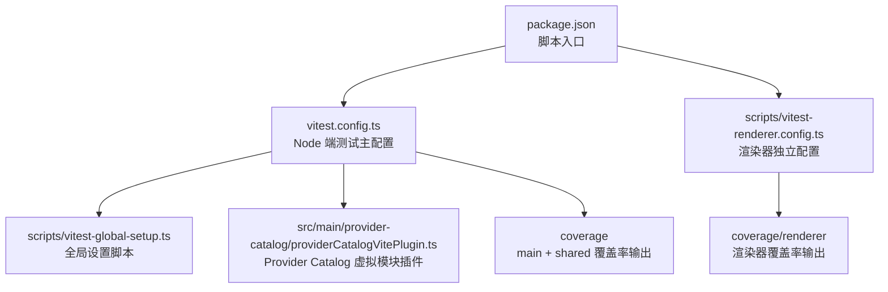
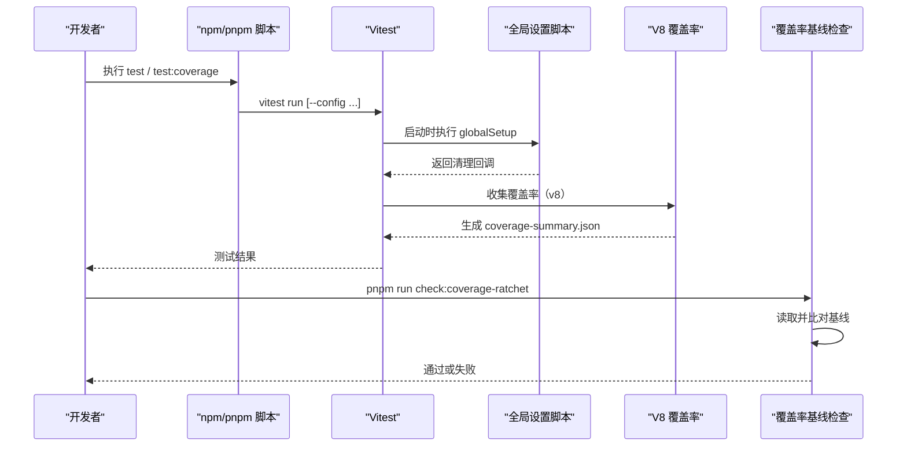
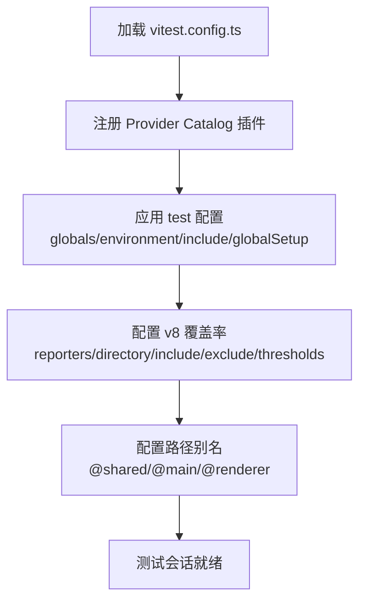
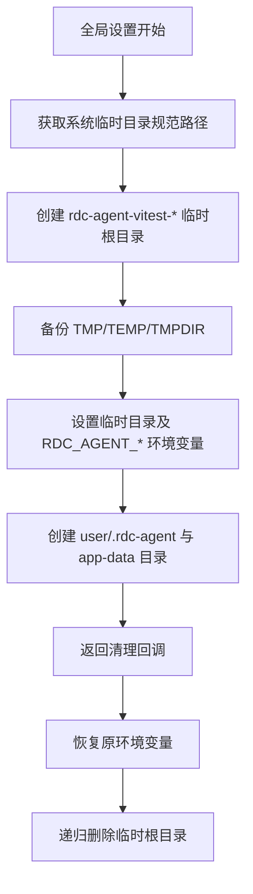
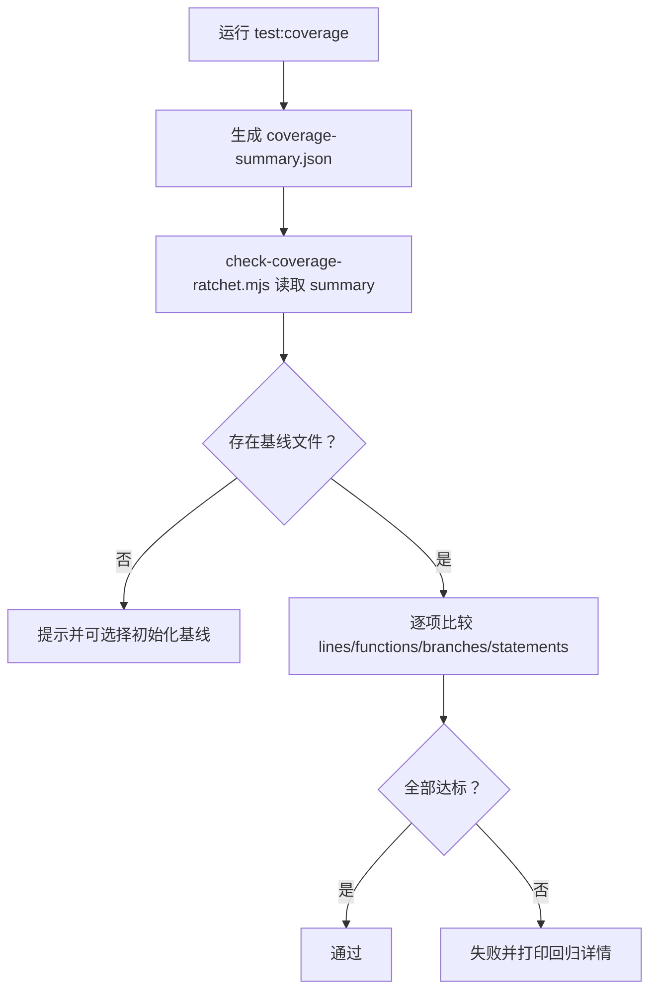
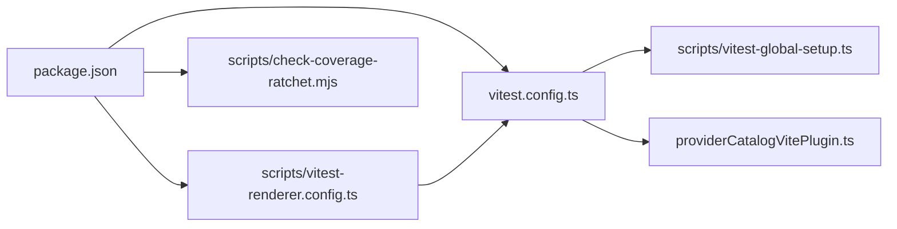

# 单元测试

<cite>
**本文引用的文件**   
- [vitest.config.ts](file://vitest.config.ts)
- [scripts/vitest-global-setup.ts](file://scripts/vitest-global-setup.ts)
- [scripts/vitest-renderer.config.ts](file://scripts/vitest-renderer.config.ts)
- [package.json](file://package.json)
- [scripts/check-coverage-ratchet.mjs](file://scripts/check-coverage-ratchet.mjs)
- [src/main/provider-catalog/providerCatalogVitePlugin.ts](file://src/main/provider-catalog/providerCatalogVitePlugin.ts)
</cite>

## 目录
1. [简介](#简介)
2. [项目结构](#项目结构)
3. [核心组件](#核心组件)
4. [架构总览](#架构总览)
5. [详细组件分析](#详细组件分析)
6. [依赖关系分析](#依赖关系分析)
7. [性能与覆盖率特性](#性能与覆盖率特性)
8. [测试编写最佳实践](#测试编写最佳实践)
9. [常见问题与排错](#常见问题与排错)
10. [结论](#结论)

## 简介
本文面向 RDC-Agent 的单元测试体系，聚焦 Vitest 配置、全局隔离机制、覆盖率门槛与“只升不降”基线策略，并给出 main 进程与 shared 层代码的测试策略、Mock 建议、异步与错误覆盖要点，以及常见问题的解决方案。文档尽量以工程现有实现为依据，帮助开发者在不深入源码的情况下也能安全、高效地编写和维护测试。

## 项目结构
RDC-Agent 使用根级 `vitest.config.ts` 作为 Node 端测试主配置，并通过 `scripts/vitest-renderer.config.ts` 提供渲染器侧独立配置。所有 `.test.ts` 文件统一遵循 `src/**/*.test.ts` 匹配规则；渲染器测试通过独立的 include 路径和报告目录进行隔离。

**图示来源**
- [package.json:1-143](file://package.json#L1-L143)
- [vitest.config.ts:1-81](file://vitest.config.ts#L1-L81)
- [scripts/vitest-global-setup.ts:1-32](file://scripts/vitest-global-setup.ts#L1-L32)
- [scripts/vitest-renderer.config.ts:1-17](file://scripts/vitest-renderer.config.ts#L1-L17)
- [src/main/provider-catalog/providerCatalogVitePlugin.ts:1-59](file://src/main/provider-catalog/providerCatalogVitePlugin.ts#L1-L59)

**章节来源**
- [vitest.config.ts:1-81](file://vitest.config.ts#L1-L81)
- [scripts/vitest-renderer.config.ts:1-17](file://scripts/vitest-renderer.config.ts#L1-L17)
- [package.json:1-143](file://package.json#L1-L143)

## 核心组件
- Vitest 主配置：定义全局开关、运行环境、测试包含规则、覆盖率 provider/报告/阈值/包含排除范围、路径别名，并注入 Provider Catalog Vite 插件。
- 全局设置脚本：在测试前创建临时根目录，隔离临时文件、`RDC_AGENT_HOME`、`RDC_AGENT_USER_DATA` 等关键路径，并在结束后清理。
- 渲染器配置：继承主配置，仅对 `src/renderer/**/*.test.ts` 生成独立覆盖率报告，且不启用门槛检查。
- 覆盖率基线检查脚本：读取 Vitest 输出的 JSON Summary，与基线文件比较，确保覆盖率不下降。

**章节来源**
- [vitest.config.ts:1-81](file://vitest.config.ts#L1-L81)
- [scripts/vitest-global-setup.ts:1-32](file://scripts/vitest-global-setup.ts#L1-L32)
- [scripts/vitest-renderer.config.ts:1-17](file://scripts/vitest-renderer.config.ts#L1-L17)
- [scripts/check-coverage-ratchet.mjs:1-87](file://scripts/check-coverage-ratchet.mjs#L1-L87)

## 架构总览
下图展示从 npm 脚本到 Vitest、全局设置、覆盖率与基线检查的整体流程。

**图示来源**
- [package.json:1-143](file://package.json#L1-L143)
- [vitest.config.ts:1-81](file://vitest.config.ts#L1-L81)
- [scripts/vitest-global-setup.ts:1-32](file://scripts/vitest-global-setup.ts#L1-L32)
- [scripts/check-coverage-ratchet.mjs:1-87](file://scripts/check-coverage-ratchet.mjs#L1-L87)

## 详细组件分析

### Vitest 主配置解析
主配置文件完成以下关键任务：
- 启用全局 API：`globals: true`，测试中可直接使用 `describe`、`it`、`expect` 等。
- 运行环境：`environment: 'node'`，适合 main 与 shared 层的 Node 单元测试。
- 测试文件包含：`include: ['src/**/*.test.ts']`，同时覆盖 main、shared、preload 等目录下的测试文件。
- 全局设置：`globalSetup: ['./scripts/vitest-global-setup.ts']`，为所有 worker 提供一致的隔离环境。
- 覆盖率：
  - provider：`v8`
  - reporter：`text`、`lcov`、`json-summary`
  - reportsDirectory：`./coverage`
  - include：`src/main/**/*.{ts,tsx}` 与 `src/shared/**/*.{ts,tsx}`
  - exclude：大量 Electron/OS 集成相关、IPC 胶水、浏览器 QA、工作线程、工具调用、OAuth 登录、旧注册表等。
  - thresholds：lines 40、functions 40、branches 30、statements 40。
- 路径别名：`@shared`、`@main`、`@renderer`。
- Vite 插件：注入 `providerCatalogVitePlugin`，使 Provider Catalog 编译产物在测试中可被正确加载。

**图示来源**
- [vitest.config.ts:1-81](file://vitest.config.ts#L1-L81)
- [src/main/provider-catalog/providerCatalogVitePlugin.ts:1-59](file://src/main/provider-catalog/providerCatalogVitePlugin.ts#L1-L59)

**章节来源**
- [vitest.config.ts:1-81](file://vitest.config.ts#L1-L81)
- [src/main/provider-catalog/providerCatalogVitePlugin.ts:1-59](file://src/main/provider-catalog/providerCatalogVitePlugin.ts#L1-L59)

### 全局设置脚本与安全隔离
全局设置脚本在 Vitest 启动时运行，负责：
- 获取系统临时目录规范路径，并创建以 `rdc-agent-vitest-` 为前缀的临时根目录。
- 备份当前进程的 `TMP`、`TEMP`、`TMPDIR` 环境变量，并指向新创建的临时目录。
- 设置 `RDC_AGENT_HOME` 与 `RDC_AGENT_USER_DATA` 为临时子目录，确保测试不会读写真实用户数据。
- 设置 `RDC_AGENT_QA_INSTANCE_ID` 为带进程标识的唯一值，避免多实例冲突。
- 返回清理函数：恢复原临时环境变量，删除整个临时根目录。

**图示来源**
- [scripts/vitest-global-setup.ts:1-32](file://scripts/vitest-global-setup.ts#L1-L32)

该机制保证：
- 测试间互不干扰：每个 Vitest 进程拥有独立临时根目录。
- 安全隔离：不触碰真实 `~/.rdc-agent` 与应用数据目录。
- 可重现：临时路径基于系统 `tmpdir`，便于调试日志定位。

**章节来源**
- [scripts/vitest-global-setup.ts:1-32](file://scripts/vitest-global-setup.ts#L1-L32)

### 渲染器测试配置
渲染器测试通过独立配置文件继承主配置，并将：
- include 限定为 `src/renderer/**/*.test.ts`
- coverage.include 限定为 `src/renderer/**/*.{ts,tsx}`
- reportsDirectory 改为 `./coverage/renderer`
- thresholds 置空，避免影响 main/shared 的覆盖率门槛

这意味着渲染器 UI 测试可以独立产出覆盖率报告，而不改变主工程的覆盖率基线。

**章节来源**
- [scripts/vitest-renderer.config.ts:1-17](file://scripts/vitest-renderer.config.ts#L1-L17)
- [vitest.config.ts:1-81](file://vitest.config.ts#L1-L81)

### 覆盖率统计与基线“只升不降”
主配置的覆盖率策略：
- provider：`v8`
- reporter：文本、LCOV、JSON Summary
- 输出目录：`./coverage`
- include：main 与 shared 源文件
- exclude：大量非单元测试面，如 IPC handlers、Electron 桌面外壳、工具调用、媒体、捕获、工作线程、OAuth、旧注册表等
- thresholds：lines 40、functions 40、branches 30、statements 40

基线检查脚本会读取 `coverage/coverage-summary.json` 中的总计百分比，并与 `scripts/fidelity/coverage-ratchet.json` 对比。若任何指标低于基线，则失败；首次缺失时可初始化基线。

**图示来源**
- [vitest.config.ts:1-81](file://vitest.config.ts#L1-L81)
- [scripts/check-coverage-ratchet.mjs:1-87](file://scripts/check-coverage-ratchet.mjs#L1-L87)

**章节来源**
- [vitest.config.ts:1-81](file://vitest.config.ts#L1-L81)
- [scripts/check-coverage-ratchet.mjs:1-87](file://scripts/check-coverage-ratchet.mjs#L1-L87)

### Provider Catalog 虚拟模块插件的作用
Provider Catalog Vite 插件在测试环境中将 Provider Catalog 清单编译为虚拟模块，暴露索引与按需加载的 surface 接口。这使测试能稳定访问 Provider Catalog 的结构与能力，而不依赖外部构建产物。

**章节来源**
- [src/main/provider-catalog/providerCatalogVitePlugin.ts:1-59](file://src/main/provider-catalog/providerCatalogVitePlugin.ts#L1-L59)

## 依赖关系分析
- package.json 暴露 `test`、`test:watch`、`test:coverage`、`test:coverage:renderer` 等脚本，分别驱动 Vitest 与渲染器独立配置。
- Vitest 主配置依赖 Provider Catalog Vite 插件，以便在测试中编译与消费 Provider Catalog。
- 渲染器配置依赖主配置，复用全局设置、别名与大部分测试行为，仅在 include、reportsDirectory、thresholds 上差异化。
- 覆盖率基线检查脚本依赖 Vitest 输出的 JSON Summary 与 fidelity 基线文件。

**图示来源**
- [package.json:1-143](file://package.json#L1-L143)
- [vitest.config.ts:1-81](file://vitest.config.ts#L1-L81)
- [scripts/vitest-global-setup.ts:1-32](file://scripts/vitest-global-setup.ts#L1-L32)
- [scripts/vitest-renderer.config.ts:1-17](file://scripts/vitest-renderer.config.ts#L1-L17)
- [scripts/check-coverage-ratchet.mjs:1-87](file://scripts/check-coverage-ratchet.mjs#L1-L87)
- [src/main/provider-catalog/providerCatalogVitePlugin.ts:1-59](file://src/main/provider-catalog/providerCatalogVitePlugin.ts#L1-L59)

**章节来源**
- [package.json:1-143](file://package.json#L1-L143)
- [vitest.config.ts:1-81](file://vitest.config.ts#L1-L81)
- [scripts/vitest-renderer.config.ts:1-17](file://scripts/vitest-renderer.config.ts#L1-L17)
- [scripts/check-coverage-ratchet.mjs:1-87](file://scripts/check-coverage-ratchet.mjs#L1-L87)
- [src/main/provider-catalog/providerCatalogVitePlugin.ts:1-59](file://src/main/provider-catalog/providerCatalogVitePlugin.ts#L1-L59)

## 性能与覆盖率特性
- 使用 V8 覆盖率 provider，能获得更准确的 Node 端覆盖率数据，并与现代 Vitest 生态兼容。
- 通过 exclude 列表剔除 IPC 胶水、Electron 集成、浏览器 QA、工作线程、工具调用、媒体、捕获、OAuth、旧注册表等难以用 Node 单元测试覆盖的代码，让覆盖率门槛真正反映核心逻辑质量。
- thresholds 设置相对保守（分支 30%，其余 40%），配合基线“只升不降”，鼓励逐步提升而非一次性暴涨。
- 渲染器覆盖率独立输出且不设门槛，允许前端交互测试演进，不影响后端稳定性门槛。

[本节为通用指导，不直接分析具体文件]

## 测试编写最佳实践

### 测试策略总览
- main 进程：优先测试业务逻辑、状态机、协议编解码、权限与策略、资源解析、会话生命周期片段等；对 IPC handler 与 Electron/OS 绑定部分通常排除在覆盖率之外，但仍应编写集成或场景测试。
- shared 层：重点覆盖类型转换、常量推导、工具函数、Provider Catalog 编译器与能力推断等纯函数与确定性逻辑。
- renderer 层：使用渲染器独立配置运行，关注组件组合、Store 更新、交互反馈；无需满足 main/shared 覆盖率门槛。

### Mock 策略
- 使用 Vitest 内置 `vi` 进行模块与方法桩化，优先 Mock 外部依赖（网络、文件系统、第三方 SDK、IPC）。
- 对 Provider Catalog 等由 Vite 插件生成的虚拟模块，保持默认导入方式即可，插件会在测试中提供编译后的索引与 surface。
- 避免 Mock 被测模块内部实现细节，尽量 Mock 其对外依赖。

### 异步测试处理
- 对于 Promise、事件流、定时器、队列等异步行为，使用 Vitest 提供的等待与断言机制，确保测试在异步完成后断言。
- 对并发、竞态、取消、重试等边界场景，编写专门用例，例如取消、超时、重复提交、状态回退。

### 错误与异常覆盖
- 针对非法输入、越界参数、权限拒绝、网络失败、文件损坏、序列号不一致等场景编写失败用例。
- 确认错误传播路径与日志记录是否按预期发生。
- 对已排除的集成路径，可在对应集成测试或浏览器 QA 中覆盖，但不在 Node 单元测试覆盖率中强求。

### 示例参考
- 测试框架用法与常用 API 可参考任意一个现有 `.test.ts` 文件，例如 preload 层的渲染器传输测试、shared 层的 conversation 分支解析测试、main 层的工具结果摘要测试、renderer 层的转录卡片展示测试等。
- 这些测试展示了 describe/it/expect 的基本组织方式，以及 vi 的使用模式。

**章节来源**
- [src/preload/rendererTransport.test.ts:1-1](file://src/preload/rendererTransport.test.ts#L1-L1)
- [src/shared/conversation/conversationBranchResolver.test.ts:1-1](file://src/shared/conversation/conversationBranchResolver.test.ts#L1-L1)
- [src/main/agent-runtime/tools/ToolResultSummarizer.test.ts:1-1](file://src/main/agent-runtime/tools/ToolResultSummarizer.test.ts#L1-L1)
- [src/renderer/features/transcript/PlanCard.test.ts:1-1](file://src/renderer/features/transcript/PlanCard.test.ts#L1-L1)

## 常见问题与排错

### 问题一：覆盖率门槛失败
现象：运行覆盖率后，`check:coverage-ratchet` 报错，指出某项指标低于基线。
排查步骤：
1. 先运行 `pnpm run test:coverage` 生成 `coverage/coverage-summary.json`。
2. 检查 Vitest 的 include/exclude 是否正确，避免误排除核心逻辑。
3. 新增或修复测试后再次运行覆盖率，确认指标上升。
4. 若确需调整基线，根据脚本提示初始化新的基线文件。

**章节来源**
- [scripts/check-coverage-ratchet.mjs:1-87](file://scripts/check-coverage-ratchet.mjs#L1-L87)
- [vitest.config.ts:1-81](file://vitest.config.ts#L1-L81)

### 问题二：全局设置污染真实用户数据
现象：测试意外写入 `~/.rdc-agent` 或应用数据目录。
排查步骤：
1. 确认 Vitest 正在执行 `scripts/vitest-global-setup.ts`。
2. 检查测试代码是否绕过 Vitest 全局设置自行创建持久目录。
3. 确认 `RDC_AGENT_HOME`、`RDC_AGENT_USER_DATA`、`TMP`、`TEMP`、`TMPDIR` 是否被测试修改但未恢复。
4. 使用 Vitest 的 `beforeEach`/`afterEach` 恢复环境，或在测试内使用临时目录。

**章节来源**
- [scripts/vitest-global-setup.ts:1-32](file://scripts/vitest-global-setup.ts#L1-L32)
- [vitest.config.ts:1-81](file://vitest.config.ts#L1-L81)

### 问题三：Provider Catalog 模块在测试中无法解析
现象：测试导入 Provider Catalog 虚拟模块时报找不到模块或导出为空。
排查步骤：
1. 确认 Vitest 主配置已注册 `providerCatalogVitePlugin`。
2. 确认未禁用 Vite 插件链。
3. 检查 Provider Catalog manifest 是否完整，必要时重新生成或校验清单。
4. 若仅渲染器测试受影响，确认渲染器配置继承主配置。

**章节来源**
- [vitest.config.ts:1-81](file://vitest.config.ts#L1-L81)
- [src/main/provider-catalog/providerCatalogVitePlugin.ts:1-59](file://src/main/provider-catalog/providerCatalogVitePlugin.ts#L1-L59)

### 问题四：渲染器覆盖率与主覆盖率互相影响
现象：渲染器测试导致 main/shared 覆盖率门槛变化。
排查步骤：
1. 确认渲染器测试使用 `scripts/vitest-renderer.config.ts`。
2. 检查渲染器配置中 thresholds 是否为 undefined。
3. 确认报告输出目录为 `./coverage/renderer`，不与主覆盖率混在一起。

**章节来源**
- [scripts/vitest-renderer.config.ts:1-17](file://scripts/vitest-renderer.config.ts#L1-L17)
- [vitest.config.ts:1-81](file://vitest.config.ts#L1-L81)

## 结论
RDC-Agent 的单元测试体系围绕 Vitest 主配置、全局隔离脚本、渲染器独立配置与覆盖率基线检查展开。通过严格的 include/exclude 与 thresholds，结合 V8 覆盖率与“只升不降”的基线策略，项目在保障测试速度的同时，持续巩固 main 与 shared 层的核心质量。编写测试时，应优先关注业务逻辑、状态机、协议与工具函数的正确性，合理 Mock 外部依赖，覆盖异步与错误路径，并遵循现有测试组织风格。遇到覆盖率或环境问题，可按本文排查步骤快速定位并解决。