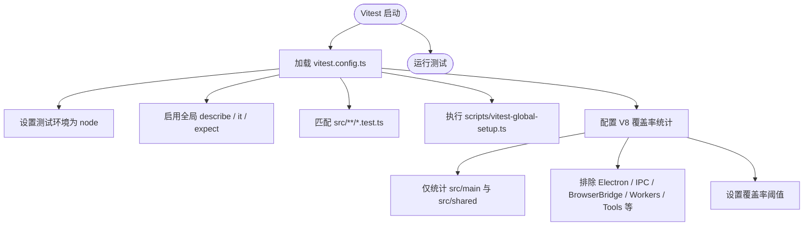
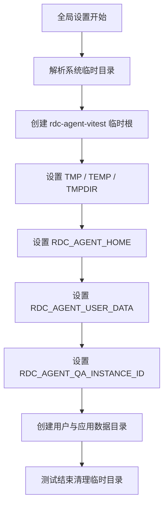
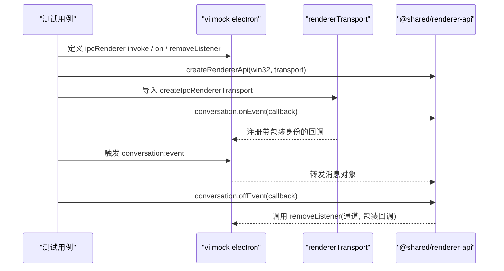
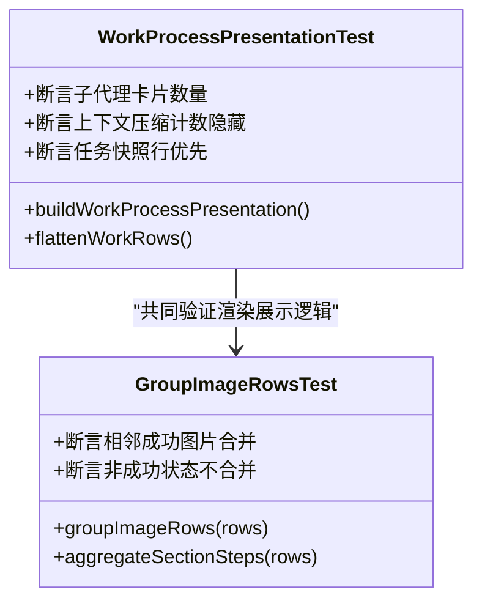
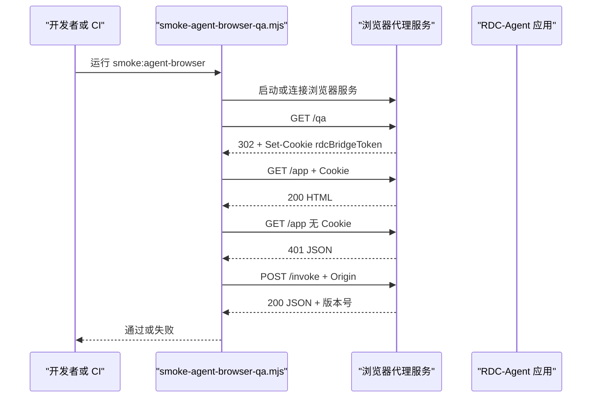
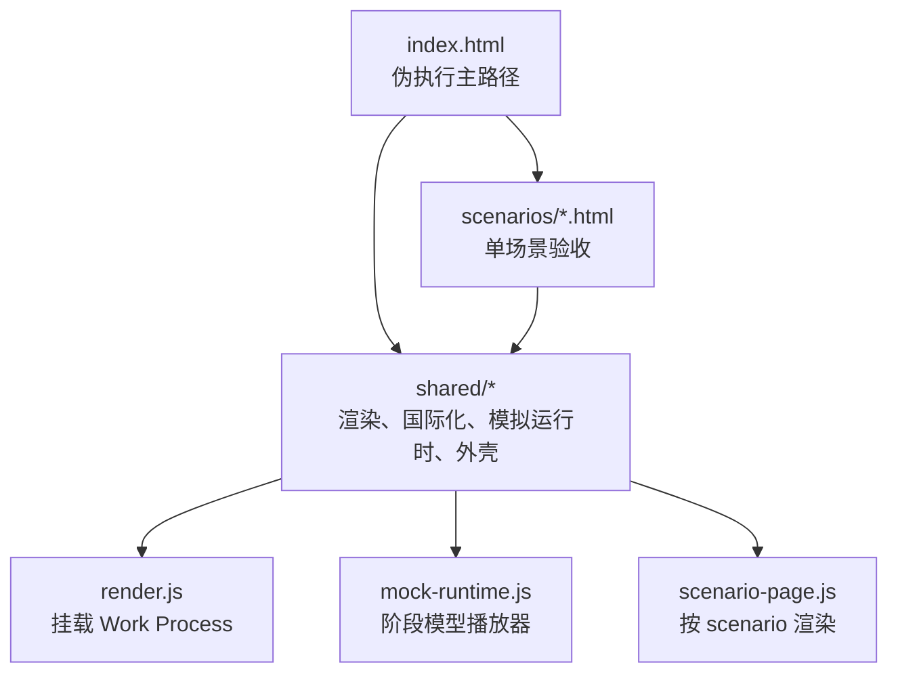
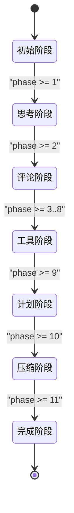
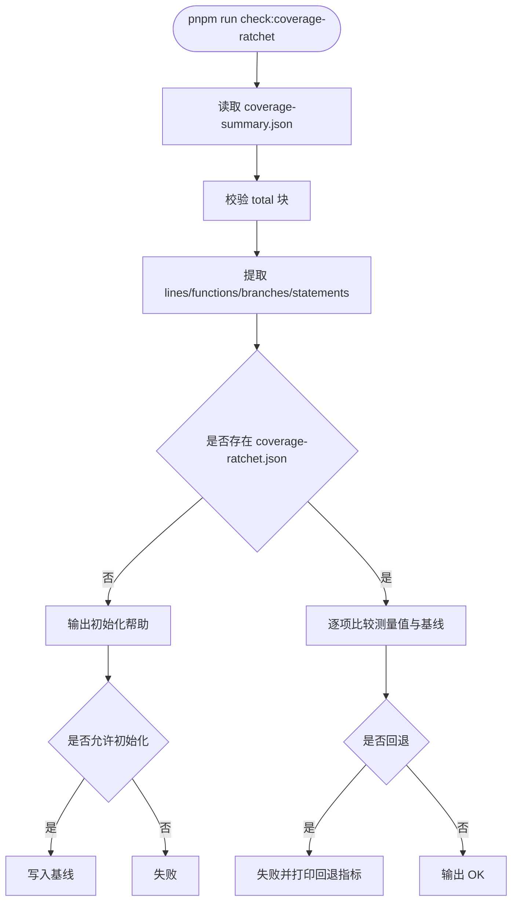
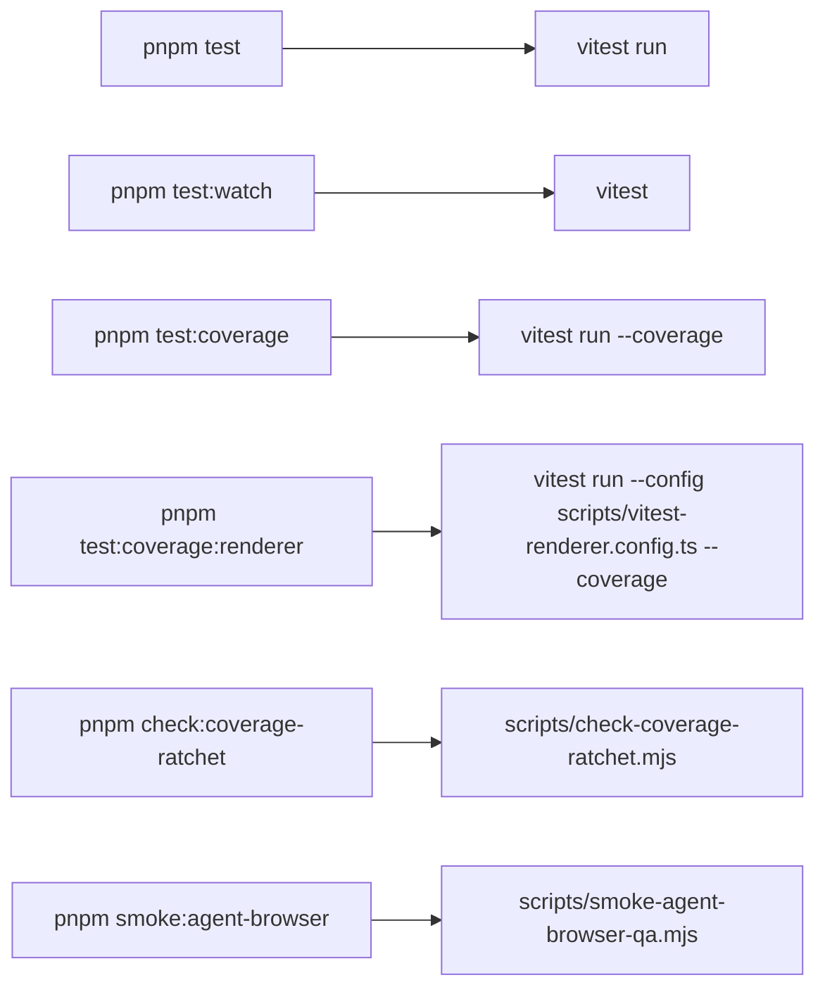

# 测试策略

<cite>
**本文引用的文件**   
- [vitest.config.ts](file://vitest.config.ts)
- [scripts/vitest-global-setup.ts](file://scripts/vitest-global-setup.ts)
- [scripts/vitest-renderer.config.ts](file://scripts/vitest-renderer.config.ts)
- [package.json](file://package.json)
- [scripts/check-coverage-ratchet.mjs](file://scripts/check-coverage-ratchet.mjs)
- [scripts/fidelity/coverage-ratchet.json](file://scripts/fidelity/coverage-ratchet.json)
- [src/preload/rendererTransport.test.ts](file://src/preload/rendererTransport.test.ts)
- [src/main/conversation/ConversationCancellation.test.ts](file://src/main/conversation/ConversationCancellation.test.ts)
- [src/renderer/features/transcript/workProcessPresentation.test.ts](file://src/renderer/features/transcript/workProcessPresentation.test.ts)
- [src/renderer/features/transcript/groupImageRows.test.ts](file://src/renderer/features/transcript/groupImageRows.test.ts)
- [test/work-process-cot/index.html](file://test/work-process-cot/index.html)
- [test/work-process-cot/README.md](file://test/work-process-cot/README.md)
- [test/work-process-cot/shared/scenario-page.js](file://test/work-process-cot/shared/scenario-page.js)
- [test/work-process-cot/shared/mock-runtime.js](file://test/work-process-cot/shared/mock-runtime.js)
- [scripts/open-agent-browser-qa.html](file://scripts/open-agent-browser-qa.html)
- [scripts/smoke-agent-browser-qa.mjs](file://scripts/smoke-agent-browser-qa.mjs)
</cite>

## 目录
1. [引言](#引言)
2. [项目结构与测试范围](#项目结构与测试范围)
3. [核心测试配置](#核心测试配置)
4. [单元测试组织与分层策略](#单元测试组织与分层策略)
5. [渲染层与浏览器质量保证](#渲染层与浏览器质量保证)
6. [端到端与工作过程验收测试](#端到端与工作过程验收测试)
7. [覆盖率阈值与覆盖度门限机制](#覆盖率阈值与覆盖度门限机制)
8. [依赖与测试边界分析](#依赖与测试边界分析)
9. [性能与稳定性考虑](#性能与稳定性考虑)
10. [调试与故障排查指南](#调试与故障排查指南)
11. [结论](#结论)

## 引言
RDC-Agent 的测试体系围绕 Vitest 展开，同时区分 Node 侧的主进程与共享代码、渲染层 UI 组件、以及面向真实工作过程的验收页面。其核心目标是：
- 用 Node 环境验证主进程逻辑与共享类型、工具函数、会话状态转换等。
- 对渲染层组件采用独立配置和报告路径，避免污染主测试的覆盖率门限。
- 通过静态高保真 HTML 场景与浏览器 QA smoke 脚本，验证 Work Process、Agent CoT、浏览器桥接等关键用户体验路径。
- 使用覆盖率门限（ratchet）保证覆盖率不会回退，并通过全局设置隔离文件系统与环境变量。

## 项目结构与测试范围
当前仓库中，Vitest 默认只发现 `src/**/*.test.ts`，因此单元测试按模块位置组织，而不是按测试框架分类。主要测试相关结构如下：

```mermaid
graph TB
    Root["项目根目录"] --> VConf["vitest.config.ts"]
    Root --> Pkg["package.json"]
    Root --> ScriptsDir["scripts/"]
    Root --> SrcDir["src/"]
    Root --> TestDir["test/"]

    ScriptsDir --> GlobalSetup["scripts/vitest-global-setup.ts"]
    ScriptsDir --> RendererConfig["scripts/vitest-renderer.config.ts"]
    ScriptsDir --> CheckRatchet["scripts/check-coverage-ratchet.mjs"]
    ScriptsDir --> SmokeBrowser["scripts/smoke-agent-browser-qa.mjs"]
    ScriptsDir --> OpenQA["scripts/open-agent-browser-qa.html"]

    SrcDir --> MainTests["src/main/**/*.test.ts"]
    SrcDir --> SharedTests["src/shared/**/*.test.ts"]
    SrcDir --> PreloadTest["src/preload/rendererTransport.test.ts"]
    SrcDir --> RendererTests["src/renderer/**/*.test.ts"]

    TestDir --> WorkCotIndex["test/work-process-cot/index.html"]
    TestDir --> WorkCotReadme["test/work-process-cot/README.md"]
    TestDir --> WorkCotShared["test/work-process-cot/shared/*"]
    TestDir --> WorkCotScenarios["test/work-process-cot/scenarios/*.html"]
```

**图表来源**
- [vitest.config.ts:1-81](file://vitest.config.ts#L1-L81)
- [scripts/vitest-global-setup.ts:1-32](file://scripts/vitest-global-setup.ts#L1-L32)
- [scripts/vitest-renderer.config.ts:1-17](file://scripts/vitest-renderer.config.ts#L1-L17)
- [scripts/check-coverage-ratchet.mjs:1-87](file://scripts/check-coverage-ratchet.mjs#L1-L87)
- [scripts/smoke-agent-browser-qa.mjs:1-200](file://scripts/smoke-agent-browser-qa.mjs#L1-L200)
- [scripts/open-agent-browser-qa.html:1-9](file://scripts/open-agent-browser-qa.html#L1-L9)
- [test/work-process-cot/index.html:1-85](file://test/work-process-cot/index.html#L1-L85)
- [test/work-process-cot/README.md:1-74](file://test/work-process-cot/README.md#L1-L74)

**章节来源**
- [vitest.config.ts:1-81](file://vitest.config.ts#L1-L81)
- [package.json:1-143](file://package.json#L1-L143)

## 核心测试配置
### Vitest 基础配置
根级 `vitest.config.ts` 定义了以下关键行为：
- 启用全局 API，例如 `describe`、`it`、`expect`、`vi`。
- 默认测试环境为 `node`。
- 默认匹配模式为 `src/**/*.test.ts`。
- 使用 `scripts/vitest-global-setup.ts` 作为全局初始化函数。
- 使用 V8 覆盖率提供者，并输出文本、LCOV 与 JSON summary。
- 默认覆盖率统计范围限定在 `src/main` 与 `src/shared`。
- 排除 Electron 入口、IPC handler 胶水、浏览器桥接服务器、worker 线程、桌面工具、媒体、捕获、部分会话服务、OAuth、调试器运行时、守护进程、SDK、报表、命令等不适合 Node 单元测试的部分。
- 设置覆盖率阈值：行 40、函数 40、分支 30、语句 40。
- 配置 `@main`、`@shared`、`@renderer` 路径别名。

**图表来源**
- [vitest.config.ts:1-81](file://vitest.config.ts#L1-L81)

### 全局设置与隔离
全局设置函数负责创建临时根目录，并重置以下环境变量：
- `TMP`、`TEMP`、`TMPDIR` 指向临时目录下的固定路径。
- `RDC_AGENT_HOME` 指向用户数据目录。
- `RDC_AGENT_USER_DATA` 指向应用数据目录。
- `RDC_AGENT_QA_INSTANCE_ID` 注入基于进程 ID 的唯一实例标识。
- 测试结束后恢复原始环境变量并删除临时目录。

该设计防止测试写入开发者真实的 `~/.rdc-agent` 或系统应用数据，同时让安全相关的路径测试仍能在规范化临时路径上运行。

**图表来源**
- [scripts/vitest-global-setup.ts:1-32](file://scripts/vitest-global-setup.ts#L1-L32)

**章节来源**
- [vitest.config.ts:1-81](file://vitest.config.ts#L1-L81)
- [scripts/vitest-global-setup.ts:1-32](file://scripts/vitest-global-setup.ts#L1-L32)

## 单元测试组织与分层策略
### 主进程与共享层测试
主进程与共享层的测试遵循以下原则：
- 使用 Node 环境运行。
- 直接调用业务逻辑函数，构造输入数据，断言输出结果或副作用。
- 对 Electron API 使用 `vi.mock` 进行替换，例如在 preload 传输测试中 mock `electron.ipcRenderer`。
- 关注异步状态、取消语义、错误与完成状态的区分。
- 不依赖完整 Electron 窗口或渲染流程。

示例测试包括：
- 预加载层 IPC 渲染传输：验证事件监听回调包装、移除监听、设置变更通道路由。
- 会话工作轨迹取消语义：验证停止请求不等于拒绝或失败，已完成的工具调用保留真实状态，延迟更新不会重新打开已停止轨迹。

**图表来源**
- [src/preload/rendererTransport.test.ts:1-47](file://src/preload/rendererTransport.test.ts#L1-L47)

**章节来源**
- [src/preload/rendererTransport.test.ts:1-47](file://src/preload/rendererTransport.test.ts#L1-L47)
- [src/main/conversation/ConversationCancellation.test.ts:1-65](file://src/main/conversation/ConversationCancellation.test.ts#L1-L65)

### 渲染层单元测试
渲染层测试位于 `src/renderer/**/*.test.ts`，由独立的 Vitest 配置文件处理：
- 继承根配置。
- 将 include 改为 `src/renderer/**/*.test.ts`。
- 将覆盖率 include 改为 `src/renderer/**/*.{ts,tsx}`。
- 将报告输出到 `./coverage/renderer`。
- 明确关闭覆盖率阈值，使渲染层覆盖率不影响主覆盖率门限。

典型渲染层测试关注：
- 工作过程展示逻辑，例如子代理工具卡片投影、上下文压缩计数器隐藏、任务快照行优先级、图像行分组规则等。
- 工具聚合与图片行分组是否保持顺序、是否跨非成功状态错误合并。

**图表来源**
- [src/renderer/features/transcript/workProcessPresentation.test.ts:1-120](file://src/renderer/features/transcript/workProcessPresentation.test.ts#L1-L120)
- [src/renderer/features/transcript/groupImageRows.test.ts:1-25](file://src/renderer/features/transcript/groupImageRows.test.ts#L1-L25)
- [scripts/vitest-renderer.config.ts:1-17](file://scripts/vitest-renderer.config.ts#L1-L17)

**章节来源**
- [scripts/vitest-renderer.config.ts:1-17](file://scripts/vitest-renderer.config.ts#L1-L17)
- [src/renderer/features/transcript/workProcessPresentation.test.ts:1-120](file://src/renderer/features/transcript/workProcessPresentation.test.ts#L1-L120)
- [src/renderer/features/transcript/groupImageRows.test.ts:1-25](file://src/renderer/features/transcript/groupImageRows.test.ts#L1-L25)

## 渲染层与浏览器质量保证
### 渲染层测试环境与 Happy DOM
当前仓库未看到显式配置 `happy-dom` 作为 Vitest 环境；渲染层测试通过独立配置文件隔离覆盖率，而不是直接依赖浏览器环境。对于需要 DOM 行为的渲染组件，建议：
- 若组件可被纯函数化，优先测试纯函数返回值。
- 若必须操作 DOM，可在渲染层测试中使用 `happy-dom` 作为测试环境，但需单独维护渲染层配置，避免影响主覆盖率门限。
- 对浏览器特有 API，使用 `vi.mock` 或测试替身，不要引入真实 Electron 渲染进程。

### 浏览器 QA 与烟雾测试
浏览器 QA 入口是一个简单的 HTML 页面，说明如何启动浏览器模式并访问 `/qa`。实际自动化检查由 `scripts/smoke-agent-browser-qa.mjs` 实现，它：
- 可选择自动启动浏览器服务。
- 等待日志中出现 `/qa?qaBootstrap=...`。
- 校验 `/qa` 返回 302 并设置认证 Cookie。
- 校验 `/app` 在携带 Cookie 时返回 HTML，未携带时返回 401 JSON。
- 校验 `/invoke` 与 `/events` 的路由与跨源保护。
- 校验产品版本是否与 `package.json` 一致。

**图表来源**
- [scripts/open-agent-browser-qa.html:1-9](file://scripts/open-agent-browser-qa.html#L1-L9)
- [scripts/smoke-agent-browser-qa.mjs:1-200](file://scripts/smoke-agent-browser-qa.mjs#L1-L200)

**章节来源**
- [scripts/open-agent-browser-qa.html:1-9](file://scripts/open-agent-browser-qa.html#L1-L9)
- [scripts/smoke-agent-browser-qa.mjs:1-200](file://scripts/smoke-agent-browser-qa.mjs#L1-L200)

## 端到端与工作过程验收测试
### work-process-cot 验收页面
`test/work-process-cot` 是 Agent CoT 与 Work Process 的高保真验收页面集合，其职责是：
- 不接入 Vitest 或 CI。
- 不修改 `src/renderer`。
- 用于人工审视视觉与状态效果。
- 提供播放、暂停、重播、跳转到完成、语言切换、主题切换等交互。

主页面包含一个伪执行时间轴，依次注入思考、评论、多族工具、计划与任务、上下文压缩、最终结果。每个场景页聚焦特定验收点，例如完整流程、运行中流式状态、已完成折叠、已停止状态、工具家族、工具聚合、上下文压缩、计划与任务、用户审批、不透明回答、错误恢复缺失、Markdown 表面等。

**图表来源**
- [test/work-process-cot/index.html:1-85](file://test/work-process-cot/index.html#L1-L85)
- [test/work-process-cot/shared/scenario-page.js:1-58](file://test/work-process-cot/shared/scenario-page.js#L1-L58)
- [test/work-process-cot/shared/mock-runtime.js:1-200](file://test/work-process-cot/shared/mock-runtime.js#L1-L200)

### 场景数据结构与执行方式
每个场景页面通过 `data-scenario` 标识选择对应的模型数据，并由 `scenario-page.js` 根据数据决定：
- 是否显示提示说明。
- 是否显示用户提问。
- 是否挂载 Work Process。
- 是否显示最终助手回复。
- 是否显示替代说明或替代 Work Process。

`mock-runtime.js` 提供一个阶段模型播放器，按阶段逐步构建演示模型，包括：
- 运行中的思考预览。
- 流式评论。
- 多种工具调用：读取文件、grep、bash、web_search、web_fetch、MCP filesystem。
- 计划评审与任务快照。
- 上下文压缩摘要。
- 完成态的最终 Markdown。

**图表来源**
- [test/work-process-cot/shared/mock-runtime.js:1-200](file://test/work-process-cot/shared/mock-runtime.js#L1-L200)

**章节来源**
- [test/work-process-cot/index.html:1-85](file://test/work-process-cot/index.html#L1-L85)
- [test/work-process-cot/README.md:1-74](file://test/work-process-cot/README.md#L1-L74)
- [test/work-process-cot/shared/scenario-page.js:1-58](file://test/work-process-cot/shared/scenario-page.js#L1-L58)
- [test/work-process-cot/shared/mock-runtime.js:1-200](file://test/work-process-cot/shared/mock-runtime.js#L1-L200)

## 覆盖率阈值与覆盖度门限机制
### 默认覆盖率阈值
根配置中的阈值为：
- 行覆盖率：40%
- 函数覆盖率：40%
- 分支覆盖率：30%
- 语句覆盖率：40%

这些阈值适用于主进程与共享层测试。渲染层测试通过独立配置关闭阈值，避免 UI 测试波动影响核心覆盖率门限。

### 覆盖度门限（ratchet）机制
`scripts/check-coverage-ratchet.mjs` 读取 `coverage/coverage-summary.json`，并与 `scripts/fidelity/coverage-ratchet.json` 比较。如果任一指标低于基线，则退出码失败。

当前基线值高于最低阈值，表示项目已有更高的实际覆盖率要求：
- 行覆盖率：68.89%
- 函数覆盖率：70.51%
- 分支覆盖率：55.95%
- 语句覆盖率：66.74%

**图表来源**
- [scripts/check-coverage-ratchet.mjs:1-87](file://scripts/check-coverage-ratchet.mjs#L1-L87)
- [scripts/fidelity/coverage-ratchet.json:1-6](file://scripts/fidelity/coverage-ratchet.json#L1-L6)

**章节来源**
- [vitest.config.ts:1-81](file://vitest.config.ts#L1-L81)
- [scripts/check-coverage-ratchet.mjs:1-87](file://scripts/check-coverage-ratchet.mjs#L1-L87)
- [scripts/fidelity/coverage-ratchet.json:1-6](file://scripts/fidelity/coverage-ratchet.json#L1-L6)

## 依赖与测试边界分析
### 测试入口与脚本
`package.json` 提供了主要测试脚本：
- `test`：运行所有默认测试。
- `test:watch`：开启监视模式。
- `test:coverage`：生成主覆盖率报告。
- `test:coverage:renderer`：生成渲染层覆盖率报告。
- `check:coverage-ratchet`：执行覆盖率门限检查。
- `smoke:agent-browser`：运行浏览器 QA smoke。

**图表来源**
- [package.json:1-143](file://package.json#L1-L143)
- [scripts/check-coverage-ratchet.mjs:1-87](file://scripts/check-coverage-ratchet.mjs#L1-L87)
- [scripts/smoke-agent-browser-qa.mjs:1-200](file://scripts/smoke-agent-browser-qa.mjs#L1-L200)

### 测试边界与排除策略
根配置明确排除了以下类型代码：
- Electron 入口与 IPC 通道胶水。
- 浏览器桥接服务器与事件中心。
- 遥测、worker 线程池、桌面工具、媒体、捕获。
- 会话编排、回放、分支、恢复等集成型服务。
- OAuth 与提供者连接认证。
- 未使用或遗留注册表、调试器运行时、守护进程、SDK、报表、命令。

这种排除策略表明：Node 单元测试侧重可独立验证的逻辑，而 Electron 生命周期、浏览器认证、设备交互、本地工具执行等更适合集成测试、浏览器 QA 或人工验收。

**章节来源**
- [vitest.config.ts:1-81](file://vitest.config.ts#L1-L81)
- [package.json:1-143](file://package.json#L1-L143)

## 性能与稳定性考虑
### 测试隔离与资源清理
全局设置确保每个 Vitest 运行使用独立临时目录，并在结束时递归删除。这有助于：
- 避免并发 worker 互相覆盖文件。
- 避免测试残留污染后续测试。
- 避免安全敏感路径被意外写入。

### 覆盖率报告体积与性能
V8 覆盖率提供者会生成文本、LCOV 与 JSON summary。建议在 CI 中：
- 仅保存必要产物。
- 避免在高频调试场景中重复生成大报告。
- 使用 `test:coverage` 与 `test:coverage:renderer` 分离主渲染层覆盖率，减少相互干扰。

### 浏览器 smoke 超时与进程管理
浏览器 smoke 脚本支持超时配置与子进程清理。长时间运行的 CI 应：
- 合理设置 `RDC_AGENT_SMOKE_TIMEOUT_MS`。
- 确保浏览器服务可用或自动启动。
- 避免多个 smoke 任务竞争同一端口或 Cookie。

[本节为通用指导，不直接分析具体文件]

## 调试与故障排查指南
### 常见问题与解决方案
| 问题 | 可能原因 | 建议处理方式 |
|---|---|---|
| 测试写入真实用户数据 | 全局设置未生效或手动覆盖了环境变量 | 检查是否跳过全局设置，确认 `RDC_AGENT_HOME` 与 `RDC_AGENT_USER_DATA` 是否指向临时路径 |
| 覆盖率低于阈值 | 新增代码未被测试覆盖，或测试被从 include 排除 | 补充单元测试，或将新增代码纳入测试范围；注意 IPC 入口与 Electron 专属代码通常不应计入主覆盖率 |
| 渲染层覆盖率影响主门限 | 使用了渲染层独立配置以外的方式运行 | 使用 `test:coverage:renderer` 查看渲染层覆盖率，使用 `test:coverage` 查看主覆盖率 |
| ratchet 检查失败 | 覆盖率回退或基线未更新 | 先修复测试覆盖率，再评估是否需要更新 `scripts/fidelity/coverage-ratchet.json` |
| 浏览器 smoke 失败 | `/qa` 未返回 302、Cookie 缺失、`/app` 返回 JSON、版本不一致 | 检查浏览器服务是否启动、日志是否包含 bootstrap URL、网络请求是否携带正确 Origin 与 Cookie |
| 渲染组件测试缺少 DOM | 测试依赖浏览器环境但未配置 | 在渲染层测试中使用 happy-dom 或调整渲染层 Vitest 配置，避免影响主覆盖率 |

### 推荐调试步骤
1. 先运行 `pnpm test`，定位失败的单元测试。
2. 使用 `pnpm test:watch` 快速迭代单个测试。
3. 使用 `pnpm test:coverage` 生成主覆盖率，检查新代码是否被统计。
4. 使用 `pnpm test:coverage:renderer` 查看渲染层覆盖率，避免误判主覆盖率。
5. 使用 `pnpm check:coverage-ratchet` 确认覆盖率门限是否回退。
6. 使用 `pnpm smoke:agent-browser` 验证浏览器服务与 QA 表面。
7. 如需人工审查 Work Process，直接打开 `test/work-process-cot/index.html` 或使用静态服务。

**章节来源**
- [scripts/vitest-global-setup.ts:1-32](file://scripts/vitest-global-setup.ts#L1-L32)
- [vitest.config.ts:1-81](file://vitest.config.ts#L1-L81)
- [scripts/check-coverage-ratchet.mjs:1-87](file://scripts/check-coverage-ratchet.mjs#L1-L87)
- [scripts/smoke-agent-browser-qa.mjs:1-200](file://scripts/smoke-agent-browser-qa.mjs#L1-L200)
- [test/work-process-cot/README.md:1-74](file://test/work-process-cot/README.md#L1-L74)

## 结论
RDC-Agent 的测试策略以 Vitest 为核心，区分 Node 主进程与共享层、渲染层、浏览器 QA 与静态验收页面。其关键特征包括：
- 使用 Node 环境运行主测试，并通过全局设置隔离文件系统与安全路径。
- 将渲染层测试与覆盖率报告分离，避免 UI 测试影响核心覆盖率门限。
- 使用覆盖率阈值与 ratchet 机制双重约束，既设定最低目标，又防止覆盖率回退。
- 通过 browser QA smoke 脚本验证浏览器服务模式、认证、跨源保护与产品版本。
- 通过 `test/work-process-cot` 静态页面进行高保真 Work Process 验收，强调视觉与状态一致性，而不耦合 CI。

在实际开发中，建议优先完善主进程与共享层单元测试，按需扩展渲染层测试，并使用浏览器 smoke 与人工验收页面覆盖复杂交互场景。当新增逻辑涉及 Electron、浏览器、设备或外部工具时，应优先考虑集成测试或验收页面，而不是强行放入 Node 单元测试。