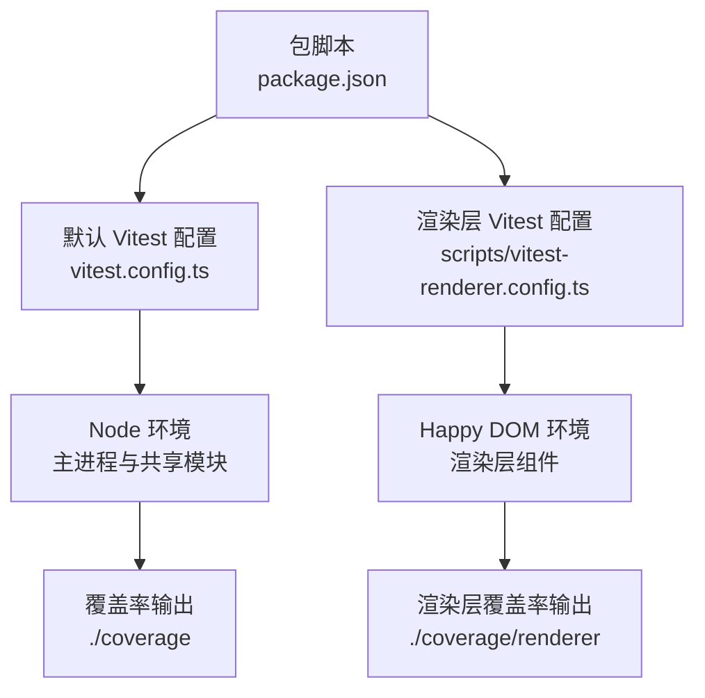
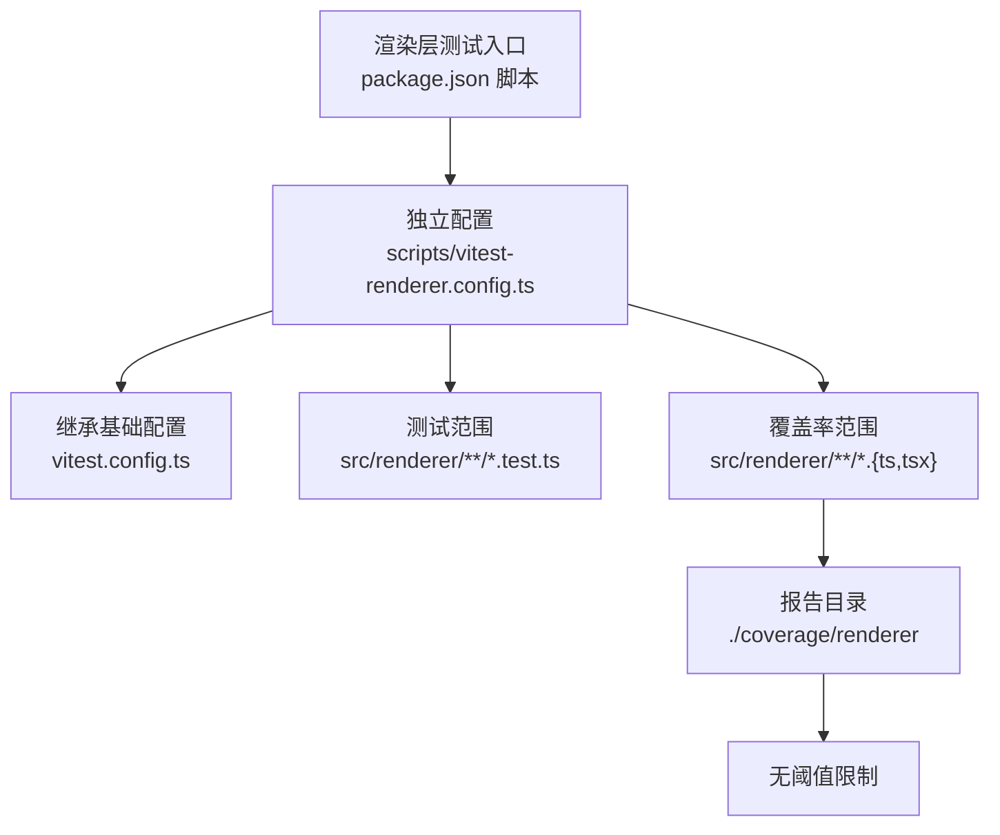
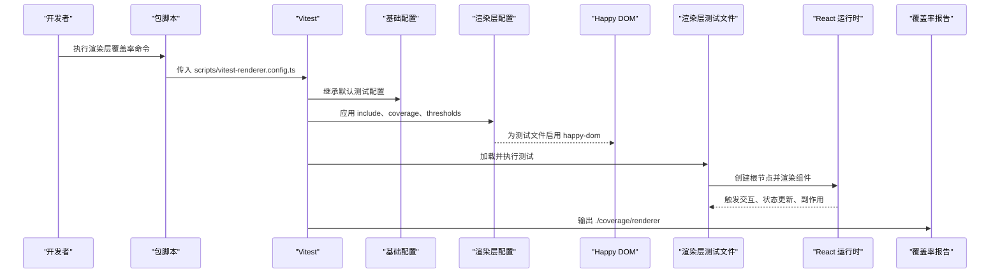
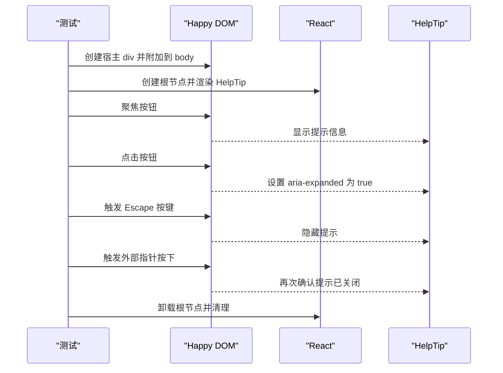
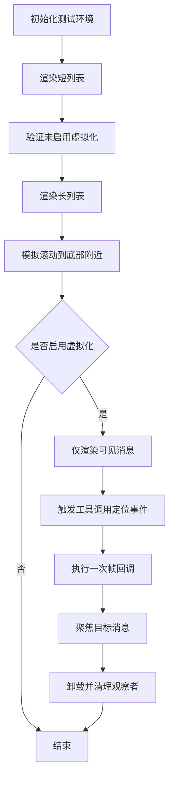
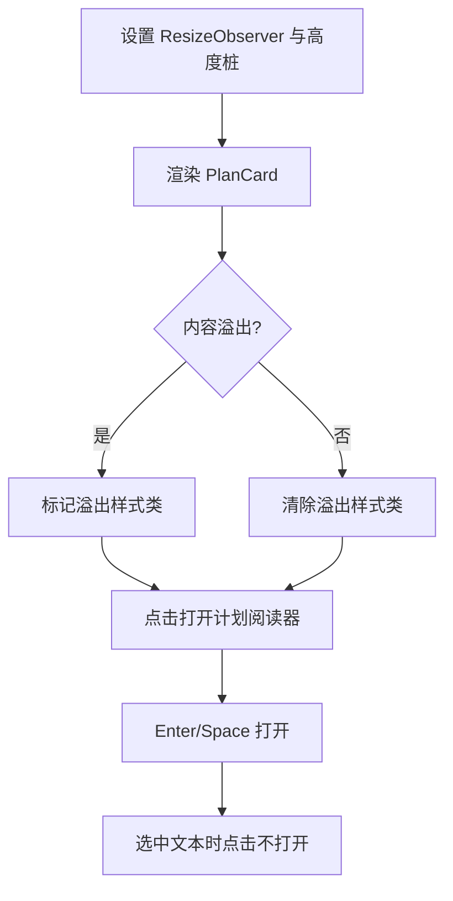
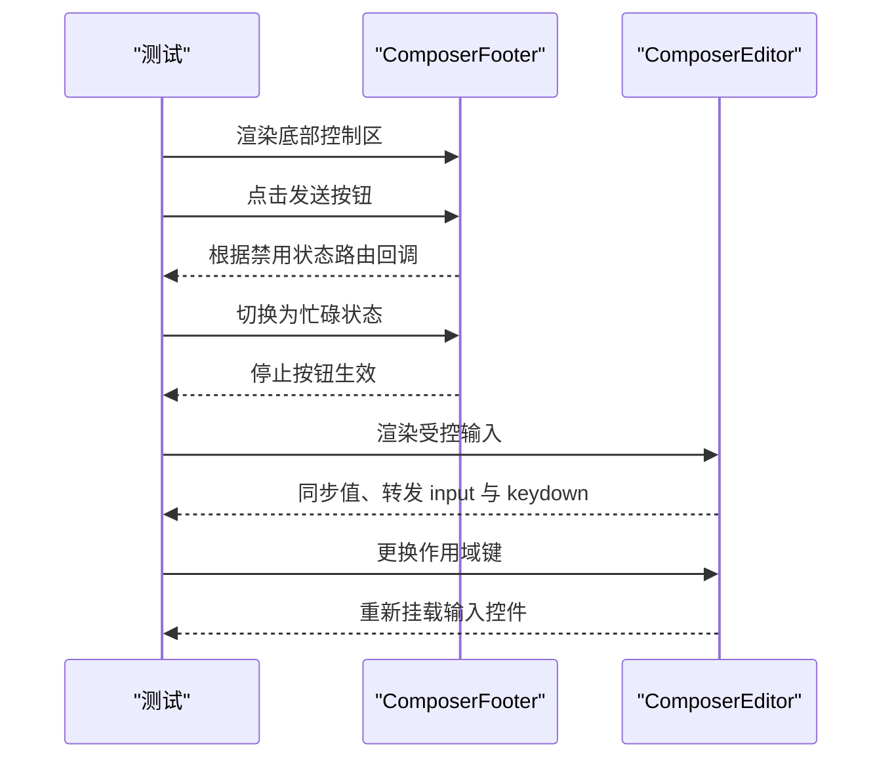
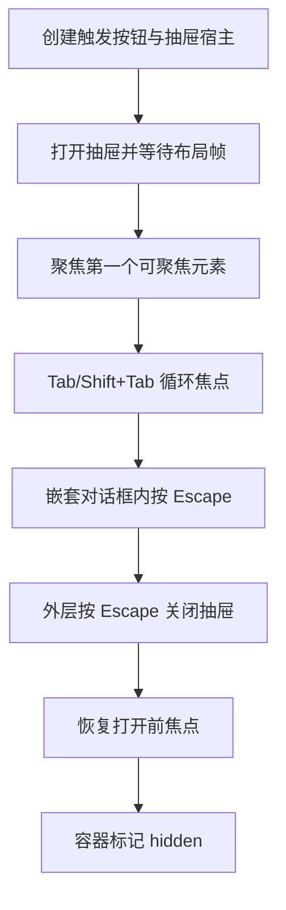
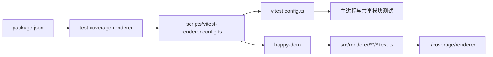

# 渲染层测试

<cite>
**本文引用的文件**   
- [scripts/vitest-renderer.config.ts](file://scripts/vitest-renderer.config.ts)
- [vitest.config.ts](file://vitest.config.ts)
- [package.json](file://package.json)
- [scripts/vitest-global-setup.ts](file://scripts/vitest-global-setup.ts)
- [src/renderer/ui/HelpTip.test.ts](file://src/renderer/ui/HelpTip.test.ts)
- [src/renderer/features/transcript/VirtualMessageList.test.ts](file://src/renderer/features/transcript/VirtualMessageList.test.ts)
- [src/renderer/features/transcript/PlanCard.test.ts](file://src/renderer/features/transcript/PlanCard.test.ts)
- [src/renderer/features/composer/ComposerControls.test.ts](file://src/renderer/features/composer/ComposerControls.test.ts)
- [src/renderer/app/WorkbenchPanelDrawer.test.ts](file://src/renderer/app/WorkbenchPanelDrawer.test.ts)
- [src/renderer/features/transcript/README.md](file://src/renderer/features/transcript/README.md)
</cite>

## 目录
1. [引言](#引言)
2. [项目结构](#项目结构)
3. [核心配置](#核心配置)
4. [架构总览](#架构总览)
5. [详细组件分析](#详细组件分析)
6. [依赖关系分析](#依赖关系分析)
7. [性能与调试建议](#性能与调试建议)
8. [故障排查](#故障排查)
9. [结论](#结论)

## 引言
本文聚焦 RDC-Agent 的渲染层测试体系，说明为何使用独立的 Renderer 测试配置、如何继承基础 Vitest 配置、测试文件包含规则、覆盖率统计策略，以及基于 Happy DOM 的 React 组件测试实践。文档还总结仓库中现有 UI 测试用例的模式，包括事件处理、条件渲染、组件组合、滚动虚拟化、对话框焦点管理、状态更新验证等，并给出性能测试与调试建议。

## 项目结构
RDC-Agent 采用 Electron 多进程架构：主进程、预加载脚本和渲染进程代码位于 `src/main`、`src/preload` 和 `src/renderer`；共享类型与工具位于 `src/shared`。测试体系分为两类：
- Node 环境测试：覆盖主进程与共享模块，使用默认 `vitest.config.ts`。
- 渲染层测试：覆盖渲染进程中的 React 组件与浏览器相关逻辑，使用独立配置文件 `scripts/vitest-renderer.config.ts`。

**图表来源**
- [package.json:105-116](file://package.json#L105-L116)
- [vitest.config.ts:1-81](file://vitest.config.ts#L1-L81)
- [scripts/vitest-renderer.config.ts:1-17](file://scripts/vitest-renderer.config.ts#L1-L17)

**章节来源**
- [package.json:105-116](file://package.json#L105-L116)
- [vitest.config.ts:1-81](file://vitest.config.ts#L1-L81)
- [scripts/vitest-renderer.config.ts:1-17](file://scripts/vitest-renderer.config.ts#L1-L17)

## 核心配置
### 基础 Vitest 配置
默认配置将测试运行在 Node 环境中，全局启用测试 API，并通过别名简化导入路径。其覆盖率目标明确限定为 `src/main` 与 `src/shared`，同时排除大量 Electron 入口、IPC 处理器、工作线程、桌面外壳、遥测、会话编排、OAuth、设置连接等不适合 Node 单元测试的代码。覆盖率报告写入 `./coverage`，并设置了行、函数、分支、语句阈值，由覆盖率门禁脚本强制检查。

| 配置项 | 默认值或行为 | 设计含义 |
|---|---|---|
| `test.environment` | `node` | 适合主进程与共享模块的纯逻辑测试 |
| `test.include` | `src/**/*.test.ts` | 默认发现所有测试文件 |
| `test.coverage.provider` | `v8` | 使用 V8 覆盖率采集 |
| `test.coverage.reportsDirectory` | `./coverage` | 主进程与共享模块覆盖率根目录 |
| `test.coverage.include` | `src/main/**/*.{ts,tsx}`、`src/shared/**/*.{ts,tsx}` | 仅统计 Node 测试面 |
| `test.coverage.thresholds` | 行、函数、语句 40，分支 30 | 由 `check:coverage-ratchet` 强制执行增长 |

**章节来源**
- [vitest.config.ts:1-81](file://vitest.config.ts#L1-L81)

### 渲染层独立配置
渲染层测试通过 `scripts/vitest-renderer.config.ts` 扩展默认配置。它继承 `base.test`，但重新定义以下关键项：
- `include`：仅匹配 `src/renderer/**/*.test.ts`，避免重复执行主进程测试。
- `coverage.include`：仅统计 `src/renderer/**/*.{ts,tsx}`。
- `coverage.reportsDirectory`：输出到 `./coverage/renderer`，与主进程覆盖率隔离。
- `coverage.thresholds`：设为 `undefined`，不强制渲染层覆盖率阈值。

该设计的核心原因是：渲染层代码通常依赖浏览器 API、React 运行时、UI 状态和外部服务，若与主进程共用同一覆盖率基线，容易污染 Node 测试的覆盖率门槛，且难以维护统一的增长策略。Renderer 的视觉保真和交互质量更多由浏览器 QA、结构性检查和人工验收保障，因此覆盖率只用于观察渲染层测试覆盖范围，而不作为硬性门禁。

**图表来源**
- [package.json:105-116](file://package.json#L105-L116)
- [scripts/vitest-renderer.config.ts:1-17](file://scripts/vitest-renderer.config.ts#L1-L17)
- [vitest.config.ts:1-81](file://vitest.config.ts#L1-L81)

**章节来源**
- [scripts/vitest-renderer.config.ts:1-17](file://scripts/vitest-renderer.config.ts#L1-L17)
- [vitest.config.ts:1-81](file://vitest.config.ts#L1-L81)

### 测试命令与依赖
包脚本提供两个关键命令：
- `test:coverage`：运行默认 Vitest 配置并生成 Node 侧覆盖率。
- `test:coverage:renderer`：使用 `scripts/vitest-renderer.config.ts` 运行渲染层测试并生成独立覆盖率。

渲染层测试依赖 `happy-dom`，版本为 `^20.14.5`，与 `vitest` 和 `@vitest/coverage-v8` 协同工作。

**章节来源**
- [package.json:105-116](file://package.json#L105-L116)
- [package.json:129-143](file://package.json#L129-L143)

## 架构总览
渲染层测试整体流程如下：
1. 开发者编写以 `.test.ts` 结尾的文件，放在 `src/renderer` 下任意子目录。
2. 通过 `pnpm test:coverage:renderer` 启动 Vitest。
3. Vitest 加载 `scripts/vitest-renderer.config.ts`，再继承 `vitest.config.ts`。
4. 对每个带 `// @vitest-environment happy-dom` 注释的测试文件，Vitest 切换到 Happy DOM 环境。
5. 测试挂载 React 根节点，模拟用户交互，断言 DOM、属性、事件回调和副作用。
6. 覆盖率采集仅针对 `src/renderer`，报告写入 `./coverage/renderer`。

**图表来源**
- [package.json:105-116](file://package.json#L105-L116)
- [scripts/vitest-renderer.config.ts:1-17](file://scripts/vitest-renderer.config.ts#L1-L17)
- [vitest.config.ts:1-81](file://vitest.config.ts#L1-L81)

## 详细组件分析
本节选取仓库中典型的渲染层测试，归纳 React 组件测试最佳实践。

### 帮助提示组件交互测试
`HelpTip.test.ts` 展示了最小化的可访问性交互测试：
- 使用 `IS_REACT_ACT_ENVIRONMENT` 配合 `act` 确保异步渲染完成。
- 通过键盘焦点和点击打开提示，通过 `Escape` 关闭。
- 验证父级 `keydown` 监听器未被冒泡影响。
- 使用 `document.body.dispatchEvent` 模拟外部点击关闭。
- 在 `finally` 中卸载根节点、移除宿主元素、恢复全局桩。

**图表来源**
- [src/renderer/ui/HelpTip.test.ts:1-34](file://src/renderer/ui/HelpTip.test.ts#L1-L34)

**章节来源**
- [src/renderer/ui/HelpTip.test.ts:1-34](file://src/renderer/ui/HelpTip.test.ts#L1-L34)

### 虚拟消息列表测试
`VirtualMessageList.test.ts` 覆盖了短列表全量渲染、长列表虚拟化、滚动定位、工具调用跳转、帧回调清理、观察者断开等场景：
- 使用 `ResizeObserver` 桩记录 `disconnect` 调用。
- 使用 `requestAnimationFrame` 桩控制动画帧调度。
- 通过 `scrollTop` 和 `scroll` 事件模拟滚动。
- 通过自定义事件 `rdc:locate-tool-call` 触发定位。
- 验证短列表不启用虚拟化，长列表启用虚拟化。
- 验证卸载后所有观察者均已断开。

**图表来源**
- [src/renderer/features/transcript/VirtualMessageList.test.ts:1-78](file://src/renderer/features/transcript/VirtualMessageList.test.ts#L1-L78)

**章节来源**
- [src/renderer/features/transcript/VirtualMessageList.test.ts:1-78](file://src/renderer/features/transcript/VirtualMessageList.test.ts#L1-L78)

### 计划卡片测试
`PlanCard.test.ts` 展示了条件渲染、溢出检测、模态阅读器集成和键盘交互：
- 使用 `vi.hoisted` 和 `vi.mock` 隔离 `PlanReaderHost`、国际化、Markdown 组件。
- 通过桩 `ResizeObserver` 和 `scrollHeight` 控制内容溢出判断。
- 断言溢出时添加样式类，非溢出时移除样式类。
- 通过可访问性标签和角色验证可访问性行为。
- 验证 Enter 和 Space 打开计划，选中文本时点击不触发打开。

**图表来源**
- [src/renderer/features/transcript/PlanCard.test.ts:1-70](file://src/renderer/features/transcript/PlanCard.test.ts#L1-L70)

**章节来源**
- [src/renderer/features/transcript/PlanCard.test.ts:1-70](file://src/renderer/features/transcript/PlanCard.test.ts#L1-L70)

### 编辑器与控制区域测试
`ComposerControls.test.ts` 展示了组件组合与行为路由：
- 使用 `vi.mock` 隔离编辑器菜单、权限选择器、模型努力控制、上下文指示器等子组件。
- 根据 `isComposerBusy` 和 `primaryButtonDisabled` 切换发送与停止行为。
- 验证附件选择、发送、停止回调被正确路由。
- 验证受控输入的值变化、IME 输入法事件、会话作用域替换导致重新挂载。

**图表来源**
- [src/renderer/features/composer/ComposerControls.test.ts:1-72](file://src/renderer/features/composer/ComposerControls.test.ts#L1-L72)

**章节来源**
- [src/renderer/features/composer/ComposerControls.test.ts:1-72](file://src/renderer/features/composer/ComposerControls.test.ts#L1-L72)

### 工作台面板抽屉测试
`WorkbenchPanelDrawer.test.ts` 展示了对话框焦点陷阱、嵌套对话框处理和焦点恢复：
- 使用 `requestAnimationFrame` 桩延迟初始布局计算。
- 验证 Tab 边界循环，Shift+Tab 回到第一个可聚焦元素。
- 验证嵌套对话框内 `Escape` 不会关闭外层抽屉。
- 验证外层 `Escape` 关闭抽屉并恢复打开前的焦点。
- 验证关闭后容器带有 `hidden` 属性。

**图表来源**
- [src/renderer/app/WorkbenchPanelDrawer.test.ts:1-47](file://src/renderer/app/WorkbenchPanelDrawer.test.ts#L1-L47)

**章节来源**
- [src/renderer/app/WorkbenchPanelDrawer.test.ts:1-47](file://src/renderer/app/WorkbenchPanelDrawer.test.ts#L1-L47)

### 渲染层测试通用模式
从上述测试可以总结出以下模式：
- 文件命名：使用 `*.test.ts`，放在对应功能目录下。
- 环境声明：在文件顶部使用 `// @vitest-environment happy-dom` 启用浏览器式 DOM。
- 异步渲染：使用 `act` 包裹渲染、状态更新和用户交互。
- 全局桩：使用 `vi.stubGlobal` 设置 `IS_REACT_ACT_ENVIRONMENT`、`ResizeObserver`、`requestAnimationFrame` 等。
- 资源隔离：使用 `vi.mock` 隔离子组件、国际化、阅读器宿主等副作用。
- 生命周期清理：在 `afterEach` 或 `finally` 中卸载根节点、移除宿主、恢复全局桩。
- 可访问性断言：检查 `aria-*`、角色、焦点顺序和键盘行为。
- 数据流断言：通过回调、事件、DOM 属性和数据结构验证状态变化。

**章节来源**
- [src/renderer/ui/HelpTip.test.ts:1-34](file://src/renderer/ui/HelpTip.test.ts#L1-L34)
- [src/renderer/features/transcript/VirtualMessageList.test.ts:1-78](file://src/renderer/features/transcript/VirtualMessageList.test.ts#L1-L78)
- [src/renderer/features/transcript/PlanCard.test.ts:1-70](file://src/renderer/features/transcript/PlanCard.test.ts#L1-L70)
- [src/renderer/features/composer/ComposerControls.test.ts:1-72](file://src/renderer/features/composer/ComposerControls.test.ts#L1-L72)
- [src/renderer/app/WorkbenchPanelDrawer.test.ts:1-47](file://src/renderer/app/WorkbenchPanelDrawer.test.ts#L1-L47)

## 依赖关系分析
渲染层测试依赖链如下：

**图表来源**
- [package.json:105-116](file://package.json#L105-L116)
- [scripts/vitest-renderer.config.ts:1-17](file://scripts/vitest-renderer.config.ts#L1-L17)
- [vitest.config.ts:1-81](file://vitest.config.ts#L1-L81)

**章节来源**
- [package.json:105-116](file://package.json#L105-L116)
- [scripts/vitest-renderer.config.ts:1-17](file://scripts/vitest-renderer.config.ts#L1-L17)
- [vitest.config.ts:1-81](file://vitest.config.ts#L1-L81)

## 性能与调试建议
### 性能测试建议
- 渲染基准：对长列表、复杂 Markdown、大图片预览等场景，使用 `requestAnimationFrame` 桩记录帧数量，避免真实浏览器性能波动干扰。
- 虚拟化断言：对虚拟滚动组件，分别验证短列表与长列表的渲染条目数、滚动定位、定位回调数量和卸载后的观察者状态。
- 内存泄漏防护：确保 `ResizeObserver`、`requestAnimationFrame`、全局事件监听器在卸载时被清理。
- 渲染次数控制：对频繁重渲染的组件，结合 `vi.fn()` 统计回调调用次数，避免不必要的状态更新。
- 渐进增强：优先用纯函数和状态断言证明逻辑正确性，再用 DOM 测试覆盖交互和可访问性。

### 调试技巧
- 使用 `IS_REACT_ACT_ENVIRONMENT` 与 `act` 避免 React 并发模式下的异步警告。
- 对无法直接断言的状态，通过 DOM 属性、ARIA 属性、事件回调和数据标识符间接验证。
- 对第三方组件或外部依赖，使用 `vi.mock` 返回稳定返回值，减少不确定性。
- 对浏览器 API，优先桩 `ResizeObserver`、`getBoundingClientRect`、`scrollHeight`、`clientHeight`，而不是依赖真实布局。
- 对键盘交互，显式构造 `KeyboardEvent`，并验证 `bubbles`、`cancelable`、`isComposing` 等字段。
- 对焦点管理，先断言当前活动元素，再断言操作后的焦点位置。
- 对渲染层覆盖率问题，优先查看 `./coverage/renderer` 而非 `./coverage`，避免混淆两套覆盖率基线。

[本节为通用指导，不直接分析具体源码文件]

## 故障排查
### 渲染层测试未执行
- 检查测试文件是否在 `src/renderer` 下且以 `.test.ts` 结尾。
- 检查是否使用 `pnpm test:coverage:renderer` 而非普通 `vitest run`。
- 检查文件头部是否正确使用 `// @vitest-environment happy-dom`。

### 覆盖率未写入 `./coverage/renderer`
- 确认使用了独立配置文件 `scripts/vitest-renderer.config.ts`。
- 确认命令包含 `--coverage`。
- 确认没有误用默认 `vitest.config.ts`。

### 测试污染主进程覆盖率
- 不要将渲染层测试放入默认 `vitest.config.ts` 的匹配范围。
- 保持 `scripts/vitest-renderer.config.ts` 的 `include` 和 `coverage.include` 严格限定在 `src/renderer`。

### 全局桩未清理导致后续测试失败
- 确保在 `afterEach` 或 `finally` 中调用 `vi.restoreAllMocks()` 和 `vi.unstubAllGlobals()`。
- 确保卸载 React 根节点并移除宿主元素。
- 对全局事件监听器，务必在 `removeEventListener` 中移除。

### 浏览器 API 缺失
- 确认使用 Happy DOM 环境。
- 对缺失的 API，使用 `vi.stubGlobal` 提供最小实现，例如 `ResizeObserver`、`requestAnimationFrame`、`getSelection`。

**章节来源**
- [scripts/vitest-renderer.config.ts:1-17](file://scripts/vitest-renderer.config.ts#L1-L17)
- [vitest.config.ts:1-81](file://vitest.config.ts#L1-L81)
- [package.json:105-116](file://package.json#L105-L116)

## 结论
RDC-Agent 的渲染层测试通过独立配置文件实现了与主进程覆盖率基线的隔离：测试范围限定在 `src/renderer`，覆盖率输出到 `./coverage/renderer`，且不设置硬性阈值。这样既保留了渲染层测试的可观测性，又避免了浏览器相关代码污染 Node 单元测试的质量门禁。现有测试用例展示了完整的 React 组件测试模式，包括环境准备、异步渲染、用户交互、状态更新、资源清理和可访问性验证。对于更复杂的 UI 行为，推荐继续使用 Happy DOM、最小化浏览器 API Mock、强化生命周期清理，并结合浏览器 QA 和人工验收保证视觉保真。

[本节为总结性内容，不直接分析具体源码文件]