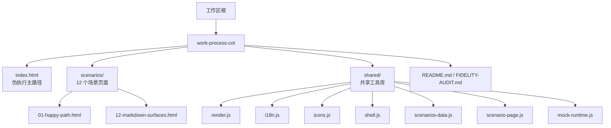
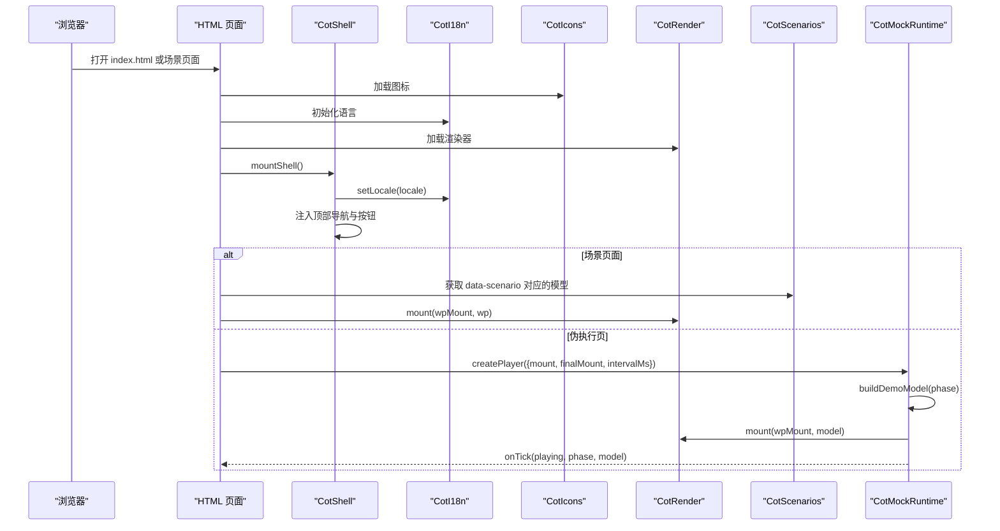
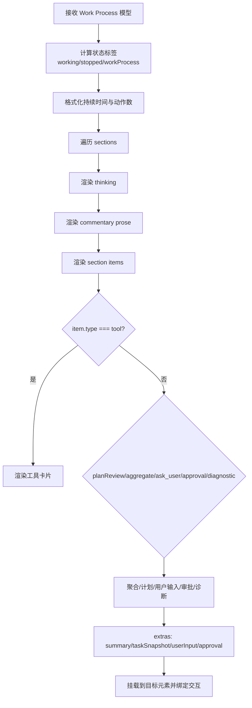
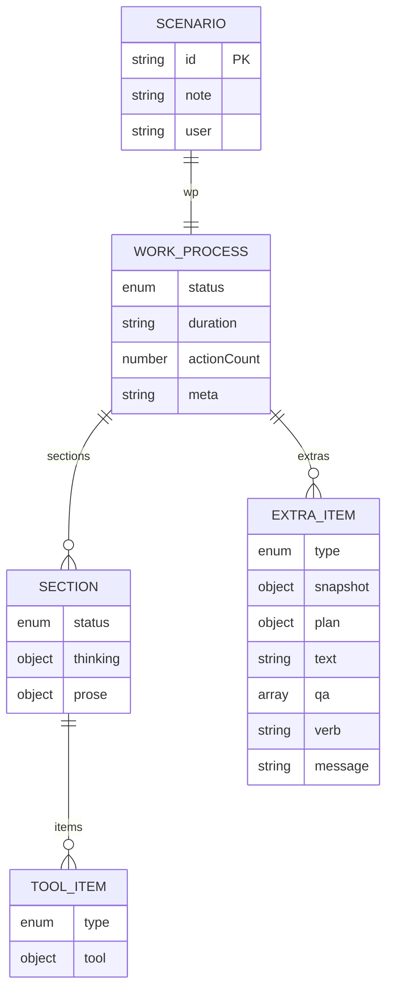
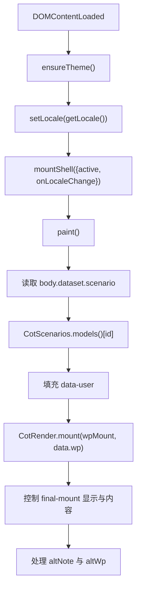
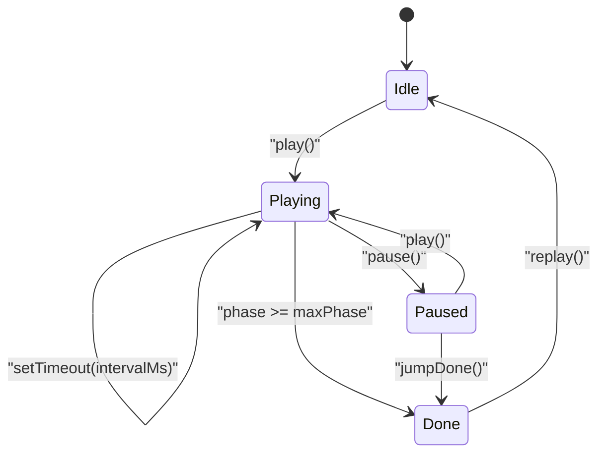
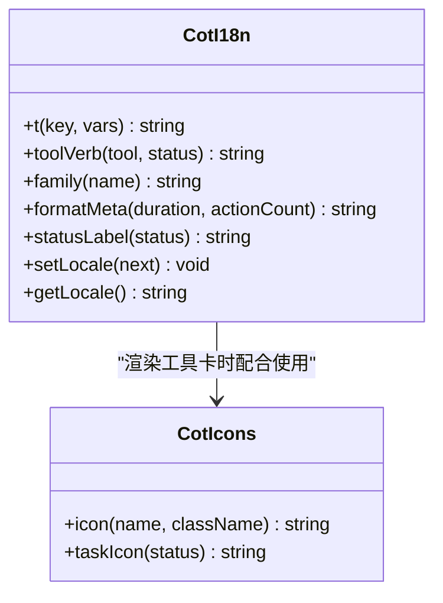
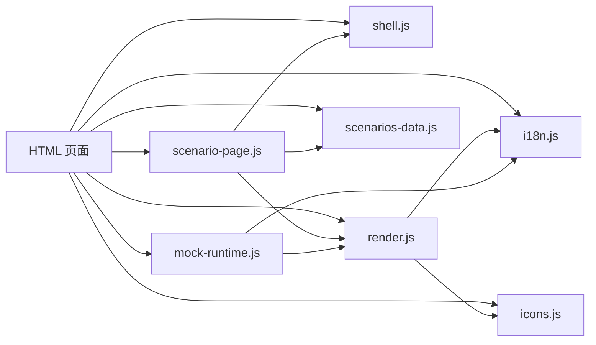

# 端到端测试

<cite>
**本文引用的文件**   
- [README.md](file://test/work-process-cot/README.md)
- [index.html](file://test/work-process-cot/index.html)
- [FIDELITY-AUDIT.md](file://test/work-process-cot/FIDELITY-AUDIT.md)
- [scenarios-data.js](file://test/work-process-cot/shared/scenarios-data.js)
- [mock-runtime.js](file://test/work-process-cot/shared/mock-runtime.js)
- [render.js](file://test/work-process-cot/shared/render.js)
- [scenario-page.js](file://test/work-process-cot/shared/scenario-page.js)
- [shell.js](file://test/work-process-cot/shared/shell.js)
- [i18n.js](file://test/work-process-cot/shared/i18n.js)
- [icons.js](file://test/work-process-cot/shared/icons.js)
- [01-happy-path.html](file://test/work-process-cot/scenarios/01-happy-path.html)
- [12-markdown-surfaces.html](file://test/work-process-cot/scenarios/12-markdown-surfaces.html)
</cite>

## 目录
1. [简介](#简介)
2. [项目结构](#项目结构)
3. [核心组件](#核心组件)
4. [架构总览](#架构总览)
5. [详细组件分析](#详细组件分析)
6. [依赖关系分析](#依赖关系分析)
7. [性能与稳定性考量](#性能与稳定性考量)
8. [故障排查指南](#故障排查指南)
9. [结论](#结论)
10. [附录：新增场景操作清单](#附录新增场景操作清单)

## 简介
RDC-Agent 的 `work-process-cot` 端到端测试是一套基于 HTML 的高保真静态验收体系，用于审视 Agent CoT（Work Process）在浏览器中的视觉、状态和交互效果。它不接入 Vitest 或 CI，也不直接修改产品渲染层 `src/renderer`，而是通过共享工具库模拟运行时数据、渲染 Work Process 树、并驱动多语言与主题切换。

其重点包括：
- 12 个预设场景，覆盖从 happy path、运行中流式输出、已完成折叠、已停止、工具族画廊、≥8 聚合、Compact 安静行、Plan/Tasks、ask_user 审批、opaque answer-only、error_recovery 缺席，到 Markdown 表面渲染。
- HTML 驱动的 E2E 体验：每个场景是一个独立 HTML 页面，通过统一 shell、国际化、图标、渲染器和场景数据加载。
- Fidelity Audit：对照产品规格文档与渲染实现，列出“已对齐”和“仍可接受的简化”，作为回归审计基准。
- Mock 运行时：为 index 伪执行页提供阶段化模型生成器与播放器，支持播放、暂停、重播、跳到完成。
- 测试数据管理：所有场景的数据集中在 `scenarios-data.js`，便于单点维护。
- 新场景扩展：新增一个 HTML 页面、在 `scenarios-data.js` 注册数据、必要时补充 i18n 文案和图标映射即可。

**章节来源**
- [README.md:1-74](file://test/work-process-cot/README.md#L1-L74)

## 项目结构
`test/work-process-cot` 是独立的前端验收目录，组织方式按职责分层：
- 顶层入口：`index.html` 是伪执行主路径演示页。
- 场景目录：`scenarios/01-happy-path.html` 到 `12-markdown-surfaces.html` 各对应一个验收场景。
- 共享库：`shared/` 下包含渲染器、国际化、图标、shell 导航、场景数据和场景页面启动器。
- 样式：`tokens.css` 和 `work-process.css` 提供设计令牌与工作过程样式。
- 审计说明：`FIDELITY-AUDIT.md` 记录保真审计结论与验证要点。

**图表来源**
- [index.html:1-85](file://test/work-process-cot/index.html#L1-L85)
- [01-happy-path.html:1-31](file://test/work-process-cot/scenarios/01-happy-path.html#L1-L31)
- [12-markdown-surfaces.html:1-31](file://test/work-process-cot/scenarios/12-markdown-surfaces.html#L1-L31)
- [scenarios-data.js:1-477](file://test/work-process-cot/shared/scenarios-data.js#L1-L477)
- [mock-runtime.js:1-266](file://test/work-process-cot/shared/mock-runtime.js#L1-L266)
- [render.js:1-442](file://test/work-process-cot/shared/render.js#L1-L442)
- [scenario-page.js:1-58](file://test/work-process-cot/shared/scenario-page.js#L1-L58)
- [shell.js:1-89](file://test/work-process-cot/shared/shell.js#L1-L89)
- [i18n.js:1-153](file://test/work-process-cot/shared/i18n.js#L1-L153)
- [icons.js:1-109](file://test/work-process-cot/shared/icons.js#L1-L109)

**章节来源**
- [README.md:1-74](file://test/work-process-cot/README.md#L1-L74)

## 核心组件
这套测试由五个核心模块组成，它们共同构成 HTML 驱动的 E2E 环境：

| 组件 | 主要职责 | 关键行为 |
|---|---|---|
| `render.js` | 将 Work Process 数据模型渲染为 HTML DOM | 渲染思考、评论、工具卡、聚合、计划卡、任务快照、ask_user、审批、摘要等；绑定展开、收起、WP 折叠等交互 |
| `i18n.js` | 多语言与工具动词映射 | 提供 `t`、`toolVerb`、`family`、`formatMeta`、`statusLabel`、语言切换事件 |
| `icons.js` | 内联 SVG 图标 | 为工具、任务状态、通用图标提供 SVG 路径和工厂函数 |
| `shell.js` | 顶部导航、主题、语言切换 | 注入 topbar、场景导航、Light/Dark、ZH/EN，触发 `onLocaleChange` |
| `scenarios-data.js` | 12 个场景的数据定义 | 以编号键值组织，包含 note、user、wp、final、altNote、altWp |
| `scenario-page.js` | 单个场景页面初始化 | 根据 `body.data-scenario` 读取数据并调用 `CotRender.mount` |
| `mock-runtime.js` | index 伪执行播放器 | 阶段化构建 demo 模型，定时推进 phase，暴露 play/pause/replay/jumpDone |

这些模块通过全局对象协作：
- `CotIcons`：图标工厂。
- `CotI18n`：国际化与工具元信息。
- `CotRender`：渲染器。
- `CotShell`：外壳与导航。
- `CotScenarios`：场景数据。
- `CotMockRuntime`：index 页面的播放器。

**章节来源**
- [render.js:1-442](file://test/work-process-cot/shared/render.js#L1-L442)
- [i18n.js:1-153](file://test/work-process-cot/shared/i18n.js#L1-L153)
- [icons.js:1-109](file://test/work-process-cot/shared/icons.js#L1-L109)
- [shell.js:1-89](file://test/work-process-cot/shared/shell.js#L1-L89)
- [scenarios-data.js:1-477](file://test/work-process-cot/shared/scenarios-data.js#L1-L477)
- [scenario-page.js:1-58](file://test/work-process-cot/shared/scenario-page.js#L1-L58)
- [mock-runtime.js:1-266](file://test/work-process-cot/shared/mock-runtime.js#L1-L266)

## 架构总览
HTML 驱动的 E2E 测试可以理解为三层：
1. **视图层**：HTML 页面定义容器，如 `cot-shell`、`conversation-thread`、`wp-mount`、`final-mount`。
2. **渲染层**：`render.js` 根据 Work Process 数据模型生成 HTML，并绑定交互。
3. **数据与运行时层**：`scenarios-data.js` 提供静态场景数据；`mock-runtime.js` 为 index 页面提供动态阶段模型；`i18n.js` 与 `icons.js` 提供翻译和图标；`shell.js` 与 `scenario-page.js` 负责页面装配。

**图表来源**
- [index.html:1-85](file://test/work-process-cot/index.html#L1-L85)
- [scenario-page.js:1-58](file://test/work-process-cot/shared/scenario-page.js#L1-L58)
- [mock-runtime.js:1-266](file://test/work-process-cot/shared/mock-runtime.js#L1-L266)
- [shell.js:1-89](file://test/work-process-cot/shared/shell.js#L1-L89)
- [render.js:1-442](file://test/work-process-cot/shared/render.js#L1-L442)
- [i18n.js:1-153](file://test/work-process-cot/shared/i18n.js#L1-L153)
- [icons.js:1-109](file://test/work-process-cot/shared/icons.js#L1-L109)

**章节来源**
- [index.html:1-85](file://test/work-process-cot/index.html#L1-L85)

## 详细组件分析

### Work Process 渲染器
`render.js` 是整个测试体系的视觉核心。它将 Work Process 数据模型转换为符合产品类名约定的 DOM，例如 `.work-process-*`、`.work-process-tool-card-*`、`.work-process-thinking-*`、`.work-process-section-list`、`.plan-card`、`.work-process-user-input-*`、`.work-process-approval` 等。

关键能力包括：
- 工具卡片：按 file、search、shell、git、web、generic 族分别渲染 body；支持 running/pending/complete 状态、expandable、args/rawResult、approval callout。
- Thinking 生命周期：section 处于 running/pending 时，thinking 显示“正在思考”、默认展开、Active Signal；完成后尊重 `open`。
- Commentary 与 Final：使用 `.markdown-body` 包裹 HTML，走 Markdown 表面。
- Plan/Tasks：渲染计划卡、拒绝壳行、任务快照列表。
- ask_user：显示动词·数量、进度、展开收起、等待回答。
- Approval：扁平 ApprovalRow，不是沉入卡片。
- 交互绑定：工具卡片展开、ask_user 展开、Work Process 整体展开收起。

**图表来源**
- [render.js:1-442](file://test/work-process-cot/shared/render.js#L1-L442)

**章节来源**
- [render.js:1-442](file://test/work-process-cot/shared/render.js#L1-L442)

### 场景数据模型
`scenarios-data.js` 是所有 12 个场景的权威数据来源。它以字符串编号作为键，例如 `'01'` 到 `'12'`，每个条目至少包含：
- `note`：该场景的验收说明。
- `user`：对话气泡中的用户提示。
- `wp`：Work Process 模型；若为 `null`，表示该场景不渲染 WP。
- `final`：assistant 最终答案 HTML。
- `altNote`、`altWp`：可选对照说明与对照 WP 模型。

典型字段包括：
- `wp.status`：`running`、`complete`、`stopped`。
- `wp.duration`、`wp.actionCount`、`wp.meta`。
- `wp.sections[].thinking.kind/status/open/duration/preview/html`。
- `wp.sections[].prose.html/streaming`。
- `wp.sections[].items[]`：`tool`、`planReview`、`aggregate`、`ask_user`、`approval`、`diagnostic`。
- `wp.extras[]`：`summary`、`taskSnapshot`、`ask_user`、`approval`。

**图表来源**
- [scenarios-data.js:1-477](file://test/work-process-cot/shared/scenarios-data.js#L1-L477)

**章节来源**
- [scenarios-data.js:1-477](file://test/work-process-cot/shared/scenarios-data.js#L1-L477)

### 场景页面加载器
每个场景页面是一个最小 HTML 模板，包含：
- 两个样式链接：`tokens.css` 和 `work-process.css`。
- `body[data-scenario="XX"]`。
- `cot-shell` 外壳容器。
- `conversation-thread` 对话槽。
- `wp-mount`：Work Process 挂载点。
- `final-mount`：最终答案挂载点。
- 脚本顺序：`icons.js` → `i18n.js` → `render.js` → `shell.js` → `scenarios-data.js` → `scenario-page.js`。

`scenario-page.js` 的职责非常简洁：
1. 从 `document.body.dataset.scenario` 读取场景编号。
2. 从 `CotScenarios.models()` 取出对应数据。
3. 写入 `data-note` 和 `data-user`。
4. 调用 `CotRender.mount('#wp-mount', data.wp)`。
5. 控制 `#final-mount` 的隐藏与内容。
6. 处理可选的 `altNote` 和 `altWp`。
7. 通过 `CotShell.mountShell` 注入顶部导航，并在语言变化时重新 paint。

**图表来源**
- [scenario-page.js:1-58](file://test/work-process-cot/shared/scenario-page.js#L1-L58)
- [01-happy-path.html:1-31](file://test/work-process-cot/scenarios/01-happy-path.html#L1-L31)
- [12-markdown-surfaces.html:1-31](file://test/work-process-cot/scenarios/12-markdown-surfaces.html#L1-L31)

**章节来源**
- [scenario-page.js:1-58](file://test/work-process-cot/shared/scenario-page.js#L1-L58)

### 伪执行播放器
`index.html` 的伪执行主路径不是静态展示，而是通过 `CotMockRuntime.createPlayer` 驱动一段时间轴。播放器内部维护 phase 从 0 到 11，每步调用 `buildDemoModel(phase)` 生成模型，再由 `CotRender.mount` 渲染到 `#wp-mount` 和 `#final-mount`。

播放器提供的接口包括：
- `play()`：开始播放。
- `pause()`：暂停。
- `replay()`：重置 phase 后重播。
- `jumpDone()`：直接跳到最终阶段。
- `render()`：手动刷新。
- `isPlaying()`：当前是否播放中。
- `getPhase()`：当前 phase。

**图表来源**
- [mock-runtime.js:1-266](file://test/work-process-cot/shared/mock-runtime.js#L1-L266)
- [index.html:1-85](file://test/work-process-cot/index.html#L1-L85)

**章节来源**
- [mock-runtime.js:1-266](file://test/work-process-cot/shared/mock-runtime.js#L1-L266)
- [index.html:1-85](file://test/work-process-cot/index.html#L1-L85)

### 国际化与图标系统
`i18n.js` 不仅维护界面文案，还维护工具动词、工具族、状态标签和元信息格式。关键点：
- `TOOL_VERBS`：按工具名维护 zh/en 下的 running/complete 动词。
- `LABELS`：Working、Work process、Stopped、Thinking、duration、actions、compact、play、pause、replay、approvalPending 等。
- `FAMILY`：将工具映射到 file/search/shell/git/web/generic。
- `mcp__*` 特殊处理：工具族为 generic，动词 key 为 `mcp_call`；裸 `mcp` 仍为查询语义。
- `formatMeta`：生成“持续 X · Y 个动作”这类 ZH 元信息。
- `statusLabel`：running/pending/error 的状态标签。
- `setLocale`：切换语言并派发 `cot:locale` 自定义事件。

`icons.js` 维护 SVG PATH 与工具图标映射，`mcp__*` 统一使用 plug 图标。

**图表来源**
- [i18n.js:1-153](file://test/work-process-cot/shared/i18n.js#L1-L153)
- [icons.js:1-109](file://test/work-process-cot/shared/icons.js#L1-L109)

**章节来源**
- [i18n.js:1-153](file://test/work-process-cot/shared/i18n.js#L1-L153)
- [icons.js:1-109](file://test/work-process-cot/shared/icons.js#L1-L109)

### 顶部外壳与场景导航
`shell.js` 提供：
- 固定场景列表 `SCENARIOS`，包含 12 个场景及伪执行页。
- `ensureTheme()`：从 `localStorage.cot-theme` 恢复 Light/Dark。
- `toggleTheme()`：切换主题并持久化。
- `renderTopbar()`：渲染品牌、场景导航、语言切换、主题切换按钮。
- `mountShell(options)`：注入 shell、绑定语言切换、触发 `onLocaleChange`。

这个 shell 让所有场景页面具备一致导航体验，同时允许 index 页面额外注入播放控件。

**章节来源**
- [shell.js:1-89](file://test/work-process-cot/shared/shell.js#L1-L89)

### 12 个预设场景说明
这 12 个场景并非自动化断言用例，而是高保真验收页面，每个页面聚焦一个或多个产品特性：

| 编号 | 文件名 | 验收重点 |
|---|---|---|
| 01 | `01-happy-path.html` | 完整一轮：thinking → commentary → 多族 tools → final |
| 02 | `02-running-streaming.html` | 运行中 Active Signal、thinking 展开、streaming commentary |
| 03 | `03-completed-collapsed.html` | 完成后 meta、thinking 默认折叠 |
| 04 | `04-stopped.html` | 已停止顶栏，不回跳 Working |
| 05 | `05-tool-families.html` | file/search/shell/git/web/generic(mcp__) 与 catalog 主要动词 |
| 06 | `06-tool-aggregate.html` | ≥8 连续工具自然语言聚合 |
| 07 | `07-context-compact.html` | `Earlier work summarized`，无 token/消息计数 |
| 08 | `08-plan-and-tasks.html` | 计划卡 + 已拒绝壳行 + 活的 Tasks 快照卡 |
| 09 | `09-ask-user-approval.html` | ask_user Q/A + 审批行 |
| 10 | `10-opaque-answer-only.html` | opaque/answer-only：无 CoT 占位 |
| 11 | `11-error-recovery-absent.html` | error_recovery 不进 WP |
| 12 | `12-markdown-surfaces.html` | commentary/final/thinking 均走 Markdown |

这些场景的数据集中在 `scenarios-data.js`，页面只负责加载、挂载和展示。

**章节来源**
- [README.md:1-74](file://test/work-process-cot/README.md#L1-L74)
- [scenarios-data.js:1-477](file://test/work-process-cot/shared/scenarios-data.js#L1-L477)

## 依赖关系分析
各模块之间的依赖如下：

**图表来源**
- [index.html:1-85](file://test/work-process-cot/index.html#L1-L85)
- [scenario-page.js:1-58](file://test/work-process-cot/shared/scenario-page.js#L1-L58)
- [mock-runtime.js:1-266](file://test/work-process-cot/shared/mock-runtime.js#L1-L266)
- [render.js:1-442](file://test/work-process-cot/shared/render.js#L1-L442)
- [i18n.js:1-153](file://test/work-process-cot/shared/i18n.js#L1-L153)
- [icons.js:1-109](file://test/work-process-cot/shared/icons.js#L1-L109)
- [shell.js:1-89](file://test/work-process-cot/shared/shell.js#L1-L89)
- [scenarios-data.js:1-477](file://test/work-process-cot/shared/scenarios-data.js#L1-L477)

耦合特征：
- 渲染器强依赖 `CotIcons` 和 `CotI18n`。
- 场景页面弱依赖 `CotScenarios`，仅按编号取数据。
- 伪执行播放器独立于场景页面，但复用 `CotRender` 和 `CotI18n`。
- shell 不关心具体业务数据，只负责 UI 外壳与导航。
- 所有模块通过全局对象通信，适合浏览器静态页面，但不适合复杂应用级依赖管理。

**章节来源**
- [render.js:1-442](file://test/work-process-cot/shared/render.js#L1-L442)
- [scenario-page.js:1-58](file://test/work-process-cot/shared/scenario-page.js#L1-L58)
- [mock-runtime.js:1-266](file://test/work-process-cot/shared/mock-runtime.js#L1-L266)
- [shell.js:1-89](file://test/work-process-cot/shared/shell.js#L1-L89)

## 性能与稳定性考量
- 渲染器使用字符串拼接生成 HTML，避免虚拟 DOM 开销，适合静态验收页。
- 播放器使用 `setTimeout` 控制节奏，`intervalMs` 默认为 650ms，可通过 `createPlayer` 选项调整。
- 场景数据集中存储，浏览器加载一次后按需访问，不会重复解析。
- 语言切换会触发 shell 重新渲染，并回调 `onLocaleChange`，场景页面需保证重绘幂等。
- 工具卡交互采用原生 DOM 事件监听，未引入重型框架。
- 由于没有真实 IPC 或 trace 投影，该体系适合视觉与状态验收，不适合性能压测或网络异常模拟。

[本节为通用指导，不直接分析具体代码行]

## 故障排查指南

### 页面空白或无法渲染
常见原因：
- 脚本加载顺序错误：必须保证 `icons.js`、`i18n.js`、`render.js`、`shell.js`、`scenarios-data.js`、`scenario-page.js` 顺序正确。
- `wp-mount` 不存在：场景页面必须包含 `id="wp-mount"`。
- `data-scenario` 缺失：`scenario-page.js` 依赖 `body.dataset.scenario`。
- `CotScenarios.models()` 返回空：检查 `scenarios-data.js` 是否定义了该编号。

排查步骤：
1. 打开浏览器开发者工具 Console。
2. 确认 `window.CotIcons`、`window.CotI18n`、`window.CotRender`、`window.CotShell`、`window.CotScenarios` 是否存在。
3. 检查 Network 面板是否缺少 CSS 或 JS。
4. 对 index 页面检查 `CotMockRuntime.createPlayer` 是否抛出错误。

**章节来源**
- [scenario-page.js:1-58](file://test/work-process-cot/shared/scenario-page.js#L1-L58)
- [index.html:1-85](file://test/work-process-cot/index.html#L1-L85)

### 中文英文切换无效
可能原因：
- 未调用 `CotShell.mountShell`。
- 未订阅 `cot:locale` 事件或 `onLocaleChange`。
- 本地存储被清除或沙箱限制。
- 页面未重新渲染，只改了语言状态。

修复建议：
- 确保 shell 注入成功。
- 场景页面在 `onLocaleChange` 中重新调用 `paint()` 或 `player.render()`。
- 检查 `localStorage.cot-locale` 和 `localStorage.cot-theme`。

**章节来源**
- [shell.js:1-89](file://test/work-process-cot/shared/shell.js#L1-L89)
- [i18n.js:1-153](file://test/work-process-cot/shared/i18n.js#L1-L153)

### 工具动词或图标不正确
可能原因：
- 工具名不在 `TOOL_VERBS` 中，会回退到默认动词。
- `mcp__*` 工具族应为 `generic`，动词 key 为 `mcp_call`。
- 图标映射缺少对应名称，会回退到通用 tool 图标。

修复建议：
- 在 `i18n.js` 的 `TOOL_VERBS` 和 `FAMILY` 中添加新工具。
- 在 `icons.js` 的 `TOOL_ICONS` 中添加图标映射。
- 在 `scenarios-data.js` 中补充对应场景数据。

**章节来源**
- [i18n.js:1-153](file://test/work-process-cot/shared/i18n.js#L1-L153)
- [icons.js:1-109](file://test/work-process-cot/shared/icons.js#L1-L109)

### Thinking 状态不符合预期
常见问题：
- 运行中 section 应显示“正在思考”且默认展开。
- 完成后应尊重 `thinking.open`。
- streaming commentary 不应误判为 settled Thought。

排查依据：
- `renderThinking` 会根据 `sectionStatus` 和 `thinking.status` 决定 streaming 与 openByDefault。
- `mock-runtime.js` 的 `buildDemoModel` 明确区分运行中和完成后的 thinking 状态。

**章节来源**
- [render.js:1-442](file://test/work-process-cot/shared/render.js#L1-L442)
- [mock-runtime.js:1-266](file://test/work-process-cot/shared/mock-runtime.js#L1-L266)

### Fidelity Audit 偏差
`FIDELITY-AUDIT.md` 列出了阻塞级偏差和仍可接受的简化。如果发现回归，优先对照：
- 顶栏 Running/Complete/Stopped 文案。
- ZH 元信息“持续 X · Y 个动作”。
- Thinking 生命周期与 sticky open。
- mcp__* 的“已调用 MCP”。
- web_search pills 与 web_fetch destination chip。
- ≥8 聚合。
- Compact 安静行。
- Plan/Tasks/ask_user/approval/Opaque/error_recovery。

**章节来源**
- [FIDELITY-AUDIT.md:1-51](file://test/work-process-cot/FIDELITY-AUDIT.md#L1-L51)

## 结论
`work-process-cot` 端到端测试是一套轻量、高保真、HTML 驱动的验收体系。它通过 `scenarios-data.js` 统一管理 12 个场景数据，通过 `render.js` 渲染 Work Process 视觉结构，通过 `mock-runtime.js` 驱动 index 伪执行流程，并通过 `FIDELITY-AUDIT.md` 对齐产品规格。它不替代真实集成测试，但非常适合在开发过程中快速验证 Agent CoT 的工作过程、工具卡、Markdown 表面和多语言表现。

[本节为总结性内容，不直接分析具体代码行]

## 附录：新增场景操作清单

### 第一步：创建场景 HTML 页面
在 `test/work-process-cot/scenarios/` 下新建一个 HTML 文件，命名遵循 `NN-name.html`，例如 `13-new-feature.html`。模板结构应参考现有场景：

必填项：
- `<body data-scenario="NN">`
- `cot-shell` 外壳
- `conversation-thread`
- `wp-mount`
- `final-mount`
- 正确的脚本加载顺序

推荐做法：
- 复制 `01-happy-path.html` 或 `12-markdown-surfaces.html`。
- 修改 `<title>`。
- 设置 `data-scenario`。
- 保持脚本顺序一致。

**章节来源**
- [01-happy-path.html:1-31](file://test/work-process-cot/scenarios/01-happy-path.html#L1-L31)
- [12-markdown-surfaces.html:1-31](file://test/work-process-cot/scenarios/12-markdown-surfaces.html#L1-L31)

### 第二步：在 scenarios-data.js 中注册数据
在 `scenarios-data.js` 的 `models` 函数中添加对应编号的条目，至少包含：
- `note`
- `user`
- `wp` 或 `wp: null`
- `final`
- 可选：`altNote`、`altWp`

注意：
- 使用英文与中文双语文案时，可复用 `CotI18n.getLocale()` 和 `CotI18n.t()`。
- `wp.sections[].thinking` 要显式声明 `kind`、`status`、`open`、`preview`、`html`。
- 工具条目建议使用 `type: 'tool'` 和 `tool.name`。
- 聚合条目使用 `type: 'aggregate'`，并确保 tools 数组达到阈值。

**章节来源**
- [scenarios-data.js:1-477](file://test/work-process-cot/shared/scenarios-data.js#L1-L477)

### 第三步：编写测试断言思路
虽然该体系不是自动化测试，但仍可在浏览器中建立人工断检清单：
- 顶栏状态是否正确：Working/Work process/Stopped。
- meta 是否包含持续时间和动作数。
- thinking 是否按运行中/完成规则展开或折叠。
- 工具卡族、动词、图标、expandable、approval 是否符合预期。
- planReview、taskSnapshot、ask_user、approval 结构是否对齐。
- Opaque 是否不渲染占位。
- Markdown 是否渲染粗体、行内代码、标题、列表、代码块。

**章节来源**
- [FIDELITY-AUDIT.md:1-51](file://test/work-process-cot/FIDELITY-AUDIT.md#L1-L51)

### 第四步：国际化支持
如需新增文案：
1. 在 `i18n.js` 的 `LABELS` 中添加键。
2. 在 `zh` 和 `en` 分支下提供文案。
3. 在 `scenarios-data.js` 或 `render.js` 中使用 `CotI18n.t('key', vars)`。
4. 在浏览器中切换 ZH/EN，确认布局不被破坏。

**章节来源**
- [i18n.js:1-153](file://test/work-process-cot/shared/i18n.js#L1-L153)

### 第五步：图标支持
如需新增工具图标：
1. 在 `icons.js` 的 `PATHS` 中添加 SVG path。
2. 在 `TOOL_ICONS` 中映射工具名。
3. 如果是 `mcp__*`，通常复用 plug。
4. 在场景中构造对应 `tool.name` 并验证图标。

**章节来源**
- [icons.js:1-109](file://test/work-process-cot/shared/icons.js#L1-L109)

### 第六步：验证与回归
- 直接用浏览器打开 `test/work-process-cot/index.html`。
- 使用顶部导航跳转到新场景。
- 切换 ZH/EN。
- 切换 Light/Dark。
- 对 index 页面使用 Play/Pause/Replay/Jump to done。
- 对照 `FIDELITY-AUDIT.md` 检查已知偏差。
- 如果涉及产品渲染变更，再另行复刻到 `src/renderer`，因为本目录明确不做产品代码改动。

**章节来源**
- [README.md:1-74](file://test/work-process-cot/README.md#L1-L74)
- [FIDELITY-AUDIT.md:1-51](file://test/work-process-cot/FIDELITY-AUDIT.md#L1-L51)