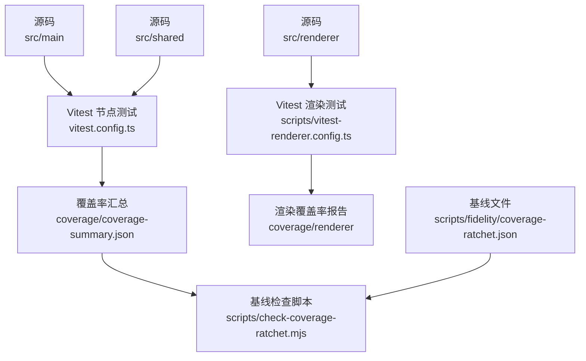
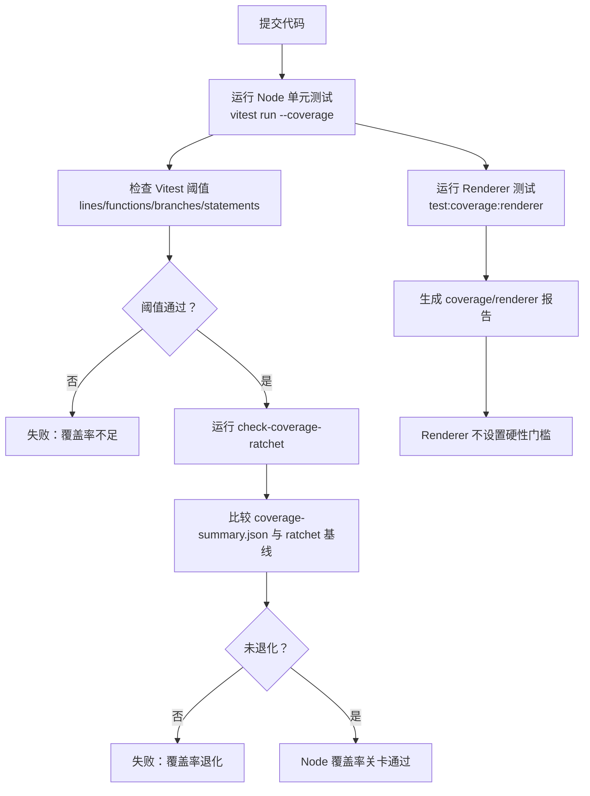
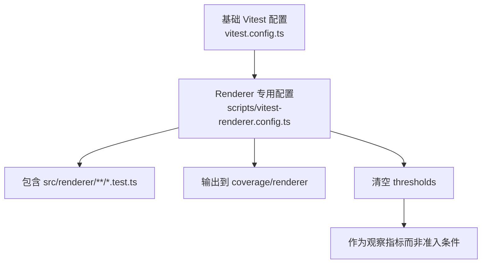
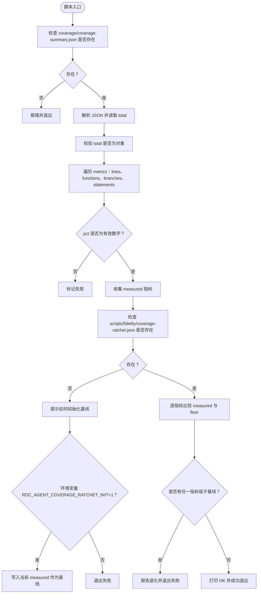
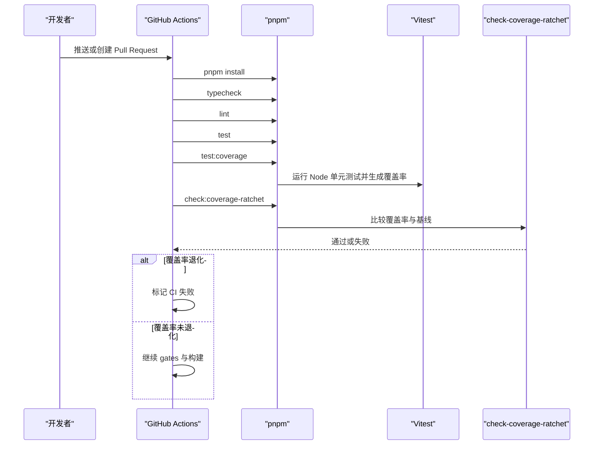

# 覆盖率基线与提升

<cite>
**本文引用的文件**
- [scripts/check-coverage-ratchet.mjs](file://scripts/check-coverage-ratchet.mjs)
- [scripts/fidelity/coverage-ratchet.json](file://scripts/fidelity/coverage-ratchet.json)
- [vitest.config.ts](file://vitest.config.ts)
- [scripts/vitest-renderer.config.ts](file://scripts/vitest-renderer.config.ts)
- [package.json](file://package.json)
- [.github/workflows/ci.yml](file://.github/workflows/ci.yml)
</cite>

## 目录
1. [引言](#引言)
2. [项目结构与覆盖率坐标](#项目结构与覆盖率坐标)
3. [核心设计：双层策略与棘轮机制](#核心设计双层策略与棘轮机制)
4. [Node 单元覆盖率配置](#node-单元覆盖率配置)
5. [Renderer 覆盖率配置](#renderer-覆盖率配置)
6. [check-coverage-ratchet 执行逻辑](#check-coverage-ratchet-执行逻辑)
7. [覆盖率统计范围与排除策略](#覆盖率统计范围与排除策略)
8. [CI/CD 集成流程](#cicd-集成流程)
9. [覆盖率报告解读方法](#覆盖率报告解读方法)
10. [覆盖率优化指南](#覆盖率优化指南)
11. [故障排查](#故障排查)
12. [结论](#结论)

## 引言
RDC-Agent 的覆盖率体系不是“越高越好”的单一指标，而是围绕两个关键目标构建：
- **防止退化**：通过 `check-coverage-ratchet` 锁定基线，保证每次提交至少不降低已积累的代码覆盖水平。
- **分层治理**：Node 单元层面使用严格的阈值和基线约束；Renderer 层面则采用独立报告、不设硬性门槛，把质量保障交给浏览器自动化测试与架构门禁。

这套机制把“覆盖率是否达到最低要求”和“覆盖率是否退步”拆成两道门：前者由 Vitest 阈值保护，后者由 ratchet 基线保护。

## 项目结构与覆盖率坐标
RDC-Agent 是 Electron + Vite + Vitest 工程，主要代码分布在三个层次：
- `src/main`：Electron 主进程业务逻辑。
- `src/shared`：主进程与渲染进程共享类型、工具、常量等。
- `src/renderer`：基于 React 的渲染进程界面。

覆盖率相关工件位于：
- `coverage/coverage-summary.json`：Vitest 生成的 Node 单元覆盖率汇总。
- `scripts/fidelity/coverage-ratchet.json`：ratchet 基线，记录 lines、functions、branches、statements 四个维度的百分比。
- `coverage/renderer`：Renderer 独立覆盖率报告目录。



**图示来源**
- [vitest.config.ts:1-81](file://vitest.config.ts#L1-L81)
- [scripts/vitest-renderer.config.ts:1-17](file://scripts/vitest-renderer.config.ts#L1-L17)
- [scripts/check-coverage-ratchet.mjs:1-87](file://scripts/check-coverage-ratchet.mjs#L1-L87)
- [scripts/fidelity/coverage-ratchet.json:1-6](file://scripts/fidelity/coverage-ratchet.json#L1-L6)

**章节来源**
- [vitest.config.ts:1-81](file://vitest.config.ts#L1-L81)
- [scripts/vitest-renderer.config.ts:1-17](file://scripts/vitest-renderer.config.ts#L1-L17)

## 核心设计：双层策略与棘轮机制

### Node 单元层面：阈值 + 基线
Node 单元测试覆盖 `src/main` 和 `src/shared`。它有两道防线：
1. **Vitest 阈值**：在 `vitest.config.ts` 中设置 lines、functions、branches、statements 的最小值，用于快速发现整体覆盖度明显下滑。
2. **ratchet 基线**：在 `scripts/fidelity/coverage-ratchet.json` 中固定当前实际覆盖率，再由 `scripts/check-coverage-ratchet.mjs` 比较最新结果，只允许提升，不允许退化。

这种设计的理念是：**阈值防止整体崩塌，基线防止渐进退化**。即使某次改动后覆盖率仍在阈值之上，只要低于历史基线，也会失败。

### Renderer 层面：独立报告 + 无强制门槛
Renderer 测试通过 `scripts/vitest-renderer.config.ts` 运行，其特点是：
- 仅包含 `src/renderer/**/*.test.ts`。
- 覆盖率输出到 `coverage/renderer`。
- 继承基础 Vitest 配置，但**显式清空 thresholds**。
- 注释明确说明：Renderer 的质量由浏览器 QA 和各类 `check:*` 门禁保障，而不是用 Node 覆盖率门槛衡量。

因此，Renderer 覆盖率更像“可观测指标”，而不是准入条件。这符合渲染层 UI 行为更适合端到端或交互测试的特征。



**图示来源**
- [vitest.config.ts:1-81](file://vitest.config.ts#L1-L81)
- [scripts/vitest-renderer.config.ts:1-17](file://scripts/vitest-renderer.config.ts#L1-L17)
- [scripts/check-coverage-ratchet.mjs:1-87](file://scripts/check-coverage-ratchet.mjs#L1-L87)

**章节来源**
- [vitest.config.ts:1-81](file://vitest.config.ts#L1-L81)
- [scripts/vitest-renderer.config.ts:1-17](file://scripts/vitest-renderer.config.ts#L1-L17)
- [scripts/check-coverage-ratchet.mjs:1-87](file://scripts/check-coverage-ratchet.mjs#L1-L87)

## Node 单元覆盖率配置

### 统计范围
Node 单元测试使用 V8 覆盖率提供者，并输出 text、lcov、json-summary 三种报告。

**需要包含的核心模块**：
- `src/main/**/*.{ts,tsx}`
- `src/shared/**/*.{ts,tsx}`

这意味着主进程中的业务逻辑、会话、设置、工具、IPC 实现、工作流、知识系统、调查系统等，只要不在排除列表中，都会进入覆盖率统计。

**需要排除的边缘情况**：
- 测试文件和 fixtures：`**/*.test.ts`、`**/fixtures/**`、`**/__fixtures__/**`、`**/generated/**`、`**/*.generated.ts`、`**/dist/**`。
- Electron / 进程入口胶水：`src/main/index.ts`、`src/main/**/index.ts`。
- IPC 通道与处理器胶水：`src/main/ipc/*Handlers.ts`、`src/main/ipc/handlers.ts`、`src/main/ipc/sessionOutputs.ts`、`src/main/ipc/channels.ts`、`src/main/ipc/HandshakeRegistry.ts`。
- 浏览器桥接服务器与事件中心：`src/main/browserAppBridge/BrowserAppBridgeServer.ts`、`src/main/browserAppBridge/rendererEventHub.ts`。
- 遥测、Worker 线程池、桌面 Shell、外部 CLI、本地设备、媒体、捕获等进程或操作系统绑定模块。
- Electron/RDC 会话编排、回放、分支、恢复等服务。
- OAuth 认证相关路径及 Provider 连接服务。
- 未使用或遗留注册表、调试器运行时、daemon、SDK、reports、testing faux、commands 等薄封装或集成层。

这些排除项的共同特征是：**它们不适合用普通 Node 单元测试覆盖**，或者应由浏览器 QA、smoke 测试、打包验证、契约检查等其他门禁负责。

### 阈值设计
Node 单元覆盖率设置了如下最小阈值：
- lines：40%
- functions：40%
- branches：30%
- statements：40%

这个阈值不是“最终质量目标”，而是**安全网**。真正锁住基线的是 `scripts/fidelity/coverage-ratchet.json`。当前基线约为：
- lines：约 68.89%
- functions：约 70.51%
- branches：约 55.95%
- statements：约 66.74%

可以看出，基线远高于阈值，说明团队更关注“不能退步”，而不是让阈值成为唯一压力源。

**章节来源**
- [vitest.config.ts:1-81](file://vitest.config.ts#L1-L81)
- [scripts/fidelity/coverage-ratchet.json:1-6](file://scripts/fidelity/coverage-ratchet.json#L1-L6)

## Renderer 覆盖率配置

Renderer 覆盖率由 `scripts/vitest-renderer.config.ts` 管理。它继承基础 Vitest 配置，但做了三个关键调整：
1. 测试文件范围限定为 `src/renderer/**/*.test.ts`。
2. 覆盖率输出目录改为 `./coverage/renderer`，避免与 Node 覆盖率混淆。
3. 将 thresholds 设置为 undefined，即**不强制覆盖率门槛**。

这样做的原因是：Renderer 层包含大量 UI 状态、React 组件、Hook、Store、样式、国际化资源等，很多行为更适合通过浏览器 QA、视觉保真检查、架构门禁来验证，而不是单纯追求单元测试覆盖率数字。



**图示来源**
- [vitest.config.ts:1-81](file://vitest.config.ts#L1-L81)
- [scripts/vitest-renderer.config.ts:1-17](file://scripts/vitest-renderer.config.ts#L1-L17)

**章节来源**
- [scripts/vitest-renderer.config.ts:1-17](file://scripts/vitest-renderer.config.ts#L1-L17)

## check-coverage-ratchet 执行逻辑

`scripts/check-coverage-ratchet.mjs` 是一个独立的 Node 脚本，职责非常明确：**读取最新覆盖率汇总并与基线比较，只允许提升，不允许退化**。

### 输入与输出
- 输入：
  - `coverage/coverage-summary.json`：Vitest 生成的覆盖率汇总。
  - `scripts/fidelity/coverage-ratchet.json`：ratchet 基线。
- 输出：
  - 成功时打印 OK 信息。
  - 失败时打印错误信息并将 `process.exitCode` 设为 1。

### 执行流程



**图示来源**
- [scripts/check-coverage-ratchet.mjs:1-87](file://scripts/check-coverage-ratchet.mjs#L1-L87)

### 关键判断规则
1. 如果缺少 `coverage/coverage-summary.json`，直接失败，并提示先运行覆盖率测试。
2. 如果 `total` 缺失或不是对象，失败。
3. 对每个 metric，若 `pct` 不是有效数字，标记失败。
4. 如果基线文件不存在：
   - 打印初始化命令和当前 measured 值。
   - 只有当环境变量 `RDC_AGENT_COVERAGE_RATCHET_INIT=1` 时，才写入基线文件。
   - 否则直接失败。
5. 如果基线存在，对每个 metric 比较：
   - 若 `measured < ratchet`，视为退化。
   - 脚本使用极小容差 `1e-9` 判断，避免浮点误差导致误判。
6. 所有指标都未退化时，打印 OK 并成功退出。

### 增量计算方式
需要注意：**该脚本并不计算“本次变更带来的增量覆盖率”**，它比较的是“当前完整覆盖率”与“基线覆盖率”。也就是说，ratchet 保护的是整体覆盖水平，而不是 diff-only 覆盖率。

如果需要评估某个改动的边际收益，应结合 Git diff、覆盖率 HTML 报告、以及具体模块的测试覆盖情况，而不是依赖 ratchet 脚本本身做增量分析。

**章节来源**
- [scripts/check-coverage-ratchet.mjs:1-87](file://scripts/check-coverage-ratchet.mjs#L1-L87)
- [scripts/fidelity/coverage-ratchet.json:1-6](file://scripts/fidelity/coverage-ratchet.json#L1-L6)

## 覆盖率统计范围与排除策略

### 需要包含的核心模块
Node 单元覆盖率的目标是覆盖**可被 Node 环境稳定运行的核心逻辑**，主要包括：
- 主进程业务逻辑：agent runtime、conversation、settings、knowledge、investigation、runtime、sessions、hooks、workflow 等。
- 共享层：types、utils、constants、theme、provider-catalog、renderer-api 等。

这些模块通常具备确定性输入输出、可注入依赖、可 mock 外部系统，适合用 Vitest + Node 环境进行测试。

### 需要排除的边缘情况
排除清单体现了项目的质量边界划分：

| 类别 | 典型路径或模式 | 原因 |
|---|---|---|
| 测试与生成产物 | `**/*.test.ts`、`**/fixtures/**`、`**/generated/**`、`**/*.generated.ts`、`**/dist/**` | 不是被测生产代码 |
| Electron 入口 | `src/main/index.ts`、`src/main/**/index.ts` | 进程启动胶水，不适合单元覆盖率 |
| IPC 通道 | `src/main/ipc/*Handlers.ts`、`handlers.ts`、`channels.ts`、`sessionOutputs.ts`、`HandshakeRegistry.ts` | 通信契约由其他门禁和集成测试验证 |
| 浏览器桥接 | `BrowserAppBridgeServer.ts`、`rendererEventHub.ts` | 属于浏览器 QA/smoke 场景 |
| 遥测 | `src/main/telemetry/**` | 通常不需要单元覆盖率 |
| Worker 与线程 | `turnPreparationWorker.ts`、`TurnPreparationWorkerPool.ts` | 进程/线程绑定，适合集成测试 |
| 桌面能力 | `src/main/tools/**`、`src/main/media/**`、`src/main/captures/**` | Electron 或操作系统绑定 |
| 会话编排 | `RdcSessionService.ts`、`RewindService.ts`、`SessionBranchService.ts`、`SessionResumeService.ts` | 复杂集成流程 |
| 认证 | `src/main/settings/oauth/**`、`ProviderAccountAuthService.ts`、`ProviderConnectionService.ts` | 外部网络与 OAuth 流程 |
| 遗留或薄封装 | registries、debugger、daemon、sdk、reports、faux、commands 等 | 非核心可测试路径或集成责任 |

这些排除项共同构成一个原则：**覆盖率统计要聚焦可测试、可重复、高价值的核心路径，而不是盲目追求全局覆盖率。**

**章节来源**
- [vitest.config.ts:1-81](file://vitest.config.ts#L1-L81)

## CI/CD 集成流程

GitHub Actions 的 CI 工作流在 Ubuntu runner 上依次执行以下关键步骤：
1. 安装依赖。
2. 类型检查。
3. Lint。
4. 单元测试。
5. 覆盖率测试。
6. **ratchet 基线检查**。
7. gates 与其他专项检查。
8. provider catalog 检查。
9. scoped resources、project instructions、prompt plan snapshot、skills、hooks、memory policy 等检查。
10. contracts 检查。
11. git diff whitespace 检查。
12. 构建。

其中，覆盖率相关的关键命令是：
- `pnpm run test:coverage`
- `pnpm run check:coverage-ratchet`

这意味着：**即使单元测试通过，如果覆盖率退化，CI 仍会失败。**



**图示来源**
- [.github/workflows/ci.yml:1-185](file://.github/workflows/ci.yml#L1-L185)
- [package.json:63-80](file://package.json#L63-L80)
- [scripts/check-coverage-ratchet.mjs:1-87](file://scripts/check-coverage-ratchet.mjs#L1-L87)

**章节来源**
- [.github/workflows/ci.yml:1-185](file://.github/workflows/ci.yml#L1-L185)
- [package.json:63-80](file://package.json#L63-L80)

## 覆盖率报告解读方法

### Node 覆盖率
Node 覆盖率默认输出到 `coverage` 目录，包含：
- text：控制台可读摘要。
- lcov：可用于 IDE 或覆盖率查看器。
- json-summary：供 `check-coverage-ratchet.mjs` 读取。

解读重点：
1. 先看 `total` 四维度：lines、functions、branches、statements。
2. 对比 `scripts/fidelity/coverage-ratchet.json`，确认是否退化。
3. 如果失败，优先看哪些模块或函数被标记为未覆盖。
4. 不要只看百分比，还要结合排除列表判断：某些模块本来就不该纳入 Node 单元覆盖率。

### Renderer 覆盖率
Renderer 覆盖率输出到 `coverage/renderer`，适用于：
- 观察渲染层测试是否覆盖到新组件或新 Hook。
- 配合浏览器 QA 结果判断 UI 行为风险。
- 识别长期缺乏测试的渲染模块。

由于没有 thresholds，Renderer 覆盖率下降不会直接导致 CI 失败，但它仍然是重要的健康信号。

### 报告联动
建议把覆盖率报告与以下门禁一起阅读：
- `check:gates`：仓库卫生、架构、保真度、共享导出、工作进程展示、会话投影、右侧栏、Knowledge、Investigation 等。
- `check:work-process-tool-coverage`：工作进程工具覆盖相关的专项检查。
- `check:contracts`：契约测试。
- `check:browser-capability`：浏览器能力门禁。

这样可以把“覆盖率数字”还原到“功能风险”语境中。

**章节来源**
- [vitest.config.ts:1-81](file://vitest.config.ts#L1-L81)
- [scripts/vitest-renderer.config.ts:1-17](file://scripts/vitest-renderer.config.ts#L1-L17)
- [package.json:63-80](file://package.json#L63-L80)

## 覆盖率优化指南

### 如何识别低覆盖率模块
1. 运行 `pnpm run test:coverage`，查看 `coverage/coverage-summary.json` 和 lcov/text 报告。
2. 定位覆盖率最低的模块，尤其是 `src/main` 和 `src/shared` 中的核心业务逻辑。
3. 结合 Vitest 测试文件命名和路径，判断是否有对应 `.test.ts`。
4. 对已被排除的路径（如 IPC handlers、OAuth、tools、media 等），不要强行补单测，而应考虑 browser QA、smoke、契约或集成测试。

### 优先测试的关键路径
建议按以下优先级编写或增强测试：
1. **纯函数与工具函数**：容易 mock，成本低，收益高。
2. **数据转换与序列化逻辑**：一旦出错，下游影响面大。
3. **会话、设置、知识、调查等核心状态机**：这些是 agent 行为的基础。
4. **IPC 消息处理核心逻辑**：注意只测业务处理，不测通道定义。
5. **Provider 与工具能力映射**：这类路径直接影响 agent 能力暴露。
6. **UI 状态与 Hook**：Renderer 侧优先写交互或状态断言，而不是追求组件覆盖率数字。

### 平衡测试成本
- 优先覆盖“容易写、容易跑、容易失败”的用例。
- 避免为装饰性代码、配置文件、类型声明、生成文件编写测试。
- 对于外部依赖（网络、文件系统、Electron API、浏览器），尽量使用 mock、stub、sandbox，而不是真实运行。
- 如果某个模块确实难以用 Node 单元测试覆盖，优先考虑把它加入排除列表，并用其他门禁保障质量。
- 提升覆盖率不等于增加断言数量；更好的方式是减少不可达分支、拆分过大函数、引入可测试结构。

### 何时更新 ratchet 基线
只有在以下情况下才应该更新 `scripts/fidelity/coverage-ratchet.json`：
- 已经补充了有价值的测试。
- 覆盖率提升来自真实逻辑覆盖，而不是临时扩大 include 或缩小 exclude。
- 更新基线的提交同时通过了 `test:coverage`、`check:coverage-ratchet`、`check:gates`、`typecheck`、`lint`、`build`。

初始化或重新生成基线时，可使用脚本提供的提示命令，并通过环境变量启用写入：
```bash
RDC_AGENT_COVERAGE_RATCHET_INIT=1 node scripts/check-coverage-ratchet.mjs
```
这会从当前 `coverage/coverage-summary.json` 的 `total` 中写入基线。

**章节来源**
- [scripts/check-coverage-ratchet.mjs:1-87](file://scripts/check-coverage-ratchet.mjs#L1-L87)
- [vitest.config.ts:1-81](file://vitest.config.ts#L1-L81)

## 故障排查

### 常见失败原因与修复

| 现象 | 可能原因 | 处理方式 |
|---|---|---|
| 提示缺少 `coverage/coverage-summary.json` | 未先运行覆盖率测试 | 先执行 `pnpm run test:coverage` |
| `coverage-summary.json is missing a total block` | Vitest 覆盖率输出异常或配置错误 | 检查 `vitest.config.ts` 中 coverage reporter 和 reportsDirectory |
| 提示缺少 ratchet 文件 | 首次运行或未初始化基线 | 使用 `RDC_AGENT_COVERAGE_RATCHET_INIT=1` 初始化，或手动维护基线 |
| 某指标覆盖率退化 | 新增代码未被测试覆盖，或现有测试失效 | 补充测试或修正测试；必要时重构代码以降低不可测分支 |
| Node 阈值失败 | 整体覆盖率低于 vitest.config.ts 中的 thresholds | 优先补核心模块测试 |
| Renderer 覆盖率变化但 CI 未失败 | renderer 配置没有 thresholds | 这是预期行为；关注浏览器 QA 和其他门禁 |
| CI 覆盖率失败但本地通过 | 本地未运行相同命令、缓存不一致、或测试顺序差异 | 在 CI 环境中复现，确保运行 `test:coverage` 和 `check:coverage-ratchet` |

### 推荐调试顺序
1. 先确认 `pnpm run test` 全部通过。
2. 再运行 `pnpm run test:coverage`，确认覆盖率报告生成。
3. 最后运行 `pnpm run check:coverage-ratchet`，定位具体退化指标。
4. 如果确实是合理的新基线，再更新 `scripts/fidelity/coverage-ratchet.json`。
5. 如果失败集中在 Renderer，检查是否误用了 Node 覆盖率门禁；Renderer 应看 `coverage/renderer` 并结合浏览器 QA。

**章节来源**
- [scripts/check-coverage-ratchet.mjs:1-87](file://scripts/check-coverage-ratchet.mjs#L1-L87)
- [vitest.config.ts:1-81](file://vitest.config.ts#L1-L81)
- [scripts/vitest-renderer.config.ts:1-17](file://scripts/vitest-renderer.config.ts#L1-L17)
- [.github/workflows/ci.yml:1-185](file://.github/workflows/ci.yml#L1-L185)

## 结论
RDC-Agent 的覆盖率体系以“防退化”为核心，通过两层设计实现可控演进：
- Node 单元层面使用 Vitest 阈值和 ratchet 基线双重约束，确保核心业务逻辑的可测试性稳步提升。
- Renderer 层面采用独立报告和宽松门槛，把 UI 行为质量交给浏览器 QA、架构门禁和交互测试。
- `check-coverage-ratchet` 的职责非常清晰：不追求增量覆盖率，只守住历史基线，保证代码质量只能前进、不能后退。

在实际工程中，最关键的实践是：**优先写有价值的测试，而不是只为提高百分比；遇到难以测试的外部路径，改用合适的门禁保障；每次提升覆盖率时，同步更新基线并让 CI 验证。**