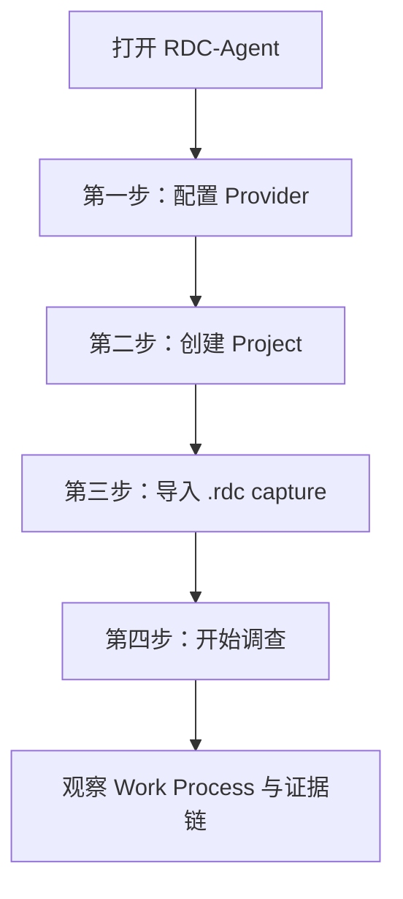

# 快速开始

<cite>
**本文引用的文件**   
- [README.en.md](file://README.en.md)
- [package.json](file://package.json)
- [scripts/launch-rdc-agent.mjs](file://scripts/launch-rdc-agent.mjs)
- [scripts/start-rdc-agent.cmd](file://scripts/start-rdc-agent.cmd)
- [electron-builder.json](file://electron-builder.json)
- [docs/workflows/first-use-and-release-readiness.md](file://docs/workflows/first-use-and-release-readiness.md)
</cite>

## 目录
1. [简介](#简介)
2. [环境要求](#环境要求)
3. [安装 RDC-Agent](#安装-rdc-agent)
4. [准备 RDC-Tool](#准备-rdc-tool)
5. [四步引导流程](#四步引导流程)
6. [开发者环境搭建](#开发者环境搭建)
7. [常见问题与排障](#常见问题与排障)
8. [下一步](#下一步)

## 简介
RDC-Agent 是面向 Windows 的桌面应用，把 RenderDoc `.rdc` 捕获、AI Agent 协作和本机 RDC 诊断整合到一个可审计的调查工作台中。它不是“大模型 + 工具调用”的简单包装，而是围绕一次 GPU 帧问题组织假设、检查、实验、证据和结论的稳定链条。

对于新用户，最直接的起点是：先配置 AI Provider，再创建 Project，导入 `.rdc` capture，然后让 Agent 开始调查。

## 环境要求
- **操作系统**：Windows（当前发行表面为 Windows）。
- **Node.js**：≥ `22.13.0`。
- **包管理器**：pnpm `11.7.0`。
- **RDC-Tool**：可选但推荐；用于驱动 RDC / RenderDoc 操作。

| 项目 | 要求 | 说明 |
|---|---|---|
| 操作系统 | Windows | 发布目标为 x64 NSIS 安装包和便携 zip。 |
| Node.js | ≥ `22.13.0` | 源码开发必须满足；已安装应用通常由 Electron 自带运行时启动。 |
| pnpm | `11.7.0` | 仓库通过 `packageManager` 字段锁定版本。 |
| RDC-Tool | 独立下载并解压 | 用于 RDC 上下文、回放、导出等原生能力；普通聊天使用可不依赖。 |

**章节来源**
- [README.en.md:89-103](file://README.en.md#L89-L103)
- [README.en.md:105-114](file://README.en.md#L105-L114)
- [package.json:1-25](file://package.json#L1-L25)

## 安装 RDC-Agent
RDC-Agent 提供两种发行产物：

1. **NSIS 安装包**：形如 `RDC-Agent-<version>-x64-setup.exe`。
2. **便携 zip**：提取完整目录后运行 `RdcAgent.exe`。

### 使用 NSIS 安装包
1. 从仓库 Releases 页面下载 `*-setup.exe`。
2. 双击安装包，按向导完成安装。
3. 在开始菜单或桌面找到 `RDC-Agent` 并启动。

### 使用便携 zip
1. 从 Releases 页面下载 `*.zip`。
2. **将整个 zip 解压到一个普通文件夹**，不要直接双击 zip 中的 exe。
3. 进入解压后的目录，运行 `RdcAgent.exe`。

```powershell
# 示例：查看 release 目录下是否已有解压后的应用
dir release\RDC-Agent-*\RdcAgent.exe
```

预期结果：应用窗口打开，出现首次使用的四步引导界面。

### 关于签名与安全警告
- 预发布版本可能显示“未知发布者”或由系统策略阻止执行。
- 只从本仓库可信地址下载。
- 不要关闭安全保护；如需临时处理受管策略限制，应优先确认下载地址和哈希值。
- 稳定版仍需要正式签名。

**章节来源**
- [README.en.md:89-103](file://README.en.md#L89-L103)
- [electron-builder.json:1-54](file://electron-builder.json#L1-L54)

## 准备 RDC-Tool
RDC-Agent 不内置你的 `.rdc` 捕获、Provider Key 或 RenderDoc 安装。RDC / RenderDoc 相关操作由外部 RDC-Tool CLI 驱动。

### 下载与解压
1. 前往 RDC-Tool 的 Releases 页面。
2. 下载自包含 zip。
3. 解压到任意位置，例如 `%LOCALAPPDATA%\Programs\rdc-tool`。
4. 确保该目录包含 RDC-Tool 根目录及其捆绑的 Python 与 CLI，而不是只指向某个 Python 可执行文件。

### 在设置中配置 RDC-Tool
1. 打开 RDC-Agent。
2. 进入 **Settings → Tools**。
3. 选择以下操作之一：
   - **检测安装**：自动检查已配置位置和默认路径 `%LOCALAPPDATA%\Programs\rdc-tool`。
   - **选择文件夹**：手动选择 RDC-Tool 根目录。
4. 点击 **验证并应用**。
5. 成功后保存 `rdcCli` 配置；失败会保留原配置，不会静默生效。

```powershell
# 示例：确认 RDC-Tool 根目录结构
dir %LOCALAPPDATA%\Programs\rdc-tool
```

预期结果：设置页显示已识别 RDC-Tool，且后续可以查询 RDC 上下文、回放 capture、导出截图等。

**章节来源**
- [README.en.md:94-103](file://README.en.md#L94-L103)
- [DESIGN.md:13](file://DESIGN.md#L13)
- [docs/workflows/first-use-and-release-readiness.md:122](file://docs/workflows/first-use-and-release-readiness.md#L122)

## 四步引导流程
RDC-Agent 的首次引导分为四个步骤：**配置 Provider → 创建 Project → 导入 .rdc capture → 开始调查**。你也可以随时从标题栏的问号按钮重新打开引导。



### 第一步：配置 Provider
1. 打开 **Settings**。
2. 添加一个 LLM Provider，并填入 API Key 或完成 OAuth 登录。
3. 选择一个可用的 model。
4. 保存配置。

成功标志：
- Provider 状态显示已连接。
- 模型选项可用。
- Agent 不再提示缺少 provider。

如果 Provider 不可用，检查：
- API Key 是否正确。
- 网络是否能访问对应服务。
- Provider 是否启用并已连接。

### 第二步：创建 Project
1. 在应用主界面新建 Project。
2. Project 资源位于 `<project-root>\.rdc-agent`。
3. 给 Project 命名，使其能明确代表一次调查范围。

Project 是 RDC-Agent 的资源边界：capture、replay、context、任务、Artifacts、Outputs、Context 和调查历史都尽量保持在同一个会话内。

### 第三步：导入 .rdc capture
1. 在 Project 中导入 `.rdc` 文件。
2. 确保 capture 名称、replay 环境和上下文身份清晰。
3. 如果本机安装了 RDC-Tool，Agent 可以通过 RDC 上下文确认 replay 就绪。

预期结果：
- Capture 出现在 Project 资源中。
- 可以查看 capture 基本信息。
- 必要时可以回放或导出截图作为证据。

### 第四步：开始调查
1. 在 conversation 中输入问题，例如“为什么这一帧有问题？”
2. 让 Agent 检查代码、运行命令、查看 RDC 上下文。
3. 通过 **Work Process** 观察真实执行过程，而不是只看最终回答。
4. 如果需要图形领域推理，切换到 Debugger、Analyzer 或 Optimizer 等专业方法。

**章节来源**
- [README.en.md:10-23](file://README.en.md#L10-L23)
- [README.en.md:89-103](file://README.en.md#L89-L103)
- [docs/workflows/first-use-and-release-readiness.md:122](file://docs/workflows/first-use-and-release-readiness.md#L122)

## 开发者环境搭建
源码开发需要 Windows、Node.js ≥ `22.13.0` 和 pnpm `11.7.0`。

### 安装依赖
```powershell
pnpm install
```

预期输出：
- pnpm 解析依赖。
- 安装 node_modules。
- 打印 pnpm store 路径。

### 启动开发模式
```powershell
pnpm run dev
```

预期行为：
- 启动 Electron。
- 加载桌面开发模式。
- 打开 RDC-Agent 窗口。

### 其他常用命令
```powershell
# 类型检查
pnpm run typecheck

# 运行测试
pnpm test

# 运行全部门禁检查
pnpm run check:gates

# 构建
pnpm run build
```

**章节来源**
- [README.en.md:105-114](file://README.en.md#L105-L114)
- [package.json:1-25](file://package.json#L1-L25)
- [package.json:26-70](file://package.json#L26-L70)
- [scripts/launch-rdc-agent.mjs:1-40](file://scripts/launch-rdc-agent.mjs#L1-L40)

## 常见问题与排障

### Windows 安全警告或无法执行
**现象**：双击安装包或 exe 被阻止，或显示未知发布者。  
**原因**：预发布版本可能未签名，或被企业安全策略拦截。  
**处理**：
1. 确认下载来源是本仓库官方 Release。
2. 核对 SHA-256。
3. 不要为了绕过警告而关闭整体安全保护。
4. 如果是便携 zip，请确保先完整解压再运行 `RdcAgent.exe`。

**章节来源**
- [README.en.md:89-103](file://README.en.md#L89-L103)
- [electron-builder.json:38-54](file://electron-builder.json#L38-L54)

### 找不到 RDC-Tool 或检测失败
**现象**：设置中无法识别 RDC-Tool，或验证失败。  
**原因**：
- 选择了错误路径，例如只选了 Python 可执行文件。
- RDC-Tool 没有放在默认路径。
- 路径中包含权限问题。

**处理**：
1. 在 **Settings → Tools** 中选择 RDC-Tool 根目录。
2. 根目录应包含 CLI 和捆绑 Python。
3. 默认检测路径包括 `%LOCALAPPDATA%\Programs\rdc-tool`。
4. 点击 **验证并应用**，失败时原配置不变。

**章节来源**
- [README.en.md:94-103](file://README.en.md#L94-L103)
- [docs/workflows/first-use-and-release-readiness.md:122](file://docs/workflows/first-use-and-release-readiness.md#L122)

### 启动时报 Node.js 版本错误
**现象**：开发启动时提示 Node.js 版本不符合要求。  
**原因**：当前 Node.js 低于 `22.13.0`。  
**处理**：升级 Node.js 到 ≥ `22.13.0`，然后重新执行 `pnpm install` 和 `pnpm run dev`。

**章节来源**
- [scripts/launch-rdc-agent.mjs:14-20](file://scripts/launch-rdc-agent.mjs#L14-L20)
- [scripts/launch-rdc-agent.mjs:52-63](file://scripts/launch-rdc-agent.mjs#L52-L63)

### pnpm 版本不一致
**现象**：依赖安装失败或锁文件冲突。  
**原因**：当前仓库要求 pnpm `11.7.0`。  
**处理**：使用匹配的 pnpm 版本，例如通过 nvm、fnm 或 corepack 切换。

**章节来源**
- [package.json:1-12](file://package.json#L1-L12)
- [scripts/launch-rdc-agent.mjs:65-86](file://scripts/launch-rdc-agent.mjs#L65-L86)

### 没有 RDC-Tool 也能用吗
**可以。** 普通聊天和通用 Agent 功能可以在没有 RDC-Tool 的情况下启动。只有涉及 RDC 上下文、回放、导出等原生能力时才需要 RDC-Tool。

**章节来源**
- [README.en.md:94-103](file://README.en.md#L94-L103)

## 下一步
完成四步引导后，你可以：
- 在 conversation 中描述 GPU 帧问题。
- 让 Agent 逐步生成假设、检查证据、提出实验。
- 使用 Debugger、Analyzer、Optimizer 三种专业方法处理图形调试场景。
- 在 Work Process 中跟踪实际执行，而不是只信任模型自述。
- 将观察、证据、结论和下一步行动保存在同一个 session 中。

如果你遇到安全问题、Provider 连接失败、RDC-Tool 路径错误或 capture 无法回放，请先确认：
1. 应用和 RDC-Tool 安装路径。
2. Provider API Key 和网络连通性。
3. `.rdc` capture 是否与本机 RenderDoc 版本兼容。
4. 是否需要重启应用以刷新配置。

**章节来源**
- [README.en.md:10-23](file://README.en.md#L10-L23)
- [README.en.md:89-114](file://README.en.md#L89-L114)