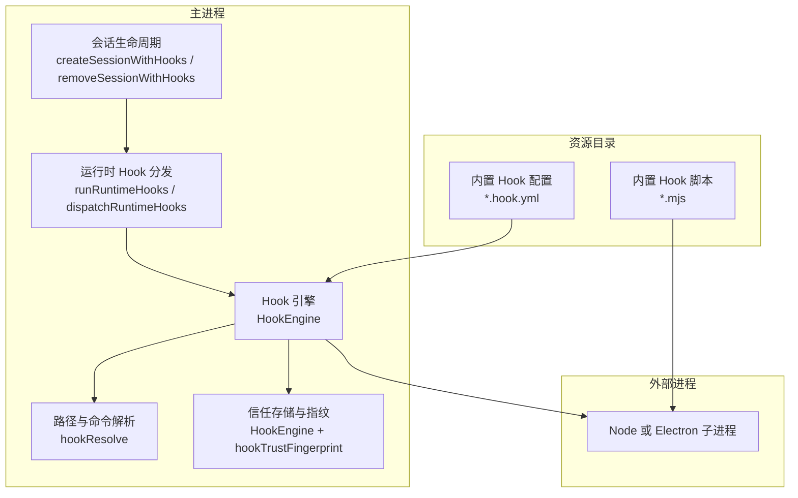
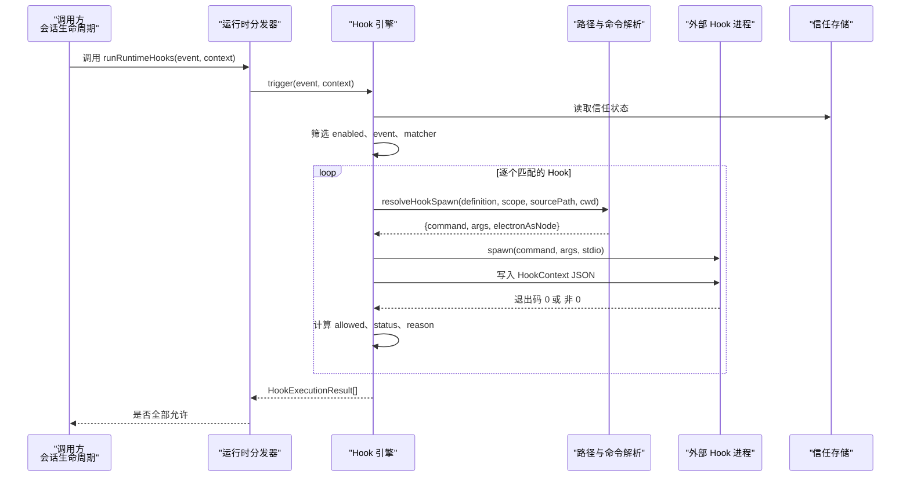
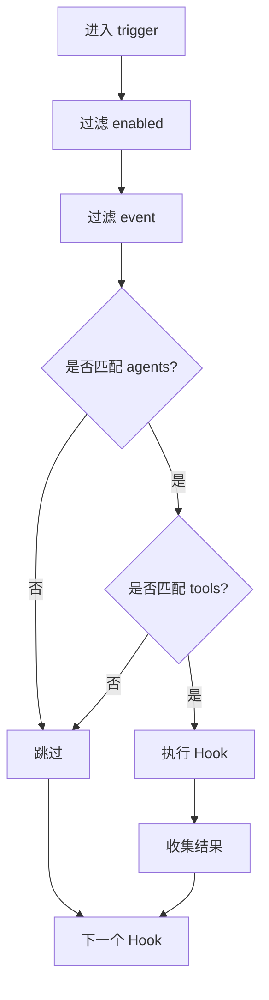
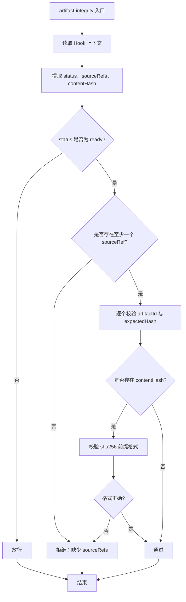
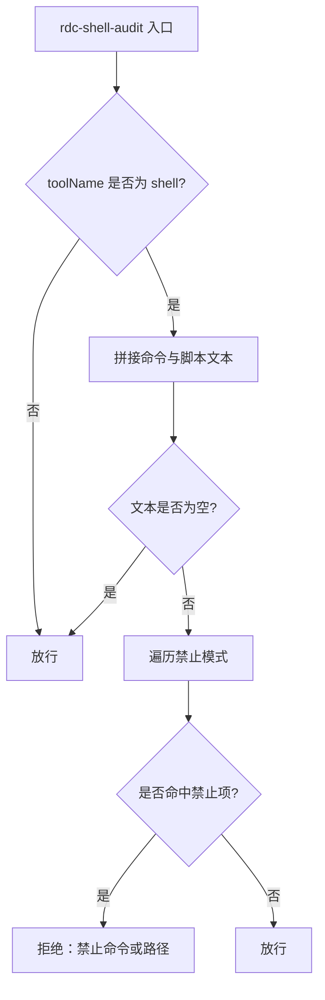
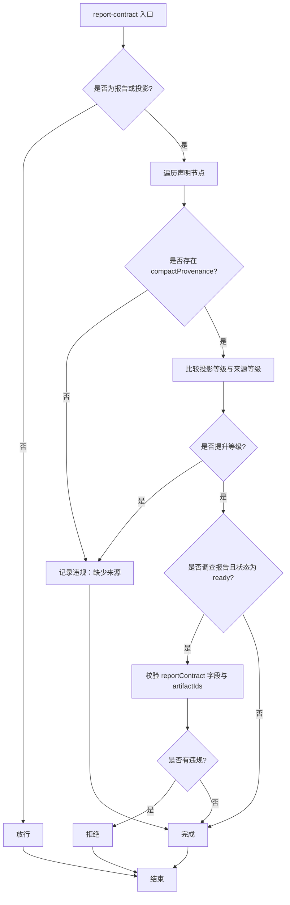
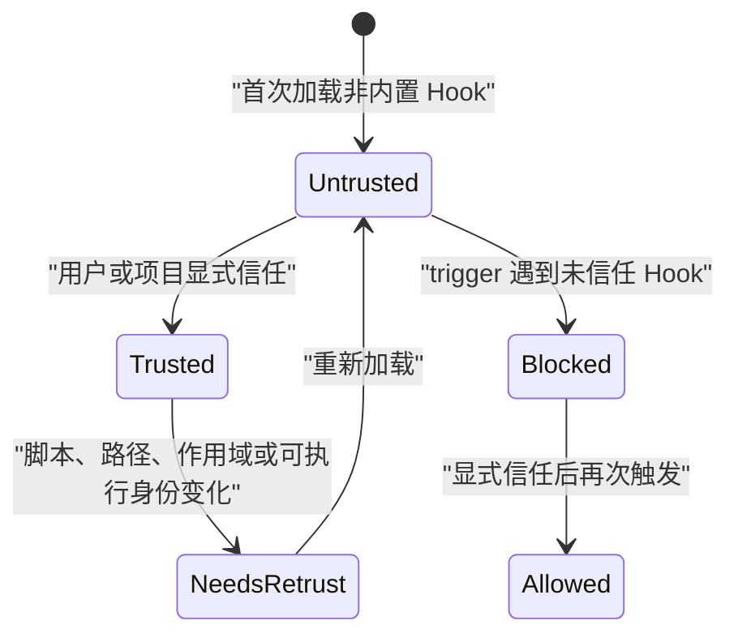

# Hook 开发

<cite>
**本文引用的文件**   
- [HookEngine.ts](file://src/main/hooks/HookEngine.ts)
- [runtimeHookDispatch.ts](file://src/main/hooks/runtimeHookDispatch.ts)
- [hookResolve.ts](file://src/main/hooks/hookResolve.ts)
- [sessionLifecycle.ts](file://src/main/hooks/sessionLifecycle.ts)
- [rdcRuntime.ts](file://src/shared/types/rdcRuntime.ts)
- [artifact-integrity.hook.yml](file://resources/agent-runtime/hooks/artifact-integrity.hook.yml)
- [artifact-integrity.mjs](file://resources/agent-runtime/hooks/artifact-integrity.mjs)
- [rdc-shell-audit.hook.yml](file://resources/agent-runtime/hooks/rdc-shell-audit.hook.yml)
- [rdc-shell-audit.mjs](file://resources/agent-runtime/hooks/rdc-shell-audit.mjs)
- [report-contract.hook.yml](file://resources/agent-runtime/hooks/report-contract.hook.yml)
- [report-contract.mjs](file://resources/agent-runtime/hooks/report-contract.mjs)
- [hook-check-lib.mjs](file://resources/agent-runtime/hooks/hook-check-lib.mjs)
- [HookEngine.test.ts](file://src/main/hooks/HookEngine.test.ts)
</cite>

## 目录
1. [引言](#引言)
2. [项目结构与定位](#项目结构与定位)
3. [核心概念](#核心概念)
4. [架构总览](#架构总览)
5. [Hook 配置格式](#hook-配置格式)
6. [钩子类型与触发条件](#钩子类型与触发条件)
7. [执行时机、上下文传递与结果处理](#执行时机上下文传递与结果处理)
8. [内置钩子实现分析](#内置钩子实现分析)
9. [信任模型与权限控制](#信任模型与权限控制)
10. [组合模式、错误恢复与日志记录](#组合模式错误恢复与日志记录)
11. [调试工具与测试接口](#调试工具与测试接口)
12. [性能特征与监控建议](#性能特征与监控建议)
13. [故障排除指南](#故障排除指南)
14. [最佳实践清单](#最佳实践清单)
15. [结论](#结论)

## 引言
本文件面向需要为 RDC Agent 运行时编写生命周期 Hook 的开发者。内容覆盖 Hook 的配置结构、匹配机制、执行流程、上下文数据、结果语义、信任与权限模型，以及三个内置 Hook：`artifact-integrity`、`rdc-shell-audit`、`report-contract` 的实现分析。文末提供组合模式、错误恢复、日志记录、调试、性能与排障建议。

## 项目结构与定位
Hook 系统位于主进程侧，由引擎加载 `.hook.yml` 配置并启动外部脚本；业务层通过事件分发 Hook，并在关键会话阶段进行拦截。

图示来源
- [sessionLifecycle.ts:1-37](file://src/main/hooks/sessionLifecycle.ts#L1-L37)
- [runtimeHookDispatch.ts:1-19](file://src/main/hooks/runtimeHookDispatch.ts#L1-L19)
- [HookEngine.ts:1-390](file://src/main/hooks/HookEngine.ts#L1-L390)
- [hookResolve.ts:1-94](file://src/main/hooks/hookResolve.ts#L1-L94)

章节来源
- [sessionLifecycle.ts:1-37](file://src/main/hooks/sessionLifecycle.ts#L1-L37)
- [runtimeHookDispatch.ts:1-19](file://src/main/hooks/runtimeHookDispatch.ts#L1-L19)
- [HookEngine.ts:1-390](file://src/main/hooks/HookEngine.ts#L1-L390)
- [hookResolve.ts:1-94](file://src/main/hooks/hookResolve.ts#L1-L94)

## 核心概念
- Hook 定义：以 `.hook.yml` 描述启用的事件、命令、参数、超时、失败策略和匹配器。
- Hook 作用域：`builtin`（内置）、`user`（用户目录）、`project`（项目目录）。
- Hook 事件：由共享类型定义的常量事件集合，例如 `tool.before-call`、`session.before-start`、`session.after-end` 等。
- Hook 上下文：引擎向子进程标准输入写入 JSON，包含事件、工具名、会话信息、项目根目录和业务载荷。
- Hook 结果：允许/拒绝布尔值、状态、退出码、输出、原因说明。
- 信任模型：非内置 Hook 必须显式信任，修改后自动失效；信任凭证持久化到信任存储。

章节来源
- [rdcRuntime.ts:120-170](file://src/shared/types/rdcRuntime.ts#L120-L170)
- [HookEngine.ts:1-120](file://src/main/hooks/HookEngine.ts#L1-L120)
- [HookEngine.ts:200-390](file://src/main/hooks/HookEngine.ts#L200-L390)

## 架构总览
Hook 的执行链路如下：

图示来源
- [runtimeHookDispatch.ts:1-19](file://src/main/hooks/runtimeHookDispatch.ts#L1-L19)
- [HookEngine.ts:200-390](file://src/main/hooks/HookEngine.ts#L200-L390)
- [hookResolve.ts:1-94](file://src/main/hooks/hookResolve.ts#L1-L94)

## Hook 配置格式
每个 Hook 由一个 `.hook.yml` 文件声明。引擎解析时要求至少包含 `id`、`event`、`command`，并对 `failurePolicy` 做校验。

| 字段 | 类型 | 必填 | 默认值 | 说明 |
|---|---|---:|---|---|
| `id` | 字符串 | 是 | 无 | Hook 唯一标识，用于信任记录和测试 |
| `enabled` | 布尔值 | 否 | `true` | 是否启用该 Hook |
| `event` | 字符串 | 是 | 无 | 要监听的事件名称 |
| `command` | 字符串 | 是 | 无 | 可执行命令，如 `node` |
| `args` | 字符串数组 | 否 | `[]` | 传递给命令的参数 |
| `cwd` | 字符串 | 否 | 项目根或工作目录 | 子进程工作目录 |
| `env` | 对象 | 否 | 空 | 从进程环境映射环境变量 |
| `timeoutMs` | 数字 | 否 | `30000` | Hook 超时毫秒数 |
| `failurePolicy` | 枚举 | 否 | 未设置则依赖脚本退出码 | `block` 表示失败直接拒绝；`warn` 表示失败仍可继续 |
| `matcher.tools` | 字符串数组 | 否 | 空 | 仅对指定工具名生效 |
| `matcher.agents` | 字符串数组 | 否 | 空 | 仅对指定 agentId 生效 |

解析规则要点：
- `id`、`event`、`command` 缺失会直接报错。
- `failurePolicy` 只接受 `block` 或 `warn`。
- `timeoutMs` 非正有限数值回退到默认值。
- `matcher` 可选，同时支持 `tools` 和 `agents` 过滤。

章节来源
- [HookEngine.ts:1-120](file://src/main/hooks/HookEngine.ts#L1-L120)
- [rdcRuntime.ts:120-170](file://src/shared/types/rdcRuntime.ts#L120-L170)

## 钩子类型与触发条件
当前仓库中可见的 Hook 事件包括：
- `tool.before-call`：在工具调用前检查。
- `session.before-start`：创建会话前检查。
- `session.after-end`：删除会话后清理。
- `context.before-compact`、`context.after-compact`：上下文压缩前后。
- `agent.before-handoff`、`agent.after-handoff`：代理移交前后。
- `permission.denied`：权限拒绝事件。

匹配逻辑：
- 只有 `enabled` 为真且 `event` 匹配的 Hook 才会参与执行。
- `matcher.tools` 为空时匹配所有工具；非空时要求 `context.toolName` 在其中。
- `matcher.agents` 为空时匹配所有代理；非空时要求 `context.agentId` 在其中。

图示来源
- [HookEngine.ts:200-390](file://src/main/hooks/HookEngine.ts#L200-L390)

章节来源
- [rdcRuntime.ts:120-170](file://src/shared/types/rdcRuntime.ts#L120-L170)
- [HookEngine.ts:320-390](file://src/main/hooks/HookEngine.ts#L320-L390)

## 执行时机、上下文传递与结果处理

### 执行时机
- 会话创建：`createSessionWithHooks` 在保存会话前调用 `dispatchRuntimeHooks('session.before-start', ...)`，若任一 Hook 拒绝则抛出错误并阻止会话创建。
- 会话删除：`removeSessionWithHooks` 在移除会话后调用 `dispatchRuntimeHooks('session.after-end', ...)`，用于审计或清理。
- 工具调用：由业务模块调用 `dispatchRuntimeHooks('tool.before-call', ...)`，根据 Hook 返回决定是否允许工具执行。

章节来源
- [sessionLifecycle.ts:1-37](file://src/main/hooks/sessionLifecycle.ts#L1-L37)
- [runtimeHookDispatch.ts:1-19](file://src/main/hooks/runtimeHookDispatch.ts#L1-L19)

### 上下文传递
Hook 子进程通过标准输入接收 `HookContext` JSON。共享库提供安全读取方法，并容忍空输入或解析异常。

| 上下文字段 | 含义 |
|---|---|
| `event` | 当前 Hook 事件 |
| `agentId` | 发起调用的代理标识（可选） |
| `toolName` | 工具名（可选） |
| `sessionId` | 会话标识（可选） |
| `projectRoot` | 项目根路径（可选） |
| `payload` | 业务载荷，通常包含工具参数或会话信息 |

工具参数访问推荐通过 `toolArgumentsOf(context)`，它会优先取 `payload.arguments`，再回退到 `payload`。

章节来源
- [HookEngine.ts:1-120](file://src/main/hooks/HookEngine.ts#L1-L120)
- [hook-check-lib.mjs:1-87](file://resources/agent-runtime/hooks/hook-check-lib.mjs#L1-L87)

### 结果处理
引擎将每个 Hook 的结果汇总为 `HookExecutionResult`，关键字段包括：

| 字段 | 含义 |
|---|---|
| `hookId` | Hook 标识 |
| `allowed` | 是否允许后续流程继续 |
| `status` | `completed`、`failed`、`timed-out`、`untrusted`、`skipped` |
| `exitCode` | 子进程退出码 |
| `stdout` / `stderr` | 标准输出和错误输出，最大截取固定字节数 |
| `reason` | 失败或拒绝原因 |

整体决策：
- 如果任一 Hook 的 `allowed` 为假，则终止后续 Hook 并拒绝本次操作。
- `failurePolicy=warn` 时，即使 Hook 失败仍视为允许。
- 未信任 Hook 直接标记为 `untrusted` 并拒绝。

章节来源
- [HookEngine.ts:1-120](file://src/main/hooks/HookEngine.ts#L1-L120)
- [HookEngine.ts:200-390](file://src/main/hooks/HookEngine.ts#L200-L390)

## 内置钩子实现分析

### artifact-integrity：工件完整性校验
用途：防止非预期写入，尤其是 `investigation_write` 类工具。

配置要点：
- 事件：`tool.before-call`
- 匹配工具：`investigation_write`
- 失败策略：`block`
- 超时：`8000` 毫秒

实现逻辑：
1. 读取 Hook 上下文。
2. 提取工具参数，关注 `status`、`sourceRefs`、`contentHash`。
3. 若状态不是 `ready`，直接放行。
4. `ready` 写入时必须存在至少一个 `sourceRefs`。
5. 每个引用必须包含 `artifactId` 和形如 `sha256:<64 位十六进制>` 的 `expectedHash`。
6. 若存在 `contentHash`，也必须符合 sha256 前缀格式。
7. 校验通过则允许；否则拒绝。

图示来源
- [artifact-integrity.mjs:1-31](file://resources/agent-runtime/hooks/artifact-integrity.mjs#L1-L31)
- [hook-check-lib.mjs:46-87](file://resources/agent-runtime/hooks/hook-check-lib.mjs#L46-L87)

章节来源
- [artifact-integrity.hook.yml:1-11](file://resources/agent-runtime/hooks/artifact-integrity.hook.yml#L1-L11)
- [artifact-integrity.mjs:1-31](file://resources/agent-runtime/hooks/artifact-integrity.mjs#L1-L31)

### rdc-shell-audit：Shell 命令审计
用途：避免绕过受控 Shell 行为，禁止硬编码 RenderDoc/RDC-Tool CLI 或 MCP 路径。

配置要点：
- 事件：`tool.before-call`
- 匹配工具：`shell`
- 失败策略：`warn`
- 超时：`8000` 毫秒

实现逻辑：
1. 读取上下文，若非 `shell` 工具则放行。
2. 从工具参数中提取 `command`、`cmd`、`executable`、`program`、`script`。
3. 拼接待审计文本。
4. 使用一组正则匹配禁止的命令或路径。
5. 命中禁止项则拒绝；否则放行。

图示来源
- [rdc-shell-audit.mjs:1-38](file://resources/agent-runtime/hooks/rdc-shell-audit.mjs#L1-L38)

章节来源
- [rdc-shell-audit.hook.yml:1-11](file://resources/agent-runtime/hooks/rdc-shell-audit.hook.yml#L1-L11)
- [rdc-shell-audit.mjs:1-38](file://resources/agent-runtime/hooks/rdc-shell-audit.mjs#L1-L38)

### report-contract：报告契约校验
用途：确保调查报告中声明的知识等级不会高于来源等级，并要求报告契约字段完整。

配置要点：
- 事件：`tool.before-call`
- 匹配工具：`investigation_write`
- 失败策略：`block`
- 超时：`8000` 毫秒

实现逻辑：
1. 判断是否为报告或投影场景。
2. 遍历声明节点，检查 `compactProvenance` 是否存在。
3. 比较投影知识等级与来源最小等级，禁止提升等级。
4. 对于调查报告，检查 `reportContract` 的必要字段及 `artifactIds` 列表。
5. 出现任何违规即拒绝。

图示来源
- [report-contract.mjs:1-66](file://resources/agent-runtime/hooks/report-contract.mjs#L1-L66)
- [hook-check-lib.mjs:69-87](file://resources/agent-runtime/hooks/hook-check-lib.mjs#L69-L87)

章节来源
- [report-contract.hook.yml:1-11](file://resources/agent-runtime/hooks/report-contract.hook.yml#L1-L11)
- [report-contract.mjs:1-66](file://resources/agent-runtime/hooks/report-contract.mjs#L1-L66)

## 信任模型与权限控制

### 作用域与优先级
Hook 来自三个位置：
- `builtin`：内置 Hook，默认信任。
- `user`：用户 Hook 目录。
- `project`：项目 Hook 目录。

当多个 Hook 具有相同 `id` 时，系统按作用域覆盖：项目 > 用户 > 内置。

### 信任指纹
非内置 Hook 每次加载都会计算信任指纹，指纹考虑：
- 定义本身
- 作用域
- 源文件真实路径
- 项目根
- 脚本字节内容与可执行身份

一旦脚本字节、真实路径、作用域或可执行身份变化，已有信任记录失效。

### 信任存储
信任记录保存在应用状态目录下的信任文件中，记录包含：
- `trustFingerprint`
- `trustedAt`
- `scope`
- `hookId`
- `ownerRoot`

### 信任操作
- 信任项目 Hook：需要提供项目根。
- 信任用户 Hook：直接信任。
- 撤销信任：可按作用域和所有者根撤销。
- 内置 Hook 不可写入信任存储。

图示来源
- [HookEngine.ts:1-200](file://src/main/hooks/HookEngine.ts#L1-L200)
- [hookTrustFingerprint.test.ts:1-98](file://src/main/hooks/hookTrustFingerprint.test.ts#L1-L98)

章节来源
- [HookEngine.ts:1-200](file://src/main/hooks/HookEngine.ts#L1-L200)
- [HookEngine.test.ts:1-200](file://src/main/hooks/HookEngine.test.ts#L1-L200)

## 组合模式、错误恢复与日志记录

### 组合模式
- 多 Hook 串联：同一事件可注册多个 Hook，引擎按顺序执行，直到某个 Hook 拒绝。
- 分层职责：
  - `artifact-integrity` 负责写入库件完整性。
  - `rdc-shell-audit` 负责 Shell 命令审计。
  - `report-contract` 负责报告契约合规。
- 作用域组合：
  - 内置 Hook 提供基础保护。
  - 用户 Hook 补充通用策略。
  - 项目 Hook 覆盖特定项目需求。

### 错误恢复
- `failurePolicy=warn`：Hook 失败不阻断主流程，适合审计型 Hook。
- `failurePolicy=block`：Hook 失败阻断主流程，适合安全性强校验。
- 未信任 Hook：直接拒绝执行，避免静默降级。
- 超时：返回 `timed-out`，是否允许取决于失败策略。
- 子进程启动失败：返回 `spawn_failed`，同样受失败策略影响。

### 日志记录
- 成功 Hook 可输出可读消息到标准输出。
- 失败 Hook 应输出明确原因到标准错误。
- 引擎限制 stdout/stderr 最大字节数，避免占用过多内存。
- 建议在 Hook 中保持输出简短，结构化失败原因便于诊断。

章节来源
- [HookEngine.ts:200-390](file://src/main/hooks/HookEngine.ts#L200-L390)
- [hook-check-lib.mjs:52-66](file://resources/agent-runtime/hooks/hook-check-lib.mjs#L52-L66)

## 调试工具与测试接口

### 测试接口
`HookEngine` 暴露 `test(hookId, context)`，可直接验证单个 Hook 的行为，而无需完整业务流程。

典型用法：
- 构造与 Hook 事件一致的 `HookContext`。
- 传入工具名、会话信息、项目根、业务载荷。
- 断言 `status` 与 `allowed`。

### 单元测试示例参考
仓库测试覆盖了：
- 项目 Hook 需要内容哈希信任。
- 内置、用户、项目作用域覆盖关系。
- 撤销信任后重新加载行为。
- 四个内置 Wave 4 Hook 模板的加载与基本执行。

章节来源
- [HookEngine.test.ts:1-200](file://src/main/hooks/HookEngine.test.ts#L1-L200)
- [HookEngine.ts:200-390](file://src/main/hooks/HookEngine.ts#L200-L390)

## 性能特征与监控建议

### 性能特征
- 每个 Hook 作为独立子进程运行，避免阻塞主进程。
- 标准输入/输出均被限制最大字节数，防止大输出拖慢系统。
- 子进程由进程监督器管理，支持超时和退出原因分类。
- 引擎在触发前已完成 Hook 加载与匹配，避免重复解析。

### 监控建议
- 统计各 Hook 的 `status` 分布，重点关注 `failed`、`timed-out`、`untrusted`。
- 记录 Hook 执行耗时，区分解析、启动、等待子进程阶段。
- 对频繁触发的 `tool.before-call` 事件，确保 Hook 逻辑轻量。
- 对长耗时 Hook 调整 `timeoutMs`，但不应掩盖真实问题。

章节来源
- [HookEngine.ts:200-390](file://src/main/hooks/HookEngine.ts#L200-L390)

## 故障排除指南

| 现象 | 可能原因 | 排查步骤 |
|---|---|---|
| Hook 始终显示 `untrusted` | 用户或项目 Hook 未显式信任 | 调用信任接口后重新加载并触发 |
| Hook 突然变为 `needsRetrust` | 脚本字节、真实路径、作用域或可执行身份变化 | 检查脚本替换、符号链接、部署路径 |
| Hook 超时 | 子进程卡住或输入未结束 | 检查 Hook 是否正确读取 stdin 并及时 exit |
| Hook 报 `spawn_failed` | 命令或参数无法解析 | 检查 `command`、`args`、`cwd` 与资源路径 |
| 工具调用被拒绝 | 某个 Hook 返回不允许 | 查看对应 Hook 的 `reason` 与 `stderr` |
| 报告校验失败 | 声明等级提升或缺少契约字段 | 检查 `compactProvenance`、`epistemic`、`reportContract` |
| Shell 审计失败 | 命令或脚本命中禁止模式 | 检查是否绕过受控 Shell 或使用硬编码路径 |

章节来源
- [HookEngine.ts:200-390](file://src/main/hooks/HookEngine.ts#L200-L390)
- [artifact-integrity.mjs:1-31](file://resources/agent-runtime/hooks/artifact-integrity.mjs#L1-L31)
- [rdc-shell-audit.mjs:1-38](file://resources/agent-runtime/hooks/rdc-shell-audit.mjs#L1-L38)
- [report-contract.mjs:1-66](file://resources/agent-runtime/hooks/report-contract.mjs#L1-L66)

## 最佳实践清单

- 配置层面
  - 始终明确 `id`、`event`、`command`。
  - 使用 `matcher.tools` 缩小匹配范围，减少不必要执行。
  - 对安全检查使用 `failurePolicy=block`，对审计检查使用 `failurePolicy=warn`。
  - 合理设置 `timeoutMs`，避免误判。

- 实现层面
  - 使用共享库读取 Hook 上下文，不要直接假设 stdin 已就绪。
  - 使用 `pass(message)` 和 `fail(message)` 统一输出语义。
  - 对外部输入做严格校验，特别是哈希、路径、等级、状态。
  - 输出简洁明确的失败原因，便于引擎记录。

- 信任与部署
  - 新用户 Hook 部署后立即信任。
  - 项目 Hook 随项目根绑定信任，避免跨项目复用。
  - 脚本更新后重新信任，避免静默降级。

- 调试与测试
  - 使用 `engine.test(hookId, context)` 快速验证。
  - 构造最小上下文复现问题。
  - 记录 `stdout`、`stderr`、`reason`、`exitCode`。

章节来源
- [HookEngine.ts:1-390](file://src/main/hooks/HookEngine.ts#L1-L390)
- [hook-check-lib.mjs:1-87](file://resources/agent-runtime/hooks/hook-check-lib.mjs#L1-L87)

## 结论
Hook 系统是 RDC Agent 运行时的重要扩展点。通过 `.hook.yml` 配置、事件匹配、上下文传递、外部子进程执行与信任模型，系统可以在工具调用、会话生命周期、代理移交等关键节点插入安全与质量检查。开发者应以“最小必要权限”“明确失败语义”“可观测日志”为原则实现 Hook，并结合内置 Hook 的模式，构建可组合、可恢复、可审计的扩展能力。