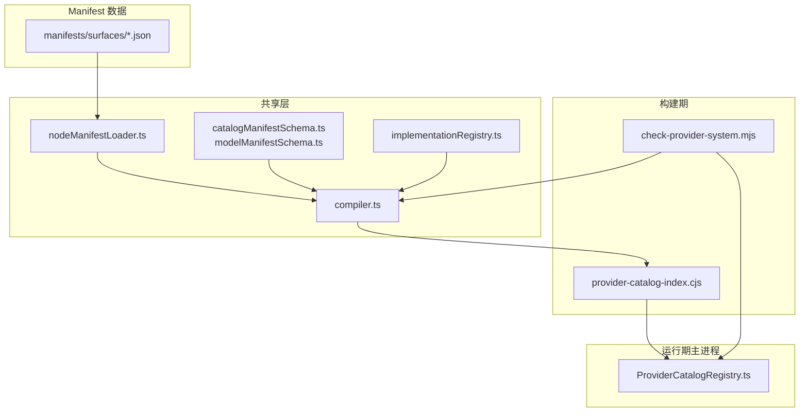
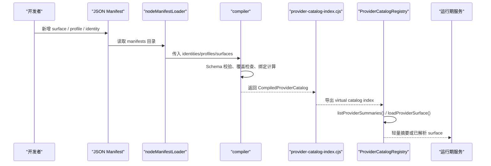
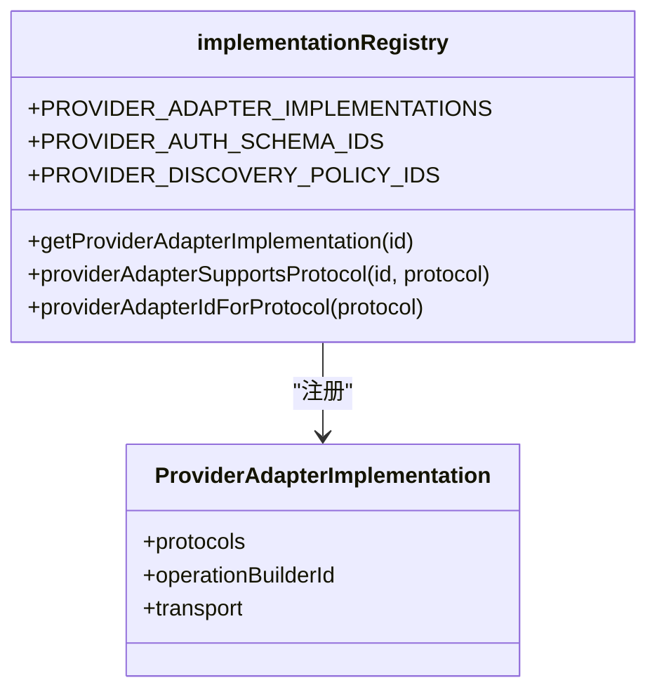
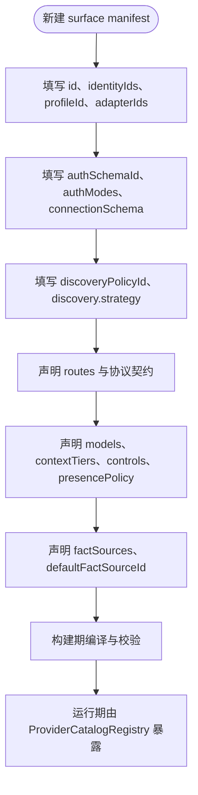
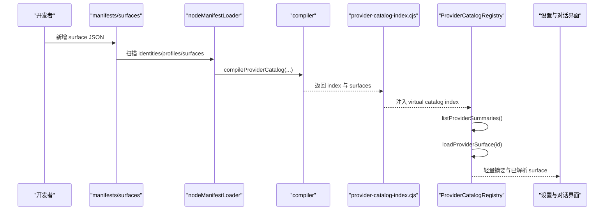
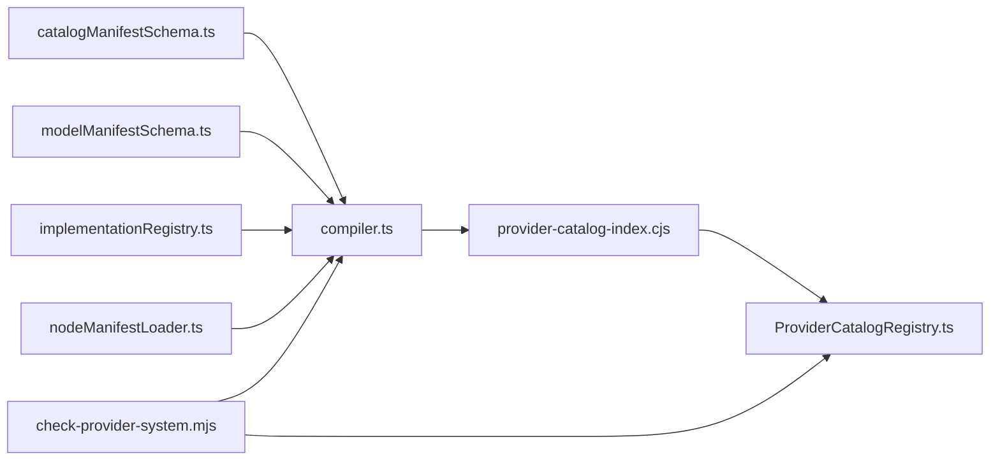

# Provider 开发

<cite>
**本文引用的文件**   
- [provider-architecture.md](file://docs/architecture/provider-architecture.md)
- [compiler.ts](file://src/shared/provider-catalog/compiler.ts)
- [catalogManifestSchema.ts](file://src/shared/provider-catalog/catalogManifestSchema.ts)
- [modelManifestSchema.ts](file://src/shared/provider-catalog/modelManifestSchema.ts)
- [implementationRegistry.ts](file://src/shared/provider-catalog/implementationRegistry.ts)
- [nodeManifestLoader.ts](file://src/shared/provider-catalog/nodeManifestLoader.ts)
- [ProviderCatalogRegistry.ts](file://src/main/provider-catalog/ProviderCatalogRegistry.ts)
- [provider-catalog-index.cjs](file://scripts/provider-catalog-index.cjs)
- [check-provider-system.mjs](file://scripts/check-provider-system.mjs)
- [openai.json](file://src/shared/provider-catalog/manifests/surfaces/openai.json)
- [anthropic.json](file://src/shared/provider-catalog/manifests/surfaces/anthropic.json)
- [ollama.json](file://src/shared/provider-catalog/manifests/surfaces/ollama.json)
- [LiveProviderCatalogParsers.ts](file://src/main/settings/LiveProviderCatalogParsers.ts)
</cite>

## 目录
1. [引言](#引言)
2. [项目结构](#项目结构)
3. [核心组件](#核心组件)
4. [架构总览](#架构总览)
5. [详细组件分析](#详细组件分析)
6. [依赖关系分析](#依赖关系分析)
7. [性能考虑](#性能考虑)
8. [故障排查指南](#故障排查指南)
9. [结论](#结论)
10. [附录：Provider 实现清单](#附录provider-实现清单)

## 引言
本文面向希望为 RDC-Agent 添加自定义 LLM Provider 的开发者。仓库采用“声明式 Catalog + 编译期校验 + 运行时 Registry”的分层设计，禁止在 TypeScript 中硬编码 Provider 事实；新增 Provider 通常只需要提供 JSON manifest、适配协议与可选的动态发现解析器。文档将解释 Provider 适配器规范、接口定义、认证机制、错误处理策略、Catalog 发现机制、配置格式、版本兼容性、注册流程、依赖注入、生命周期管理、安全最佳实践、调试技巧以及测试方法。

## 项目结构
Provider 系统横跨共享类型、Catalog 编译器、构建脚本、主进程 Registry 和设置子系统：

**图表来源**
- [nodeManifestLoader.ts:1-26](file://src/shared/provider-catalog/nodeManifestLoader.ts#L1-L26)
- [compiler.ts:1-200](file://src/shared/provider-catalog/compiler.ts#L1-L200)
- [provider-catalog-index.cjs:1-18](file://scripts/provider-catalog-index.cjs#L1-L18)
- [ProviderCatalogRegistry.ts:1-200](file://src/main/provider-catalog/ProviderCatalogRegistry.ts#L1-L200)
- [check-provider-system.mjs:1-165](file://scripts/check-provider-system.mjs#L1-L165)

**章节来源**
- [provider-architecture.md:1-138](file://docs/architecture/provider-architecture.md#L1-L138)
- [nodeManifestLoader.ts:1-26](file://src/shared/provider-catalog/nodeManifestLoader.ts#L1-L26)
- [compiler.ts:1-200](file://src/shared/provider-catalog/compiler.ts#L1-L200)

## 核心组件
- **Catalog Manifest Schema**：使用 Zod strict schema 描述 identity、profile、surface、route、connection、discovery、fact source、模型能力、上下文分层、推理控制等。
- **Model Manifest Schema**：定义协议枚举、推理 wire profile、能力状态、上下文 tier、激活方式、成本乘数、工具调用、视觉输入、结构化输出等。
- **Adapter Implementation Registry**：维护 `adapterId`、支持的协议、操作构建器 ID 和传输方式（HTTP/SDK）的闭集映射。
- **Catalog Compiler**：校验跨文件引用、覆盖所有 identity、生成稳定 revision、合并契约、计算执行绑定、排序并产出 index 与按 surface 分割的 lazy chunk。
- **Manifest Loader**：从 `manifests/{identities,profiles,surfaces}` 读取 JSON。
- **Provider Catalog Registry**：运行期唯一入口，提供轻量 summary、按需加载 surface、缓存、revision 校验、所有权与发现权限查询。
- **构建脚本**：`provider-catalog-index.cjs` 调用编译器产出虚拟索引；`check-provider-system.mjs` 阻断旧符号、非法 capability、源码 fallback 和未通过契约测试的代码。

**章节来源**
- [catalogManifestSchema.ts:1-200](file://src/shared/provider-catalog/catalogManifestSchema.ts#L1-L200)
- [modelManifestSchema.ts:1-200](file://src/shared/provider-catalog/modelManifestSchema.ts#L1-L200)
- [implementationRegistry.ts:1-177](file://src/shared/provider-catalog/implementationRegistry.ts#L1-L177)
- [compiler.ts:1-200](file://src/shared/provider-catalog/compiler.ts#L1-L200)
- [nodeManifestLoader.ts:1-26](file://src/shared/provider-catalog/nodeManifestLoader.ts#L1-L26)
- [ProviderCatalogRegistry.ts:1-200](file://src/main/provider-catalog/ProviderCatalogRegistry.ts#L1-L200)
- [provider-catalog-index.cjs:1-18](file://scripts/provider-catalog-index.cjs#L1-L18)
- [check-provider-system.mjs:1-165](file://scripts/check-provider-system.mjs#L1-L165)

## 架构总览
Provider 系统的权威链路是“声明 → 构建期编译 → 运行时解析”。产品语义以顶层架构文档为准，机器可验证契约集中在 shared 层的 provider-catalog 模块、类型定义、有效目录服务和请求规划器。

**图表来源**
- [nodeManifestLoader.ts:1-26](file://src/shared/provider-catalog/nodeManifestLoader.ts#L1-L26)
- [compiler.ts:1-200](file://src/shared/provider-catalog/compiler.ts#L1-L200)
- [provider-catalog-index.cjs:1-18](file://scripts/provider-catalog-index.cjs#L1-L18)
- [ProviderCatalogRegistry.ts:1-200](file://src/main/provider-catalog/ProviderCatalogRegistry.ts#L1-L200)

**章节来源**
- [provider-architecture.md:1-138](file://docs/architecture/provider-architecture.md#L1-L138)

## 详细组件分析

### Provider 适配器适配器与协议规范
Provider 适配器不是自由扩展点，而是由 `implementationRegistry.ts` 维护的闭集。每个适配器声明：
- 支持的一个或多个协议；
- 对应的 operation builder ID；
- HTTP 或 SDK 传输方式。

新增 Provider 时，若需要新协议或新 transport 行为，必须同时更新：
1. `PROVIDER_ADAPTER_IMPLEMENTATIONS` 中的适配器条目；
2. `PROVIDER_AUTH_SCHEMA_IDS` 或 `PROVIDER_DISCOVERY_POLICY_IDS`；
3. 对应 surface manifest 中的 `adapterId`、`authSchemaId`、`discoveryPolicyId`；
4. 编译器与契约相关校验逻辑；
5. 构建期检查脚本。

**图表来源**
- [implementationRegistry.ts:1-177](file://src/shared/provider-catalog/implementationRegistry.ts#L1-L177)

**章节来源**
- [implementationRegistry.ts:1-177](file://src/shared/provider-catalog/implementationRegistry.ts#L1-L177)

### Catalog Manifest 配置格式
surface manifest 是自定义 Provider 的主要入口。关键字段包括：
- `schemaVersion`：当前为 `2`；
- `id`：稳定的 Provider surface ID；
- `identityIds`：关联 models.dev identity；
- `profileId`：复用 profile 中的协议、认证、wire mechanics；
- `adapterIds`：允许使用的适配器列表；
- `authSchemaId`：认证模式标识；
- `discoveryPolicyId`：动态发现策略；
- `vendorId`、`label`、`status`、`availability`；
- `category`：如官方直连、兼容接入、本地、Coding/Token Plan 等；
- `surfaceKind`：account、native-api、cloud、plan、compatible-api、local；
- `serviceOperator`、`endpointClass`、`endpointOwnership`、`catalogOwnership`；
- `factSources` 与 `defaultFactSourceId`；
- `connectionSchema`：连接字段、密钥字段、头部映射、端点模板；
- `authModes` 与可选的 `authModeAvailability`；
- `capabilities`：chat、tool-calling、reasoning、vision-input、structured-output、model-discovery、prompt-cache 等；
- `routes`：每个 route 声明协议、adapter、baseUrl、默认值、契约覆盖；
- `discovery`：authority 与 strategy；
- `models`：模型定义、上下文分层、工具能力、视觉能力、选择可见性、存在策略、默认路由、controls 等。

**图表来源**
- [catalogManifestSchema.ts:1-200](file://src/shared/provider-catalog/catalogManifestSchema.ts#L1-L200)
- [modelManifestSchema.ts:1-200](file://src/shared/provider-catalog/modelManifestSchema.ts#L1-L200)
- [openai.json:1-200](file://src/shared/provider-catalog/manifests/surfaces/openai.json#L1-L200)
- [anthropic.json:1-200](file://src/shared/provider-catalog/manifests/surfaces/anthropic.json#L1-L200)
- [ollama.json:1-73](file://src/shared/provider-catalog/manifests/surfaces/ollama.json#L1-L73)

**章节来源**
- [catalogManifestSchema.ts:1-200](file://src/shared/provider-catalog/catalogManifestSchema.ts#L1-L200)
- [modelManifestSchema.ts:1-200](file://src/shared/provider-catalog/modelManifestSchema.ts#L1-L200)

### 认证机制
认证分为 manifest 层和运行期凭据租赁层：
- manifest 层通过 `authSchemaId` 与 `connectionSchema` 描述可用认证模式和连接字段。常见 schema 包括 API Key、OAuth、设备账号、Google Vertex、AWS Bedrock、SAP AI Core、本地运行时和用户端点。
- connectionSchema 可定义 secret/text/url/region/path 字段、主密钥字段、替代凭据、Header 映射和 endpoint 模板。
- 运行期发送前创建不透明凭据 lease，冻结 endpoint、typed connection values、认证 headers、OAuth/Vertex 短时 token 与 AWS Bedrock credentials。认证 header 不得进入 ModelRoute、RequestPlan、IPC、renderer、会话或 Trace。
- 账号请求在未输出流内容的 401 上最多重试一次：刷新上游凭据后原位替换同一 lease 的凭据材料，保持 endpoint、route、model 与 controls 不变。

OpenAI 与 Anthropic 使用 `declarative-api-key`；Ollama 使用 `local-runtime`。

**章节来源**
- [catalogManifestSchema.ts:1-200](file://src/shared/provider-catalog/catalogManifestSchema.ts#L1-L200)
- [implementationRegistry.ts:1-177](file://src/shared/provider-catalog/implementationRegistry.ts#L1-L177)
- [provider-architecture.md:100-138](file://docs/architecture/provider-architecture.md#L100-L138)
- [openai.json:1-200](file://src/shared/provider-catalog/manifests/surfaces/openai.json#L1-L200)
- [anthropic.json:1-200](file://src/shared/provider-catalog/manifests/surfaces/anthropic.json#L1-L200)
- [ollama.json:1-73](file://src/shared/provider-catalog/manifests/surfaces/ollama.json#L1-L73)

### 错误处理策略
- Schema 未知字段、重复 ID、失效引用、未注册实现、敏感 Header/body key 或不闭合执行路径都会使构建失败。
- 分类、operator、endpoint ownership、surfaceKind 必须显式声明，禁止互相推导。
- 未证实字段保持 unknown，UI 呈现为禁用或未知，不发明档位。
- 认证秘密不得进入 manifest、EffectiveModel、RequestPlan、IPC、renderer、会话、journal 或 Trace。
- 未证明的 entitlement 或过期证据会阻断相应执行维度，但不会静默隐藏 Retry 表面。
- HTTP 401/403 不直接等同订阅证据，只有严格匹配 model、mode、protocol 的 manifest matcher 才能归类为授权拒绝；429 视为瞬态配额；402 仅在明确标识配额耗尽时视为瞬态配额。

**章节来源**
- [provider-architecture.md:1-138](file://docs/architecture/provider-architecture.md#L1-L138)
- [check-provider-system.mjs:1-165](file://scripts/check-provider-system.mjs#L1-L165)

### Provider Catalog 的发现机制
Discovery authority 分为 authoritative-list、candidate-validation、additive、entitlement-overlay。strategy 支持：
- `json-catalog`：基于 HTTP GET/POST 拉取目录并映射字段，支持 admission 白名单/黑名单、模态过滤、上下文窗口要求、谓词规则与 route 规则；
- `custom-parser`：通过 parserId 调用 LiveProviderCatalogParsers 中的解析器；
- null：不使用动态发现。

parser 只能报告上游 identity、可用性、上下文、协议、推理元数据和能力证据；产品标签、选择、route、tier、controls、binding 和 Fast target 必须由 manifest 决定。

**章节来源**
- [catalogManifestSchema.ts:1-200](file://src/shared/provider-catalog/catalogManifestSchema.ts#L1-L200)
- [LiveProviderCatalogParsers.ts:1-200](file://src/main/settings/LiveProviderCatalogParsers.ts#L1-L200)
- [provider-architecture.md:60-120](file://docs/architecture/provider-architecture.md#L60-L120)

### 版本兼容性与 Catalog Revision
- Catalog compiler 固定 `PROVIDER_CATALOG_SCHEMA_VERSION` 为 `2`。
- `catalogRevision` 包含 effective model 的 route、control、availability、selection、quota 等行为事实，但不包含 provenance 时间戳与快照生成时间。
- ProviderCatalogRegistry 加载 compiled surface 时会校验 schemaVersion 与 catalogRevision；不一致则抛出错误。
- Settings schema 当前为 v4，Effective Catalog cache schema 为 v6；版本不匹配的缓存直接失效。

**章节来源**
- [compiler.ts:1-200](file://src/shared/provider-catalog/compiler.ts#L1-L200)
- [ProviderCatalogRegistry.ts:1-200](file://src/main/provider-catalog/ProviderCatalogRegistry.ts#L1-L200)
- [provider-architecture.md:120-138](file://docs/architecture/provider-architecture.md#L120-L138)

### Provider 注册流程与生命周期
自定义 Provider 的典型生命周期如下：

**图表来源**
- [nodeManifestLoader.ts:1-26](file://src/shared/provider-catalog/nodeManifestLoader.ts#L1-L26)
- [compiler.ts:1-200](file://src/shared/provider-catalog/compiler.ts#L1-L200)
- [provider-catalog-index.cjs:1-18](file://scripts/provider-catalog-index.cjs#L1-L18)
- [ProviderCatalogRegistry.ts:1-200](file://src/main/provider-catalog/ProviderCatalogRegistry.ts#L1-L200)

**章节来源**
- [provider-catalog-index.cjs:1-18](file://scripts/provider-catalog-index.cjs#L1-L18)
- [ProviderCatalogRegistry.ts:1-200](file://src/main/provider-catalog/ProviderCatalogRegistry.ts#L1-L200)

### 依赖注入与运行时访问
运行期代码不应直接读取 raw manifest。ProviderCatalogRegistry 提供：
- `listProviderSummaries()`：同步返回首屏所需轻量字段；
- `loadProviderSurface(id)`：异步加载并缓存单一 surface；
- `getProviderCatalogRevision()`：获取 stable revision；
- `isBuiltinProviderId(id)`：判断是否为内置 Provider；
- `getProviderModelDefinitions(id)` / `lookupProviderModelDefinition(id, modelId)`：获取完整模型定义；
- `getProviderModelSummaries(id)`：获取 UI 可见模型摘要；
- `getProviderCatalogOwnership(id)` / `getProviderDiscoveryAuthority(id)` / `getProviderAuthModeAvailability(id)`：所有权、发现权限与认证可用性。

**章节来源**
- [ProviderCatalogRegistry.ts:1-200](file://src/main/provider-catalog/ProviderCatalogRegistry.ts#L1-L200)

### 完整 Provider 实现示例

#### OpenAI 场景
OpenAI surface 展示多协议、API Key 认证、模型发现、推理与缓存契约：
- 使用 `multi-protocol` profile；
- 支持 `openai-compatible` 与 `openai-responses` 适配器；
- 使用 `declarative-api-key`；
- discovery 使用 `openai-compatible` custom parser；
- routes 分别声明 Responses 与 Chat Completions 兼容协议；
- models 声明 context tiers、tool calling、vision input、structured output 与 presence policy。

参考文件：
- [openai.json:1-200](file://src/shared/provider-catalog/manifests/surfaces/openai.json#L1-L200)

**章节来源**
- [openai.json:1-200](file://src/shared/provider-catalog/manifests/surfaces/openai.json#L1-L200)
- [implementationRegistry.ts:1-177](file://src/shared/provider-catalog/implementationRegistry.ts#L1-L177)

#### Anthropic 场景
Anthropic surface 强调 reasoning、thinking block、prompt caching 和 effort/fast mode：
- 使用 `anthropic-messages` profile；
- 使用 `anthropic-messages` 适配器；
- 使用 `declarative-api-key`；
- discovery 使用 `anthropic` custom parser；
- route 声明 AnthropicMessages 协议；
- models 声明 reasoning levels、max context、fast binding 等 controls。

参考文件：
- [anthropic.json:1-200](file://src/shared/provider-catalog/manifests/surfaces/anthropic.json#L1-L200)

**章节来源**
- [anthropic.json:1-200](file://src/shared/provider-catalog/manifests/surfaces/anthropic.json#L1-L200)
- [implementationRegistry.ts:1-177](file://src/shared/provider-catalog/implementationRegistry.ts#L1-L177)

#### 本地模型场景
Ollama 代表本地服务：
- 使用 `local-runtime` 认证；
- category 为 local；
- surfaceKind 为 local；
- endpoints 指向本地地址；
- discovery 使用 `ollama-tags`；
- 可启用 baseUrl 编辑；
- recommendedModels 提供本地推荐模型。

参考文件：
- [ollama.json:1-73](file://src/shared/provider-catalog/manifests/surfaces/ollama.json#L1-L73)

**章节来源**
- [ollama.json:1-73](file://src/shared/provider-catalog/manifests/surfaces/ollama.json#L1-L73)
- [implementationRegistry.ts:1-177](file://src/shared/provider-catalog/implementationRegistry.ts#L1-L177)

### 自定义 Provider 最佳实践
- 优先使用现有 adapterId 与 protocol；不要为相同行为重新发明传输逻辑。
- 使用 `custom-parser` 仅补充上游 identity、可用性、上下文、协议、推理能力和能力证据；不要把产品标签、tier、binding 或 selection 写进 parser。
- 使用 `json-catalog` 时明确 collectionPath、mapping、admission 和 routeRules，避免宽泛 allowPatterns。
- 对本地 Provider，使用 `local-runtime`，并通过 `baseUrlEditable` 让用户调整本地端点。
- 对 Cloud 或第三方网关，明确 `serviceOperator`、`endpointClass`、`endpointOwnership` 和 `catalogOwnership`。
- 对 Coding/Token Plan 产品，独立声明 plan surface，不要伪装成普通 compatible-access Provider。
- 所有 capability 与 control 都必须有 manifest-backed fact；unknown 应保留 unknown，不能推断 256K、High 或兼容协议。

**章节来源**
- [provider-architecture.md:1-138](file://docs/architecture/provider-architecture.md#L1-L138)
- [catalogManifestSchema.ts:1-200](file://src/shared/provider-catalog/catalogManifestSchema.ts#L1-L200)
- [LiveProviderCatalogParsers.ts:1-200](file://src/main/settings/LiveProviderCatalogParsers.ts#L1-L200)

## 依赖关系分析

**图表来源**
- [catalogManifestSchema.ts:1-200](file://src/shared/provider-catalog/catalogManifestSchema.ts#L1-L200)
- [modelManifestSchema.ts:1-200](file://src/shared/provider-catalog/modelManifestSchema.ts#L1-L200)
- [implementationRegistry.ts:1-177](file://src/shared/provider-catalog/implementationRegistry.ts#L1-L177)
- [nodeManifestLoader.ts:1-26](file://src/shared/provider-catalog/nodeManifestLoader.ts#L1-L26)
- [compiler.ts:1-200](file://src/shared/provider-catalog/compiler.ts#L1-L200)
- [provider-catalog-index.cjs:1-18](file://scripts/provider-catalog-index.cjs#L1-L18)
- [check-provider-system.mjs:1-165](file://scripts/check-provider-system.mjs#L1-L165)
- [ProviderCatalogRegistry.ts:1-200](file://src/main/provider-catalog/ProviderCatalogRegistry.ts#L1-L200)

**章节来源**
- [check-provider-system.mjs:1-165](file://scripts/check-provider-system.mjs#L1-L165)

## 性能考虑
- Catalog compiler 生成轻量 summary index 与按 surface 分割的 lazy chunk，避免向源码提交生成的 Catalog。
- ProviderCatalogRegistry 使用内存 Map 缓存已加载 surface，并按 id 去重加载 Promise，减少重复 IO。
- Renderer/preload/browser bridge 只接收 revisioned projection，不读取 raw manifest。
- Surface/model/route 变化只失效对应缓存，不广播完整 Catalog。
- 动态 discovery 应限制返回规模，配合 admission deny patterns 与 allowedModalities 减少无效候选。
- 长轮询或频繁 refresh 会增加网络与解析开销，应结合 SWR 与 catalogRevision 语义避免不必要刷新。

**章节来源**
- [provider-architecture.md:40-80](file://docs/architecture/provider-architecture.md#L40-L80)
- [ProviderCatalogRegistry.ts:1-200](file://src/main/provider-catalog/ProviderCatalogRegistry.ts#L1-L200)

## 故障排查指南

### 构建期失败
常见问题：
- manifest 中存在未知字段或重复 ID；
- adapterId 未在 `implementationRegistry.ts` 注册；
- 协议与 adapter 不匹配；
- 声明了 image/video generation 能力；
- 使用了被禁用的旧符号；
- 源码中仍直接引用 nodeManifestLoader、compileProviderCatalog 或 manifests 目录作为运行时 fallback。

排查步骤：
1. 运行 `scripts/check-provider-system.mjs`；
2. 确认 schemaVersion、category、surfaceKind、authSchemaId、discoveryPolicyId 均为合法枚举；
3. 确认 adapterId 与 protocol 属于同一适配器；
4. 确认没有引入 forbiddenSymbols；
5. 确认 manifests 目录只有 JSON 文件；
6. 确认 ProviderCatalogRegistry 仅消费虚拟 index。

**章节来源**
- [check-provider-system.mjs:1-165](file://scripts/check-provider-system.mjs#L1-L165)
- [implementationRegistry.ts:1-177](file://src/shared/provider-catalog/implementationRegistry.ts#L1-L177)
- [catalogManifestSchema.ts:1-200](file://src/shared/provider-catalog/catalogManifestSchema.ts#L1-L200)

### 运行期问题
常见问题：
- surface revision 与 index 不匹配；
- 缺少 bundled surface；
- 认证 401 未正确刷新；
- discovery 贡献了不应该存在的 tier 或 fast binding；
- unknown capability 被误判为 supported/unsupported。

排查步骤：
1. 检查 `getProviderCatalogRevision()` 与 loaded surface 的 schemaVersion/catalogRevision；
2. 检查 settings 与 effective catalog schema 版本是否匹配；
3. 检查 parser 是否只报告上游 identity、availability、context、protocol、reasoning metadata 和能力证据；
4. 检查 entitlement 与 observed evidence 的边界；
5. 检查 401/403/429/402 的分类是否符合 manifest matcher。

**章节来源**
- [ProviderCatalogRegistry.ts:1-200](file://src/main/provider-catalog/ProviderCatalogRegistry.ts#L1-L200)
- [LiveProviderCatalogParsers.ts:1-200](file://src/main/settings/LiveProviderCatalogParsers.ts#L1-L200)
- [provider-architecture.md:80-138](file://docs/architecture/provider-architecture.md#L80-L138)

### 调试技巧
- 使用 `listProviderSummaries()` 快速确认 surface 是否进入 index。
- 使用 `loadProviderSurface(id)` 单独调试某个 surface 的解析结果。
- 使用 `getProviderModelDefinitions(id)` 查看完整模型定义，便于定位 controls、contextTiers、presencePolicy。
- 使用 `getProviderAuthModeAvailability(id)` 检查不同 authMode 的 availability。
- 在 parser 中记录 diagnostic 信息，但不要污染 IPC 或持久化数据。
- 使用 `catalogRevision` 比对 preflight 与 RequestPlan 的一致性。

**章节来源**
- [ProviderCatalogRegistry.ts:1-200](file://src/main/provider-catalog/ProviderCatalogRegistry.ts#L1-L200)
- [LiveProviderCatalogParsers.ts:1-200](file://src/main/settings/LiveProviderCatalogParsers.ts#L1-L200)

### 测试方法
- 运行 `scripts/check-provider-system.mjs`，它会执行一组 contract tests，例如 compiler test、agent tool capability audit、effective catalog resolver test、request planner test、live catalog parsers test、provider connection service test、copilot billing test 等。
- 新增 manifest 后，确保编译产物能通过契约测试；不要绕过 check-provider-system。
- 对于自定义 parser，应编写单元测试验证：
  - 上游 payload 到 LiveModelObservation 的映射；
  - admission 过滤；
  - identity 提取；
  - context window、output tokens、modality、toolCalling、visionInput、structuredOutput 的解析；
  - 不泄露 product labels、routes、tiers 或 bindings。

**章节来源**
- [check-provider-system.mjs:100-165](file://scripts/check-provider-system.mjs#L100-L165)
- [LiveProviderCatalogParsers.ts:1-200](file://src/main/settings/LiveProviderCatalogParsers.ts#L1-L200)

## 结论
RDC-Agent 的 Provider 体系把“产品事实”与“执行行为”清晰分离：JSON manifest 描述身份、分类、路由、认证、发现、模型能力和约束；TypeScript 实现协议适配器、认证机制、发现解析器、编译器和运行期 Registry。新增 Provider 的首选方式是声明新的 surface manifest，复用现有 adapter、authSchema 和 discoveryPolicy；只有在协议、传输或认证机制确实不同时才扩展 registry。构建期严格校验保证安全性与一致性，运行期 Registry 提供稳定、可缓存、可审计的 Provider 访问入口。

## 附录：Provider 实现清单

| 场景 | 关键 manifest 文件 | 适配器 | 认证模式 | 发现策略 | 说明 |
|---|---|---|---|---|---|
| OpenAI | [openai.json](file://src/shared/provider-catalog/manifests/surfaces/openai.json) | openai-compatible、openai-responses | declarative-api-key | openai-compatible custom parser | 官方直连，多协议，Responses 与 Chat Completions 兼容 |
| Anthropic | [anthropic.json](file://src/shared/provider-catalog/manifests/surfaces/anthropic.json) | anthropic-messages | declarative-api-key | anthropic custom parser | 原生 Messages，推理 thinking block 与 prompt caching |
| Ollama | [ollama.json](file://src/shared/provider-catalog/manifests/surfaces/ollama.json) | ollama-openai-compatible、openai-responses | local-runtime | ollama-tags | 本地服务，可编辑 baseUrl，推荐本地模型 |

**章节来源**
- [openai.json:1-200](file://src/shared/provider-catalog/manifests/surfaces/openai.json#L1-L200)
- [anthropic.json:1-200](file://src/shared/provider-catalog/manifests/surfaces/anthropic.json#L1-L200)
- [ollama.json:1-73](file://src/shared/provider-catalog/manifests/surfaces/ollama.json#L1-L73)
- [implementationRegistry.ts:1-177](file://src/shared/provider-catalog/implementationRegistry.ts#L1-L177)