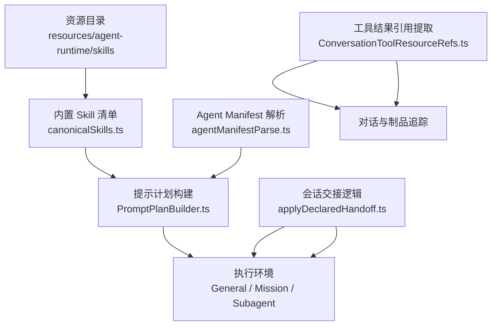
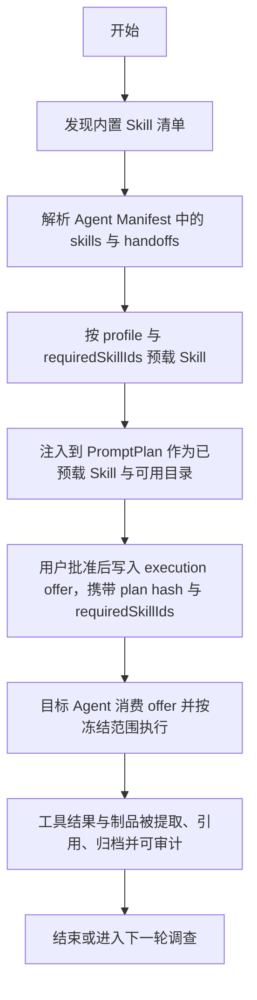
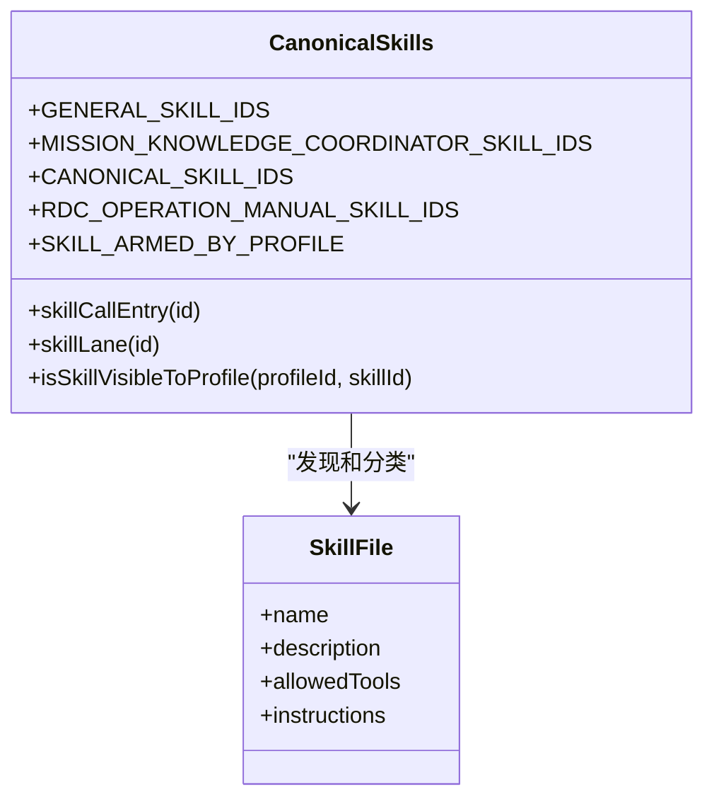
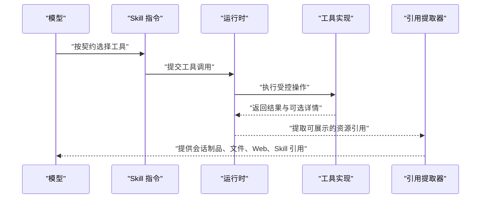
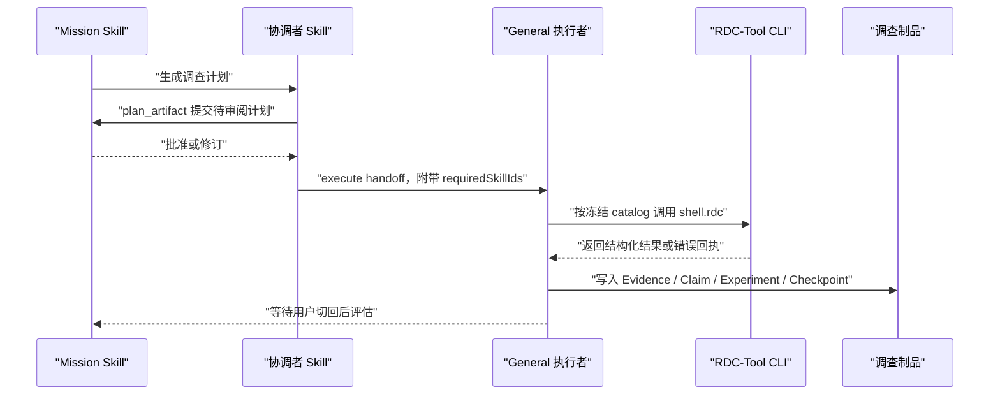
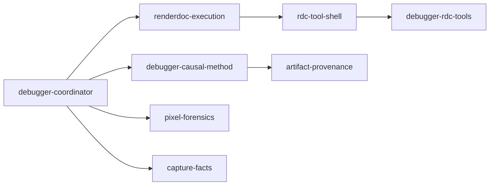
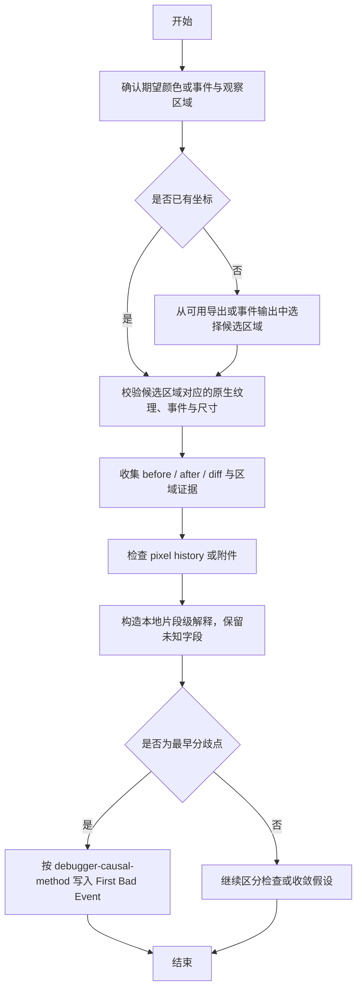
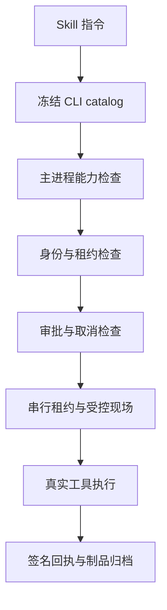
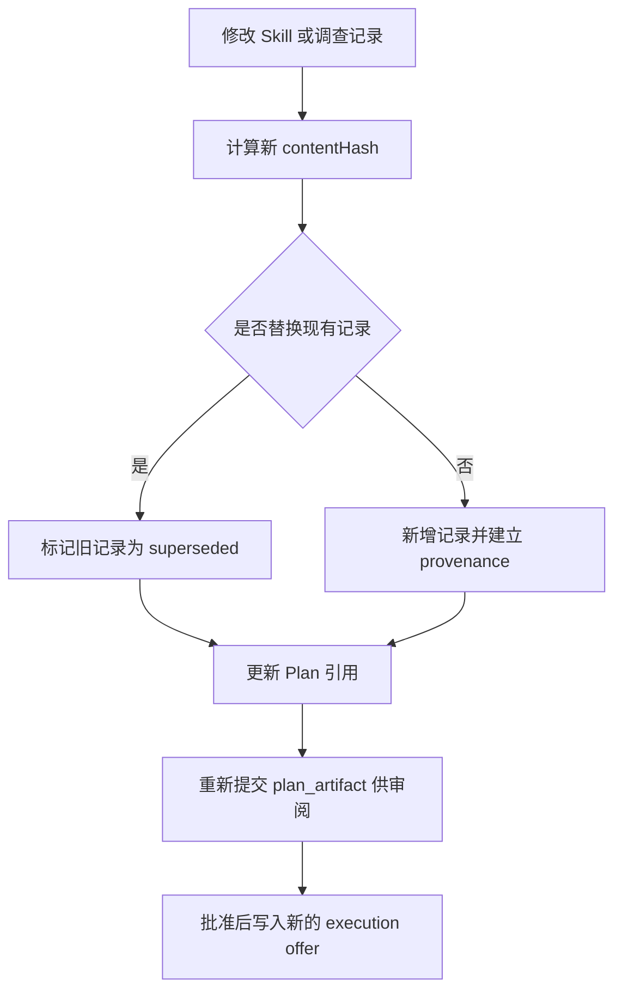

# Skill 开发

<cite>
**本文引用的文件**   
- [SKILL.md（capture-facts）](file://resources/agent-runtime/skills/capture-facts/SKILL.md)
- [SKILL.md（debug）](file://resources/agent-runtime/skills/debug/SKILL.md)
- [SKILL.md（knowledge-candidate）](file://resources/agent-runtime/skills/knowledge-candidate/SKILL.md)
- [SKILL.md（pass-graph-analysis）](file://resources/agent-runtime/skills/pass-graph-analysis/SKILL.md)
- [SKILL.md（remember）](file://resources/agent-runtime/skills/remember/SKILL.md)
- [SKILL.md（report-composition）](file://resources/agent-runtime/skills/report-composition/SKILL.md)
- [SKILL.md（analyzer-coordinator）](file://resources/agent-runtime/skills/analyzer-coordinator/SKILL.md)
- [SKILL.md（execution-orchestrator）](file://resources/agent-runtime/skills/execution-orchestrator/SKILL.md)
- [SKILL.md（analyzer-rdc-tools）](file://resources/agent-runtime/skills/analyzer-rdc-tools/SKILL.md)
- [SKILL.md（debugger-coordinator）](file://resources/agent-runtime/skills/debugger-coordinator/SKILL.md)
- [SKILL.md（debugger-causal-method）](file://resources/agent-runtime/skills/debugger-causal-method/SKILL.md)
- [SKILL.md（debugger-rdc-tools）](file://resources/agent-runtime/skills/debugger-rdc-tools/SKILL.md)
- [SKILL.md（renderdoc-execution）](file://resources/agent-runtime/skills/renderdoc-execution/SKILL.md)
- [SKILL.md（rdc-tool-shell）](file://resources/agent-runtime/skills/rdc-tool-shell/SKILL.md)
- [SKILL.md（cross-capture-alignment）](file://resources/agent-runtime/skills/cross-capture-alignment/SKILL.md)
- [SKILL.md（knowledge-scout）](file://resources/agent-runtime/skills/knowledge-scout/SKILL.md)
- [SKILL.md（analyzer-architecture-method）](file://resources/agent-runtime/skills/analyzer-architecture-method/SKILL.md)
- [SKILL.md（artifact-provenance）](file://resources/agent-runtime/skills/artifact-provenance/SKILL.md)
- [SKILL.md（capture-preflight）](file://resources/agent-runtime/skills/capture-preflight/SKILL.md)
- [SKILL.md（optimization-experiment）](file://resources/agent-runtime/skills/optimization-experiment/SKILL.md)
- [SKILL.md（optimizer-coordinator）](file://resources/agent-runtime/skills/optimizer-coordinator/SKILL.md)
- [SKILL.md（optimizer-rdc-tools）](file://resources/agent-runtime/skills/optimizer-rdc-tools/SKILL.md)
- [SKILL.md（pixel-forensics）](file://resources/agent-runtime/skills/pixel-forensics/SKILL.md)
- [SKILL.md（resource-versioning）](file://resources/agent-runtime/skills/resource-versioning/SKILL.md)
- [SKILL.md（shader-ir-analysis）](file://resources/agent-runtime/skills/shader-ir-analysis/SKILL.md)
- [SKILL.md（simplify）](file://resources/agent-runtime/skills/simplify/SKILL.md)
- [SKILL.md（skeptic-review）](file://resources/agent-runtime/skills/skeptic-review/SKILL.md)
- [SKILL.md（verify）](file://resources/agent-runtime/skills/verify/SKILL.md)
- [canonicalSkills.ts](file://src/shared/constants/canonicalSkills.ts)
- [applyDeclaredHandoff.ts](file://src/main/conversation/applyDeclaredHandoff.ts)
- [PromptPlanBuilder.ts](file://src/main/agent-runtime/prompt/PromptPlanBuilder.ts)
- [ConversationToolResourceRefs.ts](file://src/main/conversation/ConversationToolResourceRefs.ts)
- [agentManifestParse.ts](file://src/main/settings/agentManifestParse.ts)
- [AgentManifestService.ts](file://src/main/settings/AgentManifestService.ts)
</cite>

## 目录
1. [引言](#引言)
2. [项目结构](#项目结构)
3. [核心组件](#核心组件)
4. [架构总览](#架构总览)
5. [详细组件分析](#详细组件分析)
6. [依赖关系分析](#依赖关系分析)
7. [性能与容量特性](#性能与容量特性)
8. [权限与安全沙箱](#权限与安全沙箱)
9. [版本管理、发布流程与兼容性](#版本管理发布流程与兼容性)
10. [调试方法与测试策略](#调试方法与测试策略)
11. [最佳实践清单](#最佳实践清单)
12. [结论](#结论)

## 引言
本仓库中的 Skill 是以 Markdown 形式定义的领域能力契约，用于指导 Agent 在渲染捕获、调试、分析和优化等任务中如何组织证据、执行受限操作并产出可审计的产物。Skill 不是直接执行的代码模块：它通过运行时注入到提示计划中，配合工具调用、会话制品、权限策略和手递交接机制共同工作。开发者创建 Skill 时，重点在于定义清晰的职责边界、输入输出契约、可引用制品以及与其他 Skill 的协作方式。

## 项目结构
仓库中与 Skill 相关的内容主要分布在两个层面：
- 内置 Skill 目录：`resources/agent-runtime/skills/<skill-id>/SKILL.md`，每个 Skill 一个目录，包含一份 SKILL.md 说明文档。
- 运行时发现与加载：共享常量、Agent Manifest 解析、提示计划构建、会话交接等代码负责将 Skill 暴露给模型、限制其可见性与执行路径。

**图表来源**
- [canonicalSkills.ts:1-99](file://src/shared/constants/canonicalSkills.ts#L1-L99)
- [agentManifestParse.ts:1-189](file://src/main/settings/agentManifestParse.ts#L1-L189)
- [PromptPlanBuilder.ts:1-200](file://src/main/agent-runtime/prompt/PromptPlanBuilder.ts#L1-L200)
- [applyDeclaredHandoff.ts:1-121](file://src/main/conversation/applyDeclaredHandoff.ts#L1-L121)
- [ConversationToolResourceRefs.ts:1-173](file://src/main/conversation/ConversationToolResourceRefs.ts#L1-L173)

**章节来源**
- [canonicalSkills.ts:1-99](file://src/shared/constants/canonicalSkills.ts#L1-L99)
- [AgentManifestService.ts:1-200](file://src/main/settings/AgentManifestService.ts#L1-L200)

## 核心组件
Skill 体系由以下关键部分组成：
- SKILL.md 文件：描述 Skill 名称、职责、允许的工具、方法论、约束和与其他 Skill 的关系。
- 规范 Skill 清单：集中声明通用 Skill、Mission/Knowledge/Coordinator Skill、RDC 操作手册 Skill、禁止 Skill 名等。
- Agent Manifest 解析：读取 `.agent.md` 文件的前置元数据，包括 `skills`、`tools`、`handoffs`、`requiredSkillIds` 等。
- 提示计划构建器：把预载 Skill、Skill 目录、工具能力和运行时事实组装为模型可读的 PromptPlan。
- 会话交接：将批准的 Plan 与必需 Skill 绑定，交给目标 Agent 执行。
- 工具结果引用提取：从工具返回中提取文件、Web、MCP、Skill 引用与会话制品 URI，供对话和审计使用。

**章节来源**
- [SKILL.md（execution-orchestrator）:1-44](file://resources/agent-runtime/skills/execution-orchestrator/SKILL.md#L1-L44)
- [SKILL.md（rdc-tool-shell）:1-91](file://resources/agent-runtime/skills/rdc-tool-shell/SKILL.md#L1-L91)
- [canonicalSkills.ts:1-99](file://src/shared/constants/canonicalSkills.ts#L1-L99)
- [agentManifestParse.ts:1-189](file://src/main/settings/agentManifestParse.ts#L1-L189)
- [PromptPlanBuilder.ts:1-200](file://src/main/agent-runtime/prompt/PromptPlanBuilder.ts#L1-L200)
- [applyDeclaredHandoff.ts:1-121](file://src/main/conversation/applyDeclaredHandoff.ts#L1-L121)
- [ConversationToolResourceRefs.ts:1-173](file://src/main/conversation/ConversationToolResourceRefs.ts#L1-L173)

## 架构总览
Skill 的生命周期可以分为六个阶段：发现、声明、预载、注入、执行、审计。

**图表来源**
- [canonicalSkills.ts:1-99](file://src/shared/constants/canonicalSkills.ts#L1-L99)
- [agentManifestParse.ts:1-189](file://src/main/settings/agentManifestParse.ts#L1-L189)
- [PromptPlanBuilder.ts:1-200](file://src/main/agent-runtime/prompt/PromptPlanBuilder.ts#L1-L200)
- [applyDeclaredHandoff.ts:1-121](file://src/main/conversation/applyDeclaredHandoff.ts#L1-L121)
- [ConversationToolResourceRefs.ts:1-173](file://src/main/conversation/ConversationToolResourceRefs.ts#L1-L173)

### 加载顺序与可见性
- 内置 Skill 清单分为“通用 Skill”和“Mission/Knowledge/Coordinator Skill”，前者适合日常执行，后者更偏向调查规划与方法论。
- RDC 操作手册 Skill（如 `rdc-tool-shell`、`debugger-rdc-tools`、`analyzer-rdc-tools`、`optimizer-rdc-tools`）只提供操作方法知识，不等同于执行授权；执行必须由拥有对应 Profile 的 General 通过受控 CLI 完成。
- 非 Mission Profile 对 Skill 可见性的判断较宽松，但 RDC 操作手册仍受 Profile 归属限制。

**图表来源**
- [canonicalSkills.ts:1-99](file://src/shared/constants/canonicalSkills.ts#L1-L99)

**章节来源**
- [canonicalSkills.ts:1-99](file://src/shared/constants/canonicalSkills.ts#L1-L99)
- [SKILL.md（rdc-tool-shell）:1-91](file://resources/agent-runtime/skills/rdc-tool-shell/SKILL.md#L1-L91)

## 详细组件分析

### SKILL.md 文件格式与元数据
SKILL.md 是 Skill 的主要契约。仓库中已有示例显示两种常见写法：
- YAML frontmatter 元数据：`name`、`description`、`allowed-tools`。
- Markdown 正文：角色定位、步骤、约束、与其他 Skill 的引用。

例如：
- `debug/SKILL.md` 使用 `allowed-tools: [read_file, glob, grep, web_search]` 明确只读诊断范围。
- `remember/SKILL.md` 限定 `memory_search`、`memory_read`、`memory_write`。
- `knowledge-candidate/SKILL.md` 限定 `knowledge_candidate_create`。
- `simplify/SKILL.md` 限定 `read_file`、`glob`、`grep`。
- `verify/SKILL.md` 允许 `read_file`、`glob`、`grep`、`shell`。

这些 `allowed-tools` 是 Skill 作者声明的工具契约，不是运行时自动授予的白名单；实际工具可用性由 Agent Profile、Provider 能力、Permission Policy 和主进程安全门决定。

**章节来源**
- [SKILL.md（debug）:1-10](file://resources/agent-runtime/skills/debug/SKILL.md#L1-L10)
- [SKILL.md（remember）:1-16](file://resources/agent-runtime/skills/remember/SKILL.md#L1-L16)
- [SKILL.md（knowledge-candidate）:1-15](file://resources/agent-runtime/skills/knowledge-candidate/SKILL.md#L1-L15)
- [SKILL.md（simplify）:1-9](file://resources/agent-runtime/skills/simplify/SKILL.md#L1-L9)
- [SKILL.md（verify）:1-9](file://resources/agent-runtime/skills/verify/SKILL.md#L1-L9)

### 工具引用机制
Skill 通过以下方式引用工具与外部知识：
- 直接在指令中命名工具，如 `read_file`、`investigation_write`、`knowledge_search`。
- 通过 `skill_read` 读取其他 Skill 的参考文档，例如 `rdc-tool-shell` 要求先读 `$rdc-tool-shell`，再按 Plan 读专业手册的 `references/tools.md`。
- 通过 `session://`、`investigation_read`、`artifact_read` 引用会话制品与调查记录。
- 工具结果会被 `ConversationToolResourceRefs` 提取为对话侧资源引用，包括文件、目录、Web、MCP、Skill 与会话制品 URI。

**图表来源**
- [SKILL.md（rdc-tool-shell）:1-91](file://resources/agent-runtime/skills/rdc-tool-shell/SKILL.md#L1-L91)
- [ConversationToolResourceRefs.ts:1-173](file://src/main/conversation/ConversationToolResourceRefs.ts#L1-L173)

**章节来源**
- [SKILL.md（rdc-tool-shell）:1-91](file://resources/agent-runtime/skills/rdc-tool-shell/SKILL.md#L1-L91)
- [ConversationToolResourceRefs.ts:1-173](file://src/main/conversation/ConversationToolResourceRefs.ts#L1-L173)

### Skill 生命周期与执行模型
仓库中存在三类典型角色：
- Mission/Knowledge/Coordinator Skill：负责计划、评估、审查、报告和组织调查。
- Execution Orchestrator：围绕用户目标拆分任务、委派子代理、核对交付。
- RDC 执行层：通过 `renderdoc-execution` 消费冻结 Plan，通过 `rdc-tool-shell` 调用受控 CLI，由专业手册提供具体操作知识。

**图表来源**
- [SKILL.md（execution-orchestrator）:1-44](file://resources/agent-runtime/skills/execution-orchestrator/SKILL.md#L1-L44)
- [SKILL.md（renderdoc-execution）:1-56](file://resources/agent-runtime/skills/renderdoc-execution/SKILL.md#L1-L56)
- [SKILL.md（rdc-tool-shell）:1-91](file://resources/agent-runtime/skills/rdc-tool-shell/SKILL.md#L1-L91)
- [applyDeclaredHandoff.ts:1-121](file://src/main/conversation/applyDeclaredHandoff.ts#L1-L121)

**章节来源**
- [SKILL.md（execution-orchestrator）:1-44](file://resources/agent-runtime/skills/execution-orchestrator/SKILL.md#L1-L44)
- [SKILL.md（renderdoc-execution）:1-56](file://resources/agent-runtime/skills/renderdoc-execution/SKILL.md#L1-L56)
- [applyDeclaredHandoff.ts:1-121](file://src/main/conversation/applyDeclaredHandoff.ts#L1-L121)

### 依赖解析与必需 Skill
Skill 之间的依赖主要通过两种方式表达：
- 文本引用：Skill 正文中引用其他 Skill，例如 Analyzer 依赖 `$capture-facts`、`$pass-graph-analysis`、`$shader-ir-analysis`、`$cross-capture-alignment`。
- 运行时代码：Agent Manifest 的 `handoffs.requiredSkillIds` 和 canonical Skills 的 `SKILL_ARMED_BY_PROFILE` 控制哪些 Skill 随 Profile 预载。

**图表来源**
- [SKILL.md（debugger-coordinator）:1-15](file://resources/agent-runtime/skills/debugger-coordinator/SKILL.md#L1-L15)
- [SKILL.md（renderdoc-execution）:1-56](file://resources/agent-runtime/skills/renderdoc-execution/SKILL.md#L1-L56)
- [SKILL.md（debugger-causal-method）:1-40](file://resources/agent-runtime/skills/debugger-causal-method/SKILL.md#L1-L40)
- [SKILL.md（artifact-provenance）:1-38](file://resources/agent-runtime/skills/artifact-provenance/SKILL.md#L1-L38)
- [SKILL.md（pixel-forensics）:1-21](file://resources/agent-runtime/skills/pixel-forensics/SKILL.md#L1-L21)
- [SKILL.md（capture-facts）:1-18](file://resources/agent-runtime/skills/capture-facts/SKILL.md#L1-L18)

**章节来源**
- [canonicalSkills.ts:1-99](file://src/shared/constants/canonicalSkills.ts#L1-L99)
- [agentManifestParse.ts:1-189](file://src/main/settings/agentManifestParse.ts#L1-L189)

### 完整 Skill 开发示例：封装业务逻辑、定义契约、集成工具
下面以“像素取证 Skill”为例，说明如何封装领域逻辑、定义输入输出契约并集成外部工具。

#### 设计目标
- 针对错误的像素、像素历史或过绘问题，基于区域化视觉证据进行诊断。
- 区分用户提供的坐标、候选区域、原始截图、原生纹理坐标。
- 仅通过配置的 RDC 动作和 `read_image` 访问像素历史或附件。
- 将最早分歧点记录为 Debugger First Bad Event，并遵循因果方法。

#### 输入契约
- 期望颜色或事件。
- 观察到的像素区域或候选图像。
- 可用的 capture、事件、输出目标、subresource、尺寸。
- 已授权的图像、原生导出、像素历史、管线状态等证据。

#### 处理逻辑

**图表来源**
- [SKILL.md（pixel-forensics）:1-21](file://resources/agent-runtime/skills/pixel-forensics/SKILL.md#L1-L21)
- [SKILL.md（debugger-causal-method）:1-40](file://resources/agent-runtime/skills/debugger-causal-method/SKILL.md#L1-L40)

#### 输出契约
- 候选区域身份、图像源身份、事件映射。
- 原生像素/区域/历史读取结果。
- 若为 First Bad Event，则绑定 `region.kind` 为 `event` 或 `pixel`，并遵循证据优先原则。
- 明确未知项，不把缺失字段当作零值或成功。

**章节来源**
- [SKILL.md（pixel-forensics）:1-21](file://resources/agent-runtime/skills/pixel-forensics/SKILL.md#L1-L21)
- [SKILL.md（debugger-causal-method）:1-40](file://resources/agent-runtime/skills/debugger-causal-method/SKILL.md#L1-L40)

### 权限配置、安全沙箱与执行环境隔离
Skill 本身不能绕过权限系统。权限和安全隔离体现在多个层面：
- `rdc-tool-shell` 明确说明 Skill 只提供操作知识，不能授权工具、路径、会话切换或变更；实际可用操作来自 prepareTurn 冻结的同一 CLI catalog，并继续经过主进程能力、身份、路径、审批、取消与串行 lease 检查。
- 受控现场排他性从 `rdc_context.hostControls.replayIsolation` 读取，只有满足 `available=true`、`exclusive=true` 且 session/project/turn/context/leaseVersion/replay/capture 与当前执行一致时，才可能获得 `WorldState.replay.exclusiveLock`。
- 实验必须遵循 baseline → intervention → variant → rollback → restored 五阶段合同，并由主进程签名回执验证。
- 工具结果提取器只提取 allowlisted、非敏感资源证据，避免泄露任意路径或内容。
- Permission Policy 和 Agent Route Capability 决定 tool calling mode、vision input、structured output、toolCallingEvidence 等运行时事实。

**图表来源**
- [SKILL.md（rdc-tool-shell）:1-91](file://resources/agent-runtime/skills/rdc-tool-shell/SKILL.md#L1-L91)
- [SKILL.md（renderdoc-execution）:1-56](file://resources/agent-runtime/skills/renderdoc-execution/SKILL.md#L1-L56)
- [ConversationToolResourceRefs.ts:1-173](file://src/main/conversation/ConversationToolResourceRefs.ts#L1-L173)

**章节来源**
- [SKILL.md（rdc-tool-shell）:1-91](file://resources/agent-runtime/skills/rdc-tool-shell/SKILL.md#L1-L91)
- [SKILL.md（renderdoc-execution）:1-56](file://resources/agent-runtime/skills/renderdoc-execution/SKILL.md#L1-L56)
- [ConversationToolResourceRefs.ts:1-173](file://src/main/conversation/ConversationToolResourceRefs.ts#L1-L173)

### 版本管理、发布流程与兼容性保证
Skill 的版本与兼容性主要由三个机制保证：
- Artifact Provenance：`ready` 需要至少一个可解析且哈希匹配的 source ref，kind 必须解析到闭 Kind Registry，body 必须通过 schema。改变 body 字节会使其 stale；更新需标记旧 artifact 为 superseded。
- Investigation 记录的 supersedes 合同：Architecture Model、ClaimSet、Experiment 等记录不得静默覆盖，新版本必须比较变更并保持旧版本可追溯。
- PromptPlan 与 execution offer：Skill 目录和预载 Skill 带有 sourcePath 与 sourceHash；execution offer 携带 approved frozen plan 的 uri 与 hash，prepareTurn 仅在 agentId 匹配且 session 上批准计划与 offer 同 hash 时才预载 requiredSkillIds。

**图表来源**
- [SKILL.md（artifact-provenance）:1-38](file://resources/agent-runtime/skills/artifact-provenance/SKILL.md#L1-L38)
- [SKILL.md（analyzer-architecture-method）:1-44](file://resources/agent-runtime/skills/analyzer-architecture-method/SKILL.md#L1-L44)
- [applyDeclaredHandoff.ts:1-121](file://src/main/conversation/applyDeclaredHandoff.ts#L1-L121)

**章节来源**
- [SKILL.md（artifact-provenance）:1-38](file://resources/agent-runtime/skills/artifact-provenance/SKILL.md#L1-L38)
- [SKILL.md（analyzer-architecture-method）:1-44](file://resources/agent-runtime/skills/analyzer-architecture-method/SKILL.md#L1-L44)
- [applyDeclaredHandoff.ts:1-121](file://src/main/conversation/applyDeclaredHandoff.ts#L1-L121)

## 依赖关系分析
Skill 之间存在清晰的方法依赖和执行依赖：
- 基础取证类：`capture-facts`、`artifact-provenance`、`resource-versioning`。
- 领域分析方法：`analyzer-architecture-method`、`debugger-causal-method`、`optimization-experiment`。
- 领域协调者：`debugger-coordinator`、`analyzer-coordinator`、`optimizer-coordinator`。
- 执行与工具：`renderdoc-execution`、`rdc-tool-shell`、`debugger-rdc-tools`、`analyzer-rdc-tools`、`optimizer-rdc-tools`。
- 辅助能力：`knowledge-scout`、`skeptic-review`、`report-composition`、`verify`、`simplify`、`remember`、`debug`、`knowledge-candidate`、`cross-capture-alignment`、`shader-ir-analysis`、`pixel-forensics`、`renderdoc-glossary`。

```mermaid
graph TB
    subgraph "基础能力"
      CF["capture-facts"]
      AP["artifact-provenance"]
      RV["resource-versioning"]
    end
    subgraph "分析方法"
      AM["analyzer-architecture-method"]
      DC["debugger-causal-method"]
      OE["optimization-experiment"]
    end
    subgraph "协调层"
      DGC["debugger-coordinator"]
      ANC["analyzer-coordinator"]
      ORC["optimizer-coordinator"]
    end
    subgraph "执行层"
      RE["renderdoc-execution"]
      RS["rdc-tool-shell"]
      DR["debugger-rdc-tools"]
      AR["analyzer-rdc-tools"]
      OR["optimizer-rdc-tools"]
    end
    subgraph "辅助能力"
      KS["knowledge-scout"]
      SR["skeptic-review"]
      RC["report-composition"]
      VF["verify"]
      SJ["simplify"]
      RM["remember"]
      DG["debug"]
      KC["knowledge-candidate"]
      CA["cross-capture-alignment"]
      SI["shader-ir-analysis"]
      PF["pixel-forensics"]
      RG["renderdoc-glossary"]
    end

    DGC --> RE
    DGC --> RS
    DGC --> DR
    DGC --> DC
    DGC --> PF
    DGC --> CF
    DGC --> AP

    ANC --> RE
    ANC --> RS
    ANC --> AR
    ANC --> AM
    ANC --> CA
    ANC --> CF
    ANC --> RV

    ORC --> RE
    ORC --> RS
    ORC --> OR
    ORC --> OE
    ORC --> PF
    ORC --> CF

    RE --> RS
    AM --> CF
    AM --> RV
    AM --> PF
    AM --> SI
    AM --> CA
    DC --> AP
    OE --> AP
```

**图表来源**
- [canonicalSkills.ts:1-99](file://src/shared/constants/canonicalSkills.ts#L1-L99)
- [SKILL.md（debugger-coordinator）:1-15](file://resources/agent-runtime/skills/debugger-coordinator/SKILL.md#L1-L15)
- [SKILL.md（analyzer-coordinator）:1-14](file://resources/agent-runtime/skills/analyzer-coordinator/SKILL.md#L1-L14)
- [SKILL.md（optimizer-coordinator）:1-14](file://resources/agent-runtime/skills/optimizer-coordinator/SKILL.md#L1-L14)
- [SKILL.md（renderdoc-execution）:1-56](file://resources/agent-runtime/skills/renderdoc-execution/SKILL.md#L1-L56)
- [SKILL.md（analyzer-architecture-method）:1-44](file://resources/agent-runtime/skills/analyzer-architecture-method/SKILL.md#L1-L44)
- [SKILL.md（debugger-causal-method）:1-40](file://resources/agent-runtime/skills/debugger-causal-method/SKILL.md#L1-L40)
- [SKILL.md（optimization-experiment）:1-18](file://resources/agent-runtime/skills/optimization-experiment/SKILL.md#L1-L18)

**章节来源**
- [canonicalSkills.ts:1-99](file://src/shared/constants/canonicalSkills.ts#L1-L99)

## 性能与容量特性
- PromptPlanBuilder 会将 Skill 目录注入为“可用 Skill”列表，但目录大小受上下文窗口预算限制；超出时会触发 `skills.catalog.truncated` 警告。
- Skill 预载内容以 `preloaded-skill` 段注入，Token 估算基于内容长度。
- `rdc-tool-shell` 强调分页、有限枚举、最小证据保存，避免一次性塞入大结果。
- `execution-orchestrator` 强调合并只读资料、分别核算工具调用数与 Provider 请求数，并在额度临近耗尽前合并读取。
- `renderdoc-execution` 要求阶段预算账表闭合，区分估算分配与真实硬限，不允许用材料体量估计代替真实读取。

**章节来源**
- [PromptPlanBuilder.ts:1-200](file://src/main/agent-runtime/prompt/PromptPlanBuilder.ts#L1-L200)
- [SKILL.md（execution-orchestrator）:1-44](file://resources/agent-runtime/skills/execution-orchestrator/SKILL.md#L1-L44)
- [SKILL.md（renderdoc-execution）:1-56](file://resources/agent-runtime/skills/renderdoc-execution/SKILL.md#L1-L56)
- [SKILL.md（rdc-tool-shell）:1-91](file://resources/agent-runtime/skills/rdc-tool-shell/SKILL.md#L1-L91)

## 权限与安全沙箱
- Skill 不能自行打开 capture、切换 context、设置全局设置或绕过主进程安全检查。
- RDC-Tool CLI 的发现、describe、list、operation 调用均受冻结 catalog 与主进程资格化交付约束。
- 实验的五阶段签名、process identity 连续性、replay isolation、artifact capacity、CLI timeout 与终止策略均由运行时或宿主控制事实提供。
- 工具结果不会自动成为权限提升；引用提取器只提取 allowlisted 信息，防止通过 JSON wrapper 间接传递未授权路径或图片。

**章节来源**
- [SKILL.md（rdc-tool-shell）:1-91](file://resources/agent-runtime/skills/rdc-tool-shell/SKILL.md#L1-L91)
- [SKILL.md（capture-preflight）:1-15](file://resources/agent-runtime/skills/capture-preflight/SKILL.md#L1-L15)
- [ConversationToolResourceRefs.ts:1-173](file://src/main/conversation/ConversationToolResourceRefs.ts#L1-L173)

## 版本管理、发布流程与兼容性
### Skill 内部版本
- 调查记录应使用 `superseded` 表示被替代，而不是静默覆盖。
- 所有 `ready` 记录必须满足 provenance 三要素：可解析 source ref、hash 匹配、kind 与 schema 有效。
- 当需要更新 Strategy、Method、Architecture Model、Experiment 或 Report 时，应明确变更内容、保留旧版本、并重新提交计划供审阅。

### Skill 文件与 Agent Manifest 版本
- Agent Manifest 使用 `.agent.md` 和 YAML frontmatter；解析器会校验 `tools`、`skills`、`mcp-servers`、`agents`、`model`、`enabled`、`user-invocable`、`disable-model-invocation`、`max-turns`、`handoffs` 等字段。
- Manifest 文件 ID、文件名、frontmatter id 之间需要保持一致；builtin manifest 无效时会 fail closed。

### 发布与兼容性建议
- 新增 Skill 时应先在 canonicalSkills 中登记其 lane 与 profile armed 关系。
- 变更 Skill 行为时，应同步更新相关 Coordinator、Execution、Method、Tool Manual 的引用。
- 变更调查 schema 或 provenance 规则时，应保留旧记录可读性，并通过 `superseded` 过渡。
- 任何涉及 CLI、native、replay、artifact 的行为都必须保留真实回执和哈希，不能以文本摘要替代。

**章节来源**
- [SKILL.md（artifact-provenance）:1-38](file://resources/agent-runtime/skills/artifact-provenance/SKILL.md#L1-L38)
- [SKILL.md（analyzer-architecture-method）:1-44](file://resources/agent-runtime/skills/analyzer-architecture-method/SKILL.md#L1-L44)
- [agentManifestParse.ts:1-189](file://src/main/settings/agentManifestParse.ts#L1-L189)
- [AgentManifestService.ts:1-200](file://src/main/settings/AgentManifestService.ts#L1-L200)
- [canonicalSkills.ts:1-99](file://src/shared/constants/canonicalSkills.ts#L1-L99)

## 调试方法与测试策略
### 调试方法
- 使用 `debug` Skill 做只读诊断：读取实现、日志和失败证据，区分已证原因与假设，提出最小修复及正反路径验证方案。
- 使用 `verify` Skill 运行仓库检查和真实产品表面验证；静态绿色结果不能覆盖可见或运行时失败。
- 使用 `simplify` Skill 审查当前变更的可复用性、清晰度、效率与抽象层级。
- 使用 `skeptic-review` 独立挑战 Claims，要求每个 gap 写一个 `ChallengeRecord`，并给出可执行的 `requiredFollowUp`。
- 使用 `knowledge-scout` 做多车道 Knowledge 检索，但不创建 Candidate 或持久化卡片。

### 测试策略
- 单元测试：对 Skill 相关的 TypeScript 模块进行测试，例如 PromptPlanBuilder、CanonicalSkills、applyDeclaredHandoff、ConversationToolResourceRefs。
- 契约测试：确保 Skill 输出的 investigation artifact 符合 schema，provenance 可解析，hash 匹配。
- 执行回归：对 RDC 相关 Skill，使用冻结 Plan 和真实 capture 的最小复现场景，验证 baseline、intervention、variant、rollback、restored 五阶段。
- 权限回归：验证 Skill 无法通过 Skill 正文绕过 tool_allowlist、path scope、replay isolation、lease 或审批流程。

**章节来源**
- [SKILL.md（debug）:1-10](file://resources/agent-runtime/skills/debug/SKILL.md#L1-L10)
- [SKILL.md（verify）:1-9](file://resources/agent-runtime/skills/verify/SKILL.md#L1-L9)
- [SKILL.md（simplify）:1-9](file://resources/agent-runtime/skills/simplify/SKILL.md#L1-L9)
- [SKILL.md（skeptic-review）:1-47](file://resources/agent-runtime/skills/skeptic-review/SKILL.md#L1-L47)
- [SKILL.md（knowledge-scout）:1-19](file://resources/agent-runtime/skills/knowledge-scout/SKILL.md#L1-L19)

## 最佳实践清单
- 始终区分 observed、derived、inferred、unknown，不要将推断升级为观测。
- 只在用户明确要求时使用 `memory_write` 或创建 Knowledge Candidate。
- 不复制父历史、不回灌子 transcript、不通过消息扩权。
- 对大结果分页、限制数量、最小证据导出，并保留真实来源与哈希。
- 计划中明确 Small Loop 与 Big Loop 的停止条件、恢复合同和交付要求。
- 子执行 Capsule 中精确列出 goal、scope、acceptedFacts、hypotheses、challengeRefs、inputArtifactRefs、requiredSkillIds、budget、stopConditions。
- 对 causal 或 counterfactual 主张，必须先有 qualifying Experiment，再写 Claim。
- 对报告保持 View 语义，不提升 Claim rank，不重写测量事实。
- 对 RDC 操作只读 Skill 正文不等于授权；执行必须走冻结 catalog 与主进程安全门。
- 变更调查记录时显式 `supersede`，不静默覆盖。
- 遇到权限拒绝、未知字段、工具失败或预算不足时，诚实报告 partial/blocked，不伪造 completed。

**章节来源**
- [SKILL.md（capture-facts）:1-18](file://resources/agent-runtime/skills/capture-facts/SKILL.md#L1-L18)
- [SKILL.md（knowledge-candidate）:1-15](file://resources/agent-runtime/skills/knowledge-candidate/SKILL.md#L1-L15)
- [SKILL.md（execution-orchestrator）:1-44](file://resources/agent-runtime/skills/execution-orchestrator/SKILL.md#L1-L44)
- [SKILL.md（debugger-causal-method）:1-40](file://resources/agent-runtime/skills/debugger-causal-method/SKILL.md#L1-L40)
- [SKILL.md（report-composition）:1-63](file://resources/agent-runtime/skills/report-composition/SKILL.md#L1-L63)
- [SKILL.md（rdc-tool-shell）:1-91](file://resources/agent-runtime/skills/rdc-tool-shell/SKILL.md#L1-L91)

## 结论
Skill 开发的核心不是编写可执行代码，而是定义可信、可审计、可组合的领域契约。优秀的 Skill 应具备清晰名称与描述、明确的 allowed-tools、严格的证据等级、可解析的制品引用、可恢复的实验合同，以及与 Coordinator、Execution、Method、Tool Manual 的稳定协作关系。运行时通过 canonicalSkills、Agent Manifest、PromptPlanBuilder、execution offer、Permission Policy 和 ConversationToolResourceRefs 共同保证 Skill 的发现、加载、可见性、执行与审计。开发者应始终以“证据优先、权限最小、可追溯、可恢复”为原则编写 Skill，并使用 skeptic-review、verify、debug、knowledge-scout 等辅助能力提升质量与可维护性。