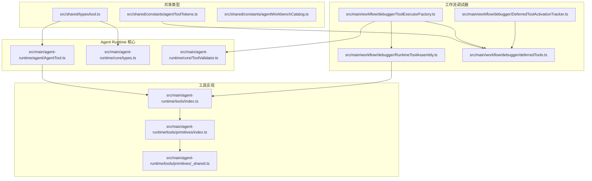
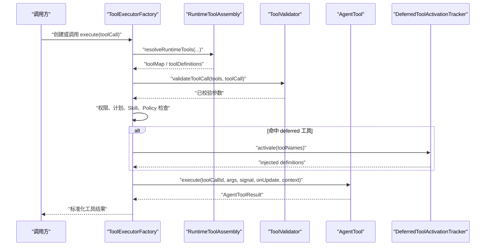
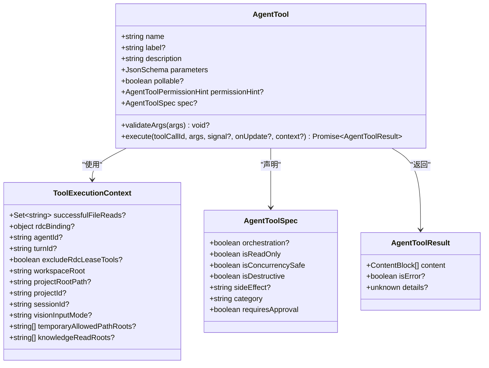
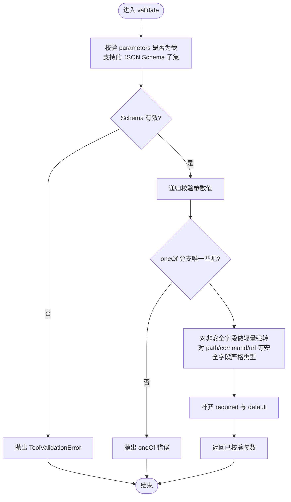
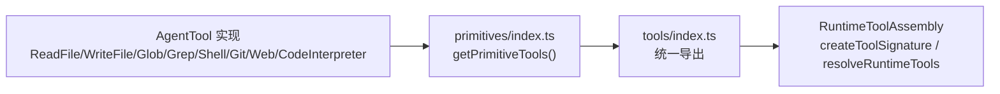
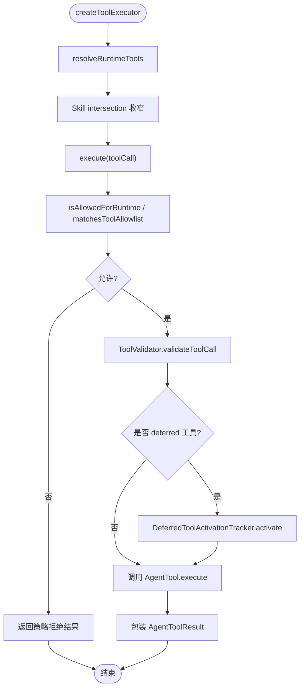
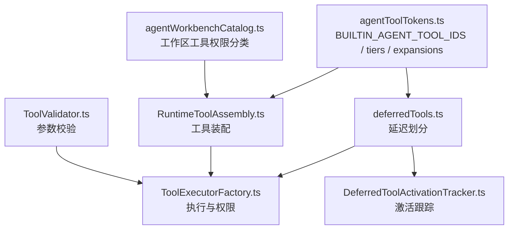

# Tool 开发

<cite>
**本文引用的文件**   
- [AgentTool.ts](file://src/main/agent-runtime/agent/AgentTool.ts)
- [types.ts](file://src/main/agent-runtime/core/types.ts)
- [ToolValidator.ts](file://src/main/agent-runtime/core/ToolValidator.ts)
- [tool.ts](file://src/shared/types/tool.ts)
- [index.ts](file://src/main/agent-runtime/tools/index.ts)
- [_shared.ts](file://src/main/agent-runtime/tools/primitives/_shared.ts)
- [index.ts（primitives）](file://src/main/agent-runtime/tools/primitives/index.ts)
- [RuntimeToolAssembly.ts](file://src/main/workflow/debugger/RuntimeToolAssembly.ts)
- [ToolExecutorFactory.ts](file://src/main/workflow/debugger/ToolExecutorFactory.ts)
- [deferredTools.ts](file://src/main/workflow/debugger/deferredTools.ts)
- [DeferredToolActivationTracker.ts](file://src/main/workflow/debugger/DeferredToolActivationTracker.ts)
- [agentToolTokens.ts](file://src/shared/constants/agentToolTokens.ts)
- [agentWorkbenchCatalog.ts](file://src/shared/constants/agentWorkbenchCatalog.ts)
- [check-tool-system.mjs](file://scripts/check-tool-system.mjs)
</cite>

## 目录
1. [引言](#引言)
2. [项目结构](#项目结构)
3. [核心组件](#核心组件)
4. [架构总览](#架构总览)
5. [详细组件分析](#详细组件分析)
6. [依赖关系分析](#依赖关系分析)
7. [性能与资源特性](#性能与资源特性)
8. [工具开发指南](#工具开发指南)
9. [权限模型与安全检查](#权限模型与安全检查)
10. [错误处理、超时控制与资源管理](#错误处理超时控制与资源管理)
11. [发现机制、动态加载与热重载](#发现机制动态加载与热重载)
12. [测试框架与集成测试方法](#测试框架与集成测试方法)
13. [结论](#结论)

## 引言
本文面向希望在本项目中注册和实现自定义 Agent Tool 的开发者。文档从代码级类型、运行时装配、参数校验、权限策略、RDC 集成、延迟加载、测试契约等维度，给出完整的工具开发生命周期说明。读者不需要先理解全部系统，但需要掌握以下概念：

- `AgentTool`：运行时实际执行的工具对象。
- `ToolDefinition`：暴露给大模型侧的参数描述与能力声明。
- `ToolValidator`：对 JSON Schema 进行严格校验与强转。
- `RuntimeToolAssembly`：组装当前会话可用的工具集合。
- `ToolExecutorFactory`：调用入口、权限拦截、计划约束、结果包装。
- `deferredTools` 与 `DeferredToolActivationTracker`：MCP 与 extended 工具的发现与延迟激活。
- `BUILTIN_AGENT_TOOL_IDS`、`AGENT_WORKBENCH_TOOL_CATALOG`、`CANONICAL_TOOL_TOKEN_EXPANSIONS`：内置工具清单、工作区展示元数据与能力令牌展开规则。

## 项目结构
本项目中，Tool 相关代码主要分布在以下位置：

**图表来源**
- [AgentTool.ts:1-87](file://src/main/agent-runtime/agent/AgentTool.ts#L1-L87)
- [types.ts:120-200](file://src/main/agent-runtime/core/types.ts#L120-L200)
- [tool.ts:1-120](file://src/shared/types/tool.ts#L1-L120)
- [index.ts](file://src/main/agent-runtime/tools/index.ts#L1-L11)
- [index.ts（primitives）:1-59](file://src/main/agent-runtime/tools/primitives/index.ts#L1-L59)
- [_shared.ts:1-200](file://src/main/agent-runtime/tools/primitives/_shared.ts#L1-L200)
- [RuntimeToolAssembly.ts:1-120](file://src/main/workflow/debugger/RuntimeToolAssembly.ts#L1-L120)
- [ToolExecutorFactory.ts:1-120](file://src/main/workflow/debugger/ToolExecutorFactory.ts#L1-L120)
- [deferredTools.ts:1-135](file://src/main/workflow/debugger/deferredTools.ts#L1-L135)
- [DeferredToolActivationTracker.ts:1-76](file://src/main/workflow/debugger/DeferredToolActivationTracker.ts#L1-L76)
- [agentToolTokens.ts:1-120](file://src/shared/constants/agentToolTokens.ts#L1-L120)

**章节来源**
- [AgentTool.ts:1-87](file://src/main/agent-runtime/agent/AgentTool.ts#L1-L87)
- [types.ts:120-200](file://src/main/agent-runtime/core/types.ts#L120-L200)
- [tool.ts:1-120](file://src/shared/types/tool.ts#L1-L120)
- [index.ts](file://src/main/agent-runtime/tools/index.ts#L1-L11)
- [index.ts（primitives）:1-59](file://src/main/agent-runtime/tools/primitives/index.ts#L1-L59)
- [_shared.ts:1-200](file://src/main/agent-runtime/tools/primitives/_shared.ts#L1-L200)
- [RuntimeToolAssembly.ts:1-120](file://src/main/workflow/debugger/RuntimeToolAssembly.ts#L1-L120)
- [ToolExecutorFactory.ts:1-120](file://src/main/workflow/debugger/ToolExecutorFactory.ts#L1-L120)
- [deferredTools.ts:1-135](file://src/main/workflow/debugger/deferredTools.ts#L1-L135)
- [DeferredToolActivationTracker.ts:1-76](file://src/main/workway/debugger/DeferredToolActivationTracker.ts#L1-L76)
- [agentToolTokens.ts:1-120](file://src/shared/constants/agentToolTokens.ts#L1-L120)

## 核心组件
本项目的工具体系由“定义层”“实现层”“装配层”“执行层”“校验层”“权限层”“发现层”共同组成：

| 层次 | 关键文件 | 职责 |
|---|---|---|
| 定义层 | [AgentTool.ts](file://src/main/agent-runtime/agent/AgentTool.ts)、[types.ts](file://src/main/agent-runtime/core/types.ts)、[tool.ts](file://src/shared/types/tool.ts) | 描述工具签名、参数 Schema、执行上下文、返回结构与分层类型。 |
| 实现层 | [index.ts](file://src/main/agent-runtime/tools/index.ts)、[index.ts（primitives）](file://src/main/agent-runtime/tools/primitives/index.ts) | 聚合文件系统、Web、Git、Shell、Code Interpreter 等内置工具。 |
| 装配层 | [RuntimeToolAssembly.ts](file://src/main/workflow/debugger/RuntimeToolAssembly.ts) | 根据会话、Skill、MCP、Task、RDC 等上下文组装可用工具。 |
| 执行层 | [ToolExecutorFactory.ts](file://src/main/workflow/debugger/ToolExecutorFactory.ts) | 权限检查、计划收敛、并发预算、结果封装、延迟激活触发。 |
| 校验层 | [ToolValidator.ts](file://src/main/agent-runtime/core/ToolValidator.ts) | 基于受限 JSON Schema 子集做严格校验与类型强转。 |
| 权限层 | [agentToolTokens.ts](file://src/shared/constants/agentToolTokens.ts)、[agentWorkbenchCatalog.ts](file://src/shared/constants/agentWorkbenchCatalog.ts) | 内置工具清单、分层 core/extended、能力令牌、工作区权限分类。 |
| 发现层 | [deferredTools.ts](file://src/main/workflow/debugger/deferredTools.ts)、[DeferredToolActivationTracker.ts](file://src/main/workflow/debugger/DeferredToolActivationTracker.ts) | MCP 前缀与 extended 工具的延迟注入与按顺序持久化激活。 |

**章节来源**
- [AgentTool.ts:1-87](file://src/main/agent-runtime/agent/AgentTool.ts#L1-L87)
- [types.ts:120-200](file://src/main/agent-runtime/core/types.ts#L120-L200)
- [tool.ts:1-120](file://src/shared/types/tool.ts#L1-L120)
- [index.ts](file://src/main/agent-runtime/tools/index.ts#L1-L11)
- [index.ts（primitives）:1-59](file://src/main/agent-runtime/tools/primitives/index.ts#L1-L59)
- [RuntimeToolAssembly.ts:1-120](file://src/main/workflow/debugger/RuntimeToolAssembly.ts#L1-L120)
- [ToolExecutorFactory.ts:1-120](file://src/main/workflow/debugger/ToolExecutorFactory.ts#L1-L120)
- [ToolValidator.ts:1-80](file://src/main/agent-runtime/core/ToolValidator.ts#L1-L80)
- [agentToolTokens.ts:1-120](file://src/shared/constants/agentToolTokens.ts#L1-L120)
- [deferredTools.ts:1-135](file://src/main/workflow/debugger/deferredTools.ts#L1-L135)
- [DeferredToolActivationTracker.ts:1-76](file://src/main/workflow/debugger/DeferredToolActivationTracker.ts#L1-L76)

## 架构总览
下图展示一次工具调用的端到端流程：

**图表来源**
- [ToolExecutorFactory.ts:80-220](file://src/main/workflow/debugger/ToolExecutorFactory.ts#L80-L220)
- [RuntimeToolAssembly.ts:60-160](file://src/main/workflow/debugger/RuntimeToolAssembly.ts#L60-L160)
- [ToolValidator.ts:80-160](file://src/main/agent-runtime/core/ToolValidator.ts#L80-L160)
- [DeferredToolActivationTracker.ts:30-76](file://src/main/workflow/debugger/DeferredToolActivationTracker.ts#L30-L76)

## 详细组件分析

### AgentTool 接口与工具定义
`AgentTool` 是运行时可执行的最小单元。它包含名称、描述、JSON Schema 参数、可选轮询标记、权限提示、能力规格以及 `execute` 执行函数。开发者实现工具时，应优先维护 `AgentTool`，再由上层转换为模型侧使用的 `ToolDefinition`。

**图表来源**
- [AgentTool.ts:1-87](file://src/main/agent-runtime/agent/AgentTool.ts#L1-L87)

要点：
- `parameters` 必须是可以被 `ToolValidator` 接受的 JSON Schema 子集。
- `spec` 用于描述工具副作用、并发安全性、是否破坏性、是否需要审批。
- `permissionHint` 与工作区展示层权限分类对应。
- `execute` 支持 `AbortSignal` 和增量回调，适合长耗时任务。
- `validateArgs` 可在权限审查之前拒绝语义非法参数。

**章节来源**
- [AgentTool.ts:1-87](file://src/main/agent-runtime/agent/AgentTool.ts#L1-L87)

### 工具定义类型与分层
系统存在两套“工具定义”视角：

| 类型 | 来源 | 用途 |
|---|---|---|
| `ToolDefinition`（core 层） | [types.ts](file://src/main/agent-runtime/core/types.ts) | 暴露给模型侧，含 `name`、`description`、`parameters`、`pollable`。 |
| `ToolDefinition`（shared 层） | [tool.ts](file://src/shared/types/tool.ts) | 更偏工具目录、RDC 操作定义、CLI 运行元数据。 |
| `LayeredToolDefinition` | [tool.ts](file://src/shared/types/tool.ts) | 表示 primitive、rdc、system、skill、mcp、ui 分层。 |
| `ToolRegistryEntry` | [tool.ts](file://src/shared/types/tool.ts) | 注册表条目，描述可用性。 |

建议：
- 实现工具时使用 `AgentTool`。
- 将 `AgentTool` 转为 `ToolDefinition` 时使用 `toolToDefinition`。
- 若需要参与 RDC 或 CLI 工具目录，再参考 shared 层的 `RdcOperationDefinition`、`ToolCatalog`。

**章节来源**
- [types.ts:120-200](file://src/main/agent-runtime/core/types.ts#L120-L200)
- [tool.ts:1-120](file://src/shared/types/tool.ts#L1-L120)
- [AgentTool.ts:70-87](file://src/main/agent-runtime/agent/AgentTool.ts#L70-L87)

### 参数验证与返回值格式化
`ToolValidator` 是一个自包含、无第三方依赖的 JSON Schema 校验器。它限制支持的关键词、递归深度、节点数量、数组长度和对象键数，并对路径类字段采用 fail-closed 严格模式。

**图表来源**
- [ToolValidator.ts:1-160](file://src/main/agent-runtime/core/ToolValidator.ts#L1-L160)

返回值方面：
- 工具实现返回 `AgentToolResult`，其中 `content` 是文本或图像内容块。
- 上层会将结果投影为 `ToolResultMessage`，并保留 `details` 供工作区摘要使用。
- 对于结构化产物，可使用 `ToolArtifact` 类型关联外部存储与摘要。

**章节来源**
- [ToolValidator.ts:1-200](file://src/main/agent-runtime/core/ToolValidator.ts#L1-L200)
- [types.ts:160-200](file://src/main/agent-runtime/core/types.ts#L160-L200)
- [tool.ts:60-120](file://src/shared/types/tool.ts#L60-L120)

### 工具注册与统一导出
内置工具通过 primitives 层统一导出，并由 `getPrimitiveTools` 提供默认集合；`tools/index.ts` 再聚合 primitives、file、system、ToolSearch 等模块。

**图表来源**
- [index.ts（primitives）:1-59](file://src/main/agent-runtime/tools/primitives/index.ts#L1-L59)
- [index.ts](file://src/main/agent-runtime/tools/index.ts#L1-L11)
- [RuntimeToolAssembly.ts:1-120](file://src/main/workflow/debugger/RuntimeToolAssembly.ts#L1-L120)

**章节来源**
- [index.ts](file://src/main/agent-runtime/tools/index.ts#L1-L11)
- [index.ts（primitives）:1-59](file://src/main/agent-runtime/tools/primitives/index.ts#L1-L59)

### 运行时装配与会话绑定
`RuntimeToolAssembly` 负责把基础工具、Task 工具、RDC 上下文工具、ask_user、turn_complete 等组合起来，并生成工具签名、权限白名单匹配逻辑。它还负责把 `AgentTool` 转换为 `ToolDefinition`，并在某些场景下直接实现短生命周期工具。

关键点：
- `createToolSignature` 用于追踪工具集合变化。
- `matchesToolAllowlist` 支持通配符与前缀匹配。
- `isAllowedForRuntime` 结合代理角色与冻结白名单判断。
- `createTurnCompletionTool`、`createRdcContextTool`、`createAskUserTool` 是典型内嵌工具示例。

**章节来源**
- [RuntimeToolAssembly.ts:1-200](file://src/main/workflow/debugger/RuntimeToolAssembly.ts#L1-L200)

### 工具执行工厂与权限拦截
`ToolExecutorFactory` 是工具执行的中心调度器。它负责：

1. 解析 effective plan 下的 toolAllowlist。
2. 调用 `resolveRuntimeTools` 获取当前会话可用的工具映射。
3. 根据 Skill 交集进一步收窄 allowed-tools。
4. 调用 `ToolValidator.validateToolCall` 校验参数。
5. 应用 Policy 拒绝、RDC lease 工具排除、subagent 排除。
6. 在首次命中 deferred 工具时触发激活。
7. 调用 `AgentTool.execute` 并包装结果。

**图表来源**
- [ToolExecutorFactory.ts:80-260](file://src/main/workflow/debugger/ToolExecutorFactory.ts#L80-L260)
- [deferredTools.ts:60-135](file://src/main/workflow/debugger/deferredTools.ts#L60-L135)
- [DeferredToolActivationTracker.ts:30-76](file://src/main/workflow/debugger/DeferredToolActivationTracker.ts#L30-L76)

**章节来源**
- [ToolExecutorFactory.ts:1-260](file://src/main/workflow/debugger/ToolExecutorFactory.ts#L1-L260)

## 依赖关系分析

**图表来源**
- [agentToolTokens.ts:1-120](file://src/shared/constants/agentToolTokens.ts#L1-L120)
- [agentWorkbenchCatalog.ts:1-60](file://src/shared/constants/agentWorkbenchCatalog.ts#L1-L60)
- [ToolValidator.ts:1-80](file://src/main/agent-runtime/core/ToolValidator.ts#L1-L80)
- [RuntimeToolAssembly.ts:1-120](file://src/main/workflow/debugger/RuntimeToolAssembly.ts#L1-L120)
- [ToolExecutorFactory.ts:1-120](file://src/main/workflow/debugger/ToolExecutorFactory.ts#L1-L120)
- [deferredTools.ts:1-80](file://src/main/workflow/debugger/deferredTools.ts#L1-L80)
- [DeferredToolActivationTracker.ts:1-60](file://src/main/workflow/debugger/DeferredToolActivationTracker.ts#L1-L60)

**章节来源**
- [agentToolTokens.ts:1-200](file://src/shared/constants/agentToolTokens.ts#L1-L200)
- [agentWorkbenchCatalog.ts:1-120](file://src/shared/constants/agentWorkbenchCatalog.ts#L1-L120)
- [ToolExecutorFactory.ts:1-200](file://src/main/workflow/debugger/ToolExecutorFactory.ts#L1-L200)

## 性能与资源特性
- 参数校验限制最大递归深度、最大节点数、最大数组项数和最大对象键数，避免恶意 schema 导致 CPU 或内存爆炸。
- 工具搜索支持 limit/offset 上限钳制，避免结果集过大。
- 延迟工具机制减少初始 prompt 大小，仅当工具名被命中时才注入。
- 文件写入采用临时文件 + fsync + 原子重命名，降低损坏风险。
- 工作区根解析优先使用 `projectRootPath`，避免误写进程 cwd。
- 工具结果支持 artifacts，便于将二进制、图片、日志等大对象交给后端存储，而不是塞入消息体。

[本节为通用性能说明，不直接分析具体文件]

## 工具开发指南

### 第一步：确定工具类型与分层
- 如果工具是文件系统、网络、Git、Shell、代码解释器等基础能力，优先考虑放在 primitives 风格中，并通过 `getPrimitiveTools` 或相应模块导出。
- 如果工具属于 system、task、knowledge、investigation、skill、mcp、ui 等高层能力，应在对应装配层注册。
- 如果工具需要作为 MCP 工具，使用 `mcp__{server}__{tool}` 命名约定，并走延迟加载。

### 第二步：实现 AgentTool
一个最小工具应满足：
1. 明确 `name`，保证在同一工具集中唯一。
2. 用自然语言写清 `description`。
3. 用受支持的 JSON Schema 描述 `parameters`。
4. 在 `execute` 中实现业务逻辑。
5. 设置 `spec` 描述副作用、并发安全和破坏性。
6. 如需用户交互，返回 `ask_user` 或相关结果结构。

参考路径：
- 工具接口定义：[AgentTool.ts](file://src/main/agent-runtime/agent/AgentTool.ts#L1-L87)
- 工具执行上下文：[AgentTool.ts](file://src/main/agent-runtime/agent/AgentTool.ts#L1-L87)
- 工具搜索结果工具实现：[ToolSearch.ts](file://src/main/agent-runtime/tools/ToolSearch.ts#L1-L186)

### 第三步：编写 JSON Schema 参数
推荐使用：
- `type: object`
- `properties`
- `required`
- `enum`
- `const`
- `default`
- `minimum` / `maximum`
- `minLength` / `maxLength`
- `pattern`
- `items`
- `oneOf`

禁止或谨慎使用：
- 不在 `SUPPORTED_SCHEMA_KEYS` 中的关键字。
- `additionalProperties: true`。
- 过深的嵌套 schema。
- 超大数组或对象。

参考路径：
- 受支持关键字与校验器：[ToolValidator.ts](file://src/main/agent-runtime/core/ToolValidator.ts#L1-L160)
- 安全字段白名单规则：[ToolValidator.ts](file://src/main/agent-runtime/core/ToolValidator.ts#L1-L120)

### 第四步：返回值设计
推荐：
- 成功时返回 `isError: false`，并将可读结果放入 `content`。
- 结构化摘要放入 `details`。
- 大对象或外部资源放入 `artifacts`。
- 错误时返回 `isError: true` 或在 `execute` 中抛出明确错误。

参考路径：
- 工具结果类型：[AgentTool.ts](file://src/main/agent-runtime/agent/AgentTool.ts#L1-L87)
- 工具调用结果类型：[tool.ts](file://src/shared/types/tool.ts#L60-L120)

### 第五步：文件操作工具示例思路
以“读取工作区文件”为例：
1. 使用 `ToolExecutionContext.projectRootPath` 或 `requireMutationWorkspaceRoot` 确定工作区根。
2. 使用 `safeResolvePath` 或 `isWithinRootAllowingAliases` 校验目标路径。
3. 对敏感路径、符号链接、越界路径进行拒绝。
4. 对二进制文件和超大文本进行门禁。
5. 返回文本内容或结构化摘要。

参考路径：
- 工作区根与路径安全：[_shared.ts](file://src/main/agent-runtime/tools/primitives/_shared.ts#L1-L200)
- 原子写入与符号链接防护：[_shared.ts](file://src/main/agent-runtime/tools/primitives/_shared.ts#L200-L462)
- 文件读取工具导出：[index.ts（primitives）](file://src/main/agent-runtime/tools/primitives/index.ts#L1-L59)

### 第六步：进程调用工具示例思路
以“Shell 工具”为例：
1. 通过 `matchShellHardDeny` 拒绝危险命令。
2. 使用工作区根限制命令作用域。
3. 使用超时控制和信号取消。
4. 限制输出大小，防止大输出阻塞。
5. 将 stdout/stderr 合并为人类可读结果。

参考路径：
- Shell 工具导出：[index.ts（primitives）](file://src/main/agent-runtime/tools/primitives/index.ts#L1-L59)
- Shell 硬拒绝规则：[_shared.ts](file://src/main/agent-runtime/tools/primitives/_shared.ts#L1-L200)

### 第七步：RDC 集成工具示例思路
以“RDC 上下文工具”为例：
1. 使用 `assertRdcContextLeaseOwnership` 确保拥有正确的 RDC 租约。
2. 检查 capture 是否打开、binding 是否 ready/applying。
3. 返回 `captureContentSha256`、host controls、capacity 等只读信息。
4. 在未打开或需要恢复时给出引导性提示，而不是暴露内部状态。

参考路径：
- RDC 上下文工具实现：[RuntimeToolAssembly.ts](file://src/main/workflow/debugger/RuntimeToolAssembly.ts#L120-L220)

### 第八步：注册与导出
- 如果工具是 primitives 风格，加入 `getPrimitiveTools` 或对应导出模块。
- 如果工具是 system 或 file 层工具，加入对应模块并重新导出。
- 如果工具由 `RuntimeToolAssembly` 装配，则在装配层注册。
- 如果是 MCP 工具，遵循 `mcp__{server}__{tool}` 命名约定。

参考路径：
- 工具统一导出：[index.ts](file://src/main/agent-runtime/tools/index.ts#L1-L11)
- 内置 primitives 列表：[index.ts（primitives）](file://src/main/agent-runtime/tools/primitives/index.ts#L1-L59)

**章节来源**
- [AgentTool.ts:1-87](file://src/main/agent-runtime/agent/AgentTool.ts#L1-L87)
- [ToolValidator.ts:1-160](file://src/main/agent-runtime/core/ToolValidator.ts#L1-L160)
- [_shared.ts:1-200](file://src/main/agent-runtime/tools/primitives/_shared.ts#L1-L200)
- [_shared.ts:200-L462](file://src/main/agent-runtime/tools/primitives/_shared.ts#L200-L462)
- [index.ts（primitives）:1-59](file://src/main/agent-runtime/tools/primitives/index.ts#L1-L59)
- [index.ts](file://src/main/agent-runtime/tools/index.ts#L1-L11)
- [RuntimeToolAssembly.ts:120-L220](file://src/main/workflow/debugger/RuntimeToolAssembly.ts#L120-L220)

## 权限模型与安全检查

### 权限分类
工作区工具权限分为：

| 权限类别 | 含义 | 典型工具 |
|---|---|---|
| `readonly` | 只读，通常无需审批 | read_file、glob、grep、web_fetch、web_search |
| `mutation` | 修改，通常需要审批 | write_file、edit_file、move_file、copy_file |
| `destructive` | 破坏性操作，通常需要审批 | delete_file |
| `approval` | 高风险，明确要求审批 | shell |

参考路径：
- [agentWorkbenchCatalog.ts:1-60](file://src/shared/constants/agentWorkbenchCatalog.ts#L1-L60)

### 能力令牌与分层
系统使用 canonical token 扩展机制决定模型能使用哪些工具：

- `read` 扩展为 read_file、read_image、artifact_read。
- `web` 扩展为 web_fetch、web_search。
- `git` 扩展为 git_status、git_diff、git_log、git_add、git_unstage、git_commit。
- `shell` 扩展为 shell。
- `knowledge`、`investigation`、`mcp`、`skills` 等也有固定扩展。
- `REJECTED_TOOL_TOKENS` 明确拒绝已移除或替换的旧 token。

参考路径：
- [agentToolTokens.ts:1-200](file://src/shared/constants/agentToolTokens.ts#L1-L200)

### 工具分层：core 与 extended
- `core` 工具每次请求常驻注入。
- `extended` 工具默认 deferred，通过 `tool_search` 或直接调用后激活。
- 检查脚本要求每个内置工具都有 core 或 extended 分类。

参考路径：
- [agentToolTokens.ts:120-L200](file://src/shared/constants/agentToolTokens.ts#L120-L200)
- [check-tool-system.mjs:1-L200](file://scripts/check-tool-system.mjs#L1-L200)

### 安全检查链
一次工具调用至少经过：
1. 工具名归一化。
2. 运行时允许白名单检查。
3. Skill allowed-tools 交集检查。
4. Policy 编译结果检查。
5. RDC lease 工具排除。
6. subagent 排除。
7. 参数 Schema 校验。
8. 工具自身 `validateArgs`。
9. 路径、命令、网络、输出大小的工具级安全门。

参考路径：
- [ToolExecutorFactory.ts:120-L260](file://src/main/workflow/debugger/ToolExecutorFactory.ts#L120-L260)
- [ToolValidator.ts:80-L200](file://src/main/agent-runtime/core/ToolValidator.ts#L80-L200)
- [_shared.ts:1-L200](file://src/main/agent-runtime/tools/primitives/_shared.ts#L1-L200)

**章节来源**
- [agentWorkbenchCatalog.ts:1-L120](file://src/shared/constants/agentWorkbenchCatalog.ts#L1-L120)
- [agentToolTokens.ts:1-L200](file://src/shared/constants/agentToolTokens.ts#L1-L200)
- [check-tool-system.mjs:1-L200](file://scripts/check-tool-system.mjs#L1-L200)
- [ToolExecutorFactory.ts:120-L260](file://src/main/workflow/debugger/ToolExecutorFactory.ts#L120-L260)
- [ToolValidator.ts:80-L200](file://src/main/agent-runtime/core/ToolValidator.ts#L80-L200)
- [_shared.ts:1-L200](file://src/main/agent-runtime/tools/primitives/_shared.ts#L1-L200)

## 错误处理、超时控制与资源管理

### 错误分类
- Schema 校验错误：由 `ToolValidator` 抛出 `ToolValidationError`。
- 策略拒绝：由 `ToolExecutorFactory` 返回策略拒绝结果。
- 路径拒绝：由 `_shared.ts` 抛出路径越界、符号链接拒绝、父目录缺失等错误。
- 工具语义错误：由 `validateArgs` 或 `execute` 抛出明确错误。

参考路径：
- [ToolValidator.ts:1-L80](file://src/main/agent-runtime/core/ToolValidator.ts#L1-L80)
- [ToolExecutorFactory.ts:120-L220](file://src/main/workflow/debugger/ToolExecutorFactory.ts#L120-L220)
- [_shared.ts:200-L462](file://src/main/agent-runtime/tools/primitives/_shared.ts#L200-L462)

### 超时控制
- 工具 `execute` 接收 `AbortSignal`，适合配合超时包装。
- `_shared.ts` 提供 `abortPromise` 辅助函数。
- 输出截断使用 UTF-8 字节切片，避免超长响应。

参考路径：
- [AgentTool.ts:40-L87](file://src/main/agent-runtime/agent/AgentTool.ts#L40-L87)
- [_shared.ts:275-L315](file://src/main/agent-runtime/tools/primitives/_shared.ts#L275-L315)

### 资源管理
- 文件写入使用临时文件 + fsync + 原子 rename。
- 路径检查覆盖符号链接、junction、Windows 8.3 别名。
- 工作区根强制要求 mutation 工具具备可信 `projectRootPath`。
- 工具执行上下文携带 session 级别临时根，避免全局状态泄露。

参考路径：
- [_shared.ts:200-L462](file://src/main/agent-runtime/tools/primitives/_shared.ts#L200-L462)
- [AgentTool.ts:1-L40](file://src/main/agent-runtime/agent/AgentTool.ts#L1-L40)

**章节来源**
- [ToolValidator.ts:1-L80](file://src/main/agent-runtime/core/ToolValidator.ts#L1-L80)
- [ToolExecutorFactory.ts:120-L220](file://src/main/workflow/debugger/ToolExecutorFactory.ts#L120-L220)
- [_shared.ts:200-L462](file://src/main/agent-runtime/tools/primitives/_shared.ts#L200-L462)
- [AgentTool.ts:1-L40](file://src/main/agent-runtime/agent/AgentTool.ts#L1-L40)

## 发现机制、动态加载与热重载

### 工具发现
`tool_search` 是一个内置工具，可对当前有效工具集进行搜索、分类过滤、审批过滤和分页。它返回匹配结果、指纹和参数 schema，帮助模型选择后续工具。

参考路径：
- [ToolSearch.ts:1-L186](file://src/main/agent-runtime/tools/ToolSearch.ts#L1-L186)

### 延迟加载
- `mcp__*` 工具和 `BUILTIN_AGENT_TOOL_TIERS` 中标记为 `extended` 的工具默认 deferred。
- `partitionDeferredTools` 将工具划分为 injected、deferredMcp、deferredBuiltin。
- `DeferredToolActivationTracker` 按 slotKey 持久化激活集合，仅在 toolSignature 变化时重置。
- `preactivateWorkflowTools` 预激活 workflow 工具，如 plan_artifact、task_*、output_register 等。

参考路径：
- [deferredTools.ts:1-L135](file://src/main/workflow/debugger/deferredTools.ts#L1-L135)
- [DeferredToolActivationTracker.ts:1-L76](file://src/main/workflow/debugger/DeferredToolActivationTracker.ts#L1-L76)
- [agentToolTokens.ts:120-L200](file://src/shared/constants/agentToolTokens.ts#L120-L200)

### 热重载支持
系统中没有显式的“热重载工具模块”机制。工具集合的变化主要通过：
- `RuntimeToolAssembly.createToolSignature` 检测工具集合变化。
- `DeferredToolActivationTracker.resolveActivatedSet` 在 toolSignature 变化时重建激活集。
- `ToolExecutorFactory.activateDeferredTools` 触发 COW 更新并让下一轮 LLM 读取新 activeTools。

这意味着“热重载”更接近“会话或槽位级别的工具集刷新”，而非任意时刻热插拔实现。

参考路径：
- [RuntimeToolAssembly.ts:40-L100](file://src/main/workflow/debugger/RuntimeToolAssembly.ts#L40-L100)
- [DeferredToolActivationTracker.ts:20-L60](file://src/main/workflow/debugger/DeferredToolActivationTracker.ts#L20-L60)
- [ToolExecutorFactory.ts:40-L100](file://src/main/workflow/debugger/ToolExecutorFactory.ts#L40-L100)

**章节来源**
- [ToolSearch.ts:1-L186](file://src/main/agent-runtime/tools/ToolSearch.ts#L1-L186)
- [deferredTools.ts:1-L135](file://src/main/workflow/debugger/deferredTools.ts#L1-L135)
- [DeferredToolActivationTracker.ts:1-L76](file://src/main/workflow/debugger/DeferredToolActivationTracker.ts#L1-L76)
- [RuntimeToolAssembly.ts:40-L100](file://src/main/workflow/debugger/RuntimeToolAssembly.ts#L40-L100)
- [ToolExecutorFactory.ts:40-L100](file://src/main/workflow/debugger/ToolExecutorFactory.ts#L40-L100)

## 测试框架与集成测试方法

### 单元测试建议
- 对 `AgentTool.parameters` 使用 `ToolValidator.validate` 或 `validateToolCall` 覆盖合法输入、默认值、oneOf、required、pattern、size 限制。
- 对文件工具覆盖路径逃逸、符号链接、权限不足、父目录缺失、二进制拒绝、超大文件。
- 对 Shell 工具覆盖命令黑名单、路径限制、输出截断、取消信号。
- 对 RDC 工具覆盖未打开 capture、需要 recovery、lease 不匹配。

参考路径：
- [ToolValidator.ts:1-L200](file://src/main/agent-runtime/core/ToolValidator.ts#L1-L200)
- [_shared.ts:1-L200](file://src/main/agent-runtime/tools/primitives/_shared.ts#L1-L200)

### 集成测试建议
- 使用 `ToolExecutorFactory` 创建 executor，传入 mock slots、deferred activation、allowlist、policy。
- 构造 `ToolCall`，验证是否被策略拒绝、是否触发 deferred 激活、是否返回正确结果。
- 验证 `tool_search` 的查询、分页、指纹稳定性。
- 验证 workbench catalog 与 builtin tool ids 的一致性。

参考路径：
- [ToolExecutorFactory.ts:1-L200](file://src/main/workflow/debugger/ToolExecutorFactory.ts#L1-L200)
- [ToolSearch.ts:1-L186](file://src/main/agent-runtime/tools/ToolSearch.ts#L1-L186)
- [check-tool-system.mjs:1-L200](file://scripts/check-tool-system.mjs#L1-L200)

**章节来源**
- [ToolValidator.ts:1-L200](file://src/main/agent-runtime/core/ToolValidator.ts#L1-L200)
- [ToolExecutorFactory.ts:1-L200](file://src/main/workflow/debugger/ToolExecutorFactory.ts#L1-L200)
- [ToolSearch.ts:1-L186](file://src/main/agent-runtime/tools/ToolSearch.ts#L1-L186)
- [check-tool-system.mjs:1-L200](file://scripts/check-tool-system.mjs#L1-L200)

## 结论
本项目中的 Tool 开发不是简单注册一个函数，而是贯穿“定义、校验、装配、权限、延迟加载、执行、结果、审计”的全链路工程。开发者应：

1. 使用 `AgentTool` 表达工具行为，使用 JSON Schema 表达参数。
2. 通过 `ToolValidator` 保证参数安全、稳定、可预测。
3. 通过 `RuntimeToolAssembly` 和 `ToolExecutorFactory` 接入权限、计划、Skill、Policy、RDC、Task、MCP 等上下文。
4. 通过 `deferredTools` 和 `DeferredToolActivationTracker` 控制工具发现与延迟注入。
5. 通过 `BUILTIN_AGENT_TOOL_IDS`、`AGENT_WORKBENCH_TOOL_CATALOG`、`CANONICAL_TOOL_TOKEN_EXPANSIONS` 保持能力声明一致性。
6. 通过路径、命令、输出、超时、信号、撤销等机制完成资源与风险控制。

只要遵循这些边界，新增工具就能在不破坏现有模型能力、权限策略和工作区安全的前提下，稳定地参与 Agent 推理与自动化工作流。