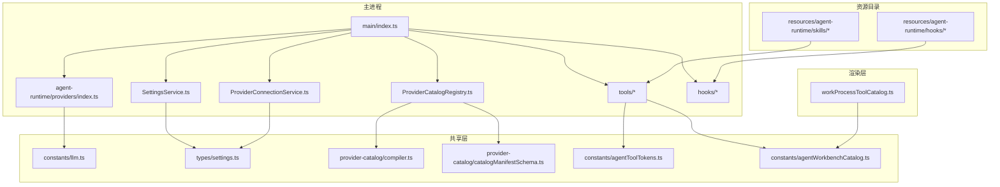
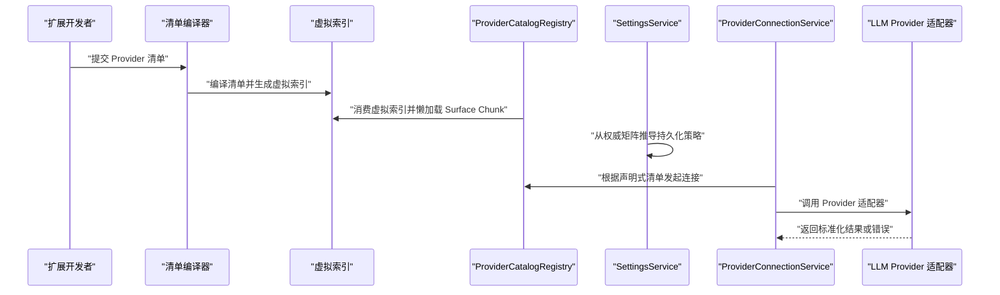
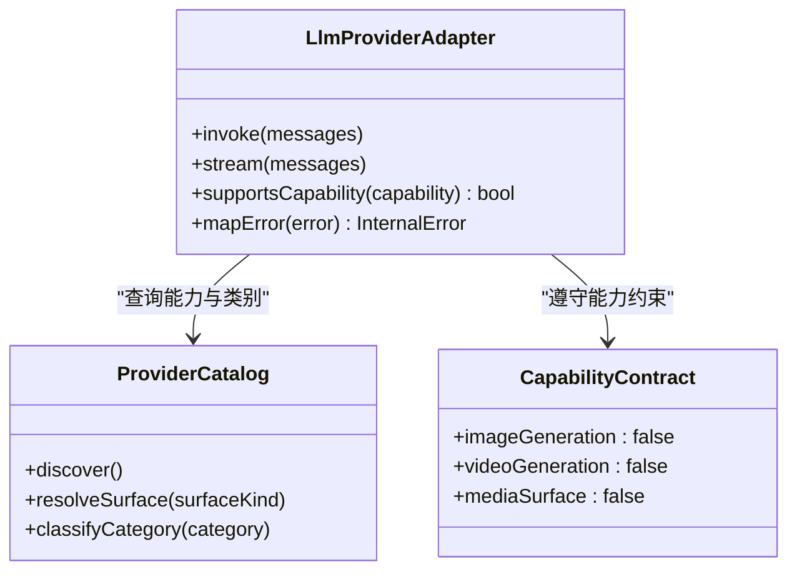
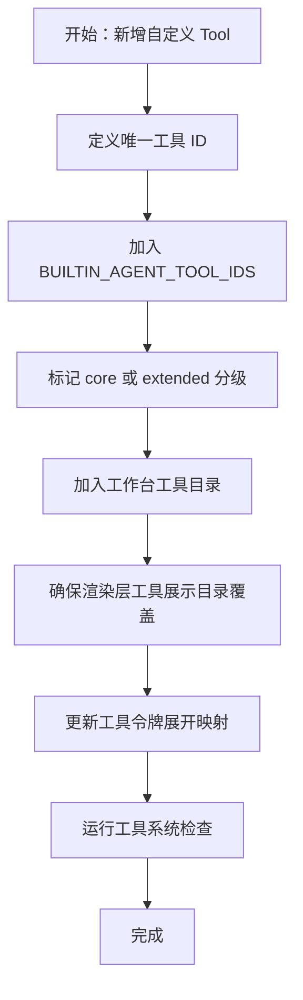
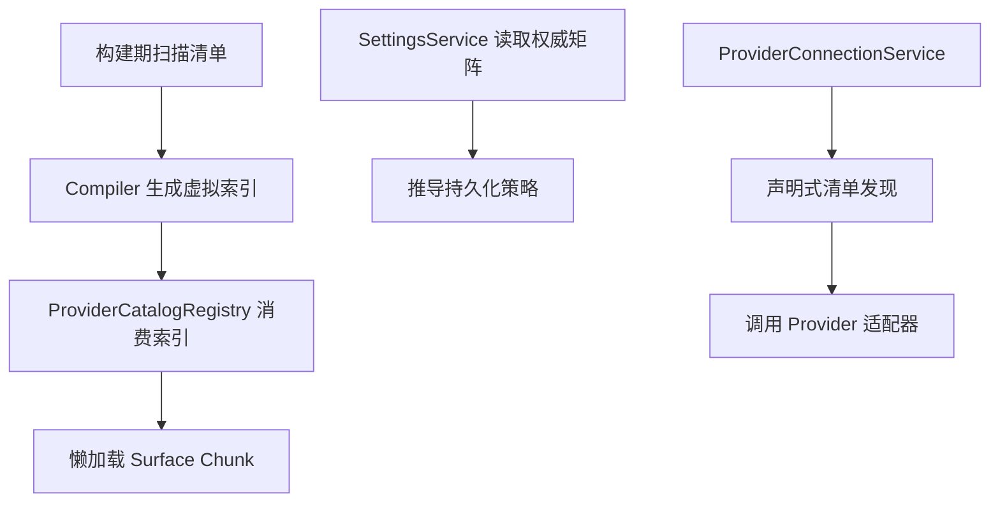
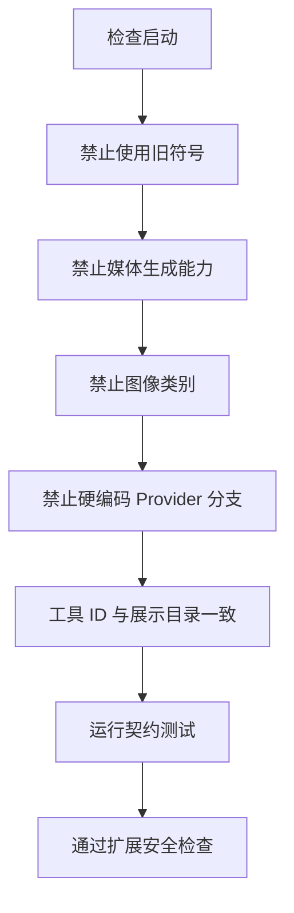

# 扩展开发

<cite>
**本文引用的文件**   
- [scripts/check-provider-system.mjs](file://scripts/check-provider-system.mjs)
- [scripts/check-tool-system.mjs](file://scripts/check-tool-system.mjs)
- [src/main/src/main/agent-runtime/providers/index.ts](file://src/main/src/main/agent-runtime/providers/index.ts)
- [src/main/src/main/provider-catalog/ProviderCatalogRegistry.ts](file://src/main/src/main/provider-catalog/ProviderCatalogRegistry.ts)
- [src/shared/src/shared/provider-catalog/compiler.ts](file://src/shared/src/shared/provider-catalog/compiler.ts)
- [src/shared/src/shared/provider-catalog/catalogManifestSchema.ts](file://src/shared/src/shared/provider-catalog/catalogManifestSchema.ts)
- [src/shared/src/shared/constants/llm.ts](file://src/shared/src/shared/constants/llm.ts)
- [src/shared/src/shared/types/settings.ts](file://src/shared/src/shared/types/settings.ts)
- [src/main/src/main/settings/LiveProviderCatalogParsers.ts](file://src/main/src/main/settings/LiveProviderCatalogParsers.ts)
- [src/main/src/main/settings/SettingsService.ts](file://src/main/src/main/settings/SettingsService.ts)
- [src/main/src/main/settings/ProviderConnectionService.ts](file://src/main/src/main/settings/ProviderConnectionService.ts)
- [src/shared/src/shared/constants/agentToolTokens.ts](file://src/shared/src/shared/constants/agentToolTokens.ts)
- [src/shared/src/shared/constants/agentWorkbenchCatalog.ts](file://src/shared/src/shared/constants/agentWorkbenchCatalog.ts)
- [src/renderer/features/transcript/workProcessToolCatalog.ts](file://src/renderer/features/transcript/workProcessToolCatalog.ts)
- [src/main/src/main/tools/toolSearch.ts](file://src/main/src/main/tools/toolSearch.ts)
- [resources/resources/agent-runtime/skills/README.md](file://resources/resources/agent-runtime/skills/README.md)
- [resources/resources/agent-runtime/hooks/README.md](file://resources/resources/agent-runtime/hooks/README.md)
</cite>

## 目录
1. [引言](#引言)
2. [项目结构](#项目结构)
3. [核心扩展点总览](#核心扩展点总览)
4. [架构总览](#架构总览)
5. [Llm Provider 适配器规范](#llm-provider-适配器规范)
6. [Skill 定义与工具注册](#skill-定义与工具注册)
7. [Hook 生命周期与信任管理](#hook-生命周期与信任管理)
8. [自定义 Tool 开发指南](#自定义-tool-开发指南)
9. [扩展发现与加载机制](#扩展发现与加载机制)
10. [版本兼容性与安全约束](#版本兼容性与安全约束)
11. [部署与发布流程](#部署与发布流程)
12. [故障排查](#故障排查)
13. [结论](#结论)

## 引言
本文面向希望为 RDC Agent 系统添加扩展的开发者，覆盖以下扩展点：
- LLM Provider 适配器
- Skill
- Hook
- Tool

文档基于仓库中的架构说明、契约文档和构建期检查脚本整理，重点说明实现规范、认证机制、错误处理、权限配置、生命周期、信任管理、参数验证、结果格式化、发现加载机制、版本兼容性以及部署注意事项。

## 项目结构
RDC Agent 将扩展能力分布在主进程、共享层、渲染层和资源目录中：
- 主进程负责 Provider Catalog、设置、会话、工具执行、Agent Runtime、Hook 执行等核心逻辑。
- 共享层提供 Provider Catalog 编译、类型契约、常量、工具令牌映射等跨进程契约。
- 渲染层暴露 Work Process 的工具展示目录，用于用户界面呈现。
- 资源目录包含内置 Agent、Skill、Hook、Prompt 等资源。

**图示来源**
- [src/main/src/main/provider-catalog/ProviderCatalogRegistry.ts](file://src/main/src/main/provider-catalog/ProviderCatalogRegistry.ts)
- [src/shared/src/shared/provider-catalog/compiler.ts](file://src/shared/src/shared/provider-catalog/compiler.ts)
- [src/shared/src/shared/provider-catalog/catalogManifestSchema.ts](file://src/shared/src/shared/provider-catalog/catalogManifestSchema.ts)
- [src/shared/src/shared/constants/llm.ts](file://src/shared/src/shared/constants/llm.ts)
- [src/shared/src/shared/types/settings.ts](file://src/shared/src/shared/types/settings.ts)
- [src/main/src/main/settings/SettingsService.ts](file://src/main/src/main/settings/SettingsService.ts)
- [src/main/src/main/settings/ProviderConnectionService.ts](file://src/main/src/main/settings/ProviderConnectionService.ts)
- [src/shared/src/shared/constants/agentToolTokens.ts](file://src/shared/src/shared/constants/agentToolTokens.ts)
- [src/shared/src/shared/constants/agentWorkbenchCatalog.ts](file://src/shared/src/shared/constants/agentWorkbenchCatalog.ts)
- [src/renderer/features/transcript/workProcessToolCatalog.ts](file://src/renderer/features/transcript/workProcessToolCatalog.ts)

**章节来源**
- [scripts/check-provider-system.mjs:1-165](file://scripts/check-provider-system.mjs#L1-L165)
- [scripts/check-tool-system.mjs:1-200](file://scripts/check-tool-system.mjs#L1-L200)

## 核心扩展点总览
| 扩展点 | 主要职责 | 关键文件位置 | 适配者关注点 |
|---|---|---|---|
| LLM Provider | 接入不同大模型服务，抽象调用、流式输出、错误语义 | `src/main/src/main/agent-runtime/providers/index.ts` | 适配器接口、能力声明、认证、错误映射 |
| Provider Catalog | 声明式发现、编译、路由、持久化策略 | `src/main/src/main/provider-catalog/ProviderCatalogRegistry.ts` | 清单格式、类别、表面类型、禁用能力 |
| Skill | 以结构化方式描述可发现、可执行的技能单元 | `resources/resources/agent-runtime/skills/*` | Skill 定义、工具绑定、权限 |
| Hook | 在 Agent 运行生命周期中注入行为 | `resources/resources/agent-runtime/hooks/*` | 钩子阶段、输入输出、信任边界 |
| Tool | 可被 Agent 调用的具体能力 | `src/main/src/main/tools/*` | 工具 ID、令牌展开、分级、显示目录 |

**章节来源**
- [src/main/src/main/agent-runtime/providers/index.ts](file://src/main/src/main/agent-runtime/providers/index.ts)
- [src/main/src/main/provider-catalog/ProviderCatalogRegistry.ts](file://src/main/src/main/provider-catalog/ProviderCatalogRegistry.ts)
- [resources/resources/agent-runtime/skills/README.md](file://resources/resources/agent-runtime/skills/README.md)
- [resources/resources/agent-runtime/hooks/README.md](file://resources/resources/agent-runtime/hooks/README.md)

## 架构总览
Provider 体系由“清单驱动”的 Catalog 与运行时 Provider 适配器共同组成。清单在构建期或预编译阶段通过 Compiler 生成虚拟索引；运行时 Registry 消费该索引并懒加载 Surface Chunk。设置层从权威矩阵推导持久化策略，而不是依赖解析器策略 ID。连接服务使用声明式 Manifest 进行发现，而不是按 Provider ID 分支硬编码。

**图示来源**
- [scripts/check-provider-system.mjs:1-165](file://scripts/check-provider-system.mjs#L1-L165)
- [src/main/src/main/provider-catalog/ProviderCatalogRegistry.ts](file://src/main/src/main/provider-catalog/ProviderCatalogRegistry.ts)
- [src/shared/src/shared/provider-catalog/compiler.ts](file://src/shared/src/shared/provider-catalog/compiler.ts)
- [src/shared/src/shared/provider-catalog/catalogManifestSchema.ts](file://src/shared/src/shared/provider-catalog/catalogManifestSchema.ts)
- [src/shared/src/shared/types/settings.ts](file://src/shared/src/shared/types/settings.ts)
- [src/main/src/main/settings/SettingsService.ts](file://src/main/src/main/settings/SettingsService.ts)
- [src/main/src/main/settings/ProviderConnectionService.ts](file://src/main/src/main/settings/ProviderConnectionService.ts)

## LLM Provider 适配器规范
### 适配器职责
- 抽象模型调用、消息构造、流式响应、重试与超时。
- 将外部 Provider 的错误转换为内部错误模型。
- 声明能力、类别、支持表面类型，避免暴露产品禁止的能力。

### 适配器实现要点
- 适配器位于主进程的 Agent Runtime Providers 模块，供运行时调度。
- 能力类别必须遵守共享常量，不得引入产品禁止的图像或媒体生成类别。
- 清单 Schema 不得允许图像、视频生成能力及媒体表面类型。
- 清单 Compiler 不得编译图像/媒体生成类别形状。
- 设置类型不得声明图像/视频生成能力，也不得新增图像 Provider 类别。

**图示来源**
- [src/main/src/main/agent-runtime/providers/index.ts](file://src/main/src/main/agent-runtime/providers/index.ts)
- [src/shared/src/shared/provider-catalog/catalogManifestSchema.ts](file://src/shared/src/shared/provider-catalog/catalogManifestSchema.ts)
- [src/shared/src/shared/constants/llm.ts](file://src/shared/src/shared/constants/llm.ts)
- [src/shared/src/shared/provider-catalog/compiler.ts](file://src/shared/src/shared/provider-catalog/compiler.ts)

### 认证机制
- 认证信息应通过 Provider Catalog 与连接服务统一注入，而不是在适配器中硬编码。
- 清单与 Manifest 负责声明 Authority Matrix 与连接属性。
- 不应存在针对特定 Provider ID 的硬编码分支。

### 错误处理
- 外部网络错误、鉴权失败、速率限制、模型不可用等均应映射到内部错误模型。
- 错误需携带上下文：Provider、Model、Surface、请求 ID、时间戳。
- 重试策略应由运行时控制，而不是由适配器自行决定无限重试。

**章节来源**
- [src/main/src/main/agent-runtime/providers/index.ts](file://src/main/src/main/agent-runtime/providers/index.ts)
- [src/shared/src/shared/provider-catalog/catalogManifestSchema.ts](file://src/shared/src/shared/provider-catalog/catalogManifestSchema.ts)
- [src/shared/src/shared/constants/llm.ts](file://src/shared/src/shared/constants/llm.ts)
- [src/shared/src/shared/provider-catalog/compiler.ts](file://src/shared/src/shared/provider-catalog/compiler.ts)
- [src/main/src/main/settings/ProviderConnectionService.ts](file://src/main/src/main/settings/ProviderConnectionService.ts)

## Skill 定义与工具注册
### Skill 定义格式
Skill 是以资源形式存在的结构化单元，通常包括：
- 名称与版本
- 描述与用途
- 所需权限
- 绑定的工具或命令
- 触发条件或入口

Skill 的资源目录位于 `resources/resources/agent-runtime/skills/*`，其 README 描述了 Skill 的组织方式和约定。

### 工具注册流程
工具注册不是随意散落在代码中，而是通过集中式常量与目录维护：
1. 定义工具 ID。
2. 将工具 ID 加入内置工具集合。
3. 在工作台工具目录中登记显示信息。
4. 在渲染层 Work Process 工具展示目录中确保覆盖。
5. 使用工具令牌展开机制控制 Agent 对工具的访问范围。

**图示来源**
- [scripts/check-tool-system.mjs:1-200](file://scripts/check-tool-system.mjs#L1-L200)
- [src/shared/src/shared/constants/agentToolTokens.ts](file://src/shared/src/shared/constants/agentToolTokens.ts)
- [src/shared/src/shared/constants/agentWorkbenchCatalog.ts](file://src/shared/src/shared/constants/agentWorkbenchCatalog.ts)
- [src/renderer/features/transcript/workProcessToolCatalog.ts](file://src/renderer/features/transcript/workProcessToolCatalog.ts)

### 权限配置
- 工具应按功能分组，例如读、文件管理、记忆写入、知识、调查等。
- 核心工具可直接授予，扩展工具可通过 `tool_search` 渐进发现。
- 某些敏感工具应加入拒绝令牌列表，避免被误授权。

**章节来源**
- [resources/resources/agent-runtime/skills/README.md](file://resources/resources/agent-runtime/skills/README.md)
- [scripts/check-tool-system.mjs:1-200](file://scripts/check-tool-system.mjs#L1-L200)
- [src/shared/src/shared/constants/agentToolTokens.ts](file://src/shared/src/shared/constants/agentToolTokens.ts)
- [src/shared/src/shared/constants/agentWorkbenchCatalog.ts](file://src/shared/src/shared/constants/agentWorkbenchCatalog.ts)
- [src/renderer/features/transcript/workProcessToolCatalog.ts](file://src/renderer/features/transcript/workProcessToolCatalog.ts)

## Hook 生命周期与信任管理
### Hook 生命周期
Hook 在 Agent 运行的关键阶段注入行为，例如：
- 会话初始化前
- 计划生成前后
- 任务执行前后
- 工具调用前后
- 结果聚合后
- 会话结束清理

Hook 资源位于 `resources/resources/agent-runtime/hooks/*`，其 README 描述 Hook 的生命周期阶段、输入输出契约和执行顺序。

### 钩子实现规范
- Hook 不应直接读写敏感凭据。
- Hook 应使用受控上下文对象，避免绕过权限校验。
- Hook 应返回标准化结果或错误，便于上游统一处理。
- Hook 的执行结果应可观测、可审计。

### 信任管理
- Hook 应由可信资源目录加载，不能由任意用户路径动态执行。
- Hook 的权限应与 Skill 和 Tool 的权限矩阵对齐。
- 高风险 Hook 应要求显式批准或处于受限模式。

**图示来源**
- [resources/resources/agent-runtime/hooks/README.md](file://resources/resources/agent-runtime/hooks/README.md)

**章节来源**
- [resources/resources/agent-runtime/hooks/README.md](file://resources/resources/agent-runtime/hooks/README.md)

## 自定义 Tool 开发指南
### 开发步骤
1. 确定工具的功能边界，避免与现有工具重复。
2. 分配稳定且唯一的工具 ID。
3. 在内置工具集合中登记该 ID。
4. 指定工具分级：core 表示基础能力，extended 表示延迟或渐进发现能力。
5. 在工作台工具目录中登记工具展示信息。
6. 在渲染层 Work Process 工具展示目录中确保对应 ID 有显示项。
7. 在工具令牌映射中配置展开规则，控制 Agent 能使用的工具集。
8. 编写参数校验、权限检查、错误映射和结果格式化逻辑。

### 参数验证
- 所有外部输入都应先校验类型、长度、枚举值、白名单。
- 敏感字段应做脱敏处理后再进入日志。
- 非法参数应返回明确的参数错误，而不是抛出不明异常。

### 结果格式化
- 工具结果应统一为标准结构，包含状态、数据、元数据、错误信息。
- 长文本、二进制内容、堆栈信息应截断或转义。
- 工具结果应可被 Trace 和右侧面板正确投影。

### 示例路径
- 工具搜索入口：`src/main/src/main/tools/toolSearch.ts`
- 工具令牌常量：`src/shared/src/shared/constants/agentToolTokens.ts`
- 工作台工具目录：`src/shared/src/shared/constants/agentWorkbenchCatalog.ts`
- 渲染层展示目录：`src/renderer/features/transcript/workProcessToolCatalog.ts`

**章节来源**
- [scripts/check-tool-system.mjs:1-200](file://scripts/check-tool-system.mjs#L1-L200)
- [src/main/src/main/tools/toolSearch.ts](file://src/main/src/main/tools/toolSearch.ts)
- [src/shared/src/shared/constants/agentToolTokens.ts](file://src/shared/src/shared/constants/agentToolTokens.ts)
- [src/shared/src/shared/constants/agentWorkbenchCatalog.ts](file://src/shared/src/shared/constants/agentWorkbenchCatalog.ts)
- [src/renderer/features/transcript/workProcessToolCatalog.ts](file://src/renderer/features/transcript/workProcessToolCatalog.ts)

## 扩展发现与加载机制
### Provider Catalog 发现
- 清单必须通过 Compiler 预编译，不能依赖运行时扫描源文件或旧式目录。
- Registry 必须消费虚拟索引并懒加载 Surface Chunk。
- 清单目录只允许 JSON 文件。
- 禁止在运行时回退到源码清单或旧式节点清单加载器。

### 设置与连接
- 设置服务应从权威矩阵推导持久化策略，而不是依赖解析器策略 ID。
- 连接服务应使用声明式清单进行发现，而不是按 Provider ID 硬编码分支。

**图示来源**
- [scripts/check-provider-system.mjs:1-165](file://scripts/check-provider-system.mjs#L1-L165)
- [src/main/src/main/provider-catalog/ProviderCatalogRegistry.ts](file://src/main/src/main/provider-catalog/ProviderCatalogRegistry.ts)
- [src/shared/src/shared/provider-catalog/compiler.ts](file://src/shared/src/shared/provider-catalog/compiler.ts)
- [src/shared/src/shared/types/settings.ts](file://src/shared/src/shared/types/settings.ts)
- [src/main/src/main/settings/SettingsService.ts](file://src/main/src/main/settings/SettingsService.ts)
- [src/main/src/main/settings/ProviderConnectionService.ts](file://src/main/src/main/settings/ProviderConnectionService.ts)

**章节来源**
- [scripts/check-provider-system.mjs:1-165](file://scripts/check-provider-system.mjs#L1-L165)
- [src/main/src/main/provider-catalog/ProviderCatalogRegistry.ts](file://src/main/src/main/provider-catalog/ProviderCatalogRegistry.ts)
- [src/shared/src/shared/provider-catalog/compiler.ts](file://src/shared/src/shared/provider-catalog/compiler.ts)
- [src/shared/src/shared/types/settings.ts](file://src/shared/src/shared/types/settings.ts)
- [src/main/src/main/settings/SettingsService.ts](file://src/main/src/main/settings/SettingsService.ts)
- [src/main/src/main/settings/ProviderConnectionService.ts](file://src/main/src/main/settings/ProviderConnectionService.ts)

## 版本兼容性与安全约束
### 版本兼容性
- Provider Catalog 清单必须保持稳定 Schema。
- 工具 ID 和令牌映射应保持向后兼容，新增工具不应破坏已有 Agent Manifest。
- Skill 和 Hook 的资源结构变更应通过版本字段或迁移逻辑处理。

### 安全约束
- 禁止暴露图像生成、视频生成能力。
- 禁止暴露媒体表面类型。
- 禁止使用已被禁止的符号，如旧版 Provider Preset 注册表、媒体运行时服务等。
- 禁止在设置类型中新增图像或视频生成能力。
- 禁止在清单 Schema 中新增图像或媒体相关枚举。
- 禁止在 Compiler 中编译图像/媒体生成类别形状。
- 禁止在 LLM 常量中暴露图像类别 ID。
- 禁止在 Live Provider Catalog Parsers 中混入产品事实字符串。
- 禁止在 SettingsService 中使用 discoveryPolicyId 推导持久化。
- 禁止在 ProviderConnectionService 中按 Provider ID 硬编码分支。
- 工具系统中禁止遗留已废弃工具的注册残留。

**图示来源**
- [scripts/check-provider-system.mjs:1-165](file://scripts/check-provider-system.mjs#L1-L165)
- [scripts/check-tool-system.mjs:1-200](file://scripts/check-tool-system.mjs#L1-L200)

**章节来源**
- [scripts/check-provider-system.mjs:1-165](file://scripts/check-provider-system.mjs#L1-L165)
- [scripts/check-tool-system.mjs:1-200](file://scripts/check-tool-system.mjs#L1-L200)

## 部署与发布流程
### 部署步骤
1. 在资源目录中添加或更新 Skill、Hook 资源。
2. 在共享常量中登记新 Tool 的 ID、分级和令牌展开。
3. 在工作台工具目录和渲染层展示目录中登记工具。
4. 提交 Provider 清单并通过 Compiler 预编译。
5. 确认清单目录只有 JSON 文件。
6. 运行 Provider 系统检查和工具系统检查。
7. 运行契约测试，确保控制流、发现、路由、Wire 契约稳定。
8. 发布前再次验证禁止能力和禁止符号未回归。

### 发布注意事项
- 不要在运行时引入新的 Provider Preset 注册表或旧式清单加载器。
- 不要新增用户种子写入能力到 Agent Manifest Service。
- 不要将已废弃工具重新注册。
- 不要绕过权限和工具令牌展开机制。

**章节来源**
- [scripts/check-provider-system.mjs:1-165](file://scripts/check-provider-system.mjs#L1-L165)
- [scripts/check-tool-system.mjs:1-200](file://scripts/check-tool-system.mjs#L1-L200)

## 故障排查
### 常见错误
- 清单中包含非 JSON 文件：检查清单目录。
- Registry 未消费虚拟索引：确认导入来源和懒加载逻辑。
- 设置了旧式节点清单加载器：移除运行时清单扫描。
- SettingsService 仍使用 discoveryPolicyId：改为权威矩阵推导。
- ProviderConnectionService 存在 Provider ID 硬编码分支：改为声明式清单发现。
- 工具 ID 不一致：检查内置工具集合、工作台目录、渲染层目录。
- 工具令牌展开缺失：检查 CANONICAL_TOOL_TOKEN_EXPANSIONS。
- 工具分级错误：检查 core 与 extended 分类。
- 禁用的图像/媒体能力出现：检查清单 Schema、Compiler、LLM 常量、设置类型。
- 工具注册残留：检查是否遗留已废弃工具注册语句。

### 诊断建议
- 优先运行 `check-provider-system.mjs` 和 `check-tool-system.mjs`。
- 查看契约测试失败的具体文件。
- 检查工具令牌展开是否与 Agent Manifest 一致。
- 检查 Skill 和 Hook 资源是否符合 README 约定。

**章节来源**
- [scripts/check-provider-system.mjs:1-165](file://scripts/check-provider-system.mjs#L1-L165)
- [scripts/check-tool-system.mjs:1-200](file://scripts/check-tool-system.mjs#L1-L200)

## 结论
RDC Agent 的扩展体系以“清单驱动、契约约束、令牌控制、分层加载”为核心原则。开发者在扩展 Provider、Skill、Hook、Tool 时，应遵循以下关键点：
- 使用声明式清单和预编译索引，不引入运行时扫描。
- 遵守能力类别、表面类型和禁止能力的约束。
- 通过工具令牌和分级控制 Agent 的能力边界。
- 保持工具 ID、展示目录、令牌映射的一致性。
- 将认证、错误、权限、审计集中在基础设施层，不在扩展中硬编码。
- 在部署前运行完整的安全与契约检查。