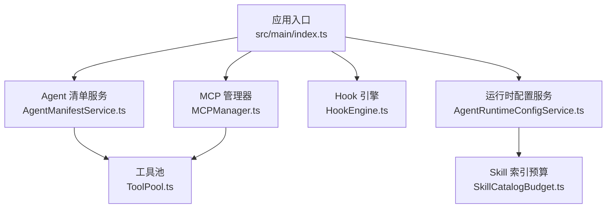
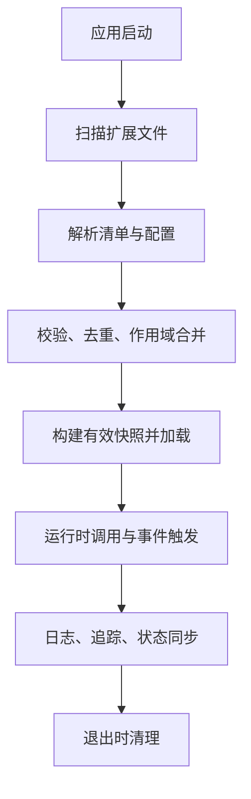
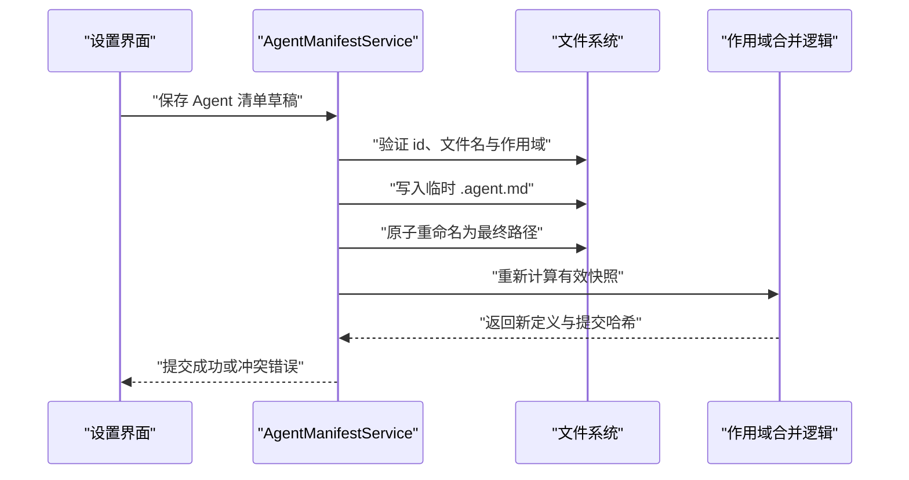
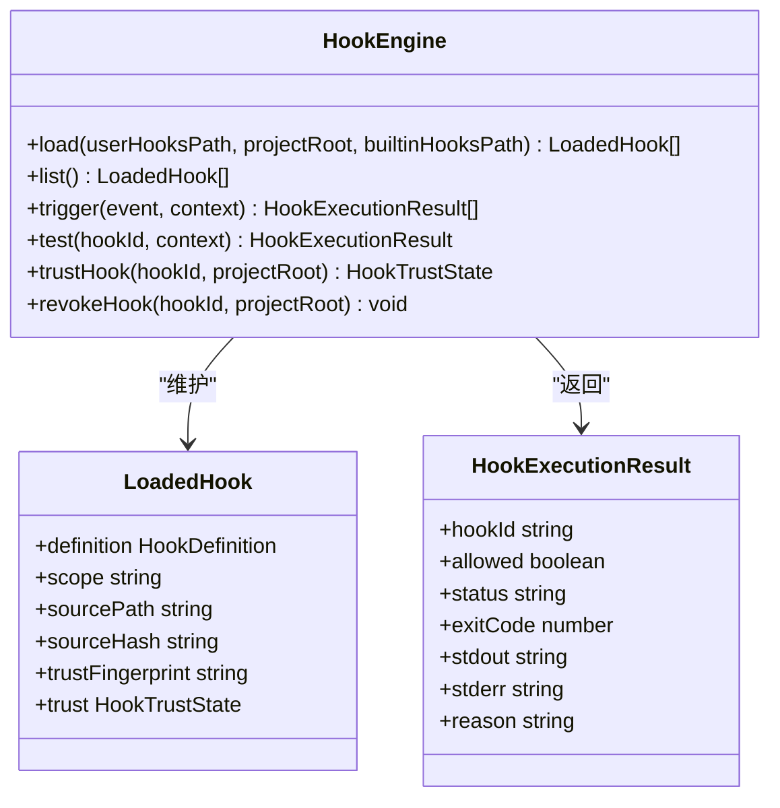
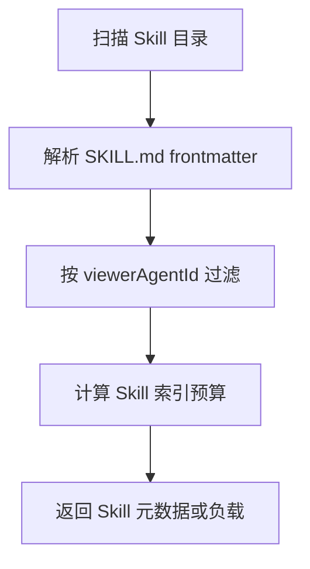
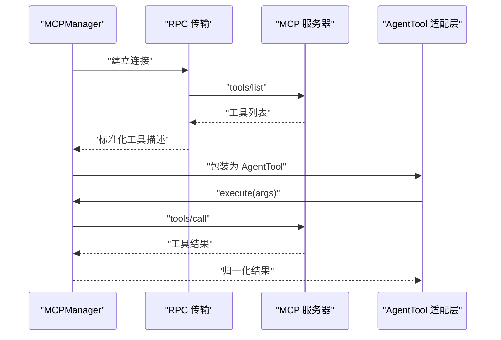
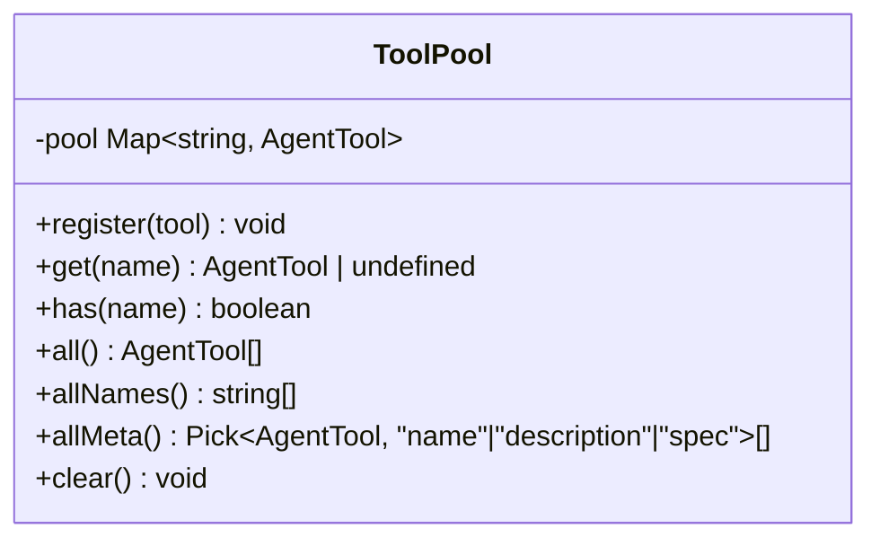
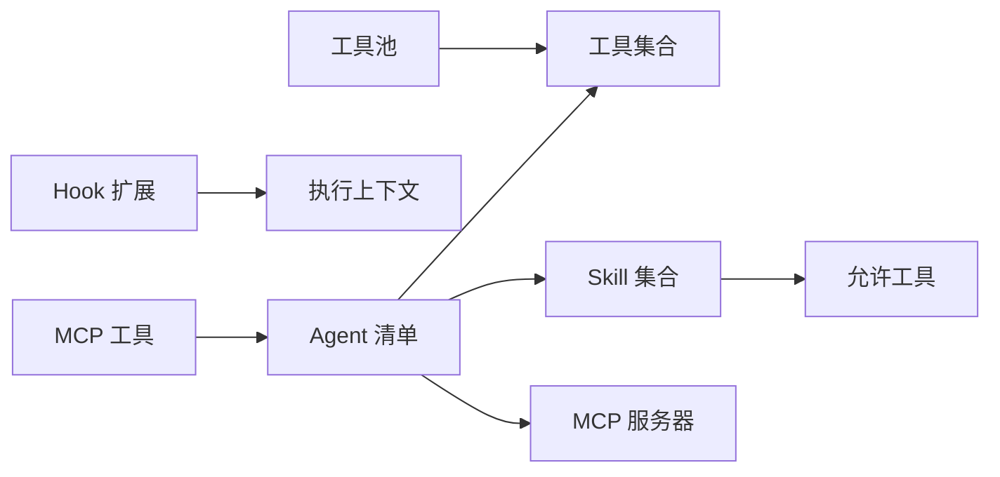

# 扩展生命周期

<cite>
**本文引用的文件**   
- [src/main/index.ts](file://src/main/index.ts)
- [src/main/settings/AgentManifestService.ts](file://src/main/settings/AgentManifestService.ts)
- [src/shared/types/agentManifest.ts](file://src/shared/types/agentManifest.ts)
- [src/main/settings/AgentRuntimeConfigService.ts](file://src/main/settings/AgentRuntimeConfigService.ts)
- [src/main/hooks/HookEngine.ts](file://src/main/hooks/HookEngine.ts)
- [src/main/agent-runtime/agent/MCPManager.ts](file://src/main/agent-runtime/agent/MCPManager.ts)
- [src/main/agent-runtime/tools/ToolPool.ts](file://src/main/agent-runtime/tools/ToolPool.ts)
- [src/main/agent-runtime/capabilities/SkillCatalogBudget.ts](file://src/main/agent-runtime/capabilities/SkillCatalogBudget.ts)
- [scripts/release/generate-checksums.mjs](file://scripts/release/generate-checksums.mjs)
- [scripts/release/verify-package.mjs](file://scripts/release/verify-package.mjs)
- [README.en.md](file://README.en.md)
</cite>

## 目录
1. [引言](#引言)
2. [项目结构](#项目结构)
3. [核心组件](#核心组件)
4. [架构总览](#架构总览)
5. [详细组件分析](#详细组件分析)
6. [依赖关系分析](#依赖关系分析)
7. [性能与资源管理](#性能与资源管理)
8. [故障排查指南](#故障排查指南)
9. [结论](#结论)
10. [附录：扩展类型与配置映射](#附录扩展类型与配置映射)

## 引言
本文面向 RDC-Agent 的“扩展”概念，围绕以下扩展形态进行统一说明：
- **Agent 清单扩展**：以 `.agent.md` 声明式 Agent 配置文件，定义模型路由、工具与技能引用。
- **Hook 扩展**：以 `.hook.yml` 声明外部命令钩子，用于审计、拦截或增强执行流程。
- **Skill 扩展**：以 `SKILL.md` 描述技能上下文、允许的工具集合和附加资源。
- **MCP 服务器扩展**：通过 MCP 协议发现并调用远程工具。
- **内置工具与运行时工具**：由 `ToolPool` 等机制注册的进程内能力。

该仓库没有传统意义上的“插件包安装器”。扩展主要体现为文件系统上的声明式资源（Agent 清单、Hook 定义、Skill 目录、MCP 描述符）以及受信任的外部进程。扩展的生命周期贯穿“发现—解析—校验—加载—运行—卸载/重载—状态同步”。

## 项目结构
与扩展生命周期直接相关的代码集中在主进程中：
- `src/main/settings/AgentManifestService.ts`：Agent 清单的发现、解析、合并、保存与路由编译。
- `src/main/settings/AgentRuntimeConfigService.ts`：Skill、MCP 描述符的发现与合并。
- `src/main/hooks/HookEngine.ts`：Hook 发现、信任指纹、执行与结果聚合。
- `src/main/agent-runtime/agent/MCPManager.ts`：MCP 服务器的连接、工具发现与调用封装。
- `src/main/agent-runtime/tools/ToolPool.ts`：进程内工具实例缓存池。
- `src/main/agent-runtime/capabilities/SkillCatalogBudget.ts`：Skill 索引预算控制。
- `src/main/index.ts`：应用启动阶段的安全策略、生命周期协调器和关键服务初始化入口。
- `scripts/release/*`：发布阶段的校验脚本，体现签名与安全基线检查。
- `README.en.md`：产品边界、安全下载和版本配对说明。

**图表来源**
- [src/main/index.ts:1-200](file://src/main/index.ts#L1-L200)
- [src/main/settings/AgentManifestService.ts:1-200](file://src/main/settings/AgentManifestService.ts#L1-L200)
- [src/main/settings/AgentRuntimeConfigService.ts:1-200](file://src/main/settings/AgentRuntimeConfigService.ts#L1-L200)
- [src/main/hooks/HookEngine.ts:1-200](file://src/main/hooks/HookEngine.ts#L1-L200)
- [src/main/agent-runtime/agent/MCPManager.ts:1-200](file://src/main/agent-runtime/agent/MCPManager.ts#L1-L200)
- [src/main/agent-runtime/tools/ToolPool.ts:1-37](file://src/main/agent-runtime/tools/ToolPool.ts#L1-L37)
- [src/main/agent-runtime/capabilities/SkillCatalogBudget.ts:1-28](file://src/main/agent-runtime/capabilities/SkillCatalogBudget.ts#L1-L28)

**章节来源**
- [src/main/index.ts:1-200](file://src/main/index.ts#L1-L200)
- [src/main/settings/AgentManifestService.ts:1-200](file://src/main/settings/AgentManifestService.ts#L1-L200)
- [src/main/settings/AgentRuntimeConfigService.ts:1-200](file://src/main/settings/AgentRuntimeConfigService.ts#L1-L200)

## 核心组件
- **Agent 清单服务**：扫描内置、用户和项目三个作用域的 `.agent.md` 文件，解析 frontmatter 与指令内容，生成有效 Agent 档案、诊断信息、模型选项和路由。
- **运行时配置服务**：扫描内置、用户和项目作用域下的 Skill 目录和 MCP 描述符，处理可见性、覆盖、信任与默认启用状态。
- **Hook 引擎**：扫描 `.hook.yml`，计算信任指纹，维护信任存储，按事件匹配并调度外部进程执行。
- **MCP 管理器**：通过 stdio 或 HTTP 连接 MCP 服务器，发现工具并包装成统一的 `AgentTool` 接口。
- **工具池**：缓存有状态工具实例，避免重复创建数据库连接、网络客户端等。
- **Skill 索引预算**：根据上下文窗口缩放注入 Skill 目录摘要，控制提示词大小。

**章节来源**
- [src/main/settings/AgentManifestService.ts:1-200](file://src/main/settings/AgentManifestService.ts#L1-L200)
- [src/main/settings/AgentRuntimeConfigService.ts:1-200](file://src/main/settings/AgentRuntimeConfigService.ts#L1-L200)
- [src/main/hooks/HookEngine.ts:1-200](file://src/main/hooks/HookEngine.ts#L1-L200)
- [src/main/agent-runtime/agent/MCPManager.ts:1-200](file://src/main/agent-runtime/agent/MCPManager.ts#L1-L200)
- [src/main/agent-runtime/tools/ToolPool.ts:1-37](file://src/main/agent-runtime/tools/ToolPool.ts#L1-L37)
- [src/main/agent-runtime/capabilities/SkillCatalogBudget.ts:1-28](file://src/main/agent-runtime/capabilities/SkillCatalogBudget.ts#L1-L28)

## 架构总览
扩展生命周期分为五层：
1. **发现层**：基于文件系统扫描 `.agent.md`、`.hook.yml`、`SKILL.md`、`.mcp.json`。
2. **解析层**：Markdown frontmatter、YAML、JSON 解析，生成结构化候选对象。
3. **校验与合并层**：ID 冲突、保留 ID、作用域优先级、信任指纹、可见性与覆盖规则。
4. **加载层**：构建有效快照、注册工具、建立 MCP 连接、加载 Skill 元数据。
5. **运行层**：工具调用、Hook 触发、MCP 工具调用、结果归一化、日志与错误传播。

**图表来源**
- [src/main/settings/AgentManifestService.ts:1-200](file://src/main/settings/AgentManifestService.ts#L1-L200)
- [src/main/settings/AgentRuntimeConfigService.ts:1-200](file://src/main/settings/AgentRuntimeConfigService.ts#L1-L200)
- [src/main/hooks/HookEngine.ts:1-200](file://src/main/hooks/HookEngine.ts#L1-L200)
- [src/main/agent-runtime/agent/MCPManager.ts:1-200](file://src/main/agent-runtime/agent/MCPManager.ts#L1-L200)

## 详细组件分析

### Agent 清单扩展：发现、配置与路由
Agent 清单是扩展的核心入口。每个 Agent 由 `.agent.md` 文件描述，包含 id、名称、描述、目标、模型列表、图标、强调色、工具、技能、MCP 服务器、其他 Agent、交接、元数据、指令等字段。清单支持“内置”“用户”“项目”三种作用域，并通过 `provenance` 记录来源路径和内容哈希。

- **发现顺序**：先加载内置 Agent，再加载用户 Agent，最后加载项目 Agent。
- **解析过程**：使用严格 Markdown 解析器读取 frontmatter 与正文，失败时会生成无效候选和诊断信息。
- **冲突解决**：相同 id 的资源由作用域优先级决定；保留历史 id 会记录诊断而非直接拒绝。
- **路由编译**：从模型列表中解析 provider 和 model，生成 `LlmAgentRoute`。
- **保存流程**：写入临时文件后原子重命名，保证编辑一致性；内置清单不可直接修改，需用户副本。

**图表来源**
- [src/main/settings/AgentManifestService.ts:200-572](file://src/main/settings/AgentManifestService.ts#L200-L572)

**章节来源**
- [src/shared/types/agentManifest.ts:1-178](file://src/shared/types/agentManifest.ts#L1-L178)
- [src/main/settings/AgentManifestService.ts:1-200](file://src/main/settings/AgentManifestService.ts#L1-L200)
- [src/main/settings/AgentManifestService.ts:200-572](file://src/main/settings/AgentManifestService.ts#L200-L572)

### Hook 扩展：信任、匹配与执行
Hook 是外部命令扩展，适合审计、安全检查、前置验证或后置报告。Hook 定义位于 `.hook.yml`，包含 id、事件、命令、参数、工作目录、环境变量、超时、失败策略和匹配条件。

- **发现范围**：内置、用户、项目三个作用域；项目 Hook 需要项目根路径。
- **信任机制**：非内置 Hook 通过“信任指纹”决定是否可信；信任存储记录 scope、owner root、hookId、指纹和时间。
- **匹配规则**：可按 agentId、toolName 过滤，未指定则宽松匹配。
- **执行模型**：通过进程监督器启动外部进程，stdin 传入 Hook 上下文，stdout/stderr 截断到固定字节数，支持超时、spawn 失败、孤儿进程等状态。
- **失败策略**：`block` 表示阻止后续流程；`warn` 仅记录警告继续执行。

**图表来源**
- [src/main/hooks/HookEngine.ts:1-200](file://src/main/hooks/HookEngine.ts#L1-L200)
- [src/main/hooks/HookEngine.ts:200-390](file://src/main/hooks/HookEngine.ts#L200-L390)

**章节来源**
- [src/main/hooks/HookEngine.ts:1-200](file://src/main/hooks/HookEngine.ts#L1-L200)
- [src/main/hooks/HookEngine.ts:200-390](file://src/main/hooks/HookEngine.ts#L200-L390)

### Skill 扩展：目录结构与预算控制
Skill 以目录形式存在，必须包含 `SKILL.md`，frontmatter 可声明 name、description、allowed-tools，正文作为 instructions。Skill 还可选 `references`、`scripts`、`assets` 子目录。

- **发现顺序**：内置 Skill → 用户 Skill → 项目 Skill。
- **可见性**：可通过 viewerAgentId 过滤，限制某些 Mission Agent 是否能看到特定 Skill。
- **预算控制**：当 Skill 目录非空时，按上下文窗口比例注入短索引，字符预算不低于下限。
- **作者视图与运行时视图**：作者视图侧重元数据展示，运行时发现保持 fail-closed 行为。

**图表来源**
- [src/main/settings/AgentRuntimeConfigService.ts:1-200](file://src/main/settings/AgentRuntimeConfigService.ts#L1-L200)
- [src/main/agent-runtime/capabilities/SkillCatalogBudget.ts:1-28](file://src/main/agent-runtime/capabilities/SkillCatalogBudget.ts#L1-L28)

**章节来源**
- [src/main/settings/AgentRuntimeConfigService.ts:1-200](file://src/main/settings/AgentRuntimeConfigService.ts#L1-L200)
- [src/main/agent-runtime/capabilities/SkillCatalogBudget.ts:1-28](file://src/main/agent-runtime/capabilities/SkillCatalogBudget.ts#L1-L28)

### MCP 扩展：协议、工具发现与生命周期
MCP 服务器通过描述符启用，支持 stdio、HTTP 和 streamable-http 三种传输。MCP 管理器负责连接、工具发现和调用。

- **配置结构**：name、type、command/args/url、env、timeoutMs。
- **环境白名单**：仅允许 PATH、SYSTEMROOT、HOME 等有限环境变量，防止泄露敏感环境。
- **工具发现**：调用 `tools/list`，将工具名统一加前缀 `mcp__{server}__{tool}`，避免命名冲突。
- **调用封装**：将 MCP 工具包装为 `AgentTool`，统一权限提示、并发性和副作用标记。
- **断开状态**：区分正常断开与孤儿进程，便于上层恢复或告警。

**图表来源**
- [src/main/agent-runtime/agent/MCPManager.ts:1-200](file://src/main/agent-runtime/agent/MCPManager.ts#L1-L200)

**章节来源**
- [src/main/agent-runtime/agent/MCPManager.ts:1-200](file://src/main/agent-runtime/agent/MCPManager.ts#L1-L200)

### 工具池：运行时管理与复用
`ToolPool` 是进程内工具实例缓存池，避免重复创建有状态工具。它提供注册、查询、枚举、元数据导出和清空能力。

- **适用场景**：数据库连接、API 客户端、会话级资源。
- **生命周期**：由上层装配器注册，Agent 运行时按需获取。
- **热更新建议**：由于是内存缓存，动态卸载应结合上层装配逻辑；若工具持有外部连接，需在替换前显式关闭。

**图表来源**
- [src/main/agent-runtime/tools/ToolPool.ts:1-37](file://src/main/agent-runtime/tools/ToolPool.ts#L1-L37)

**章节来源**
- [src/main/agent-runtime/tools/ToolPool.ts:1-37](file://src/main/agent-runtime/tools/ToolPool.ts#L1-L37)

### 应用启动与安全基线
应用入口负责 Electron 主进程初始化、渲染器安全策略、用户数据目录、浏览器 QA 隔离、关闭协调器等。扩展系统在此上下文中被间接依赖：Agent 清单、Hook、Skill、MCP、工具、会话、RDC 运行时都在应用生命周期中逐步可用。

- **渲染器安全策略**：默认禁止权限请求，生产模式禁用 unsafe-inline 和 unsafe-eval。
- **用户数据隔离**：QA 模式可创建临时用户数据目录，避免污染正式数据。
- **关闭协调器**：注册 OAuth、对话、进程、MCP、Shell、Bridge、回放等清理任务。

**章节来源**
- [src/main/index.ts:1-200](file://src/main/index.ts#L1-L200)

## 依赖关系分析
扩展之间的耦合主要体现在“声明式引用”和“运行时桥接”两个层面：
- Agent 清单引用 tools、skills、mcpServers、agents、handoffs。
- Skill 通过 allowed-tools 约束可访问工具。
- Hook 通过 matcher 限定 agentId 与 toolName。
- MCP 工具以统一前缀暴露给 Agent。
- ToolPool 作为进程内工具实例的统一容器。

**图表来源**
- [src/shared/types/agentManifest.ts:1-178](file://src/shared/types/agentManifest.ts#L1-L178)
- [src/main/settings/AgentRuntimeConfigService.ts:1-200](file://src/main/settings/AgentRuntimeConfigService.ts#L1-L200)
- [src/main/hooks/HookEngine.ts:1-200](file://src/main/hooks/HookEngine.ts#L1-L200)
- [src/main/agent-runtime/agent/MCPManager.ts:1-200](file://src/main/agent-runtime/agent/MCPManager.ts#L1-L200)
- [src/main/agent-runtime/tools/ToolPool.ts:1-37](file://src/main/agent-runtime/tools/ToolPool.ts#L1-L37)

**章节来源**
- [src/shared/types/agentManifest.ts:1-178](file://src/shared/types/agentManifest.ts#L1-L178)
- [src/main/settings/AgentRuntimeConfigService.ts:1-200](file://src/main/settings/AgentRuntimeConfigService.ts#L1-L200)
- [src/main/hooks/HookEngine.ts:1-200](file://src/main/hooks/HookEngine.ts#L1-L200)
- [src/main/agent-runtime/agent/MCPManager.ts:1-200](file://src/main/agent-runtime/agent/MCPManager.ts#L1-L200)
- [src/main/agent-runtime/tools/ToolPool.ts:1-37](file://src/main/agent-runtime/tools/ToolPool.ts#L1-L37)

## 性能与资源管理
- **Skill 索引预算**：避免把完整 Skill 目录全部注入提示词，按上下文窗口比例限制字符预算，确保 Agent 上下文不膨胀。
- **Hook 输出限制**：stdout 与 stderr 最大 64KB，避免外部命令产生巨大输出拖慢进程。
- **MCP 缓冲区限制**：RPC 传输有最大缓冲字节限制，防止恶意或异常 MCP 服务器耗尽内存。
- **工具池复用**：减少有状态工具的重建成本。
- **超时保护**：Hook 和 MCP 调用均有超时机制，避免长时间阻塞主流程。

**章节来源**
- [src/main/agent-runtime/capabilities/SkillCatalogBudget.ts:1-28](file://src/main/agent-runtime/capabilities/SkillCatalogBudget.ts#L1-L28)
- [src/main/hooks/HookEngine.ts:200-390](file://src/main/hooks/HookEngine.ts#L200-L390)
- [src/main/agent-runtime/agent/MCPManager.ts:1-200](file://src/main/agent-runtime/agent/MCPManager.ts#L1-L200)
- [src/main/agent-runtime/tools/ToolPool.ts:1-37](file://src/main/agent-runtime/tools/ToolPool.ts#L1-L37)

## 故障排查指南
- **Agent 清单无效**：检查 `.agent.md` 的 frontmatter 是否合法，id 是否安全，文件名是否与 id 一致；查看 `AGENT_MANIFEST_INVALID` 与 `AGENT_MANIFEST_SOURCE_HASH_CONFLICT` 类错误。
- **保留 id 冲突**：历史保留 id 会被诊断记录，不应作为当前 profile；必要时更换 id。
- **Hook 未被信任**：非内置 Hook 首次运行需要显式信任；指纹变化后需要重新信任。
- **Hook 超时或失败**：检查 command、args、cwd、env 是否正确；确认 failurePolicy 是 block 还是 warn。
- **Skill 不可见**：确认 viewerAgentId 是否允许该 Skill；检查 `isSkillVisibleToProfile` 相关逻辑。
- **MCP 连接失败**：检查 transport 是否受支持、命令或 URL 是否可达、环境变量是否在白名单中。
- **工具不存在**：确认工具名是否经过统一前缀处理，或是否已注册到工具池。

**章节来源**
- [src/main/settings/AgentManifestService.ts:200-572](file://src/main/settings/AgentManifestService.ts#L200-L572)
- [src/main/hooks/HookEngine.ts:200-390](file://src/main/hooks/HookEngine.ts#L200-L390)
- [src/main/settings/AgentRuntimeConfigService.ts:1-200](file://src/main/settings/AgentRuntimeConfigService.ts#L1-L200)
- [src/main/agent-runtime/agent/MCPManager.ts:1-200](file://src/main/agent-runtime/agent/MCPManager.ts#L1-L200)

## 结论
RDC-Agent 的扩展体系不是单一插件框架，而是由多类声明式扩展共同构成：
- Agent 清单提供“谁可以调用哪些模型与工具”的能力边界。
- Hook 提供“在关键执行点注入外部校验或审计”的可插拔能力。
- Skill 提供“可复用的方法论与工具集合”的知识边界。
- MCP 提供“远程工具发现与调用”的网络扩展面。
- 工具池提供“进程内工具实例复用”的性能基础。

其生命周期以“文件系统发现—结构化解析—作用域合并—信任校验—运行时加载—调用与观察”为主线。对于热重载与动态卸载，现有实现更偏向“重新扫描并重建有效快照”，而非对运行中的工具或 MCP 连接做细粒度热替换。调试、日志与性能分析主要通过 Hook 输出、MCP 调用结果、工具结果和上层工作流追踪完成。

## 附录：扩展类型与配置映射

| 扩展类型 | 发现位置 | 配置格式 | 关键属性 | 生命周期要点 |
|---|---|---|---|---|
| Agent 清单 | 内置、用户、项目作用域的 Agent 目录 | `.agent.md` Markdown frontmatter | id、models、tools、skills、mcpServers、agents、handoffs、instructions | 解析→合并→路由编译→保存→有效快照 |
| Hook | 内置、用户、项目作用域的 Hook 目录 | `.hook.yml` YAML | event、command、args、cwd、env、timeoutMs、failurePolicy、matcher | 信任指纹→匹配→进程执行→结果聚合 |
| Skill | 内置、用户、项目作用域的 Skill 目录 | `SKILL.md` Markdown frontmatter | name、description、allowed-tools、instructions | 解析→可见性过滤→索引预算→元数据或负载 |
| MCP 服务器 | 用户、项目作用域的 MCP 描述符目录 | `.mcp.json` JSON | id、transport、command/url、env、timeoutMs | 连接→tools/list→工具包装→tools/call |
| 进程内工具 | 代码中注册 | 无外部清单 | name、description、parameters、spec | 注册→缓存→按需获取→可选清理 |

**章节来源**
- [src/main/settings/AgentManifestService.ts:1-200](file://src/main/settings/AgentManifestService.ts#L1-L200)
- [src/main/settings/AgentRuntimeConfigService.ts:1-200](file://src/main/settings/AgentRuntimeConfigService.ts#L1-L200)
- [src/main/hooks/HookEngine.ts:1-200](file://src/main/hooks/HookEngine.ts#L1-L200)
- [src/main/agent-runtime/agent/MCPManager.ts:1-200](file://src/main/agent-runtime/agent/MCPManager.ts#L1-L200)
- [src/main/agent-runtime/tools/ToolPool.ts:1-37](file://src/main/agent-runtime/tools/ToolPool.ts#L1-L37)