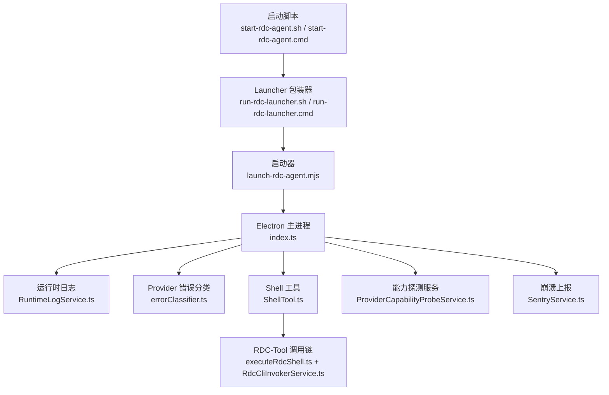
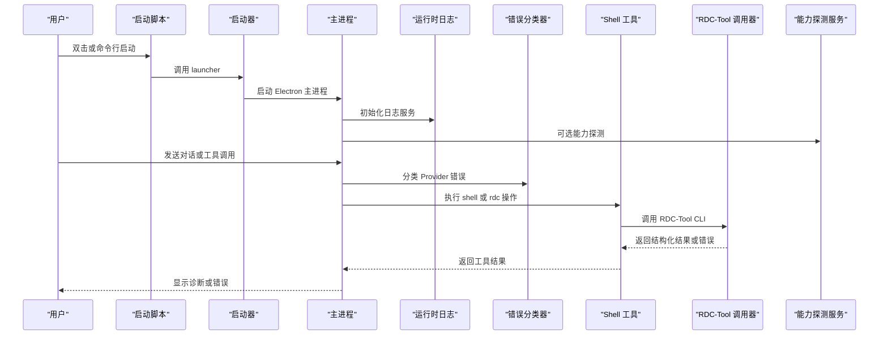
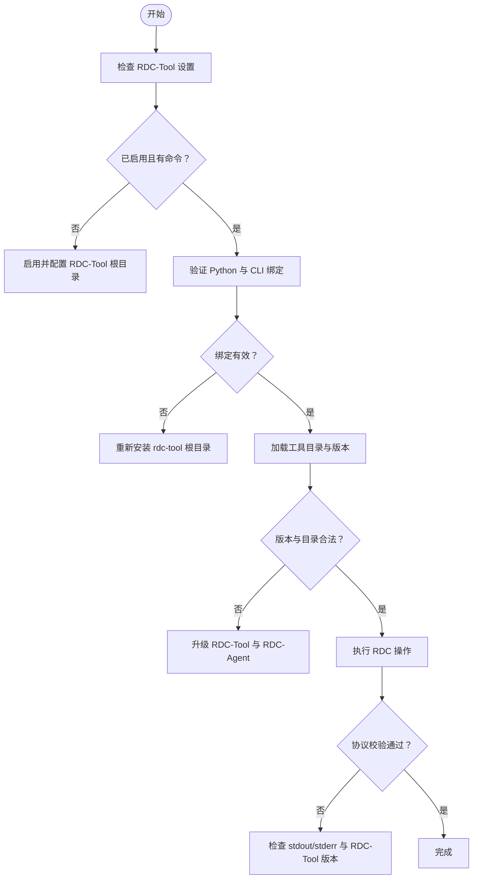
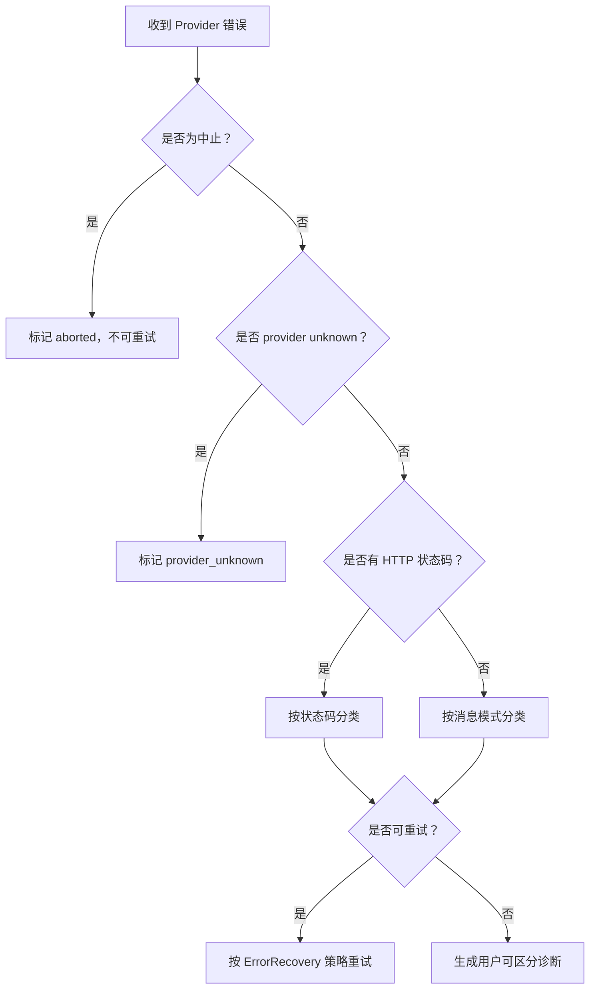
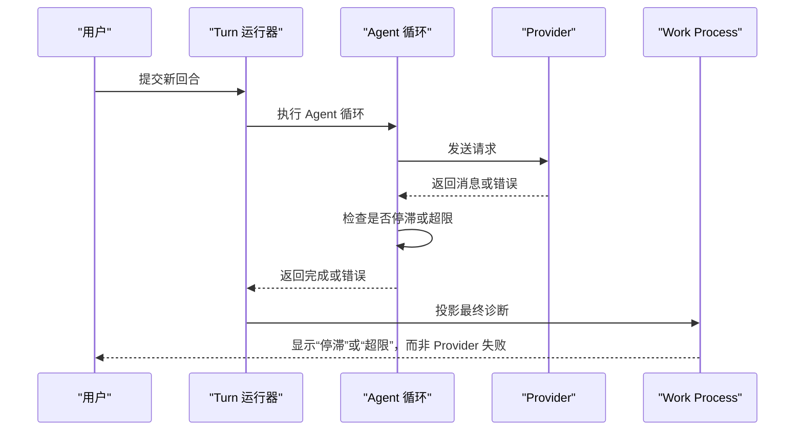
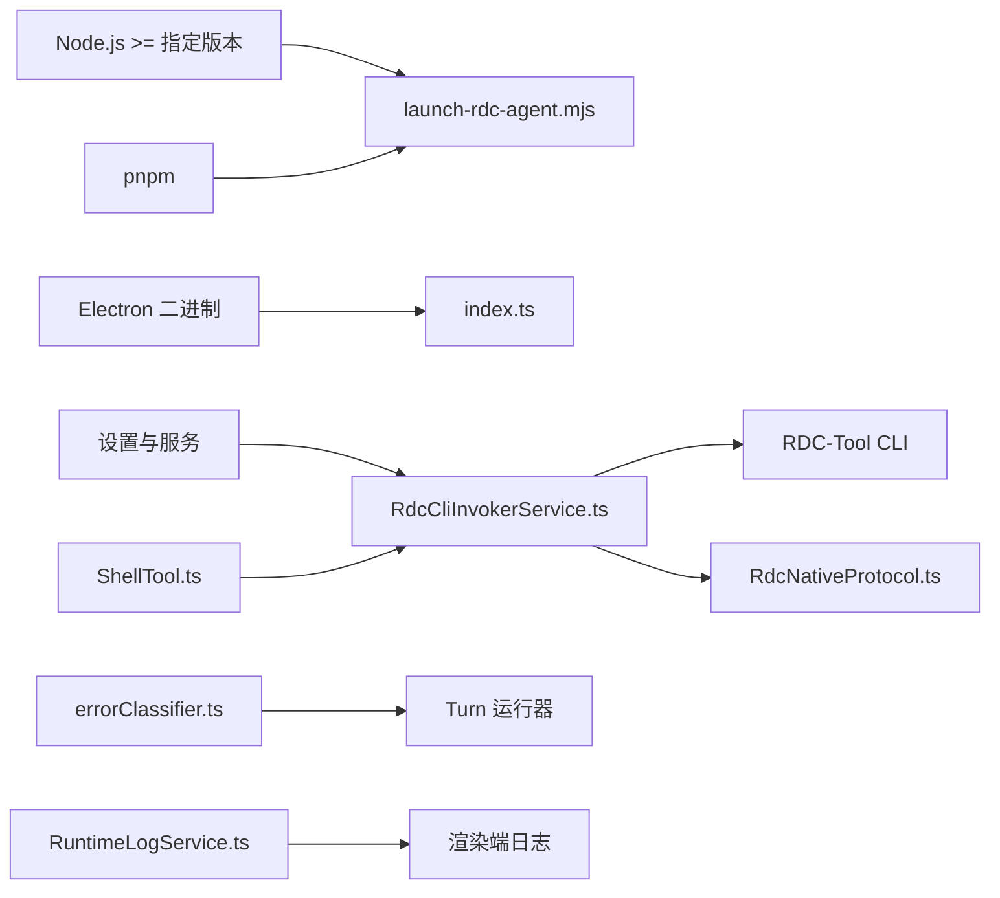

# 故障排除

<cite>
**本文引用的文件**   
- [launch-rdc-agent.mjs](file://scripts/launch-rdc-agent.mjs)
- [start-rdc-agent.sh](file://scripts/start-rdc-agent.sh)
- [start-rdc-agent.cmd](file://scripts/start-rdc-agent.cmd)
- [run-rdc-launcher.sh](file://scripts/run-rdc-launcher.sh)
- [run-rdc-launcher.cmd](file://scripts/run-rdc-launcher.cmd)
- [index.ts](file://src/main/index.ts)
- [RuntimeLogService.ts](file://src/main/runtime/RuntimeLogService.ts)
- [SentryService.ts](file://src/main/telemetry/SentryService.ts)
- [errorClassifier.ts](file://src/main/agent-runtime/providers/internal/errorClassifier.ts)
- [ShellTool.ts](file://src/main/agent-runtime/tools/primitives/ShellTool.ts)
- [executeRdcShell.ts](file://src/main/tools/executeRdcShell.ts)
- [RdcCliInvokerService.ts](file://src/main/tools/RdcCliInvokerService.ts)
- [ProviderCapabilityProbeService.ts](file://src/main/settings/ProviderCapabilityProbeService.ts)
- [failure-model.md](file://docs/contracts/failure-model.md)
- [renderdoc-agent-complete-design.md](file://docs/product/renderdoc-agent-complete-design.md)
</cite>

## 目录
1. [简介](#简介)
2. [项目结构](#项目结构)
3. [核心组件](#核心组件)
4. [架构总览](#架构总览)
5. [详细组件分析](#详细组件分析)
6. [依赖关系分析](#依赖关系分析)
7. [性能注意事项](#性能注意事项)
8. [故障排除指南](#故障排除指南)
9. [结论](#结论)
10. [附录](#附录)

## 简介
本指南面向 RDC-Agent 的安装、启动、配置、RDC-Tool 连接、Provider 认证、Agent 运行时问题及崩溃诊断。它把仓库中的失败分类、日志系统、CLI 调用器、错误分类器和 Shell 执行逻辑整合成可操作的排查流程，并给出常见错误代码含义、数据脱敏建议和报告问题时的最小证据集合。

## 项目结构
故障排除主要围绕以下路径：
- 启动器与 Node/pnpm/Electron 安装检查：`scripts/launch-rdc-agent.mjs`、`scripts/run-rdc-launcher.*`、`scripts/start-rdc-agent.*`
- 主进程入口与启动身份诊断：`src/main/index.ts`
- 运行时日志与渲染端广播：`src/main/runtime/RuntimeLogService.ts`
- Provider 错误分类与重试策略：`src/main/agent-runtime/providers/internal/errorClassifier.ts`
- Agent 命令执行与 RDC-Tool 调用：`src/main/agent-runtime/tools/primitives/ShellTool.ts`、`src/main/tools/executeRdcShell.ts`、`src/main/tools/RdcCliInvokerService.ts`
- Provider 能力探测与凭据边界：`src/main/settings/ProviderCapabilityProbeService.ts`
- 崩溃上报：`src/main/telemetry/SentryService.ts`
- 失败语义契约：`docs/contracts/failure-model.md`、`docs/product/renderdoc-agent-complete-design.md`

**图表来源**
- [start-rdc-agent.sh:1-4](file://scripts/start-rdc-agent.sh#L1-L4)
- [start-rdc-agent.cmd:1-3](file://scripts/start-rdc-agent.cmd#L1-L3)
- [run-rdc-launcher.sh:1-21](file://scripts/run-rdc-launcher.sh#L1-L21)
- [run-rdc-launcher.cmd:1-28](file://scripts/run-rdc-launcher.cmd#L1-L28)
- [launch-rdc-agent.mjs:1-200](file://scripts/launch-rdc-agent.mjs#L1-L200)
- [index.ts:723-749](file://src/main/index.ts#L723-L749)
- [RuntimeLogService.ts:1-155](file://src/main/runtime/RuntimeLogService.ts#L1-L155)
- [errorClassifier.ts:1-200](file://src/main/agent-runtime/providers/internal/errorClassifier.ts#L1-L200)
- [ShellTool.ts:1-200](file://src/main/agent-runtime/tools/primitives/ShellTool.ts#L1-L200)
- [executeRdcShell.ts:1-200](file://src/main/tools/executeRdcShell.ts#L1-L200)
- [RdcCliInvokerService.ts:1-320](file://src/main/tools/RdcCliInvokerService.ts#L1-L320)
- [ProviderCapabilityProbeService.ts:1-354](file://src/main/settings/ProviderCapabilityProbeService.ts#L1-L354)
- [SentryService.ts:1-47](file://src/main/telemetry/SentryService.ts#L1-L47)

**章节来源**
- [launch-rdc-agent.mjs:1-200](file://scripts/launch-rdc-agent.mjs#L1-L200)
- [index.ts:723-749](file://src/main/index.ts#L723-L749)
- [RuntimeLogService.ts:1-155](file://src/main/runtime/RuntimeLogService.ts#L1-L155)
- [errorClassifier.ts:1-200](file://src/main/agent-runtime/providers/internal/errorClassifier.ts#L1-L200)
- [ShellTool.ts:1-200](file://src/main/agent-runtime/tools/primitives/ShellTool.ts#L1-L200)
- [executeRdcShell.ts:1-200](file://src/main/tools/executeRdcShell.ts#L1-L200)
- [RdcCliInvokerService.ts:1-320](file://src/main/tools/RdcCliInvokerService.ts#L1-L320)
- [ProviderCapabilityProbeService.ts:1-354](file://src/main/settings/ProviderCapabilityProbeService.ts#L1-L354)
- [SentryService.ts:1-47](file://src/main/telemetry/SentryService.ts#L1-L47)
- [failure-model.md:1-137](file://docs/contracts/failure-model.md#L1-L137)
- [renderdoc-agent-complete-design.md:1-188](file://docs/product/renderdoc-agent-complete-design.md#L1-L188)

## 核心组件
- **启动器与构建流程**：校验 Node.js 版本、解析 pnpm、恢复 Electron 二进制、进入桌面或浏览器模式。Node 缺失或版本不满足时会直接退出。
- **启动身份诊断**：主进程输出版本、载体类型、应用路径、用户数据目录等信息，用于快速识别部署环境。
- **运行时日志**：统一收集应用级与会话级日志，进行敏感信息脱敏、单条大小限制和渲染端广播。
- **Provider 错误分类**：将未知 Provider 错误标准化为 `aborted`、`provider_unknown`、`rate_limit`、`network`、`auth_expired`、`stream_protocol`、`unknown` 等，并决定是否可重试。
- **Shell 工具与 RDC-Tool 调用**：安全执行命令；RDC-Tool 操作需 General turn、冻结绑定、拥有 replay session、通过协议校验和可选实验回执验证。
- **能力探测服务**：对 LLM 模型发起最小请求，记录成功、配额耗尽、鉴权失败、路由不可用等结果，避免把临时配额问题永久标记为不可用。
- **崩溃上报**：可选集成 Sentry；未安装时仅记录警告，不影响应用运行。

**章节来源**
- [launch-rdc-agent.mjs:74-112](file://scripts/launch-rdc-agent.mjs#L74-L112)
- [index.ts:183-208](file://src/main/index.ts#L183-L208)
- [RuntimeLogService.ts:1-155](file://src/main/runtime/RuntimeLogService.ts#L1-L155)
- [errorClassifier.ts:1-200](file://src/main/agent-runtime/providers/internal/errorClassifier.ts#L1-L200)
- [ShellTool.ts:1-200](file://src/main/agent-runtime/tools/primitives/ShellTool.ts#L1-L200)
- [executeRdcShell.ts:1-200](file://src/main/tools/executeRdcShell.ts#L1-L200)
- [RdcCliInvokerService.ts:1-320](file://src/main/tools/RdcCliInvokerService.ts#L1-L320)
- [ProviderCapabilityProbeService.ts:1-354](file://src/main/settings/ProviderCapabilityProbeService.ts#L1-L354)
- [SentryService.ts:1-47](file://src/main/telemetry/SentryService.ts#L1-L47)

## 架构总览
下图展示从启动到运行时关键交互，包括安装检查、日志广播、Provider 错误分类、Shell/RDC-Tool 执行和能力探测。

**图表来源**
- [start-rdc-agent.sh:1-4](file://scripts/start-rdc-agent.sh#L1-L4)
- [start-rdc-agent.cmd:1-3](file://scripts/start-rdc-agent.cmd#L1-L3)
- [run-rdc-launcher.sh:1-21](file://scripts/run-rdc-launcher.sh#L1-L21)
- [run-rdc-launcher.cmd:1-28](file://scripts/run-rdc-launcher.cmd#L1-L28)
- [launch-rdc-agent.mjs:1-200](file://scripts/launch-rdc-agent.mjs#L1-L200)
- [index.ts:723-749](file://src/main/index.ts#L723-L749)
- [RuntimeLogService.ts:1-155](file://src/main/runtime/RuntimeLogService.ts#L1-L155)
- [errorClassifier.ts:1-200](file://src/main/agent-runtime/providers/internal/errorClassifier.ts#L1-L200)
- [ShellTool.ts:1-200](file://src/main/agent-runtime/tools/primitives/ShellTool.ts#L1-L200)
- [RdcCliInvokerService.ts:1-320](file://src/main/tools/RdcCliInvokerService.ts#L1-L320)
- [ProviderCapabilityProbeService.ts:1-354](file://src/main/settings/ProviderCapabilityProbeService.ts#L1-L354)

## 详细组件分析

### 安装与启动问题
- Node.js 要求：启动器要求 Node.js 版本不低于约定版本；Windows 与 Unix 启动脚本会优先使用 `RDC_AGENT_NODE`，否则查找系统 `node` 或 Codex 内置 runtime。
- pnpm 与 Electron：启动器负责解析 pnpm、同步依赖、恢复 Electron 二进制；若 pnpm 命令失败、Electron 下载或解压失败，会直接报错。
- 启动模式：支持 `desktop`、`desktop-dev`、`browser`、`browser-dev`、`prepare-only`；非法模式会被拒绝。

常见症状与处理：
- 提示 Node.js 缺失或版本过低：安装符合要求的 Node.js，或通过 `RDC_AGENT_NODE` 指向有效 node 可执行文件。
- pnpm 安装失败：检查网络、pnpm 版本、锁文件和权限；查看启动器输出的 pnpm 命令和输出。
- Electron 无法恢复：确认 `node_modules/electron` 存在且平台匹配；必要时清理缓存后重新安装。
- 启动后立即退出：检查控制台中的 `[RDC-Agent]` 前缀输出，定位是 Node、pnpm、Electron 还是参数阶段失败。

**章节来源**
- [run-rdc-launcher.sh:1-21](file://scripts/run-rdc-launcher.sh#L1-L21)
- [run-rdc-launcher.cmd:1-28](file://scripts/run-rdc-launcher.cmd#L1-L28)
- [launch-rdc-agent.mjs:74-112](file://scripts/launch-rdc-agent.mjs#L74-L112)
- [launch-rdc-agent.mjs:204-343](file://scripts/launch-rdc-agent.mjs#L204-L343)

### 配置问题
- RDC-Tool 配置：需要在设置中启用本地 RenderDoc 工具链，选择解压后的 `rdc-tool` 根目录，而不是 `.exe`。应用会自动检测自带 Python 与 CLI。
- 旧布局拒绝：如果检测到已废弃的 RDC-Tool 安装布局，会明确提示需要按新布局安装。
- 环境变量：可通过每行 `NAME=value` 的方式设置 RDC-Tool 环境变量；未显式设置中间目录时，桌面模式使用用户资源根下的 `rdc-tool-intermediate`。

常见症状与处理：
- “RDC-Tool CLI invoker is disabled”：在设置中启用工具链。
- “RDC-Tool CLI command is not configured”：填写有效的 RDC-Tool 命令或根目录。
- “command not found”：确认绝对路径或相对工作目录下的命令存在。
- “Python and CLI must resolve inside the same installation”：不要混用不同安装源的 Python 和 CLI。
- “retired installation layout”：卸载旧布局，重新解压官方 `rdc-tool` 包并选择根目录。

**章节来源**
- [RdcCliInvokerService.ts:1-320](file://src/main/tools/RdcCliInvokerService.ts#L1-L320)
- [shellFileToolBypass.ts:57](file://src/main/agent-runtime/permissions/shellFileToolBypass.ts#L57)
- [settings.ts:12-13](file://src/renderer/i18n/locales/zh-CN/settings.ts#L12-L13)
- [onboarding.ts:48-56](file://src/renderer/i18n/locales/zh-CN/onboarding.ts#L48-L56)

### RDC-Tool 连接问题
RDC-Tool 连接涉及三层：设置绑定、CLI 调用、Native 协议。

| 问题类别 | 典型错误 | 含义 | 建议步骤 |
|---|---|---|---|
| 未配置 | `RDC-Tool CLI invoker is disabled` / `RDC-Tool CLI command is not configured` | 设置未启用或未提供命令 | 打开设置 → 工具 → 启用本地 RenderDoc 工具链 → 选择 `rdc-tool` 根目录 → 验证 |
| 命令不存在 | `RDC-Tool CLI command not found` | 配置的路径无效 | 检查绝对路径、工作目录、符号链接和权限 |
| 绑定无效 | `RDC_BINDING_INVALID` | Python 与 CLI 不在同一安装内，或使用旧布局 | 重新解压官方 `rdc-tool`，选择根目录，不使用独立 Python |
| 版本不兼容 | `RDC_UPGRADE_REQUIRED` | CLI 提供的 schema 或 tool_version 不匹配 | 同时升级 RDC-Agent 与 RDC-Tool |
| 会话绑定失效 | `RDC_EXECUTION_DENIED` | 非 General turn、缺少冻结绑定、replay session 丢失、上下文变更 | 重新准备 turn，关闭并重新打开捕获，避免跨会话复用 |
| 协议不匹配 | `RDC_CLI_PROTOCOL` | RDC-Tool 返回结果不符合预期 | 升级 RDC-Tool，检查 stdout/stderr，确认未注入二进制输出 |
| 上下文隔离 | `RDC_CONTEXT_QUARANTINED` | replay 状态不确定 | 关闭捕获并重新打开，不要继续执行 |

**图表来源**
- [RdcCliInvokerService.ts:1-320](file://src/main/tools/RdcCliInvokerService.ts#L1-L320)
- [executeRdcShell.ts:1-200](file://src/main/tools/executeRdcShell.ts#L1-L200)

**章节来源**
- [RdcCliInvokerService.ts:1-320](file://src/main/tools/RdcCliInvokerService.ts#L1-L320)
- [executeRdcShell.ts:1-200](file://src/main/tools/executeRdcShell.ts#L1-L200)

### Provider 认证与连接问题
Provider 认证和网络问题由错误分类器和服务层共同处理。

| 错误代码或状态 | 含义 | 重试策略 | 用户可见建议 |
|---|---|---|---|
| `aborted` | 请求被取消 | 不可重试 | 检查用户停止、超时、AbortSignal |
| `provider_unknown` | Provider 未找到 | 不可重试 | 检查 Provider ID 与目录 |
| `rate_limit` | 速率限制 | 可重试 | 等待配额恢复，避免重复高频请求 |
| `network` | 网络错误、500/502/503/504 | 可重试 | 检查网络、代理、防火墙 |
| `auth_expired` | 401/403 且非 scope/unconfigured | 不可重试 | 重新登录或刷新凭据 |
| `auth_scope_denied` | 401/403 且与权限范围相关 | 不可重试 | 检查账号权限和 API scope |
| `auth_unconfigured` | 401/403 且提示未配置 | 不可重试 | 补全 Provider 配置 |
| `context_overflow` | 400 且上下文溢出 | 不可重试 | 缩短上下文、减少附件或历史 |
| `request_rejected` | 400 且请求被拒绝 | 不可重试 | 修正输入或模型约束 |
| `model_source` | 404 模型不存在 | 不可重试 | 更换可用模型 |
| `stream_protocol` | Provider 流协议违规 | 不可重试 | 升级 Provider SDK 或切换模型 |
| `PROVIDER_STREAM_EMPTY` | 流结束但无 assistant 正文 | 最多重试 1 次 | 重试后仍失败则记录诊断 |
| `quota-exhausted`（能力探测） | 配额耗尽 | 短期延迟重试 | 等待 60 秒后再次探测 |

**图表来源**
- [errorClassifier.ts:1-200](file://src/main/agent-runtime/providers/internal/errorClassifier.ts#L1-L200)
- [ProviderCapabilityProbeService.ts:1-354](file://src/main/settings/ProviderCapabilityProbeService.ts#L1-L354)

**章节来源**
- [errorClassifier.ts:1-200](file://src/main/agent-runtime/providers/internal/errorClassifier.ts#L1-L200)
- [ProviderCapabilityProbeService.ts:1-354](file://src/main/settings/ProviderCapabilityProbeService.ts#L1-L354)
- [failure-model.md:60-137](file://docs/contracts/failure-model.md#L60-L137)

### Agent 运行时常见问题
- **turn 循环停滞**：当 Agent 连续三轮产生相同工具结果时，系统应判定为 `CONVERSATION_AGENT_LOOP_STALLED`，不得误报为 Provider 失败。
- **turn 次数超限**：达到最大轮次仍要求 continuation 时，应报告 `CONVERSATION_AGENT_TURN_LIMIT_EXCEEDED`，不得静默完成。
- **工具执行失败**：Shell 工具只允许一次传入 `command` 或 `rdc`；RDC-Tool 操作必须由 General turn 持有冻结绑定执行，并在队列和执行期间保持上下文所有权不变。
- **Provider 连接中断**：空流、wire 失败、HTTP 5xx、429 应按失败分类处理；最终 Work Process 只显示一条诊断，避免重复错误噪音。

**图表来源**
- [failure-model.md:85-137](file://docs/contracts/failure-model.md#L85-L137)
- [ConversationRoutePreflight.ts:506-507](file://src/main/conversation/ConversationRoutePreflight.ts#L506-L507)
- [ConversationTurnRunner.ts:523-525](file://src/main/conversation/ConversationTurnRunner.ts#L523-L525)

**章节来源**
- [failure-model.md:85-137](file://docs/contracts/failure-model.md#L85-L137)
- [ShellTool.ts:1-200](file://src/main/agent-runtime/tools/primitives/ShellTool.ts#L1-L200)
- [executeRdcShell.ts:1-200](file://src/main/tools/executeRdcShell.ts#L1-L200)

### 内存泄漏检测
仓库没有内置通用内存泄漏检测器。排查时应优先使用外部 Node/Electron 工具，并结合运行时日志和会话生命周期判断：
- 使用 Node Inspector、Chrome DevTools、Electron DevTools 抓取堆快照，比较长时间运行前后的大对象增长。
- 关注长生命周期 Map、Set、闭包引用、未释放的事件监听器、未 join 的异步任务。
- 结合 `RuntimeLogService` 的会话日志，观察会话创建/关闭是否对称。
- 对 RDC-Tool 相关对象，检查 CLI 调用器缓存、catalog 缓存、trace listeners 是否在重启或配置变化时清理。
- 注意 `MAX_ENTRY_BYTES` 日志截断机制：单条日志超过 64KB 会被压缩，原始内容可能被截断，但这不是内存泄漏的直接证据。

[本节为通用调试指导，不直接分析具体文件]

### GPU 调试问题
GPU 调试属于 RDC-Tool 与 RenderDoc 的领域问题。RDC-Agent 主要通过 Shell 工具和 RDC-Tool CLI 间接驱动原生工具，因此 GPU 调试失败通常表现为 RDC-Tool 协议错误或 native result 异常：
- 确认 RDC-Tool 能单独运行目标应用捕获。
- 检查 RDC-Tool 版本是否与 RDC-Agent 支持的契约匹配。
- 查看 RDC-Tool stderr 和 stdout，确认是否输出二进制或非 JSON 内容。
- 在 RDC-Agent 中优先使用受控 RDC 操作，而不是直接在 Shell 中执行任意 RenderDoc 命令。

[本节为通用调试指导，不直接分析具体文件]

### RenderDoc 兼容性问题
- 如果 RDC-Tool 返回非 canonical JSON、缺少 `result_kind` 或 `data`，会抛出 `RDC_CLI_PROTOCOL`。
- 如果 operation 或 replay identity 不匹配，会拒绝签发执行回执。
- 如果临时 replay 位置未能证明恢复，也会视为协议失败。
- 解决方案通常是升级 RDC-Tool、避免并发修改 capture/replay 状态、重新准备 turn，以及确保 General turn 持有正确的 lease。

**章节来源**
- [executeRdcShell.ts:160-200](file://src/main/tools/executeRdcShell.ts#L160-L200)
- [RdcNativeProtocol.ts:37-92](file://src/main/tools/RdcNativeProtocol.ts#L37-L92)

## 依赖关系分析
RDC-Agent 的排障依赖点主要集中在“外部依赖发现 → 配置校验 → 子进程执行 → 协议解析 → 错误分类”。

**图表来源**
- [launch-rdc-agent.mjs:1-200](file://scripts/launch-rdc-agent.mjs#L1-L200)
- [index.ts:723-749](file://src/main/index.ts#L723-L749)
- [RdcCliInvokerService.ts:1-320](file://src/main/tools/RdcCliInvokerService.ts#L1-L320)
- [ShellTool.ts:1-200](file://src/main/agent-runtime/tools/primitives/ShellTool.ts#L1-L200)
- [errorClassifier.ts:1-200](file://src/main/agent-runtime/providers/internal/errorClassifier.ts#L1-L200)
- [RuntimeLogService.ts:1-155](file://src/main/runtime/RuntimeLogService.ts#L1-L155)

**章节来源**
- [launch-rdc-agent.mjs:1-200](file://scripts/launch-rdc-agent.mjs#L1-L200)
- [RdcCliInvokerService.ts:1-320](file://src/main/tools/RdcCliInvokerService.ts#L1-L320)
- [ShellTool.ts:1-200](file://src/main/agent-runtime/tools/primitives/ShellTool.ts#L1-L200)
- [errorClassifier.ts:1-200](file://src/main/agent-runtime/providers/internal/errorClassifier.ts#L1-L200)
- [RuntimeLogService.ts:1-155](file://src/main/runtime/RuntimeLogService.ts#L1-L155)

## 性能注意事项
- 日志大小控制：应用日志上限约 1000 条，会话日志上限约 500 条；单条日志最大字节数有限制，字段会被截断，raw 可能只保留预览。
- Provider 流缓冲：Provider 流缓冲区有上限，协议违规不应重试。
- RDC-Tool 输出缓冲：CLI 调用默认输出缓冲上限为 8MiB，过大输出会被截断。
- 并发限制：Shell、write、task mutation、RDC/Live Capture、MCP、ask、output_register 等工具一律串行，避免并发造成 RDC 上下文冲突。
- 能力探测：配额耗尽类错误会触发短期延迟重试，避免频繁探测放大负载。

[本节为通用性能指导，不直接分析具体文件]

## 故障排除指南

### 安装问题排查清单
1. 确认操作系统和架构匹配。
2. 确认 Node.js 版本满足要求；如使用自定义 Node，设置 `RDC_AGENT_NODE`。
3. 确认 pnpm 可用；如安装失败，检查网络、pnpm 版本和锁文件。
4. 确认 Electron 二进制可恢复；必要时删除缓存后重装。
5. 检查控制台以 `[RDC-Agent]` 开头的错误输出，定位 Node、pnpm、Electron 或参数阶段失败。

**章节来源**
- [run-rdc-launcher.sh:1-21](file://scripts/run-rdc-launcher.sh#L1-L21)
- [run-rdc-launcher.cmd:1-28](file://scripts/run-rdc-launcher.cmd#L1-L28)
- [launch-rdc-agent.mjs:74-112](file://scripts/launch-rdc-agent.mjs#L74-L112)

### 配置问题排查清单
1. 打开设置面板，确认 RDC-Tool 已启用。
2. 选择解压后的 `rdc-tool` 根目录，不要选择 `.exe`。
3. 点击验证，确认 Python 与 CLI 在同一安装内。
4. 如需自定义环境变量，按每行 `NAME=value` 格式填写。
5. 若出现“retired installation layout”，重新安装官方 RDC-Tool。

**章节来源**
- [RdcCliInvokerService.ts:1-320](file://src/main/tools/RdcCliInvokerService.ts#L1-L320)
- [onboarding.ts:48-56](file://src/renderer/i18n/locales/zh-CN/onboarding.ts#L48-L56)

### RDC-Tool 连接问题排查清单
1. 确认 CLI 命令存在且可执行。
2. 确认 Python 与 CLI 来自同一 `rdc-tool` 安装。
3. 升级 RDC-Tool 与 RDC-Agent，消除 `RDC_UPGRADE_REQUIRED`。
4. 若出现 `RDC_EXECUTION_DENIED`，检查是否由 General turn 执行、是否持有冻结绑定、capture/replay 身份是否一致。
5. 若出现 `RDC_CONTEXT_QUARANTINED`，关闭并重新打开捕获。
6. 若出现 `RDC_CLI_PROTOCOL`，检查 RDC-Tool 版本、stdout/stderr 和非 JSON 输出。

**章节来源**
- [RdcCliInvokerService.ts:1-320](file://src/main/tools/RdcCliInvokerService.ts#L1-L320)
- [executeRdcShell.ts:1-200](file://src/main/tools/executeRdcShell.ts#L1-L200)

### Provider 认证问题排查清单
1. 区分认证失败、配额耗尽、网络错误、模型不存在。
2. 对于 401/403，先确认账号是否登录、scope 是否足够、配置是否完整。
3. 对于 429 或“rate limit”，等待配额恢复后再试。
4. 对于 5xx，检查网络和 Provider 状态，允许有限重试。
5. 对于 `PROVIDER_STREAM_EMPTY`，最多重试一次；仍失败则查看技术诊断。
6. 使用能力探测功能验证模型是否真正可用。

**章节来源**
- [errorClassifier.ts:1-200](file://src/main/agent-runtime/providers/internal/errorClassifier.ts#L1-L200)
- [ProviderCapabilityProbeService.ts:1-354](file://src/main/settings/ProviderCapabilityProbeService.ts#L1-L354)
- [failure-model.md:60-137](file://docs/contracts/failure-model.md#L60-L137)

### Agent 运行时问题排查清单
1. 如果看到“Agent 循环停滞”，检查是否反复调用相同工具且得到相同结果。
2. 如果看到“turn 次数超限”，检查 prompt、计划、上下文长度和工具可用性。
3. 如果工具执行失败，检查 Shell 参数、RDC-Tool 绑定、replay session 和上下文 lease。
4. 如果 Provider 连接中断，不要重复复制错误；最终 Work Process 应只展示一条诊断。

**章节来源**
- [failure-model.md:85-137](file://docs/contracts/failure-model.md#L85-L137)
- [ShellTool.ts:1-200](file://src/main/agent-runtime/tools/primitives/ShellTool.ts#L1-L200)
- [executeRdcShell.ts:1-200](file://src/main/tools/executeRdcShell.ts#L1-L200)

### 日志分析方法
- 应用日志：通过 `RuntimeLogService` 收集，包含标题、摘要、详情、原始数据和时间戳；会向渲染端广播。
- 会话日志：按 sessionId 分组，便于聚焦单个会话。
- 敏感信息脱敏：标题、摘要、详情会脱敏；raw 字段会递归脱敏；超出大小预算会被截断。
- 调试建议：
  - 复现问题时开启更细粒度日志。
  - 优先复制日志的 title、summary、detail 和 error code。
  - 不要粘贴 secret、token、API key、capture 路径中的隐私内容。
  - 如果是 Provider 问题，附带 http status、attempt count、最后状态和技术消息片段。

**章节来源**
- [RuntimeLogService.ts:1-155](file://src/main/runtime/RuntimeLogService.ts#L1-L155)
- [failure-model.md:100-137](file://docs/contracts/failure-model.md#L100-L137)

### 错误代码含义速查
| 错误代码 | 所属模块 | 含义 | 处理方向 |
|---|---|---|---|
| `RDC_EXECUTION_DENIED` | executeRdcShell | RDC 操作未被授权或上下文不符 | 检查 General turn、冻结绑定、replay session、lease |
| `RDC_CONTEXT_QUARANTINED` | executeRdcShell / RdcSessionService | replay 状态不确定 | 关闭并重新打开捕获 |
| `RDC_EVIDENCE_INVALID` | executeRdcShell / RdcValidatedEvidence | 实验证据不合法或缺少支持 | 使用支持 evidence 的操作，或移除 experimentId |
| `RDC_CLI_PROTOCOL` | RdcNativeProtocol / executeRdcShell | RDC-Tool 返回不符合协议 | 升级 RDC-Tool，检查 stdout/stderr |
| `RDC_UPGRADE_REQUIRED` | RdcCliInvokerService | CLI 版本或契约不匹配 | 升级 RDC-Tool 与 RDC-Agent |
| `STORAGE_CORRUPT` | 存储读取 | JSON/YAML 损坏或不可读 | 隔离损坏文件，恢复备份，修复 schema |
| `CONVERSATION_AGENT_LOOP_STALLED` | 对话路由/诊断 | Agent 循环停滞 | 修正 prompt、工具行为或上下文 |
| `CONVERSATION_AGENT_TURN_LIMIT_EXCEEDED` | 对话路由/诊断 | 达到最大 turn | 缩短上下文、拆分任务 |
| `PROVIDER_STREAM_EMPTY` | Provider 流 | 流结束但无正文 | 最多重试一次，仍失败则记录诊断 |

**章节来源**
- [executeRdcShell.ts:81-189](file://src/main/tools/executeRdcShell.ts#L81-L189)
- [RdcNativeProtocol.ts:37-92](file://src/main/tools/RdcNativeProtocol.ts#L37-L92)
- [RdcCliInvokerService.ts:1-320](file://src/main/tools/RdcCliInvokerService.ts#L1-L320)
- [failure-model.md:85-137](file://docs/contracts/failure-model.md#L85-L137)

### 性能瓶颈识别
- 大日志：title、summary、detail、raw 组合超过 64KB 会被截断，大量 raw 可能拖慢序列化。
- 大输出：RDC-Tool 输出缓冲默认 8MiB，超大输出会导致截断。
- 频繁 Provider 重试：429、5xx 或空流会触发重试，过多重试会放大网络压力。
- 并发滥用：非并发安全的工具不应进入并发组，尤其 RDC/Live Capture。
- 长会话历史：上下文过大可能导致 `context_overflow`，应压缩历史或拆分任务。

**章节来源**
- [RuntimeLogService.ts:1-155](file://src/main/runtime/RuntimeLogService.ts#L1-L155)
- [RdcCliInvokerService.ts:280-320](file://src/main/tools/RdcCliInvokerService.ts#L280-L320)
- [errorClassifier.ts:1-200](file://src/main/agent-runtime/providers/internal/errorClassifier.ts#L1-L200)

### 问题报告最佳实践
1. 描述现象：安装失败、启动失败、RDC-Tool 连接失败、Provider 认证失败、Agent 循环停滞等。
2. 提供环境：操作系统、RDC-Agent 版本、RDC-Tool 版本、Node 版本、部署载体。
3. 提供日志：最近 50 条应用日志或会话日志，包含时间戳和错误 code。
4. 提供最小复现：尽可能缩小到单个会话或单个 RDC-Tool 操作。
5. 提供截图：UI 错误、设置面板、控制台输出。
6. 不要上传：secret、token、API key、capture 文件、个人路径、日志中的隐私文本。

### 数据脱敏指南
- 脱敏来源：
  - RuntimeLogService 会对 title、summary、detail 做敏感文本脱敏。
  - raw 字段会递归脱敏；无法序列化的 raw 会被替换为占位。
  - Provider 恢复诊断中的技术消息片段会限制长度并脱敏。
- 人工脱敏：
  - 删除 token、secret、bearer、API key、URL query 中的凭证。
  - 隐藏用户名、邮箱、手机号、公司域名、私有路径。
  - 对 capture 路径、session id、project id 等标识符按需打码。
- 报告前检查：
  - 搜索日志中的 `secret`、`token`、`key`、`password`、`bearer`、`authorization` 等关键词。
  - 检查 raw 字段是否残留大段敏感响应。
  - 检查 RDC-Tool stderr/stdout 是否包含 capture 内部数据。

**章节来源**
- [RuntimeLogService.ts:1-155](file://src/main/runtime/RuntimeLogService.ts#L1-L155)
- [failure-model.md:100-137](file://docs/contracts/failure-model.md#L100-L137)

## 结论
RDC-Agent 的故障排除应遵循“外部依赖 → 配置 → RDC-Tool 绑定 → Provider 认证 → Agent 运行时 → 日志与上报”的顺序。安装和启动问题通常能在控制台输出中定位；RDC-Tool 问题集中在绑定、版本和协议；Provider 问题应通过错误分类区分认证、配额、网络和流协议；Agent 运行时问题要区分真实 Provider 失败与 Agent 循环停滞。报告问题时务必携带最小必要日志，并完成敏感信息脱敏。

[本节为总结性内容，不直接分析具体文件]

## 附录

### 常用命令与入口
- Windows 启动：`scripts/start-rdc-agent.cmd`
- macOS/Linux 启动：`scripts/start-rdc-agent.sh`
- 底层 Launcher：`scripts/launch-rdc-agent.mjs`
- Node 覆盖：通过 `RDC_AGENT_NODE` 指定 Node 可执行文件

**章节来源**
- [start-rdc-agent.cmd:1-3](file://scripts/start-rdc-agent.cmd#L1-L3)
- [start-rdc-agent.sh:1-4](file://scripts/start-rdc-agent.sh#L1-L4)
- [run-rdc-launcher.cmd:1-28](file://scripts/run-rdc-launcher.cmd#L1-L28)
- [run-rdc-launcher.sh:1-21](file://scripts/run-rdc-launcher.sh#L1-L21)
- [launch-rdc-agent.mjs:74-112](file://scripts/launch-rdc-agent.mjs#L74-L112)