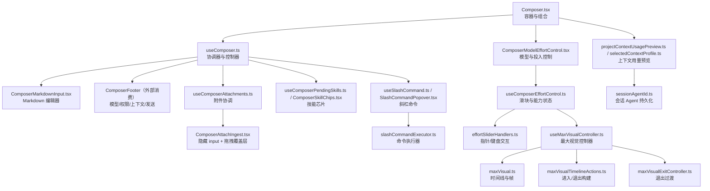
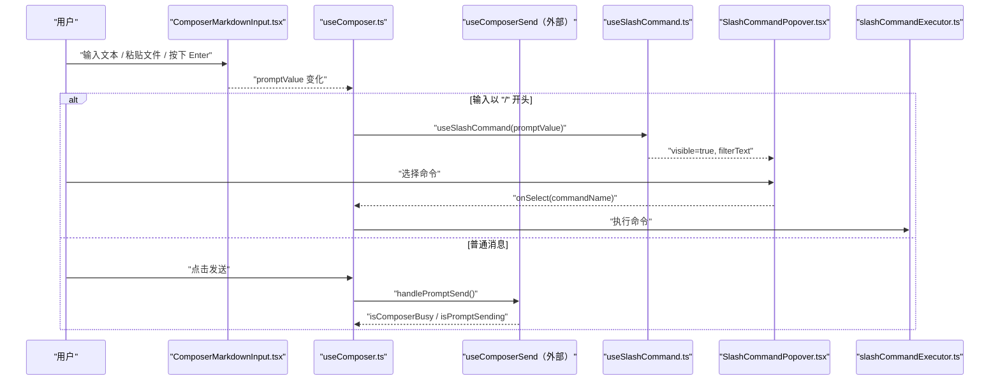
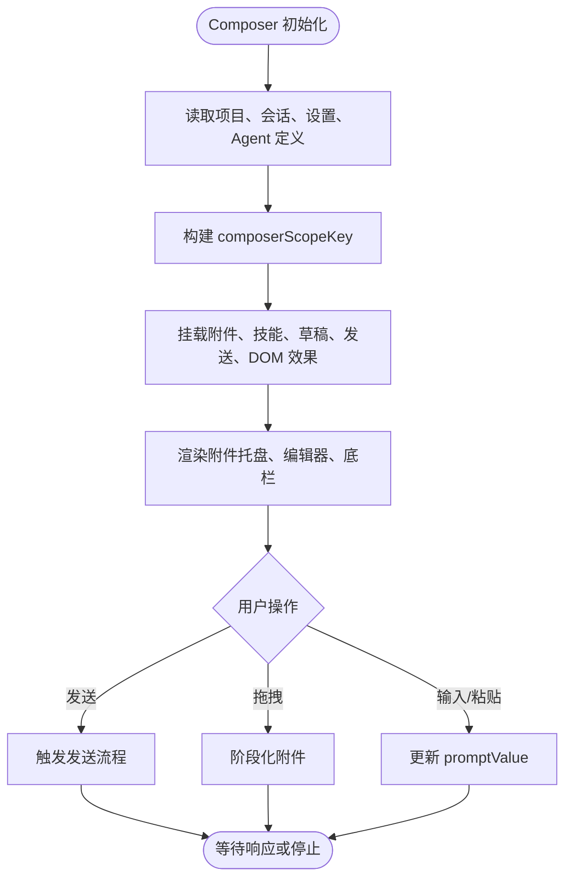
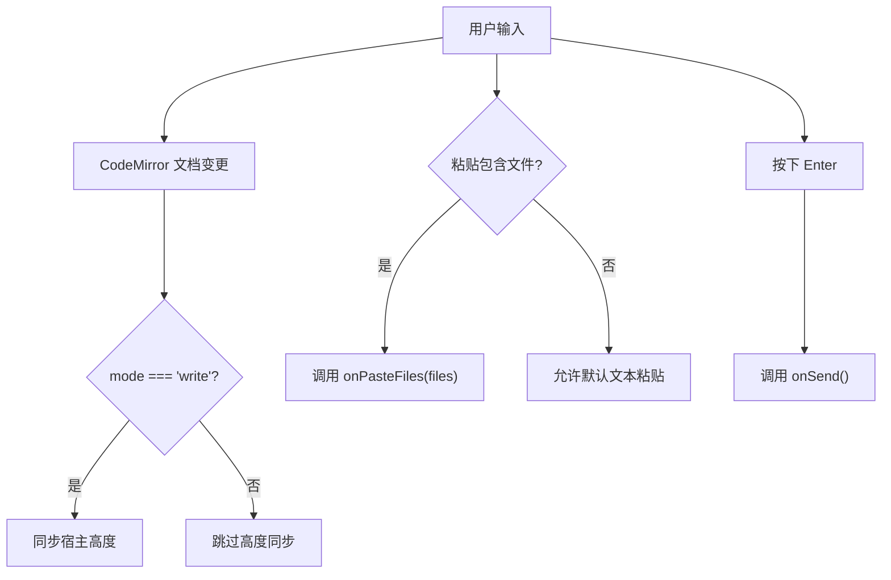
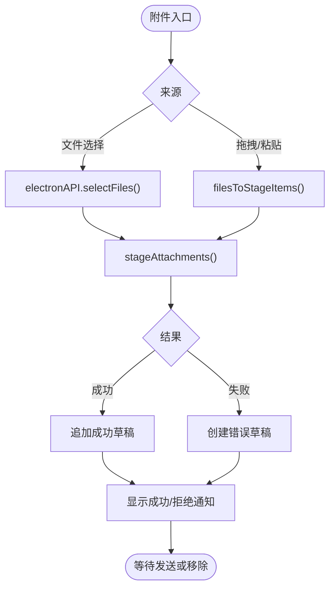
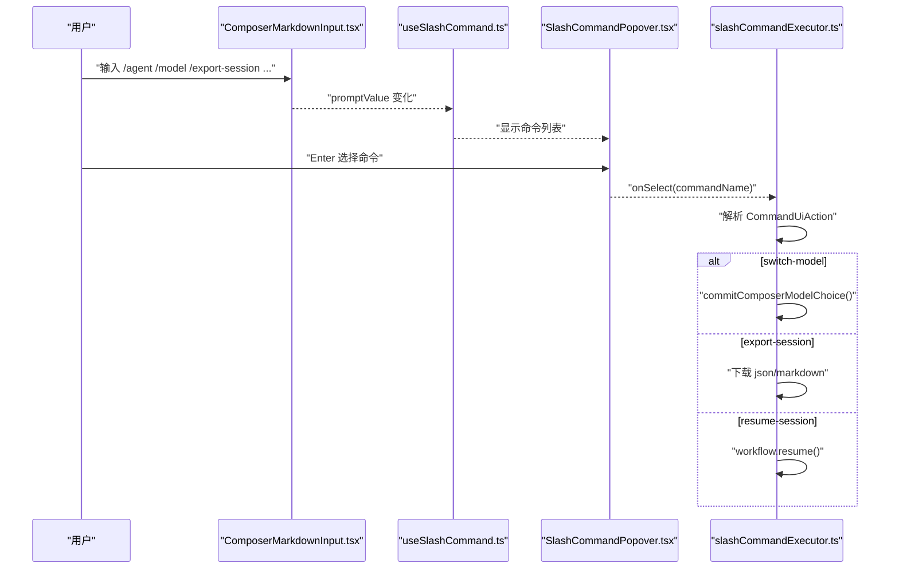
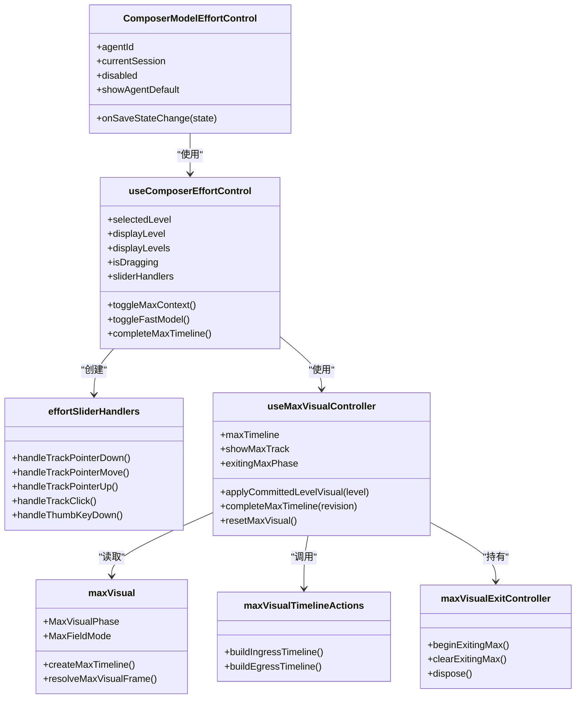
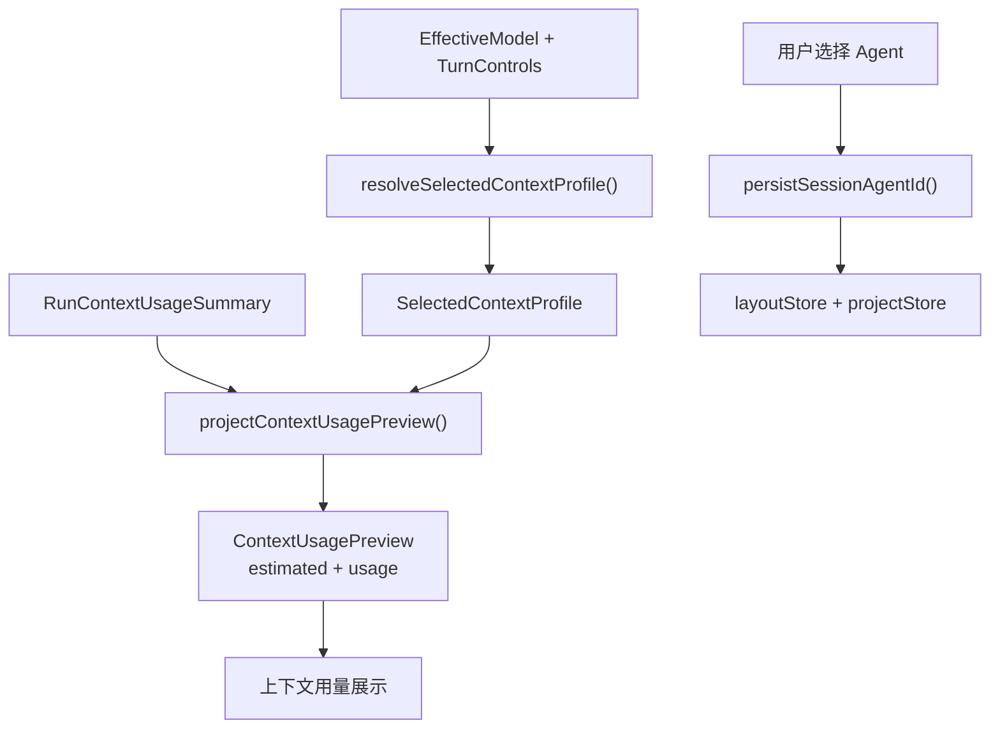
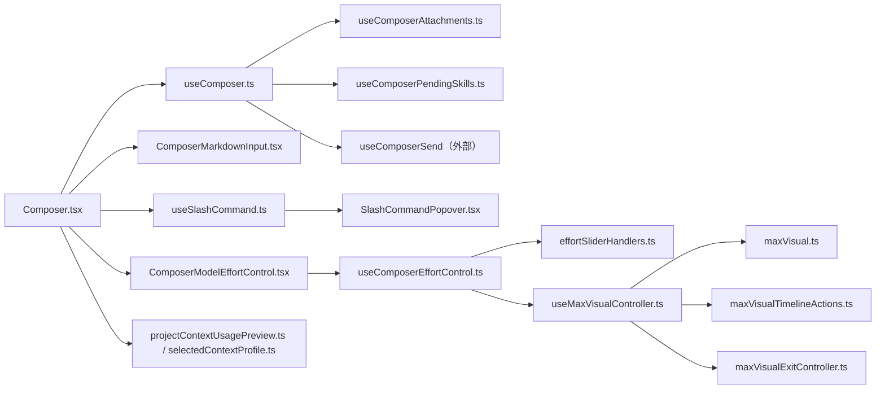

# Composer 消息输入组件

<cite>
**本文引用的文件**   
- [Composer.tsx](file://src/renderer/features/composer/Composer.tsx)
- [useComposer.ts](file://src/renderer/features/composer/useComposer.ts)
- [README.md](file://src/renderer/features/composer/README.md)
- [ComposerMarkdownInput.tsx](file://src/renderer/features/composer/ComposerMarkdownInput.tsx)
- [SlashCommandPopover.tsx](file://src/renderer/features/composer/SlashCommandPopover.tsx)
- [useSlashCommand.ts](file://src/renderer/features/composer/useSlashCommand.ts)
- [useSlashCommandAutocomplete.ts](file://src/renderer/features/composer/useSlashCommandAutocomplete.ts)
- [slashCommandExecutor.ts](file://src/renderer/features/composer/slashCommandExecutor.ts)
- [ComposerSkillChips.tsx](file://src/renderer/features/composer/ComposerSkillChips.tsx)
- [useComposerPendingSkills.ts](file://src/renderer/features/composer/useComposerPendingSkills.ts)
- [ComposerAttachIngest.tsx](file://src/renderer/features/composer/ComposerAttachIngest.tsx)
- [useComposerAttachments.ts](file://src/renderer/features/composer/useComposerAttachments.ts)
- [ComposerModelEffortControl.tsx](file://src/renderer/features/composer/ComposerModelEffortControl.tsx)
- [useComposerEffortControl.ts](file://src/renderer/features/composer/useComposerEffortControl.ts)
- [effortSliderHandlers.ts](file://src/renderer/features/composer/effortSliderHandlers.ts)
- [maxVisual.ts](file://src/renderer/features/composer/maxVisual.ts)
- [maxVisualTimelineActions.ts](file://src/renderer/features/composer/maxVisualTimelineActions.ts)
- [maxVisualExitController.ts](file://src/renderer/features/composer/maxVisualExitController.ts)
- [useMaxVisualController.ts](file://src/renderer/features/composer/useMaxVisualController.ts)
- [projectContextUsagePreview.ts](file://src/renderer/features/composer/projectContextUsagePreview.ts)
- [selectedContextProfile.ts](file://src/renderer/features/composer/selectedContextProfile.ts)
- [sessionAgentId.ts](file://src/renderer/features/composer/sessionAgentId.ts)
</cite>

## 目录
1. [简介](#简介)
2. [项目结构](#项目结构)
3. [核心组件](#核心组件)
4. [架构总览](#架构总览)
5. [详细组件分析](#详细组件分析)
6. [依赖关系分析](#依赖关系分析)
7. [性能与体验特性](#性能与体验特性)
8. [故障排查指南](#故障排查指南)
9. [结论](#结论)
10. [附录：Props、事件与样式定制](#附录props事件与样式定制)

## 简介
Composer 是 RDC Agent 渲染端的消息输入入口，负责聚合用户文本输入、Markdown 编辑、附件上传、技能选择、模型与投入控制、会话上下文用量预览以及命令斜杠系统。其设计目标是把“产品专属输入、附件、Agent 配置与运行态视觉”收敛在 `features/composer` 内，避免提升为通用 UI；同时通过受控编辑器、Hook 协调器和纯函数投影，保证草稿、发送流程、待处理请求、上下文预算和视觉动画之间的状态一致性。

该组件不是单一 React 组件，而是一个以 `Composer.tsx` 为外壳、以 `useComposer.ts` 为协调器、由多个子组件与 Hook 组合而成的功能域。

## 项目结构
Composer 功能位于 `src/renderer/features/composer`，按职责分为若干模块：

- 容器与协调层
  - `Composer.tsx`：组装附件、输入区、底栏、菜单注册表、待处理请求面板，并计算主题色与作用域键。
  - `useComposer.ts`：统一暴露 `promptValue`、附件、技能、模式、发送/停止、上下文用量等字段，对外导出 `ComposerController`。
- 输入与 Markdown
  - `ComposerMarkdownInput.tsx`：基于 CodeMirror 的 Markdown 编辑器与预览双窗格。
  - `ComposerMarkdownModeTabs.tsx`：编写/预览模式切换标签。
- 命令斜杠系统
  - `useSlashCommand.ts`、`SlashCommandPopover.tsx`：检测 `/` 前缀、显示弹出列表、键盘导航。
  - `useSlashCommandAutocomplete.ts`：轻量自动补全逻辑。
  - `slashCommandExecutor.ts`：执行 `/switch-mode`、`/switch-model`、`/export-session` 等命令。
- 附件与技能
  - `useComposerAttachments.ts`、`ComposerAttachIngest.tsx`：拖拽/粘贴/文件选择、阶段化附件、错误回退。
  - `useComposerPendingSkills.ts`、`ComposerSkillChips.tsx`：已激活技能芯片。
- 模型与投入控制
  - `ComposerModelEffortControl.tsx`、`useComposerEffortControl.ts`、`effortSliderHandlers.ts`：推理强度滑块、最大上下文轨道、快速模型开关。
  - `maxVisual.ts`、`maxVisualTimelineActions.ts`、`maxVisualExitController.ts`、`useMaxVisualController.ts`：最大视觉时间线、进入/退出控制器。
- 会话上下文配置
  - `projectContextUsagePreview.ts`、`selectedContextProfile.ts`、`useSelectedContextProfile.ts`：上下文档案与用量预览。
  - `sessionAgentId.ts`：会话级 Agent ID 持久化与客户端应用。

**图表来源**
- [Composer.tsx:1-200](file://src/renderer/features/composer/Composer.tsx#L1-L200)
- [useComposer.ts:1-196](file://src/renderer/features/composer/useComposer.ts#L1-L196)
- [ComposerMarkdownInput.tsx:1-200](file://src/renderer/features/composer/ComposerMarkdownInput.tsx#L1-L200)
- [useComposerAttachments.ts:1-189](file://src/renderer/features/composer/useComposerAttachments.ts#L1-L189)
- [useComposerPendingSkills.ts:1-47](file://src/renderer/features/composer/useComposerPendingSkills.ts#L1-L47)
- [useSlashCommand.ts:1-48](file://src/renderer/features/composer/useSlashCommand.ts#L1-L48)
- [SlashCommandPopover.tsx:1-108](file://src/renderer/features/composer/SlashCommandPopover.tsx#L1-L108)
- [slashCommandExecutor.ts:1-200](file://src/renderer/features/composer/slashCommandExecutor.ts#L1-L200)
- [ComposerModelEffortControl.tsx:1-194](file://src/renderer/features/composer/ComposerModelEffortControl.tsx#L1-L194)
- [useComposerEffortControl.ts:1-164](file://src/renderer/features/composer/useComposerEffortControl.ts#L1-L164)
- [effortSliderHandlers.ts:1-98](file://src/renderer/features/composer/effortSliderHandlers.ts#L1-L98)
- [useMaxVisualController.ts:1-170](file://src/renderer/features/composer/useMaxVisualController.ts#L1-L170)
- [maxVisual.ts:1-200](file://src/renderer/features/composer/maxVisual.ts#L1-L200)
- [maxVisualTimelineActions.ts:1-66](file://src/renderer/features/composer/maxVisualTimelineActions.ts#L1-L66)
- [maxVisualExitController.ts:1-74](file://src/renderer/features/composer/maxVisualExitController.ts#L1-L74)
- [projectContextUsagePreview.ts:1-68](file://src/renderer/features/composer/projectContextUsagePreview.ts#L1-L68)
- [selectedContextProfile.ts:1-59](file://src/renderer/features/composer/selectedContextProfile.ts#L1-L59)
- [sessionAgentId.ts:1-46](file://src/renderer/features/composer/sessionAgentId.ts#L1-L46)

**章节来源**
- [README.md:1-24](file://src/renderer/features/composer/README.md#L1-L24)

## 核心组件
Composer 的核心不是单个类，而是“组件 + Hook + 纯函数”的组合：

| 层级 | 主要职责 | 关键文件 |
|---|---|---|
| 容器层 | 组合附件、输入、底栏、菜单、待处理请求，计算作用域与主题色 | `Composer.tsx` |
| 协调层 | 提供 `promptValue`、附件、技能、模式、发送/停止、上下文用量、占位符、按钮状态 | `useComposer.ts` |
| 输入层 | Markdown 编辑、预览、粘贴文件、Enter 发送、IME 兼容 | `ComposerMarkdownInput.tsx` |
| 命令层 | 斜杠检测、弹出选择、自动补全、命令执行 | `useSlashCommand.ts`、`SlashCommandPopover.tsx`、`slashCommandExecutor.ts` |
| 附件层 | 拖拽/粘贴/文件选择、阶段化、上限校验、错误提示 | `useComposerAttachments.ts`、`ComposerAttachIngest.tsx` |
| 技能层 | 已激活技能列表、移除、去重 | `useComposerPendingSkills.ts`、`ComposerSkillChips.tsx` |
| 投入控制层 | 推理强度滑块、最大上下文、快速模型、能力状态、视觉时间线 | `ComposerModelEffortControl.tsx`、`useComposerEffortControl.ts`、`effortSliderHandlers.ts` |
| 最大视觉层 | 最大视觉相位、能量曲线、进入/退出控制器 | `maxVisual.ts`、`maxVisualTimelineActions.ts`、`maxVisualExitController.ts`、`useMaxVisualController.ts` |
| 上下文层 | 上下文档案解析、用量预估、会话 Agent ID 持久化 | `projectContextUsagePreview.ts`、`selectedContextProfile.ts`、`sessionAgentId.ts` |

**章节来源**
- [Composer.tsx:1-200](file://src/renderer/features/composer/Composer.tsx#L1-L200)
- [useComposer.ts:1-196](file://src/renderer/features/composer/useComposer.ts#L1-L196)

## 架构总览
Composer 的控制流围绕三个主线展开：

1. **输入与发送主线**  
   用户在 `ComposerMarkdownInput.tsx` 中输入文本或附件 → `useComposer.ts` 计算是否可发送 → 底栏触发发送或停止。
2. **命令斜杠主线**  
   用户输入 `/` → `useSlashCommand.ts` 显示弹出层 → 选择命令后调用 `slashCommandExecutor.ts` → 修改 Agent、模型、主题、权限、会话历史等。
3. **投入控制与最大视觉主线**  
   打开模型/投入面板 → `useComposerEffortControl.ts` 计算推理级别、滑块位置、最大上下文轨道 → `useMaxVisualController.ts` 驱动最大视觉时间线 → 提交后更新 `turnControls`。

**图表来源**
- [ComposerMarkdownInput.tsx:1-200](file://src/renderer/features/composer/ComposerMarkdownInput.tsx#L1-L200)
- [useComposer.ts:1-196](file://src/renderer/features/composer/useComposer.ts#L1-L196)
- [useSlashCommand.ts:1-48](file://src/renderer/features/composer/useSlashCommand.ts#L1-L48)
- [SlashCommandPopover.tsx:1-108](file://src/renderer/features/composer/SlashCommandPopover.tsx#L1-L108)
- [slashCommandExecutor.ts:1-200](file://src/renderer/features/composer/slashCommandExecutor.ts#L1-L200)

## 详细组件分析

### Composer 容器与协调器
`Composer.tsx` 是功能入口，负责：

- 从 `useComposer.ts` 解构 `promptValue`、附件、技能、模式、发送/停止、上下文用量等。
- 根据当前项目与会话生成 `composerScopeKey`，用于隔离草稿、附件和技能状态。
- 挂载 `ComposerMenuRegistryProvider`，并在计划审阅请求时重新挂载，防止旧会话菜单、焦点和 Effort 生命周期延续。
- 注入拖拽附件、Vision 能力判断、Markdown 模式标签、附件托盘、编辑器与底栏。
- 将主题 accent 变量、最小/最大高度 CSS 变量传递给宿主壳层。

`useComposer.ts` 则承担更多业务编排：

- 同步会话中的 Agent，加载设置，过滤用户可调用 Agent。
- 使用 `useScopedPromptDraft` 隔离项目与会话级别的草稿。
- 合并附件、技能、发送 Hook、DOM 效果、排队转交建议。
- 构造 `currentModeConfig`，支持内置模式和自定义 Agent 模式。
- 返回统一的 `ComposerController`，供 `Composer.tsx` 消费。

**图表来源**
- [Composer.tsx:1-200](file://src/renderer/features/composer/Composer.tsx#L1-L200)
- [useComposer.ts:1-196](file://src/renderer/features/composer/useComposer.ts#L1-L196)

**章节来源**
- [Composer.tsx:1-200](file://src/renderer/features/composer/Composer.tsx#L1-L200)
- [useComposer.ts:1-196](file://src/renderer/features/composer/useComposer.ts#L1-L196)
- [README.md:1-24](file://src/renderer/features/composer/README.md#L1-L24)

### Markdown 编辑模式
`ComposerMarkdownInput.tsx` 是一个受控编辑器，核心行为如下：

- 使用 CodeMirror 的 Markdown 语言扩展。
- 提供“编写”和“预览”两个 Pane，由父组件通过 `markdownMode` 控制。
- 编辑器模式下监听文档变更并同步宿主高度。
- 粘贴事件中优先提取 `File`，如果存在文件则阻止默认文本粘贴并交给上层处理。
- 绑定最高优先级的 `Enter` 快捷键触发 `onSend`。
- 支持禁用态和 placeholder。

注意：Composer 容器的 IME 确认与 Shift+Enter 不发送行为由 `useComposer.ts` 与发送 Hook 负责，而不是由 Markdown 输入直接实现。

**图表来源**
- [ComposerMarkdownInput.tsx:1-200](file://src/renderer/features/composer/ComposerMarkdownInput.tsx#L1-L200)

**章节来源**
- [ComposerMarkdownInput.tsx:1-200](file://src/renderer/features/composer/ComposerMarkdownInput.tsx#L1-L200)

### 附件上传处理
附件处理由 `useComposerAttachments.ts` 主导，`ComposerAttachIngest.tsx` 提供隐藏 `<input>` 和拖拽覆盖层：

- 使用 `buildComposerSessionScopeKey` 按项目与会话隔离待上传附件。
- 切换作用域时释放上一个作用域的 staging attachment。
- 调用 `electronAPI.conversation.stageAttachments` 进行阶段化。
- 超过最大数量时使用 `ATTACHMENT_LIMIT_EXCEEDED` 错误码创建本地失败草稿。
- 成功时展示计数通知，失败时展示拒绝原因。
- 支持浏览器 App 中直接使用 DOM File API，其他平台走 Electron 文件选择。
- 移除附件时会释放对应 staging ID。

**图表来源**
- [useComposerAttachments.ts:1-189](file://src/renderer/features/composer/useComposerAttachments.ts#L1-L189)
- [ComposerAttachIngest.tsx:1-28](file://src/renderer/features/composer/ComposerAttachIngest.tsx#L1-L28)

**章节来源**
- [useComposerAttachments.ts:1-189](file://src/renderer/features/composer/useComposerAttachments.ts#L1-L189)
- [ComposerAttachIngest.tsx:1-28](file://src/renderer/features/composer/ComposerAttachIngest.tsx#L1-L28)

### 技能选择芯片
技能芯片由 `useComposerPendingSkills.ts` 管理状态，`ComposerSkillChips.tsx` 负责展示：

- 使用项目与会话作用域键隔离已激活技能。
- `armPendingSkill` 去重添加技能 ID。
- `removePendingSkill` 按 ID 移除。
- 空列表时不渲染。
- 每个芯片显示 SKL 标识、技能名称、元数据标签和关闭按钮。

最佳实践：
- 仅对有效且非空的技能 ID 调用 `armPendingSkill`。
- 发送成功后由外层清理已使用的技能，避免跨会话污染。

**章节来源**
- [useComposerPendingSkills.ts:1-47](file://src/renderer/features/composer/useComposerPendingSkills.ts#L1-L47)
- [ComposerSkillChips.tsx:1-38](file://src/renderer/features/composer/ComposerSkillChips.tsx#L1-L38)

### 命令斜杠系统与命令执行器
斜杠命令系统分为三层：

1. **检测与弹出**  
   `useSlashCommand.ts` 检测 `promptValue` 是否以 `/` 开头，并限制最多 40 字符时显示弹出层。`SlashCommandPopover.tsx` 通过 `window.electronAPI.command.list()` 获取命令列表，并按名称或别名过滤，支持上下箭头、Enter、Escape 导航。

2. **自动补全**  
   `useSlashCommandAutocomplete.ts` 提供更轻量的斜杠模式状态，包括 `checkSlashTrigger`、`selectCommand`、`dismissSlash`，适合需要自己渲染命令列表的场景。

3. **命令执行器**  
   `slashCommandExecutor.ts` 接收命令动作，支持以下关键能力：
   - 打开设置页。
   - 切换 Agent 模式。
   - 切换模型，包括“Agent 默认”与具体模型选择。
   - 切换主题与权限模式。
   - 恢复会话、导出会话为 JSON 或 Markdown、撤销最后一个回合。

**图表来源**
- [useSlashCommand.ts:1-48](file://src/renderer/features/composer/useSlashCommand.ts#L1-L48)
- [SlashCommandPopover.tsx:1-108](file://src/renderer/features/composer/SlashCommandPopover.tsx#L1-L108)
- [slashCommandExecutor.ts:1-200](file://src/renderer/features/composer/slashCommandExecutor.ts#L1-L200)

**章节来源**
- [useSlashCommand.ts:1-48](file://src/renderer/features/composer/useSlashCommand.ts#L1-L48)
- [SlashCommandPopover.tsx:1-108](file://src/renderer/features/composer/SlashCommandPopover.tsx#L1-L108)
- [useSlashCommandAutocomplete.ts:1-37](file://src/renderer/features/composer/useSlashCommandAutocomplete.ts#L1-L37)
- [slashCommandExecutor.ts:1-200](file://src/renderer/features/composer/slashCommandExecutor.ts#L1-L200)

### 投入控制滑块与最大视觉
投入控制由 `ComposerModelEffortControl.tsx` 作为入口，内部委托 `useComposerEffortControl.ts` 处理交互、能力状态、滑块几何与最大视觉控制器。

关键点：

- **推理强度滑块**  
  `useComposerEffortControl.ts` 根据 `reasoningControl` 构建可选级别，并将拖拽比率映射到最近的可吸附级别。`effortSliderHandlers.ts` 封装指针拖拽、点击、键盘方向键操作。
- **最大上下文轨道**  
  当选中 `max` 级别时，启用最大视觉轨道。`useMaxVisualController.ts` 维护 `MaxVisualTimeline`，并根据 `open`、`isDragging`、`displayLevel`、`selectedLevel` 决定进入、活跃、退出相位。
- **时间线操作**  
  `maxVisualTimelineActions.ts` 负责构建 ingress 与 egress 时间线，区分 `propagate` 与 `dissolve` 场模式，并计算能量、进度、停止透明度。
- **退出控制器**  
  `maxVisualExitController.ts` 实现“hold + settle”过渡：先冻结一帧保持最大颜色，再启用 CSS 过渡回到普通填充，最后超时清除。

**图表来源**
- [ComposerModelEffortControl.tsx:1-194](file://src/renderer/features/composer/ComposerModelEffortControl.tsx#L1-L194)
- [useComposerEffortControl.ts:1-164](file://src/renderer/features/composer/useComposerEffortControl.ts#L1-L164)
- [effortSliderHandlers.ts:1-98](file://src/renderer/features/composer/effortSliderHandlers.ts#L1-L98)
- [useMaxVisualController.ts:1-170](file://src/renderer/features/composer/useMaxVisualController.ts#L1-L170)
- [maxVisual.ts:1-200](file://src/renderer/features/composer/maxVisual.ts#L1-L200)
- [maxVisualTimelineActions.ts:1-66](file://src/renderer/features/composer/maxVisualTimelineActions.ts#L1-L66)
- [maxVisualExitController.ts:1-74](file://src/renderer/features/composer/maxVisualExitController.ts#L1-L74)

**章节来源**
- [ComposerModelEffortControl.tsx:1-194](file://src/renderer/features/composer/ComposerModelEffortControl.tsx#L1-L194)
- [useComposerEffortControl.ts:1-164](file://src/renderer/features/composer/useComposerEffortControl.ts#L1-L164)
- [effortSliderHandlers.ts:1-98](file://src/renderer/features/composer/effortSliderHandlers.ts#L1-L98)
- [useMaxVisualController.ts:1-170](file://src/renderer/features/composer/useMaxVisualController.ts#L1-L170)
- [maxVisual.ts:1-200](file://src/renderer/features/composer/maxVisual.ts#L1-L200)
- [maxVisualTimelineActions.ts:1-66](file://src/renderer/features/composer/maxVisualTimelineActions.ts#L1-L66)
- [maxVisualExitController.ts:1-74](file://src/renderer/features/composer/maxVisualExitController.ts#L1-L74)

### 会话上下文配置
Composer 的会话上下文配置围绕“选中的上下文档案”和“用量预览”展开：

- **上下文档案选择**  
  `useSelectedContextProfile.ts` 从 `turnControlsStore` 和 `appSettingsStore` 中解析能力、控制和压缩阈值，调用 `resolveSelectedContextProfile` 得到 `SelectedContextProfile`。
- **用量预览**  
  `projectContextUsagePreview.ts` 判断当前实际用量是否与所选档案一致；不一致时按比例重算 `usagePercent` 和 breakdown，生成估计用量。
- **会话代理 ID 解析**  
  `sessionAgentId.ts` 暴露 `persistSessionAgentId`，将 Agent ID 持久化到 Electron session，并回写布局 store；同时支持 `applyDeclaredHandoffOnClient` 处理声明式交接。

**图表来源**
- [selectedContextProfile.ts:1-59](file://src/renderer/features/composer/selectedContextProfile.ts#L1-L59)
- [projectContextUsagePreview.ts:1-68](file://src/renderer/features/composer/projectContextUsagePreview.ts#L1-L68)
- [sessionAgentId.ts:1-46](file://src/renderer/features/composer/sessionAgentId.ts#L1-L46)

**章节来源**
- [useSelectedContextProfile.ts:1-19](file://src/renderer/features/composer/useSelectedContextProfile.ts#L1-L19)
- [selectedContextProfile.ts:1-59](file://src/renderer/features/composer/selectedContextProfile.ts#L1-L59)
- [projectContextUsagePreview.ts:1-68](file://src/renderer/features/composer/projectContextUsagePreview.ts#L1-L68)
- [sessionAgentId.ts:1-46](file://src/renderer/features/composer/sessionAgentId.ts#L1-L46)

## 依赖关系分析
Composer 的依赖呈现“容器薄、Hook 厚、纯函数稳”的特征：

- 容器组件尽量不直接读写复杂 store，而是通过 `useComposer.ts` 暴露的控制器字段。
- 附件、技能、草稿、发送、DOM 效果都拆成独立 Hook，降低耦合。
- 上下文用量、最大视觉时间线、模型选择等核心算法放在纯函数或 Hook 中，便于测试。
- 命令执行器集中访问 `electronAPI`，避免 UI 层散落 IPC 调用。

**图表来源**
- [Composer.tsx:1-200](file://src/renderer/features/composer/Composer.tsx#L1-L200)
- [useComposer.ts:1-196](file://src/renderer/features/composer/useComposer.ts#L1-L196)
- [useComposerAttachments.ts:1-189](file://src/renderer/features/composer/useComposerAttachments.ts#L1-L189)
- [useComposerPendingSkills.ts:1-47](file://src/renderer/features/composer/useComposerPendingSkills.ts#L1-L47)
- [useSlashCommand.ts:1-48](file://src/renderer/features/composer/useSlashCommand.ts#L1-L48)
- [SlashCommandPopover.tsx:1-108](file://src/renderer/features/composer/SlashCommandPopover.tsx#L1-L108)
- [ComposerModelEffortControl.tsx:1-194](file://src/renderer/features/composer/ComposerModelEffortControl.tsx#L1-L194)
- [useComposerEffortControl.ts:1-164](file://src/renderer/features/composer/useComposerEffortControl.ts#L1-L164)
- [effortSliderHandlers.ts:1-98](file://src/renderer/features/composer/effortSliderHandlers.ts#L1-L98)
- [useMaxVisualController.ts:1-170](file://src/renderer/features/composer/useMaxVisualController.ts#L1-L170)
- [maxVisual.ts:1-200](file://src/renderer/features/composer/maxVisual.ts#L1-L200)
- [maxVisualTimelineActions.ts:1-66](file://src/renderer/features/composer/maxVisualTimelineActions.ts#L1-L66)
- [maxVisualExitController.ts:1-74](file://src/renderer/features/composer/maxVisualExitController.ts#L1-L74)
- [projectContextUsagePreview.ts:1-68](file://src/renderer/features/composer/projectContextUsagePreview.ts#L1-L68)
- [selectedContextProfile.ts:1-59](file://src/renderer/features/composer/selectedContextProfile.ts#L1-L59)

## 性能与体验特性
- **草稿与作用域隔离**：附件、技能、草稿均按项目与会话作用域键隔离，避免跨会话状态泄漏。
- **拖动与帧调度**：滑块拖动使用 `requestAnimationFrame` 队列 pending ratio，减少频繁 setState 带来的重绘压力。
- **最大视觉优化**：仅在满足“solid handoff eligible”条件时才启用 hold+settle 过渡，避免短暂拖拽造成卡顿。
- **可见性保护**：文档隐藏时重置最大视觉时间线，避免后台渲染消耗资源。
- **附件限制**：超过最大附件数时立即创建本地错误草稿并提示，避免长时间阻塞。
- **IME 与快捷键**：Markdown 编辑器通过 CodeMirror 扩展处理粘贴与 Enter，Composer 容器层面保留 IME 确认与 Shift+Enter 不发送的业务约定。

[本节为通用指导，不直接分析具体代码片段]

## 故障排查指南
常见问题和定位方式：

| 现象 | 可能原因 | 排查位置 |
|---|---|---|
| 附件上传失败 | 超出最大数量、Electron API 不可用、文件无效 | `useComposerAttachments.ts` 的错误分支与通知 |
| 附件随会话切换残留 | 作用域 key 变化未释放 staging ID | `useComposerAttachments.ts` 的作用域切换 effect |
| 斜杠命令无响应 | `window.electronAPI.command` 不可用、命令名称不匹配 | `SlashCommandPopover.tsx`、`useSlashCommand.ts` |
| 模型切换无效 | 模型 ID 无效、保存失败、Agent 默认不可用 | `slashCommandExecutor.ts` 的 `switchModel` |
| 投入滑块无响应 | 能力状态未知、推理级别锁定、无可选级别 | `useComposerEffortControl.ts`、`effortSliderHandlers.ts` |
| 最大视觉异常闪烁 | 页面隐藏、拖拽未完成、退出过渡被中断 | `useMaxVisualController.ts`、`maxVisualExitController.ts` |
| 上下文用量不更新 | 实际用量与所选档案不一致但未进入预览阶段 | `projectContextUsagePreview.ts` |
| 会话 Agent 未持久化 | sessionId 为空、Electron Bridge 不可用 | `sessionAgentId.ts` |

**章节来源**
- [useComposerAttachments.ts:1-189](file://src/renderer/features/composer/useComposerAttachments.ts#L1-L189)
- [SlashCommandPopover.tsx:1-108](file://src/renderer/features/composer/SlashCommandPopover.tsx#L1-L108)
- [slashCommandExecutor.ts:1-200](file://src/renderer/features/composer/slashCommandExecutor.ts#L1-L200)
- [useComposerEffortControl.ts:1-164](file://src/renderer/features/composer/useComposerEffortControl.ts#L1-L164)
- [useMaxVisualController.ts:1-170](file://src/renderer/features/composer/useMaxVisualController.ts#L1-L170)
- [maxVisualExitController.ts:1-74](file://src/renderer/features/composer/maxVisualExitController.ts#L1-L74)
- [projectContextUsagePreview.ts:1-68](file://src/renderer/features/composer/projectContextUsagePreview.ts#L1-L68)
- [sessionAgentId.ts:1-46](file://src/renderer/features/composer/sessionAgentId.ts#L1-L46)

## 结论
Composer 消息输入组件是一个高度组合化的输入与配置入口。它以 `Composer.tsx` 为外壳，以 `useComposer.ts` 为协调中心，将 Markdown 编辑、附件上传、技能选择、斜杠命令、模型与投入控制、上下文用量预览和会话 Agent 持久化整合在一起。其优势在于：

- 状态隔离清晰：项目与会话作用域键贯穿草稿、附件、技能。
- 交互分层明确：编辑器只负责输入，发送、命令、附件、投入控制各自有专门 Hook 或组件。
- 视觉与业务分离：最大视觉时间线和退出控制器独立于滑块业务逻辑。
- 可扩展性强：命令系统、上下文档案、模型选项均可通过外部设置和 Electron API 扩展。

对于集成方来说，最稳妥的做法是继续使用 `useComposer` 提供的控制器接口，而不是绕过它直接操作底层 store。

[本节为总结性内容，不直接分析具体代码片段]

## 附录：Props、事件与样式定制

### Composer 组件 Props
`Composer.tsx` 公开一个简单 Props：

| 字段 | 类型 | 说明 |
|---|---|---|
| `composer` | `ComposerController` | 由 `useComposer` 返回的协调控制器，包含文本、附件、技能、模式、发送、停止等全部字段 |

**章节来源**
- [Composer.tsx:1-60](file://src/renderer/features/composer/Composer.tsx#L1-L60)
- [useComposer.ts:170-196](file://src/renderer/features/composer/useComposer.ts#L170-L196)

### Markdown 输入组件 Props
`ComposerMarkdownInput.tsx` 公开以下接口：

| 字段 | 类型 | 必填 | 说明 |
|---|---|---:|---|
| `value` | `string` | 是 | 编辑器当前值 |
| `onChange` | `(value: string) => void` | 是 | 文本变化回调 |
| `onSend` | `() => void` | 是 | 发送回调，通常由 Enter 触发 |
| `onPasteFiles` | `(files: File[]) => void` | 否 | 粘贴文件回调 |
| `placeholder` | `string` | 是 | 占位文本 |
| `mode` | `"write" \| "preview"` | 是 | 编辑器模式 |
| `disabled` | `boolean` | 否 | 是否禁用编辑 |

**章节来源**
- [ComposerMarkdownInput.tsx:1-40](file://src/renderer/features/composer/ComposerMarkdownInput.tsx#L1-L40)

### 斜杠命令弹出层 Props
`SlashCommandPopover.tsx` 公开以下接口：

| 字段 | 类型 | 说明 |
|---|---|---|
| `filterText` | `string` | 当前过滤文本 |
| `onSelect` | `(commandName: string) => void` | 选择命令回调 |
| `onDismiss` | `() => void` | 关闭弹出层回调 |

**章节来源**
- [SlashCommandPopover.tsx:1-40](file://src/renderer/features/composer/SlashCommandPopover.tsx#L1-L40)

### 技能芯片 Props
`ComposerSkillChips.tsx` 公开以下接口：

| 字段 | 类型 | 说明 |
|---|---|---|
| `pendingSkillIds` | `string[]` | 已激活技能 ID 列表 |
| `removePendingSkill` | `(skillId: string) => void` | 移除技能回调 |
| `armedSkillMeta` | `string` | 已激活技能的元数据标签 |
| `removeArmedSkillLabel` | `(skillId: string) => string` | 移除技能无障碍标签工厂 |

**章节来源**
- [ComposerSkillChips.tsx:1-38](file://src/renderer/features/composer/ComposerSkillChips.tsx#L1-L38)

### 附件入口 Props
`ComposerAttachIngest.tsx` 公开以下接口：

| 字段 | 类型 | 说明 |
|---|---|---|
| `fileInputRef` | `RefObject<HTMLInputElement>` | 隐藏文件输入 ref |
| `isDropActive` | `boolean` | 是否处于拖拽激活状态 |
| `dropHint` | `string` | 拖拽提示文案 |
| `onFiles` | `(files: File[]) => void` | 文件回调 |

**章节来源**
- [ComposerAttachIngest.tsx:1-28](file://src/renderer/features/composer/ComposerAttachIngest.tsx#L1-L28)

### 投入控制组件 Props
`ComposerModelEffortControl.tsx` 公开以下接口：

| 字段 | 类型 | 默认值 | 说明 |
|---|---|---:|---|
| `agentId` | `string` | 无 | 当前 Agent ID |
| `currentSession` | `SessionRecord \| null` | 无 | 当前会话记录 |
| `disabled` | `boolean` | `false` | 是否禁用控件 |
| `showAgentDefault` | `boolean` | `false` | 是否显示 Agent 默认模型 |
| `onSaveStateChange` | `(state: ComposerModelSaveState) => void` | 无 | 保存状态回调 |

**章节来源**
- [ComposerModelEffortControl.tsx:1-60](file://src/renderer/features/composer/ComposerModelEffortControl.tsx#L1-L60)

### 样式定制选项
Composer 的样式集中在多个 CSS 文件中，按职责命名：

- `composer-chrome.css`：壳层、编辑器、工具栏、用量、Agent/模型控件、运行状态、窄宽样式。
- `composer-effort.css`：权限、模型面板、Effort 轨道/拇指、用户提问、viewport。
- `composer-attachments.css`：附件区域样式。
- `composer-plan-review.css`：计划审阅面板样式。
- `composer-motion.css`：光环、accent、分层辉光等动效。
- `composer-pending-requests.css`：审批与提问面板外壳。
- `composer-editor.css`、`composer-user-input.css`、`composer-viewport.css`、`composer-toolbar.css`、`composer-running-state.css`、`composer-permission.css`、`composer-agent-popup.css`、`composer-agent-trigger.css`、`composer-responsive.css`、`composer-effort-focus.css`、`composer-effort-thumb.css`、`composer-effort-track.css`、`composer-model-picker.css`、`composer-model-effort-panel.css`、`composer-model-effort-view.css`、`composer-usage.css`、`composer-viewport.css`、`composer-motion.css` 等。

推荐做法：
- 不要直接复制整个 CSS 文件，而是通过 CSS 变量和现有 class 名覆盖。
- 如需新增视觉状态，应在对应职责的 CSS 文件中追加规则，而不是混入 `composer-chrome.css`。
- 动效应优先复用 `composer-motion.css` 的光环与辉光语义，避免重复实现。

**章节来源**
- [README.md:12-24](file://src/renderer/features/composer/README.md#L12-L24)