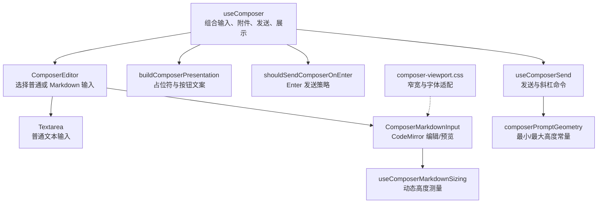
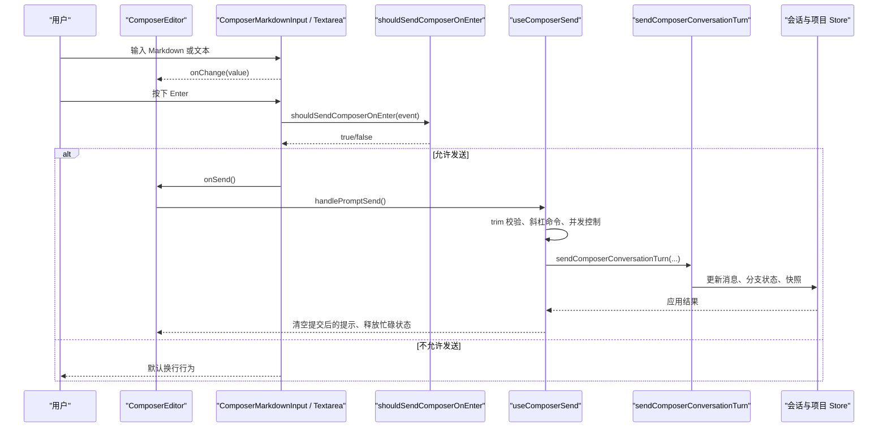
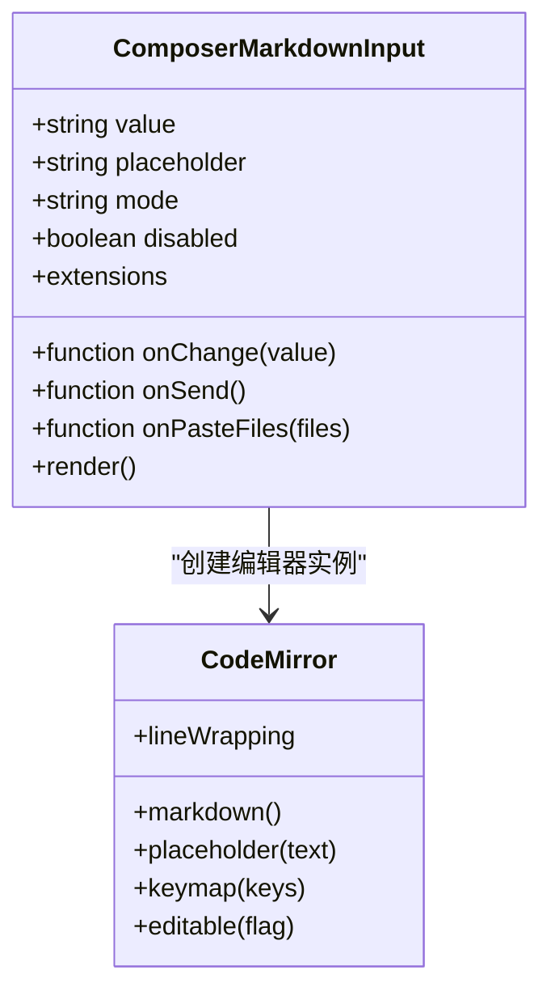
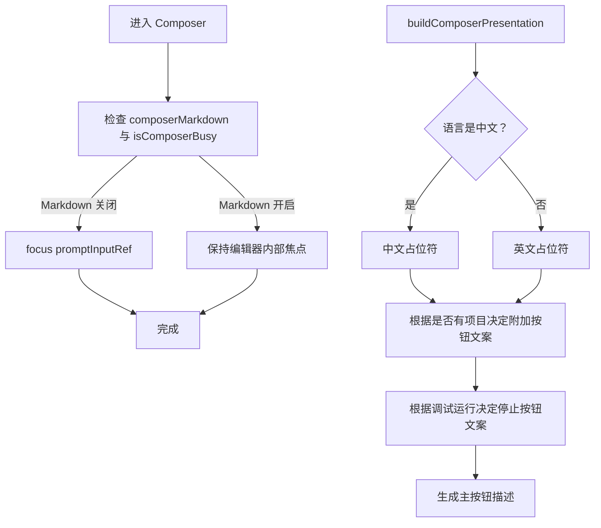
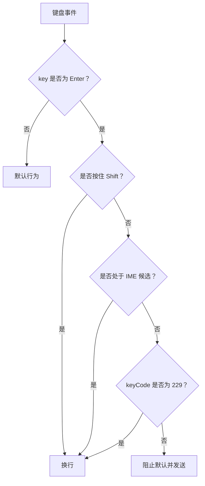
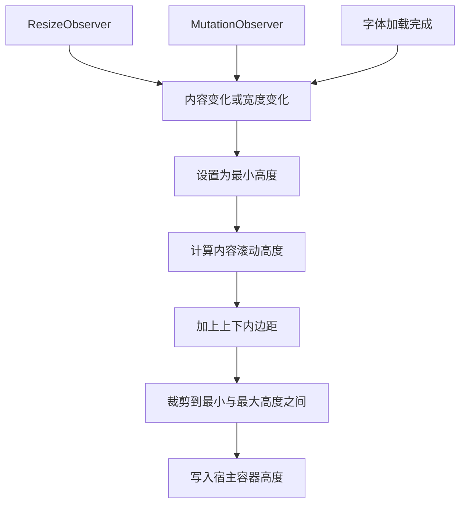
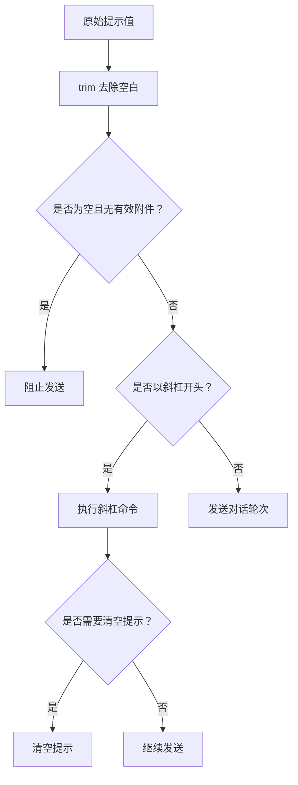
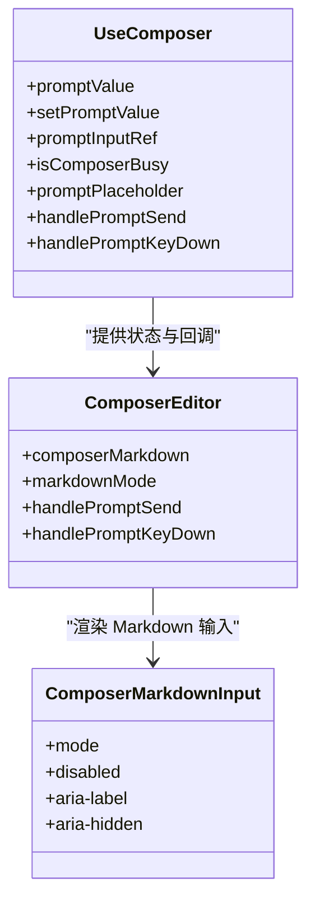
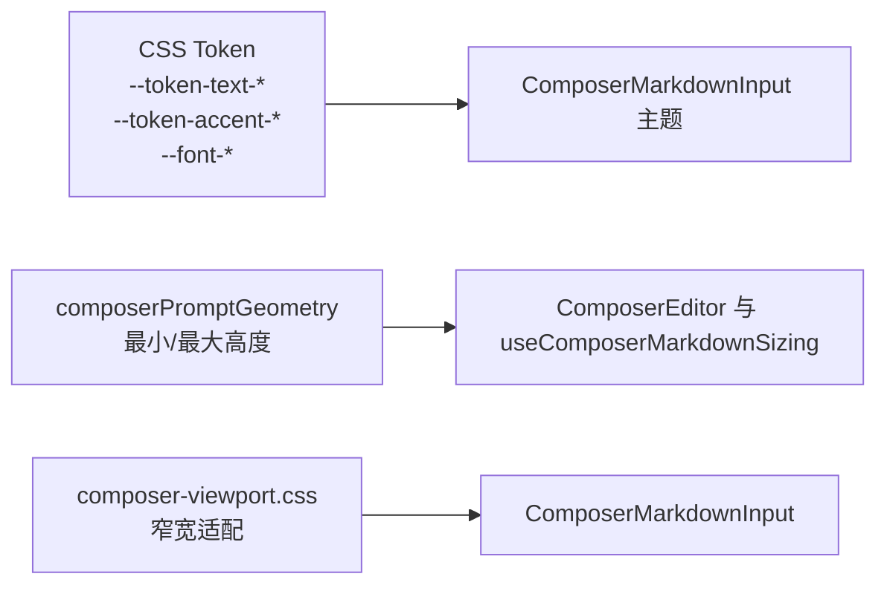
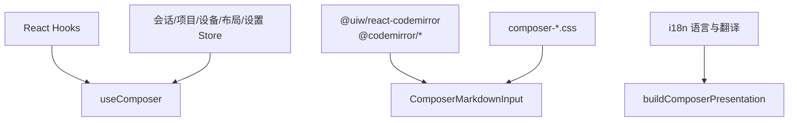

# Markdown 编辑器与输入处理

<cite>
**本文引用的文件**   
- [README.md](file://src/renderer/features/composer/README.md)
- [useComposer.ts](file://src/renderer/features/composer/useComposer.ts)
- [composerPresentation.ts](file://src/renderer/features/composer/composerPresentation.ts)
- [ComposerEditor.tsx](file://src/renderer/features/composer/ComposerEditor.tsx)
- [ComposerMarkdownInput.tsx](file://src/renderer/features/composer/ComposerMarkdownInput.tsx)
- [useComposerMarkdownSizing.ts](file://src/renderer/features/composer/useComposerMarkdownSizing.ts)
- [composerPromptGeometry.ts](file://src/renderer/features/composer/composerPromptGeometry.ts)
- [composerKeyboard.ts](file://src/renderer/features/composer/composerKeyboard.ts)
- [useComposerSend.ts](file://src/renderer/features/composer/useComposerSend.ts)
- [composer-viewport.css](file://src/renderer/features/composer/composer-viewport.css)
</cite>

## 目录
1. [引言](#引言)
2. [项目结构](#项目结构)
3. [核心组件](#核心组件)
4. [架构总览](#架构总览)
5. [详细组件分析](#详细组件分析)
6. [依赖关系分析](#依赖关系分析)
7. [性能考虑](#性能考虑)
8. [故障排查指南](#故障排查指南)
9. [结论](#结论)

## 引言
本文面向 Composer 的 Markdown 编辑器与输入处理子系统，聚焦以下目标：
- 解释 Markdown 编辑模式的核心实现，包括文本输入、自动聚焦、占位符生成。
- 说明键盘快捷键策略，包括 Enter 发送、Shift+Enter 换行、Tab 缩进。
- 解析提示几何计算逻辑，包括动态高度、视口适配与滚动行为。
- 梳理输入验证与清理机制，包括空白字符处理、最大长度限制与安全过滤。
- 总结编辑器状态管理、焦点控制与无障碍访问支持。
- 提供自定义样式和主题配置参考。

该子系统的权威入口位于 `src/renderer/features/composer`，其 README 明确说明 Composer 保留产品专属输入、附件、Agent 配置与运行态视觉，领域组件留在 feature 内，不提升为通用 UI。

**章节来源**
- [README.md:1-24](file://src/renderer/features/composer/README.md#L1-L24)

## 项目结构
Composer 输入相关代码采用“功能域 + 工具函数 + 样式”的分层组织方式：
- 控制器 Hook：聚合会话草稿、附件、发送、停止与运行态。
- 编辑器组件：分别负责普通文本输入与 Markdown 编辑/预览。
- 几何与尺寸：集中定义最小/最大高度，并实现动态测量。
- 键盘策略：统一判断是否应通过 Enter 发送消息。
- 发送流程：封装斜杠命令、并发模型切换、对话轮次发送与状态恢复。
- 样式表：按职责拆分，覆盖外壳、视口、窄宽适配等。

**图表来源**
- [useComposer.ts:1-196](file://src/renderer/features/composer/useComposer.ts#L1-L196)
- [ComposerEditor.tsx:1-65](file://src/renderer/features/composer/ComposerEditor.tsx#L1-L65)
- [ComposerMarkdownInput.tsx:1-203](file://src/renderer/features/composer/ComposerMarkdownInput.tsx#L1-L203)
- [useComposerMarkdownSizing.ts:1-56](file://src/renderer/features/composer/useComposerMarkdownSizing.ts#L1-L56)
- [composerPresentation.ts:1-35](file://src/renderer/features/composer/composerPresentation.ts#L1-L35)
- [composerKeyboard.ts:1-7](file://src/renderer/features/composer/composerKeyboard.ts#L1-L7)
- [composerPromptGeometry.ts:1-3](file://src/renderer/features/composer/composerPromptGeometry.ts#L1-L3)
- [composer-viewport.css:1-52](file://src/renderer/features/composer/composer-viewport.css#L1-L52)

**章节来源**
- [README.md:1-24](file://src/renderer/features/composer/README.md#L1-L24)

## 核心组件
- `useComposer`：Composer 的唯一协调入口，聚合草稿、附件、技能、发送、停止、上下文用量与展示信息；根据当前 Agent、会话与运行状态生成可访问的占位符与按钮文案。
- `ComposerEditor`：受控书写区，根据 `composerMarkdown` 在普通文本输入与 Markdown 编辑器之间切换，并传递键盘事件与文件粘贴回调。
- `ComposerMarkdownInput`：基于 CodeMirror 的 Markdown 编辑器，提供写模式与预览模式，内置占位符、Tab 缩进、Enter 发送与粘贴文件拦截。
- `useComposerMarkdownSizing`：监听内容变化、ResizeObserver、MutationObserver、字体加载与宽度变化，计算并设置宿主容器高度。
- `composerPresentation`：根据语言、Agent 模式、项目存在性、调试运行状态与忙碌状态，生成占位符与按钮描述。
- `composerKeyboard`：判定 Enter 键是否触发发送，同时兼容中文输入法候选确认与 Shift+Enter 换行。
- `useComposerSend`：封装发送前校验、斜杠命令执行、并发模型切换、会话投影更新与失败恢复。
- `composerPromptGeometry`：定义提示框最小与最大高度常量。
- `composer-viewport.css`：窄宽视口下的布局与字号适配。

**章节来源**
- [useComposer.ts:1-196](file://src/renderer/features/composer/useComposer.ts#L1-L196)
- [ComposerEditor.tsx:1-65](file://src/renderer/features/composer/ComposerEditor.tsx#L1-L65)
- [ComposerMarkdownInput.tsx:1-203](file://src/renderer/features/composer/ComposerMarkdownInput.tsx#L1-L203)
- [useComposerMarkdownSizing.ts:1-56](file://src/renderer/features/composer/useComposerMarkdownSizing.ts#L1-L56)
- [composerPresentation.ts:1-35](file://src/renderer/features/composer/composerPresentation.ts#L1-L35)
- [composerKeyboard.ts:1-7](file://src/renderer/features/composer/composerKeyboard.ts#L1-L7)
- [useComposerSend.ts:1-199](file://src/renderer/features/composer/useComposerSend.ts#L1-L199)
- [composerPromptGeometry.ts:1-3](file://src/renderer/features/composer/composerPromptGeometry.ts#L1-L3)
- [composer-viewport.css:1-52](file://src/renderer/features/composer/composer-viewport.css#L1-L52)

## 架构总览
Composer 输入链路从用户交互到对话发送的关键路径如下：

**图表来源**
- [ComposerMarkdownInput.tsx:80-150](file://src/renderer/features/composer/ComposerMarkdownInput.tsx#L80-L150)
- [composerKeyboard.ts:1-7](file://src/renderer/features/composer/composerKeyboard.ts#L1-L7)
- [useComposerSend.ts:70-160](file://src/renderer/features/composer/useComposerSend.ts#L70-L160)

**章节来源**
- [ComposerMarkdownInput.tsx:80-150](file://src/renderer/features/composer/ComposerMarkdownInput.tsx#L80-L150)
- [useComposerSend.ts:70-160](file://src/renderer/features/composer/useComposerSend.ts#L70-L160)

## 详细组件分析

### Markdown 编辑模式与文本输入
`ComposerMarkdownInput` 使用 CodeMirror 渲染 Markdown 编辑器，并通过扩展实现：
- Markdown 语法支持。
- 自定义主题，继承系统 Token 文本颜色、字号、行高与强调色。
- 占位符文本由外部传入。
- 启用自动换行。
- Tab 缩进通过 `indentWithTab` 提供。
- Enter 键绑定最高优先级发送回调。
- 禁用时关闭编辑能力。
- 粘贴事件拦截文件，并在剪贴板文本为空时阻止默认插入。

写模式与预览模式通过 `data-mode` 与类名切换：
- 写模式显示 `.cm-content`。
- 预览模式显示 `MessageMarkdown` 渲染结果，空内容时显示占位符。

**图表来源**
- [ComposerMarkdownInput.tsx:1-203](file://src/renderer/features/composer/ComposerMarkdownInput.tsx#L1-L203)

**章节来源**
- [ComposerMarkdownInput.tsx:1-203](file://src/renderer/features/composer/ComposerMarkdownInput.tsx#L1-L203)

### 自动聚焦与占位符文本生成
自动聚焦：
- `useComposer` 维护一个指向普通文本输入的 `promptInputRef`。
- 当 Markdown 模式关闭且未处于忙碌状态时，Composer 将 ref 传给非 Markdown 输入路径，使普通文本输入可获得焦点。
- Markdown 模式下，焦点交由 CodeMirror 内部编辑器管理。

占位符文本生成：
- `buildComposerPresentation` 根据语言、当前 Agent 模式标签、是否存在项目、是否存在活动调试运行与 Composer 忙碌状态，生成占位符、附件按钮文案、停止按钮文案与主按钮描述。
- 中文与非中文路径分别返回本地化占位符。
- `useComposer` 将该占位符传递给 `ComposerEditor`，再传递给 `ComposerMarkdownInput` 或普通 `Textarea`。

**图表来源**
- [useComposer.ts:35-170](file://src/renderer/features/composer/useComposer.ts#L35-L170)
- [composerPresentation.ts:1-35](file://src/renderer/features/composer/composerPresentation.ts#L1-L35)
- [ComposerEditor.tsx:1-65](file://src/renderer/features/composer/ComposerEditor.tsx#L1-L65)

**章节来源**
- [useComposer.ts:35-170](file://src/renderer/features/composer/useComposer.ts#L35-L170)
- [composerPresentation.ts:1-35](file://src/renderer/features/composer/composerPresentation.ts#L1-L35)
- [ComposerEditor.tsx:1-65](file://src/renderer/features/composer/ComposerEditor.tsx#L1-L65)

### 键盘快捷键系统
键盘策略集中在 `shouldSendComposerOnEnter`：
- 仅当 `key === 'Enter'` 且未按住 Shift 时才可能发送。
- 如果处于中文输入法候选阶段（`isComposing`），不发送，避免打断 IME 候选确认。
- 当 `keyCode === 229` 时也不发送，这是部分浏览器在 IME 输入期间的特殊按键码。
- 其他按键不会触发发送。

在 `useComposerSend.handlePromptKeyDown` 中：
- 调用 `shouldSendComposerOnEnter`。
- 若返回真，则阻止默认行为并调用异步发送。

在 `ComposerMarkdownInput` 中：
- 为 CodeMirror 注册最高优先级的 Enter 键映射，直接调用 `onSend()`。
- Tab 缩进通过 `indentWithTab` 提供。
- Shift+Enter 不会触发该映射，因此保留换行行为。

**图表来源**
- [composerKeyboard.ts:1-7](file://src/renderer/features/composer/composerKeyboard.ts#L1-L7)
- [useComposerSend.ts:140-160](file://src/renderer/features/composer/useComposerSend.ts#L140-L160)
- [ComposerMarkdownInput.tsx:90-130](file://src/renderer/features/composer/ComposerMarkdownInput.tsx#L90-L130)

**章节来源**
- [composerKeyboard.ts:1-7](file://src/renderer/features/composer/composerKeyboard.ts#L1-L7)
- [useComposerSend.ts:140-160](file://src/renderer/features/composer/useComposerSend.ts#L140-L160)
- [ComposerMarkdownInput.tsx:90-130](file://src/renderer/features/composer/ComposerMarkdownInput.tsx#L90-L130)

### 提示几何计算与视口适配
提示几何常量：
- 最小高度：72px。
- 最大高度：180px。

这些常量被普通文本输入与 Markdown 输入共同引用：
- 普通文本输入通过 `Textarea` 的 `minHeight` 与 `maxHeight` 限制。
- Markdown 输入通过 CSS 变量与动态样式限制容器高度。

动态高度测量逻辑：
- 在 `useComposerMarkdownSizing` 中，每次值变化后调度一次测量。
- 使用 `ResizeObserver` 监听宿主容器与内容元素宽度变化。
- 使用 `MutationObserver` 监听父节点属性变化，例如类名、隐藏状态与字体缩放。
- 监听字体加载完成事件，确保排版稳定后再测量。
- 先重置为最小高度，再计算内容滚动高度加上上下内边距，并裁剪到最小与最大高度之间。
- 通过动态样式赋值给宿主容器。

视口适配：
- `composer-viewport.css` 在小于等于 900px 时调整外壳、弹出面板、用户输入选项与工具审批操作布局。
- 在小于等于 640px 时降低文本区域与 Markdown 输入字号，提高小屏可读性。

**图表来源**
- [useComposerMarkdownSizing.ts:1-56](file://src/renderer/features/composer/useComposerMarkdownSizing.ts#L1-L56)
- [composerPromptGeometry.ts:1-3](file://src/renderer/features/composer/composerPromptGeometry.ts#L1-L3)
- [ComposerEditor.tsx:35-60](file://src/renderer/features/composer/ComposerEditor.tsx#L35-L60)
- [composer-viewport.css:1-52](file://src/renderer/features/composer/composer-viewport.css#L1-L52)

**章节来源**
- [useComposerMarkdownSizing.ts:1-56](file://src/renderer/features/composer/useComposerMarkdownSizing.ts#L1-L56)
- [composerPromptGeometry.ts:1-3](file://src/renderer/features/composer/composerPromptGeometry.ts#L1-L3)
- [ComposerEditor.tsx:35-60](file://src/renderer/features/composer/ComposerEditor.tsx#L35-L60)
- [composer-viewport.css:1-52](file://src/renderer/features/composer/composer-viewport.css#L1-L52)

### 输入验证与清理机制
输入清理：
- 发送前对提示值进行 `trim()`，去除首尾空白。
- 如果内容为空且没有有效附件，则不发送。
- 以 `/` 开头的提示被视为斜杠命令，走斜杠命令执行路径；成功处理后可能清空已提交的提示。
- 并发模型切换命令有特殊处理，允许在忙碌状态下执行。

最大长度限制：
- 当前代码未显式实现提示文本的最大长度截断。
- 普通文本输入与 Markdown 编辑器均依赖外层 `Textarea` 与 `composerPromptGeometry` 的高度限制，但没有针对字符数的硬上限。

安全过滤：
- 当前 Composer 输入处理未实现专门的 XSS 过滤或 HTML 转义逻辑。
- Markdown 预览通过 `MessageMarkdown` 渲染，具体渲染安全策略属于 MessageMarkdown 组件的职责范围；Composer 输入侧主要做空白清理与发送条件判断。

**图表来源**
- [useComposerSend.ts:70-160](file://src/renderer/features/composer/useComposerSend.ts#L70-L160)

**章节来源**
- [useComposerSend.ts:70-160](file://src/renderer/features/composer/useComposerSend.ts#L70-L160)

### 编辑器状态管理、焦点控制与无障碍访问
状态管理：
- `useComposer` 订阅项目、会话、设备、设置与布局 store，合成 Composer 所需状态。
- 通过 `useScopedPromptDraft` 管理会话级草稿。
- 通过 `useComposerAttachments` 与 `useComposerPendingSkills` 管理附件与技能状态。
- 通过 `useComposerSend` 管理发送状态、忙碌状态与停止操作。
- 通过 `buildComposerPresentation` 生成可访问的主按钮描述。

焦点控制：
- 普通文本输入通过 `promptInputRef` 暴露原生文本域 ref。
- Markdown 编辑器的焦点由 CodeMirror 管理。
- 当 Markdown 模式关闭且 Composer 不忙碌时，Composer 尝试聚焦普通输入。

无障碍访问：
- Markdown 编辑器为编辑器与预览区域设置 `aria-label`。
- 写模式与预览模式通过 `aria-hidden` 控制不可见区域的屏幕阅读器可见性。
- 附件、技能、模型与努力程度控件广泛使用 `aria-checked`、`aria-expanded`、`aria-label`、`aria-busy` 等属性。
- 主按钮描述来自 `primaryButtonDescription`，便于辅助技术朗读。

**图表来源**
- [useComposer.ts:1-196](file://src/renderer/features/composer/useComposer.ts#L1-L196)
- [ComposerEditor.tsx:1-65](file://src/renderer/features/composer/ComposerEditor.tsx#L1-L65)
- [ComposerMarkdownInput.tsx:150-203](file://src/renderer/features/composer/ComposerMarkdownInput.tsx#L150-L203)

**章节来源**
- [useComposer.ts:1-196](file://src/renderer/features/composer/useComposer.ts#L1-L196)
- [ComposerEditor.tsx:1-65](file://src/renderer/features/composer/ComposerEditor.tsx#L1-L65)
- [ComposerMarkdownInput.tsx:150-203](file://src/renderer/features/composer/ComposerMarkdownInput.tsx#L150-L203)

### 自定义样式与主题配置
编辑器主题：
- `ComposerMarkdownInput` 定义 CodeMirror 主题，使用系统 Token 如 `--token-text-body`、`--token-accent-primary`、`--font-sans`、`--font-mono`。
- 选择背景使用 accent 颜色的混合透明色。
- 光标颜色、活跃行背景、占位符颜色均通过 Token 控制。

布局与视口样式：
- `composer-viewport.css` 提供窄宽适配，在小屏幕下调整字号与布局方向。
- Composer 外壳、附件、权限、模型面板、运行状态等样式按职责命名并由 README 说明导入顺序。

建议配置方式：
- 通过修改 CSS Token 值改变编辑器颜色、字号与行高。
- 通过修改 `COMPOSER_PROMPT_MIN_HEIGHT` 与 `COMPOSER_PROMPT_MAX_HEIGHT` 调整提示区域高度范围。
- 通过 `composerMarkdown` 开关控制是否启用 Markdown 编辑模式。
- 通过 `buildComposerPresentation` 的参数影响占位符与按钮文案，但实际文案生成位于该函数内部。

**图表来源**
- [ComposerMarkdownInput.tsx:20-80](file://src/renderer/features/composer/ComposerMarkdownInput.tsx#L20-L80)
- [composerPromptGeometry.ts:1-3](file://src/renderer/features/composer/composerPromptGeometry.ts#L1-L3)
- [composer-viewport.css:1-52](file://src/renderer/features/composer/composer-viewport.css#L1-L52)

**章节来源**
- [ComposerMarkdownInput.tsx:20-80](file://src/renderer/features/composer/ComposerMarkdownInput.tsx#L20-L80)
- [composerPromptGeometry.ts:1-3](file://src/renderer/features/composer/composerPromptGeometry.ts#L1-L3)
- [composer-viewport.css:1-52](file://src/renderer/features/composer/composer-viewport.css#L1-L52)

## 依赖关系分析
Composer 输入子系统依赖以下层次：
- React Hooks 与 DOM API：`useCallback`、`useEffect`、`useLayoutEffect`、`useRef`、`ResizeObserver`、`MutationObserver`、`requestAnimationFrame`。
- CodeMirror：Markdown 扩展、占位符、KeyMap、编辑器主题。
- 共享类型与主题：Agent 模式、Token 颜色、字体族。
- Store：会话、项目、设备、布局、工作流与设置。
- 国际化：语言与翻译函数。
- 样式：Composer 系列 CSS 文件。

**图表来源**
- [useComposer.ts:1-196](file://src/renderer/features/composer/useComposer.ts#L1-L196)
- [ComposerMarkdownInput.tsx:1-80](file://src/renderer/features/composer/ComposerMarkdownInput.tsx#L1-L80)
- [composerPresentation.ts:1-35](file://src/renderer/features/composer/composerPresentation.ts#L1-L35)

**章节来源**
- [useComposer.ts:1-196](file://src/renderer/features/composer/useComposer.ts#L1-L196)
- [ComposerMarkdownInput.tsx:1-80](file://src/renderer/features/composer/ComposerMarkdownInput.tsx#L1-L80)
- [composerPresentation.ts:1-35](file://src/renderer/features/composer/composerPresentation.ts#L1-L35)

## 性能考虑
- 动态高度测量使用 `requestAnimationFrame` 合并多次变更，避免频繁重排。
- `ResizeObserver` 仅在宿主宽度变化或内容宽度变化时触发测量。
- `MutationObserver` 只监听必要属性变化，减少不必要的回调。
- 字体加载完成后重新测量，避免因字体替换导致高度抖动。
- 取消动画帧、断开观察者与清理动态样式，防止内存泄漏。
- Markdown 编辑器只在写模式响应内容变化，预览模式避免重复测量。
- 发送逻辑使用 try/finally 保证忙碌状态最终释放，避免 UI 卡死。

[本节为一般性指导，不直接分析特定文件]

## 故障排查指南
常见问题与定位建议：
- 按下 Enter 未发送：
  - 检查是否处于中文输入法候选阶段。
  - 检查是否按住 Shift。
  - 检查 keyCode 是否为 229。
  - 检查是否以斜杠开头且未被斜杠命令处理。
- 提示区域高度异常：
  - 检查 `composerPromptGeometry` 的最小与最大高度。
  - 检查宿主容器是否被隐藏或折叠。
  - 检查字体是否加载完成。
  - 检查父节点是否添加或移除类名、隐藏属性或字体缩放属性。
- Markdown 预览不更新：
  - 检查 `value` 是否发生变化。
  - 检查 `onChange` 是否正确更新状态。
  - 检查预览模式是否激活。
- 无法粘贴文件：
  - 检查 `onPasteFiles` 是否传入。
  - 检查剪贴板中是否有文件。
  - 检查文本内容是否为空。
- 无障碍标签缺失：
  - 检查 Markdown 编辑器与预览区域是否设置 `aria-label`。
  - 检查写模式与预览模式是否正确使用 `aria-hidden`。
  - 检查主按钮是否使用 `primaryButtonDescription`。

**章节来源**
- [composerKeyboard.ts:1-7](file://src/renderer/features/composer/composerKeyboard.ts#L1-L7)
- [useComposerMarkdownSizing.ts:1-56](file://src/renderer/features/composer/useComposerMarkdownSizing.ts#L1-L56)
- [ComposerMarkdownInput.tsx:80-203](file://src/renderer/features/composer/ComposerMarkdownInput.tsx#L80-L203)
- [useComposerSend.ts:70-199](file://src/renderer/features/composer/useComposerSend.ts#L70-L199)

## 结论
Composer 的 Markdown 编辑器与输入处理子系统围绕 `useComposer` 控制器 Hook 构建，将输入、附件、Agent 配置、发送流程与可视展示解耦。Markdown 编辑模式通过 CodeMirror 提供语法支持与可定制主题；占位符与按钮文案由 `buildComposerPresentation` 根据语言、模式与运行态动态生成；键盘策略统一处理 Enter、Shift+Enter 与 IME 场景；提示几何通过常量与动态测量结合，实现稳定高度与视口适配；输入清理聚焦空白去除与发送条件判断，而最大长度与安全过滤不在当前输入层实现。整体设计兼顾可读性、可维护性与无障碍体验，适合在现有 Token 体系下扩展样式与行为。

[本节为总结性内容，不直接分析特定文件]