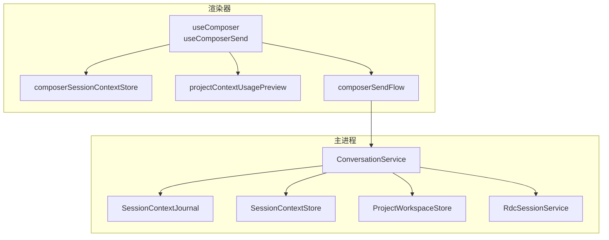
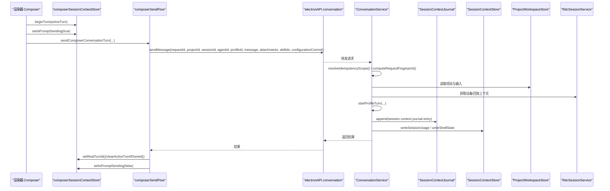
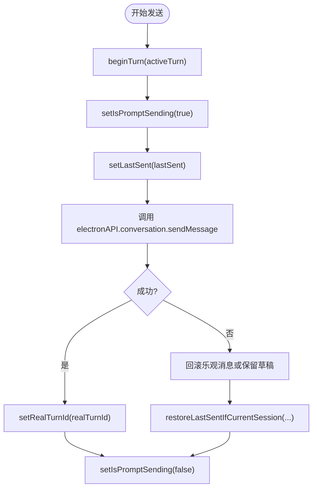
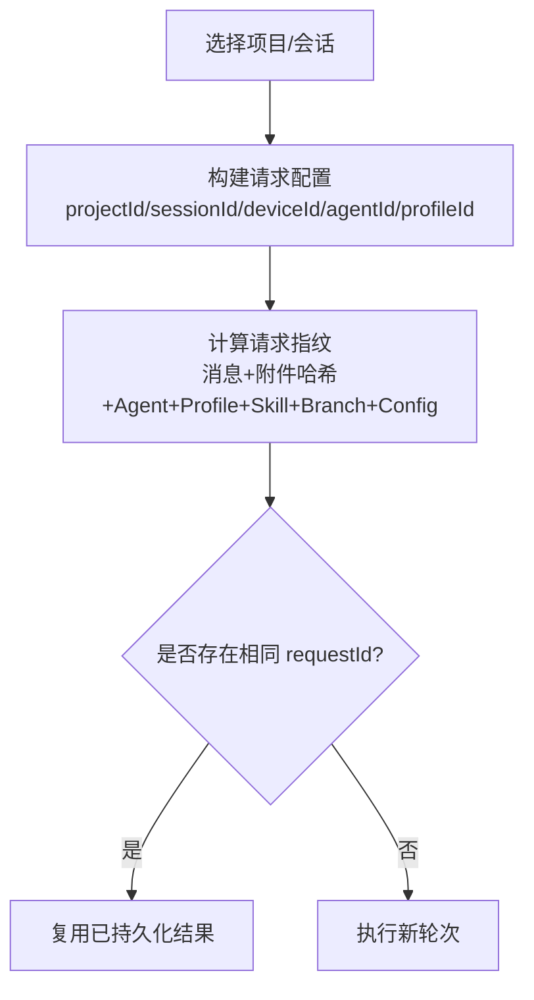
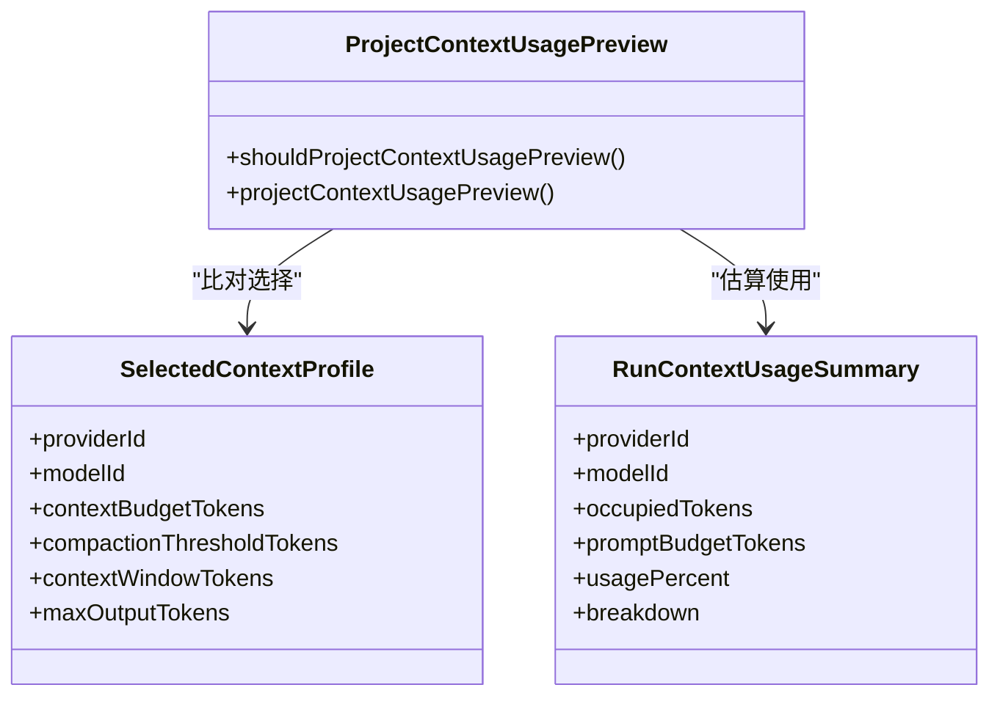
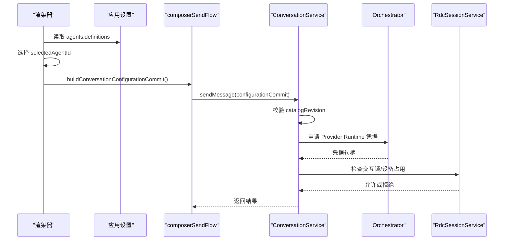
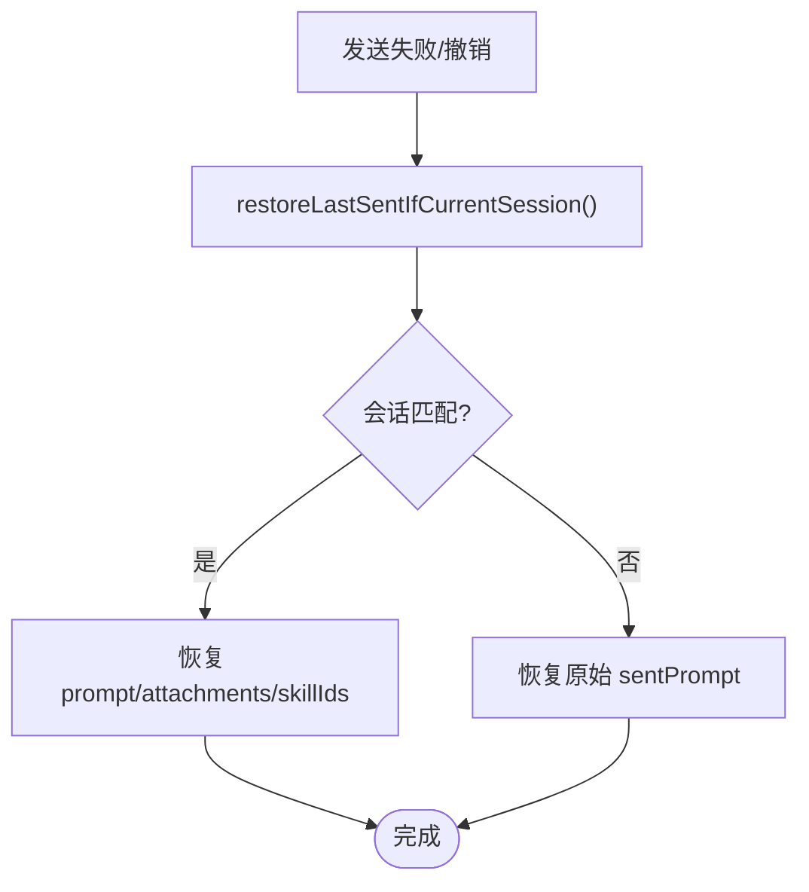
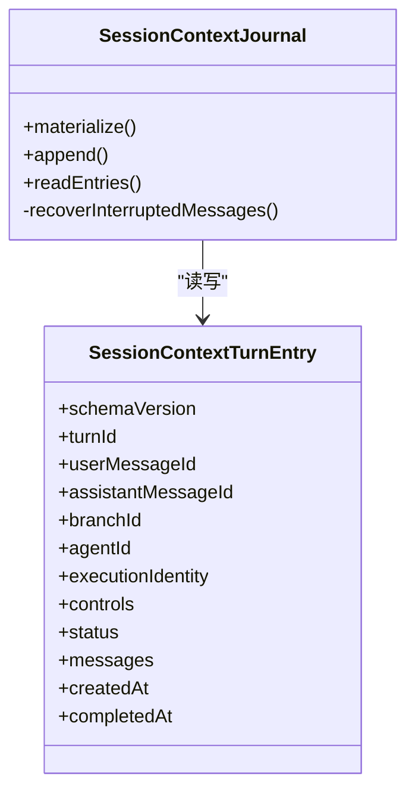
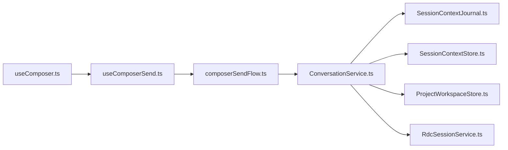

# 会话上下文与项目绑定

<cite>
**本文引用的文件**   
- [SessionContextStore.ts](file://src/main/sessions/SessionContextStore.ts)
- [SessionContextJournal.ts](file://src/main/conversation/SessionContextJournal.ts)
- [ConversationService.ts](file://src/main/conversation/ConversationService.ts)
- [RdcSessionService.ts](file://src/main/sessions/RdcSessionService.ts)
- [ProjectWorkspaceStore.ts](file://src/main/sessions/ProjectWorkspaceStore.ts)
- [projectContextUsagePreview.ts](file://src/renderer/features/composer/projectContextUsagePreview.ts)
- [composerSessionContextStore.ts](file://src/renderer/stores/composerSessionContextStore.ts)
- [useComposerSend.ts](file://src/renderer/features/composer/useComposerSend.ts)
- [composerSendFlow.ts](file://src/renderer/features/composer/composerSendFlow.ts)
- [useComposer.ts](file://src/renderer/features/composer/useComposer.ts)
</cite>

## 目录
1. [引言](#引言)
2. [项目结构](#项目结构)
3. [核心组件](#核心组件)
4. [架构总览](#架构总览)
5. [详细组件分析](#详细组件分析)
6. [依赖关系分析](#依赖关系分析)
7. [性能考量](#性能考量)
8. [故障排查指南](#故障排查指南)
9. [结论](#结论)
10. [附录：最佳实践与代码片段路径](#附录最佳实践与代码片段路径)

## 引言
本文围绕“Composer 会话上下文与项目绑定”展开，系统性说明以下目标：
- 会话上下文的生命周期管理，包括渲染器侧的 `activeTurn`、`lastSent`、`isPromptSending` 状态。
- 项目上下文的预览与使用机制，包括项目选择、上下文注入、依赖检查。
- 上下文档案（Provider/模型配置）选择策略及缓存行为。
- 会话代理 ID 解析流程，包括代理发现、版本兼容、权限验证。
- 跨会话状态同步，包括 `lastSent` 恢复、草稿持久化、冲突解决。
- 结合源码定位的代码示例路径与最佳实践。

## 项目结构
与本次主题直接相关的代码分布在主进程会话层、对话服务层、渲染器 Composer 特性层以及共享类型中：

**图表来源**
- [useComposer.ts:1-196](file://src/renderer/features/composer/useComposer.ts#L1-L196)
- [useComposerSend.ts:1-199](file://src/renderer/features/composer/useComposerSend.ts#L1-L199)
- [composerSessionContextStore.ts:1-112](file://src/renderer/stores/composerSessionContextStore.ts#L1-L112)
- [projectContextUsagePreview.ts:1-68](file://src/renderer/features/composer/projectContextUsagePreview.ts#L1-L68)
- [composerSendFlow.ts:1-200](file://src/renderer/features/composer/composerSendFlow.ts#L1-L200)
- [ConversationService.ts:200-420](file://src/main/conversation/ConversationService.ts#L200-L420)
- [SessionContextJournal.ts:1-246](file://src/main/conversation/SessionContextJournal.ts#L1-L246)
- [SessionContextStore.ts:1-96](file://src/main/sessions/SessionContextStore.ts#L1-L96)
- [ProjectWorkspaceStore.ts:1-605](file://src/main/sessions/ProjectWorkspaceStore.ts#L1-L605)
- [RdcSessionService.ts:1-200](file://src/main/sessions/RdcSessionService.ts#L1-L200)

**章节来源**
- [useComposer.ts:1-196](file://src/renderer/features/composer/useComposer.ts#L1-L196)
- [ConversationService.ts:200-420](file://src/main/conversation/ConversationService.ts#L200-L420)

## 核心组件
- **渲染器会话上下文存储**：维护 `activeTurn`、`lastSent`、`isPromptSending` 等 UI 状态，并暴露归属校验与恢复方法。
- **Composer 发送流程**：组合输入、附件、技能、Agent 配置，发起 IPC 调用，处理乐观消息与回滚。
- **对话服务**：主进程入口，负责幂等请求、上下文解析、轮次运行、分支切换、中断恢复与终端落盘。
- **会话上下文日志**：以 JSONL 形式记录已完成的 turn 上下文，用于后续上下文重建与制品回放。
- **会话上下文存储**：按会话写入 usage 快照、shell 工作目录、上下文日志。
- **项目工作区存储**：管理项目注册表、当前选择、项目输入扫描与引用。
- **上下文使用预览**：在准备阶段对预算与窗口进行预估展示。
- **RDC 会话服务**：管理捕获回放生命周期、设备占用、交互锁，与 Agent 执行隔离。

**章节来源**
- [composerSessionContextStore.ts:1-112](file://src/renderer/stores/composerSessionContextStore.ts#L1-L112)
- [useComposerSend.ts:1-199](file://src/renderer/features/composer/useComposerSend.ts#L1-L199)
- [composerSendFlow.ts:1-200](file://src/renderer/features/composer/composerSendFlow.ts#L1-L200)
- [ConversationService.ts:200-700](file://src/main/conversation/ConversationService.ts#L200-L700)
- [SessionContextJournal.ts:1-246](file://src/main/conversation/SessionContextJournal.ts#L1-L246)
- [SessionContextStore.ts:1-96](file://src/main/sessions/SessionContextStore.ts#L1-L96)
- [ProjectWorkspaceStore.ts:1-605](file://src/main/sessions/ProjectWorkspaceStore.ts#L1-L605)
- [projectContextUsagePreview.ts:1-68](file://src/renderer/features/composer/projectContextUsagePreview.ts#L1-L68)
- [RdcSessionService.ts:1-200](file://src/main/sessions/RdcSessionService.ts#L1-L200)

## 架构总览
Composer 的发送流程由渲染器驱动，通过 IPC 进入主进程的 ConversationService；后者协调上下文构建、Agent 编排、会话日志与项目资源。

**图表来源**
- [useComposerSend.ts:50-199](file://src/renderer/features/composer/useComposerSend.ts#L50-L199)
- [composerSendFlow.ts:1-200](file://src/renderer/features/composer/composerSendFlow.ts#L1-L200)
- [ConversationService.ts:420-700](file://src/main/conversation/ConversationService.ts#L420-L700)
- [SessionContextJournal.ts:200-246](file://src/main/conversation/SessionContextJournal.ts#L200-L246)
- [SessionContextStore.ts:1-96](file://src/main/sessions/SessionContextStore.ts#L1-L96)
- [ProjectWorkspaceStore.ts:1-200](file://src/main/sessions/ProjectWorkspaceStore.ts#L1-L200)
- [RdcSessionService.ts:1-200](file://src/main/sessions/RdcSessionService.ts#L1-L200)

## 详细组件分析

### 一、会话上下文生命周期：activeTurn、lastSent、isPromptSending
渲染器侧通过 Zustand store 维护 Composer 的会话上下文：
- `activeTurn`：记录当前正在创建的 turn 的所有权信息（sessionId、requestId、agentId），以及乐观 turnId 与真实 turnId。
- `lastSent`：记录最近一次发送的提示词、附件、技能列表，用于跨会话恢复。
- `isPromptSending`：标记是否处于提示发送过程中，影响 UI 忙碌状态与手推建议触发条件。

关键行为：
- `beginTurn(context)`：在发送前设置 activeTurn，同时清空输入、附件与技能。
- `setRealTurnId(ownership, turnId, committedSessionId?)`：当后端返回真实 turnId 后，更新 activeTurn。
- `clearActiveTurnIfOwned(ownership)`：所有权一致时清理 activeTurn，避免残留状态。
- `setLastSent(lastSent)`：保存最后一次发送内容。
- `resetForSessionSwitch()`：会话切换时重置 activeTurn、isPromptSending、手推建议。
- `restoreLastSentIfCurrentSession(currentSessionId, apply)`：在当前会话匹配时恢复 lastSent 到编辑器。

**图表来源**
- [composerSessionContextStore.ts:1-112](file://src/renderer/stores/composerSessionContextStore.ts#L1-L112)
- [useComposerSend.ts:50-199](file://src/renderer/features/composer/useComposerSend.ts#L50-L199)
- [composerSendFlow.ts:1-200](file://src/renderer/features/composer/composerSendFlow.ts#L1-L200)

**章节来源**
- [composerSessionContextStore.ts:1-112](file://src/renderer/stores/composerSessionContextStore.ts#L1-L112)
- [useComposerSend.ts:50-199](file://src/renderer/features/composer/useComposerSend.ts#L50-L199)
- [composerSendFlow.ts:1-200](file://src/renderer/features/composer/composerSendFlow.ts#L1-L200)

### 二、项目上下文使用预览：项目选择、上下文注入、依赖检查
- 项目选择：
  - `ProjectWorkspaceStore` 管理当前项目与当前会话的选择，并在选择变更时自动校验一致性。
  - `getCurrentProjectId()`、`setCurrentProjectId(projectId)` 与 `getCurrentSessionId()`、`setCurrentSessionId(sessionId)` 共同维护选择态。
- 上下文注入：
  - `useComposer.ts` 将当前项目、会话、运行中的调试任务、设备、Agent 模式等信息传递给发送流程。
  - `composerSendFlow.ts` 构造请求体，包含 `projectId`、`sessionId`、`currentRunId`、`replayDeviceId`、`agentId`、`profileId`、`message`、`attachments`、`skillIds`、`turnControls`、`configurationCommit`。
- 依赖检查：
  - 主进程 ConversationService 会计算幂等指纹，比较消息、附件哈希、Agent、Profile、turnControls、预加载技能、分支锚点与配置提交。
  - 若存在相同 requestId 的已持久化请求，则直接复用历史结果，避免重复执行。

**图表来源**
- [ProjectWorkspaceStore.ts:200-350](file://src/main/sessions/ProjectWorkspaceStore.ts#L200-L350)
- [useComposer.ts:1-196](file://src/renderer/features/composer/useComposer.ts#L1-L196)
- [composerSendFlow.ts:1-200](file://src/renderer/features/composer/composerSendFlow.ts#L1-L200)
- [ConversationService.ts:200-420](file://src/main/conversation/ConversationService.ts#L200-L420)

**章节来源**
- [ProjectWorkspaceStore.ts:200-350](file://src/main/sessions/ProjectWorkspaceStore.ts#L200-L350)
- [useComposer.ts:1-196](file://src/renderer/features/composer/useComposer.ts#L1-L196)
- [composerSendFlow.ts:1-200](file://src/renderer/features/composer/composerSendFlow.ts#L1-L200)
- [ConversationService.ts:200-420](file://src/main/conversation/ConversationService.ts#L200-L420)

### 三、上下文档案选择机制：档案列表、选择策略、缓存管理
- 档案列表与选择：
  - `useComposer.ts` 从应用设置中加载 Agent 定义，筛选出用户可调用的 Agent，并以 `selectedAgentId` 作为当前模式。
  - `useSelectedContextProfile()` 提供上下文档案配置（如 providerId、modelId、promptBudgetTokens、compactionThresholdTokens、contextWindowTokens、maxOutputTokens）。
- 选择策略：
  - `projectContextUsagePreview.ts` 判断是否需要预览：当实际 usage 与所选档案不一致时，根据档案的预算重新估算使用百分比与分解。
  - 预览仅在准备阶段生效，且不会改变后端实际运行参数。
- 缓存管理：
  - 会话使用快照通过 `SessionContextStore.writeSessionUsage` 持久化；读取时按 schema 版本迁移并过滤子代理。
  - Shell 工作目录通过 `writeSessionShellCwd` 原子写入 shell-state.json。

**图表来源**
- [projectContextUsagePreview.ts:1-68](file://src/renderer/features/composer/projectContextUsagePreview.ts#L1-L68)
- [SessionContextStore.ts:1-96](file://src/main/sessions/SessionContextStore.ts#L1-L96)

**章节来源**
- [useComposer.ts:1-196](file://src/renderer/features/composer/useComposer.ts#L1-L196)
- [projectContextUsagePreview.ts:1-68](file://src/renderer/features/composer/projectContextUsagePreview.ts#L1-L68)
- [SessionContextStore.ts:1-96](file://src/main/sessions/SessionContextStore.ts#L1-L96)

### 四、会话代理 ID 解析：代理发现、版本兼容、权限验证
- 代理发现：
  - `useComposer.ts` 从应用设置加载 `agents.definitions`，筛选 `enabled && userInvocable` 的 Agent。
  - 用户可通过 UI 切换 `selectedAgentId`，并通过 `persistSessionAgentId` 持久化到会话级别。
- 版本兼容：
  - `conversationSendFlow.ts` 通过 `buildConversationConfigurationCommit` 生成 `configurationCommit`，其中包含 Provider Catalog Revision，确保路由冻结版本与运行时目录一致。
  - ConversationService 在幂等检查时会比较持久化的 `catalogRevision`，防止因目录升级导致的冲突。
- 权限验证：
  - 主进程 ConversationService 在准备阶段会申请 Provider Runtime 凭据，并在释放阶段归还；Credential Lease 传递与转移逻辑由 Orchestrator 管理。
  - RdcSessionService 通过交互锁阻止非 Agent 执行的干扰操作，保障 Agent 独占性。

**图表来源**
- [useComposer.ts:1-196](file://src/renderer/features/composer/useComposer.ts#L1-L196)
- [composerSendFlow.ts:1-200](file://src/renderer/features/composer/composerSendFlow.ts#L1-L200)
- [ConversationService.ts:420-700](file://src/main/conversation/ConversationService.ts#L420-L700)
- [RdcSessionService.ts:1-200](file://src/main/sessions/RdcSessionService.ts#L1-L200)

**章节来源**
- [useComposer.ts:1-196](file://src/renderer/features/composer/useComposer.ts#L1-L196)
- [composerSendFlow.ts:1-200](file://src/renderer/features/composer/composerSendFlow.ts#L1-L200)
- [ConversationService.ts:420-700](file://src/main/conversation/ConversationService.ts#L420-L700)
- [RdcSessionService.ts:1-200](file://src/main/sessions/RdcSessionService.ts#L1-L200)

### 五、跨会话状态同步：lastSent 恢复、草稿持久化、冲突解决
- lastSent 恢复：
  - `useComposerSend.ts` 在发送失败或撤销时尝试恢复 lastSent，仅当当前会话与 lastSent 所属会话一致时才应用。
  - `restoreLastSentIfCurrentSession` 使用归一化会话标识（含 no-session）进行比较。
- 草稿持久化：
  - `useComposer.ts` 使用 `useScopedPromptDraft` 基于 projectId 和 sessionId 管理提示词草稿。
  - `sessionModelOverride.ts` 与 `sessionAgentId.ts` 支持会话级模型与 Agent 偏好覆盖。
- 冲突解决：
  - ConversationService 的幂等键由 requestId 决定，指纹冲突会抛出明确错误，防止重复执行不同请求。
  - SessionContextJournal 在追加条目时检测重复 turnId，若内容不一致则抛出冲突异常，要求清理会话。

**图表来源**
- [useComposerSend.ts:100-199](file://src/renderer/features/composer/useComposerSend.ts#L100-L199)
- [composerSessionContextStore.ts:90-112](file://src/renderer/stores/composerSessionContextStore.ts#L90-L112)
- [ConversationService.ts:200-420](file://src/main/conversation/ConversationService.ts#L200-L420)
- [SessionContextJournal.ts:200-246](file://src/main/conversation/SessionContextJournal.ts#L200-L246)

**章节来源**
- [useComposerSend.ts:100-199](file://src/renderer/features/composer/useComposerSend.ts#L100-L199)
- [composerSessionContextStore.ts:90-112](file://src/renderer/stores/composerSessionContextStore.ts#L90-L112)
- [ConversationService.ts:200-420](file://src/main/conversation/ConversationService.ts#L200-L420)
- [SessionContextJournal.ts:200-246](file://src/main/conversation/SessionContextJournal.ts#L200-L246)

### 六、会话上下文日志与制品回放
- 日志结构：
  - `SessionContextTurnEntry` 包含 turnId、userMessageId、assistantMessageId、branchId、agentId、executionIdentity、controls、status、messages、createdAt、completedAt。
  - 日志采用 JSONL 格式，按 turnId 去重，并对 continuation 制品进行规范化与范围过滤。
- 制品回放：
  - `filterSessionContextMessageArtifacts` 依据 continuation 的 scope 与 retention 策略决定是否回放。
  - `CONTINUATION_RETENTION_TURNS = 8` 限制可选制品的回放窗口。
- 中断恢复：
  - 若可见 turn 缺失，系统会从对话历史恢复用户消息与中断占位助手消息，但不盲目提升工具输出为证据。

**图表来源**
- [SessionContextJournal.ts:1-246](file://src/main/conversation/SessionContextJournal.ts#L1-L246)

**章节来源**
- [SessionContextJournal.ts:1-246](file://src/main/conversation/SessionContextJournal.ts#L1-L246)

## 依赖关系分析
- 渲染器依赖：
  - `useComposer` 依赖多个 store（项目、会话、设备、设置、对话），并组合 `useComposerSend`、`useComposerAttachments`、`useComposerPendingSkills`。
  - `composerSendFlow` 依赖 `conversationSendHelpers`、`conversationConfigurationCommit`、`conversationRequestId`。
- 主进程依赖：
  - `ConversationService` 依赖 `StorageAdapter`、`AgentOrchestrator`、`TraceService`、`WorkflowProjectionPublisher`、`SessionContextJournal`、`SessionContextStore`。
  - `RdcSessionService` 依赖 `RdcSessionRuntime`、`ReplayHistoryStore`、`ReplayLivePreviewStore`、`ShellInvocationService`。
- 耦合与内聚：
  - 渲染器与主进程通过 IPC 解耦，但共享类型与协议强耦合。
  - 会话上下文日志与对话历史分离，保证回放与可视轨迹的一致性。

**图表来源**
- [useComposer.ts:1-196](file://src/renderer/features/composer/useComposer.ts#L1-L196)
- [useComposerSend.ts:1-199](file://src/renderer/features/composer/useComposerSend.ts#L1-L199)
- [composerSendFlow.ts:1-200](file://src/renderer/features/composer/composerSendFlow.ts#L1-L200)
- [ConversationService.ts:200-700](file://src/main/conversation/ConversationService.ts#L200-L700)
- [SessionContextJournal.ts:1-246](file://src/main/conversation/SessionContextJournal.ts#L1-L246)
- [SessionContextStore.ts:1-96](file://src/main/sessions/SessionContextStore.ts#L1-L96)
- [ProjectWorkspaceStore.ts:1-605](file://src/main/sessions/ProjectWorkspaceStore.ts#L1-L605)
- [RdcSessionService.ts:1-200](file://src/main/sessions/RdcSessionService.ts#L1-L200)

**章节来源**
- [useComposer.ts:1-196](file://src/renderer/features/composer/useComposer.ts#L1-L196)
- [ConversationService.ts:200-700](file://src/main/conversation/ConversationService.ts#L200-L700)

## 性能考量
- 幂等请求与指纹计算：
  - ConversationService 对附件内容进行哈希并排序技能列表，以减少重复执行与分支歧义。
  - 请求指纹冲突会快速失败，避免无效重试。
- 上下文日志与制品回放：
  - 仅跨 turn scope 的制品持久化，减少日志体积。
  - 回放窗口限制为最近 8 个 visible turns，降低内存与处理开销。
- 项目输入扫描：
  - ProjectWorkspaceStore 限制最大深度、最大条目数与 yield 间隔，避免大目录阻塞。
- 交互锁与生命周期串行化：
  - RdcSessionService 通过串行化生命周期操作与交互锁，防止并发冲突。

[本节为通用性能讨论，不直接分析具体文件]

## 故障排查指南
- 会话上下文日志不完整：
  - 现象：materialize 时报错“会话上下文日志对若干可见 turn 不完整”。
  - 原因：进程崩溃导致终端上下文事务未提交。
  - 处理：确认中断恢复逻辑是否生成占位助手消息；必要时清理会话并重试。
  - 参考：[SessionContextJournal.ts:150-200](file://src/main/conversation/SessionContextJournal.ts#L150-L200)
- 请求 ID 冲突：
  - 现象：抛出“REQUEST_ID_CONFLICT”，提示 requestId 属于不同消息或指纹。
  - 原因：客户端重复使用 requestId 但请求体变化，或目录版本不匹配。
  - 处理：确保 requestId 唯一，检查 `configurationCommit` 与 `catalogRevision`。
  - 参考：[ConversationService.ts:200-420](file://src/main/conversation/ConversationService.ts#L200-L420)
- 会话上下文条目冲突：
  - 现象：追加条目时报错“Conflicting session context entry for turn ...”。
  - 原因：同一 turnId 写入不同内容。
  - 处理：清理会话上下文或使用幂等写入策略。
  - 参考：[SessionContextJournal.ts:200-246](file://src/main/conversation/SessionContextJournal.ts#L200-L246)
- RDC 交互锁：
  - 现象：抛出“RDC_INTERACTION_LOCKED”或“RDC_REPLAY_BUSY”。
  - 原因：Agent 正在执行或回放处于忙状态。
  - 处理：等待锁释放或关闭会话后重试。
  - 参考：[RdcSessionService.ts:1-200](file://src/main/sessions/RdcSessionService.ts#L1-L200)

**章节来源**
- [SessionContextJournal.ts:150-246](file://src/main/conversation/SessionContextJournal.ts#L150-L246)
- [ConversationService.ts:200-420](file://src/main/conversation/ConversationService.ts#L200-L420)
- [RdcSessionService.ts:1-200](file://src/main/sessions/RdcSessionService.ts#L1-L200)

## 结论
本项目通过渲染器与主进程的分层设计，实现了 Composer 会话上下文与项目绑定的完整生命周期管理。渲染器侧的状态机清晰维护 `activeTurn`、`lastSent`、`isPromptSending`；主进程侧通过幂等请求、上下文日志、项目输入管理与 RDC 生命周期控制，确保跨会话一致性与可靠性。上下文档案选择与预览机制为用户提供直观的预算感知，而代理 ID 解析与权限验证保障了安全与兼容性。建议在扩展时遵循现有幂等、日志与锁机制，避免引入新的竞态条件。

[本节为总结性内容，不直接分析具体文件]

## 附录：最佳实践与代码片段路径
- 管理活跃 turn：
  - 在发送前调用 `beginTurn`，成功后调用 `setRealTurnId`，失败或撤销时调用 `clearActiveTurnIfOwned`。
  - 参考：[composerSessionContextStore.ts:20-60](file://src/renderer/stores/composerSessionContextStore.ts#L20-L60)
- 恢复草稿：
  - 使用 `restoreLastSentIfCurrentSession` 在会话切换或发送失败时恢复上次发送内容。
  - 参考：[composerSessionContextStore.ts:90-112](file://src/renderer/stores/composerSessionContextStore.ts#L90-L112)
- 设置发送标志：
  - 在命令执行前后设置 `isPromptSending`，确保 UI 状态正确。
  - 参考：[useComposerSend.ts:70-120](file://src/renderer/features/composer/useComposerSend.ts#L70-L120)
- 项目选择与输入刷新：
  - 使用 `setCurrentProjectId` 与 `refreshProjectInputs` 更新项目与输入。
  - 参考：[ProjectWorkspaceStore.ts:250-350](file://src/main/sessions/ProjectWorkspaceStore.ts#L250-L350)
- 上下文使用预览：
  - 在准备阶段调用 `projectContextUsagePreview` 显示预算使用情况。
  - 参考：[projectContextUsagePreview.ts:20-68](file://src/renderer/features/composer/projectContextUsagePreview.ts#L20-L68)
- 会话上下文日志写入：
  - 在 turn 完成后调用 `appendSessionContextTurn` 写入日志。
  - 参考：[SessionContextStore.ts:60-96](file://src/main/sessions/SessionContextStore.ts#L60-L96)

**章节来源**
- [composerSessionContextStore.ts:20-112](file://src/renderer/stores/composerSessionContextStore.ts#L20-L112)
- [useComposerSend.ts:70-120](file://src/renderer/features/composer/useComposerSend.ts#L70-L120)
- [ProjectWorkspaceStore.ts:250-350](file://src/main/sessions/ProjectWorkspaceStore.ts#L250-L350)
- [projectContextUsagePreview.ts:20-68](file://src/renderer/features/composer/projectContextUsagePreview.ts#L20-L68)
- [SessionContextStore.ts:60-96](file://src/main/sessions/SessionContextStore.ts#L60-L96)