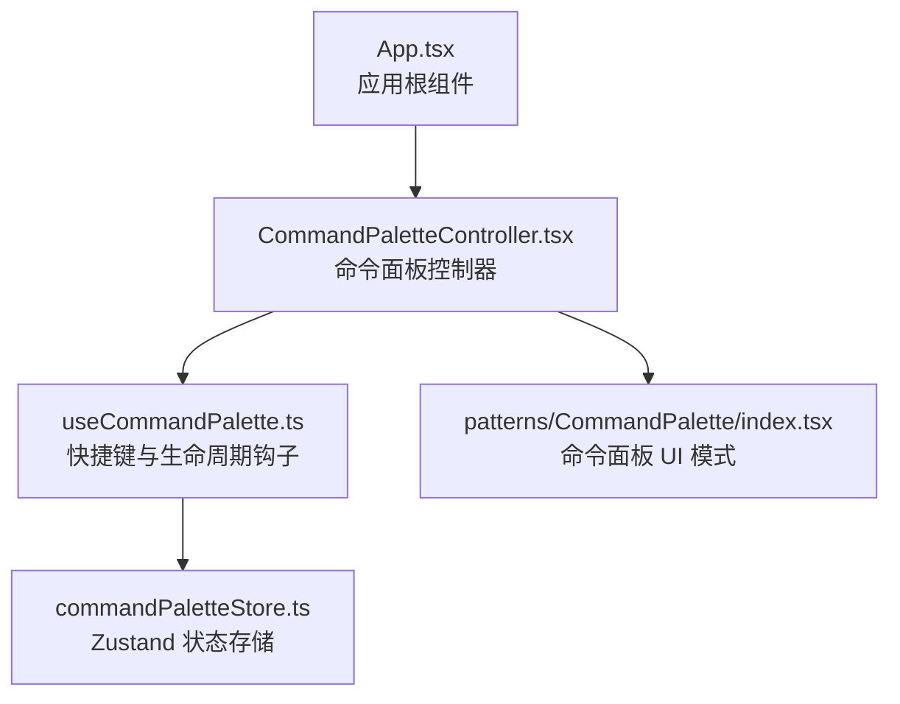
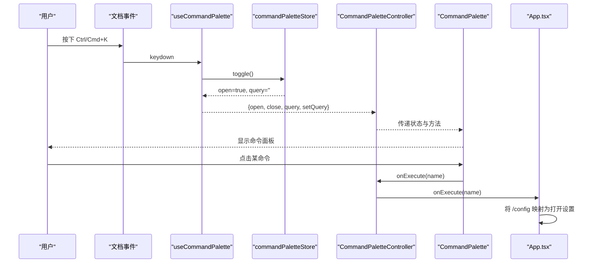
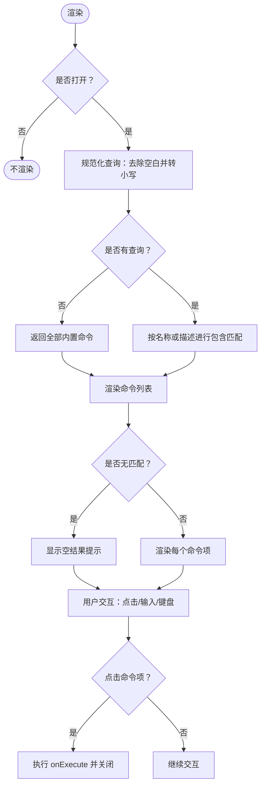
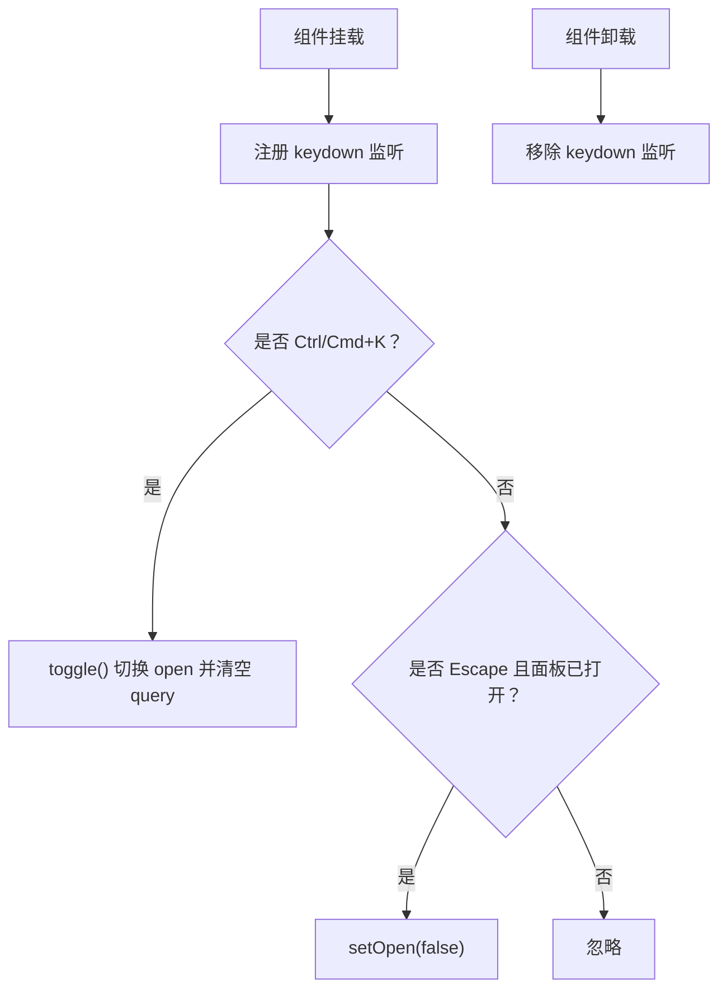
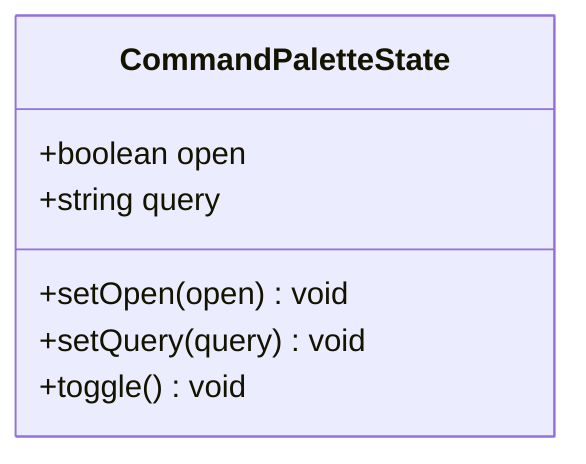
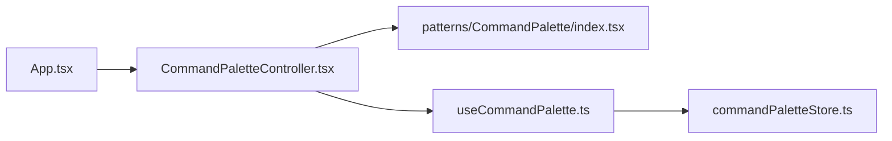

# 命令弹出界面

<cite>
**本文引用的文件**   
- [App.tsx](file://src/renderer/app/App.tsx)
- [CommandPaletteController.tsx](file://src/renderer/app/CommandPaletteController.tsx)
- [useCommandPalette.ts](file://src/renderer/app/useCommandPalette.ts)
- [commandPaletteStore.ts](file://src/renderer/stores/commandPaletteStore.ts)
- [index.tsx](file://src/renderer/patterns/CommandPalette/index.tsx)
- [useCommandPalette.test.ts](file://src/renderer/app/useCommandPalette.test.ts)
</cite>

## 目录
1. [简介](#简介)
2. [项目结构](#项目结构)
3. [核心组件](#核心组件)
4. [架构总览](#架构总览)
5. [详细组件分析](#详细组件分析)
6. [依赖关系分析](#依赖关系分析)
7. [性能考虑](#性能考虑)
8. [故障排查指南](#故障排查指南)
9. [结论](#结论)
10. [附录](#附录)

## 简介
本文件围绕“命令弹出界面”展开，聚焦以下方面：
- UI 组件结构：命令列表渲染、选中状态管理、键盘导航支持。
- 命令过滤逻辑：名称匹配、别名匹配、大小写处理。
- 用户交互：上下箭头导航、Enter 选择、Escape 关闭、鼠标悬停高亮。
- 可访问性：ARIA 属性、角色定义、键盘焦点管理。
- 样式定制选项与响应式设计考虑。

当前实现中，“命令弹出界面”由一个轻量命令面板模式（Pattern）与 App 层的控制器、全局快捷键钩子、Zustand 状态存储共同构成。它面向内置命令提供快速输入、即时过滤与执行入口，并通过 App 层将部分命令映射到应用行为（例如打开设置）。

## 项目结构
命令弹出界面相关代码分布在渲染进程的前端代码中，采用“模式 + 控制器 + 状态存储”的分层组织方式：
- 模式层负责展示与本地过滤逻辑。
- 控制器层负责与 App 集成并透传执行回调。
- 状态存储层维护开闭、查询词等全局状态。
- App 层挂载控制器，并将特定命令路由到业务动作。

**图表来源**
- [App.tsx:240-260](file://src/renderer/app/App.tsx#L240-L260)
- [CommandPaletteController.tsx:1-7](file://src/renderer/app/CommandPaletteController.tsx#L1-L7)
- [useCommandPalette.ts:1-24](file://src/renderer/app/useCommandPalette.ts#L1-L24)
- [commandPaletteStore.ts:1-17](file://src/renderer/stores/commandPaletteStore.ts#L1-L17)
- [index.tsx:1-71](file://src/renderer/patterns/CommandPalette/index.tsx#L1-L71)

**章节来源**
- [App.tsx:240-260](file://src/renderer/app/App.tsx#L240-L260)
- [CommandPaletteController.tsx:1-7](file://src/renderer/app/CommandPaletteController.tsx#L1-L7)
- [useCommandPalette.ts:1-24](file://src/renderer/app/useCommandPalette.ts#L1-L24)
- [commandPaletteStore.ts:1-17](file://src/renderer/stores/commandPaletteStore.ts#L1-L17)
- [index.tsx:1-71](file://src/renderer/patterns/CommandPalette/index.tsx#L1-L71)

## 核心组件
- 命令面板模式（CommandPalette）
  - 职责：接收 open、close、query、setQuery、onExecute；渲染遮罩、输入框、命令列表和空结果提示。
  - 内置命令：包含一组以斜杠开头的命令名及其描述，作为默认过滤源。
- 命令面板控制器（CommandPaletteController）
  - 职责：调用 useCommandPalette 获取状态与方法，并将 onExecute 透传给 UI 模式。
- 快捷键钩子（useCommandPalette）
  - 职责：监听 Ctrl/Cmd+K 打开面板，Esc 关闭面板；卸载时移除事件监听。
- 状态存储（commandPaletteStore）
  - 职责：维护 open、query、setOpen、setQuery、toggle；切换时清空查询。
- App 集成
  - 职责：在应用根组件中挂载 CommandPaletteController，并将特定命令（如 /config）映射到打开设置模态。

**章节来源**
- [index.tsx:1-71](file://src/renderer/patterns/CommandPalette/index.tsx#L1-L71)
- [CommandPaletteController.tsx:1-7](file://src/renderer/app/CommandPaletteController.tsx#L1-L7)
- [useCommandPalette.ts:1-24](file://src/renderer/app/useCommandPalette.ts#L1-L24)
- [commandPaletteStore.ts:1-17](file://src/renderer/stores/commandPaletteStore.ts#L1-L17)
- [App.tsx:240-260](file://src/renderer/app/App.tsx#L240-L260)

## 架构总览
命令弹出界面的数据流与控制流如下：
- 用户通过全局快捷键触发开关。
- 控制器从 Zustand 状态中读取 open 与 query，并传入 UI 模式。
- UI 模式根据 query 对内置命令进行本地过滤并渲染。
- 用户点击某条命令时，调用 onExecute，由 App 层将特定命令路由到具体功能。

**图表来源**
- [useCommandPalette.ts:5-24](file://src/renderer/app/useCommandPalette.ts#L5-L24)
- [commandPaletteStore.ts:9-17](file://src/renderer/stores/commandPaletteStore.ts#L9-L17)
- [CommandPaletteController.tsx:1-7](file://src/renderer/app/CommandPaletteController.tsx#L1-L7)
- [index.tsx:25-71](file://src/renderer/patterns/CommandPalette/index.tsx#L25-L71)
- [App.tsx:240-260](file://src/renderer/app/App.tsx#L240-L260)

## 详细组件分析

### 命令面板模式（UI 层）
- 渲染结构
  - 遮罩层：点击关闭面板。
  - 内容容器：阻止事件冒泡，避免误触遮罩。
  - 输入区域：包含提示符与输入框，自动聚焦。
  - 列表区域：遍历过滤后的命令，每项为一个按钮。
  - 空结果提示：当无匹配命令时显示。
- 命令过滤逻辑
  - 查询规范化：trim 后转小写。
  - 匹配规则：命令名包含查询或描述包含查询（描述也转小写）。
  - 未输入时返回全部内置命令。
- 选中状态管理
  - 当前实现没有显式“选中行”状态；仅通过鼠标点击执行命令。
  - 建议扩展：维护 selectedIndex 并在键盘上下导航时更新。
- 键盘导航支持
  - 当前未在模式内部实现上下箭头导航与 Enter 确认逻辑。
  - 可通过在模式内增加 onKeyDown 监听补齐。
- 鼠标交互
  - 遮罩点击关闭。
  - 列表项按钮点击执行命令并关闭面板。
  - 悬停高亮可通过 CSS 控制。

**图表来源**
- [index.tsx:14-23](file://src/renderer/patterns/CommandPalette/index.tsx#L14-L23)
- [index.tsx:25-71](file://src/renderer/patterns/CommandPalette/index.tsx#L25-L71)

**章节来源**
- [index.tsx:1-71](file://src/renderer/patterns/CommandPalette/index.tsx#L1-L71)

### 快捷键与生命周期（useCommandPalette）
- 快捷键绑定
  - 监听 document 的 keydown。
  - Ctrl/Cmd+K 触发 toggle，同时 preventDefault 避免浏览器默认行为。
  - Esc 仅在面板打开时关闭。
- 生命周期
  - useEffect 注册监听，清理函数在卸载时移除监听，防止内存泄漏。
- 返回值
  - 暴露 open、close、query、setQuery 供控制器与 UI 使用。

**图表来源**
- [useCommandPalette.ts:5-24](file://src/renderer/app/useCommandPalette.ts#L5-L24)

**章节来源**
- [useCommandPalette.ts:1-24](file://src/renderer/app/useCommandPalette.ts#L1-L24)

### 状态存储（commandPaletteStore）
- 状态字段
  - open：面板是否可见。
  - query：当前输入查询。
- 方法
  - setOpen：设置 open，并在打开时将 query 清空。
  - setQuery：更新查询。
  - toggle：切换 open，并在切换时清空 query。
- 设计要点
  - 使用 Zustand create 创建 store。
  - 切换时清空 query，保证每次打开都是干净输入状态。

**图表来源**
- [commandPaletteStore.ts:3-17](file://src/renderer/stores/commandPaletteStore.ts#L3-L17)

**章节来源**
- [commandPaletteStore.ts:1-17](file://src/renderer/stores/commandPaletteStore.ts#L1-L17)

### 控制器（CommandPaletteController）
- 职责单一：桥接 App 与 UI 模式。
- 透传 onExecute：让上层 App 决定如何处理命令执行。
- 复用 useCommandPalette：集中管理快捷键与状态。

**章节来源**
- [CommandPaletteController.tsx:1-7](file://src/renderer/app/CommandPaletteController.tsx#L1-L7)

### App 集成
- 挂载控制器：在应用主体中渲染 CommandPaletteController。
- 命令路由：将 /config 映射为打开设置模态，其余命令可由外部扩展。
- 与其他模态共存：与知识中心模态、通知等并列渲染。

**章节来源**
- [App.tsx:240-260](file://src/renderer/app/App.tsx#L240-L260)

## 依赖关系分析
- 耦合度
  - 模式层仅依赖 i18n 与 React，低耦合。
  - 控制器依赖模式与钩子，保持薄封装。
  - 钩子依赖 Zustand store，解耦于 UI。
  - App 仅依赖控制器，命令路由集中在 App 层，便于扩展。
- 循环依赖
  - 当前模块间无循环导入。
- 外部依赖
  - Zustand：用于状态管理。
  - React：组件与 Hooks。
  - i18n：用于占位符文本。

**图表来源**
- [App.tsx:240-260](file://src/renderer/app/App.tsx#L240-L260)
- [CommandPaletteController.tsx:1-7](file://src/renderer/app/CommandPaletteController.tsx#L1-L7)
- [index.tsx:1-71](file://src/renderer/patterns/CommandPalette/index.tsx#L1-L71)
- [useCommandPalette.ts:1-24](file://src/renderer/app/useCommandPalette.ts#L1-L24)
- [commandPaletteStore.ts:1-17](file://src/renderer/stores/commandPaletteStore.ts#L1-L17)

**章节来源**
- [App.tsx:240-260](file://src/renderer/app/App.tsx#L240-L260)
- [CommandPaletteController.tsx:1-7](file://src/renderer/app/CommandPaletteController.tsx#L1-L7)
- [index.tsx:1-71](file://src/renderer/patterns/CommandPalette/index.tsx#L1-L71)
- [useCommandPalette.ts:1-24](file://src/renderer/app/useCommandPalette.ts#L1-L24)
- [commandPaletteStore.ts:1-17](file://src/renderer/stores/commandPaletteStore.ts#L1-L17)

## 性能考虑
- 过滤计算
  - 使用 useMemo 缓存过滤结果，依赖 query 变化，避免重复计算。
  - 内置命令数量较少，时间复杂度近似 O(n)，空间复杂度 O(n)。
- 事件监听
  - 仅在 mounted 时添加 document keydown 监听，unmounted 时移除，避免多余监听器。
- 渲染优化
  - 未打开时直接返回 null，减少不必要的 DOM 树。
  - 列表项使用稳定 key（命令名），有助于 React 列表 diff。
- 可扩展性
  - 若后续引入远程命令或大量命令，应考虑分页虚拟滚动、增量搜索索引与防抖查询。

[本节为通用性能建议，不直接分析具体文件]

## 故障排查指南
- 快捷键无效
  - 检查是否在 App 层级正确挂载了 CommandPaletteController。
  - 确认浏览器未拦截 Ctrl/Cmd+K 的默认行为；当前实现已调用 preventDefault。
  - 验证测试断言：单元测试会模拟 keydown 事件并校验 open 状态变化。
- 无法关闭面板
  - 检查是否按下 Esc 且面板处于打开状态；当前实现仅在 open 为 true 时关闭。
  - 检查遮罩点击事件是否正确触发 close。
- 过滤结果异常
  - 确认查询词是否正确 trim 并转小写；匹配逻辑对名称与描述均做小写比较。
  - 确认内置命令集合是否被替换或扩展。
- 点击命令无反应
  - 检查 onExecute 是否传入控制器并被 App 层接收。
  - 确认 /config 之外的命令是否需要在 App 层补充路由逻辑。

**章节来源**
- [useCommandPalette.test.ts:1-27](file://src/renderer/app/useCommandPalette.test.ts#L1-L27)
- [useCommandPalette.ts:5-24](file://src/renderer/app/useCommandPalette.ts#L5-L24)
- [index.tsx:25-71](file://src/renderer/patterns/CommandPalette/index.tsx#L25-L71)
- [App.tsx:240-260](file://src/renderer/app/App.tsx#L240-L260)

## 结论
命令弹出界面在当前仓库中以简洁的模式实现了“快速输入 + 本地过滤 + 基础执行”的核心能力，并通过 Zustand 与 React Hooks 维持清晰的状态与生命周期管理。其优点包括：
- 分层清晰：模式、控制器、钩子、存储职责明确。
- 易于扩展：可在 App 层接入更多命令路由，或在模式层扩展键盘导航与高级过滤。
- 可测试性强：快捷键行为有对应单元测试覆盖。

需要改进的方向包括：
- 增强键盘导航：实现上下箭头移动选中项、Enter 确认、Tab/Shift+Tab 跳转。
- 完善可访问性：为列表与项提供 aria-activedescendant、aria-controls、role="listbox"/"option" 等语义。
- 统一样式主题：当前样式类名存在但未在仓库中发现对应样式文件，需补齐 CSS 并考虑暗色主题与响应式布局。
- 命令扩展机制：支持动态命令、别名、分组与优先级排序。

[本节为总结性内容，不直接分析具体文件]

## 附录

### 用户交互矩阵
- 打开面板：Ctrl/Cmd+K。
- 关闭面板：Esc、点击遮罩。
- 选择命令：鼠标点击命令项。
- 键盘导航：当前未实现，建议扩展上下箭头、Enter、Tab。

### 过滤与匹配规则
- 查询规范化：去除首尾空白并转小写。
- 匹配范围：命令名、命令描述。
- 大小写处理：比较前统一转为小写。
- 别名支持：当前未实现；可在命令对象中新增 aliases 字段并在过滤逻辑中加入别名匹配。

### 可访问性现状与建议
- 现状
  - 输入框设置了 aria-label。
  - 列表与列表项未设置 ARIA 列表语义。
  - 未维护活动项焦点与 aria-activedescendant。
- 建议
  - 外层容器 role="dialog" 或 role="combobox"，配合 aria-modal、aria-labelledby。
  - 列表 role="listbox"，列表项 role="option"，并为活动项设置 aria-selected。
  - 输入框与列表之间通过 aria-controls 关联，并使用 aria-activedescendant 指向活动项 id。
  - 键盘逻辑：ArrowUp/ArrowDown 切换选中项，Enter 确认，Escape 关闭，Tab/Shift+Trap 在对话框边界内聚焦。

### 样式定制与响应式建议
- 当前样式类名
  - 遮罩层：command-palette-overlay
  - 面板容器：command-palette
  - 输入区域：command-palette-input-wrap
  - 输入框：command-palette-input
  - 列表容器：command-palette-list
  - 列表项：command-palette-item
  - 名称标签：command-palette-name
  - 空结果提示：command-palette-empty
- 定制建议
  - 使用 CSS 变量定义颜色、字号、圆角与阴影，支持明暗主题切换。
  - 面板宽度自适应视口，移动端居中卡片，桌面端固定最大宽度。
  - 列表项悬停高亮通过 :hover 伪类实现，确保焦点与悬停视觉一致。
  - 字体缩放与多语言长文本换行适配。

[本节为概念性说明，不直接分析具体文件]