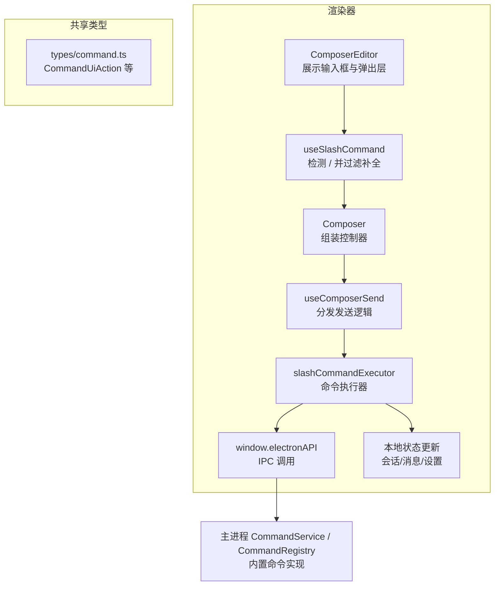
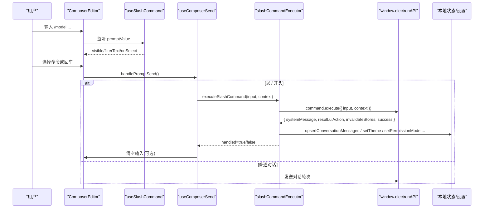
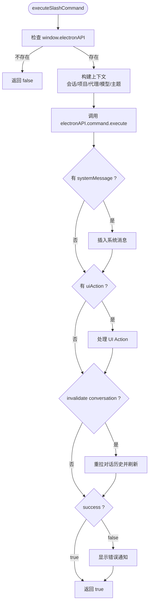
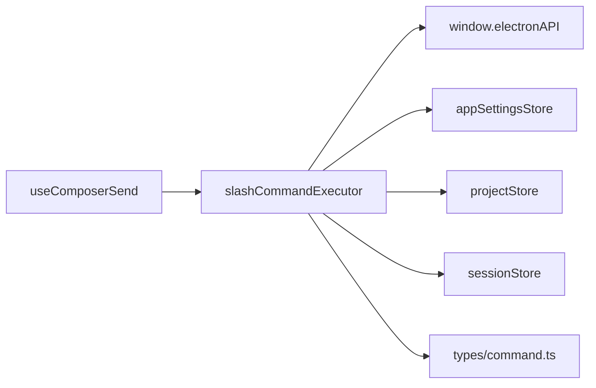

# 命令执行系统

<cite>
**本文引用的文件**   
- [slashCommandExecutor.ts](file://src/renderer/features/composer/slashCommandExecutor.ts)
- [useComposerSend.ts](file://src/renderer/features/composer/useComposerSend.ts)
- [useSlashCommand.ts](file://src/renderer/features/composer/useSlashCommand.ts)
- [ComposerEditor.tsx](file://src/renderer/features/composer/ComposerEditor.tsx)
- [command.ts](file://src/shared/src/shared/types/command.ts)
</cite>

## 目录
1. [引言](#引言)
2. [项目结构](#项目结构)
3. [核心组件](#核心组件)
4. [架构总览](#架构总览)
5. [详细组件分析](#详细组件分析)
6. [依赖关系分析](#依赖关系分析)
7. [性能与健壮性](#性能与健壮性)
8. [故障排查指南](#故障排查指南)
9. [结论](#结论)
10. [附录：内置命令与扩展点](#附录内置命令与扩展点)

## 引言
本文件面向“命令执行系统”，聚焦渲染器侧的斜杠命令处理链路，解释如下主题：
- SlashCommandContext 上下文设计，包括会话、项目、设置访问和 UI 能力。
- 内置命令实现路径，包括模型切换、会话加载、主题与权限设置等。
- 命令参数解析，包括 payload 提取、字符串校验、错误处理。
- 与后端 API 的交互方式，包括 electronAPI 调用、结果处理与通知显示。
- 自定义命令开发指南与扩展点说明。

该系统的目标是让使用者通过输入框以 `/` 开头的文本触发命令，由前端路由到统一的命令执行流程，再由后端命令注册中心提供具体实现；同时为需要直接操作对话状态的前端命令提供本地处理分支。

## 项目结构
命令执行系统主要位于渲染器的 Composer（对话编辑器）特性中，并与共享类型及主进程命令服务协作：

**图表来源**
- [ComposerEditor.tsx:1-65](file://src/renderer/features/composer/ComposerEditor.tsx#L1-L65)
- [useSlashCommand.ts:1-48](file://src/renderer/features/composer/useSlashCommand.ts#L1-L48)
- [useComposerSend.ts:1-199](file://src/renderer/features/composer/useComposerSend.ts#L1-L199)
- [slashCommandExecutor.ts:1-283](file://src/renderer/features/composer/slashCommandExecutor.ts#L1-L283)
- [command.ts](file://src/shared/src/shared/types/command.ts)

**章节来源**
- [ComposerEditor.tsx:1-65](file://src/renderer/features/composer/ComposerEditor.tsx#L1-L65)
- [useSlashCommand.ts:1-48](file://src/renderer/features/composer/useSlashCommand.ts#L1-L48)
- [useComposerSend.ts:1-199](file://src/renderer/features/composer/useComposerSend.ts#L1-L199)
- [slashCommandExecutor.ts:1-283](file://src/renderer/features/composer/slashCommandExecutor.ts#L1-L283)
- [command.ts](file://src/shared/src/shared/types/command.ts)

## 核心组件
- 命令提示与补全：`useSlashCommand` 负责检测以 `/` 开头的输入、计算过滤文本、控制弹出层显隐，并在选中命令后清空输入并回调发送。
- 编辑器视图：`ComposerEditor` 将 `useSlashCommand` 的结果注入到弹出层，并根据 Markdown 模式选择输入控件。
- 发送路由：`useComposerSend` 在用户提交时判断是否斜杠命令；若是则进入命令执行器，否则走常规对话发送流程。
- 命令执行器：`slashCommandExecutor` 提供统一入口，封装对 `electronAPI.command.execute` 的调用、对后端返回 UI Action 的处理、以及部分本地命令逻辑。
- 共享类型：`CommandUiAction` 定义前端可识别的后端 UI 指令，用于打开设置、切换主题、切换权限、恢复会话、导出会话、撤销、运行技能等。

**章节来源**
- [useSlashCommand.ts:1-48](file://src/renderer/features/composer/useSlashCommand.ts#L1-L48)
- [ComposerEditor.tsx:1-65](file://src/renderer/features/composer/ComposerEditor.tsx#L1-L65)
- [useComposerSend.ts:1-199](file://src/renderer/features/composer/useComposerSend.ts#L1-L199)
- [slashCommandExecutor.ts:1-283](file://src/renderer/features/composer/slashCommandExecutor.ts#L1-L283)
- [command.ts](file://src/shared/src/shared/types/command.ts)

## 架构总览
斜杠命令从输入到执行的端到端流程如下：

**图表来源**
- [ComposerEditor.tsx:1-65](file://src/renderer/features/composer/ComposerEditor.tsx#L1-L65)
- [useSlashCommand.ts:1-48](file://src/renderer/features/composer/useSlashCommand.ts#L1-L48)
- [useComposerSend.ts:1-199](file://src/renderer/features/composer/useComposerSend.ts#L1-L199)
- [slashCommandExecutor.ts:1-283](file://src/renderer/features/composer/slashCommandExecutor.ts#L1-L283)

## 详细组件分析

### SlashCommandContext 上下文设计
`SlashCommandContext` 是命令执行器接收的上下文对象，它将“当前会话、当前项目、代理与模式、对话消息、设置与通知”等能力聚合起来，避免命令执行器直接耦合具体 store 实现。

- 会话管理
  - `currentSession`: 当前会话记录，为空表示未选择会话。
  - `setConversationMessages` / `upsertConversationMessages`: 刷新对话消息列表，用于同步后端命令修改后的对话状态。
- 项目状态
  - `currentProject`: 当前项目记录，包含项目 ID 与工作区根路径等元信息。
- 代理与模式
  - `selectedAgentId` / `setSelectedAgentId`: 当前选中的代理标识。
  - `setCurrentMode`: 将代理标识映射为界面模式，影响工作流呈现。
- 设置与 UI
  - `openSettings(section?)`: 打开应用设置面板并可指定节。
  - `showNotice(message)`: 向用户显示一次性通知。
  - `armPendingSkill(skillId)`（可选）：标记下一个发送携带的技能。

该上下文的设计使得命令执行器既能调用后端 API，也能直接操作前端状态与 UI，形成“后端命令 + 前端本地命令”的统一入口。

**章节来源**
- [slashCommandExecutor.ts:1-60](file://src/renderer/features/composer/slashCommandExecutor.ts#L1-L60)

### 命令参数解析与错误处理
命令参数解析集中在两个层面：

1. 通用 payload 提取
   - 使用内部工具函数从 `CommandUiAction.payload` 中提取字符串字段，若字段不存在或类型不是字符串则返回空值。
   - 所有 UI Action 分支均先校验关键字段是否存在且合法，再执行业务逻辑。

2. 特定命令校验
   - 主题设置仅接受有限集合值，非法值会立即提示并中止。
   - 权限模式同样进行白名单校验。
   - 会话相关命令在未提供 sessionId 时会提示“未选择会话”。
   - 技能执行需要 skillId，缺失时提示并中止。

错误处理策略：
- 对于无法直接处理的无效参数，使用 `showNotice` 给出明确提示。
- 对异步 API 失败，读取 `error` 或默认消息提示。
- 对异常捕获，将 Error 对象消息或通用失败信息提示给用户。

**章节来源**
- [slashCommandExecutor.ts:60-283](file://src/renderer/features/composer/slashCommandExecutor.ts#L60-L283)

### 内置命令实现

#### 模型切换
模型切换既支持前端本地逻辑，也支持后端命令统一处理：

- 前端本地逻辑
  - 当收到 `switch-model` 的 UI Action 时，会判断是否为“代理默认模型”标记。
  - 若是默认模型，尝试清除覆盖配置；若非默认模型，则解析并写入模型覆盖。
  - 若选项无效或保存失败，通过翻译文案和用户通知反馈。
- 后端统一命令
  - 普通 `/model` 输入会进入 `executeSlashCommand`，将当前会话、项目、代理、模式、当前模型与主题等信息一并传给后端。
  - 后端命令实现可根据上下文决定如何切换模型，并可选择返回 UI Action 驱动前端进一步更新。

**章节来源**
- [slashCommandExecutor.ts:100-170](file://src/renderer/features/composer/slashCommandExecutor.ts#L100-L170)
- [slashCommandExecutor.ts:233-283](file://src/renderer/features/composer/slashCommandExecutor.ts#L233-L283)

#### 会话加载与会话恢复
- 会话加载
  - 对应 `resume-session` 场景：如果提供了 sessionId，则调用 `electronAPI.session.select` 选择会话，随后并行加载会话列表、运行历史与对话历史，并更新项目和会话状态。
  - 若选择失败或未找到会话，则显示错误通知。
- 会话恢复
  - 若未提供 sessionId，则调用 `electronAPI.workflow.resume` 尝试恢复最近的可恢复会话。
  - 失败时提示错误或“无可恢复会话”。

**章节来源**
- [slashCommandExecutor.ts:80-120](file://src/renderer/features/composer/slashCommandExecutor.ts#L80-L120)

#### 主题与权限设置
- 主题设置
  - 接收 theme 参数，仅允许 `dark`、`light`、`system`。
  - 调用应用设置 store 的 `setTheme` 方法更新主题。
- 权限设置
  - 接收 mode 参数，仅允许 `default`、`auto-review`、`full-access`、`custom`。
  - 调用设置 store 的 `setAgentPermissionMode` 更新权限模式。

**章节来源**
- [slashCommandExecutor.ts:140-170](file://src/renderer/features/composer/slashCommandExecutor.ts#L140-L170)

#### 其他常用命令
- 打开设置：`open-settings`，可选 section 参数。
- 切换代理模式：`switch-mode`，传入 agentId。
- 导出会话：`export-session`，支持 JSON 或 Markdown 格式，按当前会话或传入 sessionId 导出。
- 撤销最后一轮：`undo-session`，调用对话 API 并刷新消息。
- 清空会话历史：`clear-session`，调用清理接口并刷新消息。
- 预装技能：`run-skill`，将技能标记为下一次发送携带。

**章节来源**
- [slashCommandExecutor.ts:120-220](file://src/renderer/features/composer/slashCommandExecutor.ts#L120-L220)

### 与后端 API 的交互
命令执行器通过 `window.electronAPI` 与主进程通信：

- 命令执行
  - 调用 `electronAPI.command.execute`，传入原始输入与结构化上下文。
  - 上下文包含会话 ID、项目 ID、工作区根路径、代理 ID、当前模式、当前模型标识、当前主题。
- 结果处理
  - 若返回 `systemMessage`，将其插入对话消息列表。
  - 若返回 `uiAction`，交由前端 UI Action 处理器执行本地操作。
  - 若返回 `invalidateStores.conversation`，重新拉取对话历史并刷新消息。
  - 若 `success` 为 false，显示后端返回的错误消息。
  - 捕获异常时显示错误信息，但仍返回 true，避免阻塞后续发送状态。

**图表来源**
- [slashCommandExecutor.ts:233-283](file://src/renderer/features/composer/slashCommandExecutor.ts#L233-L283)

**章节来源**
- [slashCommandExecutor.ts:233-283](file://src/renderer/features/composer/slashCommandExecutor.ts#L233-L283)

### 命令输入与补全体验
`useSlashCommand` 的职责是提升斜杠命令的可用性：

- 检测输入是否以 `/` 开头。
- 计算去除 `/` 后的过滤文本。
- 限制弹出层仅在长度不超过阈值时显示。
- 选中命令后清空输入并回调 `onSendCommand`，由上层决定是否发送命令。

`ComposerEditor` 将弹出层与输入框组合，支持纯文本与 Markdown 两种输入模式，并在合适时机渲染命令补全弹出层。

**章节来源**
- [useSlashCommand.ts:1-48](file://src/renderer/features/composer/useSlashCommand.ts#L1-L48)
- [ComposerEditor.tsx:1-65](file://src/renderer/features/composer/ComposerEditor.tsx#L1-L65)

## 依赖关系分析
命令执行系统的依赖关系可以概括为：

- 渲染器层依赖：
  - `useComposerSend` 依赖 `slashCommandExecutor` 与多个 store（项目、会话、对话、工作流）。
  - `slashCommandExecutor` 依赖 `window.electronAPI`、应用设置 store、项目 store、会话 store、i18n 与模型选择辅助函数。
- 共享类型依赖：
  - `CommandUiAction` 定义了前后端 UI 动作契约，使前端能安全地处理后端返回的动作。

**图表来源**
- [useComposerSend.ts:1-199](file://src/renderer/features/composer/useComposerSend.ts#L1-L199)
- [slashCommandExecutor.ts:1-283](file://src/renderer/features/composer/slashCommandExecutor.ts#L1-L283)
- [command.ts](file://src/shared/src/shared/types/command.ts)

**章节来源**
- [useComposerSend.ts:1-199](file://src/renderer/features/composer/useComposerSend.ts#L1-L199)
- [slashCommandExecutor.ts:1-283](file://src/renderer/features/composer/slashCommandExecutor.ts#L1-L283)
- [command.ts](file://src/shared/src/shared/types/command.ts)

## 性能与健壮性
- 并发与忙碌状态
  - 普通对话发送与斜杠命令发送都会设置 `isPromptSending`，避免重复提交。
  - 针对模型切换命令存在并发豁免逻辑，允许在忙碌状态下再次切换模型。
- 批量数据加载
  - 会话加载时使用并行请求加载会话列表、运行历史与对话历史，减少等待时间。
- 异常容错
  - 对命令执行过程进行 try/catch，确保异常不会导致整个发送流程崩溃。
  - 对无效参数进行前置校验，避免无意义后端调用。
- 状态一致性
  - 根据后端返回的 `invalidateStores` 指示，主动刷新对话历史，保持前端状态与后端一致。

**章节来源**
- [useComposerSend.ts:1-199](file://src/renderer/features/composer/useComposerSend.ts#L1-L199)
- [slashCommandExecutor.ts:80-120](file://src/renderer/features/composer/slashCommandExecutor.ts#L80-L120)
- [slashCommandExecutor.ts:233-283](file://src/renderer/features/composer/slashCommandExecutor.ts#L233-L283)

## 故障排查指南
常见问题与定位建议：

- 命令不生效
  - 确认输入是否以 `/` 开头。
  - 检查 `window.electronAPI` 是否存在。
  - 查看命令执行器是否正确返回 handled 标志。
- 模型切换失败
  - 检查 modelId 是否为代理默认模型标记或有效模型覆盖。
  - 查看保存覆盖配置的返回结果与通知文案。
- 会话加载失败
  - 检查 sessionId 是否正确。
  - 查看 `session.select` 与并行拉取会话、运行、历史的返回。
- 主题或权限设置无效
  - 检查传入值是否在允许集合内。
  - 确认设置 store 的方法是否被调用。
- 对话状态不同步
  - 检查后端是否返回 `invalidateStores.conversation`。
  - 确认是否重新拉取了对话历史并更新了消息列表。
- 通知频繁或文案不清晰
  - 检查 `showNotice` 调用位置与文案来源，优先使用 i18n 文案。

**章节来源**
- [slashCommandExecutor.ts:60-283](file://src/renderer/features/composer/slashCommandExecutor.ts#L60-L283)
- [useComposerSend.ts:1-199](file://src/renderer/features/composer/useComposerSend.ts#L1-L199)

## 结论
命令执行系统将“输入框斜杠命令”抽象为统一的执行通道：前端负责输入体验、参数解析、UI 动作处理与状态刷新，后端负责命令注册与业务实现。`SlashCommandContext` 作为上下文契约，将会话、项目、设置与 UI 能力暴露给命令执行器，既支持后端命令驱动，也支持前端本地命令快速响应。通过清晰的参数校验、错误通知与状态同步机制，系统在易用性与健壮性之间取得平衡。

## 附录：内置命令与扩展点

### 内置命令清单
- 模型切换：`/model`
- 会话加载：`/session`
- 主题设置：`/theme`
- 权限设置：`/permissions`
- 打开设置：`/settings`
- 切换代理模式：`/mode`
- 恢复会话：`/resume`
- 导出会话：`/export`
- 撤销：`/undo`
- 清空会话：`/clear`
- 运行技能：`/skill`

这些命令可通过两种方式触发：
- 直接输入 `/xxx` 由后端命令注册中心处理。
- 后端命令返回 UI Action，由前端执行本地操作。

**章节来源**
- [slashCommandExecutor.ts:120-220](file://src/renderer/features/composer/slashCommandExecutor.ts#L120-L220)
- [slashCommandExecutor.ts:233-283](file://src/renderer/features/composer/slashCommandExecutor.ts#L233-L283)

### 自定义命令开发指南
- 推荐优先使用后端命令
  - 在命令注册中心注册新命令，实现业务逻辑。
  - 如需更新 UI，返回 `uiAction`，由前端统一处理。
- 使用 `SlashCommandContext`
  - 不要直接耦合具体 store，而是通过上下文提供的 setter 更新会话、消息、模式与设置。
  - 通过 `showNotice` 向用户反馈成功或失败。
- 参数解析
  - 使用 payload 提取工具获取字符串参数，并进行必要校验。
  - 对非法参数尽早返回，避免副作用。
- 与 electronAPI 交互
  - 所有 IPC 调用应集中在使用处，并处理成功、失败与异常三种情况。
  - 对可能刷新对话的命令，关注 `invalidateStores` 并刷新消息。
- 测试建议
  - 为关键命令编写单元测试，覆盖参数校验、成功分支与错误分支。
  - 对 UI Action 处理逻辑进行隔离测试，确保状态更新正确。

**章节来源**
- [slashCommandExecutor.ts:1-283](file://src/renderer/features/composer/slashCommandExecutor.ts#L1-L283)
- [useComposerSend.ts:1-199](file://src/renderer/features/composer/useComposerSend.ts#L1-L199)
- [command.ts](file://src/shared/src/shared/types/command.ts)