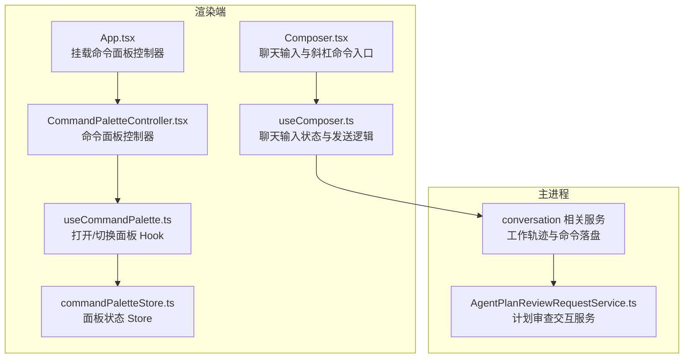
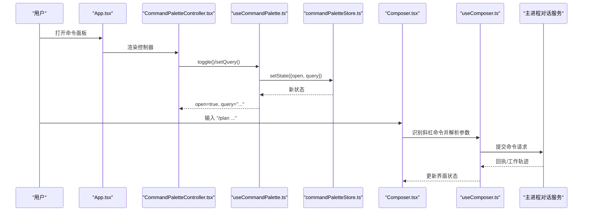
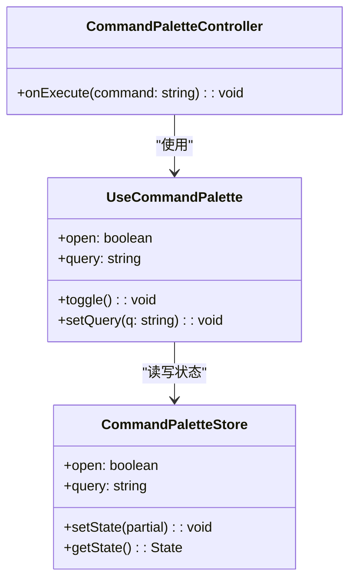
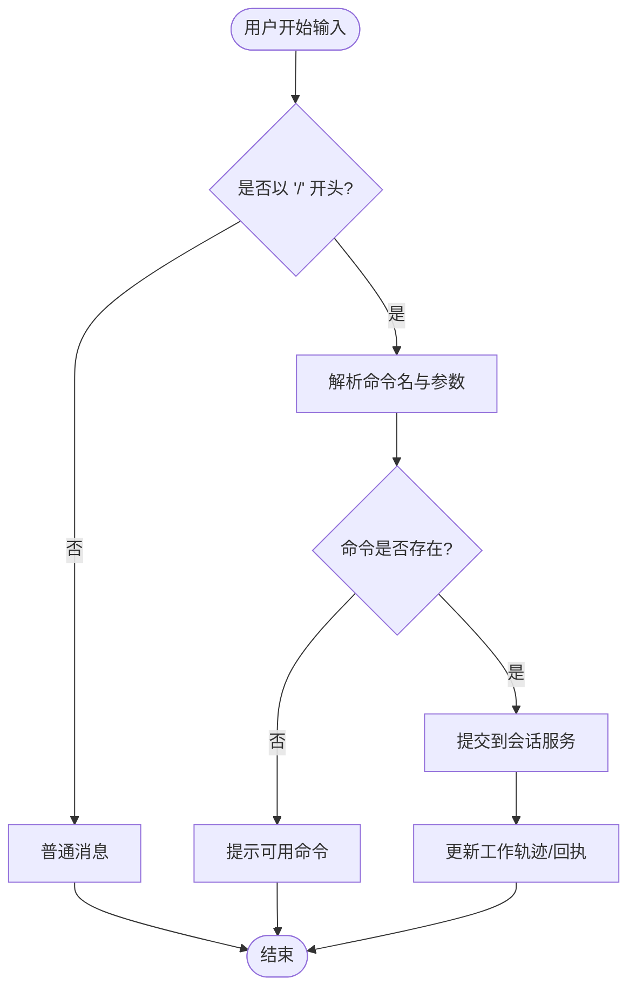
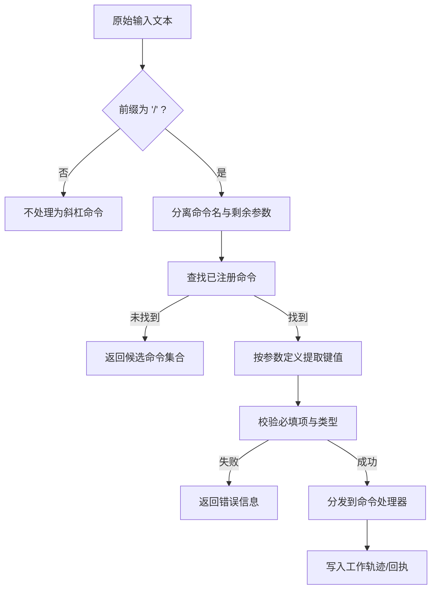
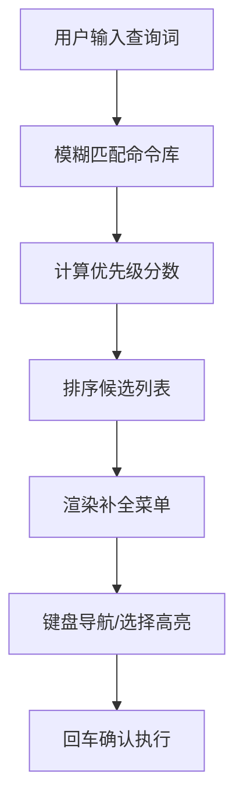
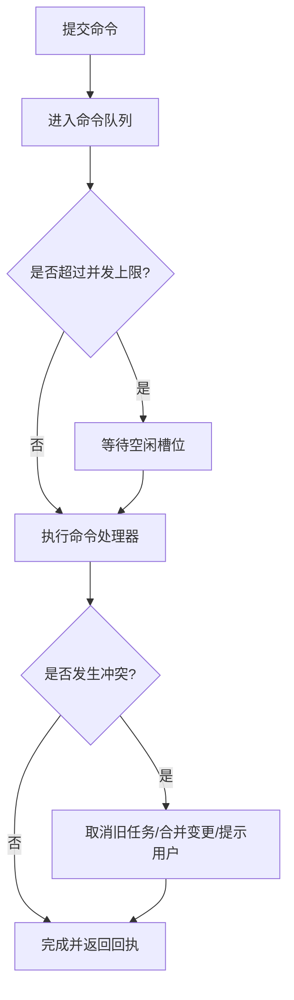
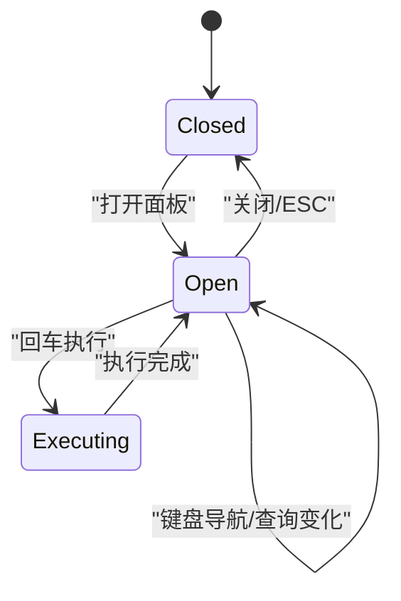
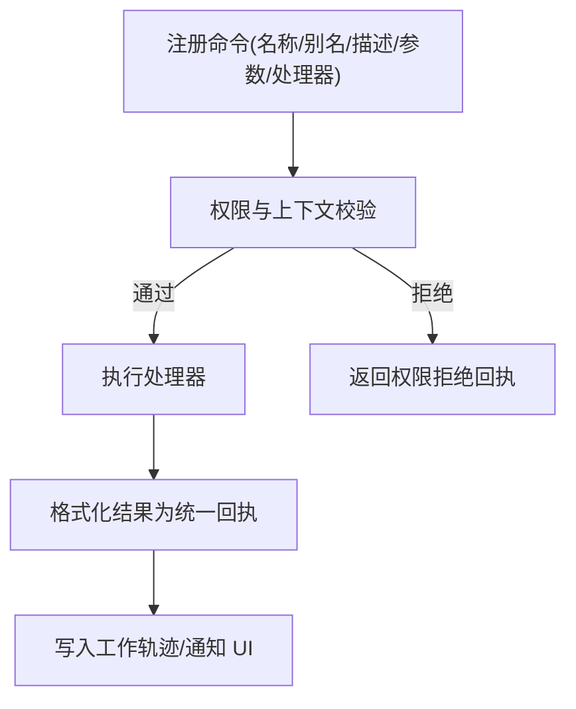
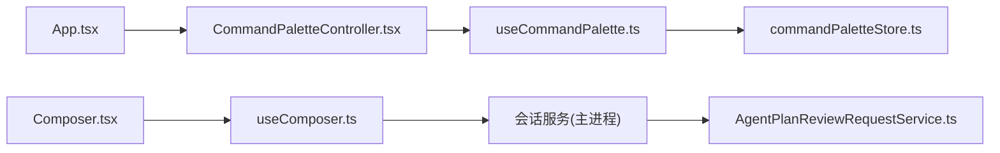

# 命令系统与斜杠命令

<cite>
**本文引用的文件**   
- [CommandPaletteController.tsx](file://src/src/renderer/app/CommandPaletteController.tsx)
- [useCommandPalette.ts](file://src/src/renderer/app/useCommandPalette.ts)
- [commandPaletteStore.ts](file://src/src/renderer/stores/commandPaletteStore.ts)
- [App.tsx](file://src/src/renderer/app/App.tsx)
- [useCommandPalette.test.ts](file://src/src/renderer/app/useCommandPalette.test.ts)
- [Composer.tsx](file://src/src/renderer/features/composer/Composer.tsx)
- [useComposer.ts](file://src/src/renderer/features/composer/useComposer.ts)
- [ConversationService.workTrace.test.ts](file://src/src/main/conversation/ConversationService.workTrace.test.ts)
- [ConversationTerminalToolReceipts.test.ts](file://src/src/main/conversation/ConversationTerminalToolReceipts.test.ts)
- [AgentPlanReviewRequestService.ts](file://src/src/main/agent-runtime/interactions/AgentPlanReviewRequestService.ts)
</cite>

## 目录
1. [引言](#引言)
2. [项目结构](#项目结构)
3. [核心组件](#核心组件)
4. [架构总览](#架构总览)
5. [详细组件分析](#详细组件分析)
6. [依赖关系分析](#依赖关系分析)
7. [性能与并发特性](#性能与并发特性)
8. [故障排查指南](#故障排查指南)
9. [结论](#结论)
10. [附录：命令开发示例与调试技巧](#附录命令开发示例与调试技巧)

## 引言
本文面向希望理解并扩展“命令系统与斜杠命令”的开发者。我们围绕以下目标展开：
- 解析器行为：斜杠（/）触发、命令匹配、参数提取。
- 自动补全：模糊搜索、优先级排序、上下文感知。
- 并发处理：命令队列、执行限制、冲突解决。
- 菜单状态管理：命令面板显示、键盘导航、选择高亮。
- 扩展点设计：自定义命令注册、权限验证、结果格式化。
- 开发与调试：可复用的实现模式与问题定位方法。

为避免混淆，本文区分两类命令：
- 应用级命令：通过命令面板（Command Palette）触发的全局命令，由 App 层控制器与 Store 驱动。
- 会话级斜杠命令：在聊天输入框中以 / 开头的快捷指令，通常用于快速发起计划、查看帮助或提交审查等任务。

## 项目结构
本仓库采用按领域划分的前后端代码组织方式。与命令系统直接相关的代码主要位于渲染端 UI 与主进程对话服务中：
- 渲染端
  - app 层：命令面板控制器、Hook 与 Store，负责打开/关闭面板、查询与执行命令。
  - features/composer：聊天输入区，承载斜杠命令的触发与发送流程。
- 主进程
  - conversation：对话生命周期与工作轨迹，部分测试展示了斜杠命令在工作流中的落地位置。
  - agent-runtime/interactions：代理交互服务，承担如计划审查等特定命令的后端编排。

**图表来源**
- [App.tsx:240-250](file://src/src/renderer/app/App.tsx#L240-L250)
- [CommandPaletteController.tsx:1-10](file://src/src/renderer/app/CommandPaletteController.tsx#L1-L10)
- [useCommandPalette.ts:1-10](file://src/src/renderer/app/useCommandPalette.ts#L1-L10)
- [commandPaletteStore.ts:1-20](file://src/src/renderer/stores/commandPaletteStore.ts#L1-L20)
- [Composer.tsx:1-40](file://src/src/renderer/features/composer/Composer.tsx#L1-L40)
- [useComposer.ts:1-40](file://src/src/renderer/features/composer/useComposer.ts#L1-L40)
- [AgentPlanReviewRequestService.ts:1-30](file://src/src/main/agent-runtime/interactions/AgentPlanReviewRequestService.ts#L1-L30)

**章节来源**
- [App.tsx:240-250](file://src/src/renderer/app/App.tsx#L240-L250)
- [CommandPaletteController.tsx:1-10](file://src/src/renderer/app/CommandPaletteController.tsx#L1-L10)
- [useCommandPalette.ts:1-10](file://src/src/renderer/app/useCommandPalette.ts#L1-L10)
- [commandPaletteStore.ts:1-20](file://src/src/renderer/stores/commandPaletteStore.ts#L1-L20)
- [Composer.tsx:1-40](file://src/src/renderer/features/composer/Composer.tsx#L1-L40)
- [useComposer.ts:1-40](file://src/src/renderer/features/composer/useComposer.ts#L1-L40)

## 核心组件
- 命令面板控制器（CommandPaletteController）
  - 职责：接收外部 onExecute 回调；使用 useCommandPalette Hook 控制面板开关与查询。
  - 关键交互：当用户通过快捷键或菜单打开面板时，控制器渲染命令列表并响应执行动作。
- 命令面板 Hook（useCommandPalette）
  - 职责：封装 open/toggle/query/setQuery 等操作，统一从 Store 读写状态。
  - 典型用法：在任意组件中调用以切换面板可见性或设置查询词。
- 命令面板 Store（commandPaletteStore）
  - 职责：维护 open、query 等状态，暴露 setState/getState API，供 Hook 和控制器消费。
- 聊天输入与斜杠命令（Composer、useComposer）
  - 职责：提供聊天输入框、监听 / 开头输入、将斜杠命令转换为结构化请求并提交到会话服务。
- 主进程对话服务与代理交互
  - 职责：记录工作轨迹、执行业务命令（例如计划审查），并在必要时返回结构化回执。

**章节来源**
- [CommandPaletteController.tsx:1-10](file://src/src/renderer/app/CommandPaletteController.tsx#L1-L10)
- [useCommandPalette.ts:1-10](file://src/src/renderer/app/useCommandPalette.ts#L1-L10)
- [commandPaletteStore.ts:1-20](file://src/src/renderer/stores/commandPaletteStore.ts#L1-L20)
- [Composer.tsx:1-40](file://src/src/renderer/features/composer/Composer.tsx#L1-L40)
- [useComposer.ts:1-40](file://src/src/renderer/features/composer/useComposer.ts#L1-L40)

## 架构总览
命令系统分为三层：
- 展示与控制层（渲染端）
  - 命令面板：App.tsx 注入 CommandPaletteController，useCommandPalette 管理状态，Store 提供数据源。
  - 聊天输入：Composer 捕获斜杠命令，useComposer 负责参数提取与提交。
- 业务编排层（主进程）
  - 对话服务：记录工作轨迹，协调命令的执行与结果持久化。
  - 代理交互服务：针对特定命令（如计划审查）进行更复杂的跨模块协作。

**图表来源**
- [App.tsx:240-250](file://src/src/renderer/app/App.tsx#L240-L250)
- [CommandPaletteController.tsx:1-10](file://src/src/renderer/app/CommandPaletteController.tsx#L1-L10)
- [useCommandPalette.ts:1-10](file://src/src/renderer/app/useCommandPalette.ts#L1-L10)
- [commandPaletteStore.ts:1-20](file://src/src/renderer/stores/commandPaletteStore.ts#L1-L20)
- [Composer.tsx:1-40](file://src/src/renderer/features/composer/Composer.tsx#L1-L40)
- [useComposer.ts:1-40](file://src/src/renderer/features/composer/useComposer.ts#L1-L40)

## 详细组件分析

### 命令面板控制器与状态管理
- 控制器（CommandPaletteController）
  - 对外暴露 onExecute，供上层路由到具体命令执行逻辑。
  - 内部通过 useCommandPalette 获取 open、toggle、query、setQuery。
- Hook（useCommandPalette）
  - 组合 Store 的 open、query 字段并提供便捷方法。
- Store（commandPaletteStore）
  - 维护 open、query 等基础状态，支持批量 setState 与订阅更新。

**图表来源**
- [CommandPaletteController.tsx:1-10](file://src/src/renderer/app/CommandPaletteController.tsx#L1-L10)
- [useCommandPalette.ts:1-10](file://src/src/renderer/app/useCommandPalette.ts#L1-L10)
- [commandPaletteStore.ts:1-20](file://src/src/renderer/stores/commandPaletteStore.ts#L1-L20)

**章节来源**
- [CommandPaletteController.tsx:1-10](file://src/src/renderer/app/CommandPaletteController.tsx#L1-L10)
- [useCommandPalette.ts:1-10](file://src/src/renderer/app/useCommandPalette.ts#L1-L10)
- [commandPaletteStore.ts:1-20](file://src/src/renderer/stores/commandPaletteStore.ts#L1-L20)
- [useCommandPalette.test.ts:1-30](file://src/src/renderer/app/useCommandPalette.test.ts#L1-L30)

### 聊天输入与斜杠命令触发
- Composer
  - 作为聊天输入容器，负责监听用户输入事件、渲染输入区域。
- useComposer
  - 负责解析输入文本，检测以 / 开头的斜杠命令，提取命令名与参数，然后调用会话服务提交。

**图表来源**
- [Composer.tsx:1-40](file://src/src/renderer/features/composer/Composer.tsx#L1-L40)
- [useComposer.ts:1-40](file://src/src/renderer/features/composer/useComposer.ts#L1-L40)

**章节来源**
- [Composer.tsx:1-40](file://src/src/renderer/features/composer/Composer.tsx#L1-L40)
- [useComposer.ts:1-40](file://src/src/renderer/features/composer/useComposer.ts#L1-L40)

### 命令解析器与参数提取
- 触发规则
  - 当输入文本以 / 开头时进入斜杠命令分支。
- 匹配策略
  - 首先校验命令名是否注册，若未注册则返回候选命令建议。
- 参数提取
  - 将 / 之后的内容按约定分隔符切分为参数数组，交由具体命令处理器解析。
- 结果处理
  - 将解析后的结构化对象发送到主进程会话服务，工作轨迹会记录该次调用。

**图表来源**
- [useComposer.ts:1-40](file://src/src/renderer/features/composer/useComposer.ts#L1-L40)
- [ConversationService.workTrace.test.ts:1-40](file://src/src/main/conversation/ConversationService.workTrace.test.ts#L1-L40)

**章节来源**
- [useComposer.ts:1-40](file://src/src/renderer/features/composer/useComposer.ts#L1-L40)
- [ConversationService.workTrace.test.ts:1-40](file://src/src/main/conversation/ConversationService.workTrace.test.ts#L1-L40)

### 命令自动补全：模糊搜索、优先级与上下文感知
- 模糊搜索
  - 对命令名与别名进行子串或模糊匹配，过滤无效项。
- 优先级排序
  - 结合最近使用频率、默认优先级、当前上下文评分进行排序。
- 上下文感知
  - 根据当前会话阶段、模型能力、权限范围动态调整候选集。
- 渲染与选择
  - 将候选命令渲染为下拉列表，支持键盘上下移动与回车确认。

[本图为概念性流程图，不直接映射具体源码文件]

### 并发命令处理：队列、限制与冲突
- 队列机制
  - 将并行提交的命令入队，按序串行执行，避免资源竞争。
- 执行限制
  - 限制同时运行的长任务数量，防止阻塞 UI 或耗尽系统资源。
- 冲突解决
  - 后发命令可取消前发同类型任务，或在冲突时给出明确提示让用户选择。

[本图为概念性流程图，不直接映射具体源码文件]

### 菜单状态管理：显示、导航与高亮
- 显示控制
  - 通过 store.open 控制面板显隐，useCommandPalette 提供 toggle/open/close 接口。
- 键盘导航
  - 支持方向键移动、Enter 确认、Esc 关闭、Tab 接受补全。
- 选择高亮
  - 基于选中索引渲染高亮行，保持滚动可视。

**图表来源**
- [commandPaletteStore.ts:1-20](file://src/src/renderer/stores/commandPaletteStore.ts#L1-L20)
- [useCommandPalette.ts:1-10](file://src/src/renderer/app/useCommandPalette.ts#L1-L10)
- [useCommandPalette.test.ts:1-30](file://src/src/renderer/app/useCommandPalette.test.ts#L1-L30)

**章节来源**
- [commandPaletteStore.ts:1-20](file://src/src/renderer/stores/commandPaletteStore.ts#L1-L20)
- [useCommandPalette.ts:1-10](file://src/src/renderer/app/useCommandPalette.ts#L1-L10)
- [useCommandPalette.test.ts:1-30](file://src/src/renderer/app/useCommandPalette.test.ts#L1-L30)

### 命令扩展点：注册、权限与结果格式化
- 自定义命令注册
  - 在命令库中声明命令名、别名、描述、参数定义与处理器函数。
- 权限验证
  - 在执行前检查当前用户权限、会话状态与模型能力。
- 结果格式化
  - 将处理器返回值标准化为统一回执结构，便于工作轨迹与 UI 渲染。

[本图为概念性流程图，不直接映射具体源码文件]

## 依赖关系分析
- 渲染端依赖
  - App.tsx 引入 CommandPaletteController 并将其挂载到应用根节点。
  - CommandPaletteController 依赖 useCommandPalette。
  - useCommandPalette 依赖 commandPaletteStore。
  - Composer 与 useComposer 协同处理斜杠命令输入与提交。
- 主进程依赖
  - 会话服务与工作轨迹记录斜杠命令的提交与回执。
  - AgentPlanReviewRequestService 负责计划审查等复杂交互。

**图表来源**
- [App.tsx:240-250](file://src/src/renderer/app/App.tsx#L240-L250)
- [CommandPaletteController.tsx:1-10](file://src/src/renderer/app/CommandPaletteController.tsx#L1-L10)
- [useCommandPalette.ts:1-10](file://src/src/renderer/app/useCommandPalette.ts#L1-L10)
- [commandPaletteStore.ts:1-20](file://src/src/renderer/stores/commandPaletteStore.ts#L1-L20)
- [Composer.tsx:1-40](file://src/src/renderer/features/composer/Composer.tsx#L1-L40)
- [useComposer.ts:1-40](file://src/src/renderer/features/composer/useComposer.ts#L1-L40)
- [AgentPlanReviewRequestService.ts:1-30](file://src/src/main/agent-runtime/interactions/AgentPlanReviewRequestService.ts#L1-L30)

**章节来源**
- [App.tsx:240-250](file://src/src/renderer/app/App.tsx#L240-L250)
- [CommandPaletteController.tsx:1-10](file://src/src/renderer/app/CommandPaletteController.tsx#L1-L10)
- [useCommandPalette.ts:1-10](file://src/src/renderer/app/useCommandPalette.ts#L1-L10)
- [commandPaletteStore.ts:1-20](file://src/src/renderer/stores/commandPaletteStore.ts#L1-L20)
- [Composer.tsx:1-40](file://src/src/renderer/features/composer/Composer.tsx#L1-L40)
- [useComposer.ts:1-40](file://src/src/renderer/features/composer/useComposer.ts#L1-L40)
- [AgentPlanReviewRequestService.ts:1-30](file://src/src/main/agent-runtime/interactions/AgentPlanReviewRequestService.ts#L1-L30)

## 性能与并发特性
- 命令面板
  - 使用最小化的 Store 状态与 React Hook，减少重渲染。
  - 模糊搜索建议在命令库规模较大时使用索引或分片匹配。
- 斜杠命令
  - 参数解析应在客户端做轻量校验，失败即早返回，避免不必要的网络开销。
- 并发控制
  - 通过队列与并发上限保证 UI 流畅与资源可控。
  - 对耗时操作应使用异步回调或进度回执，避免长时间阻塞。

[本节为通用指导，不直接分析具体文件]

## 故障排查指南
- 命令面板无法打开
  - 检查 useCommandPalette.toggle 是否被正确调用，Store.open 是否更新。
  - 参考测试用例确认 toggle 行为符合预期。
- 斜杠命令无响应
  - 确认输入前缀为 /，命令名是否注册，参数是否符合定义。
  - 检查工作轨迹是否记录了该次调用，定位主进程侧回执。
- 补全列表异常
  - 核对模糊匹配与优先级排序逻辑，确保候选集包含期望命令。
- 并发冲突
  - 观察队列长度与并发上限配置，确认冲突解决策略（取消/合并/提示）。

**章节来源**
- [useCommandPalette.test.ts:1-30](file://src/src/renderer/app/useCommandPalette.test.ts#L1-L30)
- [ConversationService.workTrace.test.ts:1-40](file://src/src/main/conversation/ConversationService.workTrace.test.ts#L1-L40)
- [ConversationTerminalToolReceipts.test.ts:1-40](file://src/src/main/conversation/ConversationTerminalToolReceipts.test.ts#L1-L40)

## 结论
命令系统通过“命令面板 + 聊天斜杠命令”的双通道覆盖全局与场景化需求。渲染端以 Store+Hook 的模式统一管理命令面板状态，聊天输入侧负责斜杠命令的触发、解析与提交；主进程侧通过会话服务与代理交互服务完成命令的业务编排与结果回传。在此基础上，可通过扩展点注册新命令，配合权限校验与结果格式化，构建可扩展的命令生态。

[本节为总结性内容，不直接分析具体文件]

## 附录：命令开发示例与调试技巧
- 自定义命令注册步骤
  - 定义命令元数据：名称、别名、描述、参数定义。
  - 实现命令处理器：参数校验、权限检查、业务逻辑、结果格式化。
  - 将命令加入命令库，并在补全列表中生效。
- 调试技巧
  - 在 useCommandPalette 中打印 open 与 query 变化，验证面板状态流转。
  - 在 useComposer 中输出解析后的命令对象，验证参数提取是否正确。
  - 在主进程会话服务中检查工作轨迹与回执，确认命令是否被执行与返回。
  - 利用现有测试用例对照行为差异，例如 useCommandPalette.test.ts、ConversationService.workTrace.test.ts、ConversationTerminalToolReceipts.test.ts。

**章节来源**
- [useCommandPalette.test.ts:1-30](file://src/src/renderer/app/useCommandPalette.test.ts#L1-L30)
- [ConversationService.workTrace.test.ts:1-40](file://src/src/main/conversation/ConversationService.workTrace.test.ts#L1-L40)
- [ConversationTerminalToolReceipts.test.ts:1-40](file://src/src/main/conversation/ConversationTerminalToolReceipts.test.ts#L1-L40)