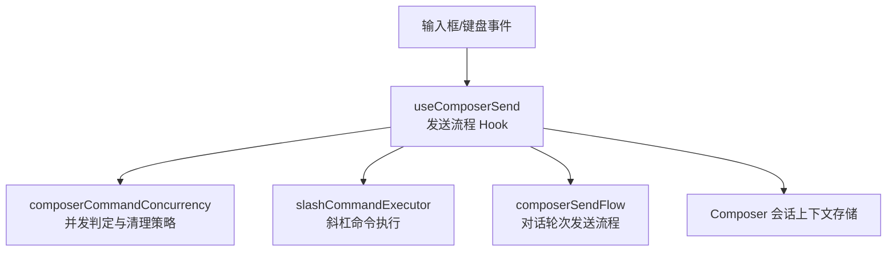
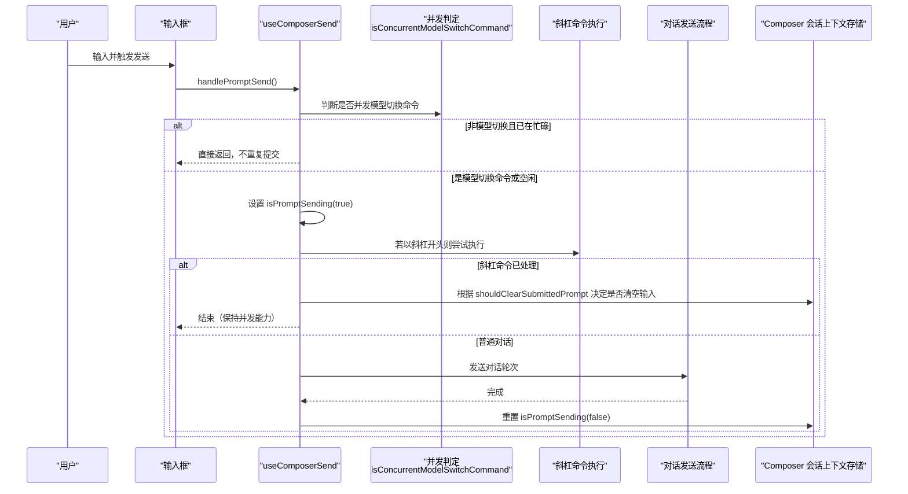
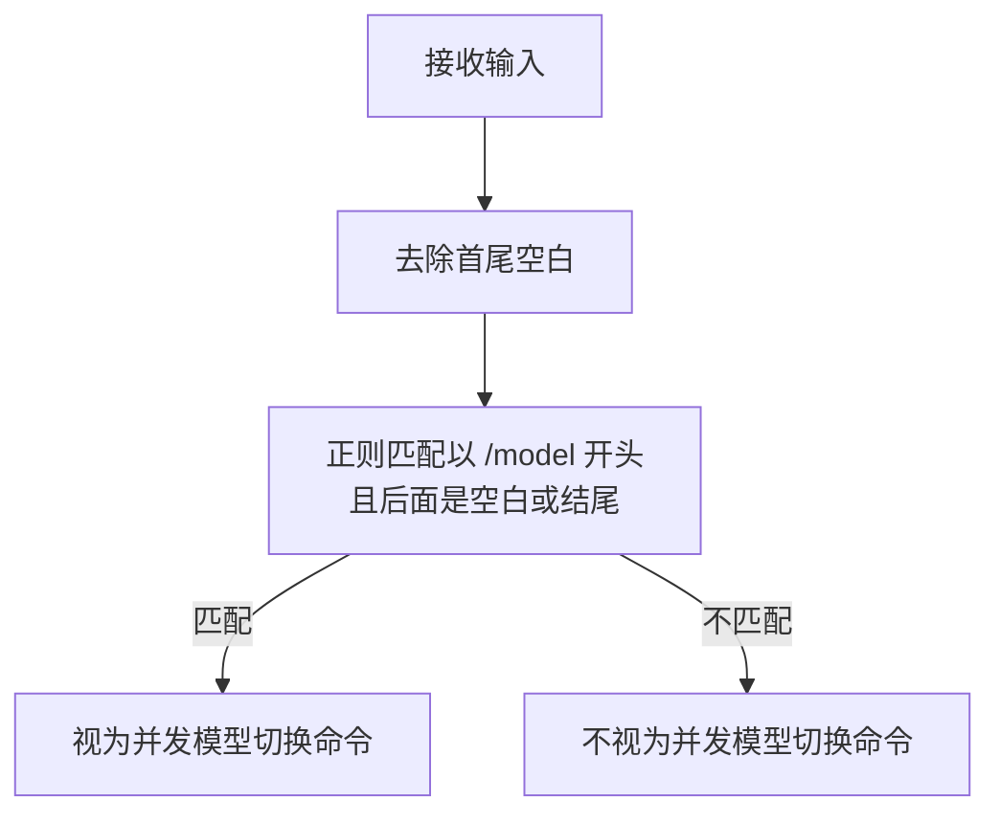
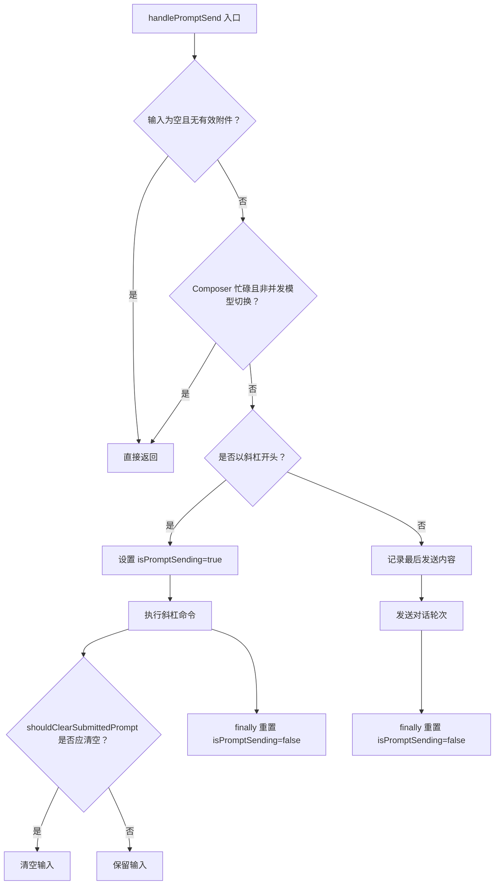
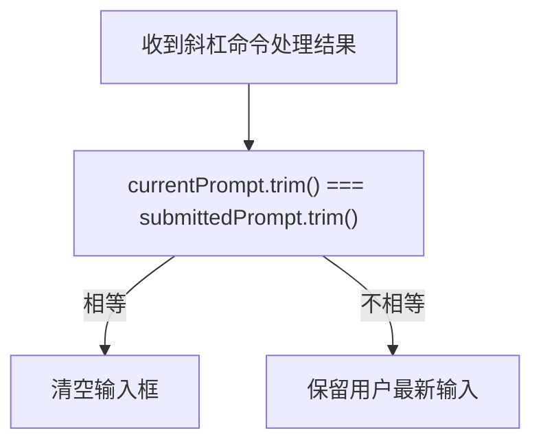
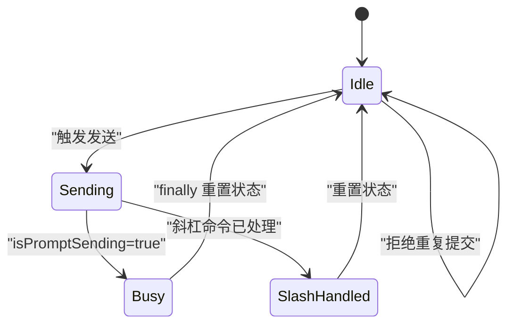
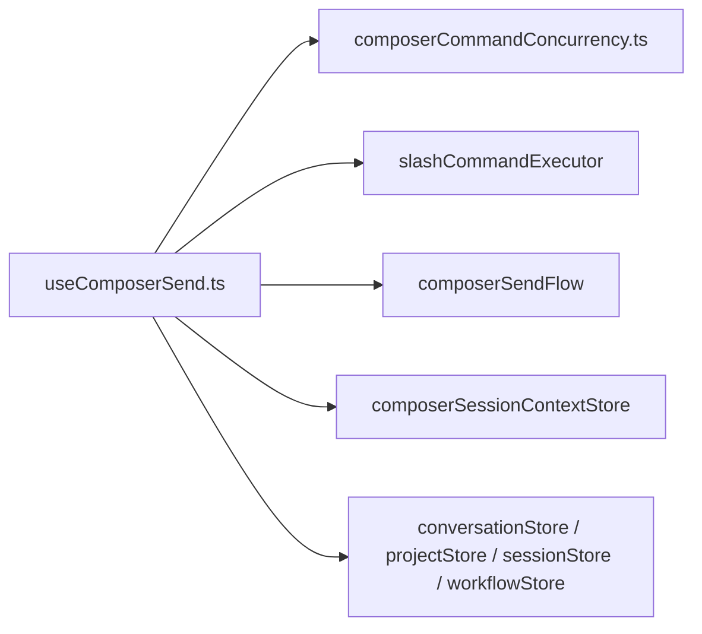

# 并发命令控制

<cite>
**本文引用的文件**   
- [composerCommandConcurrency.ts](file://src/renderer/features/composer/composerCommandConcurrency.ts)
- [useComposerSend.ts](file://src/renderer/features/composer/useComposerSend.ts)
- [composerCommandConcurrency.test.ts](file://src/renderer/features/composer/composerCommandConcurrency.test.ts)
</cite>

## 目录
1. [简介](#简介)
2. [项目结构定位](#项目结构定位)
3. [核心组件](#核心组件)
4. [架构总览](#架构总览)
5. [详细组件分析](#详细组件分析)
6. [依赖关系分析](#依赖关系分析)
7. [性能与并发优化建议](#性能与并发优化建议)
8. [故障排查指南](#故障排查指南)
9. [结论](#结论)

## 简介
本文件面向“并发命令控制”能力，聚焦于以下目标：
- 解释并发检测机制，特别是 `isConcurrentModelSwitchCommand` 的识别规则。
- 说明命令队列管理中的提交检测、重复请求防止与状态同步。
- 解析 `shouldClearSubmittedPrompt` 的判断逻辑及其对用户体验的影响。
- 总结并发冲突解决策略，并给出可落地的性能优化建议。

该能力主要位于渲染层 Composer 发送流程中，通过轻量函数与 React Hook 协作，在用户快速切换模型、重复提交或会话切换等场景下，保证界面状态与后端处理的一致性。

## 项目结构定位
并发命令控制相关代码集中在渲染器 Composer 功能域：
- 并发判定与清理策略定义：`src/renderer/features/composer/composerCommandConcurrency.ts`
- 发送流程 Hook 集成并发判断与状态管理：`src/renderer/features/composer/useComposerSend.ts`
- 单元测试覆盖并发判定与清理策略：`src/renderer/features/composer/composerCommandConcurrency.test.ts`

**图表来源**
- [useComposerSend.ts:1-199](file://src/renderer/features/composer/useComposerSend.ts#L1-L199)
- [composerCommandConcurrency.ts:1-7](file://src/renderer/features/composer/composerCommandConcurrency.ts#L1-L7)

**章节来源**
- [composerCommandConcurrency.ts:1-7](file://src/renderer/features/composer/composerCommandConcurrency.ts#L1-L7)
- [useComposerSend.ts:1-199](file://src/renderer/features/composer/useComposerSend.ts#L1-L199)
- [composerCommandConcurrency.test.ts:1-19](file://src/renderer/features/composer/composerCommandConcurrency.test.ts#L1-L19)

## 核心组件
- 并发命令识别函数
  - `isConcurrentModelSwitchCommand(input)`：用于判断当前输入是否为允许与正在进行的对话轮次并发执行的模型切换命令。
- 提交提示清理函数
  - `shouldClearSubmittedPrompt(currentPrompt, submittedPrompt)`：用于判断是否可以用最新输入替换已提交的旧提示词，避免旧结果覆盖新草稿。
- 发送流程 Hook
  - `useComposerSend`：整合输入校验、并发判定、斜杠命令执行、常规对话发送以及 UI 状态同步。

**章节来源**
- [composerCommandConcurrency.ts:1-7](file://src/renderer/features/composer/composerCommandConcurrency.ts#L1-L7)
- [useComposerSend.ts:1-199](file://src/renderer/features/composer/useComposerSend.ts#L1-L199)

## 架构总览
下图展示一次典型的用户输入到命令处理的并发控制流程。

**图表来源**
- [useComposerSend.ts:40-140](file://src/renderer/features/composer/useComposerSend.ts#L40-L140)
- [composerCommandConcurrency.ts:1-7](file://src/renderer/features/composer/composerCommandConcurrency.ts#L1-L7)

## 详细组件分析

### 并发检测机制：`isConcurrentModelSwitchCommand`
- 作用
  - 识别“模型切换命令”，允许其绕过 Composer 忙碌限制，与当前进行中的对话轮次并行执行。
- 匹配规则
  - 先对输入做去空白处理。
  - 使用大小写不敏感的正则匹配以 `/model` 开头的命令，并且要求其后为空白字符或字符串结尾。
  - 因此：
    - `/model deepseek:deepseek-v4-pro` 匹配成功。
    - ` /MODEL github-copilot:gemini-3.1-pro-preview ` 去空白后仍匹配。
    - `/models`、`/settings` 不会匹配。
- 设计意义
  - 将“模型切换”视为局部操作，不影响其他会话或工作流；同时避免普通消息因忙碌而丢失。

**图表来源**
- [composerCommandConcurrency.ts:1-3](file://src/renderer/features/composer/composerCommandConcurrency.ts#L1-L3)

**章节来源**
- [composerCommandConcurrency.ts:1-3](file://src/renderer/features/composer/composerCommandConcurrency.ts#L1-L3)
- [composerCommandConcurrency.test.ts:4-10](file://src/renderer/features/composer/composerCommandConcurrency.test.ts#L4-L10)

### 命令队列管理与提交检测
虽然未实现显式“队列”数据结构，但通过状态与条件判断实现了“类队列”的串行化效果：
- 提交前检查
  - 若输入为空且没有有效附件，直接放弃提交。
  - 若 Composer 处于忙碌状态，且不是并发模型切换命令，也直接放弃提交。
- 重复请求防止
  - 通过 `isPromptSending` 与外部会话上下文（`hasActiveConversationTurn`、`hasActiveDebugRun`）组合判断忙碌状态。
  - 只有非忙碌或并发模型切换命令才会进入后续处理。
- 状态同步
  - 斜杠命令路径：
    - 若非并发模型切换命令，先设置 `isPromptSending=true`。
    - 命令处理后，在 finally 分支确保重置 `isPromptSending=false`。
  - 普通对话路径：
    - 记录最后一次发送内容到 Composer 会话上下文存储。
    - 发送完成后在 finally 分支重置 `isPromptSending=false`。

**图表来源**
- [useComposerSend.ts:55-140](file://src/renderer/features/composer/useComposerSend.ts#L55-L140)

**章节来源**
- [useComposerSend.ts:55-140](file://src/renderer/features/composer/useComposerSend.ts#L55-L140)

### 提交提示清理逻辑：`shouldClearSubmittedPrompt`
- 作用
  - 当斜杠命令被处理后，决定是否用最新输入覆盖旧的提交提示词，从而避免旧命令结果把用户的新草稿“挤掉”。
- 比较规则
  - 对 `currentPrompt` 和 `submittedPrompt` 分别去空白后比较。
  - 仅当两者完全一致时才返回真，表示“当前输入与上次提交一致”，可以安全清空。
- 用户体验优化
  - 如果用户在旧命令尚未完成时修改了输入，旧命令完成后不应清空新输入。
  - 这避免了“老结果覆盖新草稿”的问题，提升交互稳定性。

**图表来源**
- [composerCommandConcurrency.ts:5-7](file://src/renderer/features/composer/composerCommandConcurrency.ts#L5-L7)

**章节来源**
- [composerCommandConcurrency.ts:5-7](file://src/renderer/features/composer/composerCommandConcurrency.ts#L5-L7)
- [composerCommandConcurrency.test.ts:12-19](file://src/renderer/features/composer/composerCommandConcurrency.test.ts#L12-L19)

### 并发冲突解决策略
- 优先保护用户最新输入
  - 通过 `shouldClearSubmittedPrompt` 只允许“与提交完全一致的输入”被清空。
- 允许关键命令并发
  - 模型切换命令被识别为并发命令，可绕过忙碌限制，提高模型选择效率。
- 防止重复提交
  - 忙碌状态下忽略普通提交，避免同一轮对话被重复创建。
- 会话切换保护
  - 当会话失效或切换时，主动重置 `isPromptSending=false`，防止残留忙碌状态影响后续交互。

**图表来源**
- [useComposerSend.ts:60-140](file://src/renderer/features/composer/useComposerSend.ts#L60-L140)

**章节来源**
- [useComposerSend.ts:60-140](file://src/renderer/features/composer/useComposerSend.ts#L60-L140)

## 依赖关系分析
- `useComposerSend` 依赖：
  - `composerCommandConcurrency`：提供并发命令识别与提交清理策略。
  - `slashCommandExecutor`：执行斜杠命令。
  - `composerSendFlow`：处理普通对话轮次的发送流程。
  - `useComposerSessionContextStore`：读写 Composer 会话上下文状态。
  - 多个全局 Store：会话、项目、工作流、对话消息等。

**图表来源**
- [useComposerSend.ts:1-40](file://src/renderer/features/composer/useComposerSend.ts#L1-L40)

**章节来源**
- [useComposerSend.ts:1-40](file://src/renderer/features/composer/useComposerSend.ts#L1-L40)

## 性能与并发优化建议
- 正则表达式优化
  - 当前正则仅在输入长度较短时开销很小；若未来扩展更多命令模式，可考虑预编译正则或建立命令白名单映射表。
- 减少不必要的状态更新
  - 对于已处理的斜杠命令，应尽量早地短路返回，避免多余的状态写入。
- 并发命令范围收敛
  - 目前仅允许 `/model` 类命令并发，建议保持最小并发集合，避免扩大并发面导致状态竞争。
- 防抖与节流
  - 可在高频输入场景中对发送触发做轻微防抖，但不影响模型切换命令的即时响应。
- 资源清理
  - 确保所有异步路径都在 finally 分支释放 `isPromptSending`，避免长时间占用忙碌状态。

[本节为通用性能建议，不直接分析具体文件，故无章节来源]

## 故障排查指南
- 现象：输入模型切换命令无效或被忽略
  - 检查是否以 `/model` 开头，且其后紧跟空白或为结尾。
  - 确认未被其他忙碌状态拦截。
- 现象：旧命令完成后清空了新输入
  - 检查 `shouldClearSubmittedPrompt` 的两个参数是否完全一致。
  - 确认是否在斜杠命令处理分支触发了清空逻辑。
- 现象：Composer 一直显示忙碌
  - 检查是否有异步路径未在 finally 重置 `isPromptSending`。
  - 检查会话切换时是否重置了 `isPromptSending=false`。
- 现象：重复提交导致多条相同对话
  - 检查忙碌判断是否正确生效。
  - 确认普通提交在忙碌时被拒绝。

**章节来源**
- [composerCommandConcurrency.ts:1-7](file://src/renderer/features/composer/composerCommandConcurrency.ts#L1-L7)
- [useComposerSend.ts:40-140](file://src/renderer/features/composer/useComposerSend.ts#L40-L140)

## 结论
并发命令控制通过轻量的并发识别函数与发送流程 Hook 协作，实现了以下效果：
- 精准识别模型切换命令，允许其与当前对话并发执行。
- 防止普通提交在忙碌状态下重复进入队列。
- 避免旧命令结果覆盖用户最新输入。
- 在会话切换和异步完成后正确恢复状态。

该方案在保持简单性的同时提供了足够的鲁棒性，适合在 Composer 这类高交互频率场景中持续演进。