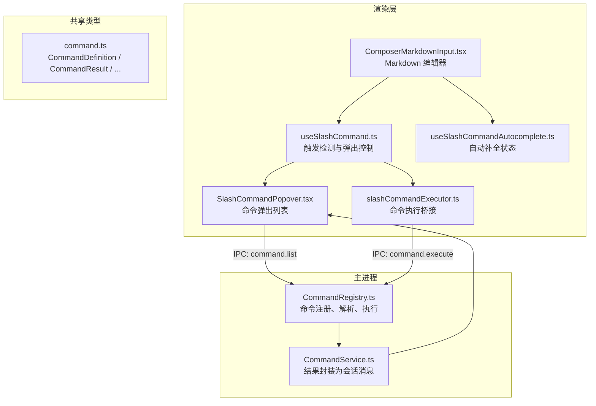
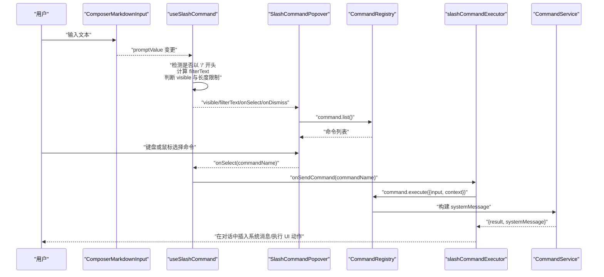
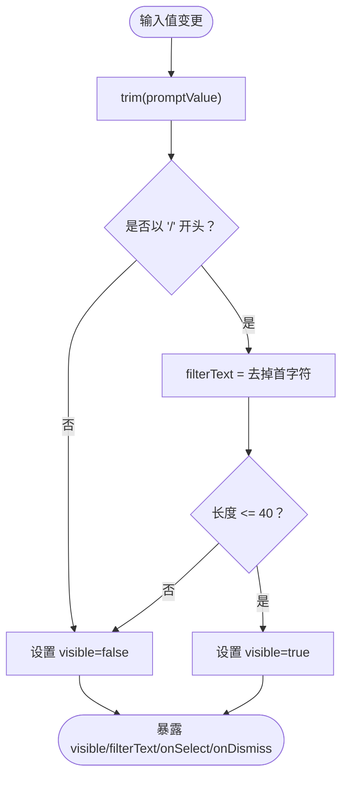
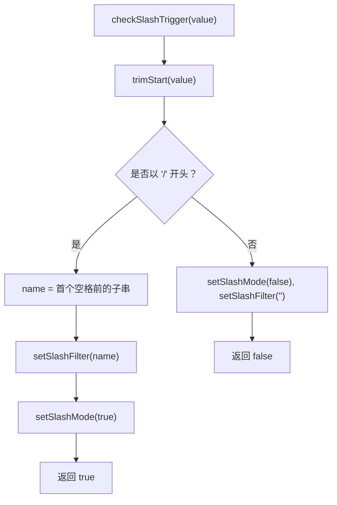
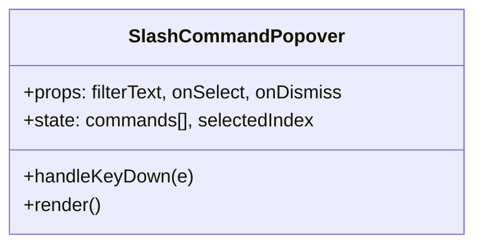
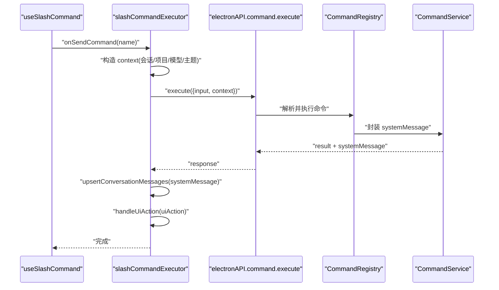
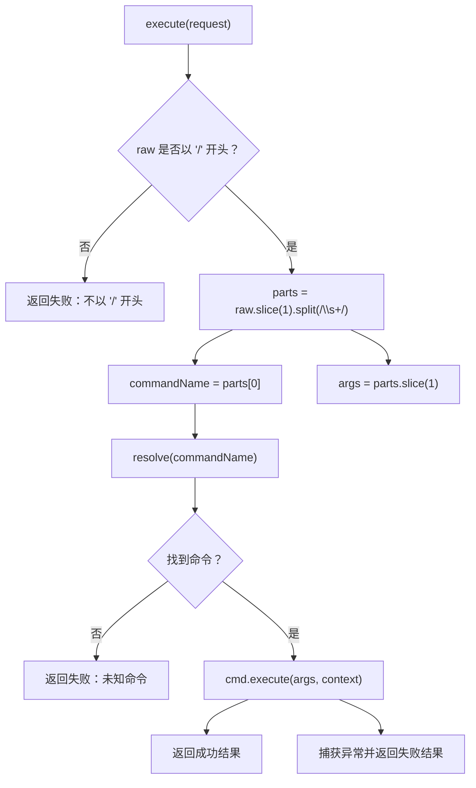
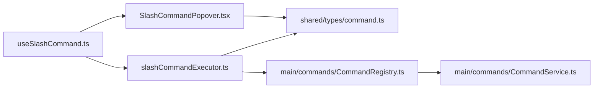

# 斜杠命令解析器

<cite>
**本文引用的文件**   
- [useSlashCommand.ts](file://src/renderer/features/composer/useSlashCommand.ts)
- [useSlashCommandAutocomplete.ts](file://src/renderer/features/composer/useSlashCommandAutocomplete.ts)
- [slashCommandExecutor.ts](file://src/renderer/features/composer/slashCommandExecutor.ts)
- [SlashCommandPopover.tsx](file://src/renderer/features/composer/SlashCommandPopover.tsx)
- [ComposerMarkdownInput.tsx](file://src/renderer/features/composer/ComposerMarkdownInput.tsx)
- [command.ts](file://src/shared/types/command.ts)
- [CommandRegistry.ts](file://src/main/commands/CommandRegistry.ts)
- [CommandService.ts](file://src/main/commands/CommandService.ts)
</cite>

## 目录
1. [引言](#引言)
2. [项目结构](#项目结构)
3. [核心组件](#核心组件)
4. [架构总览](#架构总览)
5. [详细组件分析](#详细组件分析)
6. [依赖关系分析](#依赖关系分析)
7. [性能与复杂度](#性能与复杂度)
8. [调试技巧](#调试技巧)
9. [常见问题与解决方案](#常见问题与解决方案)
10. [结论](#结论)

## 引言
本文聚焦渲染层的“斜杠命令解析器”，即用户在聊天输入框中以 `/` 触发命令补全、过滤、选择并执行命令的完整链路。内容覆盖：
- 输入框监听与前缀匹配；
- 命令可见性、过滤文本和长度限制；
- 自动补全状态（slashMode、slashFilter）；
- 命令列表加载、键盘导航与选择填充；
- 命令执行、UI 动作与系统消息；
- 完整的类型定义说明；
- 调试方法与常见故障排查。

该文档既适合初次接触代码的读者，也提供足够深入的技术细节供二次开发使用。

## 项目结构
斜杠命令相关代码分布在渲染层 UI 逻辑、共享类型定义与主进程命令注册/执行层：

**图示来源**
- [ComposerMarkdownInput.tsx:1-200](file://src/renderer/features/composer/ComposerMarkdownInput.tsx#L1-L200)
- [useSlashCommand.ts:1-48](file://src/renderer/features/composer/useSlashCommand.ts#L1-L48)
- [useSlashCommandAutocomplete.ts:1-37](file://src/renderer/features/composer/useSlashCommandAutocomplete.ts#L1-L37)
- [SlashCommandPopover.tsx:1-108](file://src/renderer/features/composer/SlashCommandPopover.tsx#L1-L108)
- [slashCommandExecutor.ts:201-283](file://src/renderer/features/composer/slashCommandExecutor.ts#L201-L283)
- [command.ts:1-89](file://src/shared/types/command.ts#L1-L89)
- [CommandRegistry.ts:1-115](file://src/main/commands/CommandRegistry.ts#L1-L115)
- [CommandService.ts:1-73](file://src/main/commands/CommandService.ts#L1-L73)

**章节来源**
- [ComposerMarkdownInput.tsx:1-200](file://src/renderer/features/composer/ComposerMarkdownInput.tsx#L1-L200)
- [useSlashCommand.ts:1-48](file://src/renderer/features/composer/useSlashCommand.ts#L1-L48)
- [useSlashCommandAutocomplete.ts:1-37](file://src/renderer/features/composer/useSlashCommandAutocomplete.ts#L1-L37)
- [SlashCommandPopover.tsx:1-108](file://src/renderer/features/composer/SlashCommandPopover.tsx#L1-L108)
- [slashCommandExecutor.ts:201-283](file://src/renderer/features/composer/slashCommandExecutor.ts#L201-L283)
- [command.ts:1-89](file://src/shared/types/command.ts#L1-L89)
- [CommandRegistry.ts:1-115](file://src/main/commands/CommandRegistry.ts#L1-L115)
- [CommandService.ts:1-73](file://src/main/commands/CommandService.ts#L1-L73)

## 核心组件
- 输入触发与弹出控制：`useSlashCommand`
- 自动补全状态：`useSlashCommandAutocomplete`
- 命令弹出面板：`SlashCommandPopover`
- 命令执行桥接：`slashCommandExecutor`
- 共享类型：`command.ts`
- 命令注册与执行：`CommandRegistry`
- 命令结果转系统消息：`CommandService`

这些组件共同实现“输入 → 前缀匹配 → 过滤 → 选择 → 执行 → 结果展示”的闭环。

**章节来源**
- [useSlashCommand.ts:1-48](file://src/renderer/features/composer/useSlashCommand.ts#L1-L48)
- [useSlashCommandAutocomplete.ts:1-37](file://src/renderer/features/composer/useSlashCommandAutocomplete.ts#L1-L37)
- [SlashCommandPopover.tsx:1-108](file://src/renderer/features/composer/SlashCommandPopover.tsx#L1-L108)
- [slashCommandExecutor.ts:201-283](file://src/renderer/features/composer/slashCommandExecutor.ts#L201-L283)
- [command.ts:1-89](file://src/shared/types/command.ts#L1-L89)
- [CommandRegistry.ts:1-115](file://src/main/commands/CommandRegistry.ts#L1-L115)
- [CommandService.ts:1-73](file://src/main/commands/CommandService.ts#L1-L73)

## 架构总览
从用户输入到命令执行的时序如下：

**图示来源**
- [useSlashCommand.ts:1-48](file://src/renderer/features/composer/useSlashCommand.ts#L1-L48)
- [SlashCommandPopover.tsx:1-108](file://src/renderer/features/composer/SlashCommandPopover.tsx#L1-L108)
- [slashCommandExecutor.ts:201-283](file://src/renderer/features/composer/slashCommandExecutor.ts#L201-L283)
- [CommandRegistry.ts:1-115](file://src/main/commands/CommandRegistry.ts#L1-L115)
- [CommandService.ts:1-73](file://src/main/commands/CommandService.ts#L1-L73)

## 详细组件分析

### 输入触发与可见性控制：useSlashCommand
职责：
- 监听输入值变化；
- 检测以 `/` 开头的字符串；
- 提取不含前导 `/` 的过滤文本；
- 控制弹出层可见性，包含长度限制；
- 处理命令选择与取消。

关键行为：
- 前缀检测：对 `promptValue.trim()` 判断是否以 `/` 开头。
- 过滤文本：去除前导 `/` 后作为 `filterText`。
- 可见性条件：必须以 `/` 开头且修剪后的长度不超过 40。
- 选择回调：隐藏弹出层、清空输入、调用上层发送命令方法。
- 取消回调：仅隐藏弹出层。

**图示来源**
- [useSlashCommand.ts:1-48](file://src/renderer/features/composer/useSlashCommand.ts#L1-L48)

**章节来源**
- [useSlashCommand.ts:1-48](file://src/renderer/features/composer/useSlashCommand.ts#L1-L48)

### 自动补全状态：useSlashCommandAutocomplete
职责：
- 维护 `slashMode`（是否处于斜杠模式）；
- 维护 `slashFilter`（当前命令名片段）；
- 检测输入是否进入斜杠模式；
- 支持命令选择回填；
- 支持关闭斜杠模式。

关键行为：
- `checkSlashTrigger(value)`：
  - 取左空白修剪后的值；
  - 若以 `/` 开头，则截取第一个空格前的部分作为命令名，更新 `slashFilter` 并开启 `slashMode`；
  - 否则关闭模式并清空过滤器。
- `selectCommand(name, value, onChange)`：
  - 保留原始输入中的参数部分；
  - 将输入替换为 `/name + 原参数`；
  - 关闭斜杠模式并清空过滤器。
- `dismissSlash()`：关闭模式并清空过滤器。

**图示来源**
- [useSlashCommandAutocomplete.ts:1-37](file://src/renderer/features/composer/useSlashCommandAutocomplete.ts#L1-L37)

**章节来源**
- [useSlashCommandAutocomplete.ts:1-37](file://src/renderer/features/composer/useSlashCommandAutocomplete.ts#L1-L37)

### 命令弹出面板：SlashCommandPopover
职责：
- 通过 IPC 获取命令列表；
- 根据 `filterText` 进行名称和别名前缀过滤；
- 提供键盘导航（上/下/回车/退出）；
- 渲染命令项并转发选择事件。

关键点：
- 命令列表仅在首次挂载时通过 `window.electronAPI.command.list()` 拉取一次；
- 过滤策略：命令名或任一别名的前缀匹配，比较均转为小写；
- 键盘事件绑定在 `document` 上，避免焦点丢失导致交互失效；
- 选中项高亮由 `selectedIndex` 驱动，并在 `filterText` 变化时重置为首项；
- 底部显示操作提示文案。

**图示来源**
- [SlashCommandPopover.tsx:1-108](file://src/renderer/features/composer/SlashCommandPopover.tsx#L1-L108)

**章节来源**
- [SlashCommandPopover.tsx:1-108](file://src/renderer/features/composer/SlashCommandPopover.tsx#L1-L108)

### 命令执行桥接：slashCommandExecutor
职责：
- 构造 `CommandExecuteRequest.context`，包含会话、项目、工作区、代理、模式、模型、主题等上下文；
- 通过 IPC 调用 `electronAPI.command.execute`；
- 将返回的系统消息插入对话；
- 处理命令返回的 UI 动作；
- 在需要时刷新会话历史；
- 统一错误提示。

关键流程：
- 读取当前有效模型；
- 调用 IPC 执行命令；
- 若返回 `systemMessage`，则插入对话；
- 若存在 `uiAction`，则执行对应界面动作；
- 若标记需刷新会话存储，则重新拉取对话历史；
- 失败时通过 `showNotice` 反馈给用户。

**图示来源**
- [slashCommandExecutor.ts:201-283](file://src/renderer/features/composer/slashCommandExecutor.ts#L201-L283)
- [CommandRegistry.ts:1-115](file://src/main/commands/CommandRegistry.ts#L1-L115)
- [CommandService.ts:1-73](file://src/main/commands/CommandService.ts#L1-L73)

**章节来源**
- [slashCommandExecutor.ts:201-283](file://src/renderer/features/composer/slashCommandExecutor.ts#L201-L283)

### 输入框与触发点：ComposerMarkdownInput
职责：
- 提供 Markdown 编辑能力；
- 处理粘贴文件；
- 绑定回车键发送；
- 与其他组件协作，把 `value` 传给 `useSlashCommand` 和 `useSlashCommandAutocomplete`。

注意：
- 本文件本身不直接实现斜杠命令逻辑，而是作为输入容器；
- 实际的 `/` 检测与弹出控制由 `useSlashCommand` 负责；
- 自动补全状态由 `useSlashCommandAutocomplete` 管理。

**章节来源**
- [ComposerMarkdownInput.tsx:1-200](file://src/renderer/features/composer/ComposerMarkdownInput.tsx#L1-L200)

### 类型定义与接口说明
位于共享类型文件，供渲染层与主进程共用：

- `CommandContext`：命令执行上下文，包含会话 ID、项目 ID、工作区根路径、代理 ID、当前模式、当前模型 ID、当前主题等。
- `CommandResult`：命令执行结果，包含成功标志、消息、可选数据、可选系统消息、可选 UI 动作、需要失效的存储集合。
- `CommandUiAction`：结构化 UI 动作，包括打开设置、切换模式、切换模型、切换主题、切换权限、恢复会话、导出会话、撤销会话、清除会话、运行技能等。
- `CommandDefinition`：命令定义，包含唯一 ID、名称、描述、别名、分类和执行函数。
- `CommandExecuteRequest`：IPC 请求体，包含原始输入与上下文。
- `CommandListResult`：IPC 响应体，包含命令列表条目（ID、名称、描述、别名、分类）。

这些类型保证了渲染层与主进程之间的契约稳定，便于扩展新命令与 UI 动作。

**章节来源**
- [command.ts:1-89](file://src/shared/types/command.ts#L1-L89)

### 命令注册与执行：CommandRegistry
职责：
- 维护命令映射表（主名称与别名）；
- 提供注册、注销、查找与按类别列出命令；
- 解析原始输入，提取命令名与参数；
- 调用命令执行函数并捕获异常；
- 返回统一的 `CommandResult`。

关键点：
- 同名命令会覆盖；
- 别名不会覆盖已有主名称；
- `list` 去重并按名称排序；
- `execute` 要求输入以 `/` 开头，否则返回失败；
- 未知命令返回友好提示信息；
- 执行异常会被包装成失败的 `CommandResult`。

**图示来源**
- [CommandRegistry.ts:1-115](file://src/main/commands/CommandRegistry.ts#L1-L115)

**章节来源**
- [CommandRegistry.ts:1-115](file://src/main/commands/CommandRegistry.ts#L1-L115)

### 命令结果转系统消息：CommandService
职责：
- 调用 `CommandRegistry.execute`；
- 根据 `CommandResult.message` 或 `systemMessage` 构造 `ConversationMessage`；
- 写入会话 ID、项目 ID、角色、状态、时间戳及工作轨迹；
- 返回 `{ result, systemMessage }` 给调用方。

关键点：
- 命令标题为 `/${commandName}`；
- 成功状态为 `complete`，失败状态为 `error`；
- 若存在 `data`，会在摘要中包含 JSON 序列化结果；
- 生成唯一 ID 和 turnId，便于后续追踪。

**章节来源**
- [CommandService.ts:1-73](file://src/main/commands/CommandService.ts#L1-L73)

## 依赖关系分析
- `useSlashCommand` 依赖 React Hooks，不直接访问 Electron API；
- `SlashCommandPopover` 通过 `window.electronAPI.command.list` 获取命令列表；
- `slashCommandExecutor` 通过 `window.electronAPI.command.execute` 执行命令；
- 主进程 `CommandRegistry` 维护命令注册表，并对外暴露 `list` 与 `execute`；
- `CommandService` 负责将命令结果包装为可渲染的会话消息；
- 所有数据结构由 `command.ts` 统一约束。

**图示来源**
- [useSlashCommand.ts:1-48](file://src/renderer/features/composer/useSlashCommand.ts#L1-L48)
- [SlashCommandPopover.tsx:1-108](file://src/renderer/features/composer/SlashCommandPopover.tsx#L1-L108)
- [slashCommandExecutor.ts:201-283](file://src/renderer/features/composer/slashCommandExecutor.ts#L201-L283)
- [command.ts:1-89](file://src/shared/types/command.ts#L1-L89)
- [CommandRegistry.ts:1-115](file://src/main/commands/CommandRegistry.ts#L1-L115)
- [CommandService.ts:1-73](file://src/main/commands/CommandService.ts#L1-L73)

**章节来源**
- [useSlashCommand.ts:1-48](file://src/renderer/features/composer/useSlashCommand.ts#L1-L48)
- [SlashCommandPopover.tsx:1-108](file://src/renderer/features/composer/SlashCommandPopover.tsx#L1-L108)
- [slashCommandExecutor.ts:201-283](file://src/renderer/features/composer/slashCommandExecutor.ts#L201-L283)
- [command.ts:1-89](file://src/shared/types/command.ts#L1-L89)
- [CommandRegistry.ts:1-115](file://src/main/commands/CommandRegistry.ts#L1-L115)
- [CommandService.ts:1-73](file://src/main/commands/CommandService.ts#L1-L73)

## 性能与复杂度
- 触发检测与可见性计算：每次输入都进行 O(1) 的前缀检查与长度判断；
- 过滤文本计算：O(k)，k 为命令名字符数；
- 命令列表过滤：O(n)，n 为命令总数，主要发生在 `SlashCommandPopover` 中；
- 命令执行：取决于具体命令实现，但解析阶段为 O(m)，m 为参数字符串数量；
- 命令列表只拉取一次，减少重复 IPC 开销；
- 键盘事件监听在文档级，避免频繁添加移除监听器；
- 长度限制 40 字符可有效控制弹出层出现频率，降低渲染压力。

## 调试技巧
- 检查触发条件：
  - 确认输入修剪后是否以 `/` 开头；
  - 确认修剪后长度不超过 40；
  - 观察 `visible` 与 `filterText` 是否正确更新。
- 检查自动补全状态：
  - 观察 `slashMode` 是否在输入 `/` 后变为真；
  - 观察 `slashFilter` 是否为命令名片段；
  - 选择命令后确认模式被清空。
- 检查命令列表：
  - 通过开发者工具查看 `window.electronAPI.command.list()` 返回值；
  - 确认命令名称、别名、分类是否符合预期；
  - 验证过滤逻辑是否匹配名称或别名。
- 检查命令执行：
  - 观察 `slashCommandExecutor` 传入的 `context` 是否包含正确的会话、项目、模型与主题；
  - 查看 `CommandRegistry.execute` 是否成功解析命令名与参数；
  - 查看 `CommandService` 生成的 `systemMessage` 是否插入对话。
- 常用断点位置：
  - `useSlashCommand` 的 `useEffect` 与 `onSelect`；
  - `useSlashCommandAutocomplete` 的 `checkSlashTrigger` 与 `selectCommand`；
  - `SlashCommandPopover` 的 `handleKeyDown`；
  - `slashCommandExecutor` 的 `executeSlashCommand`；
  - `CommandRegistry.execute` 与 `CommandService.buildSystemMessage`。

## 常见问题与解决方案
- 问题：输入 `/` 后没有弹出命令列表。
  - 可能原因：
    - 输入未以 `/` 开头；
    - 修剪后长度超过 40；
    - 命令列表尚未加载；
    - `window.electronAPI.command` 不可用。
  - 解决方案：
    - 检查 `visible` 计算逻辑；
    - 缩短输入长度；
    - 确保命令已注册并可列出；
    - 检查 IPC 通道是否正常。

- 问题：输入命令后无法选择。
  - 可能原因：
    - 过滤结果为空；
    - 键盘事件未被捕获；
    - `filterText` 与命令名/别名不匹配。
  - 解决方案：
    - 检查过滤逻辑是否区分大小写；
    - 确认键盘事件监听是否生效；
    - 检查命令别名配置。

- 问题：选择命令后没有执行。
  - 可能原因：
    - `onSelect` 未调用 `onSendCommand`；
    - `slashCommandExecutor` 未正确构造上下文；
    - IPC 执行失败。
  - 解决方案：
    - 检查选择回调链；
    - 打印 `context` 与 `input`；
    - 查看命令执行返回的错误信息。

- 问题：命令执行成功但没有系统消息。
  - 可能原因：
    - 命令未返回 `message` 或 `systemMessage`；
    - `CommandService` 未构造消息。
  - 解决方案：
    - 检查命令实现的返回值；
    - 确认 `buildSystemMessage` 是否被调用。

- 问题：自动补全状态异常。
  - 可能原因：
    - `slashMode` 未关闭；
    - `slashFilter` 未清空；
    - 选择命令后未更新输入。
  - 解决方案：
    - 检查 `selectCommand` 与 `dismissSlash`；
    - 确保选择后清空状态。

**章节来源**
- [useSlashCommand.ts:1-48](file://src/renderer/features/composer/useSlashCommand.ts#L1-L48)
- [useSlashCommandAutocomplete.ts:1-37](file://src/renderer/features/composer/useSlashCommandAutocomplete.ts#L1-L37)
- [SlashCommandPopover.tsx:1-108](file://src/renderer/features/composer/SlashCommandPopover.tsx#L1-L108)
- [slashCommandExecutor.ts:201-283](file://src/renderer/features/composer/slashCommandExecutor.ts#L201-L283)
- [CommandRegistry.ts:1-115](file://src/main/commands/CommandRegistry.ts#L1-L115)
- [CommandService.ts:1-73](file://src/main/commands/CommandService.ts#L1-L73)

## 结论
斜杠命令解析器以清晰的职责边界组织代码：渲染层负责输入检测、过滤与弹出控制，主进程负责命令注册、解析与执行，并通过共享类型保证前后端契约一致。其核心优势在于：
- 输入检测简单可靠，具备长度限制；
- 自动补全状态与命令选择分离，易于扩展；
- 命令执行结果通过系统消息呈现，便于追踪与调试；
- 类型定义完善，利于团队协作与二次开发。

在实际使用中，建议优先关注触发条件、过滤逻辑、命令列表加载与命令执行上下文构造，这四个环节是定位问题的关键入口。