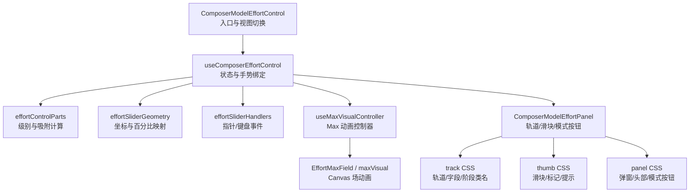
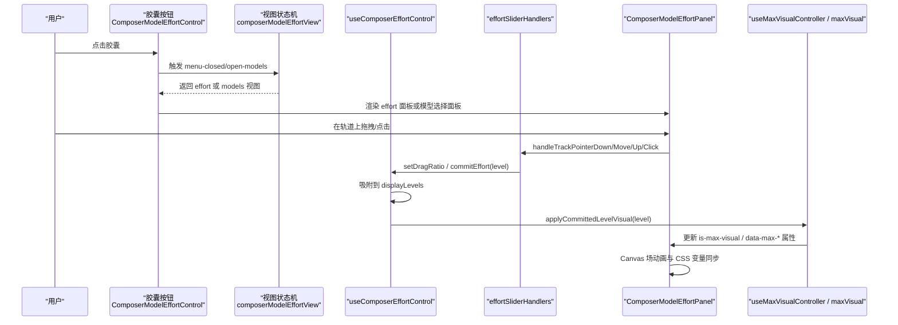
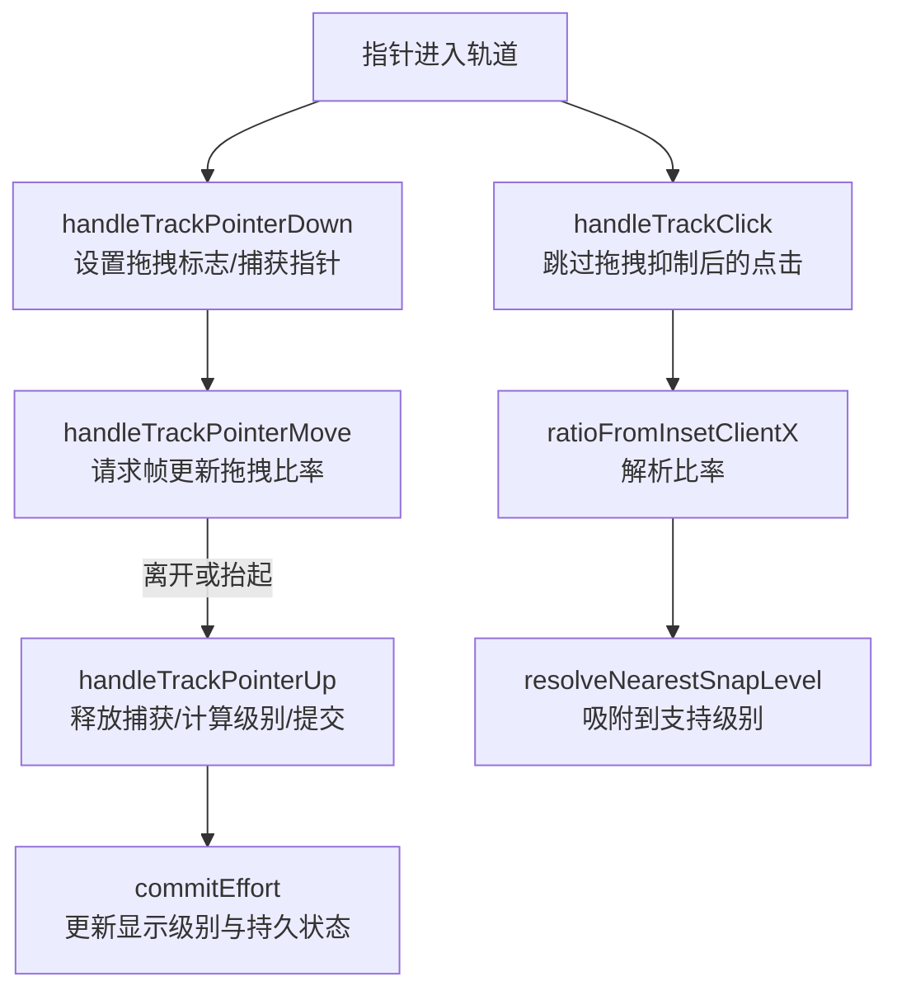
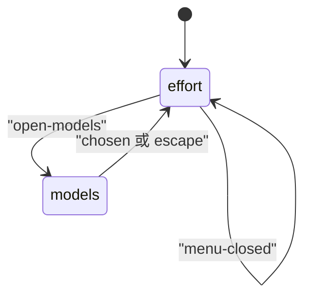
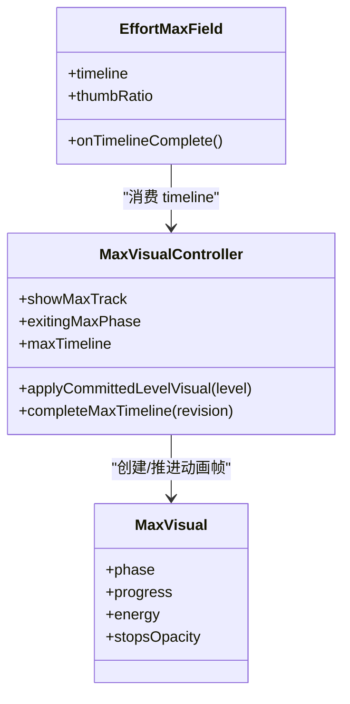
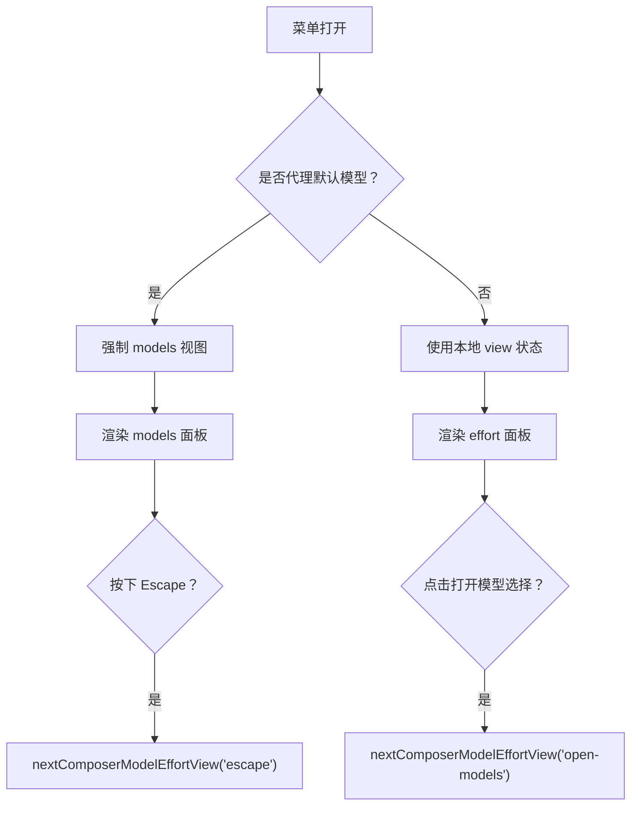
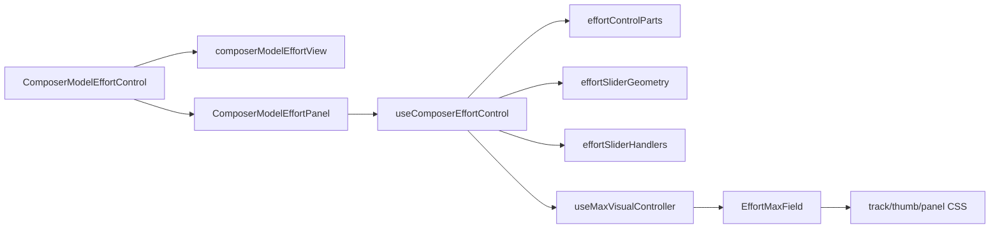

# 投入控制滑块与视觉反馈

<cite>
**本文引用的文件**   
- [ComposerModelEffortControl.tsx](file://src/renderer/features/composer/ComposerModelEffortControl.tsx)
- [useComposerEffortControl.ts](file://src/renderer/features/composer/useComposerEffortControl.ts)
- [effortSliderHandlers.ts](file://src/renderer/features/composer/effortSliderHandlers.ts)
- [effortSliderGeometry.ts](file://src/renderer/features/composer/effortSliderGeometry.ts)
- [effortControlParts.tsx](file://src/renderer/features/composer/effortControlParts.tsx)
- [effortControlStatusLabels.ts](file://src/renderer/features/composer/effortControlStatusLabels.ts)
- [composerModelEffortView.ts](file://src/renderer/features/composer/composerModelEffortView.ts)
- [ComposerModelEffortPanel.tsx](file://src/renderer/features/composer/ComposerModelEffortPanel.tsx)
- [EffortMaxField.tsx](file://src/renderer/features/composer/EffortMaxField.tsx)
- [maxVisual.ts](file://src/renderer/features/composer/maxVisual.ts)
- [useMaxVisualController.ts](file://src/renderer/features/composer/useMaxVisualController.ts)
- [composer-effort-track.css](file://src/renderer/features/composer/composer-effort-track.css)
- [composer-effort-thumb.css](file://src/renderer/features/composer/composer-effort-thumb.css)
- [composer-model-effort-panel.css](file://src/renderer/features/composer/composer-model-effort-panel.css)
- [composer-effort-focus.css](file://src/renderer/features/composer/composer-effort-focus.css)
</cite>

## 目录
1. [简介](#简介)
2. [项目结构与定位](#项目结构与定位)
3. [核心组件](#核心组件)
4. [架构总览](#架构总览)
5. [详细组件分析](#详细组件分析)
6. [依赖关系分析](#依赖关系分析)
7. [性能特性](#性能特性)
8. [故障排查](#故障排查)
9. [结论](#结论)

## 简介
本文聚焦 Composer 的“投入控制”能力：用户通过一个带吸附轨道的滑块调节模型推理强度，并在 effort（努力程度）视图与 models（模型选择）视图之间切换。文档从交互逻辑、数值映射、视觉反馈、状态管理、无障碍访问和可配置点六个维度展开，帮助开发者理解实现细节并安全扩展。

## 项目结构与定位
投入控制相关代码集中在渲染器 composer 功能模块中：
- 入口控件：[ComposerModelEffortControl.tsx](file://src/renderer/features/composer/ComposerModelEffortControl.tsx)
- 交互逻辑 Hook：[useComposerEffortControl.ts](file://src/renderer/features/composer/useComposerEffortControl.ts)
- 滑块事件处理：[effortSliderHandlers.ts](file://src/renderer/features/composer/effortSliderHandlers.ts)
- 几何与坐标映射：[effortSliderGeometry.ts](file://src/renderer/features/composer/effortSliderGeometry.ts)
- 通用计算与展示装配：[effortControlParts.tsx](file://src/renderer/features/composer/effortControlParts.tsx)
- 能力状态标签：[effortControlStatusLabels.ts](file://src/renderer/features/composer/effortControlStatusLabels.ts)
- 视图状态机：[composerModelEffortView.ts](file://src/renderer/features/composer/composerModelEffortView.ts)
- 面板 UI：[ComposerModelEffortPanel.tsx](file://src/renderer/features/composer/ComposerModelEffortPanel.tsx)
- Max 视觉场：[EffortMaxField.tsx](file://src/renderer/features/composer/EffortMaxField.tsx)、[maxVisual.ts](file://src/renderer/features/composer/maxVisual.ts)、[useMaxVisualController.ts](file://src/renderer/features/composer/useMaxVisualController.ts)
- 样式：[composer-effort-track.css](file://src/renderer/features/composer/composer-effort-track.css)、[composer-effort-thumb.css](file://src/renderer/features/composer/composer-effort-thumb.css)、[composer-model-effort-panel.css](file://src/renderer/features/composer/composer-model-effort-panel.css)、[composer-effort-focus.css](file://src/renderer/features/composer/composer-effort-focus.css)

**图表来源**
- [ComposerModelEffortControl.tsx:1-194](file://src/renderer/features/composer/ComposerModelEffortControl.tsx#L1-L194)
- [useComposerEffortControl.ts:1-164](file://src/renderer/features/composer/useComposerEffortControl.ts#L1-L164)
- [effortControlParts.tsx:1-149](file://src/renderer/features/composer/effortControlParts.tsx#L1-L149)
- [effortSliderGeometry.ts:1-66](file://src/renderer/features/composer/effortSliderGeometry.ts#L1-L66)
- [effortSliderHandlers.ts:1-98](file://src/renderer/features/composer/effortSliderHandlers.ts#L1-L98)
- [useMaxVisualController.ts:1-170](file://src/renderer/features/composer/useMaxVisualController.ts#L1-L170)
- [EffortMaxField.tsx:1-231](file://src/renderer/features/composer/EffortMaxField.tsx#L1-L231)
- [maxVisual.ts:1-200](file://src/renderer/features/composer/maxVisual.ts#L1-L200)
- [composer-effort-track.css:1-117](file://src/renderer/features/composer/composer-effort-track.css#L1-L117)
- [composer-effort-thumb.css:1-164](file://src/renderer/features/composer/composer-effort-thumb.css#L1-L164)
- [composer-model-effort-panel.css:1-166](file://src/renderer/features/composer/composer-model-effort-panel.css#L1-L166)

**章节来源**
- [ComposerModelEffortControl.tsx:1-194](file://src/renderer/features/composer/ComposerModelEffortControl.tsx#L1-L194)

## 核心组件
- 入口控件：负责菜单打开/关闭、effort/models 视图切换、胶囊式标题拼装、当前模型与努力程度展示、以及把 Hook 暴露的数据传递给子面板。
- 交互 Hook：聚合能力状态、显示级别、拖拽比例、最大层级动画、轨道布局、能力可用性标签，并产出统一的事件处理器与切换方法。
- 滑块事件处理器：封装 Pointer 拖拽、点击、键盘方向键等输入，映射为逻辑比率与吸附级别。
- 几何工具：将 clientX 与 track 尺寸转换为 0–1 逻辑比率，再换算成居中滑块的 left% 与提示框位置。
- 视图状态机：定义 effort 与 models 两种视图，以及 open-models、chosen、escape、menu-closed 四类事件驱动的跳转规则。
- 面板 UI：渲染轨道、刻度标记、滑块、提示、快模式/最大上下文模式开关、模型选择入口和能力状态提示。
- Max 视觉系统：当选择“max”时，驱动入场/激活/离场动画，使用 Canvas 绘制能量场，并通过 CSS 变量同步给轨道与滑块。

**章节来源**
- [useComposerEffortControl.ts:1-164](file://src/renderer/features/composer/useComposerEffortControl.ts#L1-L164)
- [effortSliderHandlers.ts:1-98](file://src/renderer/features/composer/effortSliderHandlers.ts#L1-L98)
- [effortSliderGeometry.ts:1-66](file://src/renderer/features/composer/effortSliderGeometry.ts#L1-L66)
- [composerModelEffortView.ts:1-10](file://src/renderer/features/composer/composerModelEffortView.ts#L1-L10)
- [ComposerModelEffortPanel.tsx:1-244](file://src/renderer/features/composer/ComposerModelEffortPanel.tsx#L1-L244)
- [maxVisual.ts:1-200](file://src/renderer/features/composer/maxVisual.ts#L1-L200)
- [useMaxVisualController.ts:1-170](file://src/renderer/features/composer/useMaxVisualController.ts#L1-L170)

## 架构总览
下图展示了从用户操作到状态提交再到视觉反馈的完整流程。

**图表来源**
- [ComposerModelEffortControl.tsx:1-194](file://src/renderer/features/composer/ComposerModelEffortControl.tsx#L1-L194)
- [composerModelEffortView.ts:1-10](file://src/renderer/features/composer/composerModelEffortView.ts#L1-L10)
- [useComposerEffortControl.ts:1-164](file://src/renderer/features/composer/useComposerEffortControl.ts#L1-L164)
- [effortSliderHandlers.ts:1-98](file://src/renderer/features/composer/effortSliderHandlers.ts#L1-L98)
- [ComposerModelEffortPanel.tsx:1-244](file://src/renderer/features/composer/ComposerModelEffortPanel.tsx#L1-L244)
- [useMaxVisualController.ts:1-170](file://src/renderer/features/composer/useMaxVisualController.ts#L1-L170)
- [maxVisual.ts:1-200](file://src/renderer/features/composer/maxVisual.ts#L1-L200)

## 详细组件分析

### 投入控制交互逻辑
- 拖动
  - 轨道捕获 Pointer 事件；拖拽期间禁用动画过渡以保证跟手。
  - 每次移动通过 requestAnimationFrame 节流更新 dragRatio，避免频繁重排。
  - 抬起或取消时释放 PointerCapture，并根据最终 clientX 计算最近吸附级别并提交。
- 点击
  - 若刚结束拖拽会抑制一次点击事件，避免重复提交。
  - 否则直接根据点击位置计算目标级别并提交。
- 键盘导航
  - 在滑块拇指获得焦点后，左/下键减小，右/上键增大，按支持级别步进。
- 数值映射
  - 将 clientX 映射到 0–1 逻辑比率；再通过显示级别数量映射到离散索引，取最近整数作为吸附级别。
  - 滑块位置以“居中 inset”方式计算 left%，确保滑块中心始终位于轨道范围内。

**图表来源**
- [effortSliderHandlers.ts:1-98](file://src/renderer/features/composer/effortSliderHandlers.ts#L1-L98)
- [effortSliderGeometry.ts:1-66](file://src/renderer/features/composer/effortSliderGeometry.ts#L1-L66)
- [effortControlParts.tsx:1-149](file://src/renderer/features/composer/effortControlParts.tsx#L1-L149)

**章节来源**
- [effortSliderHandlers.ts:1-98](file://src/renderer/features/composer/effortSliderHandlers.ts#L1-L98)
- [effortSliderGeometry.ts:1-66](file://src/renderer/features/composer/effortSliderGeometry.ts#L1-L66)
- [effortControlParts.tsx:1-149](file://src/renderer/features/composer/effortControlParts.tsx#L1-L149)

### 视图切换（effort/models）
- 视图类型：仅包含 effort 与 models 两种视图。
- 事件：
  - open-models：从 effort 切换到 models。
  - chosen：选择模型后，视是否保留代理默认值决定关闭菜单或回到 effort。
  - escape：在 models 视图内按 Escape 返回 effort。
  - menu-closed：菜单关闭时重置为 effort。
- 自动行为：
  - 从 models 切回 effort 且菜单已打开时，自动将焦点移动到模型选择按钮，提升可访问性。
  - 当代理默认模型被选中且未覆盖时，强制显示 models 视图。

**图表来源**
- [composerModelEffortView.ts:1-10](file://src/renderer/features/composer/composerModelEffortView.ts#L1-L10)
- [ComposerModelEffortControl.tsx:1-194](file://src/renderer/features/composer/ComposerModelEffortControl.tsx#L1-L194)

**章节来源**
- [composerModelEffortView.ts:1-10](file://src/renderer/features/composer/composerModelEffortView.ts#L1-L10)
- [ComposerModelEffortControl.tsx:1-194](file://src/renderer/features/composer/ComposerModelEffortControl.tsx#L1-L194)

### 视觉反馈系统
- 轨道样式
  - 基础轨道背景随当前 effort 级别变化，通过 CSS 变量填充不同色阶。
  - dragging 状态下改为抓取光标；disabled 状态下禁止交互并降低边框对比度。
  - 当进入 Max 可视化阶段，轨道边框与背景切换为 Max 主题变量，并移除普通过渡以保持跟随。
- 滑块样式
  - 滑块为圆形，带有阴影与边框；拖动时禁用过渡以提升跟手性。
  - Max 阶段边框与背景采用 Max 主题变量；退出 Max 时有 hold/settle 两阶段过渡。
  - focus-visible 提供清晰的轮廓线，满足键盘导航可见性。
- 刻度标记
  - 每个支持级别对应一个刻度点，当前级别高亮；Max 阶段整体提高不透明度。
- 提示气泡
  - 基于滑块百分比动态计算提示框 left%，防止超出轨道边界。
- 最大层级场动画
  - 选择 max 时进入入场动画，随后进入 active 稳定态，最后离场；Canvas 根据 energy、formationEnergy、fieldMode 等参数逐帧绘制像素场。
  - 动画结果通过 CSS 变量与 data 属性回写宿主元素，由 CSS 控制停止点透明度与裁剪范围。

**图表来源**
- [EffortMaxField.tsx:1-231](file://src/renderer/features/composer/EffortMaxField.tsx#L1-L231)
- [useMaxVisualController.ts:1-170](file://src/renderer/features/composer/useMaxVisualController.ts#L1-L170)
- [maxVisual.ts:1-200](file://src/renderer/features/composer/maxVisual.ts#L1-L200)

**章节来源**
- [composer-effort-track.css:1-117](file://src/renderer/features/composer/composer-effort-track.css#L1-L117)
- [composer-effort-thumb.css:1-164](file://src/renderer/features/composer/composer-effort-thumb.css#L1-L164)
- [composer-model-effort-panel.css:1-166](file://src/renderer/features/composer/composer-model-effort-panel.css#L1-L166)
- [composer-effort-focus.css:1-7](file://src/renderer/features/composer/composer-effort-focus.css#L1-L7)
- [EffortMaxField.tsx:1-231](file://src/renderer/features/composer/EffortMaxField.tsx#L1-L231)
- [useMaxVisualController.ts:1-170](file://src/renderer/features/composer/useMaxVisualController.ts#L1-L170)
- [maxVisual.ts:1-200](file://src/renderer/features/composer/maxVisual.ts#L1-L200)

### 投入级别与模型参数的对应关系
- 投入级别来源
  - 级别集合来自能力描述中的 ReasoningControl，并按顺序规范化为显示级别。
  - 若能力未知或缺失，则退化为单一 off 级别。
- 级别标签
  - 使用固定键值映射到本地化文案，包括 off、on、minimal、low、medium、high、xhigh、max。
- 当前选择
  - 优先从 turnControls.reasoningLevel 解析，受 ReasoningControl 限制与显示级别裁剪。
- 与模型能力的关系
  - 最大上下文与快速模式分别由能力对象中的 maxContext 与 fast 控制，可能处于 fixed、unsupported、unverified 或当前账户不可用等状态。
  - 这些状态通过能力状态标签组件呈现，影响模式按钮可用性与提示文案。

注意：仓库中没有显式的 token 上限、响应长度或计算资源分配数值表。投入级别与后端具体资源配额的关系由 Provider 能力系统与上层设置服务决定；本组件仅负责展示与调整 reasoningLevel、fastModel、maxContextMode 等前端控制项。

**章节来源**
- [effortControlParts.tsx:1-149](file://src/renderer/features/composer/effortControlParts.tsx#L1-L149)
- [useComposerEffortControl.ts:1-164](file://src/renderer/features/composer/useComposerEffortControl.ts#L1-L164)
- [effortControlStatusLabels.ts:1-55](file://src/renderer/features/composer/effortControlStatusLabels.ts#L1-L55)

### 视图状态管理与事件处理
- effort 视图
  - 渲染轨道、滑块、刻度、提示、快模式与最大上下文开关。
  - 提供 open-models 入口，用于跳转到 models 视图。
- models 视图
  - 渲染模型选择面板，允许选择默认模型或覆盖当前模型。
  - 支持 Escape 返回 effort，或在保存成功后根据策略决定是否关闭菜单。
- 菜单联动
  - 胶囊按钮维护 open 状态，并向子面板传递 popupShift、trackWidth 等布局信息。
  - 关闭菜单时强制切换回 effort 视图，清理临时拖拽状态。

**图表来源**
- [ComposerModelEffortControl.tsx:1-194](file://src/renderer/features/composer/ComposerModelEffortControl.tsx#L1-L194)
- [composerModelEffortView.ts:1-10](file://src/renderer/features/composer/composerModelEffortView.ts#L1-L10)

**章节来源**
- [ComposerModelEffortControl.tsx:1-194](file://src/renderer/features/composer/ComposerModelEffortControl.tsx#L1-L194)
- [composerModelEffortView.ts:1-10](file://src/renderer/features/composer/composerModelEffortView.ts#L1-L10)

### 无障碍访问支持
- 键盘导航
  - 滑块支持方向键步进；Capsule、模式按钮、模型选择按钮均具备可聚焦样式。
  - models 视图下 Escape 关闭并返回 effort，符合对话框交互预期。
- 屏幕阅读器
  - 胶囊按钮设置 aria-haspopup、aria-expanded、aria-label。
  - 弹出面板使用 role="dialog" 与 aria-label。
  - 模式按钮使用 role="switch" 与 aria-checked。
- 焦点管理
  - 从 models 返回 effort 时，主动聚焦模型选择按钮。
  - 弹出层通过 transform 平移定位，不影响文档流，减少焦点跳跃风险。

**章节来源**
- [ComposerModelEffortControl.tsx:1-194](file://src/renderer/features/composer/ComposerModelEffortControl.tsx#L1-L194)
- [effortSliderHandlers.ts:1-98](file://src/renderer/features/composer/effortSliderHandlers.ts#L1-L98)
- [effortControlParts.tsx:1-149](file://src/renderer/features/composer/effortControlParts.tsx#L1-L149)
- [composer-effort-focus.css:1-7](file://src/renderer/features/composer/composer-effort-focus.css#L1-L7)

### 自定义样式与交互行为的配置示例
- 颜色与主题变量
  - 轨道填充色通过 --composer-effort-fill-1 至 --composer-effort-fill-5 或 token 同名变量注入。
  - Max 阶段使用 --composer-effort-max-from/mid/to、--composer-effort-max-track、--composer-effort-max-thumb、--composer-effort-max-sparkle 等变量控制场与滑块外观。
- 过渡时间
  - 使用 --composer-effort-position-duration 控制滑块与刻度位置动画时长；布局稳定阶段设为 0ms 以避免抖动。
- 轨道尺寸
  - 轨道高度与刻度大小由 --space-6、--space-8 等设计令牌控制，便于适配不同密度主题。
- 交互行为扩展点
  - 通过 useComposerEffortControl 暴露的 hasAdjustableReasoning、displayLevels、toggleFastModel、toggleMaxContext 等方法组合现有能力，无需修改底层事件处理器。
  - 通过 EffortMaxField 的 onTimelineComplete 回调参与 Max 动画完成生命周期。

**章节来源**
- [composer-effort-track.css:1-117](file://src/renderer/features/composer/composer-effort-track.css#L1-L117)
- [composer-effort-thumb.css:1-164](file://src/renderer/features/composer/composer-effort-thumb.css#L1-L164)
- [composer-model-effort-panel.css:1-166](file://src/renderer/features/composer/composer-model-effort-panel.css#L1-L166)
- [useComposerEffortControl.ts:1-164](file://src/renderer/features/composer/useComposerEffortControl.ts#L1-L164)
- [EffortMaxField.tsx:1-231](file://src/renderer/features/composer/EffortMaxField.tsx#L1-L231)

## 依赖关系分析
- 组件耦合
  - ComposerModelEffortControl 依赖视图状态机、模型选择选项与能力展示拼装逻辑。
  - useComposerEffortControl 聚合能力状态、显示级别、拖拽状态、布局信息与视觉控制器，是交互中枢。
  - effortSliderHandlers 与 effortSliderGeometry 解耦于 React，专注输入与坐标转换。
  - Max 视觉系统独立于轨道事件，通过 timeline 与 CSS 变量对外输出视觉效果。
- 外部依赖
  - 能力与模型选择来自 Provider 目录与设置服务，通过 useComposerTurnControls 与 useAppSettingsStore 暴露。
  - 本地化文案通过 i18n 注入，所有用户可见字符串均经 t 函数处理。

**图表来源**
- [ComposerModelEffortControl.tsx:1-194](file://src/renderer/features/composer/ComposerModelEffortControl.tsx#L1-L194)
- [composerModelEffortView.ts:1-10](file://src/renderer/features/composer/composerModelEffortView.ts#L1-L10)
- [useComposerEffortControl.ts:1-164](file://src/renderer/features/composer/useComposerEffortControl.ts#L1-L164)
- [effortControlParts.tsx:1-149](file://src/renderer/features/composer/effortControlParts.tsx#L1-L149)
- [effortSliderGeometry.ts:1-66](file://src/renderer/features/composer/effortSliderGeometry.ts#L1-L66)
- [effortSliderHandlers.ts:1-98](file://src/renderer/features/composer/effortSliderHandlers.ts#L1-L98)
- [useMaxVisualController.ts:1-170](file://src/renderer/features/composer/useMaxVisualController.ts#L1-L170)
- [EffortMaxField.tsx:1-231](file://src/renderer/features/composer/EffortMaxField.tsx#L1-L231)

**章节来源**
- [ComposerModelEffortControl.tsx:1-194](file://src/renderer/features/composer/ComposerModelEffortControl.tsx#L1-L194)
- [useComposerEffortControl.ts:1-164](file://src/renderer/features/composer/useComposerEffortControl.ts#L1-L164)

## 性能特性
- 拖拽帧调度
  - 使用 requestAnimationFrame 合并多次指针移动，避免每像素移动都触发 setState。
- 布局稳定期
  - 初始测量轨道宽度时，将位置过渡时间置零，防止首次渲染抖动。
- Canvas 渲染优化
  - 根据设备像素比缩放画布尺寸，保持清晰且避免过度重绘；仅在活跃阶段启动观察器。
- 动画阶段
  - Max 动画分为 ingress、active、egress，使用缓动函数与分段能量曲线，避免两端闪烁。
- 事件节流
  - 拖拽结束后抑制一次点击，防止重复提交；PointerCapture 保证拖拽路径不被其他元素截获。

**章节来源**
- [effortSliderHandlers.ts:1-98](file://src/renderer/features/composer/effortSliderHandlers.ts#L1-L98)
- [EffortMaxField.tsx:1-231](file://src/renderer/features/composer/EffortMaxField.tsx#L1-L231)
- [maxVisual.ts:1-200](file://src/renderer/features/composer/maxVisual.ts#L1-L200)

## 故障排查
- 滑块无响应
  - 检查 hasAdjustableReasoning 是否为真；若 ReasoningControl 为 unknown 或 none，则滑块禁用。
  - 确认 displayLevels 长度大于 1；若只有单级，则无法滑动。
- 拖动卡顿
  - 检查是否在布局稳定期；此时 position 过渡时间为 0ms，属正常现象。
  - 确认 PointerCapture 是否正确释放，避免后续点击误判。
- Max 动画异常
  - 确认 selectedLevel 是否为 max；非 max 时不应进入 Max 可视化阶段。
  - 检查 canvas 宽高与 DPR 是否同步；观察 ResizeObserver 与 MutationObserver 是否被正确断开。
- 视图无法切换
  - 检查菜单 open 状态是否与视图一致；menu-closed 会强制回到 effort。
  - 确认 models 视图下 Escape 事件是否冒泡并被捕获。
- 无障碍问题
  - 确认弹出层具有 role="dialog" 与 aria-label。
  - 确认模式按钮使用 role="switch" 与 aria-checked。
  - 检查 focus-visible 轮廓是否被全局样式覆盖。

**章节来源**
- [useComposerEffortControl.ts:1-164](file://src/renderer/features/composer/useComposerEffortControl.ts#L1-L164)
- [effortSliderHandlers.ts:1-98](file://src/renderer/features/composer/effortSliderHandlers.ts#L1-L98)
- [useMaxVisualController.ts:1-170](file://src/renderer/features/composer/useMaxVisualController.ts#L1-L170)
- [composerModelEffortView.ts:1-10](file://src/renderer/features/composer/composerModelEffortView.ts#L1-L10)
- [composer-model-effort-panel.css:1-166](file://src/renderer/features/composer/composer-model-effort-panel.css#L1-L166)

## 结论
Composer 的投入控制滑块以清晰的职责分层实现了从输入到状态的完整闭环：入口控件负责视图与菜单，Hook 聚合能力与布局，事件处理器专注输入，几何工具负责坐标转换，视觉控制器驱动 Max 场动画，CSS 提供丰富的阶段样式。该实现兼顾性能与无障碍，适合在多 Provider、多模型的复杂场景中扩展与定制。对于 token 限制、响应长度与计算资源等后端指标，应由 Provider 能力系统与设置服务统一建模，前端通过 reasoningLevel、fastModel、maxContextMode 等可控项进行表达与联动。