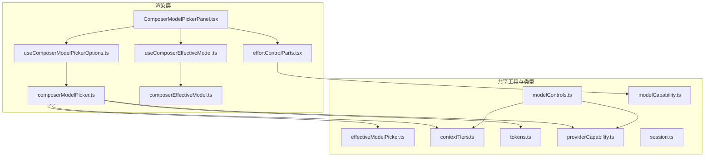
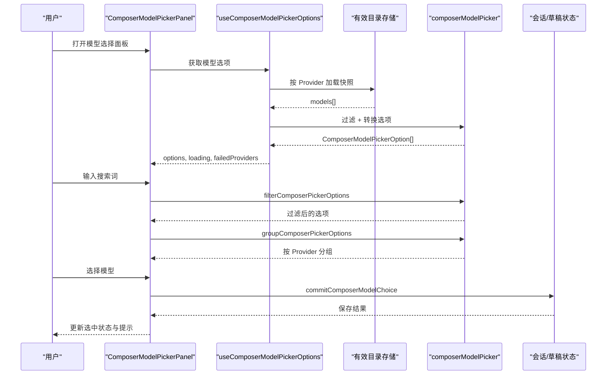
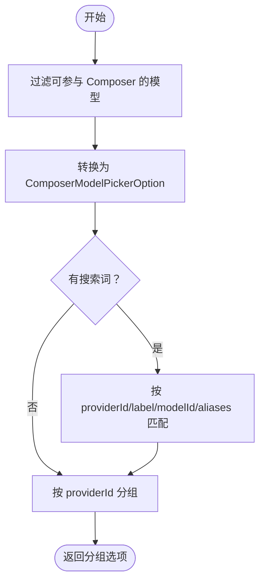
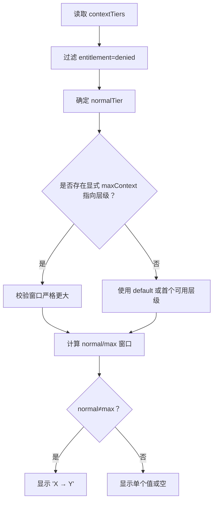
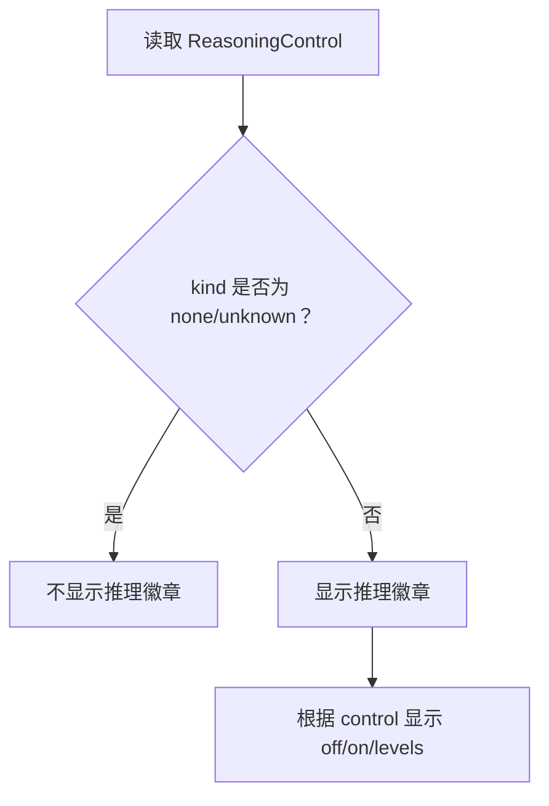
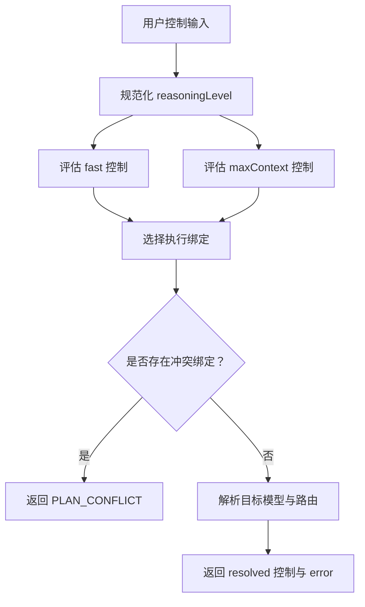
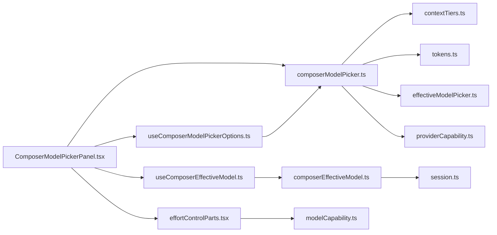

# 模型选择器与能力展示

<cite>
**本文引用的文件**   
- [composerModelPicker.ts](file://src/renderer/features/composer/composerModelPicker.ts)
- [useComposerModelPickerOptions.ts](file://src/renderer/features/composer/useComposerModelPickerOptions.ts)
- [ComposerModelPickerPanel.tsx](file://src/renderer/features/composer/ComposerModelPickerPanel.tsx)
- [effectiveModelPicker.ts](file://src/shared/utils/effectiveModelPicker.ts)
- [contextTiers.ts](file://src/shared/utils/contextTiers.ts)
- [tokens.ts](file://src/shared/utils/tokens.ts)
- [modelControls.ts](file://src/shared/utils/modelControls.ts)
- [providerCapability.ts](file://src/shared/types/providerCapability.ts)
- [modelCapability.ts](file://src/shared/types/modelCapability.ts)
- [session.ts](file://src/shared/types/session.ts)
- [composerEffectiveModel.ts](file://src/renderer/lib/composerEffectiveModel.ts)
- [useComposerEffectiveModel.ts](file://src/renderer/hooks/useComposerEffectiveModel.ts)
- [effortControlParts.tsx](file://src/renderer/features/composer/effortControlParts.tsx)
</cite>

## 目录
1. [引言](#引言)
2. [项目结构](#项目结构)
3. [核心组件](#核心组件)
4. [架构总览](#架构总览)
5. [详细组件分析](#详细组件分析)
6. [依赖关系分析](#依赖关系分析)
7. [性能考量](#性能考量)
8. [故障排查指南](#故障排查指南)
9. [结论](#结论)
10. [附录：配置与扩展方法](#附录配置与扩展方法)

## 引言
本文面向 Composer 的模型选择器及其能力展示，目标是帮助开发者理解“从 Provider 到 UI 选项”的完整链路，包括：
- 模型过滤、分组和查询；
- EffectiveModel 转换、标签与别名处理；
- 上下文窗口计算、token 格式化与范围显示；
- reasoning 推理能力识别与 UI 标记；
- 模型选择状态管理、持久化与默认值恢复；
- 控制项解析、执行绑定与冲突处理；
- 可配置项、代码示例路径与扩展建议。

## 项目结构
Composer 模型选择相关逻辑分布在渲染层、共享工具类型与能力定义中：
- 渲染层负责组合数据、渲染 UI、处理用户交互；
- 共享工具提供模型筛选、上下文层级、token 格式化等通用能力；
- 类型定义统一描述 EffectiveModel、ReasoningControl、SessionModelOverride 等核心数据结构。



**图表来源**
- [ComposerModelPickerPanel.tsx:1-238](file://src/renderer/features/composer/ComposerModelPickerPanel.tsx#L1-L238)
- [useComposerModelPickerOptions.ts:1-41](file://src/renderer/features/composer/useComposerModelPickerOptions.ts#L1-L41)
- [composerModelPicker.ts:1-111](file://src/renderer/features/composer/composerModelPicker.ts#L1-L111)
- [useComposerEffectiveModel.ts:1-45](file://src/renderer/hooks/useComposerEffectiveModel.ts#L1-L45)
- [composerEffectiveModel.ts:1-46](file://src/renderer/lib/composerEffectiveModel.ts#L1-L46)
- [contextTiers.ts:1-149](file://src/shared/utils/contextTiers.ts#L1-L149)
- [tokens.ts:1-14](file://src/shared/utils/tokens.ts#L1-L14)
- [modelControls.ts:1-327](file://src/shared/utils/modelControls.ts#L1-L327)
- [providerCapability.ts:1-396](file://src/shared/types/providerCapability.ts#L1-L396)
- [modelCapability.ts:1-293](file://src/shared/types/modelCapability.ts#L1-L293)
- [session.ts:1-200](file://src/shared/types/session.ts#L1-L200)

**章节来源**
- [ComposerModelPickerPanel.tsx:1-238](file://src/renderer/features/composer/ComposerModelPickerPanel.tsx#L1-L238)
- [useComposerModelPickerOptions.ts:1-41](file://src/renderer/features/composer/useComposerModelPickerOptions.ts#L1-L41)
- [composerModelPicker.ts:1-111](file://src/renderer/features/composer/composerModelPicker.ts#L1-L111)
- [useComposerEffectiveModel.ts:1-45](file://src/renderer/hooks/useComposerEffectiveModel.ts#L1-L45)
- [composerEffectiveModel.ts:1-46](file://src/renderer/lib/composerEffectiveModel.ts#L1-L46)

## 核心组件
- **模型选择面板**：负责搜索、分组、选择模型、显示上下文窗口与推理标识、回退为 Agent 默认模型。
- **模型选项加载 Hook**：按 Provider 异步加载有效目录快照，过滤出可参与 Composer 选择的模型。
- **模型选择器工具**：将 EffectiveModel 转换为 UI 选项，计算上下文窗口标签、推理支持判断、分组与查询匹配。
- **有效模型选择门控**：决定某个模型是否允许出现在选择器中（排除内部用途、不可用或被禁用）。
- **上下文层级工具**：解析 normal/max 模式、计算窗口 token、输出上限、预算上限。
- **Token 格式化**：将整数 token 数转为易读字符串。
- **模型控制解析**：解析 fast、maxContext、reasoning 控制项，并应用执行绑定、冲突检测与目标模型切换。
- **会话模型覆盖与默认路由**：决定当前 Composer 的有效模型来源（会话覆盖、草稿、Agent 编译路由）。

**章节来源**
- [composerModelPicker.ts:1-111](file://src/renderer/features/composer/composerModelPicker.ts#L1-L111)
- [useComposerModelPickerOptions.ts:1-41](file://src/renderer/features/composer/useComposerModelPickerOptions.ts#L1-L41)
- [effectiveModelPicker.ts:1-18](file://src/shared/utils/effectiveModelPicker.ts#L1-L18)
- [contextTiers.ts:1-149](file://src/shared/utils/contextTiers.ts#L1-L149)
- [tokens.ts:1-14](file://src/shared/utils/tokens.ts#L1-L14)
- [modelControls.ts:1-327](file://src/shared/utils/modelControls.ts#L1-L327)
- [composerEffectiveModel.ts:1-46](file://src/renderer/lib/composerEffectiveModel.ts#L1-L46)
- [useComposerEffectiveModel.ts:1-45](file://src/renderer/hooks/useComposerEffectiveModel.ts#L1-L45)

## 架构总览
Composer 模型选择的数据流如下：
1. 用户打开选择器时，Hook 遍历已启用的 Provider，异步加载其有效目录快照。
2. 对每个 Provider 的 models 列表，使用 `isComposerPickerModel` 过滤出适合 Composer 的模型。
3. 将 EffectiveModel 通过 `toComposerPickerOption` 转换为 Composer 选项，生成 providerId、label、aliases、contextWindowTokens、hasReasoning。
4. 用户在搜索框输入后，使用 `filterComposerPickerOptions` 过滤，再使用 `groupComposerPickerOptions` 按 Provider 分组。
5. 面板根据当前 effective model 高亮选中项，点击选择后调用保存逻辑写入会话或项目草稿。
6. 若未显式选择，则回退到 Agent 编译路由或 Agent 默认模型。



**图表来源**
- [ComposerModelPickerPanel.tsx:1-238](file://src/renderer/features/composer/ComposerModelPickerPanel.tsx#L1-L238)
- [useComposerModelPickerOptions.ts:1-41](file://src/renderer/features/composer/useComposerModelPickerOptions.ts#L1-L41)
- [composerModelPicker.ts:1-111](file://src/renderer/features/composer/composerModelPicker.ts#L1-L111)

**章节来源**
- [ComposerModelPickerPanel.tsx:1-238](file://src/renderer/features/composer/ComposerModelPickerPanel.tsx#L1-L238)
- [useComposerModelPickerOptions.ts:1-41](file://src/renderer/features/composer/useComposerModelPickerOptions.ts#L1-L41)
- [composerModelPicker.ts:1-111](file://src/renderer/features/composer/composerModelPicker.ts#L1-L111)

## 详细组件分析

### 模型过滤与分组逻辑
- **Provider 分组**：`groupComposerPickerOptions` 使用 Map 按 `providerId` 建立分组，保持首次出现顺序，并为每个组保存 `providerLabel` 与模型数组。
- **模型能力筛选**：`isComposerPickerModel` 基于 `isAgentToolExecutableModel` 判断模型是否可作为 Composer 执行目标；`isEffectiveModelPickerSelectable` 进一步屏蔽 internal 可见性、不可用与被禁用的模型。
- **查询匹配**：`matchesComposerPickerQuery` 对 providerId、providerLabel、modelId、label、aliases 进行大小写归一化子串匹配。
- **时间复杂度**：
  - 过滤：O(n)，n 为候选选项数；
  - 分组：O(n)，单次 Map 查找；
  - 查询匹配：O(m·k)，m 为匹配字段数，k 为平均字段长度。



**图表来源**
- [composerModelPicker.ts:1-111](file://src/renderer/features/composer/composerModelPicker.ts#L1-L111)
- [effectiveModelPicker.ts:1-18](file://src/shared/utils/effectiveModelPicker.ts#L1-L18)

**章节来源**
- [composerModelPicker.ts:1-111](file://src/renderer/features/composer/composerModelPicker.ts#L1-L111)
- [effectiveModelPicker.ts:1-18](file://src/shared/utils/effectiveModelPicker.ts#L1-L18)

### 模型选项构建过程
- **EffectiveModel 转换**：`toComposerPickerOption` 将 EffectiveModel 映射为 UI 友好的选项，包含 providerId、providerLabel、modelId、label、aliases、contextWindowTokens、contextWindowLabel、hasReasoning。
- **标签生成**：优先使用 `model.label`，否则回退到 `model.modelId`。
- **别名处理**：直接透传 `model.aliases`，用于搜索匹配。
- **上下文窗口计算**：`resolvePickerContextWindow` 先通过 `resolveContextTierChoices` 得到 normalTier 与 maxTier，再用 `contextTierWindowTokens` 计算窗口；若两者不同则显示范围标签。
- **推理能力标识**：`hasPickerReasoning` 判断 `model.controls.reasoning.kind` 是否为 none 或 unknown；非 none/unknown 即视为支持推理。

```mermaid
classDiagram
  class EffectiveModel {
    +string providerId
    +string modelId
    +string label
    +string[] aliases
    +ContextTier[] contextTiers
    +{fast,maxContext,reasoning} controls
  }

  class ComposerModelPickerOption {
    +string providerId
    +string providerLabel
    +string modelId
    +string label
    +string[] aliases
    +number|null contextWindowTokens
    +string|null contextWindowLabel
    +boolean hasReasoning
  }

  class ComposerModelPickerGroup {
    +string providerId
    +string providerLabel
    +ComposerModelPickerOption[] models
  }

  EffectiveModel --> ComposerModelPickerOption : "toComposerPickerOption"
  ComposerModelPickerOption --> ComposerModelPickerGroup : "groupComposerPickerOptions"
```

**图表来源**
- [composerModelPicker.ts:1-111](file://src/renderer/features/composer/composerModelPicker.ts#L1-L111)
- [providerCapability.ts:1-396](file://src/shared/types/providerCapability.ts#L1-L396)

**章节来源**
- [composerModelPicker.ts:1-111](file://src/renderer/features/composer/composerModelPicker.ts#L1-L111)
- [providerCapability.ts:1-396](file://src/shared/types/providerCapability.ts#L1-L396)

### 上下文窗口计算与展示
- **上下文层级解析**：`resolveContextTierChoices` 从 `model.contextTiers` 中过滤被 denied 的层级，确定 normalTier 与可选 maxTier；若 maxTier 存在且数值严格大于 normalTier，则认为 Max 模式可用。
- **窗口 token 计算**：`contextTierWindowTokens` 优先取 `maxTotalTokens`，否则用 `maxPromptTokens + maxOutputTokens` 推导；若无合法数字则返回 undefined。
- **范围显示**：当 normal 与 max 窗口都存在且不同，则显示如 “X → Y” 的范围标签；否则显示单个值。
- **Token 格式化**：`formatTokenCount` 将整数转为 k/M 单位字符串，提升可读性。
- **性能影响提示**：
  - 大窗口可能增加请求体体积、延迟与成本；
  - RequestPlanner 会基于 `contextBudgetTokens` 与 `compactionThresholdTokens` 做压缩触发；
  - UI 仅展示窗口范围，不直接计算压缩阈值，但可通过标签引导用户关注大上下文。



**图表来源**
- [contextTiers.ts:1-149](file://src/shared/utils/contextTiers.ts#L1-L149)
- [composerModelPicker.ts:1-111](file://src/renderer/features/composer/composerModelPicker.ts#L1-L111)
- [tokens.ts:1-14](file://src/shared/utils/tokens.ts#L1-L14)

**章节来源**
- [contextTiers.ts:1-149](file://src/shared/utils/contextTiers.ts#L1-L149)
- [composerModelPicker.ts:1-111](file://src/renderer/features/composer/composerModelPicker.ts#L1-L111)
- [tokens.ts:1-14](file://src/shared/utils/tokens.ts#L1-L14)

### 推理能力标识与用户引导
- **推理能力检测**：`hasPickerReasoning` 以 `controls.reasoning.kind` 为依据；none 或 unknown 表示不支持或不明确。
- **UI 标记**：ComposerModelPickerPanel 在模型项元信息处渲染推理徽章，文案来自国际化键。
- **用户引导**：
  - 选择器顶部显示 Agent 默认模型状态；
  - 推理开关由 effortControlParts 与 modelCapability 共同驱动，展示 off/on/levels 序列；
  - 若推理为 always-on 或 levels，面板会展示对应级别与默认值。



**图表来源**
- [composerModelPicker.ts:1-111](file://src/renderer/features/composer/composerModelPicker.ts#L1-L111)
- [ComposerModelPickerPanel.tsx:201-238](file://src/renderer/features/composer/ComposerModelPickerPanel.tsx#L201-L238)
- [effortControlParts.tsx:1-149](file://src/renderer/features/composer/effortControlParts.tsx#L1-L149)
- [modelCapability.ts:1-293](file://src/shared/types/modelCapability.ts#L1-L293)

**章节来源**
- [composerModelPicker.ts:1-111](file://src/renderer/features/composer/composerModelPicker.ts#L1-L111)
- [ComposerModelPickerPanel.tsx:201-238](file://src/renderer/features/composer/ComposerModelPickerPanel.tsx#L201-L238)
- [effortControlParts.tsx:1-149](file://src/renderer/features/composer/effortControlParts.tsx#L1-L149)
- [modelCapability.ts:1-293](file://src/shared/types/modelCapability.ts#L1-L293)

### 模型选择状态管理与持久化
- **有效模型来源优先级**：
  1. 会话级 `modelOverride`；
  2. 项目草稿级 `draftModel`；
  3. Agent 编译路由 `compiledRoute`；
  4. 无选择时回退为 Agent 默认模型。
- **状态读取 Hook**：`useComposerEffectiveModel` 订阅 appSettingsStore、projectStore 与 composerModelDraftStore，计算 effective 与是否有显式选择。
- **持久化操作**：ComposerModelPickerPanel 调用 `commitComposerModelChoice` 与 `clearComposerModelChoice`，分别用于保存模型选择与恢复 Agent 默认。
- **错误处理**：保存失败时显示错误提示，并提供重试入口。

```mermaid
stateDiagram-v2
  [*] --> Idle
  Idle --> Loading : "加载 Provider 目录"
  Loading --> Ready : "目录就绪"
  Ready --> Selecting : "用户选择模型"
  Selecting --> Saving : "提交选择"
  Saving --> Ready : "成功"
  Saving --> Error : "失败"
  Error --> Ready : "重试或取消"
  Ready --> Default : "清除选择"
  Default --> Ready
```

**图表来源**
- [useComposerEffectiveModel.ts:1-45](file://src/renderer/hooks/useComposerEffectiveModel.ts#L1-L45)
- [composerEffectiveModel.ts:1-46](file://src/renderer/lib/composerEffectiveModel.ts#L1-L46)
- [ComposerModelPickerPanel.tsx:1-238](file://src/renderer/features/composer/ComposerModelPickerPanel.tsx#L1-L238)
- [session.ts:1-200](file://src/shared/types/session.ts#L1-L200)

**章节来源**
- [useComposerEffectiveModel.ts:1-45](file://src/renderer/hooks/useComposerEffectiveModel.ts#L1-L45)
- [composerEffectiveModel.ts:1-46](file://src/renderer/lib/composerEffectiveModel.ts#L1-L46)
- [ComposerModelPickerPanel.tsx:1-238](file://src/renderer/features/composer/ComposerModelPickerPanel.tsx#L1-L238)
- [session.ts:1-200](file://src/shared/types/session.ts#L1-L200)

### 控制项解析与执行绑定
- **控制项类型**：fast、maxContext、reasoning 三类控制项由 `ResolvedModelControls` 描述，包含 state/value/defaultValue/disabled/reason 等字段。
- **执行绑定**：`selectBinding` 根据 fastModel、maxContextMode、reasoningLevel 与 routeOptionIds 匹配 executionBindings；若多个 binding 具有相同特异性且动作不同，则返回 PLAN_CONFLICT。
- **目标模型切换**：`resolveExecutionBinding` 支持 action.kind=model-switch，并校验目标模型的 availability、enabled、route 协议一致性。
- **阻塞与错误**：当绑定不可用或目标不可用时，控制项被标记为 blocked，并附带 reason。



**图表来源**
- [modelControls.ts:1-327](file://src/shared/utils/modelControls.ts#L1-L327)
- [providerCapability.ts:1-396](file://src/shared/types/providerCapability.ts#L1-L396)
- [modelCapability.ts:1-293](file://src/shared/types/modelCapability.ts#L1-L293)

**章节来源**
- [modelControls.ts:1-327](file://src/shared/utils/modelControls.ts#L1-L327)
- [providerCapability.ts:1-396](file://src/shared/types/providerCapability.ts#L1-L396)
- [modelCapability.ts:1-293](file://src/shared/types/modelCapability.ts#L1-L293)

## 依赖关系分析
- **渲染层依赖**：
  - ComposerModelPickerPanel 依赖 useComposerModelPickerOptions、useComposerEffectiveModel、composerModelPicker、effortControlParts；
  - useComposerModelPickerOptions 依赖 useEffectiveCatalogStore 与 composerModelPicker；
  - useComposerEffectiveModel 依赖 appSettingsStore、projectStore、composerModelDraftStore 与 composerEffectiveModel。
- **工具与类型依赖**：
  - composerModelPicker 依赖 contextTiers、tokens、agentToolCapability、providerCapability；
  - modelControls 依赖 providerCapability、contextTiers、modelCapability；
  - contextTiers 依赖 providerCapability；
  - tokens 独立；
  - session 类型用于 modelOverride 与 draftModel。



**图表来源**
- [ComposerModelPickerPanel.tsx:1-238](file://src/renderer/features/composer/ComposerModelPickerPanel.tsx#L1-L238)
- [useComposerModelPickerOptions.ts:1-41](file://src/renderer/features/composer/useComposerModelPickerOptions.ts#L1-L41)
- [useComposerEffectiveModel.ts:1-45](file://src/renderer/hooks/useComposerEffectiveModel.ts#L1-L45)
- [composerModelPicker.ts:1-111](file://src/renderer/features/composer/composerModelPicker.ts#L1-L111)
- [effortControlParts.tsx:1-149](file://src/renderer/features/composer/effortControlParts.tsx#L1-L149)
- [composerEffectiveModel.ts:1-46](file://src/renderer/lib/composerEffectiveModel.ts#L1-L46)
- [contextTiers.ts:1-149](file://src/shared/utils/contextTiers.ts#L1-L149)
- [tokens.ts:1-14](file://src/shared/utils/tokens.ts#L1-L14)
- [effectiveModelPicker.ts:1-18](file://src/shared/utils/effectiveModelPicker.ts#L1-L18)
- [providerCapability.ts:1-396](file://src/shared/types/providerCapability.ts#L1-L396)
- [modelCapability.ts:1-293](file://src/shared/types/modelCapability.ts#L1-L293)
- [session.ts:1-200](file://src/shared/types/session.ts#L1-L200)

**章节来源**
- [ComposerModelPickerPanel.tsx:1-238](file://src/renderer/features/composer/ComposerModelPickerPanel.tsx#L1-L238)
- [useComposerModelPickerOptions.ts:1-41](file://src/renderer/features/composer/useComposerModelPickerOptions.ts#L1-L41)
- [useComposerEffectiveModel.ts:1-45](file://src/renderer/hooks/useComposerEffectiveModel.ts#L1-L45)
- [composerModelPicker.ts:1-111](file://src/renderer/features/composer/composerModelPicker.ts#L1-L111)
- [effortControlParts.tsx:1-149](file://src/renderer/features/composer/effortControlParts.tsx#L1-L149)
- [composerEffectiveModel.ts:1-46](file://src/renderer/lib/composerEffectiveModel.ts#L1-L46)
- [contextTiers.ts:1-149](file://src/shared/utils/contextTiers.ts#L1-L149)
- [tokens.ts:1-14](file://src/shared/utils/tokens.ts#L1-L14)
- [effectiveModelPicker.ts:1-18](file://src/shared/utils/effectiveModelPicker.ts#L1-L18)
- [providerCapability.ts:1-396](file://src/shared/types/providerCapability.ts#L1-L396)
- [modelCapability.ts:1-293](file://src/shared/types/modelCapability.ts#L1-L293)
- [session.ts:1-200](file://src/shared/types/session.ts#L1-L200)

## 性能考量
- **异步加载**：useComposerModelPickerOptions 对每个 Provider 并行加载目录快照，避免串行阻塞；loading 状态聚合所有 Provider 的加载情况。
- **过滤与分组开销**：过滤与分组均为线性操作；搜索匹配涉及多字段比较，建议在选项数量较大时考虑防抖或分页。
- **上下文窗口计算**：只在转换选项时计算一次；UI 仅展示格式化结果，不参与复杂运算。
- **推理能力检查**：只检查 kind 字段，成本低。
- **控制项解析**：仅在需要时解析，避免在每次渲染中重复计算；binding 冲突会在 planning 阶段暴露。

[本节为一般性指导，不涉及具体文件分析]

## 故障排查指南
- **模型未显示**：
  - 检查 `isComposerPickerModel` 是否过滤掉该模型；
  - 检查 `isEffectiveModelPickerSelectable` 是否因 unavailable/internal/enabled=false 而隐藏。
- **上下文窗口为空**：
  - 确认 contextTiers 中是否存在合法的 numeric window；
  - 检查 normalTier 与 maxTier 是否都具备 `maxTotalTokens` 或可推导的 prompt+output。
- **推理徽章未显示**：
  - 检查 `controls.reasoning.kind` 是否为 none 或 unknown；
  - 确认 wireProfile 与 levels 是否正确配置。
- **Fast/Max 控制被禁用**：
  - 查看 `resolveModelControls` 返回的 resolved 控制中的 reason；
  - 检查 executionBindings 是否存在冲突或目标模型不可用。
- **保存失败**：
  - ComposerModelPickerPanel 会捕获保存错误并显示提示；
  - 检查会话或草稿存储权限与状态。

**章节来源**
- [effectiveModelPicker.ts:1-18](file://src/shared/utils/effectiveModelPicker.ts#L1-L18)
- [composerModelPicker.ts:1-111](file://src/renderer/features/composer/composerModelPicker.ts#L1-L111)
- [contextTiers.ts:1-149](file://src/shared/utils/contextTiers.ts#L1-L149)
- [modelControls.ts:1-327](file://src/shared/utils/modelControls.ts#L1-L327)
- [ComposerModelPickerPanel.tsx:1-238](file://src/renderer/features/composer/ComposerModelPickerPanel.tsx#L1-L238)

## 结论
Composer 模型选择器通过清晰的职责分层实现了从 Provider 目录到 UI 选项的可靠映射：
- 使用 EffectiveModel 作为统一数据源，结合 contextTiers 与 tokens 完成上下文窗口计算与展示；
- 使用 reasoning control 与 picker 工具实现推理能力识别与 UI 标记；
- 使用会话/草稿/Agent 路由的多级优先级保证默认值恢复与状态持久化；
- 使用执行绑定与控制解析确保 fast/max/reasoning 的正确性与安全性；
- 通过分组、查询与错误提示提升用户体验与可维护性。

[本节为总结性内容，不涉及具体文件分析]

## 附录：配置与扩展方法
- **扩展模型过滤规则**：
  - 修改 `isComposerPickerModel` 以加入新的能力条件；
  - 在 `toComposerPickerOption` 中增加新字段，例如 cost、quota、visionSupport。
- **扩展上下文窗口展示**：
  - 在 `resolvePickerContextWindow` 中增加输出上限提示；
  - 在 `contextTiers.ts` 中扩展 `contextTierOutputTokens` 与 `resolvePlanningOutputTokens`。
- **扩展推理能力标识**：
  - 在 `hasPickerReasoning` 中加入更多 kind 分支；
  - 在 effortControlParts 中扩展 displayLevels 与级别映射。
- **扩展分组与排序**：
  - 在 `groupComposerPickerOptions` 中引入自定义排序函数；
  - 添加按类别、价格、供应商等级分组的策略。
- **扩展状态管理**：
  - 在 `composerEffectiveModel.ts` 中增加新的默认来源优先级；
  - 在 useComposerEffectiveModel 中订阅新的设置来源。

参考路径：
- [composerModelPicker.ts:1-111](file://src/renderer/features/composer/composerModelPicker.ts#L1-L111)
- [contextTiers.ts:1-149](file://src/shared/utils/contextTiers.ts#L1-L149)
- [effortControlParts.tsx:1-149](file://src/renderer/features/composer/effortControlParts.tsx#L1-L149)
- [modelControls.ts:1-327](file://src/shared/utils/modelControls.ts#L1-L327)
- [composerEffectiveModel.ts:1-46](file://src/renderer/lib/composerEffectiveModel.ts#L1-L46)
- [useComposerEffectiveModel.ts:1-45](file://src/renderer/hooks/useComposerEffectiveModel.ts#L1-L45)