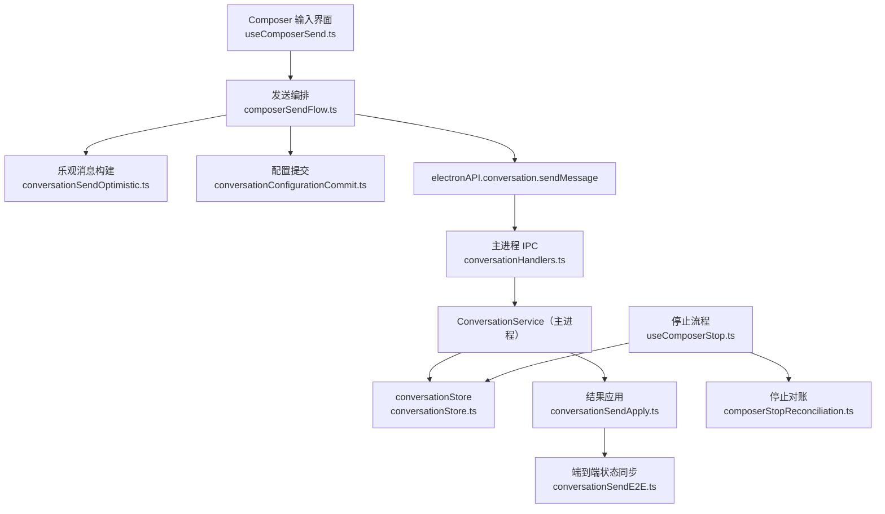
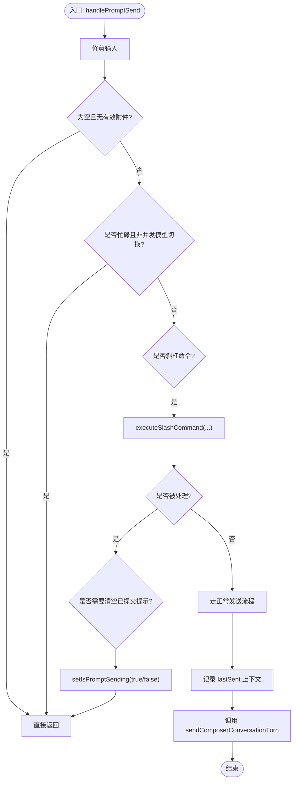
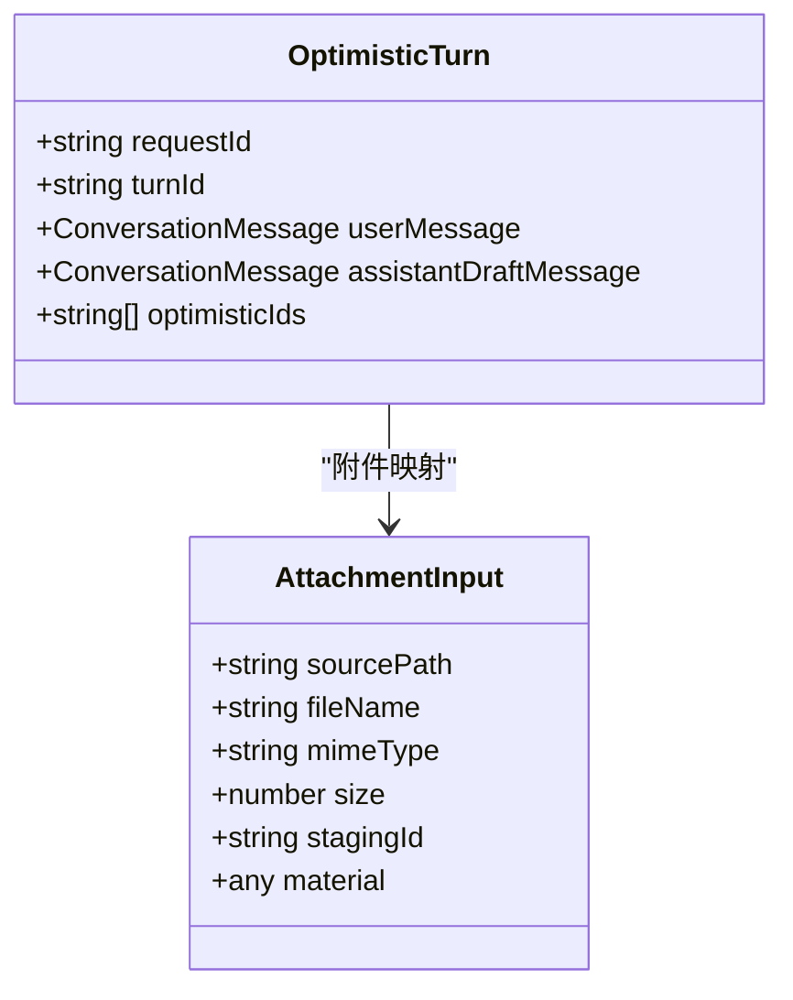
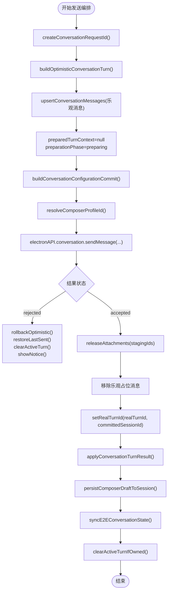
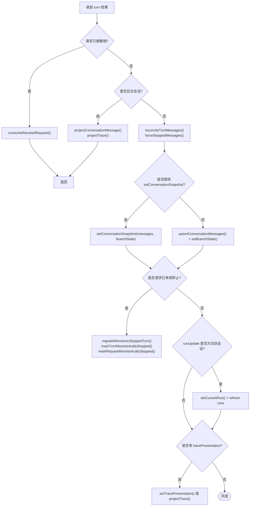
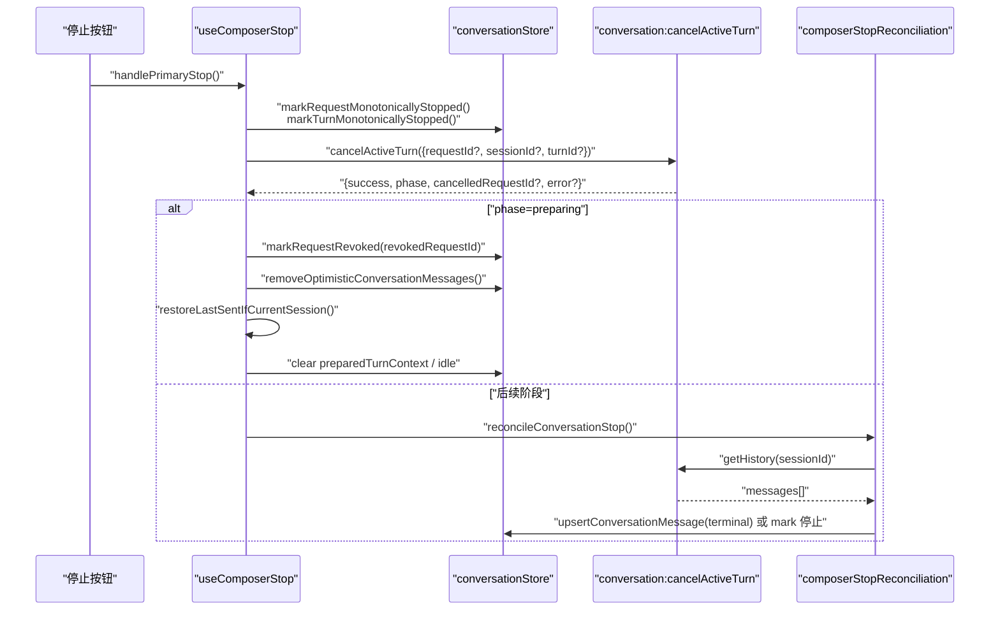
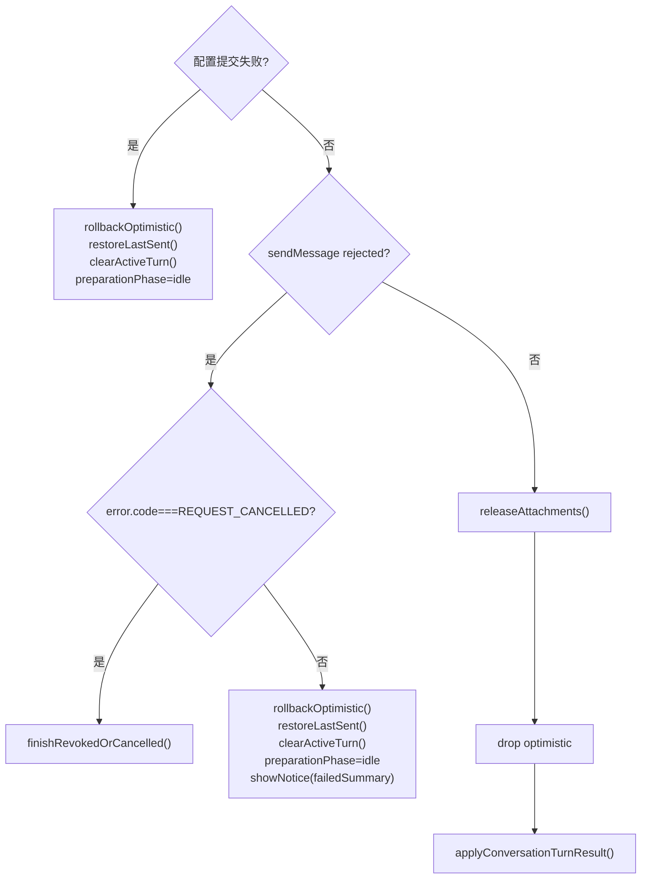
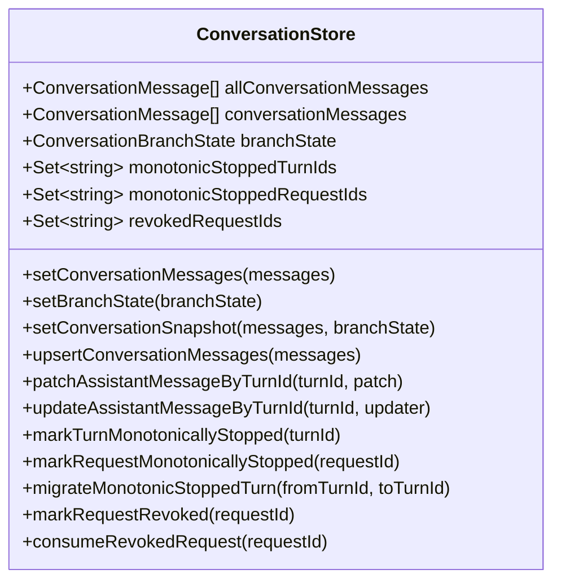
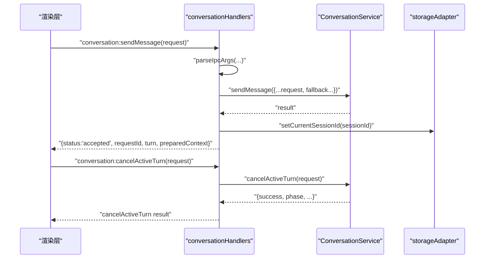
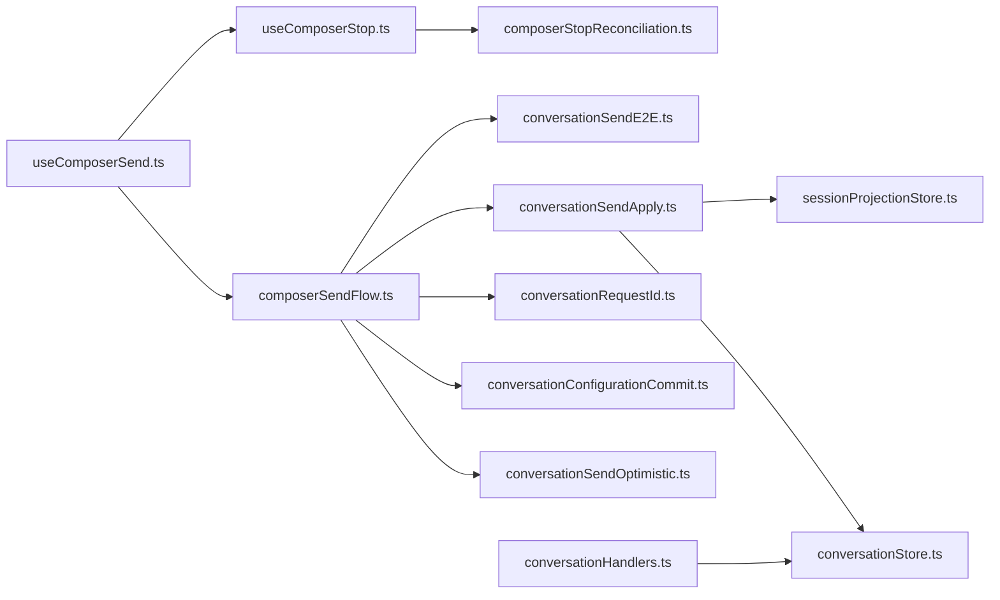

# 消息发送流程与状态协调

<cite>
**本文引用的文件**   
- [useComposerSend.ts](file://src/renderer/features/composer/useComposerSend.ts)
- [composerSendFlow.ts](file://src/renderer/features/composer/composerSendFlow.ts)
- [conversationStore.ts](file://src/renderer/stores/conversationStore.ts)
- [conversationSendOptimistic.ts](file://src/renderer/stores/conversationSendOptimistic.ts)
- [conversationSendApply.ts](file://src/renderer/stores/conversationSendApply.ts)
- [conversationSendE2E.ts](file://src/renderer/stores/conversationSendE2E.ts)
- [conversationConfigurationCommit.ts](file://src/renderer/stores/conversationConfigurationCommit.ts)
- [conversationRequestId.ts](file://src/renderer/services/conversationRequestId.ts)
- [useComposerStop.ts](file://src/renderer/features/composer/useComposerStop.ts)
- [composerStopReconciliation.ts](file://src/renderer/features/composer/composerStopReconciliation.ts)
- [conversationHandlers.ts](file://src/main/ipc/conversationHandlers.ts)
- [projectSessionHandlers.ts](file://src/main/ipc/projectSessionHandlers.ts)
- [conversation.ts](file://src/shared/types/conversation.ts)
</cite>

## 目录
1. [简介](#简介)
2. [项目结构](#项目结构)
3. [核心组件](#核心组件)
4. [架构总览](#架构总览)
5. [详细组件分析](#详细组件分析)
6. [依赖关系分析](#依赖关系分析)
7. [性能考虑](#性能考虑)
8. [故障排查指南](#故障排查指南)
9. [结论](#结论)

## 简介
本文围绕 Composer 消息发送流程与状态协调展开，系统性解释从用户输入到主进程执行、结果回写、会话状态同步的完整链路。重点包括：
- 参数验证、消息构建、乐观更新、错误处理；
- ConversationMessage 更新、BranchState 同步、RunSummary 管理；
- requestId 生成、超时/取消机制；
- 多步骤提交流程：配置提交、消息发送、结果回滚；
- 与 conversationStore 的集成及错误恢复；
- 调试技巧与性能优化建议。

## 项目结构
Composer 的消息发送由渲染层触发，经由 IPC 进入主进程的 ConversationService，最终落盘并驱动 UI 状态更新。关键文件分布如下：
- 渲染层入口：`useComposerSend.ts` 负责拦截回车、斜杠命令、并发控制与停止逻辑；
- 发送编排：`composerSendFlow.ts` 串联请求生命周期、乐观更新、IPC 调用与结果应用；
- 乐观更新与附件转换：`conversationSendOptimistic.ts`；
- 结果应用与会话分支同步：`conversationSendApply.ts`、`conversationSendE2E.ts`；
- 配置快照：`conversationConfigurationCommit.ts`；
- 唯一请求标识：`conversationRequestId.ts`；
- 停止与撤销：`useComposerStop.ts`、`composerStopReconciliation.ts`；
- 主进程 IPC 路由：`conversationHandlers.ts`、`projectSessionHandlers.ts`；
- 共享类型定义：`conversation.ts`。



**图表来源**
- [useComposerSend.ts:40-180](file://src/renderer/features/composer/useComposerSend.ts#L40-L180)
- [composerSendFlow.ts:20-285](file://src/renderer/features/composer/composerSendFlow.ts#L20-L285)
- [conversationSendOptimistic.ts:1-112](file://src/renderer/stores/conversationSendOptimistic.ts#L1-L112)
- [conversationConfigurationCommit.ts:1-55](file://src/renderer/stores/conversationConfigurationCommit.ts#L1-L55)
- [conversationHandlers.ts:30-120](file://src/main/ipc/conversationHandlers.ts#L30-L120)
- [conversationStore.ts:1-139](file://src/renderer/stores/conversationStore.ts#L1-L139)
- [conversationSendApply.ts:1-191](file://src/renderer/stores/conversationSendApply.ts#L1-L191)
- [conversationSendE2E.ts:1-50](file://src/renderer/stores/conversationSendE2E.ts#L1-L50)

**章节来源**
- [useComposerSend.ts:1-199](file://src/renderer/features/composer/useComposerSend.ts#L1-L199)
- [composerSendFlow.ts:1-285](file://src/renderer/features/composer/composerSendFlow.ts#L1-L285)
- [conversationStore.ts:1-139](file://src/renderer/stores/conversationStore.ts#L1-L139)

## 核心组件
- Composer 发送钩子：负责按键拦截、斜杠命令分流、并发忙闲控制、最后一次发送上下文记录与恢复。
- 发送编排器：生成 requestId、构建乐观消息、写入准备阶段上下文、发起 IPC 调用、处理拒绝/成功、释放暂存附件、应用结果、同步端到端状态。
- 乐观消息工厂：生成用户与助手草稿消息，附带附件映射与工作追踪骨架。
- 结果应用器：合并消息、对齐分支状态、后台会话投影、更新 RunSummary、追踪呈现。
- 配置提交器：持久化 Agent/Provider 设置变更，计算有效模型并返回一致性快照。
- 请求 ID 生成器：优先使用全局随机 UUID，回退时间戳加随机串。
- 停止控制器：标记单调停止、调用 cancelActiveTurn、处理 prepping 阶段的撤销、恢复最后一次发送内容、与工作流停止协同。
- 停止对账器：根据主进程反馈查询真实终态，避免覆盖已完成的终端消息。
- 主进程 IPC：校验参数、委派 ConversationService、更新当前项目/会话/运行上下文、统一拒绝封装。

**章节来源**
- [useComposerSend.ts:12-180](file://src/renderer/features/composer/useComposerSend.ts#L12-L180)
- [composerSendFlow.ts:20-285](file://src/renderer/features/composer/composerSendFlow.ts#L20-L285)
- [conversationSendOptimistic.ts:12-112](file://src/renderer/stores/conversationSendOptimistic.ts#L12-L112)
- [conversationSendApply.ts:17-191](file://src/renderer/stores/conversationSendApply.ts#L17-L191)
- [conversationConfigurationCommit.ts:10-55](file://src/renderer/stores/conversationConfigurationCommit.ts#L10-L55)
- [conversationRequestId.ts:1-4](file://src/renderer/services/conversationRequestId.ts#L1-L4)
- [useComposerStop.ts:20-170](file://src/renderer/features/composer/useComposerStop.ts#L20-L170)
- [composerStopReconciliation.ts:1-61](file://src/renderer/features/composer/composerStopReconciliation.ts#L1-L61)
- [conversationHandlers.ts:30-120](file://src/main/ipc/conversationHandlers.ts#L30-L120)

## 架构总览
发送流程可抽象为“渲染层触发 → 乐观更新 → 配置提交 → IPC 发送 → 结果应用 → 分支与追踪同步”的多阶段流水线。主进程侧仅暴露最小 IPC 接口，业务语义集中在 ConversationService（未在本仓库直接展示），渲染层通过 Zustand store 维护可见消息、分支状态与单调停止集合。

```mermaid
sequenceDiagram
    participant UI as "Composer 输入"
    participant SendHook as "useComposerSend"
    participant Flow as "composerSendFlow"
    participant Opt as "conversationSendOptimistic"
    participant Cfg as "conversationConfigurationCommit"
    participant IPC as "electronAPI.conversation"
    participant Main as "conversationHandlers"
    participant Store as "conversationStore"
    participant Apply as "conversationSendApply"
    participant E2E as "conversationSendE2E"

    UI->>SendHook: "回车或点击发送"
    SendHook->>Flow: "sendComposerConversationTurn(...)"
    Flow->>Opt: "buildOptimisticConversationTurn()"
    Opt-->>Flow: "乐观用户消息+助手草稿"
    Flow->>Store: "upsertConversationMessages(乐观消息)"
    Flow->>Cfg: "buildConversationConfigurationCommit()"
    Cfg-->>Flow: "configurationCommit"
    Flow->>IPC: "sendMessage({requestId, ...})"
    IPC->>Main: "conversation:sendMessage"
    Main-->>IPC: "{status:'accepted', turn}"
    IPC-->>Flow: "turn 结果"
    Flow->>Apply: "applyConversationTurnResult(turn)"
    Apply->>Store: "merge/upsert 消息+branchState"
    Flow->>E2E: "syncE2EConversationState(sessionId, turnId)"
    E2E-->>Flow: "历史最终一致"
    Flow-->>UI: "清理活跃轮次/提示"
```

**图表来源**
- [useComposerSend.ts:60-170](file://src/renderer/features/composer/useComposerSend.ts#L60-L170)
- [composerSendFlow.ts:40-285](file://src/renderer/features/composer/composerSendFlow.ts#L40-L285)
- [conversationSendOptimistic.ts:12-80](file://src/renderer/stores/conversationSendOptimistic.ts#L12-L80)
- [conversationConfigurationCommit.ts:10-55](file://src/renderer/stores/conversationConfigurationCommit.ts#L10-L55)
- [conversationHandlers.ts:30-120](file://src/main/ipc/conversationHandlers.ts#L30-L120)
- [conversationSendApply.ts:40-191](file://src/renderer/stores/conversationSendApply.ts#L40-L191)
- [conversationSendE2E.ts:1-50](file://src/renderer/stores/conversationSendE2E.ts#L1-L50)

## 详细组件分析

### 参数验证与发送入口
- 空输入保护：当内容为空且无有效附件时直接返回。
- 并发保护：存在正在发送、活动对话轮次或调试运行时禁止重复发送，除非是并发模型切换命令。
- 斜杠命令分流：以 `/` 开头的命令交由 `executeSlashCommand` 处理，必要时保持发送忙位。
- 最后一次发送上下文：在发送前记录 sessionId、projectId、prompt、附件与技能 ID，用于失败恢复。



**图表来源**
- [useComposerSend.ts:40-170](file://src/renderer/features/composer/useComposerSend.ts#L40-L170)

**章节来源**
- [useComposerSend.ts:40-170](file://src/renderer/features/composer/useComposerSend.ts#L40-L170)

### 乐观更新与消息构建
- 乐观消息包含两条：用户消息（complete）与助手草稿（streaming）。
- 助手草稿附带初始 workTrace：status=running，summary 为空，blocks 为空数组。
- 附件映射将 PendingAttachmentDraft 转换为 ConversationAttachmentInput，过滤错误条目。
- 乐观消息 id 带有 request 标识，便于后续移除与迁移。



**图表来源**
- [conversationSendOptimistic.ts:12-112](file://src/renderer/stores/conversationSendOptimistic.ts#L12-L112)

**章节来源**
- [conversationSendOptimistic.ts:12-112](file://src/renderer/stores/conversationSendOptimistic.ts#L12-L112)

### 配置提交与请求生命周期
- 配置提交：基于选中 agent、当前项目与可选 modelOverride，持久化 Agent/Provider 设置，读取 provider catalog 后生成 configurationCommit。
- 请求 ID：优先使用 crypto.randomUUID，否则使用时间戳加随机串。
- 准备阶段：设置 preparedTurnContext 为 null，conversationPreparationPhase 设为 preparing；成功后再根据结果切换为 current。
- 所有权与活跃轮次：记录 sessionId、requestId、agentId、optimisticTurnId、realTurnId，用于停止与清理。



**图表来源**
- [composerSendFlow.ts:40-285](file://src/renderer/features/composer/composerSendFlow.ts#L40-L285)
- [conversationConfigurationCommit.ts:10-55](file://src/renderer/stores/conversationConfigurationCommit.ts#L10-L55)
- [conversationRequestId.ts:1-4](file://src/renderer/services/conversationRequestId.ts#L1-L4)

**章节来源**
- [composerSendFlow.ts:40-285](file://src/renderer/features/composer/composerSendFlow.ts#L40-L285)
- [conversationConfigurationCommit.ts:10-55](file://src/renderer/stores/conversationConfigurationCommit.ts#L10-L55)
- [conversationRequestId.ts:1-4](file://src/renderer/services/conversationRequestId.ts#L1-L4)

### 结果应用与会话状态协调
- 消息合并策略：按 message.id 建立映射，保留 updatedAt 更大的版本，避免覆盖已完成助手消息。
- 分支状态同步：若提供 setConversationSnapshot，则原子更新 messages 与 branchState；否则分别 upsert 消息与分支。
- 后台会话处理：若非当前活跃会话事件，消息与 trace 投影到 sessionProjectionStore，不污染前台视图。
- RunSummary 管理：当 runUpdate.sessionId 为活跃会话时，立即 setCurrentRun 并刷新 runs 列表。
- 单调停止迁移：若请求已被标记为单调停止，则将乐观 turnId 迁移至真实 turnId，并标记真实 turn 与请求停止。



**图表来源**
- [conversationSendApply.ts:17-191](file://src/renderer/stores/conversationSendApply.ts#L17-L191)

**章节来源**
- [conversationSendApply.ts:17-191](file://src/renderer/stores/conversationSendApply.ts#L17-L191)

### 停止与取消机制
- 乐观停止：立即标记 monotonicStoppedTurnIds、monotonicStoppedRequestIds，并更新助手消息的 workTrace 为 stopped。
- 主进程取消：调用 conversation.cancelActiveTurn(requestId?, sessionId?, turnId?)，并根据 phase 区分 preparing 撤销与后续对账。
- Preparing 撤销：若处于 preparing 阶段，标记 revokedRequestIds，移除对应乐观消息，恢复最后一次发送内容，清空 preparedTurnContext 与 preparationPhase。
- 延迟停止对账：查询真实历史消息，若已有终端状态则替换 store 中的消息；否则在当前会话中补充停止标记。



**图表来源**
- [useComposerStop.ts:20-170](file://src/renderer/features/composer/useComposerStop.ts#L20-L170)
- [composerStopReconciliation.ts:1-61](file://src/renderer/features/composer/composerStopReconciliation.ts#L1-L61)

**章节来源**
- [useComposerStop.ts:20-170](file://src/renderer/features/composer/useComposerStop.ts#L20-L170)
- [composerStopReconciliation.ts:1-61](file://src/renderer/features/composer/composerStopReconciliation.ts#L1-L61)

### 多步骤提交流程：配置提交、消息发送、结果回滚
- 配置提交失败：抛出异常会被捕获，触发 rollbackOptimistic、restoreLastSent、clearActiveTurn、清空 preparedTurnContext 与 preparationPhase。
- 消息发送 rejected：根据错误码判断 REQUEST_CANCELLED，若是则走撤销路径；否则回滚乐观消息并提示失败。
- 附件暂存释放：成功路径下调用 releaseAttachments 清理 stagingId。
- 乐观占位移除：在 applyConversationTurnResult 之前移除乐观消息，避免与权威消息冲突。



**图表来源**
- [composerSendFlow.ts:150-285](file://src/renderer/features/composer/composerSendFlow.ts#L150-L285)

**章节来源**
- [composerSendFlow.ts:150-285](file://src/renderer/features/composer/composerSendFlow.ts#L150-L285)

### 与 conversationStore 的集成
- 消息追加与合并：addConversationMessage、upsertConversationMessage、upsertConversationMessages 均会排序并按分支投影 visible 消息。
- 分支状态同步：setBranchState 同时更新 branchState 与 visible 消息集。
- 快照更新：setConversationSnapshot 支持原子更新 messages 与 branchState。
- 单调停止：markTurnMonotonicallyStopped、markRequestMonotonicallyStopped、migrateMonotonicStoppedTurn 确保停止语义不可逆。
- 撤销消费：markRequestRevoked 与 consumeRevokedRequest 配合 preparing 阶段快速清理。



**图表来源**
- [conversationStore.ts:1-139](file://src/renderer/stores/conversationStore.ts#L1-L139)

**章节来源**
- [conversationStore.ts:1-139](file://src/renderer/stores/conversationStore.ts#L1-L139)

### 主进程 IPC 集成
- sendMessage：解析 ConversationSendMessageArgsSchema，委派 conversationService.sendMessage，更新 state.currentProjectId/sessionId/runId，返回 accepted 与 turn。
- cancelActiveTurn：解析 ConversationCancelActiveTurnArgsSchema，委托 conversationService.cancelActiveTurn。
- getHistory：返回会话历史与 branchState，供端到端同步使用。
- 错误统一：toRejectedSendResult 包装异常，携带 requestId，便于渲染层识别 REQUEST_CANCELLED。



**图表来源**
- [conversationHandlers.ts:30-200](file://src/main/ipc/conversationHandlers.ts#L30-L200)

**章节来源**
- [conversationHandlers.ts:30-200](file://src/main/ipc/conversationHandlers.ts#L30-L200)

## 依赖关系分析
- useComposerSend 依赖 composerSendFlow、useComposerStop、slashCommandExecutor、composerKeyboard 与多个 Zustand stores。
- composerSendFlow 依赖 optimistic builder、configuration commit、requestId generator、session/workflow/project stores 与 electronAPI。
- conversationSendApply 依赖 conversationStore、projectStore、sessionEventGate、sessionProjectionStore 与 stopWorkTrace。
- conversationSendE2E 依赖 electronAPI.conversation.getHistory 与 electronAPI.trace.getProjection。
- conversationConfigurationCommit 依赖 appSettingsStore 与 agentManifest 工具函数。
- conversationStore 提供消息合并、分支投影、单调停止与撤销语义。



**图表来源**
- [useComposerSend.ts:1-199](file://src/renderer/features/composer/useComposerSend.ts#L1-L199)
- [composerSendFlow.ts:1-285](file://src/renderer/features/composer/composerSendFlow.ts#L1-L285)
- [conversationSendOptimistic.ts:1-112](file://src/renderer/stores/conversationSendOptimistic.ts#L1-L112)
- [conversationConfigurationCommit.ts:1-55](file://src/renderer/stores/conversationConfigurationCommit.ts#L1-L55)
- [conversationSendApply.ts:1-191](file://src/renderer/stores/conversationSendApply.ts#L1-L191)
- [conversationSendE2E.ts:1-50](file://src/renderer/stores/conversationSendE2E.ts#L1-L50)
- [conversationStore.ts:1-139](file://src/renderer/stores/conversationStore.ts#L1-L139)
- [conversationHandlers.ts:30-200](file://src/main/ipc/conversationHandlers.ts#L30-L200)

**章节来源**
- [useComposerSend.ts:1-199](file://src/renderer/features/composer/useComposerSend.ts#L1-L199)
- [composerSendFlow.ts:1-285](file://src/renderer/features/composer/composerSendFlow.ts#L1-L285)
- [conversationSendApply.ts:1-191](file://src/renderer/stores/conversationSendApply.ts#L1-L191)
- [conversationHandlers.ts:30-200](file://src/main/ipc/conversationHandlers.ts#L30-L200)

## 性能考虑
- 乐观更新减少首帧等待：先插入用户消息与助手草稿，提升响应感。
- 批量 upsert：通过 upsertConversationMessages 一次性合并多条消息，降低多次 re-render 开销。
- 原子快照：setConversationSnapshot 保证消息与分支状态同步，避免中间态闪烁。
- 后台会话投影：非活跃会话的消息与 trace 投影到 sessionProjectionStore，避免前台重绘压力。
- 异步刷新：项目、会话、运行列表刷新使用 Promise.all 并行，错误单独 catch 不影响主流程。
- 附件暂存释放：成功路径尽早释放 stagingId，减少主进程资源占用。
- 端到端同步限频：getHistory 轮询间隔固定 250ms，最多尝试 40 次，避免频繁 IPC。

[本节为通用性能建议，不直接分析具体代码片段]

## 故障排查指南
- 发送无响应：
  - 检查 isPromptSending 与 hasActiveConversationTurn/hasActiveDebugRun 是否阻止发送。
  - 确认 trim 后的 prompt 或附件是否存在有效项。
  - 查看斜杠命令是否被正确处理。
- 乐观消息未消失：
  - 确认 sendComposerConversationTurn 是否成功进入 applyConversationTurnResult。
  - 检查 removeOptimisticConversationMessages 是否匹配 optimisticIds。
- 消息未更新或显示旧状态：
  - 核对 reconcileTurnMessages 的 updatedAt 比较逻辑。
  - 确认 setConversationSnapshot 是否传入 branchState。
- 停止无效：
  - 检查 markRequestMonotonicallyStopped/markTurnMonotonicallyStopped 是否生效。
  - 确认 cancelActiveTurn 的 requestId/sessionId/turnId 是否准确。
  - 查看 prepare 阶段 revoke 是否清除乐观消息并恢复 lastSent。
- 后端拒绝请求：
  - 检查 conversationHandlers 的 toRejectedSendResult 是否携带 requestId。
  - 渲染层对 REQUEST_CANCELLED 做特殊处理，不应显示普通错误。

**章节来源**
- [useComposerSend.ts:40-180](file://src/renderer/features/composer/useComposerSend.ts#L40-L180)
- [composerSendFlow.ts:150-285](file://src/renderer/features/composer/composerSendFlow.ts#L150-L285)
- [conversationSendApply.ts:17-191](file://src/renderer/stores/conversationSendApply.ts#L17-L191)
- [useComposerStop.ts:60-170](file://src/renderer/features/composer/useComposerStop.ts#L60-L170)
- [conversationHandlers.ts:30-120](file://src/main/ipc/conversationHandlers.ts#L30-L120)

## 结论
Composer 消息发送流程通过清晰的阶段划分与强一致的 store 操作，实现了从乐观更新到权威结果回写的稳健路径。requestId 贯穿请求生命周期，配合单调停止与撤销机制，保障停止与取消语义的正确性。conversationStore 作为单一可信源，结合分支投影与后台会话投影，既保证前台流畅体验，又维持跨会话数据完整性。配置提交与附件暂存释放进一步提升了可追溯性与资源管理质量。整体架构具备良好的可扩展性与可调试性，适合在多模型、多会话、多分支场景下稳定运行。

[本节为总结性内容，不直接分析具体文件]