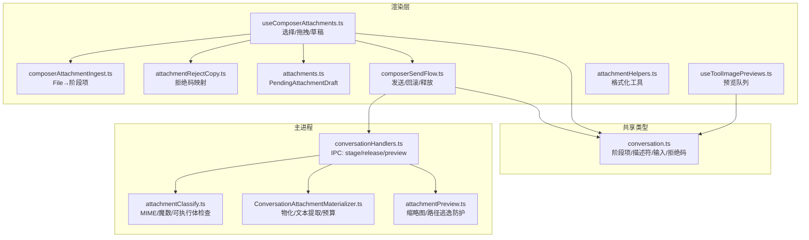
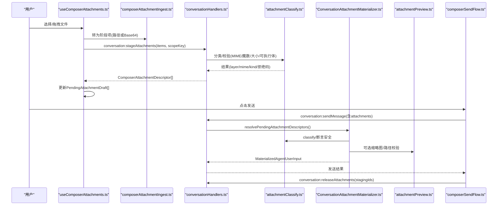
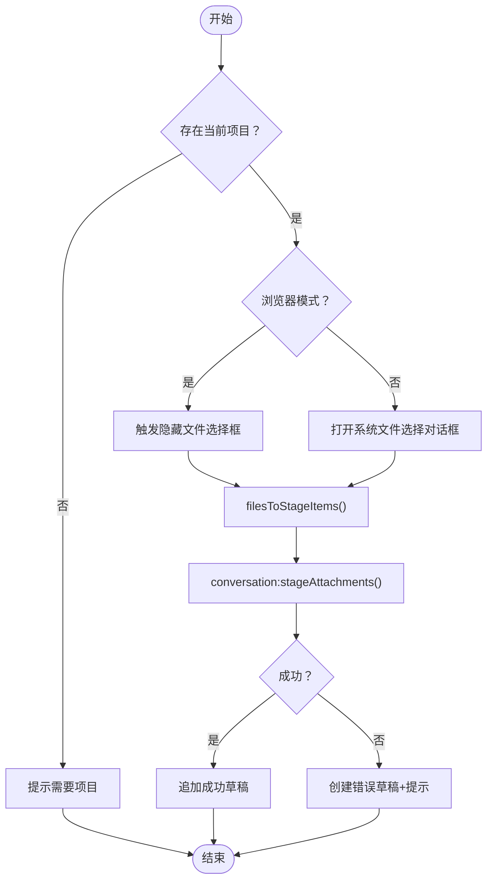
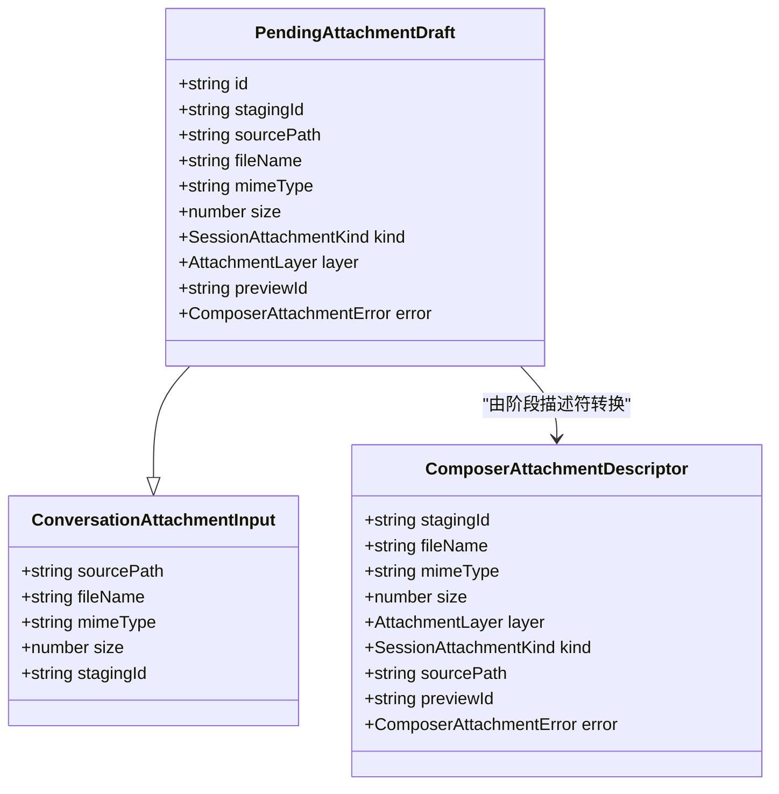
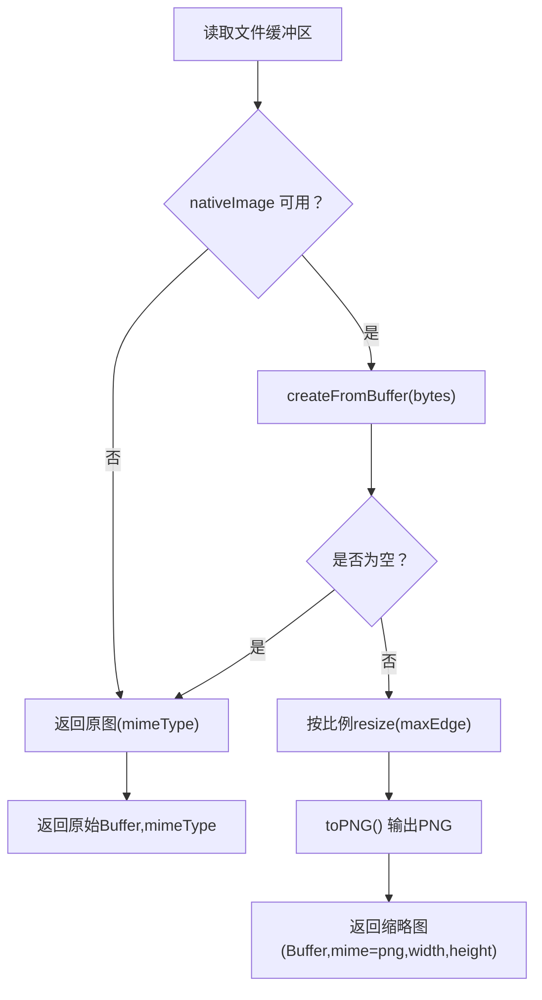
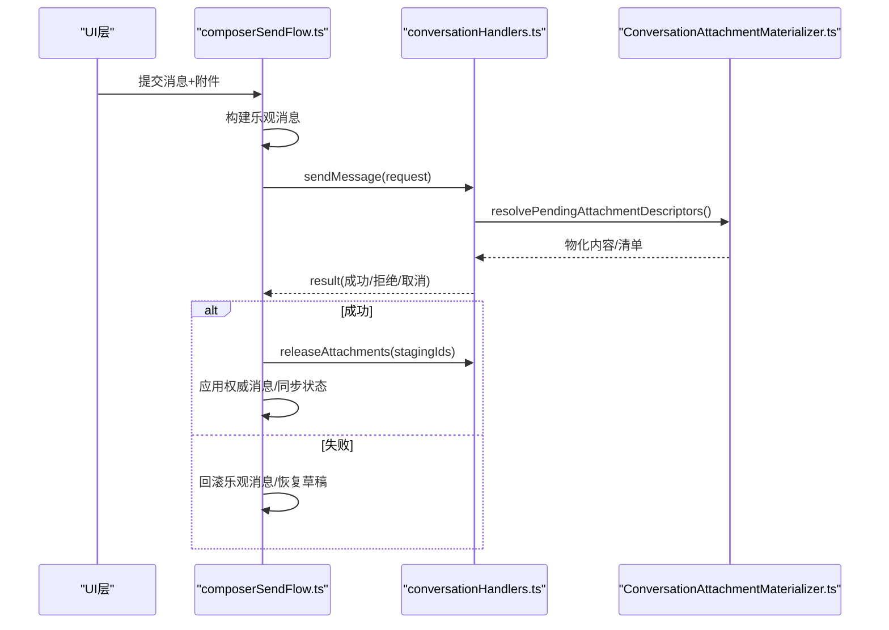
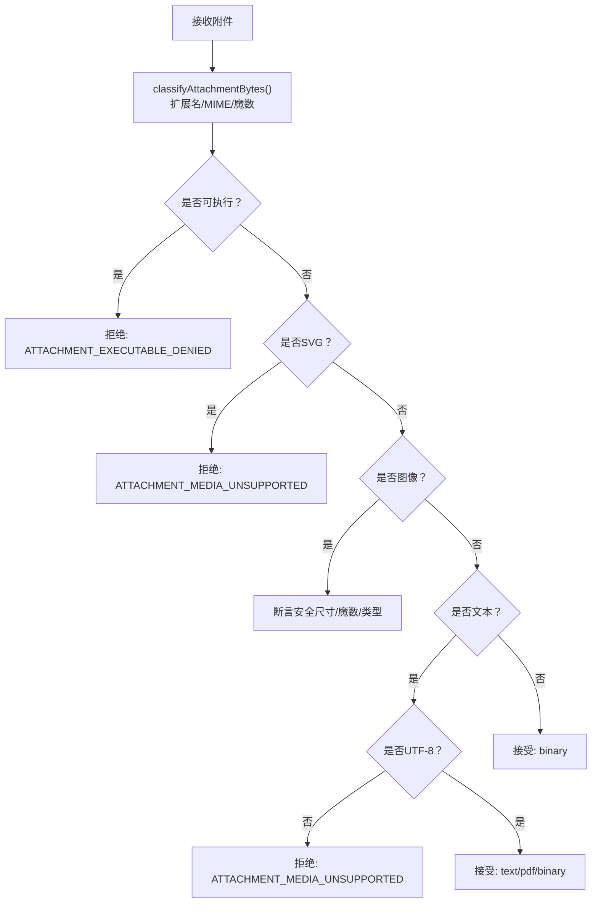
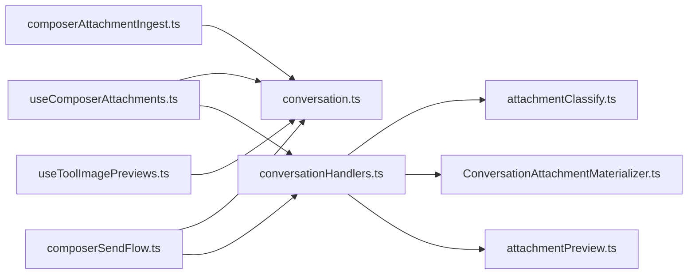

# 附件上传与文件处理

<cite>
**本文引用的文件**   
- [useComposerAttachments.ts](file://src/renderer/features/composer/useComposerAttachments.ts)
- [composerAttachmentIngest.ts](file://src/renderer/features/composer/composerAttachmentIngest.ts)
- [attachmentRejectCopy.ts](file://src/renderer/features/composer/attachmentRejectCopy.ts)
- [attachments.ts](file://src/renderer/types/attachments.ts)
- [composerSendFlow.ts](file://src/renderer/features/composer/composerSendFlow.ts)
- [conversation.ts](file://src/shared/types/conversation.ts)
- [conversationHandlers.ts](file://src/main/ipc/conversationHandlers.ts)
- [ConversationAttachmentMaterializer.ts](file://src/main/conversation/ConversationAttachmentMaterializer.ts)
- [attachmentClassify.ts](file://src/main/conversation/attachmentClassify.ts)
- [attachmentPreview.ts](file://src/main/conversation/attachmentPreview.ts)
- [attachmentHelpers.ts](file://src/renderer/services/attachmentHelpers.ts)
- [useToolImagePreviews.ts](file://src/renderer/hooks/useToolImagePreviews.ts)
</cite>

## 目录
1. [引言](#引言)
2. [项目结构](#项目结构)
3. [核心组件](#核心组件)
4. [架构总览](#架构总览)
5. [详细组件分析](#详细组件分析)
6. [依赖关系分析](#依赖关系分析)
7. [性能与内存优化](#性能与内存优化)
8. [故障排查指南](#故障排查指南)
9. [结论](#结论)

## 引言
本文聚焦 Composer 中的附件上传与文件处理链路，覆盖从用户选择附件、类型与大小校验、缩略图预览、待处理草稿管理、批量发送，到主进程安全分类、图像解码限制及权限控制等关键环节。文档面向具备基础前端或后端知识的读者，同时提供代码级流程图和依赖图，帮助快速定位问题与扩展能力。

## 项目结构
附件相关代码分布在渲染层（React UI 与状态）、共享类型定义、以及主进程（Electron main）的安全校验与资源解析三个层次：

- 渲染层
  - 附件选择与拖拽：`useComposerAttachments.ts`
  - 本地文件或粘贴缓冲转入：`composerAttachmentIngest.ts`
  - 拒绝码与数量限制常量映射：`attachmentRejectCopy.ts`
  - 待处理草稿类型：`attachments.ts`
  - 发送流程与错误恢复：`composerSendFlow.ts`
  - 图片预览 Hook：`useToolImagePreviews.ts`
  - 文件大小格式化等工具：`attachmentHelpers.ts`
- 共享类型
  - 附件阶段项、描述符、输入、拒绝码等：`conversation.ts`
- 主进程
  - IPC 处理器：`conversationHandlers.ts`
  - 附件分类与安全校验：`attachmentClassify.ts`
  - 附件物化与内容注入：`ConversationAttachmentMaterializer.ts`
  - 缩略图生成与路径校验：`attachmentPreview.ts`

**图示来源**
- [useComposerAttachments.ts:1-189](file://src/renderer/features/composer/useComposerAttachments.ts#L1-L189)
- [composerAttachmentIngest.ts:1-65](file://src/renderer/features/composer/composerAttachmentIngest.ts#L1-L65)
- [attachmentRejectCopy.ts:1-22](file://src/renderer/features/composer/attachmentRejectCopy.ts#L1-L22)
- [attachments.ts:1-15](file://src/renderer/types/attachments.ts#L1-L15)
- [composerSendFlow.ts:1-285](file://src/renderer/features/composer/composerSendFlow.ts#L1-L285)
- [conversation.ts:270-390](file://src/shared/types/conversation.ts#L270-L390)
- [conversationHandlers.ts:220-260](file://src/main/ipc/conversationHandlers.ts#L220-L260)
- [attachmentClassify.ts:1-364](file://src/main/conversation/attachmentClassify.ts#L1-L364)
- [ConversationAttachmentMaterializer.ts:1-381](file://src/main/conversation/ConversationAttachmentMaterializer.ts#L1-L381)
- [attachmentPreview.ts:1-99](file://src/main/conversation/attachmentPreview.ts#L1-L99)

**章节来源**
- [useComposerAttachments.ts:1-189](file://src/renderer/features/composer/useComposerAttachments.ts#L1-L189)
- [conversation.ts:270-390](file://src/shared/types/conversation.ts#L270-L390)
- [conversationHandlers.ts:220-260](file://src/main/ipc/conversationHandlers.ts#L220-L260)

## 核心组件
- 附件选择与状态管理：基于 React Hook 维护按会话作用域分组的 `PendingAttachmentDraft[]`，支持项目选择提示、浏览器兼容模式、文件选择对话框、拖拽状态标记、删除与批量释放。
- 附件摄入转换：将系统文件或剪贴板 File 转换为统一的阶段项，桌面端走真实路径，浏览器端以 Base64 传输。
- 类型与大小过滤：通过共享类型中的拒绝码体系与主进程分类器进行强约束，包括最大文件数、单文件大小、总字节数、可执行体禁止、SVG 禁止、UTF-8 文本要求等。
- 缩略图预览：主进程侧使用 Electron nativeImage 生成 PNG 缩略图，限制最大边长；对过大输入降级返回原图；严格路径逃逸与符号链接检查。
- 发送流程：构建乐观消息、调用 IPC 发送、失败时回滚并恢复草稿；成功后释放暂存附件 ID。
- 权限与策略：主进程在消息物化阶段校验模型是否支持图像输入、读取路径是否在允许范围（由权限策略服务约束），并在冻结内容重建时校验哈希一致性。

**章节来源**
- [attachments.ts:1-15](file://src/renderer/types/attachments.ts#L1-L15)
- [attachmentClassify.ts:1-364](file://src/main/conversation/attachmentClassify.ts#L1-L364)
- [attachmentPreview.ts:1-99](file://src/main/conversation/attachmentPreview.ts#L1-L99)
- [composerSendFlow.ts:1-285](file://src/renderer/features/composer/composerSendFlow.ts#L1-L285)

## 架构总览
附件从用户交互到模型输入的完整数据流如下：

**图示来源**
- [useComposerAttachments.ts:1-189](file://src/renderer/features/composer/useComposerAttachments.ts#L1-L189)
- [composerAttachmentIngest.ts:1-65](file://src/renderer/features/composer/composerAttachmentIngest.ts#L1-L65)
- [conversationHandlers.ts:220-260](file://src/main/ipc/conversationHandlers.ts#L220-L260)
- [attachmentClassify.ts:1-364](file://src/main/conversation/attachmentClassify.ts#L1-L364)
- [ConversationAttachmentMaterializer.ts:1-381](file://src/main/conversation/ConversationAttachmentMaterializer.ts#L1-L381)
- [attachmentPreview.ts:1-99](file://src/main/conversation/attachmentPreview.ts#L1-L99)
- [composerSendFlow.ts:1-285](file://src/renderer/features/composer/composerSendFlow.ts#L1-L285)

## 详细组件分析

### 附件选择对话框与输入接入
- 文件来源
  - 桌面端：调用系统文件选择接口获取路径数组。
  - 浏览器应用模式：触发隐藏的 `<input type="file">`。
- 文件类型过滤
  - 前端不进行硬编码后缀白名单过滤，主要交由主进程分类器统一判断。
  - 前端根据共享拒绝码常量与错误信息识别“超出上限”等异常，展示用户友好提示。
- 大小限制
  - 前端通过共享常量限制单次最多附件数量。
  - 主进程进一步限制单文件大小与所有附件总字节数。
- 拖拽支持
  - Hook 暴露 `isDropActive` 与 `setIsDropActive`，便于上层 UI 显示拖拽高亮区域；当前 Hook 未实现具体 onDrop 逻辑，可由调用方组合。
- 错误处理与重试
  - 阶段化失败会创建带错误码的草稿条目，用户可直接删除该草稿。
  - 发送失败会回滚乐观消息并恢复草稿，避免丢失用户输入。

**图示来源**
- [useComposerAttachments.ts:1-189](file://src/renderer/features/composer/useComposerAttachments.ts#L1-L189)
- [composerAttachmentIngest.ts:1-65](file://src/renderer/features/composer/composerAttachmentIngest.ts#L1-L65)
- [attachmentRejectCopy.ts:1-22](file://src/renderer/features/composer/attachmentRejectCopy.ts#L1-L22)

**章节来源**
- [useComposerAttachments.ts:1-189](file://src/renderer/features/composer/useComposerAttachments.ts#L1-L189)
- [composerAttachmentIngest.ts:1-65](file://src/renderer/features/composer/composerAttachmentIngest.ts#L1-L65)
- [attachmentRejectCopy.ts:1-22](file://src/renderer/features/composer/attachmentRejectCopy.ts#L1-L22)

### 待处理附件状态管理（PendingAttachmentDraft）
- 数据结构
  - 继承共享的 ConversationAttachmentInput，补充 id、stagingId、kind、layer、previewId、error 字段。
- 状态组织
  - 按 Composer 会话作用域键分组存储，切换作用域时自动释放旧草稿对应的 stagingId。
- 批量操作
  - 新增：批量 stage 后去重合并已有 stagingId，仅保留有效新条目。
  - 删除：移除指定草稿；若仍持有 stagingId 且非错误条目，则异步释放。
- 取消上传
  - 切换作用域或删除草稿时调用 releaseAttachments，释放主进程暂存资源。

**图示来源**
- [attachments.ts:1-15](file://src/renderer/types/attachments.ts#L1-L15)
- [conversation.ts:291-346](file://src/shared/types/conversation.ts#L291-L346)

**章节来源**
- [attachments.ts:1-15](file://src/renderer/types/attachments.ts#L1-L15)
- [useComposerAttachments.ts:1-189](file://src/renderer/features/composer/useComposerAttachments.ts#L1-L189)
- [conversation.ts:270-390](file://src/shared/types/conversation.ts#L270-L390)

### 图片预览与缩略图生成
- 缩略图生成
  - 使用 Electron nativeImage 从缓冲区加载图像，计算缩放比例并按最大边长压缩为 PNG。
  - 超过阈值时直接返回原图，避免大图像解码开销。
- 路径安全
  - 通过 `assertAttachmentPreviewPath` 校验根目录与目标文件相对位置，拒绝路径逃逸与符号链接。
- 预览获取
  - 渲染层通过 Hook 拉取预览 Data URL，内部维护并发队列（最多 4 个并行），支持滚动失效与重试。

**图示来源**
- [attachmentPreview.ts:1-99](file://src/main/conversation/attachmentPreview.ts#L1-L99)

**章节来源**
- [attachmentPreview.ts:1-99](file://src/main/conversation/attachmentPreview.ts#L1-L99)
- [useToolImagePreviews.ts:1-46](file://src/renderer/hooks/useToolImagePreviews.ts#L1-L46)

### 文件上传流程、进度与重试
- 阶段化上传（stage）
  - 渲染层调用 IPC `conversation:stageAttachments`，主进程校验并返回 `ComposerAttachmentDescriptor[]`。
  - 主进程侧对请求体设置最大字节限制，防止超大载荷进入主进程。
- 发送消息（send）
  - 渲染层构造乐观消息并立即显示，随后调用 `conversation:sendMessage`。
  - 失败分支：回滚乐观消息、恢复草稿、清理活跃轮次上下文。
  - 成功分支：释放 stagingId，持久化草稿快照，同步端到端会话状态。
- 进度显示
  - 当前实现未提供逐字节进度回调；如需进度条，可在 IPC 层引入流式事件或分段上报机制。
- 重试机制
  - 预览拉取支持重试；附件阶段化与发送本身无内置重试，需上层 UI 根据错误码决定是否重新选择或重新发送。

**图示来源**
- [composerSendFlow.ts:1-285](file://src/renderer/features/composer/composerSendFlow.ts#L1-L285)
- [conversationHandlers.ts:220-260](file://src/main/ipc/conversationHandlers.ts#L220-L260)
- [ConversationAttachmentMaterializer.ts:1-381](file://src/main/conversation/ConversationAttachmentMaterializer.ts#L1-L381)

**章节来源**
- [composerSendFlow.ts:1-285](file://src/renderer/features/composer/composerSendFlow.ts#L1-L285)
- [conversationHandlers.ts:220-260](file://src/main/ipc/conversationHandlers.ts#L220-L260)

### 安全验证机制
- MIME 类型与魔数校验
  - 通过文件头魔数检测 PNG/JPEG/GIF/WebP/PDF/ZIP 等格式，拒绝 SVG。
  - 声明 MIME 与魔数不一致时视为非法。
- 可执行体拦截
  - 根据扩展名与 PE/ELF/Mach-O 魔数拒绝可执行二进制。
- 文本安全
  - 文本类附件必须为合法 UTF-8，否则拒绝。
- 图像尺寸限制
  - 限制最大边长与像素总数，防止极端图像导致解码溢出。
- 路径与符号链接防护
  - 预览读取前校验相对路径、符号链接与真实路径，拒绝路径逃逸。
- 权限控制
  - 主进程在消息物化阶段校验模型是否支持图像输入；冻结内容重建时校验附件哈希与清单一致性，确保内容未被篡改。
  - 更广泛的文件系统读写与命令执行权限由 AgentPermissionPolicyService 控制，影响后续工具执行与资源访问。

**图示来源**
- [attachmentClassify.ts:1-364](file://src/main/conversation/attachmentClassify.ts#L1-L364)
- [ConversationAttachmentMaterializer.ts:1-381](file://src/main/conversation/ConversationAttachmentMaterializer.ts#L1-L381)

**章节来源**
- [attachmentClassify.ts:1-364](file://src/main/conversation/attachmentClassify.ts#L1-L364)
- [ConversationAttachmentMaterializer.ts:1-381](file://src/main/conversation/ConversationAttachmentMaterializer.ts#L1-L381)
- [attachmentPreview.ts:1-99](file://src/main/conversation/attachmentPreview.ts#L1-L99)

## 依赖关系分析
- 渲染层依赖共享类型定义，避免前后端结构漂移。
- 渲染层通过 electronAPI 调用主进程 IPC，解耦 UI 与主进程资源访问。
- 主进程 IPC 处理器作为入口，委派给分类器、物化器与预览模块。
- 分类器集中维护文件格式、魔数、大小与拒绝码规则，被多个模块复用。
- 预览 Hook 通过会话与作用域隔离，避免跨会话预览泄露。

**图示来源**
- [useComposerAttachments.ts:1-189](file://src/renderer/features/composer/useComposerAttachments.ts#L1-L189)
- [composerAttachmentIngest.ts:1-65](file://src/renderer/features/composer/composerAttachmentIngest.ts#L1-L65)
- [composerSendFlow.ts:1-285](file://src/renderer/features/composer/composerSendFlow.ts#L1-L285)
- [useToolImagePreviews.ts:1-46](file://src/renderer/hooks/useToolImagePreviews.ts#L1-L46)
- [conversation.ts:270-390](file://src/shared/types/conversation.ts#L270-L390)
- [conversationHandlers.ts:220-260](file://src/main/ipc/conversationHandlers.ts#L220-L260)
- [attachmentClassify.ts:1-364](file://src/main/conversation/attachmentClassify.ts#L1-L364)
- [ConversationAttachmentMaterializer.ts:1-381](file://src/main/conversation/ConversationAttachmentMaterializer.ts#L1-L381)
- [attachmentPreview.ts:1-99](file://src/main/conversation/attachmentPreview.ts#L1-L99)

**章节来源**
- [conversation.ts:270-390](file://src/shared/types/conversation.ts#L270-L390)
- [conversationHandlers.ts:220-260](file://src/main/ipc/conversationHandlers.ts#L220-L260)

## 性能与内存优化
- 大文件 Base64 传输
  - 浏览器模式下，文件被整体读入 ArrayBuffer 再 Base64 编码，可能带来较大内存峰值。建议对大文件优先采用路径传输（桌面端），或增加大小限制提示。
- 缩略图生成
  - 默认最大边长 512，卡片缩略图使用 144；超过阈值的输入直接返回原图，减少解码压力。
- 预览并发控制
  - 全局并发上限为 4，避免大量图片同时解码导致卡顿。
- 文本/PDF 内联预算
  - 物化阶段根据上下文预算限制内联文本长度，避免超长附件撑满消息。
- 图像解码限制
  - 解码后的图像字节数上限受 MAX_DECODED_IMAGE_BYTES 约束，防止超大图像占满内存。

[本节为通用性能讨论，不直接分析具体代码行]

## 故障排查指南
- 常见拒绝码与原因
  - ATTACHMENT_LIMIT_EXCEEDED：附件数量、单文件大小或总字节数超限。
  - ATTACHMENT_EXECUTABLE_DENIED：可执行文件被拒绝。
  - ATTACHMENT_MEDIA_UNSUPPORTED：不支持的媒体类型（如 SVG、非支持的图像/PDF）。
  - ATTACHMENT_INVALID：魔数与声明 MIME 不一致、图像尺寸超限、文本非 UTF-8。
  - ATTACHMENT_NOT_FOUND：文件不存在或路径无效。
- 预览失败
  - 路径逃逸或符号链接：检查路径是否在允许的会话附件目录内。
  - 会话不匹配：预览请求附带 sessionId，需与当前会话一致。
  - 类型不支持：仅支持 NATIVE_IMAGE_MIME_TYPES。
- 发送失败
  - 查看通知消息与错误对象 code/message。
  - 确认模型路由是否支持图像输入（visionInputMode）。
  - 检查冻结内容重建时的哈希校验失败，需重新准备请求。
- 调试建议
  - 在渲染层打印 PendingAttachmentDraft 列表，确认 stagingId 与 error 字段。
  - 在主进程日志中关注分类结果与拒绝码。
  - 预览失败时核对路径相对性与符号链接情况。

**章节来源**
- [attachmentRejectCopy.ts:1-22](file://src/renderer/features/composer/attachmentRejectCopy.ts#L1-L22)
- [attachmentClassify.ts:1-364](file://src/main/conversation/attachmentClassify.ts#L1-L364)
- [attachmentPreview.ts:1-99](file://src/main/conversation/attachmentPreview.ts#L1-L99)
- [composerSendFlow.ts:1-285](file://src/renderer/features/composer/composerSendFlow.ts#L1-L285)

## 结论
本项目将附件的选择、阶段化、预览与发送流程拆分为渲染层、共享类型与主进程三部分，通过严格的分类器与安全检查保证安全性与稳定性。待处理附件采用作用域隔离与 stagingId 生命周期管理，兼顾用户体验与资源回收。未来可在进度上报、病毒扫描集成方面扩展：例如在 IPC 层引入流式进度事件，或在主进程分类后调用外部杀毒引擎并对结果进行阻断。