# Knowledge Center 知识中心

<cite>
**本文引用的文件**   
- [index.tsx](file://src/renderer/features/knowledge/KnowledgeCenterModal/index.tsx)
- [useKnowledgeCenter.ts](file://src/renderer/features/knowledge/KnowledgeCenterModal/useKnowledgeCenter.ts)
- [knowledgeCenterModel.ts](file://src/renderer/features/knowledge/KnowledgeCenterModal/knowledgeCenterModel.ts)
- [knowledgeCenterQuery.ts](file://src/renderer/features/knowledge/KnowledgeCenterModal/knowledgeCenterQuery.ts)
- [useKnowledgeSelection.ts](file://src/renderer/features/knowledge/KnowledgeCenterModal/useKnowledgeSelection.ts)
- [ImportKnowledgeDialog.tsx](file://src/renderer/features/knowledge/KnowledgeCenterModal/panels/ImportKnowledgeDialog.tsx)
- [ExportKnowledgeDialog.tsx](file://src/renderer/features/knowledge/KnowledgeCenterModal/panels/ExportKnowledgeDialog.tsx)
- [WriteConfirmDialog.tsx](file://src/renderer/features/knowledge/KnowledgeCenterModal/panels/WriteConfirmDialog.tsx)
- [knowledgeHandlers.ts](file://src/main/ipc/knowledgeHandlers.ts)
- [KnowledgeQueryService.ts](file://src/main/knowledge/KnowledgeQueryService.ts)
- [KnowledgeIndexService.ts](file://src/main/knowledge/KnowledgeIndexService.ts)
- [KnowledgeImportService.ts](file://src/main/knowledge/KnowledgeImportService.ts)
- [KnowledgeExportService.ts](file://src/main/knowledge/KnowledgeExportService.ts)
- [knowledge.ts](file://src/shared/types/knowledge.ts)
</cite>

## 目录
1. [简介](#简介)
2. [项目结构](#项目结构)
3. [核心组件](#核心组件)
4. [架构总览](#架构总览)
5. [详细组件分析](#详细组件分析)
6. [依赖关系分析](#依赖关系分析)
7. [性能与可扩展性](#性能与可扩展性)
8. [故障排查指南](#故障排查指南)
9. [结论](#结论)
10. [附录：接口与使用示例](#附录接口与使用示例)

## 简介
Knowledge Center 是 RDC Agent 的知识中心模态框，用于浏览、检索、编辑、导入、导出和确认写入知识库卡片。它由三个主面板组成：索引面板（空间列表）、详情面板（卡片详情、差异比较、冲突解决）和编辑器相关流程（通过写入确认对话框完成）。后端提供查询、编译、导入、导出、候选项、写入和权限令牌等能力。

## 项目结构
知识中心的前端实现位于渲染进程，主要代码集中在 `src/renderer/features/knowledge/KnowledgeCenterModal`；后端服务位于 `src/main/knowledge` 并通过 IPC 暴露给前端。共享类型定义在 `src/shared/types/knowledge.ts`。

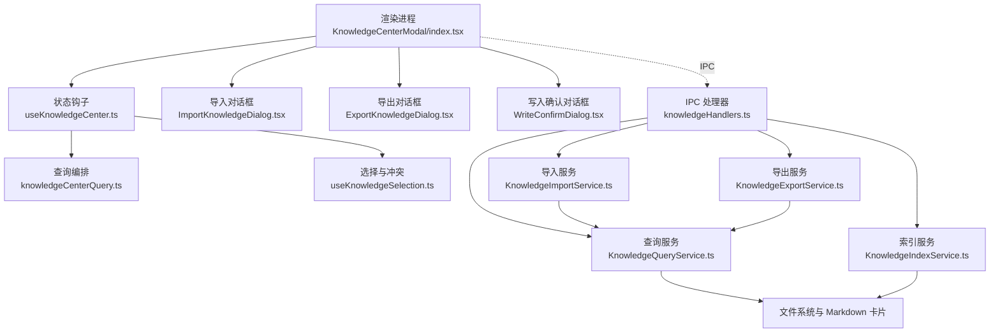

**图表来源**
- [index.tsx:1-191](file://src/renderer/features/knowledge/KnowledgeCenterModal/index.tsx#L1-L191)
- [useKnowledgeCenter.ts:1-196](file://src/renderer/features/knowledge/KnowledgeCenterModal/useKnowledgeCenter.ts#L1-L196)
- [knowledgeCenterQuery.ts:1-69](file://src/renderer/features/knowledge/KnowledgeCenterModal/knowledgeCenterQuery.ts#L1-L69)
- [useKnowledgeSelection.ts:1-80](file://src/renderer/features/knowledge/KnowledgeCenterModal/useKnowledgeSelection.ts#L1-L80)
- [knowledgeHandlers.ts:1-424](file://src/main/ipc/knowledgeHandlers.ts#L1-L424)
- [KnowledgeQueryService.ts:1-239](file://src/main/knowledge/KnowledgeQueryService.ts#L1-L239)
- [KnowledgeIndexService.ts:1-173](file://src/main/knowledge/KnowledgeIndexService.ts#L1-L173)
- [KnowledgeImportService.ts:1-328](file://src/main/knowledge/KnowledgeImportService.ts#L1-L328)
- [KnowledgeExportService.ts:1-171](file://src/main/knowledge/KnowledgeExportService.ts#L1-L171)

**章节来源**
- [index.tsx:1-191](file://src/renderer/features/knowledge/KnowledgeCenterModal/index.tsx#L1-L191)

## 核心组件
- **KnowledgeCenterModal**：顶层模态框容器，负责打开/关闭、窄屏切换、导入/导出/写入确认三个子对话框的挂载，以及将导入结果“揭示”到已选空间并刷新视图。
- **useKnowledgeCenter**：中心状态管理，维护空间列表、索引概览、当前选中空间、全文搜索、过滤条件、查询请求、命中结果、编译包、错误信息和加载状态；提供刷新概览、执行查询、重建索引、切换视图、显示详情等动作。
- **knowledgeCenterModel**：模型常量、请求序列工具、查询键生成、详情转记录等基础逻辑。
- **knowledgeCenterQuery**：构建查询请求、合并查询与编译结果、防抖控制。
- **useKnowledgeSelection**：选择具体卡片或冲突对，调用 `knowledge:card` 获取详情，协调冲突选择。
- **IPC 处理器**：统一入口，校验参数、验证空间、人类确认、批准令牌消费，并委托各服务处理。
- **服务层**：查询、索引、导入、导出分别封装各自职责，操作文件系统、Markdown 卡片、快照和打包格式。

**章节来源**
- [index.tsx:1-191](file://src/renderer/features/knowledge/KnowledgeCenterModal/index.tsx#L1-L191)
- [useKnowledgeCenter.ts:1-196](file://src/renderer/features/knowledge/KnowledgeCenterModal/useKnowledgeCenter.ts#L1-L196)
- [knowledgeCenterModel.ts:1-92](file://src/renderer/features/knowledge/KnowledgeCenterModal/knowledgeCenterModel.ts#L1-L92)
- [knowledgeCenterQuery.ts:1-69](file://src/renderer/features/knowledge/KnowledgeCenterModal/knowledgeCenterQuery.ts#L1-L69)
- [useKnowledgeSelection.ts:1-80](file://src/renderer/features/knowledge/KnowledgeCenterModal/useKnowledgeSelection.ts#L1-L80)
- [knowledgeHandlers.ts:1-424](file://src/main/ipc/knowledgeHandlers.ts#L1-L424)

## 架构总览
知识中心的交互遵循“前端状态 + IPC + 主进程服务”的分层模式：

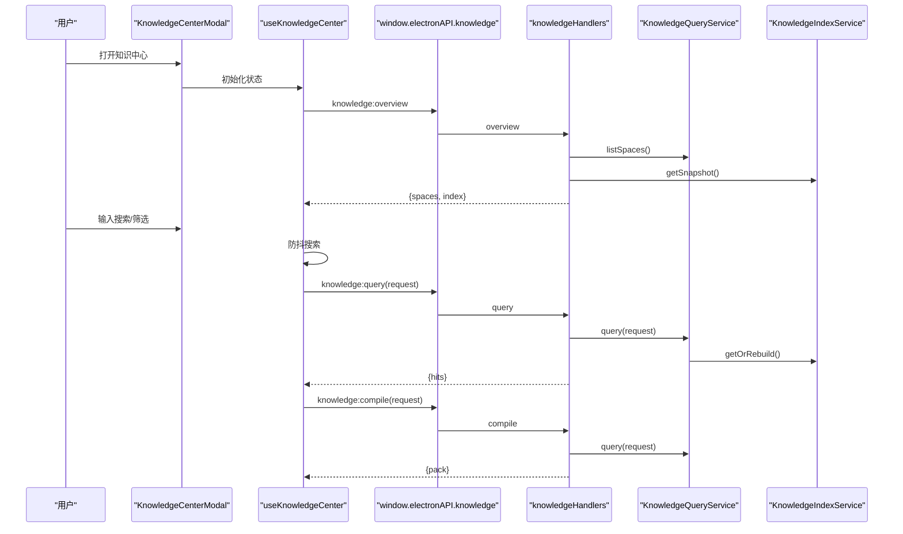

**图表来源**
- [useKnowledgeCenter.ts:1-196](file://src/renderer/features/knowledge/KnowledgeCenterModal/useKnowledgeCenter.ts#L1-L196)
- [knowledgeCenterQuery.ts:1-69](file://src/renderer/features/knowledge/KnowledgeCenterModal/knowledgeCenterQuery.ts#L1-L69)
- [knowledgeHandlers.ts:1-424](file://src/main/ipc/knowledgeHandlers.ts#L1-L424)
- [KnowledgeQueryService.ts:1-239](file://src/main/knowledge/KnowledgeQueryService.ts#L1-L239)
- [KnowledgeIndexService.ts:1-173](file://src/main/knowledge/KnowledgeIndexService.ts#L1-L173)

## 详细组件分析

### 模态框与面板切换
KnowledgeCenterModal 渲染一个可聚焦的对话框，包含顶部工具栏、窄屏标签页和三列布局。窄屏模式下通过标签在“空间”“列表”“详情”三个面板之间切换；宽屏模式下可同时展示多个面板。导入、导出、写入确认通过 React Portal 挂载到 body，避免点击冒泡影响遮罩关闭。

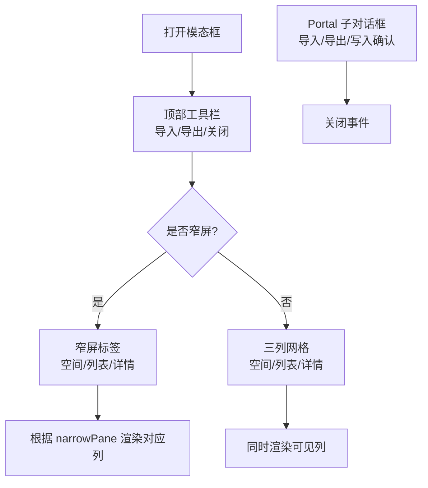

**图表来源**
- [index.tsx:1-191](file://src/renderer/features/knowledge/KnowledgeCenterModal/index.tsx#L1-L191)

**章节来源**
- [index.tsx:1-191](file://src/renderer/features/knowledge/KnowledgeCenterModal/index.tsx#L1-L191)

### 状态与数据流
useKnowledgeCenter 维护以下关键状态：
- 空间列表与索引概览
- 当前选中空间 ID 数组
- 全文搜索与防抖值
- 类型、生命周期、检索车道过滤
- 查询请求与命中结果
- 编译包与查询键
- 卡片选择与冲突信息
- 加载与错误状态

其数据流包括：
1. 打开时刷新概览，建立初始空间和索引。
2. 当空间选择变化时重新执行查询。
3. 每次查询先执行 `knowledge:query`，再并行或串行执行 `knowledge:compile` 以获取打包结果。
4. 导入后自动刷新概览、查询，并可选择跳转到被导入卡片所在空间。
5. 关闭时清理所有异步序列和状态。

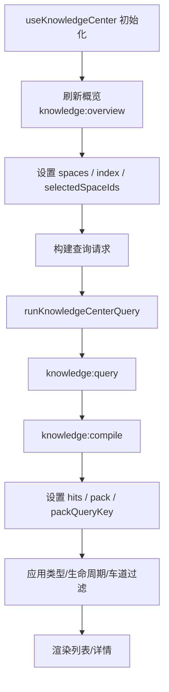

**图表来源**
- [useKnowledgeCenter.ts:1-196](file://src/renderer/features/knowledge/KnowledgeCenterModal/useKnowledgeCenter.ts#L1-L196)
- [knowledgeCenterQuery.ts:1-69](file://src/renderer/features/knowledge/KnowledgeCenterModal/knowledgeCenterQuery.ts#L1-L69)

**章节来源**
- [useKnowledgeCenter.ts:1-196](file://src/renderer/features/knowledge/KnowledgeCenterModal/useKnowledgeCenter.ts#L1-L196)
- [knowledgeCenterQuery.ts:1-69](file://src/renderer/features/knowledge/KnowledgeCenterModal/knowledgeCenterQuery.ts#L1-L69)

### 知识卡片选择与冲突
useKnowledgeSelection 负责：
- 选择某张卡片并调用 `knowledge:card` 拉取详情。
- 将详情映射为编辑器可用的记录。
- 管理冲突选择，包括冲突对、左右卡片、切换回卡片视图等操作。
- 在查询键或打开状态变化时清理选择和冲突。

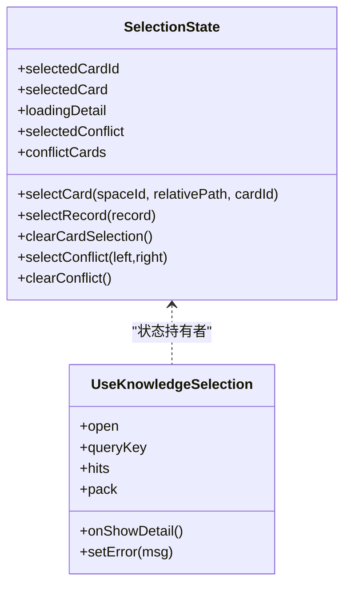

**图表来源**
- [useKnowledgeSelection.ts:1-80](file://src/renderer/features/knowledge/KnowledgeCenterModal/useKnowledgeSelection.ts#L1-L80)

**章节来源**
- [useKnowledgeSelection.ts:1-80](file://src/renderer/features/knowledge/KnowledgeCenterModal/useKnowledgeSelection.ts#L1-L80)

### 导入功能
ImportKnowledgeDialog 支持两种输入模式：
- 文件模式：选择本地文件或目录，显示文件名、路径、待验证提示。
- 粘贴模式：直接粘贴 YAML 内容。

导入成功后显示结果列表，每个条目可能处于草稿、隔离、冲突或已存在状态，并显示缺失资源、现有卡片 ID、案例 ID 等信息。若允许创建候选项，还提供“创建候选项”按钮。

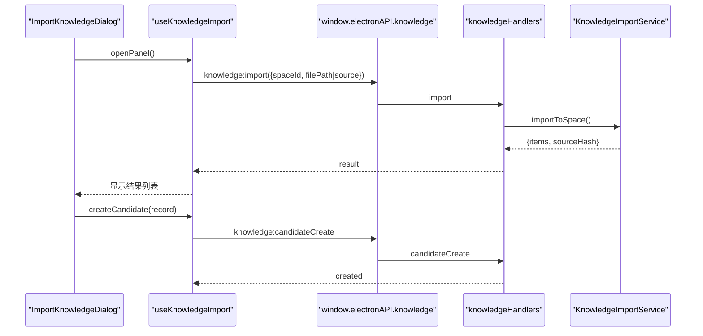

**图表来源**
- [ImportKnowledgeDialog.tsx:1-213](file://src/renderer/features/knowledge/KnowledgeCenterModal/panels/ImportKnowledgeDialog.tsx#L1-L213)
- [knowledgeHandlers.ts:1-424](file://src/main/ipc/knowledgeHandlers.ts#L1-L424)
- [KnowledgeImportService.ts:1-328](file://src/main/knowledge/KnowledgeImportService.ts#L1-L328)

**章节来源**
- [ImportKnowledgeDialog.tsx:1-213](file://src/renderer/features/knowledge/KnowledgeCenterModal/panels/ImportKnowledgeDialog.tsx#L1-L213)

### 导出功能
ExportKnowledgeDialog 支持三种导出范围：
- 已选择卡片
- 当前过滤结果
- 指定空间

支持两种格式：
- 包格式：YAML 清单加图片的 ZIP。
- Markdown 格式：多卡片 Markdown 文本。

导出前会进行安全校验，排除缺失资源、包含绝对路径或敏感信息的卡片，以及不符合大小限制的图片。

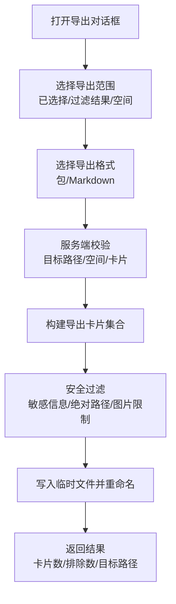

**图表来源**
- [ExportKnowledgeDialog.tsx:1-129](file://src/renderer/features/knowledge/KnowledgeCenterModal/panels/ExportKnowledgeDialog.tsx#L1-L129)
- [KnowledgeExportService.ts:1-171](file://src/main/knowledge/KnowledgeExportService.ts#L1-L171)

**章节来源**
- [ExportKnowledgeDialog.tsx:1-129](file://src/renderer/features/knowledge/KnowledgeCenterModal/panels/ExportKnowledgeDialog.tsx#L1-L129)
- [KnowledgeExportService.ts:1-171](file://src/main/knowledge/KnowledgeExportService.ts#L1-L171)

### 写入确认与批量操作
WriteConfirmDialog 是一个强约束的确认对话框，要求：
- 填写变更原因。
- 版本仍有效。
- 显式勾选确认。
- 若存在矛盾关系，需单独勾选“已确认冲突”。

对话框展示目标、来源状态、案例 ID、更新时间、矛盾数量、差异行、回滚基线等信息，并在满足所有条件后才允许提交。提交后触发 `knowledge:write` 或 `knowledge:promote`，并由主进程弹出系统级确认对话框。

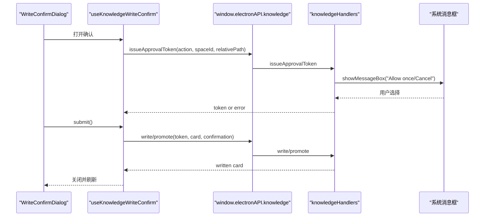

**图表来源**
- [WriteConfirmDialog.tsx:1-145](file://src/renderer/features/knowledge/KnowledgeCenterModal/panels/WriteConfirmDialog.tsx#L1-L145)
- [knowledgeHandlers.ts:1-424](file://src/main/ipc/knowledgeHandlers.ts#L1-L424)

**章节来源**
- [WriteConfirmDialog.tsx:1-145](file://src/renderer/features/knowledge/KnowledgeCenterModal/panels/WriteConfirmDialog.tsx#L1-L145)

### 知识库空间组织与管理
空间分为用户空间和项目空间，由 `KnowledgeQueryService` 动态列出：
- 用户空间：指向用户知识根目录。
- 项目空间：来自会话存储适配器列出的项目，每个项目有独立知识路径。

空间列表参与：
- 概览返回
- 导入目标选择
- 导出空间选择
- 权限令牌绑定
- 查询范围过滤

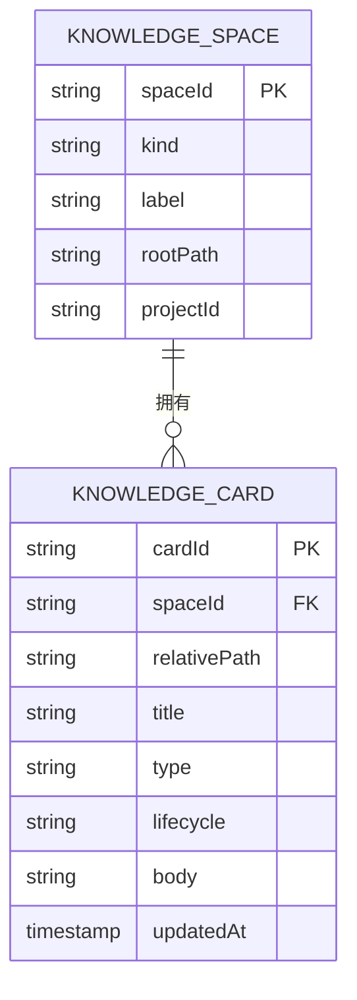

**图表来源**
- [knowledge.ts:1-302](file://src/shared/types/knowledge.ts#L1-L302)
- [KnowledgeQueryService.ts:1-239](file://src/main/knowledge/KnowledgeQueryService.ts#L1-L239)

**章节来源**
- [KnowledgeQueryService.ts:1-239](file://src/main/knowledge/KnowledgeQueryService.ts#L1-L239)
- [knowledge.ts:1-302](file://src/shared/types/knowledge.ts#L1-L302)

### 知识检索与过滤机制
检索由六条检索车道构成：
- 身份/路径
- 作用域/元数据
- 词汇
- 结构
- 关系/图
- 时间/版本

查询流程：
1. 从索引服务获取或重建快照。
2. 按空间、类型、生命周期、版本、作用域过滤宇宙集。
3. 逐车道计算分数，合并命中，去重并排序。
4. 前端再按已选车道、类型、生命周期进行二次过滤。

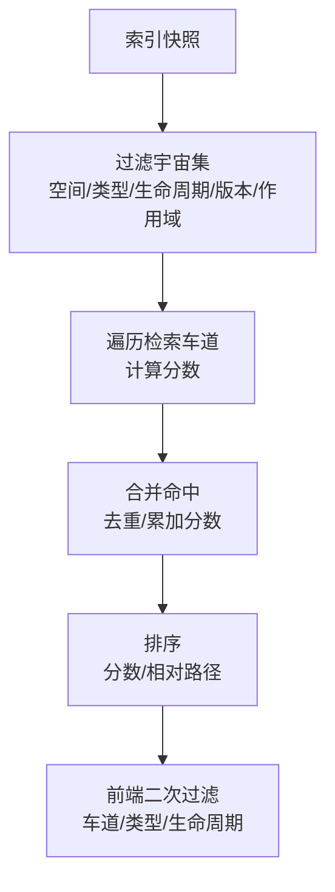

**图表来源**
- [KnowledgeIndexService.ts:1-173](file://src/main/knowledge/KnowledgeIndexService.ts#L1-L173)
- [KnowledgeQueryService.ts:1-239](file://src/main/knowledge/KnowledgeQueryService.ts#L1-L239)
- [knowledge.ts:1-302](file://src/shared/types/knowledge.ts#L1-L302)

**章节来源**
- [KnowledgeQueryService.ts:1-239](file://src/main/knowledge/KnowledgeQueryService.ts#L1-L239)
- [knowledge.ts:1-302](file://src/shared/types/knowledge.ts#L1-L302)

### 知识卡片展示与编辑
知识卡片的展示与编辑涉及：
- 元数据网格：类型、生命周期、作用域、关系、案例章节、图片等。
- 差异比较：写入确认对话框中显示变更差异。
- 冲突解决：识别矛盾关系，提供冲突行和对比。

卡片详情通过 `knowledge:card` 获取，包含完整正文、预览、内容哈希、来源状态、案例 ID、章节、图片及缺失资源。编辑器侧通过 `detailToRecord` 将详情转为可编辑的记录结构。

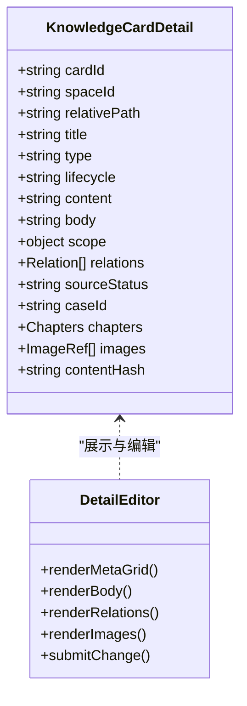

**图表来源**
- [knowledge.ts:1-302](file://src/shared/types/knowledge.ts#L1-L302)
- [knowledgeCenterModel.ts:1-92](file://src/renderer/features/knowledge/KnowledgeCenterModal/knowledgeCenterModel.ts#L1-L92)
- [useKnowledgeSelection.ts:1-80](file://src/renderer/features/knowledge/KnowledgeCenterModal/useKnowledgeSelection.ts#L1-L80)

**章节来源**
- [knowledge.ts:1-302](file://src/shared/types/knowledge.ts#L1-L302)
- [knowledgeCenterModel.ts:1-92](file://src/renderer/features/knowledge/KnowledgeCenterModal/knowledgeCenterModel.ts#L1-L92)
- [useKnowledgeSelection.ts:1-80](file://src/renderer/features/knowledge/KnowledgeCenterModal/useKnowledgeSelection.ts#L1-L80)

## 依赖关系分析
IPC 处理器是渲染进程与主进程服务的唯一契约边界，承担参数校验、空间存在性检查、人类确认、批准令牌发放与消费、错误标准化等职责。服务层内部耦合度较低：
- 查询服务依赖索引服务和文件系统。
- 导入服务依赖查询服务和持久化存储。
- 导出服务依赖查询服务和文件系统。
- 索引服务负责快照持久化和增量校验。

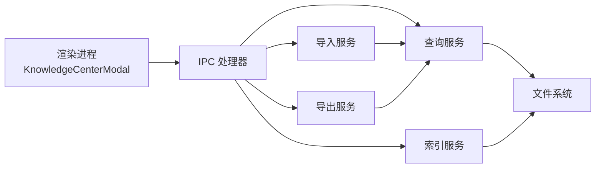

**图表来源**
- [knowledgeHandlers.ts:1-424](file://src/main/ipc/knowledgeHandlers.ts#L1-L424)
- [KnowledgeQueryService.ts:1-239](file://src/main/knowledge/KnowledgeQueryService.ts#L1-L239)
- [KnowledgeIndexService.ts:1-173](file://src/main/knowledge/KnowledgeIndexService.ts#L1-L173)
- [KnowledgeImportService.ts:1-328](file://src/main/knowledge/KnowledgeImportService.ts#L1-L328)
- [KnowledgeExportService.ts:1-171](file://src/main/knowledge/KnowledgeExportService.ts#L1-L171)

**章节来源**
- [knowledgeHandlers.ts:1-424](file://src/main/ipc/knowledgeHandlers.ts#L1-L424)

## 性能与可扩展性
- 搜索防抖：前端默认 300 毫秒防抖，减少频繁查询。
- 索引快照：索引服务缓存快照，仅在过期时重建，避免重复扫描。
- 查询与编译分离：先执行轻量查询，再按需编译打包，避免无谓大图解析。
- 列表排序：命中结果按分数和相对路径稳定排序。
- 导出原子写入：临时文件写入后重命名，降低部分写入风险。
- 可扩展点：
  - 增加新的检索车道以提升相关性。
  - 扩展导出格式（如 JSON）。
  - 增强冲突检测策略。
  - 优化大图读取与压缩。

[本节为通用指导，不直接分析具体文件]

## 故障排查指南
常见错误与定位方式：
- 未知知识空间：检查 `spaceId` 是否在 `listSpaces()` 返回结果中。
- 未通过人类确认：主进程消息框未点击“允许一次”，或测试模式下未启用全访问。
- 批准令牌无效：令牌过期或被重复消费。
- 导出结果为空：卡片缺失资源、包含敏感信息或绝对路径，或图片不安全。
- 导入冲突：同一案例 ID 已存在不同卡片，需要手动解决。
- 写入版本过时：确认对话框提示版本陈旧，需重新拉取详情。

建议排查步骤：
1. 打开概览，确认空间存在。
2. 查看导入结果中的状态和缺失资源。
3. 检查导出日志中的排除数量和目标路径。
4. 在写入确认对话框中查看差异、冲突和回滚基线。
5. 在主进程日志中查找“知识会话草稿迁移冲突”等警告。

**章节来源**
- [knowledgeHandlers.ts:1-424](file://src/main/ipc/knowledgeHandlers.ts#L1-L424)
- [KnowledgeImportService.ts:1-328](file://src/main/knowledge/KnowledgeImportService.ts#L1-L328)
- [KnowledgeExportService.ts:1-171](file://src/main/knowledge/KnowledgeExportService.ts#L1-L171)
- [WriteConfirmDialog.tsx:1-145](file://src/renderer/features/knowledge/KnowledgeCenterModal/panels/WriteConfirmDialog.tsx#L1-L145)

## 结论
Knowledge Center 通过清晰的前端状态管理和稳定的 IPC 契约，实现了知识库的浏览、检索、编辑、导入、导出与确认写入。其设计强调安全、可审计和可扩展：空间权限明确、人类确认强制、令牌机制严格、索引快照高效、导出安全过滤完备。未来可在检索车道、冲突检测和导出格式上继续扩展。

[本节为总结，不直接分析具体文件]

## 附录：接口与使用示例

### IPC 接口总览
- `knowledge:overview`：获取空间列表与索引概览。
- `knowledge:query`：执行检索，返回命中列表。
- `knowledge:card`：获取卡片详情。
- `knowledge:compile`：编译查询结果成包。
- `knowledge:index:rebuild`：重建索引快照。
- `knowledge:candidates`：列出候选项。
- `knowledge:candidateCreate`：创建候选项。
- `knowledge:import`：导入 Markdown 或包。
- `knowledge:image`：读取图片预览。
- `knowledge:issueApprovalToken`：申请修改批准令牌。
- `knowledge:write`：写入卡片。
- `knowledge:export`：导出知识。
- `knowledge:promote`：晋升或变更卡片生命周期。

### 使用示例

#### 获取概览
- 前端调用：`window.electronAPI.knowledge.overview()`
- 返回：`{ spaces, index }`
- 用途：填充空间下拉框、显示索引统计。

#### 执行检索
- 前端调用：`window.electronAPI.knowledge.query(request)`
- 请求体字段：`spaceIds`、`text`、`type`、`lifecycle`、`lanes`、`scope`、`asOf`、`cardId`、`relativePath`、`relationTargetCardId`
- 返回：`{ hits, lanes }`

#### 编译包
- 前端调用：`window.electronAPI.knowledge.compile(request & { limit? })`
- 返回：`{ hits, pack }`
- 用途：冲突视图、批量导出。

#### 导入
- 前端调用：`window.electronAPI.knowledge.import({ spaceId, filePath | source })`
- 返回：`{ items, sourceHash }`
- 后续：可创建候选项或刷新概览。

#### 导出
- 前端调用：`window.electronAPI.knowledge.export({ scope, format, targetPath, ... })`
- 返回：`{ cardCount, excludedCount, bytes, targetPath }`

#### 写入
- 前端调用：`window.electronAPI.knowledge.write({ card, confirmation, approvalToken })`
- 前提：已通过 `issueApprovalToken` 取得令牌并完成人类确认。

#### 晋升
- 前端调用：`window.electronAPI.knowledge.promote({ card, confirmation, approvalToken })`
- 前提：同上。

**章节来源**
- [knowledgeHandlers.ts:1-424](file://src/main/ipc/knowledgeHandlers.ts#L1-L424)
- [useKnowledgeCenter.ts:1-196](file://src/renderer/features/knowledge/KnowledgeCenterModal/useKnowledgeCenter.ts#L1-L196)
- [knowledgeCenterQuery.ts:1-69](file://src/renderer/features/knowledge/KnowledgeCenterModal/knowledgeCenterQuery.ts#L1-L69)
- [knowledge.ts:1-302](file://src/shared/types/knowledge.ts#L1-L302)