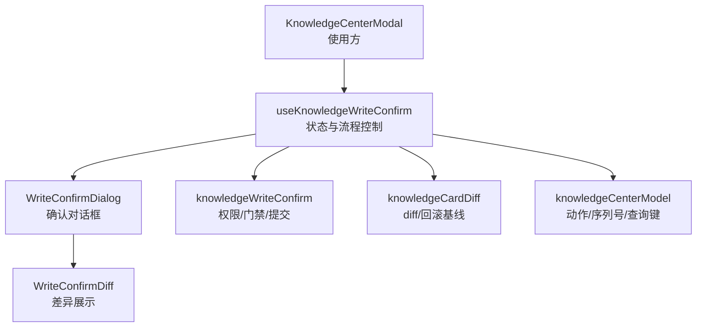
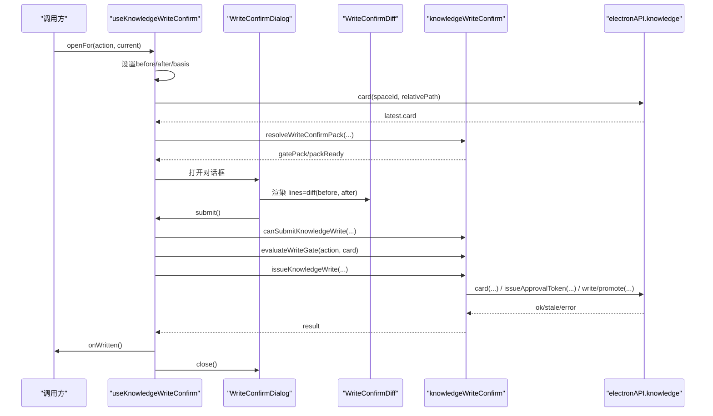
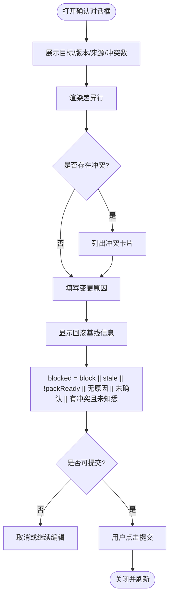
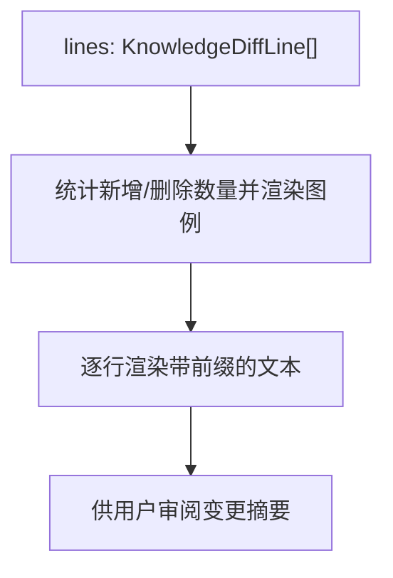
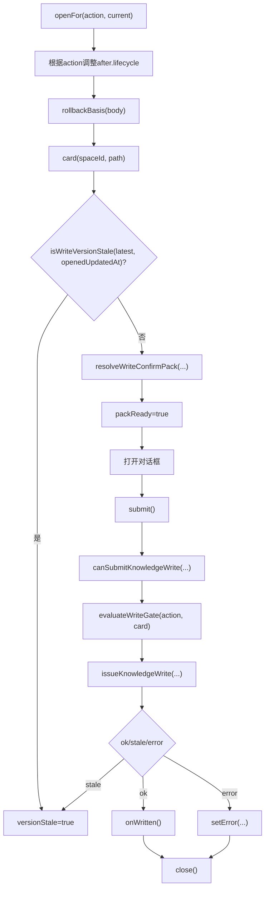
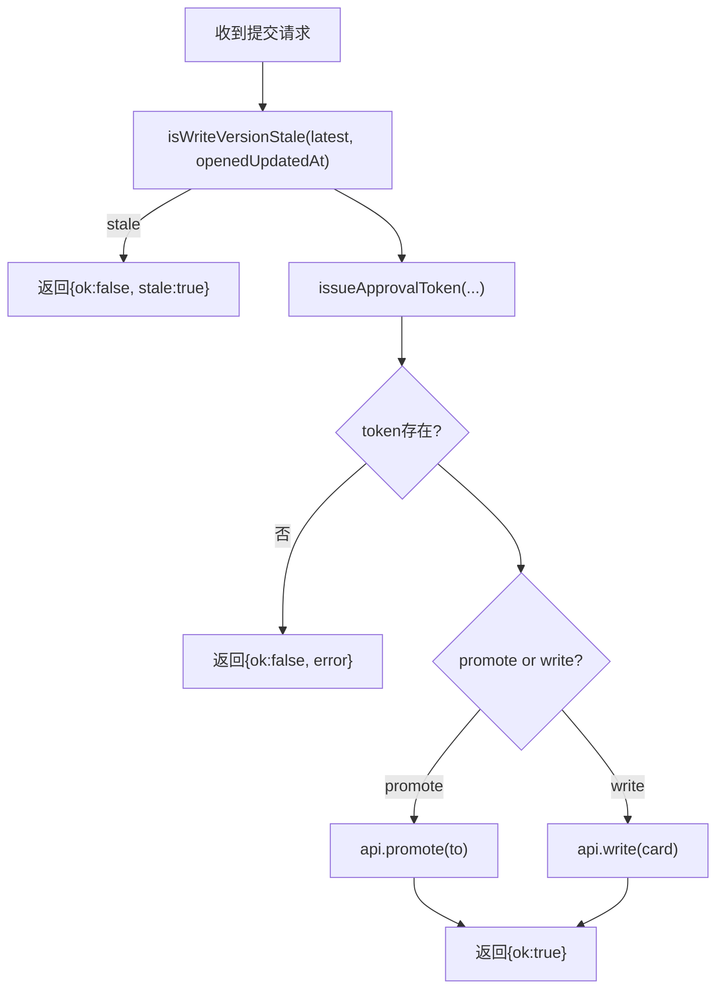
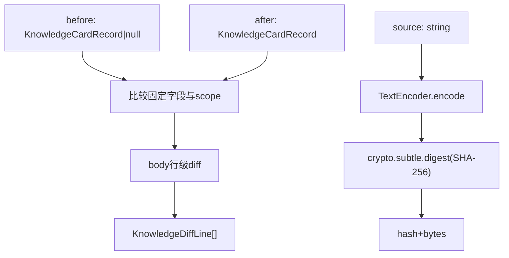
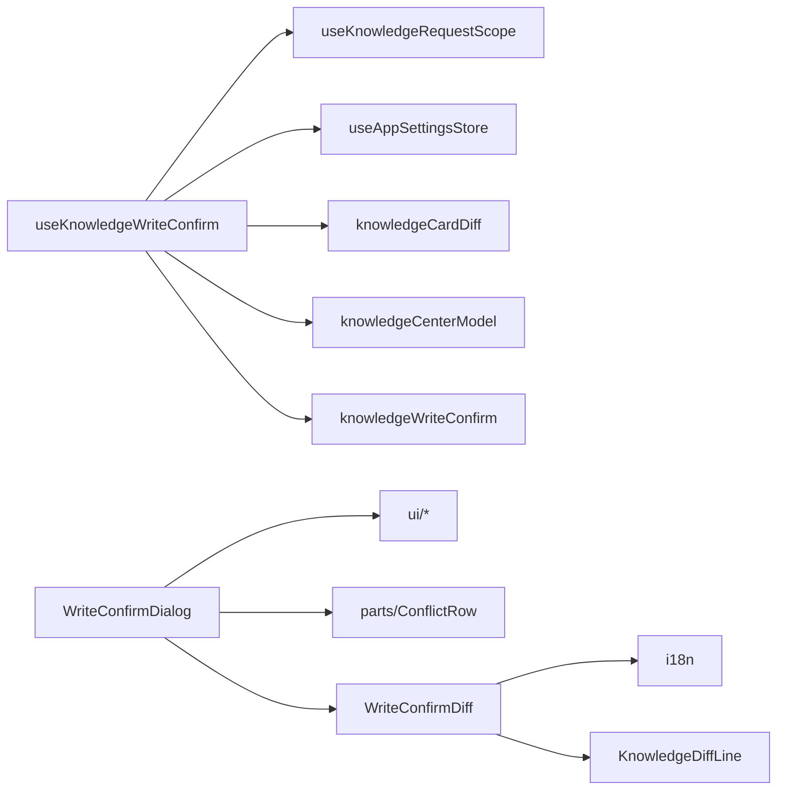
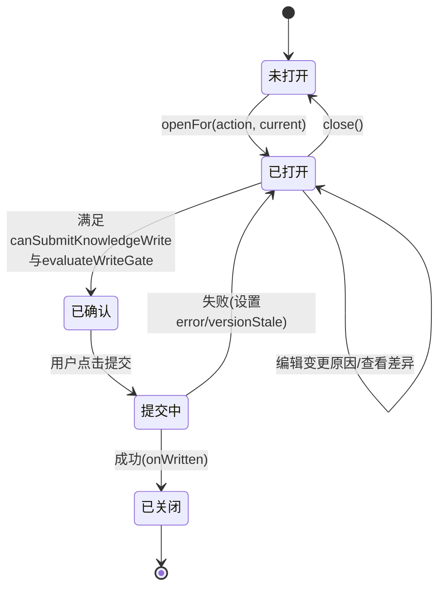
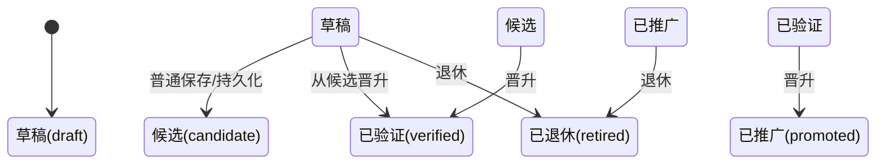

# 写入确认与草稿管理

<cite>
**本文引用的文件**   
- [useKnowledgeWriteConfirm.ts](file://src/renderer/features/knowledge/KnowledgeCenterModal/useKnowledgeWriteConfirm.ts)
- [WriteConfirmDialog.tsx](file://src/renderer/features/knowledge/KnowledgeCenterModal/panels/WriteConfirmDialog.tsx)
- [WriteConfirmDiff.tsx](file://src/renderer/features/knowledge/KnowledgeCenterModal/panels/WriteConfirmDiff.tsx)
- [knowledgeWriteConfirm.ts](file://src/renderer/features/knowledge/KnowledgeCenterModal/knowledgeWriteConfirm.ts)
- [knowledgeCardDiff.ts](file://src/renderer/features/knowledge/KnowledgeCenterModal/knowledgeCardDiff.ts)
- [knowledgeCenterModel.ts](file://src/renderer/features/knowledge/KnowledgeCenterModal/knowledgeCenterModel.ts)
- [useKnowledgeWriteConfirm.test.ts](file://src/renderer/features/knowledge/KnowledgeCenterModal/useKnowledgeWriteConfirm.test.ts)
</cite>

## 目录
1. [引言](#引言)
2. [项目结构](#项目结构)
3. [核心组件](#核心组件)
4. [架构总览](#架构总览)
5. [详细组件分析](#详细组件分析)
6. [依赖关系分析](#依赖关系分析)
7. [性能与扩展性](#性能与扩展性)
8. [故障排查指南](#故障排查指南)
9. [结论](#结论)
10. [附录：状态机与自定义扩展](#附录状态机与自定义扩展)

## 引言
本文件聚焦知识卡片“写入确认与草稿管理”的完整实现，覆盖以下目标：
- 解释 WriteConfirmDialog 的确认流程：变更预览、用户确认、取消处理。
- 说明 WriteConfirmDiff 的差异展示：草稿与基线对比、变更摘要、差异行渲染。
- 梳理 useKnowledgeWriteConfirm Hook 的状态管理：草稿创建、变更跟踪、提交队列。
- 解析 knowledgeWriteConfirm 的业务逻辑：写入权限检查、依赖验证、事务化调用。
- 给出写入确认的工作流和草稿状态机图。
- 提供自定义写入策略与确认流程的扩展方式。

## 项目结构
写入确认能力集中在 KnowledgeCenterModal 功能模块中，采用“Hook + UI 面板 + 业务函数 + 差异工具”的分层组织：
- Hook 层：useKnowledgeWriteConfirm.ts，负责打开/关闭、草稿构建、版本校验、冲突收集、提交调度。
- UI 层：WriteConfirmDialog.tsx、WriteConfirmDiff.tsx，负责事实展示、差异呈现、交互确认。
- 业务逻辑层：knowledgeWriteConfirm.ts，封装权限、门禁、冲突、提交事务。
- 差异与模型层：knowledgeCardDiff.ts、knowledgeCenterModel.ts，提供 diff 算法、动作类型、序列号等基础能力。

**图表来源**
- [useKnowledgeWriteConfirm.ts:1-162](file://src/renderer/features/knowledge/KnowledgeCenterModal/useKnowledgeWriteConfirm.ts#L1-L162)
- [WriteConfirmDialog.tsx:1-145](file://src/renderer/features/knowledge/KnowledgeCenterModal/panels/WriteConfirmDialog.tsx#L1-L145)
- [WriteConfirmDiff.tsx:1-29](file://src/renderer/features/knowledge/KnowledgeCenterModal/panels/WriteConfirmDiff.tsx#L1-L29)
- [knowledgeWriteConfirm.ts:1-152](file://src/renderer/features/knowledge/KnowledgeCenterModal/knowledgeWriteConfirm.ts#L1-L152)
- [knowledgeCardDiff.ts:1-61](file://src/renderer/features/knowledge/KnowledgeCenterModal/knowledgeCardDiff.ts#L1-L61)
- [knowledgeCenterModel.ts:1-92](file://src/renderer/features/knowledge/KnowledgeCenterModal/knowledgeCenterModel.ts#L1-L92)

**章节来源**
- [useKnowledgeWriteConfirm.ts:1-162](file://src/renderer/features/knowledge/KnowledgeCenterModal/useKnowledgeWriteConfirm.ts#L1-L162)
- [WriteConfirmDialog.tsx:1-145](file://src/renderer/features/knowledge/KnowledgeCenterModal/panels/WriteConfirmDialog.tsx#L1-L145)
- [WriteConfirmDiff.tsx:1-29](file://src/renderer/features/knowledge/KnowledgeCenterModal/panels/WriteConfirmDiff.tsx#L1-L29)
- [knowledgeWriteConfirm.ts:1-152](file://src/renderer/features/knowledge/KnowledgeCenterModal/knowledgeWriteConfirm.ts#L1-L152)
- [knowledgeCardDiff.ts:1-61](file://src/renderer/features/knowledge/KnowledgeCenterModal/knowledgeCardDiff.ts#L1-L61)
- [knowledgeCenterModel.ts:1-92](file://src/renderer/features/knowledge/KnowledgeCenterModal/knowledgeCenterModel.ts#L1-L92)

## 核心组件
- useKnowledgeWriteConfirm：集中管理写入确认的全部状态与异步流程，对外暴露 openFor/open/close/submit/diff/basis/block 等 API。
- WriteConfirmDialog：以任务对话框形式展示目标、版本、冲突、变更原因、差异与确认勾选，统一阻断提交。
- WriteConfirmDiff：将 diff 结果按行渲染，统计新增/删除数量并标注变更前/后。
- knowledgeWriteConfirm：实现写入门禁、冲突收集、包新鲜度判断、审批令牌申请与写/晋升事务。
- knowledgeCardDiff：字段级与正文行级 diff，以及基于 SHA-256 的回滚基线计算。
- knowledgeCenterModel：定义 KnowledgeWriteAction、detailToRecord、knowledgeQueryKey、createRequestSeq 等共享能力。

**章节来源**
- [useKnowledgeWriteConfirm.ts:1-162](file://src/renderer/features/knowledge/KnowledgeCenterModal/useKnowledgeWriteConfirm.ts#L1-L162)
- [WriteConfirmDialog.tsx:1-145](file://src/renderer/features/knowledge/KnowledgeCenterModal/panels/WriteConfirmDialog.tsx#L1-L145)
- [WriteConfirmDiff.tsx:1-29](file://src/renderer/features/knowledge/KnowledgeCenterModal/panels/WriteConfirmDiff.tsx#L1-L29)
- [knowledgeWriteConfirm.ts:1-152](file://src/renderer/features/knowledge/KnowledgeCenterModal/knowledgeWriteConfirm.ts#L1-L152)
- [knowledgeCardDiff.ts:1-61](file://src/renderer/features/knowledge/KnowledgeCenterModal/knowledgeCardDiff.ts#L1-L61)
- [knowledgeCenterModel.ts:1-92](file://src/renderer/features/knowledge/KnowledgeCenterModal/knowledgeCenterModel.ts#L1-L92)

## 架构总览
写入确认的整体时序如下：
- 外部触发 openFor(action, current)，生成 before/after，计算回滚基线，拉取最新卡与编译后的依赖包，进入确认对话框。
- 用户在对话框填写变更原因、查看差异、勾选确认；存在冲突时需额外勾选“已知悉冲突”。
- 点击提交时，先做 canSubmitKnowledgeWrite 与 evaluateWriteGate 双重校验，再调用 issueKnowledgeWrite 完成权限校验与写操作。
- 成功后回调 onWritten 并关闭对话框；失败则更新 error/versionStale/busy 状态。

**图表来源**
- [useKnowledgeWriteConfirm.ts:38-139](file://src/renderer/features/knowledge/KnowledgeCenterModal/useKnowledgeWriteConfirm.ts#L38-L139)
- [WriteConfirmDialog.tsx:16-145](file://src/renderer/features/knowledge/KnowledgeCenterModal/panels/WriteConfirmDialog.tsx#L16-L145)
- [WriteConfirmDiff.tsx:1-29](file://src/renderer/features/knowledge/KnowledgeCenterModal/panels/WriteConfirmDiff.tsx#L1-L29)
- [knowledgeWriteConfirm.ts:18-152](file://src/renderer/features/knowledge/KnowledgeCenterModal/knowledgeWriteConfirm.ts#L18-L152)

## 详细组件分析

### WriteConfirmDialog：确认流程
- 目标、版本、来源与冲突数作为只读事实展示。
- 通过 blocked 表达式统一阻断：存在 block 提示、版本过期、依赖包未就绪、变更原因缺失、未显式确认、存在冲突但未知悉。
- 底部按钮支持关闭与提交；busy 状态下禁用所有交互。
- 当 action 为从草稿直接晋升 verified 或缺章 case 时，显示 InlineError 提示。
- 变更原因 Textarea 必填，错误态即时反馈。
- 展开区域显示回滚基线的哈希与字节长度，并提示不会自动回滚。
- 两个 Checkbox：显式确认与已知悉冲突（仅在有冲突时出现）。

**图表来源**
- [WriteConfirmDialog.tsx:16-145](file://src/renderer/features/knowledge/KnowledgeCenterModal/panels/WriteConfirmDialog.tsx#L16-L145)

**章节来源**
- [WriteConfirmDialog.tsx:16-145](file://src/renderer/features/knowledge/KnowledgeCenterModal/panels/WriteConfirmDialog.tsx#L16-L145)

### WriteConfirmDiff：差异展示
- 接收 KnowledgeDiffLine[]，分别统计 remove/add 数量。
- 顶部图例标注“变更前”和“变更后”，每行前缀 -/+/空格表示变化。
- 差异内容来自 diffKnowledgeCard，涵盖字段与正文行级对比。

**图表来源**
- [WriteConfirmDiff.tsx:1-29](file://src/renderer/features/knowledge/KnowledgeCenterModal/panels/WriteConfirmDiff.tsx#L1-L29)
- [knowledgeCardDiff.ts:1-61](file://src/renderer/features/knowledge/KnowledgeCenterModal/knowledgeCardDiff.ts#L1-L61)

**章节来源**
- [WriteConfirmDiff.tsx:1-29](file://src/renderer/features/knowledge/KnowledgeCenterModal/panels/WriteConfirmDiff.tsx#L1-L29)

### useKnowledgeWriteConfirm：状态管理与提交流程
关键状态与职责：
- open/action/before/after/changeReason/confirmed/acknowledgedConflicts：控制对话框生命周期与用户输入。
- basis：对当前 body 计算 SHA-256 摘要与字节数，作为回滚依据。
- openedUpdatedAt：打开时的版本号，用于版本冲突检测。
- versionStale：若服务端最新版本与打开版本不一致，则标记过期。
- packReady/gatePack：依赖包就绪与冲突数据；从外部传入或重新编译。
- contradicts：基于 gatePack 与 after 计算出的冲突列表。
- busy/error：提交中状态与错误信息。

核心方法：
- openFor：根据 action 修改 after.lifecycle，计算回滚基线，拉取最新卡与编译依赖包，打开对话框。
- submit：canSubmitKnowledgeWrite → evaluateWriteGate → issueKnowledgeWrite → onWritten → close。
- close：清理状态、重置 busy/error 等。

**图表来源**
- [useKnowledgeWriteConfirm.ts:38-139](file://src/renderer/features/knowledge/KnowledgeCenterModal/useKnowledgeWriteConfirm.ts#L38-L139)
- [knowledgeCardDiff.ts:45-61](file://src/renderer/features/knowledge/KnowledgeCenterModal/knowledgeCardDiff.ts#L45-L61)
- [knowledgeWriteConfirm.ts:18-152](file://src/renderer/features/knowledge/KnowledgeCenterModal/knowledgeWriteConfirm.ts#L18-L152)

**章节来源**
- [useKnowledgeWriteConfirm.ts:1-162](file://src/renderer/features/knowledge/KnowledgeCenterModal/useKnowledgeWriteConfirm.ts#L1-L162)

### knowledgeWriteConfirm：业务逻辑
- evaluateWriteGate：阻止草稿直接晋升 verified；case 类型晋升 verified 时校验必填章节。
- isWriteVersionStale：比较服务端 updatedAt 与本地打开时的 openedUpdatedAt，为空或不匹配即过期。
- collectCardContradicts：聚合 pack.conflicts 与 card.relations 中的 contradicts，去重后返回。
- isWritePackStale/resolveWriteConfirmPack：根据 queryRequest 的 knowledgeQueryKey 判断依赖包是否需要重新编译。
- canSubmitKnowledgeWrite：要求 packReady、after、changeReason、explicit confirmed，且有冲突时必须 acknowledgedConflicts。
- issueKnowledgeWrite：再次检查版本；申请 approvalToken；按 action 决定调用 write 或 promote；返回 {ok} 或 {ok:false, stale?, error?}。

**图表来源**
- [knowledgeWriteConfirm.ts:18-152](file://src/renderer/features/knowledge/KnowledgeCenterModal/knowledgeWriteConfirm.ts#L18-L152)

**章节来源**
- [knowledgeWriteConfirm.ts:1-152](file://src/renderer/features/knowledge/KnowledgeCenterModal/knowledgeWriteConfirm.ts#L1-L152)

### knowledgeCardDiff：差异与回滚基线
- diffKnowledgeCard：比较 title/type/lifecycle/sourceStatus/caseId 字段及 scope JSON，并对 body 进行行级 diff。
- rollbackBasis：对 body 进行 UTF-8 编码并计算 SHA-256，输出 hash 与 byteLength，作为回滚依据。

**图表来源**
- [knowledgeCardDiff.ts:1-61](file://src/renderer/features/knowledge/KnowledgeCenterModal/knowledgeCardDiff.ts#L1-L61)

**章节来源**
- [knowledgeCardDiff.ts:1-61](file://src/renderer/features/knowledge/KnowledgeCenterModal/knowledgeCardDiff.ts#L1-L61)

### knowledgeCenterModel：动作与模型
- KnowledgeWriteAction：save、persist-draft、promote-verified、promote-promoted、retire。
- detailToRecord：将详情视图对象规范化为 KnowledgeCardRecord。
- knowledgeQueryKey：序列化查询参数为字符串键，用于判断依赖包是否陈旧。
- createRequestSeq：生成 next/isCurrent 序列，避免竞态导致旧响应覆盖新状态。

**章节来源**
- [knowledgeCenterModel.ts:1-92](file://src/renderer/features/knowledge/KnowledgeCenterModal/knowledgeCenterModel.ts#L1-L92)

## 依赖关系分析
- useKnowledgeWriteConfirm 依赖：
  - useKnowledgeRequestScope：提供 request.next()/isCurrent 来避免竞态。
  - useAppSettingsStore：读取 agentRuntime.permissions.mode。
  - knowledgeCardDiff：diffKnowledgeCard、rollbackBasis。
  - knowledgeCenterModel：detailToRecord、knowledgeErrorMessage。
  - knowledgeWriteConfirm：权限与事务相关函数。
- WriteConfirmDialog 依赖：
  - ui/Button、Checkbox、Textarea、InlineError、TaskDialog。
  - parts/ConflictRow。
  - WriteConfirmDiff。
- WriteConfirmDiff 依赖：
  - i18n。
  - knowledgeCardDiff.KnowledgeDiffLine。

**图表来源**
- [useKnowledgeWriteConfirm.ts:1-162](file://src/renderer/features/knowledge/KnowledgeCenterModal/useKnowledgeWriteConfirm.ts#L1-L162)
- [WriteConfirmDialog.tsx:1-145](file://src/renderer/features/knowledge/KnowledgeCenterModal/panels/WriteConfirmDialog.tsx#L1-L145)
- [WriteConfirmDiff.tsx:1-29](file://src/renderer/features/knowledge/KnowledgeCenterModal/panels/WriteConfirmDiff.tsx#L1-L29)

**章节来源**
- [useKnowledgeWriteConfirm.ts:1-162](file://src/renderer/features/knowledge/KnowledgeCenterModal/useKnowledgeWriteConfirm.ts#L1-L162)
- [WriteConfirmDialog.tsx:1-145](file://src/renderer/features/knowledge/KnowledgeCenterModal/panels/WriteConfirmDialog.tsx#L1-L145)
- [WriteConfirmDiff.tsx:1-29](file://src/renderer/features/knowledge/KnowledgeCenterModal/panels/WriteConfirmDiff.tsx#L1-L29)

## 性能与扩展性
- 差异计算：diffKnowledgeCard 对固定字段与 body 行级对比，时间复杂度 O(N)（N 为行数），适合常规知识卡片体量。
- 依赖包编译：仅在 packQueryKey 与当前查询不匹配时触发 compile，避免重复计算。
- 竞态保护：request.next()/isCurrent 确保只有最新操作的响应影响状态。
- 可扩展点：
  - 自定义写入策略：在 issueKnowledgeWrite 之前增加自定义校验（例如合规检查、敏感词过滤）；或在 canSubmitKnowledgeWrite 中加入额外条件。
  - 自定义门禁规则：扩展 evaluateWriteGate，增加新的 lifecycle 转换限制或章节校验。
  - 自定义差异维度：扩展 COMPARE_FIELDS 或 diffKnowledgeCard，加入更多字段的行级比较。
  - 自定义冲突源：扩展 collectCardContradicts，纳入外部系统冲突或规则引擎结果。

[本节为通用指导，不涉及具体文件分析]

## 故障排查指南
- 提交被阻塞：
  - 检查 blocked 表达式：block 提示、versionStale、!packReady、changeReason 为空、!confirmed、存在冲突但 !acknowledgedConflicts。
  - 若 action 为 promote-verified 且 card.lifecycle 为 draft，会返回 draft-to-verified 阻断。
  - 若 card.type 为 case 且章节缺失，会返回 missing-chapters:... 阻断。
- 版本过旧：
  - openedUpdatedAt 与 latest.updatedAt 不一致时，isWriteVersionStale 返回 true，提交会被标记 stale。
- 依赖包未就绪：
  - packReady=false 时 canSubmitKnowledgeWrite 直接返回 false；检查 resolveWriteConfirmPack 是否正确编译。
- 冲突未确认：
  - collectCardContradicts 返回非空时，必须勾选“已知悉冲突”。
- 权限令牌无效：
  - issueApprovalToken 返回无 token 时，issueKnowledgeWrite 返回 {ok:false, error}。

**章节来源**
- [WriteConfirmDialog.tsx:22-145](file://src/renderer/features/knowledge/KnowledgeCenterModal/panels/WriteConfirmDialog.tsx#L22-L145)
- [knowledgeWriteConfirm.ts:18-152](file://src/renderer/features/knowledge/KnowledgeCenterModal/knowledgeWriteConfirm.ts#L18-L152)
- [useKnowledgeWriteConfirm.ts:83-139](file://src/renderer/features/knowledge/KnowledgeCenterModal/useKnowledgeWriteConfirm.ts#L83-L139)

## 结论
写入确认与草稿管理通过 Hook 统一管理状态，配合对话框与差异组件形成完整的“预览-确认-提交”闭环。业务逻辑层将权限、门禁、冲突与事务调用解耦，既保证了安全性，又便于扩展。差异与基线机制为用户提供可靠的变更审计与回滚依据。

[本节为总结，不涉及具体文件分析]

## 附录：状态机与自定义扩展

### 写入确认状态机

**图表来源**
- [useKnowledgeWriteConfirm.ts:38-139](file://src/renderer/features/knowledge/KnowledgeCenterModal/useKnowledgeWriteConfirm.ts#L38-L139)

### 草稿状态机

**图表来源**
- [knowledgeCenterModel.ts:10-18](file://src/renderer/features/knowledge/KnowledgeCenterModal/knowledgeCenterModel.ts#L10-L18)
- [useKnowledgeWriteConfirm.ts:52-66](file://src/renderer/features/knowledge/KnowledgeCenterModal/useKnowledgeWriteConfirm.ts#L52-L66)

### 自定义写入策略与确认流程扩展建议
- 新增写入前置校验：在 canSubmitKnowledgeWrite 中追加自定义条件（如合规、配额、标签完整性）。
- 新增门禁规则：在 evaluateWriteGate 中扩展新的 lifecycle 转换限制或业务规则。
- 自定义差异维度：扩展 diffKnowledgeCard 的比较字段集合，或将更多结构化数据纳入行级 diff。
- 自定义冲突来源：扩展 collectCardContradicts，接入外部冲突源或规则引擎。
- 自定义权限流程：在 issueKnowledgeWrite 前注入自定义审批步骤或审计日志。
- 自定义回滚策略：在 rollbackBasis 基础上扩展更复杂的快照与合并策略。

[本节为概念性扩展建议，不直接分析具体代码文件]