# 冲突检测与差异比较

<cite>
**本文引用的文件**   
- [useKnowledgeConflicts.ts](file://src/renderer/features/knowledge/KnowledgeCenterModal/useKnowledgeConflicts.ts)
- [ConflictCompare.tsx](file://src/renderer/features/knowledge/KnowledgeCenterModal/parts/ConflictCompare.tsx)
- [ConflictRow.tsx](file://src/renderer/features/knowledge/KnowledgeCenterModal/parts/ConflictRow.tsx)
- [knowledgeCardDiff.ts](file://src/renderer/features/knowledge/KnowledgeCenterModal/knowledgeCardDiff.ts)
- [WriteConfirmDiff.tsx](file://src/renderer/features/knowledge/KnowledgeCenterModal/panels/WriteConfirmDiff.tsx)
- [useKnowledgeSelection.ts](file://src/renderer/features/knowledge/KnowledgeCenterModal/useKnowledgeSelection.ts)
- [useKnowledgeWriteConfirm.ts](file://src/renderer/features/knowledge/KnowledgeCenterModal/useKnowledgeWriteConfirm.ts)
</cite>

## 目录
1. [简介](#简介)
2. [项目结构](#项目结构)
3. [核心组件](#核心组件)
4. [架构总览](#架构总览)
5. [详细组件分析](#详细组件分析)
6. [依赖关系分析](#依赖关系分析)
7. [性能考虑](#性能考虑)
8. [故障排查指南](#故障排查指南)
9. [结论](#结论)
10. [附录：自定义差异算法与冲突解决策略](#附录自定义差异算法与冲突解决策略)

## 简介
本文围绕知识中心中的“冲突检测”和“差异比较”能力展开，聚焦以下目标：
- 解释 `ConflictCompare` 如何展示两条矛盾知识卡片之间的对比视图。
- 说明 `ConflictRow` 如何在列表中渲染单条冲突对，并区分新增、删除、修改的视觉语义。
- 梳理 `useKnowledgeConflicts` Hook 的冲突选择、卡片加载与竞态保护逻辑。
- 深入解析 `knowledgeCardDiff` 的差异算法，包括字段级比较、正文行级 diff、格式保留与性能优化。
- 提供冲突解决流程图、差异可视化示例，以及扩展自定义差异算法和冲突解决策略的实现指南。

该实现属于渲染层功能，主要位于 `src/renderer/features/knowledge/KnowledgeCenterModal` 下，通过 Electron API 与主进程的知识服务交互，完成数据加载、版本检查与写入确认。

## 项目结构
下图展示冲突检测与差异比较在知识中心模态框中的位置与调用关系。

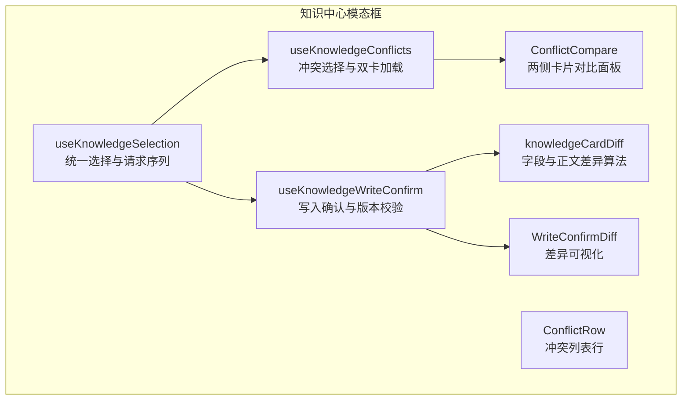

**图表来源**
- [useKnowledgeSelection.ts:1-80](file://src/renderer/features/knowledge/KnowledgeCenterModal/useKnowledgeSelection.ts#L1-L80)
- [useKnowledgeConflicts.ts:1-59](file://src/renderer/features/knowledge/KnowledgeCenterModal/useKnowledgeConflicts.ts#L1-L59)
- [ConflictCompare.tsx:1-114](file://src/renderer/features/knowledge/KnowledgeCenterModal/parts/ConflictCompare.tsx#L1-L114)
- [ConflictRow.tsx:1-49](file://src/renderer/features/knowledge/KnowledgeCenterModal/parts/ConflictRow.tsx#L1-L49)
- [useKnowledgeWriteConfirm.ts:1-162](file://src/renderer/features/knowledge/KnowledgeCenterModal/useKnowledgeWriteConfirm.ts#L1-L162)
- [knowledgeCardDiff.ts:1-61](file://src/renderer/features/knowledge/KnowledgeCenterModal/knowledgeCardDiff.ts#L1-L61)
- [WriteConfirmDiff.tsx:1-29](file://src/renderer/features/knowledge/KnowledgeCenterModal/panels/WriteConfirmDiff.tsx#L1-L29)

**章节来源**
- [useKnowledgeSelection.ts:1-80](file://src/renderer/features/knowledge/KnowledgeCenterModal/useKnowledgeSelection.ts#L1-L80)
- [useKnowledgeConflicts.ts:1-59](file://src/renderer/features/knowledge/KnowledgeCenterModal/useKnowledgeConflicts.ts#L1-L59)
- [ConflictCompare.tsx:1-114](file://src/renderer/features/knowledge/KnowledgeCenterModal/parts/ConflictCompare.tsx#L1-L114)
- [ConflictRow.tsx:1-49](file://src/renderer/features/knowledge/KnowledgeCenterModal/parts/ConflictRow.tsx#L1-L49)
- [useKnowledgeWriteConfirm.ts:1-162](file://src/renderer/features/knowledge/KnowledgeCenterModal/useKnowledgeWriteConfirm.ts#L1-L162)
- [knowledgeCardDiff.ts:1-61](file://src/renderer/features/knowledge/KnowledgeCenterModal/knowledgeCardDiff.ts#L1-L61)
- [WriteConfirmDiff.tsx:1-29](file://src/renderer/features/knowledge/KnowledgeCenterModal/panels/WriteConfirmDiff.tsx#L1-L29)

## 核心组件
- `useKnowledgeConflicts`：根据冲突元数据定位左右两张卡片的来源，并行加载详情，并通过请求序列避免旧请求覆盖新选择。
- `ConflictCompare`：将一对矛盾卡片以左右分栏形式呈现，展示标题、来源、预览摘要、更新时间等元信息，并提供跳转查看完整卡片的入口。
- `ConflictRow`：在冲突列表中渲染一条冲突对，显示左右标题、ID、状态徽章和最近更新时间，用于点击进入对比详情。
- `knowledgeCardDiff`：提供基于字段的差异生成和正文行级 diff，输出统一的 `KnowledgeDiffLine` 行模型；同时提供哈希回滚基线计算。
- `WriteConfirmDiff`：将差异行渲染为带图例的前置文本块，用 `+`/`-`/空格前缀表示变更后、变更前、未变更。
- `useKnowledgeWriteConfirm`：封装写入确认流程，负责版本过期检查、打包编译、冲突收集、提交门控、错误处理，并暴露差异结果供 UI 渲染。
- `useKnowledgeSelection`：统一卡片与冲突的选择生命周期，协调请求序列、加载状态、错误状态与 UI 显隐。

**章节来源**
- [useKnowledgeConflicts.ts:1-59](file://src/renderer/features/knowledge/KnowledgeCenterModal/useKnowledgeConflicts.ts#L1-L59)
- [ConflictCompare.tsx:1-114](file://src/renderer/features/knowledge/KnowledgeCenterModal/parts/ConflictCompare.tsx#L1-L114)
- [ConflictRow.tsx:1-49](file://src/renderer/features/knowledge/KnowledgeCenterModal/parts/ConflictRow.tsx#L1-L49)
- [knowledgeCardDiff.ts:1-61](file://src/renderer/features/knowledge/KnowledgeCenterModal/knowledgeCardDiff.ts#L1-L61)
- [WriteConfirmDiff.tsx:1-29](file://src/renderer/features/knowledge/KnowledgeCenterModal/panels/WriteConfirmDiff.tsx#L1-L29)
- [useKnowledgeWriteConfirm.ts:1-162](file://src/renderer/features/knowledge/KnowledgeCenterModal/useKnowledgeWriteConfirm.ts#L1-L162)
- [useKnowledgeSelection.ts:1-80](file://src/renderer/features/knowledge/KnowledgeCenterModal/useKnowledgeSelection.ts#L1-L80)

## 架构总览
下图展示从用户操作到差异展示与冲突解决的端到端调用链。

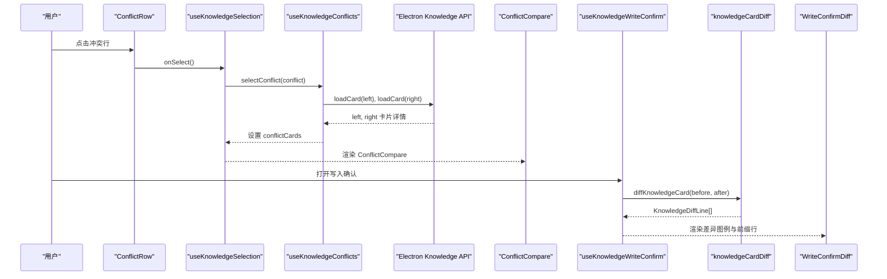

**图表来源**
- [ConflictRow.tsx:1-49](file://src/renderer/features/knowledge/KnowledgeCenterModal/parts/ConflictRow.tsx#L1-L49)
- [useKnowledgeSelection.ts:1-80](file://src/renderer/features/knowledge/KnowledgeCenterModal/useKnowledgeSelection.ts#L1-L80)
- [useKnowledgeConflicts.ts:1-59](file://src/renderer/features/knowledge/KnowledgeCenterModal/useKnowledgeConflicts.ts#L1-L59)
- [ConflictCompare.tsx:1-114](file://src/renderer/features/knowledge/KnowledgeCenterModal/parts/ConflictCompare.tsx#L1-L114)
- [useKnowledgeWriteConfirm.ts:1-162](file://src/renderer/features/knowledge/KnowledgeCenterModal/useKnowledgeWriteConfirm.ts#L1-L162)
- [knowledgeCardDiff.ts:1-61](file://src/renderer/features/knowledge/KnowledgeCenterModal/knowledgeCardDiff.ts#L1-L61)
- [WriteConfirmDiff.tsx:1-29](file://src/renderer/features/knowledge/KnowledgeCenterModal/panels/WriteConfirmDiff.tsx#L1-L29)

## 详细组件分析

### ConflictCompare：冲突对比面板
- 作用：以左右两栏展示一对矛盾卡片，包含标题、来源空间与路径、类型标签、预览内容、更新时间等。
- 关键行为：
  - 当左侧或右侧卡片尚未加载时显示加载提示。
  - 卡片缺失时显示卡片 ID 与缺失提示。
  - 提供“查看相关卡片”按钮，跳转到完整卡片详情。
  - 顶部标题以“左 ↔ 右”的形式强调矛盾关系，并附带“待处理”徽章。
- 数据结构：接收 `conflict`（冲突元数据）、`left/right`（已加载卡片详情）、`loading`（加载状态）和 `onOpenCard`（打开卡片回调）。

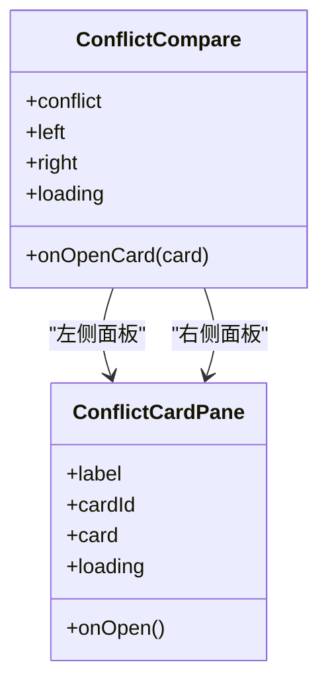

**图表来源**
- [ConflictCompare.tsx:1-114](file://src/renderer/features/knowledge/KnowledgeCenterModal/parts/ConflictCompare.tsx#L1-L114)

**章节来源**
- [ConflictCompare.tsx:1-114](file://src/renderer/features/knowledge/KnowledgeCenterModal/parts/ConflictCompare.tsx#L1-L114)

### ConflictRow：冲突列表行
- 作用：在冲突列表中渲染一对矛盾卡片，突出“待处理”状态，并展示最近更新的时间。
- 视觉区分：
  - 使用徽章标识冲突状态。
  - 显示左右卡片的标题与 ID，便于快速识别。
  - 通过时间戳帮助判断哪条更新更近。
- 交互：支持选中高亮与点击选择，由上层传入 `selected` 与 `onSelect`。

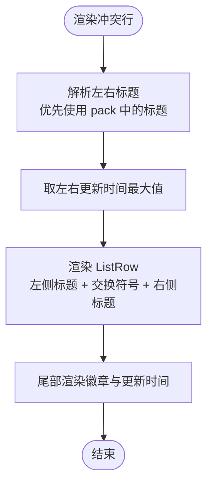

**图表来源**
- [ConflictRow.tsx:1-49](file://src/renderer/features/knowledge/KnowledgeCenterModal/parts/ConflictRow.tsx#L1-L49)

**章节来源**
- [ConflictRow.tsx:1-49](file://src/renderer/features/knowledge/KnowledgeCenterModal/parts/ConflictRow.tsx#L1-L49)

### useKnowledgeConflicts：冲突检测与双卡加载
- 输入：
  - `hits`：当前搜索结果命中。
  - `pack`：已编译的知识包，包含更丰富的命中信息。
  - `detailSeq`：共享的请求序列器，防止异步竞态。
  - `loadCard`：根据 spaceId 与 relativePath 加载卡片详情的函数。
  - `onBeginSelect/onEndSelect`：开始与结束选择的回调。
- 核心逻辑：
  - 根据冲突元数据的左右卡片 ID，先在 `pack.hits` 中查找，再回退到 `hits`。
  - 并发加载左右两张卡片详情，任一失败返回 null。
  - 使用 `detailSeq.isCurrent(seq)` 确保只有最新选择会更新状态。
  - 暴露 `selectConflict` 与 `clearConflict` 给上层统一控制。
- 复杂度与性能：
  - 每次选择最多两次 I/O 调用，使用 `Promise.all` 并行。
  - 不缓存历史冲突结果，依赖上层选择生命周期清理。

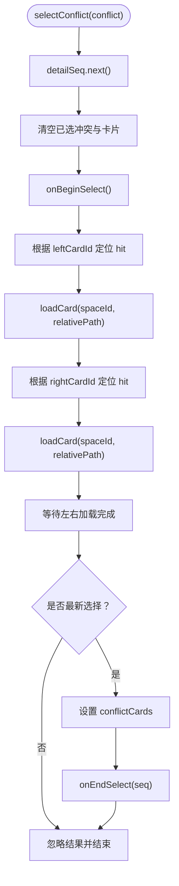

**图表来源**
- [useKnowledgeConflicts.ts:1-59](file://src/renderer/features/knowledge/KnowledgeCenterModal/useKnowledgeConflicts.ts#L1-L59)

**章节来源**
- [useKnowledgeConflicts.ts:1-59](file://src/renderer/features/knowledge/KnowledgeCenterModal/useKnowledgeConflicts.ts#L1-L59)

### knowledgeCardDiff：差异算法
- 差异行模型 `KnowledgeDiffLine`：
  - `kind`：`same`（相同）、`add`（变更后新增）、`remove`（变更前存在）。
  - `text`：原始文本片段。
- 字段级比较：
  - 比较 `title`、`type`、`lifecycle`、`sourceStatus`、`caseId` 等关键字段。
  - 若值变化，分别插入一行 `remove` 与一行 `add`，格式为 `字段名: 值`。
- 作用域比较：
  - 将 `scope` 对象序列化后比较字符串，差异处同样以 `remove/add` 行输出。
- 正文行级 diff：
  - 按换行符拆分 before/after 正文，逐行比对。
  - 相同行标记为 `same`，仅出现于 before 的行标记为 `remove`，仅出现于 after 的行标记为 `add`。
  - 这种“行对齐”方式保留原文换行结构，适合大段落快速浏览。
- 性能特征：
  - 字段比较为线性遍历固定字段数组。
  - 正文 diff 为 O(n) 行扫描，无复杂回溯或 LCS 计算，适合实时预览。
  - 如需更精确的词级 diff，可在 `lineDiff` 内部替换算法，但需评估性能影响。
- 辅助工具：
  - `rollbackBasis`：对正文进行 SHA-256 哈希与字节计数，作为写入基线。

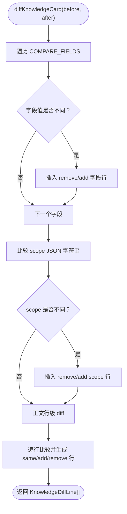

**图表来源**
- [knowledgeCardDiff.ts:1-61](file://src/renderer/features/knowledge/KnowledgeCenterModal/knowledgeCardDiff.ts#L1-L61)

**章节来源**
- [knowledgeCardDiff.ts:1-61](file://src/renderer/features/knowledge/KnowledgeCenterModal/knowledgeCardDiff.ts#L1-L61)

### WriteConfirmDiff：差异可视化
- 图例：显示“变更前”与“变更后”的统计数量。
- 行渲染：
  - `add` 行以 `+` 前缀显示。
  - `remove` 行以 `-` 前缀显示。
  - `same` 行以空格前缀显示，保持行数对齐。
- 样式：通过类名 `is-add`、`is-remove`、`knowledge-center-diff-line` 与 `knowledge-center-diff` 容器组织布局。

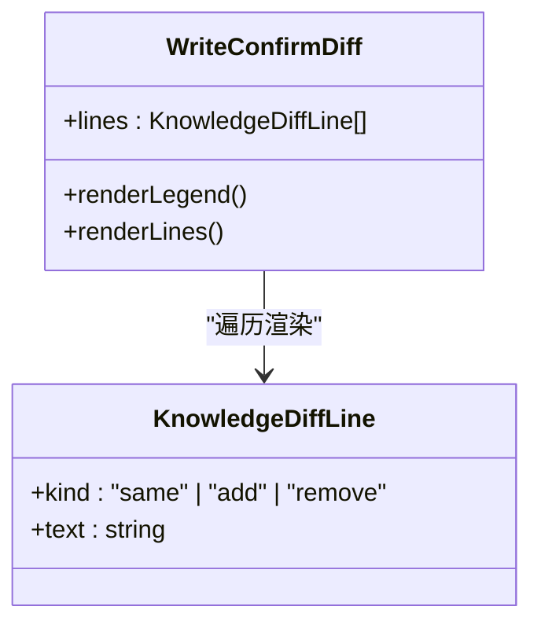

**图表来源**
- [WriteConfirmDiff.tsx:1-29](file://src/renderer/features/knowledge/KnowledgeCenterModal/panels/WriteConfirmDiff.tsx#L1-L29)
- [knowledgeCardDiff.ts:1-61](file://src/renderer/features/knowledge/KnowledgeCenterModal/knowledgeCardDiff.ts#L1-L61)

**章节来源**
- [WriteConfirmDiff.tsx:1-29](file://src/renderer/features/knowledge/KnowledgeCenterModal/panels/WriteConfirmDiff.tsx#L1-L29)

### useKnowledgeWriteConfirm：写入确认与版本校验
- 职责：
  - 打开写入确认时，记录 before/after 数据、正文哈希基线、打开时的更新时间。
  - 拉取最新版本，检查是否版本过期。
  - 编译或刷新确认所需的知识包，收集冲突对。
  - 提交前执行门控检查，支持拒绝策略。
  - 调用主进程写入接口，处理 stale 与错误。
- 差异暴露：
  - 如果存在 before 与 after，则调用 `diffKnowledgeCard` 生成差异行。
  - 否则对纯新增内容生成差异。
- 冲突聚合：
  - 通过 `collectCardContradicts(pack, after)` 获取与当前卡片存在矛盾的已知冲突对。
- 状态管理：
  - 包含 open/busy/error/versionStale/acknowledgedConflicts/gatePack/packReady 等状态。
  - 通过 `request` 序列器保证关闭与切换时不再更新状态。

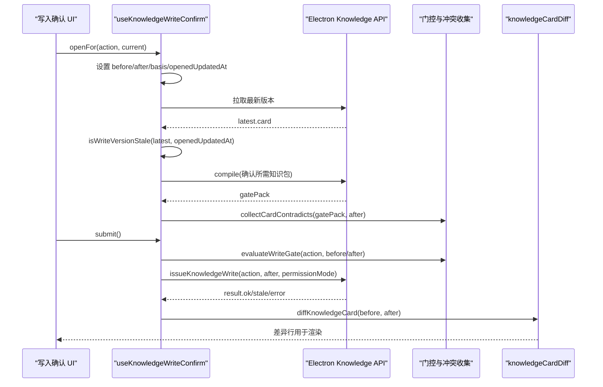

**图表来源**
- [useKnowledgeWriteConfirm.ts:1-162](file://src/renderer/features/knowledge/KnowledgeCenterModal/useKnowledgeWriteConfirm.ts#L1-L162)
- [knowledgeCardDiff.ts:1-61](file://src/renderer/features/knowledge/KnowledgeCenterModal/knowledgeCardDiff.ts#L1-L61)

**章节来源**
- [useKnowledgeWriteConfirm.ts:1-162](file://src/renderer/features/knowledge/KnowledgeCenterModal/useKnowledgeWriteConfirm.ts#L1-L162)

### useKnowledgeSelection：选择生命周期与竞态保护
- 统一维护卡片选择与冲突选择的请求序列。
- 卡片选择：
  - 调用 `window.electronAPI.knowledge.card` 获取详情。
  - 使用 `detailSeq.isCurrent(seq)` 跳过过期结果。
  - 卡片不存在时设置明确错误码。
- 冲突选择：
  - 委托 `useKnowledgeConflicts` 加载左右卡片。
  - 开始选择时清空卡片选择并显示详情区域。
  - 结束时恢复加载状态。
- 生命周期：
  - 模态框开关与查询键变化时清理选择与冲突。

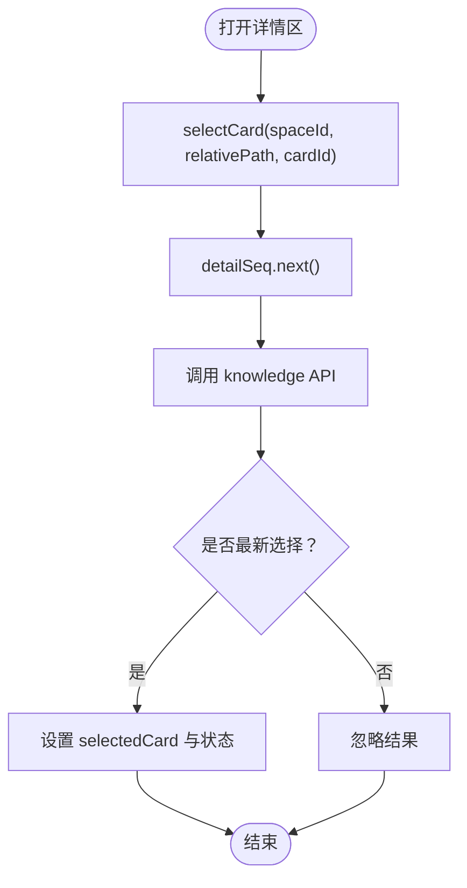

**图表来源**
- [useKnowledgeSelection.ts:1-80](file://src/renderer/features/knowledge/KnowledgeCenterModal/useKnowledgeSelection.ts#L1-L80)

**章节来源**
- [useKnowledgeSelection.ts:1-80](file://src/renderer/features/knowledge/KnowledgeCenterModal/useKnowledgeSelection.ts#L1-L80)

## 依赖关系分析
下图展示冲突检测与差异比较模块的内部依赖。

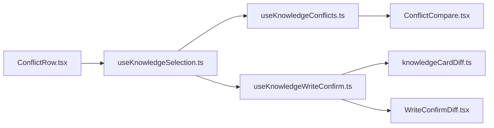

**图表来源**
- [useKnowledgeSelection.ts:1-80](file://src/renderer/features/knowledge/KnowledgeCenterModal/useKnowledgeSelection.ts#L1-L80)
- [useKnowledgeConflicts.ts:1-59](file://src/renderer/features/knowledge/KnowledgeCenterModal/useKnowledgeConflicts.ts#L1-L59)
- [ConflictCompare.tsx:1-114](file://src/renderer/features/knowledge/KnowledgeCenterModal/parts/ConflictCompare.tsx#L1-L114)
- [useKnowledgeWriteConfirm.ts:1-162](file://src/renderer/features/knowledge/KnowledgeCenterModal/useKnowledgeWriteConfirm.ts#L1-L162)
- [knowledgeCardDiff.ts:1-61](file://src/renderer/features/knowledge/KnowledgeCenterModal/knowledgeCardDiff.ts#L1-L61)
- [WriteConfirmDiff.tsx:1-29](file://src/renderer/features/knowledge/KnowledgeCenterModal/panels/WriteConfirmDiff.tsx#L1-L29)
- [ConflictRow.tsx:1-49](file://src/renderer/features/knowledge/KnowledgeCenterModal/parts/ConflictRow.tsx#L1-L49)

**章节来源**
- [useKnowledgeSelection.ts:1-80](file://src/renderer/features/knowledge/KnowledgeCenterModal/useKnowledgeSelection.ts#L1-L80)
- [useKnowledgeConflicts.ts:1-59](file://src/renderer/features/knowledge/KnowledgeCenterModal/useKnowledgeConflicts.ts#L1-L59)
- [ConflictCompare.tsx:1-114](file://src/renderer/features/knowledge/KnowledgeCenterModal/parts/ConflictCompare.tsx#L1-L114)
- [useKnowledgeWriteConfirm.ts:1-162](file://src/renderer/features/knowledge/KnowledgeCenterModal/useKnowledgeWriteConfirm.ts#L1-L162)
- [knowledgeCardDiff.ts:1-61](file://src/renderer/features/knowledge/KnowledgeCenterModal/knowledgeCardDiff.ts#L1-L61)
- [WriteConfirmDiff.tsx:1-29](file://src/renderer/features/knowledge/KnowledgeCenterModal/panels/WriteConfirmDiff.tsx#L1-L29)
- [ConflictRow.tsx:1-49](file://src/renderer/features/knowledge/KnowledgeCenterModal/parts/ConflictRow.tsx#L1-L49)

## 性能考虑
- 差异算法
  - 当前正文 diff 采用逐行扫描，时间复杂度为 O(n)，适合实时预览。
  - 对于超大正文，可考虑分页或虚拟滚动渲染差异行。
  - 如需词级差异，应引入增量 diff 算法并进行节流或 Web Worker 卸载。
- 网络与并发
  - 冲突双卡加载使用并发请求，减少整体等待时间。
  - 所有异步结果均通过请求序列器过滤，避免多余渲染与状态抖动。
- 渲染优化
  - 差异行渲染使用稳定 key，建议结合不可变数据更新策略减少重渲染。
  - 对 `same` 行可合并渲染以提升长文档体验。

[本节为通用性能指导，不直接分析具体代码文件]

## 故障排查指南
- 冲突卡片缺失
  - 现象：ConflictCompare 显示卡片 ID 与缺失提示。
  - 原因：pack 或 hits 中无法找到对应 cardId，或 loadCard 抛错。
  - 处理：检查知识包编译是否正确，确认 sourceId 与相对路径匹配。
- 版本过期
  - 现象：写入确认后出现 versionStale 标志。
  - 原因：本地 openedUpdatedAt 早于最新版本。
  - 处理：刷新知识包与卡片详情，重新打开写入确认。
- 竞态导致状态错乱
  - 现象：快速切换卡片或冲突时，UI 显示旧结果。
  - 原因：未正确使用 detailSeq/request 序列器。
  - 处理：确保所有异步回调在 isCurrent(seq) 后才更新状态。
- 差异异常
  - 现象：差异行错位或缺失。
  - 原因：正文含特殊换行或空行。
  - 处理：确认 lineDiff 的换行分割逻辑与前后文一致；必要时规范化换行符。

**章节来源**
- [ConflictCompare.tsx:1-114](file://src/renderer/features/knowledge/KnowledgeCenterModal/parts/ConflictCompare.tsx#L1-L114)
- [useKnowledgeConflicts.ts:1-59](file://src/renderer/features/knowledge/KnowledgeCenterModal/useKnowledgeConflicts.ts#L1-L59)
- [useKnowledgeWriteConfirm.ts:1-162](file://src/renderer/features/knowledge/KnowledgeCenterModal/useKnowledgeWriteConfirm.ts#L1-L162)
- [knowledgeCardDiff.ts:1-61](file://src/renderer/features/knowledge/KnowledgeCenterModal/knowledgeCardDiff.ts#L1-L61)

## 结论
本实现通过 `useKnowledgeConflicts` 与 `useKnowledgeWriteConfirm` 协作，将冲突检测、版本校验与差异比较整合到知识中心的冲突与写入流程中。`ConflictCompare` 与 `ConflictRow` 提供清晰的冲突可视化入口，`knowledgeCardDiff` 提供轻量高效的差异算法，`WriteConfirmDiff` 则将差异以直观的图例与前缀行呈现。整体设计注重竞态安全、可读性与可扩展性，便于后续接入更复杂的差异算法与冲突解决策略。

[本节为总结性内容，不直接分析具体代码文件]

## 附录：自定义差异算法与冲突解决策略

### 自定义差异算法
- 替换正文 diff：
  - 在 `knowledgeCardDiff.ts` 中修改 `lineDiff`，将逐行比对替换为词级或 token 级 diff。
  - 注意保持 `KnowledgeDiffLine` 模型不变，以便 `WriteConfirmDiff` 无需改动。
- 新增字段比较：
  - 扩展 `COMPARE_FIELDS`，增加业务字段，如 `tags`、`priority` 等。
  - 对于复杂对象，先序列化后再比较，或编写专用比较函数。
- 性能优化：
  - 对超长正文启用分页或懒加载差异行。
  - 将重型 diff 计算放入 Web Worker，避免阻塞主线程。

**章节来源**
- [knowledgeCardDiff.ts:1-61](file://src/renderer/features/knowledge/KnowledgeCenterModal/knowledgeCardDiff.ts#L1-L61)
- [WriteConfirmDiff.tsx:1-29](file://src/renderer/features/knowledge/KnowledgeCenterModal/panels/WriteConfirmDiff.tsx#L1-L29)

### 自定义冲突解决策略
- 自动合并：
  - 在 `useKnowledgeWriteConfirm` 中根据冲突对与业务规则生成合并后的 after。
  - 需要定义冲突优先级与合并策略，例如保留最新更新时间或指定来源权重。
- 人工裁决：
  - 在 `ConflictCompare` 中增加“采纳左侧/右侧/手动编辑”的操作。
  - 将决策结果回传到 `useKnowledgeWriteConfirm`，作为最终写入内容。
- 冲突状态流转：
  - 定义冲突状态机：pending → reviewing → resolved → closed。
  - 在 UI 上通过徽章与颜色表达状态，并在列表与详情中保持一致。

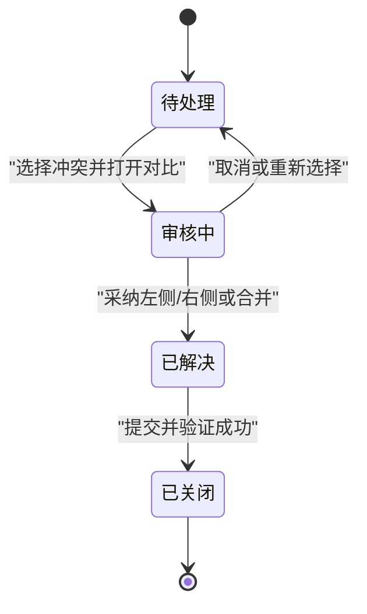

[此图为概念性状态图，不直接映射具体代码文件]