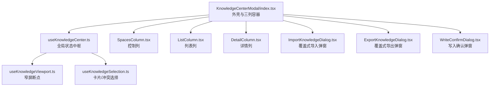
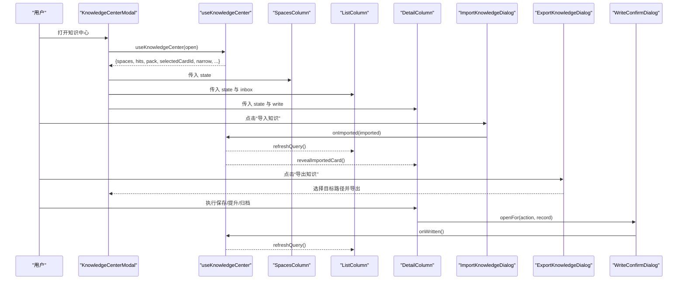
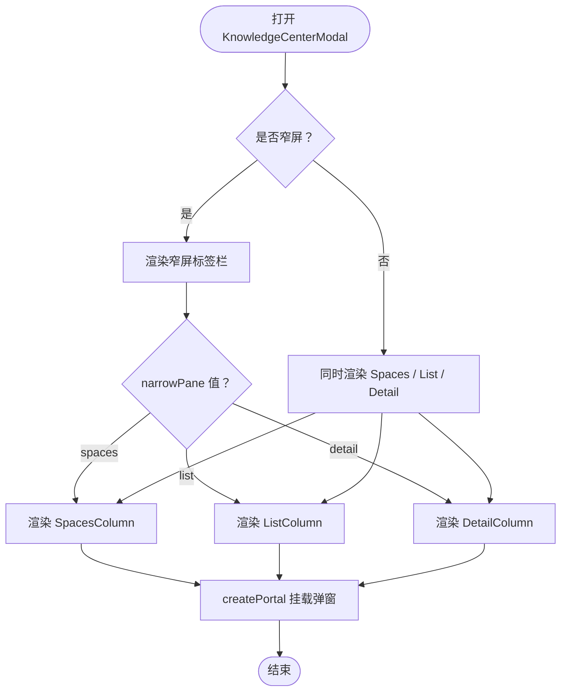
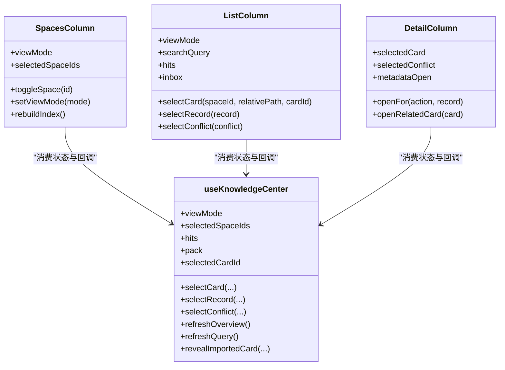
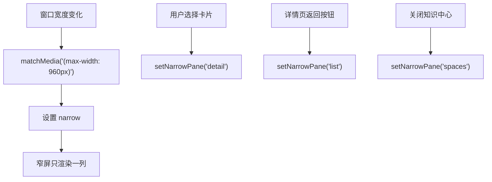
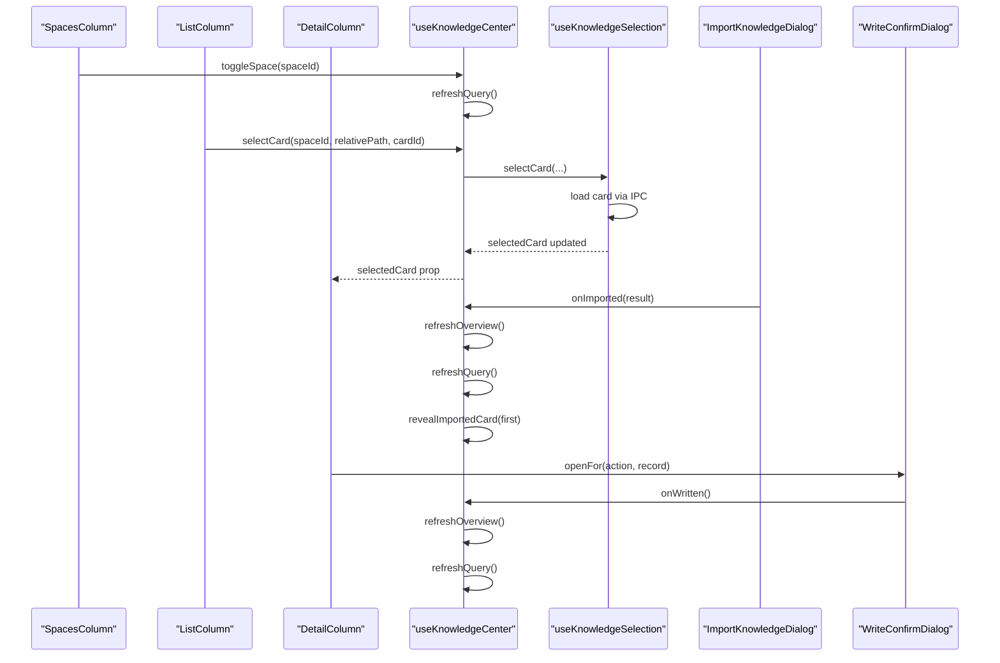
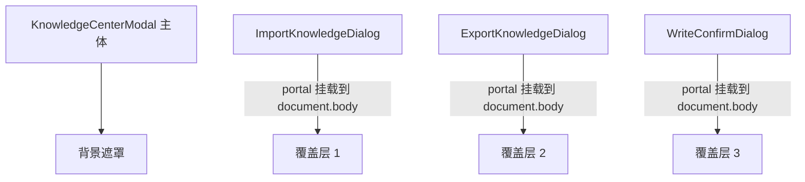
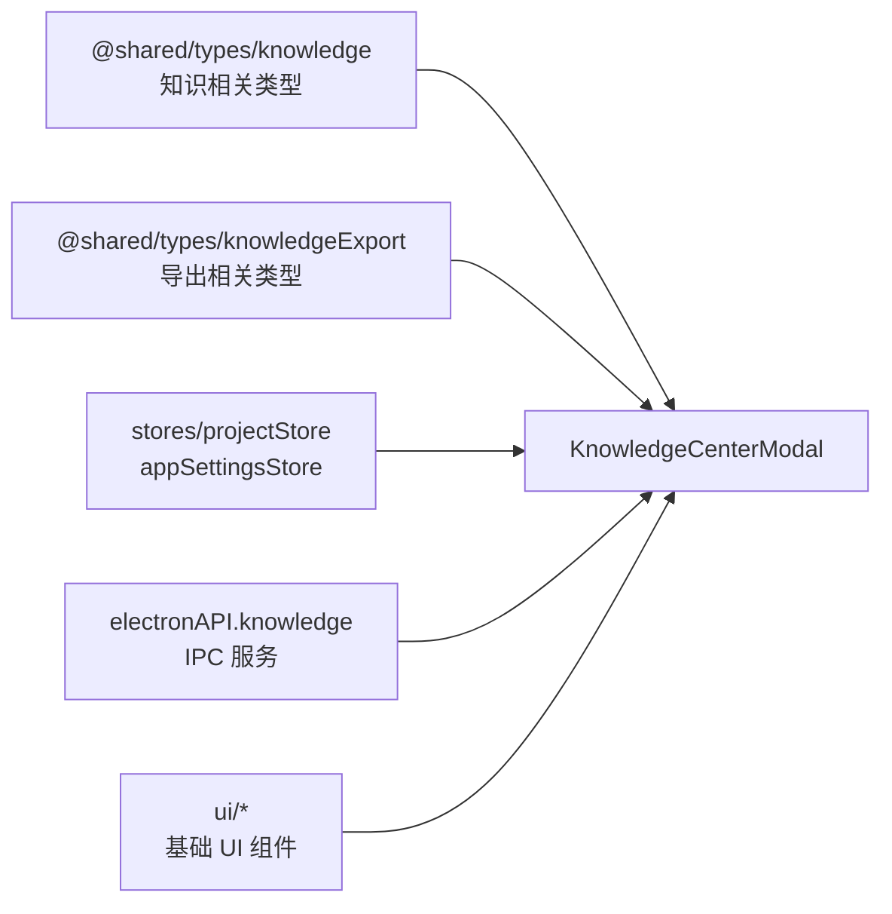

# 知识中心外壳与三列布局

<cite>
**本文引用的文件**   
- [index.tsx](file://src/renderer/features/knowledge/KnowledgeCenterModal/index.tsx)
- [useKnowledgeCenter.ts](file://src/renderer/features/knowledge/KnowledgeCenterModal/useKnowledgeCenter.ts)
- [SpacesColumn.tsx](file://src/renderer/features/knowledge/KnowledgeCenterModal/columns/SpacesColumn.tsx)
- [ListColumn.tsx](file://src/renderer/features/knowledge/KnowledgeCenterModal/columns/ListColumn.tsx)
- [DetailColumn.tsx](file://src/renderer/features/knowledge/KnowledgeCenterModal/columns/DetailColumn.tsx)
- [useKnowledgeViewport.ts](file://src/renderer/features/knowledge/KnowledgeCenterModal/useKnowledgeViewport.ts)
- [useKnowledgeSelection.ts](file://src/renderer/features/knowledge/KnowledgeCenterModal/useKnowledgeSelection.ts)
- [ImportKnowledgeDialog.tsx](file://src/renderer/features/knowledge/KnowledgeCenterModal/panels/ImportKnowledgeDialog.tsx)
- [ExportKnowledgeDialog.tsx](file://src/renderer/features/knowledge/KnowledgeCenterModal/panels/ExportKnowledgeDialog.tsx)
- [WriteConfirmDialog.tsx](file://src/renderer/features/knowledge/KnowledgeCenterModal/panels/WriteConfirmDialog.tsx)
- [useKnowledgeImport.ts](file://src/renderer/features/knowledge/KnowledgeCenterModal/useKnowledgeImport.ts)
- [useKnowledgeExport.ts](file://src/renderer/features/knowledge/KnowledgeCenterModal/useKnowledgeExport.ts)
- [useKnowledgeWriteConfirm.ts](file://src/renderer/features/knowledge/KnowledgeCenterModal/useKnowledgeWriteConfirm.ts)
- [knowledgeCenterModel.ts](file://src/renderer/features/knowledge/KnowledgeCenterModal/knowledgeCenterModel.ts)
- [knowledge-center.md](file://docs/ui/knowledge-center.md)
</cite>

## 目录
1. [引言](#引言)
2. [项目结构](#项目结构)
3. [核心组件](#核心组件)
4. [架构总览](#架构总览)
5. [详细组件分析](#详细组件分析)
6. [依赖关系分析](#依赖关系分析)
7. [性能与滚动行为](#性能与滚动行为)
8. [故障排查](#故障排查)
9. [结论](#结论)
10. [附录：扩展点与自定义列布局示例](#附录自定义列布局与扩展点)

## 引言
本文件聚焦 Knowledge Center 的外壳模态与三列布局，围绕 `KnowledgeCenterModal` 主组件如何组装 Spaces、List、Detail 三列展开。文档解释覆盖式导入导出和写入确认对话框的层级关系；说明窄屏下三列切换逻辑；梳理空间选择、知识卡片选择、详情面板状态之间的同步机制；总结列宽度、滚动行为和响应式设计；并提供列间通信的数据流图、交互时序图以及扩展三列布局的实现思路。

## 项目结构
Knowledge Center 位于渲染器特性目录中，以 `KnowledgeCenterModal` 为入口，采用“状态钩子 + 三列 + 任务弹窗”的结构：

- 外壳与布局：`KnowledgeCenterModal/index.tsx`
- 状态中枢：`useKnowledgeCenter.ts`
- 三列：`columns/SpacesColumn.tsx`、`columns/ListColumn.tsx`、`columns/DetailColumn.tsx`
- 视口与选择：`useKnowledgeViewport.ts`、`useKnowledgeSelection.ts`
- 覆盖式弹窗：`panels/ImportKnowledgeDialog.tsx`、`panels/ExportKnowledgeDialog.tsx`、`panels/WriteConfirmDialog.tsx`
- 业务钩子：`useKnowledgeImport.ts`、`useKnowledgeExport.ts`、`useKnowledgeWriteConfirm.ts`
- 模型工具：`knowledgeCenterModel.ts`
- 产品规格说明：`docs/ui/knowledge-center.md`

**图示来源**  
- [index.tsx:1-191](file://src/renderer/features/knowledge/KnowledgeCenterModal/index.tsx#L1-L191)
- [useKnowledgeCenter.ts:1-196](file://src/renderer/features/knowledge/KnowledgeCenterModal/useKnowledgeCenter.ts#L1-L196)
- [useKnowledgeViewport.ts:1-16](file://src/renderer/features/knowledge/KnowledgeCenterModal/useKnowledgeViewport.ts#L1-L16)
- [useKnowledgeSelection.ts:1-80](file://src/renderer/features/knowledge/KnowledgeCenterModal/useKnowledgeSelection.ts#L1-L80)
- [SpacesColumn.tsx:1-74](file://src/renderer/features/knowledge/KnowledgeCenterModal/columns/SpacesColumn.tsx#L1-L74)
- [ListColumn.tsx:1-169](file://src/renderer/features/knowledge/KnowledgeCenterModal/columns/ListColumn.tsx#L1-L169)
- [DetailColumn.tsx:1-182](file://src/renderer/features/knowledge/KnowledgeCenterModal/columns/DetailColumn.tsx#L1-L182)
- [ImportKnowledgeDialog.tsx:1-200](file://src/renderer/features/knowledge/KnowledgeCenterModal/panels/ImportKnowledgeDialog.tsx#L1-L200)
- [ExportKnowledgeDialog.tsx:1-129](file://src/renderer/features/knowledge/KnowledgeCenterModal/panels/ExportKnowledgeDialog.tsx#L1-L129)
- [WriteConfirmDialog.tsx:1-145](file://src/renderer/features/knowledge/KnowledgeCenterModal/panels/WriteConfirmDialog.tsx#L1-L145)

**章节来源**  
- [knowledge-center.md:1-43](file://docs/ui/knowledge-center.md#L1-L43)

## 核心组件
- `KnowledgeCenterModal`：挂载在应用外壳中的居中模态，负责打开关闭、顶层按钮（导入/导出）、窄屏标签栏、三列容器、以及通过 `createPortal` 将三个任务弹窗直接挂载到 `document.body`，避免弹窗点击冒泡到背景遮罩。
- `useKnowledgeCenter`：维护视图模式、空间选择、筛选、搜索、查询结果、选中卡片、冲突、索引构建等全局状态，并协调刷新流程。
- `useKnowledgeViewport`：基于 `matchMedia('(max-width: 960px)')` 判断是否进入窄屏模式，并暴露当前窄屏显示的 pane。
- `useKnowledgeSelection`：管理选中的卡片或冲突对，负责按需加载详情，并在查询键变化时清空选择。

**章节来源**  
- [index.tsx:1-191](file://src/renderer/features/knowledge/KnowledgeCenterModal/index.tsx#L1-L191)
- [useKnowledgeCenter.ts:1-196](file://src/renderer/features/knowledge/KnowledgeCenterModal/useKnowledgeCenter.ts#L1-L196)
- [useKnowledgeViewport.ts:1-16](file://src/renderer/features/knowledge/KnowledgeCenterModal/useKnowledgeViewport.ts#L1-L16)
- [useKnowledgeSelection.ts:1-80](file://src/renderer/features/knowledge/KnowledgeCenterModal/useKnowledgeSelection.ts#L1-L80)

## 架构总览
Knowledge Center 采用“单一状态源 + 三列消费 + 覆盖式任务弹窗”的架构。主组件不直接操作后端，而是把 UI 状态交给 `useKnowledgeCenter`，由该钩子统一发起 overview、query、compile、card、candidates 等 IPC 请求。三列只消费状态和回调；导入、导出、写入确认作为同级弹窗存在，不影响列布局与滚动。

**图示来源**  
- [index.tsx:1-191](file://src/renderer/features/knowledge/KnowledgeCenterModal/index.tsx#L1-L191)
- [useKnowledgeCenter.ts:1-196](file://src/renderer/features/knowledge/KnowledgeCenterModal/useKnowledgeCenter.ts#L1-L196)
- [ImportKnowledgeDialog.tsx:1-200](file://src/renderer/features/knowledge/KnowledgeCenterModal/panels/ImportKnowledgeDialog.tsx#L1-L200)
- [ExportKnowledgeDialog.tsx:1-129](file://src/renderer/features/knowledge/KnowledgeCenterModal/panels/ExportKnowledgeDialog.tsx#L1-L129)
- [WriteConfirmDialog.tsx:1-145](file://src/renderer/features/knowledge/KnowledgeCenterModal/panels/WriteConfirmDialog.tsx#L1-L145)

## 详细组件分析

### 主外壳与三列装配
`KnowledgeCenterModal` 是布局装配点：
- 顶部品牌标题、导入/导出按钮、宽屏关闭按钮。
- 窄屏时显示三段标签栏 `spaces / list / detail`，用于切换当前可见列。
- 使用 `state.narrow` 与 `state.narrowPane` 决定渲染哪一列。
- 通过 `createPortal` 把三个弹窗直接挂载到 `document.body`，使它们成为 React 树的兄弟节点，而不是容器的子节点；这样点击弹窗内部不会触发背景遮罩关闭。
- 使用 `useOverlayLayer` 注册自身覆盖层，Escape 仅关闭知识中心本身，不会穿透到子弹窗。

**图示来源**  
- [index.tsx:1-191](file://src/renderer/features/knowledge/KnowledgeCenterModal/index.tsx#L1-L191)
- [useKnowledgeViewport.ts:1-16](file://src/renderer/features/knowledge/KnowledgeCenterModal/useKnowledgeViewport.ts#L1-L16)

**章节来源**  
- [index.tsx:1-191](file://src/renderer/features/knowledge/KnowledgeCenterModal/index.tsx#L1-L191)

### 列职责与数据边界
- **SpacesColumn**：控制列，负责三种视图模式切换（Cards / Candidates / Conflicts）、空间多选、索引状态展示与重建入口。它不持有搜索和筛选状态，只调用 `state.setViewMode`、`state.toggleSpace`、`state.rebuildIndex`。
- **ListColumn**：列表列，根据视图模式渲染不同内容：
  - Cards：搜索框 + 筛选 + 按服务返回顺序渲染 hit 行。
  - Candidates：候选收件箱列表，带“待审核”徽章。
  - Conflicts：冲突对列表，每行显示左右标题和“待核对”。
- **DetailColumn**：详情列，展示选中卡片或冲突对比、元信息、图片、Markdown 正文、写操作按钮；草稿卡支持创建候选，非草稿卡支持保存、提升、归档。

**图示来源**  
- [SpacesColumn.tsx:1-74](file://src/renderer/features/knowledge/KnowledgeCenterModal/columns/SpacesColumn.tsx#L1-L74)
- [ListColumn.tsx:1-169](file://src/renderer/features/knowledge/KnowledgeCenterModal/columns/ListColumn.tsx#L1-L169)
- [DetailColumn.tsx:1-182](file://src/renderer/features/knowledge/KnowledgeCenterModal/columns/DetailColumn.tsx#L1-L182)
- [useKnowledgeCenter.ts:1-196](file://src/renderer/features/knowledge/KnowledgeCenterModal/useKnowledgeCenter.ts#L1-L196)

**章节来源**  
- [SpacesColumn.tsx:1-74](file://src/renderer/features/knowledge/KnowledgeCenterModal/columns/SpacesColumn.tsx#L1-L74)
- [ListColumn.tsx:1-169](file://src/renderer/features/knowledge/KnowledgeCenterModal/columns/ListColumn.tsx#L1-L169)
- [DetailColumn.tsx:1-182](file://src/renderer/features/knowledge/KnowledgeCenterModal/columns/DetailColumn.tsx#L1-L182)

### 窄屏切换与响应式行为
- 断点：`≤960px` 进入窄屏模式。
- 窄屏模式下只渲染一列，顶部提供 `spaces / list / detail` 标签栏。
- 当用户选择卡片时，`useKnowledgeCenter` 调用 `showDetail()`，即设置 `narrowPane = 'detail'`；详情页提供返回按钮回到列表。
- 关闭知识中心时，会重置 `narrowPane` 为 `spaces`，并清空卡片选择与冲突选择。

**图示来源**  
- [useKnowledgeViewport.ts:1-16](file://src/renderer/features/knowledge/KnowledgeCenterModal/useKnowledgeViewport.ts#L1-L16)
- [useKnowledgeCenter.ts:1-196](file://src/renderer/features/knowledge/KnowledgeCenterModal/useKnowledgeCenter.ts#L1-L196)
- [index.tsx:1-191](file://src/renderer/features/knowledge/KnowledgeCenterModal/index.tsx#L1-L191)

**章节来源**  
- [useKnowledgeViewport.ts:1-16](file://src/renderer/features/knowledge/KnowledgeCenterModal/useKnowledgeViewport.ts#L1-L16)
- [useKnowledgeCenter.ts:1-196](file://src/renderer/features/knowledge/KnowledgeCenterModal/useKnowledgeCenter.ts#L1-L196)
- [index.tsx:1-191](file://src/renderer/features/knowledge/KnowledgeCenterModal/index.tsx#1-L191)

### 列间状态同步机制
三列之间没有直接耦合，所有状态集中在 `useKnowledgeCenter`，并通过回调函数传递：

- **空间选择**：`SpacesColumn` 调用 `state.toggleSpace`，更新 `selectedSpaceIds`；`useKnowledgeCenter` 在空间数量变化时触发 `refreshQuery`。
- **知识卡片选择**：`ListColumn` 调用 `state.selectCard`，`useKnowledgeSelection` 负责加载详情并切换到详情页；`DetailColumn` 消费 `selectedCard`。
- **冲突选择**：`ListColumn` 调用 `state.selectConflict`，`useKnowledgeSelection` 与 `useKnowledgeConflicts` 协作加载冲突两端卡片，`DetailColumn` 渲染对比视图。
- **导入完成**：`ImportKnowledgeDialog` 通过 `onImported` 回调通知 `useKnowledgeCenter`，后者刷新 overview/query，并尝试定位第一条导入卡片进行 reveal。
- **写入完成**：`WriteConfirmDialog` 提交后通过 `onWritten` 回调刷新 overview/query，并刷新导入收件箱。

**图示来源**  
- [useKnowledgeCenter.ts:1-196](file://src/renderer/features/knowledge/KnowledgeCenterModal/useKnowledgeCenter.ts#L1-L196)
- [useKnowledgeSelection.ts:1-80](file://src/renderer/features/knowledge/KnowledgeCenterModal/useKnowledgeSelection.ts#L1-L80)
- [ImportKnowledgeDialog.tsx:1-200](file://src/renderer/features/knowledge/KnowledgeCenterModal/panels/ImportKnowledgeDialog.tsx#L1-L200)
- [WriteConfirmDialog.tsx:1-145](file://src/renderer/features/knowledge/KnowledgeCenterModal/panels/WriteConfirmDialog.tsx#L1-L145)

**章节来源**  
- [useKnowledgeCenter.ts:1-196](file://src/renderer/features/knowledge/KnowledgeCenterModal/useKnowledgeCenter.ts#L1-L196)
- [useKnowledgeSelection.ts:1-80](file://src/renderer/features/knowledge/KnowledgeCenterModal/useKnowledgeSelection.ts#L1-L80)

### 覆盖式导入导出与写入确认的层级关系
三个弹窗都通过 `TaskDialog` 渲染，并以 React portal 挂载到 `document.body`，因此它们是知识中心模态的背景之上的同级覆盖层，而不是其 DOM 子树的一部分。主组件使用 `useOverlayLayer` 为自身注册覆盖层，而子弹窗各自注册自己的覆盖层，所以 Escape 只关闭最上层弹窗或知识中心本身。

- 导入弹窗：文件模式与粘贴模式互斥，结果页展示每条条目的状态与提示，并可创建候选。
- 导出弹窗：可选择范围（已选 / 筛选结果 / 指定空间）与格式（知识包 / Markdown），目标路径由系统保存对话框返回。
- 写入确认弹窗：显示目标、版本、差异、冲突、变更原因、回滚依据，并要求显式勾选确认后才能提交。

**图示来源**  
- [index.tsx:1-191](file://src/renderer/features/knowledge/KnowledgeCenterModal/index.tsx#L1-L191)
- [ImportKnowledgeDialog.tsx:1-200](file://src/renderer/features/knowledge/KnowledgeCenterModal/panels/ImportKnowledgeDialog.tsx#L1-L200)
- [ExportKnowledgeDialog.tsx:1-129](file://src/renderer/features/knowledge/KnowledgeCenterModal/panels/ExportKnowledgeDialog.tsx#L1-L129)
- [WriteConfirmDialog.tsx:1-145](file://src/renderer/features/knowledge/KnowledgeCenterModal/panels/WriteConfirmDialog.tsx#L1-L145)

**章节来源**  
- [index.tsx:1-191](file://src/renderer/features/knowledge/KnowledgeCenterModal/index.tsx#L1-L191)
- [ImportKnowledgeDialog.tsx:1-200](file://src/renderer/features/knowledge/KnowledgeCenterModal/panels/ImportKnowledgeDialog.tsx#L1-L200)
- [ExportKnowledgeDialog.tsx:1-129](file://src/renderer/features/knowledge/KnowledgeCenterModal/panels/ExportKnowledgeDialog.tsx#L1-L129)
- [WriteConfirmDialog.tsx:1-145](file://src/renderer/features/knowledge/KnowledgeCenterModal/panels/WriteConfirmDialog.tsx#L1-L145)

### 列宽度管理与滚动行为
- 文档描述三列网格为 `224px / minmax(280px, 0.8fr) / 1.2fr`，中列可换行。
- 主组件在打开或选中卡片变化时将滚动位置重置到左上角，保证每次打开或切换详情时从初始位置开始阅读。
- 三列分别包裹在 `Panel` 中，便于独立滚动区域管理；具体 CSS 类名如 `knowledge-center-grid`、`knowledge-center-list`、`knowledge-center-content` 对应不同列容器。

**章节来源**  
- [knowledge-center.md:1-43](file://docs/ui/knowledge-center.md#L1-L43)
- [index.tsx:1-191](file://src/renderer/features/knowledge/KnowledgeCenterModal/index.tsx#L1-L191)

### 自定义列布局与扩展点实现示例
虽然当前实现固定为 Spaces / List / Detail 三列，但可通过以下扩展点定制：

- **替换列组件**：保留 `KnowledgeCenterModal` 的 `state` 接口，传入新的 `SpacesColumn`、`ListColumn`、`DetailColumn` 实现。
- **新增列类型**：在 `KnowledgeNarrowPane` 中添加新 pane，并在窄屏标签栏与条件渲染处加入新分支。
- **自定义列宽度**：修改 CSS 网格比例；例如调整三列比例为 `auto / 1fr / 1.2fr`，或在移动端隐藏某一列。
- **扩展列间通信**：在 `useKnowledgeCenter` 中增加新状态与回调，供多列共享；避免列直接互相引用。
- **覆盖式面板扩展**：复用 `TaskDialog` 与 `createPortal` 模式，将新面板挂载到 `document.body`，并接入现有 overlay stack。

示例步骤：
1. 在 `knowledgeCenterModel.ts` 中扩展 `KnowledgeNarrowPane` 类型。
2. 在 `index.tsx` 中为窄屏标签栏添加新 tab。
3. 在 `index.tsx` 的条件渲染中加入新列。
4. 新建 `MyCustomColumn.tsx`，消费 `useKnowledgeCenter` 的状态与回调。
5. 如需新弹窗，新建 `panels/MyPanel.tsx`，使用 `TaskDialog`，并由 `index.tsx` 通过 `createPortal` 挂载。

**章节来源**  
- [knowledgeCenterModel.ts:1-92](file://src/renderer/features/knowledge/KnowledgeCenterModal/knowledgeCenterModel.ts#L1-L92)
- [index.tsx:1-191](file://src/renderer/features/knowledge/KnowledgeCenterModal/index.tsx#L1-L191)

## 依赖关系分析
Knowledge Center 的依赖主要集中在渲染器侧状态与 IPC 通道上：

- 状态依赖：`useProjectStore` 获取当前会话 ID；`appSettingsStore` 提供权限模式。
- 类型依赖：`@shared/types/knowledge` 与 `@shared/types/knowledgeExport`。
- IPC 依赖：`window.electronAPI.knowledge.*` 包括 overview、query、compile、card、indexRebuild、candidates、candidateCreate、import、export 等。
- 组件依赖：UI 基础组件如 `Button`、`Tabs`、`Checkbox`、`Panel`、`EmptyState`、`Badge`、`InlineError`、`Icon`、`SearchField`、`Textarea`、`Select`、`TaskDialog`。

**图示来源**  
- [useKnowledgeCenter.ts:1-196](file://src/renderer/features/knowledge/KnowledgeCenterModal/useKnowledgeCenter.ts#L1-L196)
- [useKnowledgeWriteConfirm.ts:1-162](file://src/renderer/features/knowledge/KnowledgeCenterModal/useKnowledgeWriteConfirm.ts#L1-L162)
- [useKnowledgeImport.ts:1-190](file://src/renderer/features/knowledge/KnowledgeCenterModal/useKnowledgeImport.ts#L1-L190)
- [useKnowledgeExport.ts:1-128](file://src/renderer/features/knowledge/KnowledgeCenterModal/useKnowledgeExport.ts#L1-L128)

**章节来源**  
- [useKnowledgeCenter.ts:1-196](file://src/renderer/features/knowledge/KnowledgeCenterModal/useKnowledgeCenter.ts#L1-L196)
- [useKnowledgeWriteConfirm.ts:1-162](file://src/renderer/features/knowledge/KnowledgeCenterModal/useKnowledgeWriteConfirm.ts#L1-L162)
- [useKnowledgeImport.ts:1-190](file://src/renderer/features/knowledge/KnowledgeCenterModal/useKnowledgeImport.ts#L1-L190)
- [useKnowledgeExport.ts:1-128](file://src/renderer/features/knowledge/KnowledgeCenterModal/useKnowledgeExport.ts#L1-L128)

## 性能与滚动行为
- 搜索防抖：输入搜索词后通过定时器延迟发送查询，避免频繁 IPC。
- 请求序列号：overview、query、rebuild、detail 各使用独立的请求序列号，确保旧响应被丢弃，防止竞态。
- 空态与加载态：列表与详情都有明确的 loading 与 empty 提示，避免无意义渲染。
- 滚动重置：每次打开知识中心或选中卡片变化时，将容器滚动位置归零，保证一致的阅读起点。
- 列表顺序：Cards 列表保持服务返回的 hits 顺序，不在渲染层重排，降低排序开销。

**章节来源**  
- [useKnowledgeCenter.ts:1-196](file://src/renderer/features/knowledge/KnowledgeCenterModal/useKnowledgeCenter.ts#L1-L196)
- [useKnowledgeSelection.ts:1-80](file://src/renderer/features/knowledge/KnowledgeCenterModal/useKnowledgeSelection.ts#L1-L80)
- [ListColumn.tsx:1-169](file://src/renderer/features/knowledge/KnowledgeCenterModal/columns/ListColumn.tsx#L1-L169)
- [index.tsx:1-191](file://src/renderer/features/knowledge/KnowledgeCenterModal/index.tsx#L1-L191)

## 故障排查
- 无法打开知识中心：检查 `open` 状态是否正确传入，以及 `useOverlayLayer` 是否注册了覆盖层。
- 窄屏标签栏不生效：确认断点 `960px` 媒体查询与 `narrowPane` 状态是否同步。
- 导入后未跳转：检查 `onImported` 是否调用 `revealImportedCard`，并确认 `firstImportedSpaceCard` 能拿到第一条导入卡片。
- 写入确认按钮禁用：检查变更原因是否为空、是否勾选显式确认、是否存在冲突未确认、版本是否过期。
- 导出为空结果：确认所选范围与空间计数是否正确，导出空结果时会返回特定错误提示。

**章节来源**  
- [index.tsx:1-191](file://src/renderer/features/knowledge/KnowledgeCenterModal/index.tsx#L1-L191)
- [useKnowledgeImport.ts:1-190](file://src/renderer/features/knowledge/KnowledgeCenterModal/useKnowledgeImport.ts#L1-L190)
- [useKnowledgeExport.ts:1-128](file://src/renderer/features/knowledge/KnowledgeCenterModal/useKnowledgeExport.ts#L1-L128)
- [WriteConfirmDialog.tsx:1-145](file://src/renderer/features/knowledge/KnowledgeCenterModal/panels/WriteConfirmDialog.tsx#L1-L145)

## 结论
Knowledge Center 的外壳与三列布局以 `KnowledgeCenterModal` 为中心，通过 `useKnowledgeCenter` 集中管理状态，Spaces、List、Detail 三列共同消费状态并调用回调，形成清晰的数据流向。窄屏模式通过 `matchMedia` 与 `narrowPane` 实现单列切换，覆盖式导入、导出、写入确认弹窗以 portal 方式挂载到 body，既保持可读性又避免点击冒泡问题。列间通信遵循单向状态流，适合扩展新列与新弹窗。

## 附录：扩展点与自定义列布局示例
本节给出面向扩展的实践建议，不涉及具体代码内容：

- **扩展窄屏 pane**：在 `knowledgeCenterModel.ts` 的 `KnowledgeNarrowPane` 中新增类型，在 `index.tsx` 的窄屏标签栏与条件渲染中加入分支。
- **自定义三列宽度**：通过 CSS 调整 `knowledge-center-grid` 的比例，例如将中间列设为固定宽度，右侧列自适应。
- **新增列间状态**：在 `useKnowledgeCenter` 中增加新字段与回调，并保持列组件只读状态、只写回调的原则。
- **新增覆盖式面板**：新建 `panels/NewPanel.tsx`，使用 `TaskDialog`，并通过 `createPortal` 挂载到 `document.body`，同时处理 busy、error、close 生命周期。

这些扩展点保持现有架构的稳定性和可测试性，同时允许团队逐步演进知识中心的界面形态。