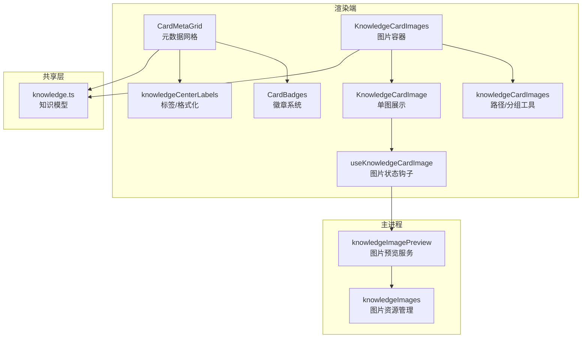
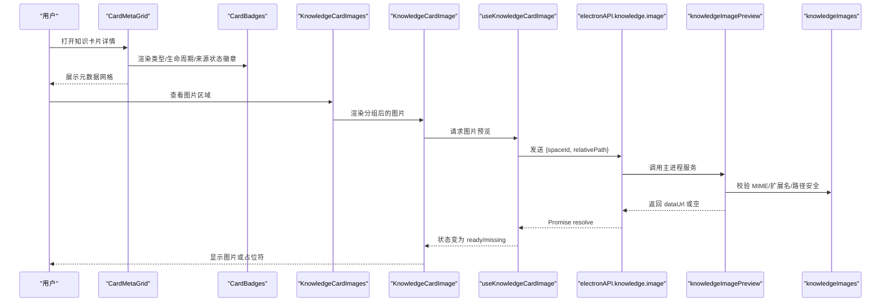
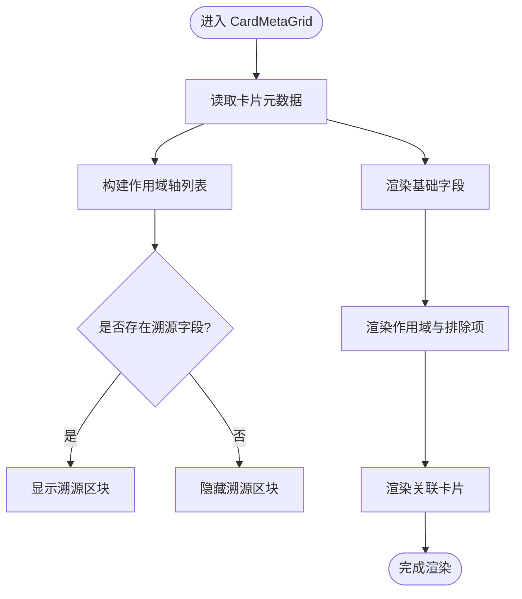
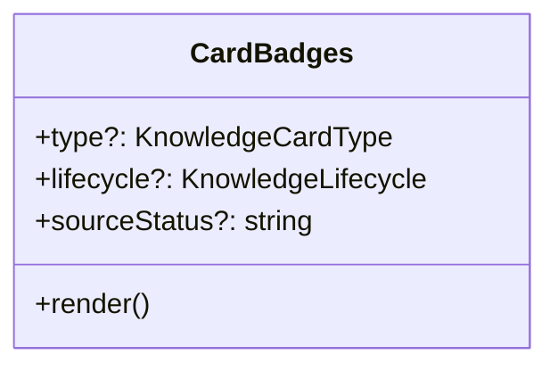
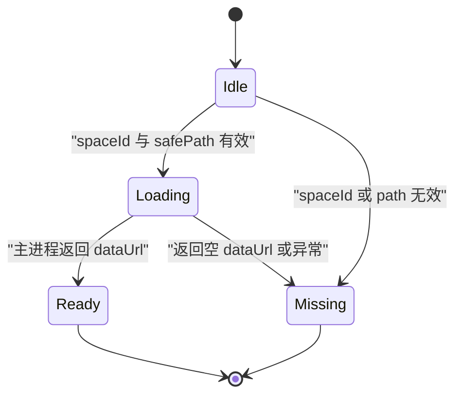
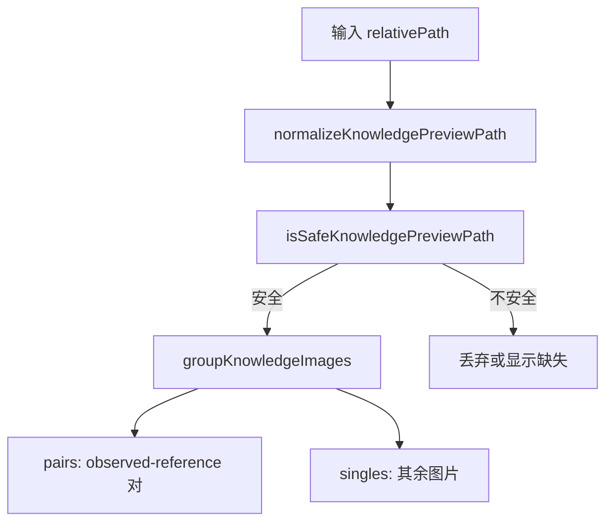
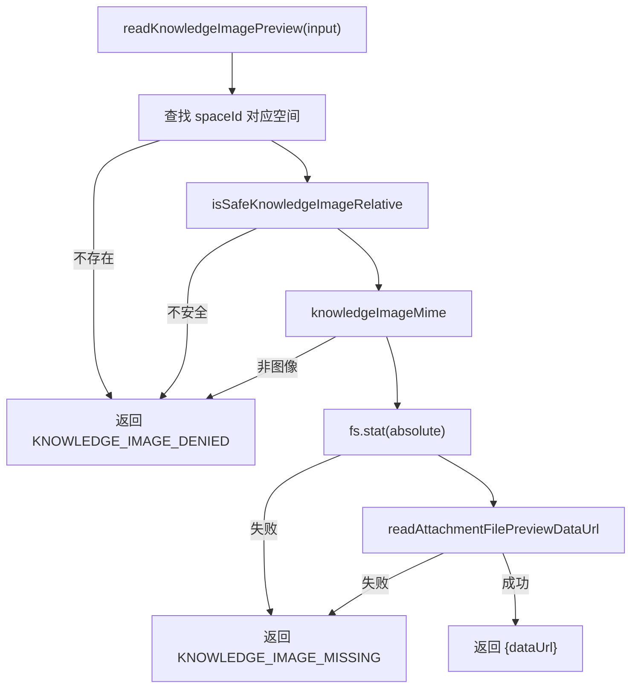
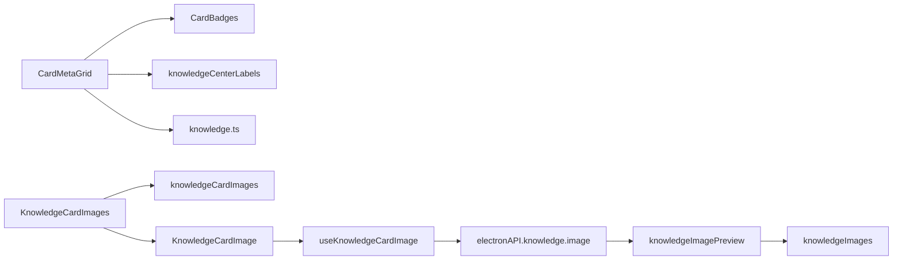
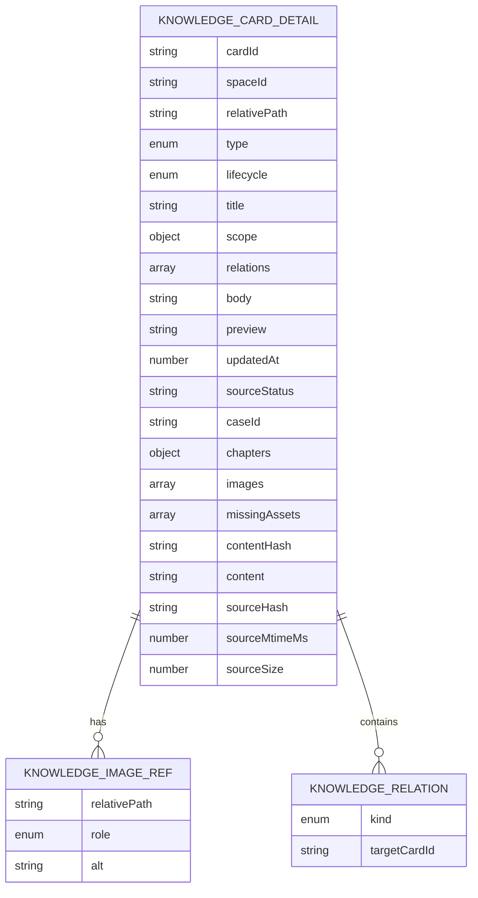
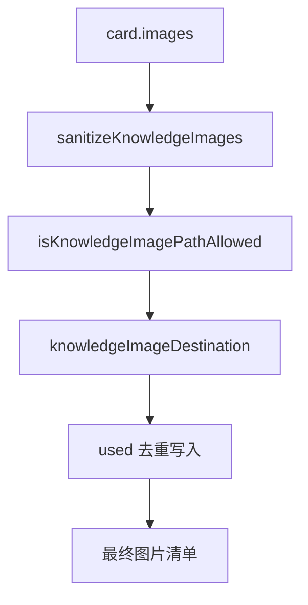

# 知识卡片展示与元数据网格

<cite>
**本文引用的文件**   
- [CardMetaGrid.tsx](file://src/renderer/features/knowledge/KnowledgeCenterModal/parts/CardMetaGrid.tsx)
- [CardBadges.tsx](file://src/renderer/features/knowledge/KnowledgeCenterModal/parts/CardBadges.tsx)
- [KnowledgeCardImages.tsx](file://src/renderer/features/knowledge/KnowledgeCenterModal/parts/KnowledgeCardImages.tsx)
- [KnowledgeCardImage.tsx](file://src/renderer/features/knowledge/KnowledgeCenterModal/parts/KnowledgeCardImage.tsx)
- [useKnowledgeCardImage.ts](file://src/renderer/features/knowledge/KnowledgeCenterModal/useKnowledgeCardImage.ts)
- [knowledgeCardImages.ts](file://src/renderer/features/knowledge/KnowledgeCenterModal/knowledgeCardImages.ts)
- [knowledgeCenterLabels.ts](file://src/renderer/features/knowledge/KnowledgeCenterModal/knowledgeCenterLabels.ts)
- [knowledge.ts](file://shared/types/knowledge.ts)
- [knowledgeImagePreview.ts](file://src/main/knowledge/knowledgeImagePreview.ts)
- [knowledgeImages.ts](file://src/main/knowledge/knowledgeImages.ts)
</cite>

## 目录
1. [引言](#引言)
2. [项目结构](#项目结构)
3. [核心组件](#核心组件)
4. [架构总览](#架构总览)
5. [详细组件分析](#详细组件分析)
6. [依赖关系分析](#依赖关系分析)
7. [性能与缓存特性](#性能与缓存特性)
8. [排错指南](#排错指南)
9. [结论](#结论)
10. [附录：扩展点与示例](#附录扩展点与示例)

## 引言
本文围绕“知识卡片展示”与“元数据网格”展开，聚焦以下能力：
- CardMetaGrid 如何渲染知识的类型、生命周期、来源状态、用例编号、更新时间、空间标签、相对路径、作用域轴、排除项、关联卡片及来源溯源信息。
- CardBadges 的徽章系统如何呈现分类标签、生命周期标识和来源状态标记。
- 图片展示组件如何实现单图预览、多图分组（观察/参考对）、懒加载、安全校验、错误处理与占位符。
- 图片路径解析、主进程图片读取、MIME 类型判定与资源可用性的流程。
- 元数据结构定义与图片资源管理流程图。
- 如何扩展现有渲染器与图片处理器以支持自定义字段或新的图片行为。

## 项目结构
该功能位于渲染端的“知识中心模态框”中，并与共享类型定义和主进程知识服务协作：
- 渲染端 UI 组件：CardMetaGrid、CardBadges、KnowledgeCardImages、KnowledgeCardImage、useKnowledgeCardImage。
- 渲染端工具函数：knowledgeCardImages（路径规范化、角色分组、国际化键生成）。
- 渲染端标签映射：knowledgeCenterLabels（类型、生命周期、作用域轴、时间格式化）。
- 共享类型：knowledge.ts（知识卡片、作用域、关系、图片引用等模型）。
- 主进程图片预览：knowledgeImagePreview（权限校验、MIME 校验、Data URL 生成）。
- 主进程图片资源管理：knowledgeImages（扩展名、MIME 映射、路径安全校验、图像归属策略）。

**图表来源**
- [CardMetaGrid.tsx:1-130](file://src/renderer/features/knowledge/KnowledgeCenterModal/parts/CardMetaGrid.tsx#L1-L130)
- [CardBadges.tsx:1-29](file://src/renderer/features/knowledge/KnowledgeCenterModal/parts/CardBadges.tsx#L1-L29)
- [KnowledgeCardImages.tsx:1-47](file://src/renderer/features/knowledge/KnowledgeCenterModal/parts/KnowledgeCardImages.tsx#L1-L47)
- [KnowledgeCardImage.tsx:1-48](file://src/renderer/features/knowledge/KnowledgeCenterModal/parts/KnowledgeCardImage.tsx#L1-L48)
- [useKnowledgeCardImage.ts:1-40](file://src/renderer/features/knowledge/KnowledgeCenterModal/useKnowledgeCardImage.ts#L1-L40)
- [knowledgeCardImages.ts:1-34](file://src/renderer/features/knowledge/KnowledgeCenterModal/knowledgeCardImages.ts#L1-L34)
- [knowledgeCenterLabels.ts:1-66](file://src/renderer/features/knowledge/KnowledgeCenterModal/knowledgeCenterLabels.ts#L1-L66)
- [knowledge.ts:1-200](file://shared/types/knowledge.ts#L1-L200)
- [knowledgeImagePreview.ts:1-34](file://src/main/knowledge/knowledgeImagePreview.ts#L1-L34)
- [knowledgeImages.ts:1-103](file://src/main/knowledge/knowledgeImages.ts#L1-L103)

## 核心组件
- CardMetaGrid：聚合并展示知识卡片的元数据，包括基础信息、作用域与排除项、关联卡片、来源溯源块。
- CardBadges：将类型、生命周期、来源状态渲染为徽章；当来源状态为固定值时追加未验证提示。
- KnowledgeCardImages：将图片按 observed/reference 成对展示，其余作为单图；为空时不渲染。
- KnowledgeCardImage：负责单张图片的标题、占位、加载与缺失状态展示。
- useKnowledgeCardImage：根据 spaceId 与相对路径请求主进程图片预览，返回 idle/loading/ready/missing 状态。
- knowledgeCardImages：规范化路径、安全校验、图片分组、角色标签键生成。
- knowledgeCenterLabels：提供类型、生命周期、作用域轴、章节与时间的本地化键与格式化函数。
- 主进程图片模块：knowledgeImagePreview 负责权限、MIME 校验与 Data URL 生成；knowledgeImages 提供扩展名、MIME 映射、路径安全与归属规则。

**章节来源**
- [CardMetaGrid.tsx:1-130](file://src/renderer/features/knowledge/KnowledgeCenterModal/parts/CardMetaGrid.tsx#L1-L130)
- [CardBadges.tsx:1-29](file://src/renderer/features/knowledge/KnowledgeCenterModal/parts/CardBadges.tsx#L1-L29)
- [KnowledgeCardImages.tsx:1-47](file://src/renderer/features/knowledge/KnowledgeCenterModal/parts/KnowledgeCardImages.tsx#L1-L47)
- [KnowledgeCardImage.tsx:1-48](file://src/renderer/features/knowledge/KnowledgeCenterModal/parts/KnowledgeCardImage.tsx#L1-L48)
- [useKnowledgeCardImage.ts:1-40](file://src/renderer/features/knowledge/KnowledgeCenterModal/useKnowledgeCardImage.ts#L1-L40)
- [knowledgeCardImages.ts:1-34](file://src/renderer/features/knowledge/KnowledgeCenterModal/knowledgeCardImages.ts#L1-L34)
- [knowledgeCenterLabels.ts:1-66](file://src/renderer/features/knowledge/KnowledgeCenterModal/knowledgeCenterLabels.ts#L1-L66)
- [knowledgeImagePreview.ts:1-34](file://src/main/knowledge/knowledgeImagePreview.ts#L1-L34)
- [knowledgeImages.ts:1-103](file://src/main/knowledge/knowledgeImages.ts#L1-L103)

## 架构总览
知识卡片元数据与图片展示由渲染端组件与主进程服务协同完成：
- 元数据渲染：CardMetaGrid 使用 shared types 中的 KnowledgeCardDetail 获取字段，通过 labels 进行本地化显示，并通过 CardBadges 渲染徽章。
- 图片展示：KnowledgeCardImages 调用 groupKnowledgeImages 对图片进行分组，再交由 KnowledgeCardImage 渲染；图片数据由 useKnowledgeCardImage 从主进程获取。
- 主进程侧：knowledgeImagePreview 接收 spaceId 与 relativePath，校验空间存在性、路径安全性、MIME 类型后读取文件并生成 dataUrl；knowledgeImages 提供 MIME、扩展名、路径归一化与安全判断。

**图表来源**
- [CardMetaGrid.tsx:26-128](file://src/renderer/features/knowledge/KnowledgeCenterModal/parts/CardMetaGrid.tsx#L26-L128)
- [CardBadges.tsx:11-28](file://src/renderer/features/knowledge/KnowledgeCenterModal/parts/CardBadges.tsx#L11-L28)
- [KnowledgeCardImages.tsx:12-46](file://src/renderer/features/knowledge/KnowledgeCenterModal/parts/KnowledgeCardImages.tsx#L12-L46)
- [KnowledgeCardImage.tsx:22-47](file://src/renderer/features/knowledge/KnowledgeCenterModal/parts/KnowledgeCardImage.tsx#L22-L47)
- [useKnowledgeCardImage.ts:12-39](file://src/renderer/features/knowledge/KnowledgeCenterModal/useKnowledgeCardImage.ts#L12-L39)
- [knowledgeImagePreview.ts:10-33](file://src/main/knowledge/knowledgeImagePreview.ts#L10-L33)
- [knowledgeImages.ts:13-103](file://src/main/knowledge/knowledgeImages.ts#L13-L103)

## 详细组件分析

### CardMetaGrid：元数据网格
职责：
- 渲染基础字段：类型、生命周期、来源状态、用例编号、更新时间、空间标签、相对路径。
- 渲染作用域与排除项：仅显示存在的轴，并在存在排除项时展示排除列表。
- 渲染关联卡片：列出 kind 与 targetCardId，可选提供跳转回调。
- 渲染来源溯源：包含 sourceHash、sourceMtimeMs、sourceSize，支持文件大小格式化。
- 空值处理：多个字段在缺省时显示占位符“—”。

关键实现要点：
- 作用域轴过滤：只渲染 card.scope 中存在或 exclusions 非空的轴。
- 时间格式化：使用 formatKnowledgeTime，返回空字符串时回退到“—”。
- 文件大小格式化：小于 KB/MB 时分别格式化单位。
- 来源溯源折叠面板：仅在存在任意溯源字段时展示内容，否则显示“无溯源”提示。

**图表来源**
- [CardMetaGrid.tsx:26-128](file://src/renderer/features/knowledge/KnowledgeCenterModal/parts/CardMetaGrid.tsx#L26-L128)
- [knowledgeCenterLabels.ts:49-66](file://src/renderer/features/knowledge/KnowledgeCenterModal/knowledgeCenterLabels.ts#L49-L66)

**章节来源**
- [CardMetaGrid.tsx:1-130](file://src/renderer/features/knowledge/KnowledgeCenterModal/parts/CardMetaGrid.tsx#L1-L130)
- [knowledgeCenterLabels.ts:1-66](file://src/renderer/features/knowledge/KnowledgeCenterModal/knowledgeCenterLabels.ts#L1-L66)

### CardBadges：徽章系统
职责：
- 类型徽章：基于 KnowledgeCardType 映射到本地化键。
- 生命周期徽章：基于 KnowledgeLifecycle 映射到本地化键，并附加样式类名。
- 来源状态徽章：直接显示 sourceStatus；若值为 fixed，追加“未验证”提示。

视觉与交互：
- 徽章统一采用 class="knowledge-center-badge"。
- 生命周期徽章额外使用 class="knowledge-center-badge--{lifecycle}" 表示不同阶段。
- 空值不渲染对应徽章，避免空白占位。

**图表来源**
- [CardBadges.tsx:1-29](file://src/renderer/features/knowledge/KnowledgeCenterModal/parts/CardBadges.tsx#L1-L29)

**章节来源**
- [CardBadges.tsx:1-29](file://src/renderer/features/knowledge/KnowledgeCenterModal/parts/CardBadges.tsx#L1-L29)

### 图片展示组件：单图、多图轮播与懒加载
说明：
- 当前实现并非传统“轮播”，而是将 observed/reference 成对展示，剩余图片单独展示。
- 懒加载：每个图片通过 useKnowledgeCardImage 按需发起请求，仅在挂载且参数有效时加载。
- 错误处理：缺少 spaceId、路径不安全或主进程返回空 dataUrl 时显示占位符，并提供 aria-label 与可读文本。
- 占位符：使用 is-missing 与 is-loading 类名区分状态，同时显示路径与“图片缺失”文案。

**图表来源**
- [useKnowledgeCardImage.ts:12-39](file://src/renderer/features/knowledge/KnowledgeCenterModal/useKnowledgeCardImage.ts#L12-L39)
- [KnowledgeCardImage.tsx:22-47](file://src/renderer/features/knowledge/KnowledgeCenterModal/parts/KnowledgeCardImage.tsx#L22-L47)

**章节来源**
- [KnowledgeCardImages.tsx:1-47](file://src/renderer/features/knowledge/KnowledgeCenterModal/parts/KnowledgeCardImages.tsx#L1-L47)
- [KnowledgeCardImage.tsx:1-48](file://src/renderer/features/knowledge/KnowledgeCenterModal/parts/KnowledgeCardImage.tsx#L1-L48)
- [useKnowledgeCardImage.ts:1-40](file://src/renderer/features/knowledge/KnowledgeCenterModal/useKnowledgeCardImage.ts#L1-L40)

### 图片路径解析与安全校验
- 路径规范化：移除反斜杠、前导斜杠与前缀“./”，保证跨平台一致性。
- 安全校验：拒绝包含空字符、包含“..”段或不在允许扩展名集合内的路径。
- 角色分组：observed 与 reference 按索引一一配对，其他 role 作为 singles。
- 角色标签键：根据 KnowledgeImageRole 生成 i18n 键。

**图表来源**
- [knowledgeCardImages.ts:1-34](file://src/renderer/features/knowledge/KnowledgeCenterModal/knowledgeCardImages.ts#L1-L34)

**章节来源**
- [knowledgeCardImages.ts:1-34](file://src/renderer/features/knowledge/KnowledgeCenterModal/knowledgeCardImages.ts#L1-L34)

### 主进程图片预览与资源管理
- 空间查找：根据 spaceId 定位 KnowledgeSpace；不存在则返回“拒绝访问”。
- 路径安全：isSafeKnowledgeImageRelative 确保不包含空字符、不包含“..”且扩展名在白名单内。
- MIME 校验：knowledgeImageMime 返回扩展名对应的 MIME；非图像 MIME 直接拒绝。
- 文件存在性：stat 检查绝对路径是否可访问。
- Data URL 生成：readAttachmentFilePreviewDataUrl 读取文件并生成预览数据；失败返回“缺失图片”。

**图表来源**
- [knowledgeImagePreview.ts:10-33](file://src/main/knowledge/knowledgeImagePreview.ts#L10-L33)
- [knowledgeImages.ts:13-103](file://src/main/knowledge/knowledgeImages.ts#L13-L103)

**章节来源**
- [knowledgeImagePreview.ts:1-34](file://src/main/knowledge/knowledgeImagePreview.ts#L1-L34)
- [knowledgeImages.ts:1-103](file://src/main/knowledge/knowledgeImages.ts#L1-L103)

## 依赖关系分析
- CardMetaGrid 依赖：
  - shared types：KnowledgeCardDetail、KnowledgeScopeAxis、KNOWLEDGE_SCOPE_AXES。
  - 本地化：useI18n、TYPE_LABEL_KEYS、LIFECYCLE_LABEL_KEYS、SCOPE_LABELS、formatKnowledgeTime。
  - 子组件：CardBadges。
- CardBadges 依赖：
  - shared types：KnowledgeCardType、KnowledgeLifecycle。
  - 本地化：TYPE_LABEL_KEYS、LIFECYCLE_LABEL_KEYS。
- 图片相关依赖：
  - KnowledgeCardImages 依赖 knowledgeCardImages.groupKnowledgeImages 与 KnowledgeCardImage。
  - KnowledgeCardImage 依赖 useKnowledgeCardImage 与 knowledgeCardImages.normalizeKnowledgePreviewPath、knowledgeImageRoleLabelKey。
  - useKnowledgeCardImage 依赖 electronAPI.knowledge.image 与 knowledgeCardImages.isSafeKnowledgePreviewPath、normalizeKnowledgePreviewPath。
  - 主进程 knowledgeImagePreview 依赖 knowledgeFs.resolveWithinRoot、conversation attachmentClassify、knowledgeImages.isSafeKnowledgeImageRelative、knowledgeImageMime。
  - knowledgeImages 提供扩展名、MIME、路径归一化、角色转换、目标路径生成、安全校验与去重。

**图表来源**
- [CardMetaGrid.tsx:1-130](file://src/renderer/features/knowledge/KnowledgeCenterModal/parts/CardMetaGrid.tsx#L1-L130)
- [CardBadges.tsx:1-29](file://src/renderer/features/knowledge/KnowledgeCenterModal/parts/CardBadges.tsx#L1-L29)
- [KnowledgeCardImages.tsx:1-47](file://src/renderer/features/knowledge/KnowledgeCenterModal/parts/KnowledgeCardImages.tsx#L1-L47)
- [KnowledgeCardImage.tsx:1-48](file://src/renderer/features/knowledge/KnowledgeCenterModal/parts/KnowledgeCardImage.tsx#L1-L48)
- [useKnowledgeCardImage.ts:1-40](file://src/renderer/features/knowledge/KnowledgeCenterModal/useKnowledgeCardImage.ts#L1-L40)
- [knowledgeCardImages.ts:1-34](file://src/renderer/features/knowledge/KnowledgeCenterModal/knowledgeCardImages.ts#L1-L34)
- [knowledgeImagePreview.ts:1-34](file://src/main/knowledge/knowledgeImagePreview.ts#L1-L34)
- [knowledgeImages.ts:1-103](file://src/main/knowledge/knowledgeImages.ts#L1-L103)
- [knowledge.ts:1-200](file://shared/types/knowledge.ts#L1-L200)

**章节来源**
- [CardMetaGrid.tsx:1-130](file://src/renderer/features/knowledge/KnowledgeCenterModal/parts/CardMetaGrid.tsx#L1-L130)
- [knowledge.ts:1-200](file://shared/types/knowledge.ts#L1-L200)

## 性能与缓存特性
- 懒加载：图片仅在组件挂载且参数有效时发起请求，避免一次性加载所有图片。
- 状态隔离：useKnowledgeCardImage 为每个图片维护独立状态，避免相互干扰。
- 取消副作用：组件卸载时设置 cancelled 标志，忽略异步结果，防止内存泄漏。
- 路径规范化与安全检查在前端与主进程双重执行，减少无效 I/O。
- 主进程 MIME 与扩展名白名单限制，提前拒绝非法请求，降低磁盘与网络开销。

注意：当前实现未在浏览器侧显式缓存 Data URL；如需提升重复渲染性能，可在 useKnowledgeCardImage 或更上层增加基于 (spaceId, relativePath) 的缓存层。

[本节为通用性能建议，不涉及具体代码行]

## 排错指南
常见问题与定位方法：
- 图片显示“缺失”：
  - 检查 spaceId 是否正确传入 useKnowledgeCardImage。
  - 确认 relativePath 经 isSafeKnowledgePreviewPath 校验通过（不含空字符、不含“..”、扩展名为 png/jpg/jpeg/gif/webp）。
  - 主进程中 knowledgeImagePreview 会再次校验 MIME 与文件存在性；若返回空 dataUrl，则为“缺失图片”。
- 路径被拒绝：
  - 检查 knowledgeImages.isSafeKnowledgeImageRelative 与 normalizeKnowledgeImagePath 的归一化逻辑，确保路径符合预期。
- 元数据显示异常：
  - 检查 knowledgeCenterLabels 的本地化键映射是否正确，特别是 TYPE_LABEL_KEYS、LIFECYCLE_LABEL_KEYS、SCOPE_LABELS。
  - 确认 KnowledgeCardDetail 字段是否齐全，尤其是 scope.exclusions、relations、sourceHash/sourceMtimeMs/sourceSize。

**章节来源**
- [useKnowledgeCardImage.ts:12-39](file://src/renderer/features/knowledge/KnowledgeCenterModal/useKnowledgeCardImage.ts#L12-L39)
- [knowledgeCardImages.ts:5-20](file://src/renderer/features/knowledge/KnowledgeCenterModal/knowledgeCardImages.ts#L5-L20)
- [knowledgeImagePreview.ts:10-33](file://src/main/knowledge/knowledgeImagePreview.ts#L10-L33)
- [knowledgeImages.ts:60-103](file://src/main/knowledge/knowledgeImages.ts#L60-L103)
- [knowledgeCenterLabels.ts:1-48](file://src/renderer/features/knowledge/KnowledgeCenterModal/knowledgeCenterLabels.ts#L1-L48)

## 结论
CardMetaGrid 与 CardBadges 共同构成知识卡片元数据的稳定展示面，结合 shared types 与本地化映射，提供一致的键值展示与空值处理。图片展示组件通过安全的路径解析、主进程资源校验与懒加载状态管理，实现可靠的单图与多图分组预览。整体架构清晰，前端与主进程职责分离良好，便于扩展与维护。

[本节为总结性内容，不涉及具体代码行]

## 附录：扩展点与示例

### 自定义元数据渲染器
思路：
- 新增一个渲染器接口，接收 KnowledgeCardDetail 与渲染上下文，返回 ReactNode。
- 在 CardMetaGrid 中注册并遍历渲染器列表，将自定义字段插入到指定位置。
- 复用 knowledgeCenterLabels.formatKnowledgeTime 与 formatBytes 进行格式化。

参考路径：
- [CardMetaGrid.tsx:26-128](file://src/renderer/features/knowledge/KnowledgeCenterModal/parts/CardMetaGrid.tsx#L26-L128)
- [knowledgeCenterLabels.ts:49-66](file://src/renderer/features/knowledge/KnowledgeCenterModal/knowledgeCenterLabels.ts#L49-L66)

### 自定义图片处理器
思路：
- 在 useKnowledgeCardImage 外层封装一个处理器接口，拦截 (spaceId, relativePath) 请求，返回 dataUrl 或错误码。
- 默认实现委托 electronAPI.knowledge.image；可替换为预取、压缩、CDN 代理或本地缓存。
- 保持 KnowledgeCardImage 的状态机不变，仅改变数据来源。

参考路径：
- [useKnowledgeCardImage.ts:12-39](file://src/renderer/features/knowledge/KnowledgeCenterModal/useKnowledgeCardImage.ts#L12-L39)
- [knowledgeImagePreview.ts:10-33](file://src/main/knowledge/knowledgeImagePreview.ts#L10-L33)

### 元数据结构定义

**图表来源**
- [knowledge.ts:57-150](file://shared/types/knowledge.ts#L57-L150)
- [knowledge.ts:151-200](file://shared/types/knowledge.ts#L151-L200)

### 图片资源管理流程图

**图表来源**
- [knowledgeImages.ts:60-103](file://src/main/knowledge/knowledgeImages.ts#L60-L103)