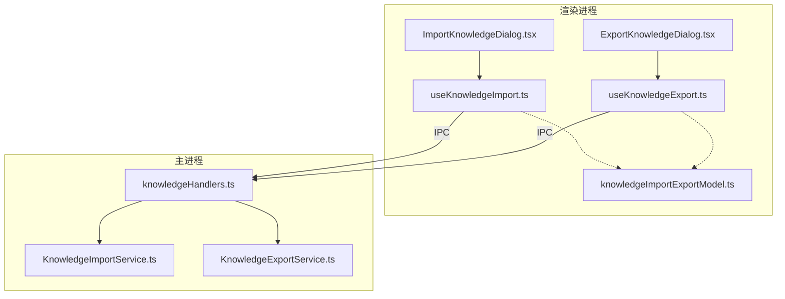
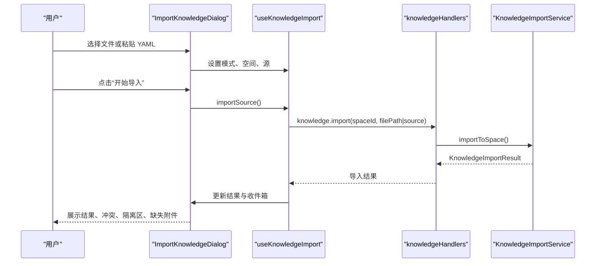
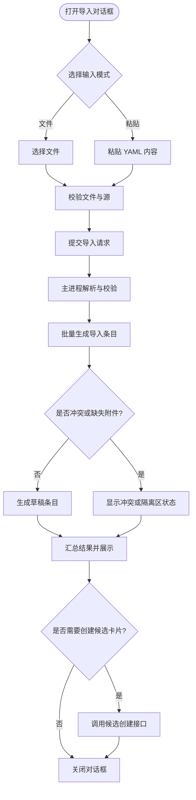
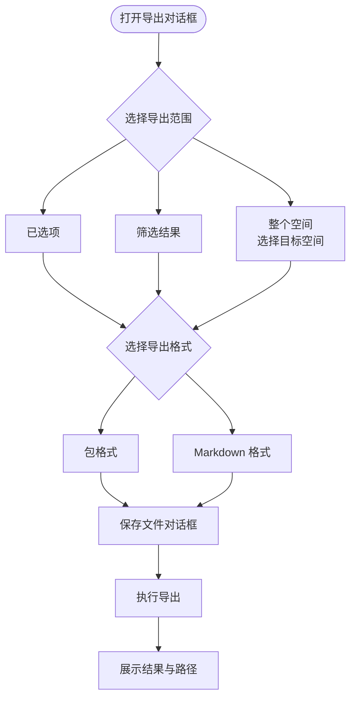
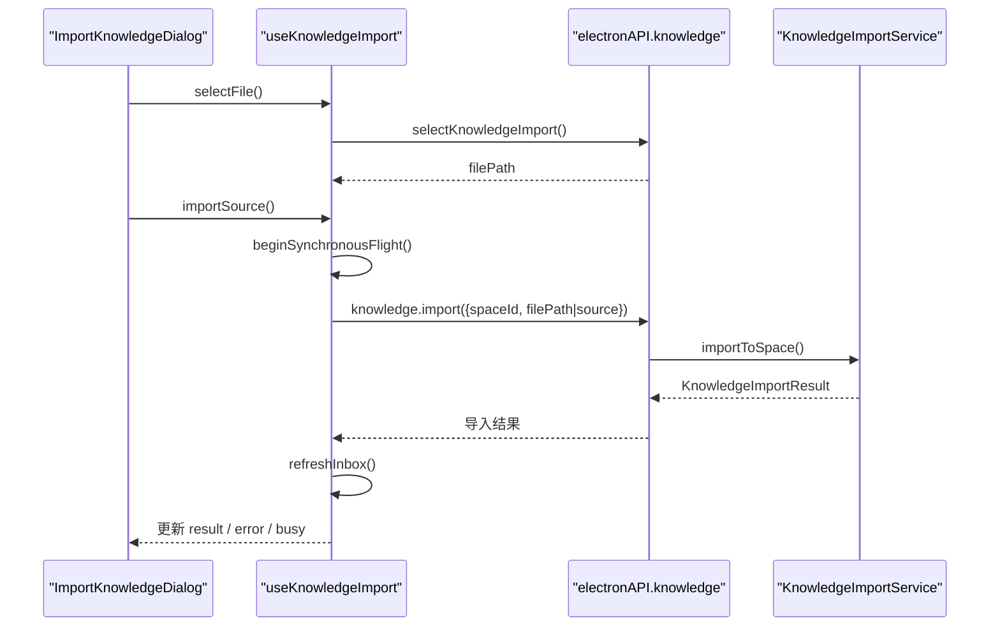
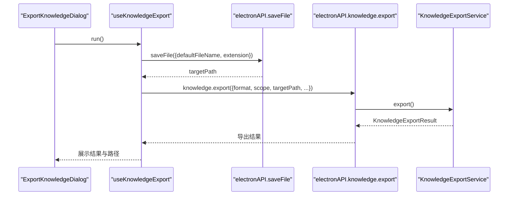
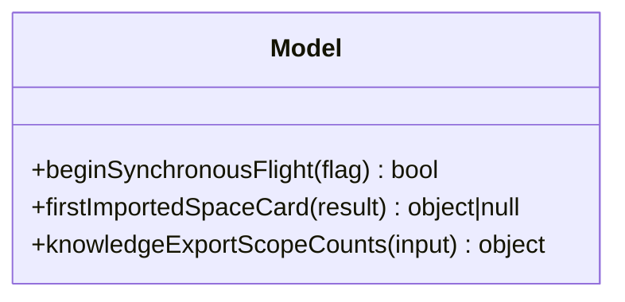
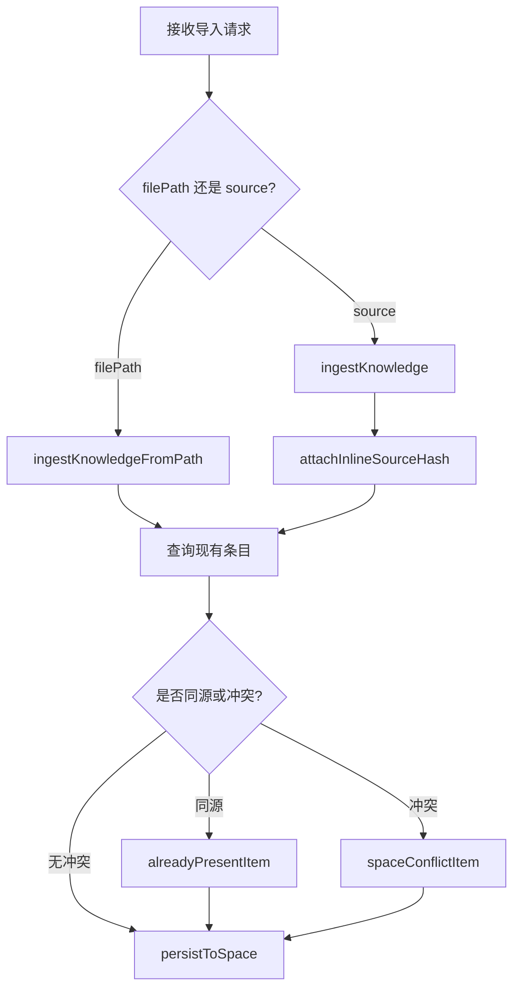
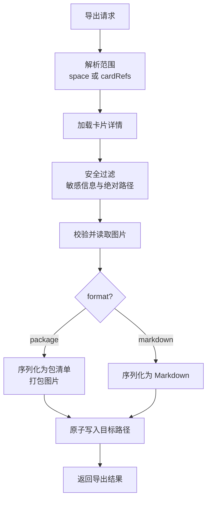
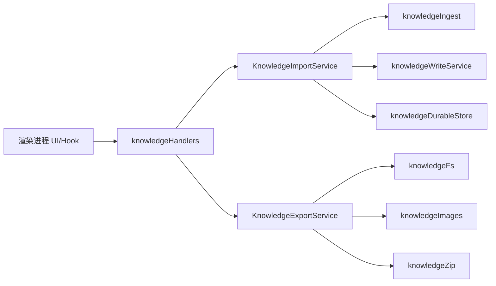

# 知识库导入导出功能

<cite>
**本文引用的文件**   
- [ImportKnowledgeDialog.tsx](file://src/renderer/features/knowledge/KnowledgeCenterModal/panels/ImportKnowledgeDialog.tsx)
- [ExportKnowledgeDialog.tsx](file://src/renderer/features/knowledge/KnowledgeCenterModal/panels/ExportKnowledgeDialog.tsx)
- [useKnowledgeImport.ts](file://src/renderer/features/knowledge/KnowledgeCenterModal/useKnowledgeImport.ts)
- [useKnowledgeExport.ts](file://src/renderer/features/knowledge/KnowledgeCenterModal/useKnowledgeExport.ts)
- [knowledgeImportExportModel.ts](file://src/renderer/features/knowledge/KnowledgeCenterModal/knowledgeImportExportModel.ts)
- [knowledgeImportExportModel.test.ts](file://src/renderer/features/knowledge/KnowledgeCenterModal/knowledgeImportExportModel.test.ts)
- [KnowledgeImportService.ts](file://src/main/knowledge/KnowledgeImportService.ts)
- [KnowledgeExportService.ts](file://src/main/knowledge/KnowledgeExportService.ts)
- [knowledgeHandlers.ts](file://src/main/ipc/knowledgeHandlers.ts)
</cite>

## 目录
1. [简介](#简介)
2. [项目结构](#项目结构)
3. [核心组件](#核心组件)
4. [架构总览](#架构总览)
5. [详细组件分析](#详细组件分析)
6. [依赖关系分析](#依赖关系分析)
7. [性能与扩展性](#性能与扩展性)
8. [故障排查指南](#故障排查指南)
9. [结论](#结论)
10. [附录：数据模型与格式规范](#附录数据模型与格式规范)

## 简介
本文件面向知识中心的“导入”和“导出”能力，围绕以下目标展开：
- 解释 ImportKnowledgeDialog 和 ExportKnowledgeDialog 的用户界面行为：文件选择、内容粘贴、模式切换、结果展示。
- 说明 useKnowledgeImport Hook 的完整导入流程：输入校验、IPC 调用、解析与校验、批量处理、冲突与隔离区处理、错误恢复。
- 说明 useKnowledgeExport Hook 的导出逻辑：作用域计算、序列化、图片附件打包、压缩存储、结果返回。
- 梳理 knowledgeImportExportModel 的数据模型与工具函数，并补充共享类型中的导入导出协议。
- 提供流程图、错误处理策略、可扩展示例与 API 使用建议。

## 项目结构
导入导出功能跨越渲染进程、主进程与共享类型层：
- 渲染进程 UI 与状态：
  - ImportKnowledgeDialog.tsx：导入对话框 UI。
  - ExportKnowledgeDialog.tsx：导出对话框 UI。
  - useKnowledgeImport.ts：导入 Hook。
  - useKnowledgeExport.ts：导出 Hook。
  - knowledgeImportExportModel.ts：导入导出的前端通用模型与工具。
- 主进程服务：
  - KnowledgeImportService.ts：知识导入服务，负责解析、校验、写入草稿卡片。
  - KnowledgeExportService.ts：知识导出服务，负责序列化、安全过滤、打包与落盘。
  - knowledgeHandlers.ts：IPC 处理器，桥接渲染进程与主进程服务。

**图表来源**
- [ImportKnowledgeDialog.tsx:1-200](file://src/renderer/features/knowledge/KnowledgeCenterModal/panels/ImportKnowledgeDialog.tsx#L1-L200)
- [ExportKnowledgeDialog.tsx:1-129](file://src/renderer/features/knowledge/KnowledgeCenterModal/panels/ExportKnowledgeDialog.tsx#L1-L129)
- [useKnowledgeImport.ts:1-190](file://src/renderer/features/knowledge/KnowledgeCenterModal/useKnowledgeImport.ts#L1-L190)
- [useKnowledgeExport.ts:1-128](file://src/renderer/features/knowledge/KnowledgeCenterModal/useKnowledgeExport.ts#L1-L128)
- [knowledgeImportExportModel.ts:1-33](file://src/renderer/features/knowledge/KnowledgeCenterModal/knowledgeImportExportModel.ts#L1-L33)
- [knowledgeHandlers.ts:1-200](file://src/main/ipc/knowledgeHandlers.ts#L1-L200)
- [KnowledgeImportService.ts:1-200](file://src/main/knowledge/KnowledgeImportService.ts#L1-L200)
- [KnowledgeExportService.ts:1-171](file://src/main/knowledge/KnowledgeExportService.ts#L1-L171)

**章节来源**
- [ImportKnowledgeDialog.tsx:1-200](file://src/renderer/features/knowledge/KnowledgeCenterModal/panels/ImportKnowledgeDialog.tsx#L1-L200)
- [ExportKnowledgeDialog.tsx:1-129](file://src/renderer/features/knowledge/KnowledgeCenterModal/panels/ExportKnowledgeDialog.tsx#L1-L129)
- [useKnowledgeImport.ts:1-190](file://src/renderer/features/knowledge/KnowledgeCenterModal/useKnowledgeImport.ts#L1-L190)
- [useKnowledgeExport.ts:1-128](file://src/renderer/features/knowledge/KnowledgeCenterModal/useKnowledgeExport.ts#L1-L128)
- [knowledgeImportExportModel.ts:1-33](file://src/renderer/features/knowledge/KnowledgeCenterModal/knowledgeImportExportModel.ts#L1-L33)
- [knowledgeHandlers.ts:1-200](file://src/main/ipc/knowledgeHandlers.ts#L1-L200)
- [KnowledgeImportService.ts:1-200](file://src/main/knowledge/KnowledgeImportService.ts#L1-L200)
- [KnowledgeExportService.ts:1-171](file://src/main/knowledge/KnowledgeExportService.ts#L1-L171)

## 核心组件
- ImportKnowledgeDialog：提供“文件导入”和“粘贴 YAML”两种输入模式；支持选择目标空间；显示导入结果列表、统一状态、单项状态、缺失附件提示、冲突提示，以及创建候选卡片的入口。
- ExportKnowledgeDialog：提供“已选项”“筛选结果”“整个空间”三种导出范围；支持“包格式”和“Markdown 格式”；当范围为“整个空间”时，允许选择具体空间；完成后显示导出路径、排除数量等结果。
- useKnowledgeImport：封装导入的状态机，包括打开/关闭、模式切换、文件选择、源文本编辑、空间选择、导入执行、候选卡片创建、收件箱刷新、错误处理。
- useKnowledgeExport：封装导出的状态机，包括打开/关闭、范围与格式选择、空间计数、导出执行、错误处理和结果展示。
- knowledgeImportExportModel：提供同步飞行标志、导入结果首张卡片提取、导出范围计数等纯函数工具。

**章节来源**
- [ImportKnowledgeDialog.tsx:1-200](file://src/renderer/features/knowledge/KnowledgeCenterModal/panels/ImportKnowledgeDialog.tsx#L1-L200)
- [ExportKnowledgeDialog.tsx:1-129](file://src/renderer/features/knowledge/KnowledgeCenterModal/panels/ExportKnowledgeDialog.tsx#L1-L129)
- [useKnowledgeImport.ts:1-190](file://src/renderer/features/knowledge/KnowledgeCenterModal/useKnowledgeImport.ts#L1-L190)
- [useKnowledgeExport.ts:1-128](file://src/renderer/features/knowledge/KnowledgeCenterModal/useKnowledgeExport.ts#L1-L128)
- [knowledgeImportExportModel.ts:1-33](file://src/renderer/features/knowledge/KnowledgeCenterModal/knowledgeImportExportModel.ts#L1-L33)

## 架构总览
导入导出采用“渲染进程 Hook + 对话框 + 主进程服务 + IPC 处理器”的分层设计：
- 渲染进程负责用户交互、本地状态、进度与错误展示。
- 主进程负责安全的文件系统访问、知识解析、安全检查、持久化、打包与落盘。
- IPC 层对参数进行校验，并在需要时触发人类确认。

**图表来源**
- [ImportKnowledgeDialog.tsx:1-200](file://src/renderer/features/knowledge/KnowledgeCenterModal/panels/ImportKnowledgeDialog.tsx#L1-L200)
- [useKnowledgeImport.ts:1-190](file://src/renderer/features/knowledge/KnowledgeCenterModal/useKnowledgeImport.ts#L1-L190)
- [knowledgeHandlers.ts:1-200](file://src/main/ipc/knowledgeHandlers.ts#L1-L200)
- [KnowledgeImportService.ts:1-200](file://src/main/knowledge/KnowledgeImportService.ts#L1-L200)

## 详细组件分析

### 导入对话框 ImportKnowledgeDialog
- 输入模式：
  - 文件模式：通过 Electron API 选择文件，显示文件名与路径，并标记“待验证”。
  - 粘贴模式：提供多行文本框，粘贴 YAML 内容，禁用拼写检查。
- 目标空间：下拉选择 user 或项目空间。
- 结果视图：
  - 统一状态：若所有条目状态一致则显示统一标签。
  - 单项状态：每条记录显示标题、caseId、相对路径、状态徽章。
  - 冲突与缺失：冲突项显示已有卡片 ID；缺失附件项显示数量提示。
  - 已存在：当内容与现有条目同源时标记为“已存在”，并可复用已有卡片元信息。
  - 创建候选：对 draft 且无缺失附件的条目，可调用 candidateCreate。
- 按钮行为：
  - “运行导入”在可选输入存在且未忙时启用。
  - 完成后可关闭对话框。

**图表来源**
- [ImportKnowledgeDialog.tsx:1-200](file://src/renderer/features/knowledge/KnowledgeCenterModal/panels/ImportKnowledgeDialog.tsx#L1-L200)
- [useKnowledgeImport.ts:1-190](file://src/renderer/features/knowledge/KnowledgeCenterModal/useKnowledgeImport.ts#L1-L190)
- [KnowledgeImportService.ts:1-200](file://src/main/knowledge/KnowledgeImportService.ts#L1-L200)

**章节来源**
- [ImportKnowledgeDialog.tsx:1-200](file://src/renderer/features/knowledge/KnowledgeCenterModal/panels/ImportKnowledgeDialog.tsx#L1-L200)
- [useKnowledgeImport.ts:1-190](file://src/renderer/features/knowledge/KnowledgeCenterModal/useKnowledgeImport.ts#L1-L190)

### 导出对话框 ExportKnowledgeDialog
- 导出范围：
  - 已选项 selected：仅导出当前选中的单条知识卡片。
  - 筛选结果 filtered：导出当前检索/筛选命中的所有卡片。
  - 整个空间 space：导出指定空间内的全部卡片，需选择空间。
- 导出格式：
  - package：生成 ZIP 压缩包，包含清单与图片附件。
  - markdown：生成 Markdown 文档，不含图片。
- 结果展示：
  - 成功时显示导出卡片数、被排除数量、目标路径。
  - 失败时显示错误消息，如无可导出卡片时的友好提示。

**图表来源**
- [ExportKnowledgeDialog.tsx:1-129](file://src/renderer/features/knowledge/KnowledgeCenterModal/panels/ExportKnowledgeDialog.tsx#L1-L129)
- [useKnowledgeExport.ts:1-128](file://src/renderer/features/knowledge/KnowledgeCenterModal/useKnowledgeExport.ts#L1-L128)
- [KnowledgeExportService.ts:1-171](file://src/main/knowledge/KnowledgeExportService.ts#L1-L171)

**章节来源**
- [ExportKnowledgeDialog.tsx:1-129](file://src/renderer/features/knowledge/KnowledgeCenterModal/panels/ExportKnowledgeDialog.tsx#L1-L129)
- [useKnowledgeExport.ts:1-128](file://src/renderer/features/knowledge/KnowledgeCenterModal/useKnowledgeExport.ts#L1-L128)

### 导入流程 useKnowledgeImport
- 状态管理：
  - open/busy/error/result/inbox/candidateError 等状态。
  - mode/source/filePath/spaceId 等输入状态。
- 关键方法：
  - selectFile：调用 Electron API 选择导入文件，清空粘贴源，显示文件路径。
  - importSource：
    - 校验 spaceId。
    - beginSynchronousFlight 防止重复并发。
    - 调用 window.electronAPI.knowledge.import，传入 spaceId、sessionId（可选）、filePath 或 source。
    - 刷新收件箱，调用 onImported 回调。
  - createCandidate：
    - 校验 sessionId。
    - 调用 candidateCreate，成功后刷新收件箱并可选择关闭对话框。
    - 特殊处理 KNOWLEDGE_ASSETS_MISSING 错误，转换为更友好的中文提示。
- 错误处理：
  - 统一通过 knowledgeErrorMessage 转换错误。
  - 对特定错误码给出业务语义提示。

**图表来源**
- [useKnowledgeImport.ts:1-190](file://src/renderer/features/knowledge/KnowledgeCenterModal/useKnowledgeImport.ts#L1-L190)
- [knowledgeHandlers.ts:1-200](file://src/main/ipc/knowledgeHandlers.ts#L1-L200)
- [KnowledgeImportService.ts:1-200](file://src/main/knowledge/KnowledgeImportService.ts#L1-L200)

**章节来源**
- [useKnowledgeImport.ts:1-190](file://src/renderer/features/knowledge/KnowledgeCenterModal/useKnowledgeImport.ts#L1-L190)

### 导出流程 useKnowledgeExport
- 状态管理：
  - scope/format/spaceId/busy/error/result/pendingCount 等。
- 关键方法：
  - run：
    - beginSynchronousFlight 防止重复并发。
    - 打开保存文件对话框，根据 format 选择默认扩展名 zip 或 md。
    - 根据 scope 构建 cardRefs 或 spaceId。
    - 调用 window.electronAPI.knowledge.export，返回导出结果。
    - 捕获 KNOWLEDGE_EXPORT_EMPTY_RESULT，转换为“无可导出卡片”的提示。
- 范围计数：
  - 使用 knowledgeExportScopeCounts 计算 selected/filtered/space 的数量。
  - space 计数来自 query 的空间卡片总数，而非筛选后的 hits。

**图表来源**
- [useKnowledgeExport.ts:1-128](file://src/renderer/features/knowledge/KnowledgeCenterModal/useKnowledgeExport.ts#L1-L128)
- [knowledgeImportExportModel.ts:1-33](file://src/renderer/features/knowledge/KnowledgeCenterModal/knowledgeImportExportModel.ts#L1-L33)
- [KnowledgeExportService.ts:1-171](file://src/main/knowledge/KnowledgeExportService.ts#L1-L171)

**章节来源**
- [useKnowledgeExport.ts:1-128](file://src/renderer/features/knowledge/KnowledgeCenterModal/useKnowledgeExport.ts#L1-L128)

### 前端模型 knowledgeImportExportModel
- beginSynchronousFlight：确保同一时刻只有一个异步任务进入，避免重复提交。
- firstImportedSpaceCard：从导入结果中查找第一个 status 为 draft 且有 record 的条目，返回其 spaceId、relativePath、cardId，便于后续跳转或定位。
- knowledgeExportScopeCounts：根据 selected/hits/spaceCount 计算三种导出范围的待处理数量。

**图表来源**
- [knowledgeImportExportModel.ts:1-33](file://src/renderer/features/knowledge/KnowledgeCenterModal/knowledgeImportExportModel.ts#L1-L33)
- [knowledgeImportExportModel.test.ts:1-73](file://src/renderer/features/knowledge/KnowledgeCenterModal/knowledgeImportExportModel.test.ts#L1-L73)

**章节来源**
- [knowledgeImportExportModel.ts:1-33](file://src/renderer/features/knowledge/KnowledgeCenterModal/knowledgeImportExportModel.ts#L1-L33)
- [knowledgeImportExportModel.test.ts:1-73](file://src/renderer/features/knowledge/KnowledgeCenterModal/knowledgeImportExportModel.test.ts#L1-L73)

### 主进程导入服务 KnowledgeImportService
- 解析阶段：
  - ingestKnowledgeFromPath：从文件路径解析知识内容。
  - ingestKnowledge：从内联源文本解析知识内容。
  - attachInlineSourceHash：为内联源计算哈希并注入到每个条目的 record.sourceHash 与 sourceSize。
- 冲突检测：
  - sameSource：基于 sourceHash 判断是否与现有条目同源。
  - alreadyPresentItem：将同源的导入条目映射为 draft 状态，reason=already-present，并填充 existingCardId。
  - spaceConflictItem：当 caseId 冲突时，生成 conflict 状态，reason=duplicate-case-id，并提供 existingCardId。
- 写入阶段：
  - persistToSpace：将解析结果写入目标空间的草稿卡片。
- 会话草稿迁移：
  - migrateSessionDrafts：清理或迁移会话遗留草稿，避免与现有条目冲突。

**图表来源**
- [KnowledgeImportService.ts:1-200](file://src/main/knowledge/KnowledgeImportService.ts#L1-L200)

**章节来源**
- [KnowledgeImportService.ts:1-200](file://src/main/knowledge/KnowledgeImportService.ts#L1-L200)

### 主进程导出服务 KnowledgeExportService
- 范围解析：
  - scope=space：要求 spaceId，列出该空间的全部卡片。
  - scope=selected/filtered：要求至少一个 cardRef。
- 安全过滤：
  - isExportable：排除 missingAssets、包含敏感信息或绝对路径的卡片。
  - 图片校验：isSafeKnowledgeImageRelative、最大字节限制。
- 序列化：
  - toPackageCard：构造包卡片，省略 undefined 字段。
  - serializePackage：输出 YAML 清单，包含 schema、exportedAt、cards。
  - serializeMarkdown：输出 Markdown 文档，按卡片分隔。
- 打包与落盘：
  - package：zipKnowledgeFiles，包含清单与图片二进制。
  - markdown：UTF-8 编码的文本。
  - 原子写入：先写 .tmp，再 rename 到目标路径。

**图表来源**
- [KnowledgeExportService.ts:1-171](file://src/main/knowledge/KnowledgeExportService.ts#L1-L171)

**章节来源**
- [KnowledgeExportService.ts:1-171](file://src/main/knowledge/KnowledgeExportService.ts#L1-L171)

## 依赖关系分析
- 渲染进程与主进程的耦合点：
  - window.electronAPI.selectKnowledgeImport：选择导入文件。
  - window.electronAPI.saveFile：选择导出目标路径。
  - window.electronAPI.knowledge.import：发起导入。
  - window.electronAPI.knowledge.export：发起导出。
  - window.electronAPI.knowledge.candidates：获取候选卡片收件箱。
  - window.electronAPI.knowledge.candidateCreate：创建候选卡片。
  - window.electronAPI.knowledge.query：查询空间卡片数量。
- 主进程内部依赖：
  - knowledgeHandlers 组合 KnowledgeImportService、KnowledgeExportService、knowledgeQueryService、knowledgeWriteService、knowledgeDurableStore 等。
  - KnowledgeImportService 依赖 knowledgeIngest、knowledgeWriteService、knowledgeDurableStore、KnowledgeIndexService、KnowledgeQueryService。
  - KnowledgeExportService 依赖 knowledgeFs、knowledgeImages、knowledgeZip、知识查询服务。

**图表来源**
- [knowledgeHandlers.ts:1-200](file://src/main/ipc/knowledgeHandlers.ts#L1-L200)
- [KnowledgeImportService.ts:1-200](file://src/main/knowledge/KnowledgeImportService.ts#L1-L200)
- [KnowledgeExportService.ts:1-171](file://src/main/knowledge/KnowledgeExportService.ts#L1-L171)

**章节来源**
- [knowledgeHandlers.ts:1-200](file://src/main/ipc/knowledgeHandlers.ts#L1-L200)
- [KnowledgeImportService.ts:1-200](file://src/main/knowledge/KnowledgeImportService.ts#L1-L200)
- [KnowledgeExportService.ts:1-171](file://src/main/knowledge/KnowledgeExportService.ts#L1-L171)

## 性能与扩展性
- 并发控制：
  - 使用 beginSynchronousFlight 防止重复导入或导出，避免资源竞争与重复写入。
- 增量与批处理：
  - 导入时批量解析与写入草稿卡片，减少多次 IO 开销。
  - 导出时先收集图片二进制，再去重后打包，避免重复写入。
- 可扩展点：
  - 新增导出格式：在 EXTENSION 映射中添加新扩展名，并在 useKnowledgeExport.run 中分支处理；在 KnowledgeExportService 中实现新的序列化逻辑。
  - 新增导入格式：在 KnowledgeImportService 的 ingest 链路扩展解析器，并在 IPC 层增加参数校验。
  - 自定义校验规则：扩展 isExportable 与 ingest 阶段的敏感信息检测。

[本节为通用指导，不直接分析具体文件]

## 故障排查指南
- 导入失败常见原因：
  - 未知空间：检查 spaceId 是否有效。
  - 内容解析失败：检查 YAML 结构是否符合导入格式。
  - 冲突或缺失附件：查看导入结果中的 reason 与 missingAssets。
  - 会话相关错误：创建候选卡片时需要有效的 sessionId。
- 导出失败常见原因：
  - 无可导出卡片：当所有卡片被安全过滤或不存在时抛出空结果错误。
  - 目标路径无效：非绝对路径会直接拒绝。
  - 图片异常：路径不安全、为空或超过大小限制会导致整卡被排除。
- 错误呈现：
  - 渲染进程统一使用 knowledgeErrorMessage 转换错误。
  - 针对 KNOWLEDGE_ASSETS_MISSING、KNOWLEDGE_EXPORT_EMPTY_RESULT 等错误码提供友好提示。

**章节来源**
- [useKnowledgeImport.ts:1-190](file://src/renderer/features/knowledge/KnowledgeCenterModal/useKnowledgeImport.ts#L1-L190)
- [useKnowledgeExport.ts:1-128](file://src/renderer/features/knowledge/KnowledgeCenterModal/useKnowledgeExport.ts#L1-L128)
- [KnowledgeImportService.ts:1-200](file://src/main/knowledge/KnowledgeImportService.ts#L1-L200)
- [KnowledgeExportService.ts:1-171](file://src/main/knowledge/KnowledgeExportService.ts#L1-L171)

## 结论
导入导出功能以清晰的职责分层实现：
- 渲染进程专注交互与状态管理。
- 主进程承担解析、校验、持久化与安全策略。
- 共享类型与模型保证前后端协议一致性。
通过统一的错误处理、并发控制和范围计算，系统能够在复杂场景下保持稳定与可维护性。扩展新格式或新校验规则时，可在对应服务层添加逻辑，并保持 IPC 契约稳定。

[本节为总结，不直接分析具体文件]

## 附录：数据模型与格式规范

### 导入数据模型
- KnowledgeImportRequest：
  - spaceId：必填，目标空间。
  - filePath：可选，导入文件路径。
  - source：可选，内联 YAML 文本。
  - availableAssetNames/availableImagePaths：可选，用于资产可用性校验。
- KnowledgeImportResult：
  - items：导入条目数组，每项包含 status、lifecycle、record、reason、missingAssets、existingCardId 等。
  - verified：是否已完成验证。
  - candidateCreated：是否创建了候选卡片。
  - sourceHash/sourceSize：源内容哈希与大小。
- KnowledgeImportItem：
  - status：draft/quarantine/conflict 等。
  - reason：already-present/duplicate-case-id/missing-assets 等。
  - record：KnowledgeCardRecord，包含 cardId、spaceId、relativePath、type、lifecycle、title、scope、relations、body 等。
  - missingAssets：缺失附件名称列表。
  - existingCardId/existingCaseId：冲突时提供已有卡片标识。

**章节来源**
- [KnowledgeImportService.ts:1-200](file://src/main/knowledge/KnowledgeImportService.ts#L1-L200)

### 导出数据模型
- KnowledgeExportRequest：
  - format：package/markdown。
  - scope：selected/filtered/space。
  - targetPath：必填，绝对路径。
  - cardRefs：scope 非 space 时必填。
  - spaceId：scope 为 space 时必填。
- KnowledgeExportResult：
  - cardCount：成功导出卡片数。
  - excludedCount：被排除卡片数。
  - bytes：输出字节数。
  - targetPath：输出文件路径。
- KnowledgePackage：
  - schema：包格式版本标识。
  - exportedAt：导出时间。
  - cards：KnowledgePackageCard 数组。
- KnowledgePackageCard：
  - 包含 cardId、relativePath、type、lifecycle、title、scope、relations、body、sourceStatus、caseId、chapters、images 等。

**章节来源**
- [KnowledgeExportService.ts:1-171](file://src/main/knowledge/KnowledgeExportService.ts#L1-L171)

### 扩展示例与 API 使用建议
- 新增导出格式：
  - 在 useKnowledgeExport.ts 中为 EXTENSION 添加映射。
  - 在 run 方法中为新格式分支处理保存文件名与扩展名。
  - 在 KnowledgeExportService.ts 中实现新的序列化与打包逻辑。
- 新增导入格式：
  - 在 KnowledgeImportService.ts 的 ingest 链路添加解析器。
  - 在 IPC 层增加参数校验，确保新格式的字段安全。
- API 使用建议：
  - 导入前尽量提供 availableAssetNames 与 availableImagePaths，以减少导入后缺失附件。
  - 导出前尽量缩小 scope，提高成功率与速度。
  - 对可能产生大量输出的导出，建议使用 package 格式，以便携带图片附件。

[本节为概念性指导，不直接分析具体文件]