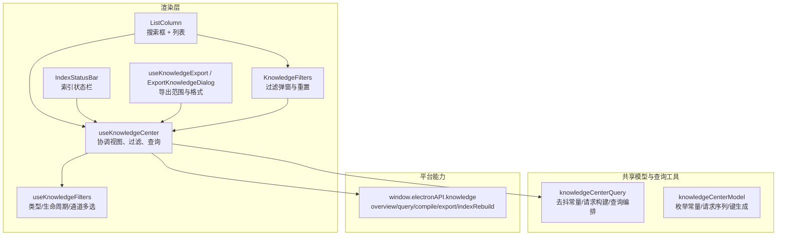
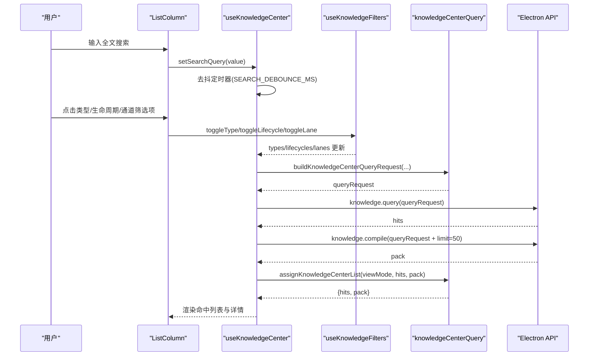
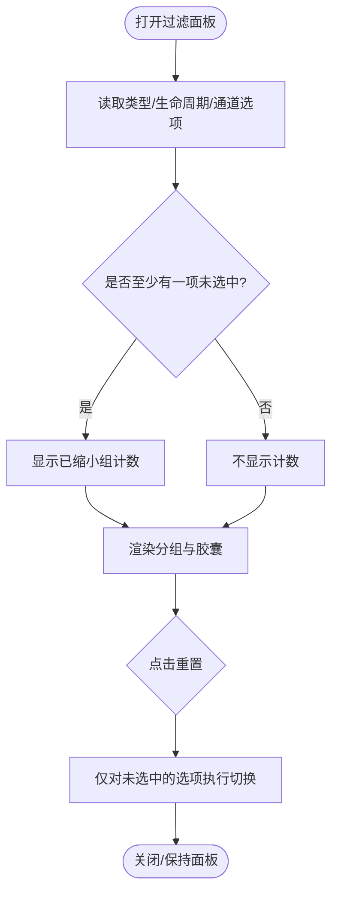
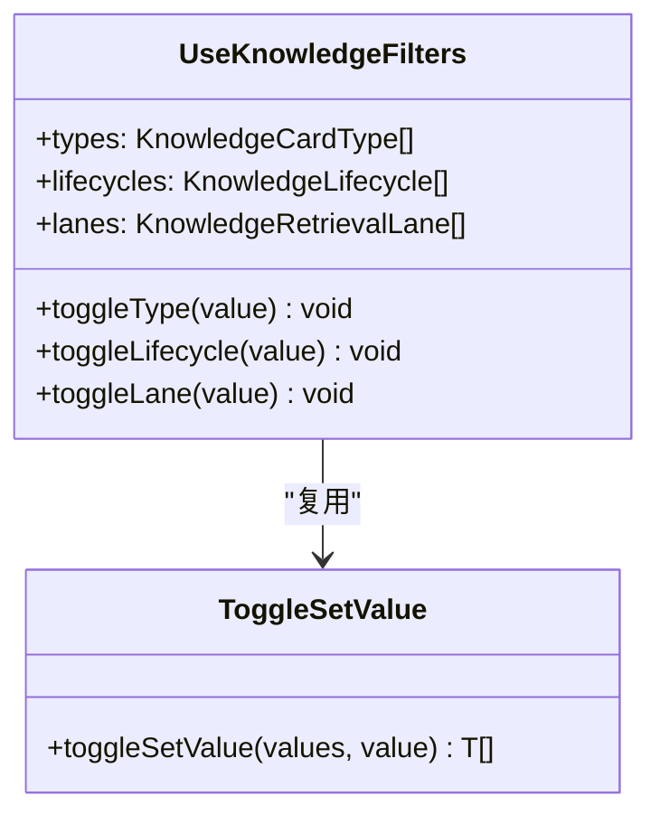
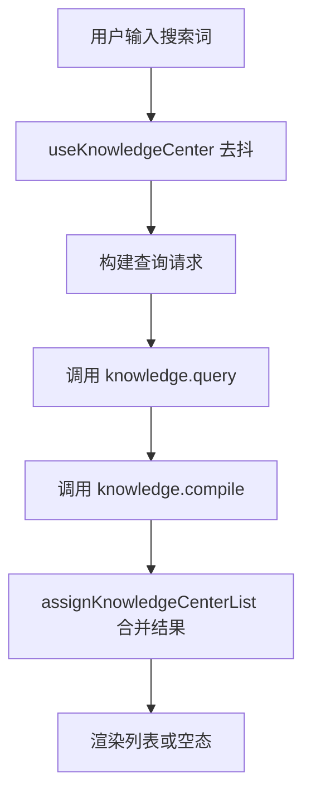
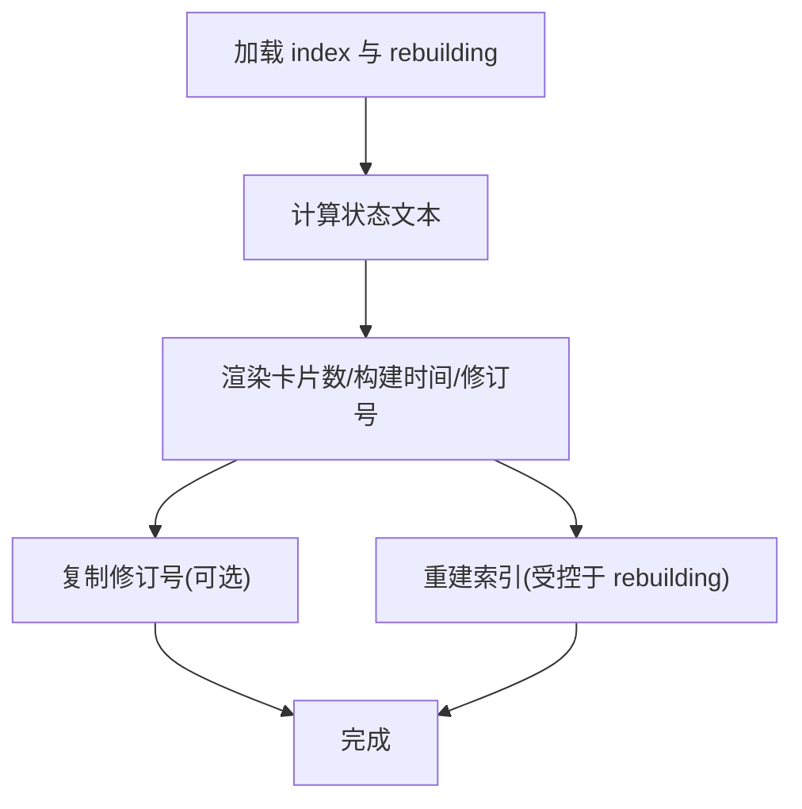
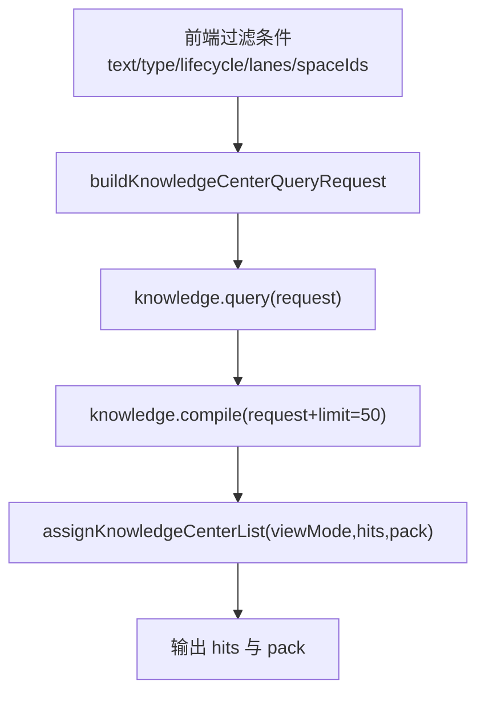
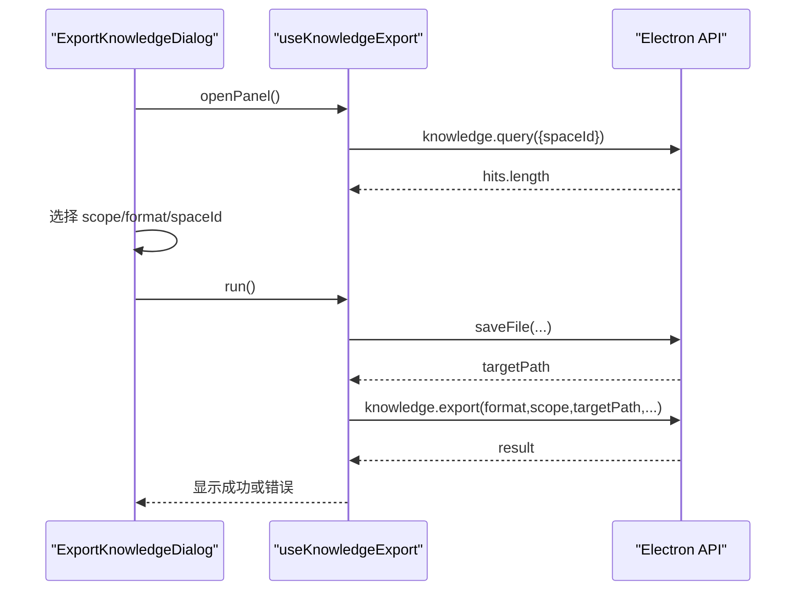
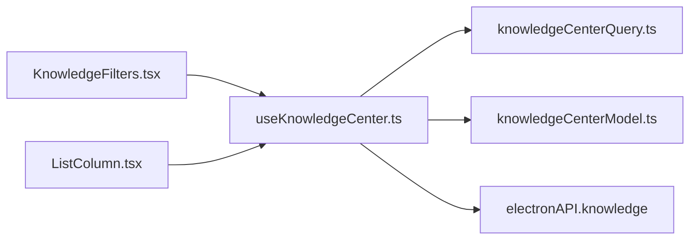

# 知识检索与过滤系统

<cite>
**本文引用的文件**   
- [useKnowledgeFilters.ts](file://src/renderer/features/knowledge/KnowledgeCenterModal/useKnowledgeFilters.ts)
- [KnowledgeFilters.tsx](file://src/renderer/features/knowledge/KnowledgeCenterModal/parts/KnowledgeFilters.tsx)
- [IndexStatusBar.tsx](file://src/renderer/features/knowledge/KnowledgeCenterModal/parts/IndexStatusBar.tsx)
- [useKnowledgeCenter.ts](file://src/renderer/features/knowledge/KnowledgeCenterModal/useKnowledgeCenter.ts)
- [knowledgeCenterQuery.ts](file://src/renderer/features/knowledge/KnowledgeCenterModal/knowledgeCenterQuery.ts)
- [knowledgeCenterModel.ts](file://src/renderer/features/knowledge/KnowledgeCenterModal/knowledgeCenterModel.ts)
- [ListColumn.tsx](file://src/renderer/features/knowledge/KnowledgeCenterModal/columns/ListColumn.tsx)
- [ExportKnowledgeDialog.tsx](file://src/renderer/features/knowledge/KnowledgeCenterModal/panels/ExportKnowledgeDialog.tsx)
- [useKnowledgeExport.ts](file://src/renderer/features/knowledge/KnowledgeCenterModal/useKnowledgeExport.ts)
</cite>

## 目录
1. [引言](#引言)
2. [项目结构](#项目结构)
3. [核心组件](#核心组件)
4. [架构总览](#架构总览)
5. [详细组件分析](#详细组件分析)
6. [依赖关系分析](#依赖关系分析)
7. [性能考虑](#性能考虑)
8. [故障排查指南](#故障排查指南)
9. [结论](#结论)
10. [附录：扩展与集成示例](#附录扩展与集成示例)

## 引言
本文件系统性地梳理知识检索与过滤子系统，聚焦以下目标：
- 解释 KnowledgeFilters 组件的搜索界面设计，包括全文搜索框、标签筛选器（类型、生命周期）、分类浏览器（检索通道）。
- 解析 useKnowledgeFilters Hook 的过滤状态管理。
- 说明 useKnowledgeCenter 如何组合多条件查询、模糊匹配和去抖。
- 描述索引状态栏如何展示索引健康、卡片数量、构建时间与版本信息。
- 总结搜索算法在渲染层与后端之间的职责边界：前端负责请求构造、去抖与结果拼装；后端服务负责分词、权重计算与排序。
- 提供流程图、时序图与可操作的扩展指南，帮助开发者自定义过滤器与搜索引擎。

## 项目结构
知识检索与过滤能力集中在 renderer 层的 Knowledge Center Modal 特性中，核心由“视图状态”“过滤状态”“查询编排”“列表与索引状态 UI”组成。

图表来源
- [useKnowledgeCenter.ts:1-196](file://src/renderer/features/knowledge/KnowledgeCenterModal/useKnowledgeCenter.ts#L1-L196)
- [useKnowledgeFilters.ts:1-16](file://src/renderer/features/knowledge/KnowledgeCenterModal/useKnowledgeFilters.ts#L1-L16)
- [KnowledgeFilters.tsx:1-109](file://src/renderer/features/knowledge/KnowledgeCenterModal/parts/KnowledgeFilters.tsx#L1-L109)
- [ListColumn.tsx:1-169](file://src/renderer/features/knowledge/KnowledgeCenterModal/columns/ListColumn.tsx#L1-L169)
- [IndexStatusBar.tsx:1-79](file://src/renderer/features/knowledge/KnowledgeCenterModal/parts/IndexStatusBar.tsx#L1-L79)
- [knowledgeCenterQuery.ts:1-69](file://src/renderer/features/knowledge/KnowledgeCenterModal/knowledgeCenterQuery.ts#L1-L69)
- [knowledgeCenterModel.ts:1-92](file://src/renderer/features/knowledge/KnowledgeCenterModal/knowledgeCenterModel.ts#L1-L92)

章节来源
- [useKnowledgeCenter.ts:1-196](file://src/renderer/features/knowledge/KnowledgeCenterModal/useKnowledgeCenter.ts#L1-L196)
- [knowledgeCenterQuery.ts:1-69](file://src/renderer/features/knowledge/KnowledgeCenterModal/knowledgeCenterQuery.ts#L1-L69)
- [knowledgeCenterModel.ts:1-92](file://src/renderer/features/knowledge/KnowledgeCenterModal/knowledgeCenterModel.ts#L1-L92)

## 核心组件
- KnowledgeFilters：以 Popover 形式呈现三类筛选器，支持一键重置已勾选选项。
- useKnowledgeFilters：维护类型、生命周期、检索通道的多选集合，并提供切换方法。
- ListColumn：承载全文搜索 SearchField 与 KnowledgeFilters，并渲染搜索结果列表或候选/冲突视图。
- useKnowledgeCenter：聚合空间选择、搜索去抖、查询编排、详情与冲突处理，并与 Electron API 交互。
- IndexStatusBar：展示索引构建状态、卡片数、构建时间与修订号，并提供重建按钮。
- useKnowledgeExport / ExportKnowledgeDialog：基于当前 hits 或选中项进行导出范围与格式选择。

章节来源
- [KnowledgeFilters.tsx:1-109](file://src/renderer/features/knowledge/KnowledgeCenterModal/parts/KnowledgeFilters.tsx#L1-L109)
- [useKnowledgeFilters.ts:1-16](file://src/renderer/features/knowledge/KnowledgeCenterModal/useKnowledgeFilters.ts#L1-L16)
- [ListColumn.tsx:1-169](file://src/renderer/features/knowledge/KnowledgeCenterModal/columns/ListColumn.tsx#L1-L169)
- [useKnowledgeCenter.ts:1-196](file://src/renderer/features/knowledge/KnowledgeCenterModal/useKnowledgeCenter.ts#L1-L196)
- [IndexStatusBar.tsx:1-79](file://src/renderer/features/knowledge/KnowledgeCenterModal/parts/IndexStatusBar.tsx#L1-L79)
- [useKnowledgeExport.ts:1-128](file://src/renderer/features/knowledge/KnowledgeCenterModal/useKnowledgeExport.ts#L1-L128)
- [ExportKnowledgeDialog.tsx:1-129](file://src/renderer/features/knowledge/KnowledgeCenterModal/panels/ExportKnowledgeDialog.tsx#L1-L129)

## 架构总览
下图展示了用户输入到搜索结果返回的关键流程，强调前端去抖、后端查询与编译、以及结果组装。

图表来源
- [ListColumn.tsx:1-169](file://src/renderer/features/knowledge/KnowledgeCenterModal/columns/ListColumn.tsx#L1-L169)
- [useKnowledgeCenter.ts:1-196](file://src/renderer/features/knowledge/KnowledgeCenterModal/useKnowledgeCenter.ts#L1-L196)
- [knowledgeCenterQuery.ts:1-69](file://src/renderer/features/knowledge/KnowledgeCenterModal/knowledgeCenterQuery.ts#L1-L69)

章节来源
- [useKnowledgeCenter.ts:1-196](file://src/renderer/features/knowledge/KnowledgeCenterModal/useKnowledgeCenter.ts#L1-L196)
- [knowledgeCenterQuery.ts:1-69](file://src/renderer/features/knowledge/KnowledgeCenterModal/knowledgeCenterQuery.ts#L1-L69)

## 详细组件分析

### KnowledgeFilters 组件：搜索界面与交互设计
- 分组维度
  - 类型：来自共享枚举 ALL_CARD_TYPES。
  - 生命周期：来自共享枚举 ALL_LIFECYCLES。
  - 检索通道：来自 KNOWLEDGE_RETRIEVAL_LANES。
- 交互行为
  - 使用 CheckPill 实现多选胶囊；未选中的选项会被高亮统计。
  - 顶部显示“已缩窄的组数”，便于快速感知筛选强度。
  - 提供“重置筛选”按钮，仅清空已勾选但未全选的组合。
- 数据绑定
  - 所有状态由 useKnowledgeCenter 提供的 state 暴露，避免组件内部额外状态。

图表来源
- [KnowledgeFilters.tsx:1-109](file://src/renderer/features/knowledge/KnowledgeCenterModal/parts/KnowledgeFilters.tsx#L1-L109)
- [knowledgeCenterModel.ts:1-92](file://src/renderer/features/knowledge/KnowledgeCenterModal/knowledgeCenterModel.ts#L1-L92)

章节来源
- [KnowledgeFilters.tsx:1-109](file://src/renderer/features/knowledge/KnowledgeCenterModal/parts/KnowledgeFilters.tsx#L1-L109)
- [knowledgeCenterModel.ts:1-92](file://src/renderer/features/knowledge/KnowledgeCenterModal/knowledgeCenterModel.ts#L1-L92)

### useKnowledgeFilters Hook：过滤状态与多条件组合
- 状态字段
  - types：知识卡类型数组，默认全选。
  - lifecycles：生命周期数组，默认全选。
  - lanes：检索通道数组，默认全选。
- 操作函数
  - toggleType / toggleLifecycle / toggleLane：基于 toggleSetValue 实现“存在则移除、不存在则追加”。
- 复杂度
  - 每次切换为 O(n)，n 为对应枚举长度，通常很小。
- 组合语义
  - 多条件之间为“且”的关系：最终查询会同时传入 type、lifecycle、lanes，后端据此过滤。

图表来源
- [useKnowledgeFilters.ts:1-16](file://src/renderer/features/knowledge/KnowledgeCenterModal/useKnowledgeFilters.ts#L1-L16)
- [knowledgeCenterModel.ts:1-92](file://src/renderer/features/knowledge/KnowledgeCenterModal/knowledgeCenterModel.ts#L1-L92)

章节来源
- [useKnowledgeFilters.ts:1-16](file://src/renderer/features/knowledge/KnowledgeCenterModal/useKnowledgeFilters.ts#L1-L16)
- [knowledgeCenterModel.ts:1-92](file://src/renderer/features/knowledge/KnowledgeCenterModal/knowledgeCenterModel.ts#L1-L92)

### 列表列与全文搜索：SearchField 与空态提示
- 全文搜索
  - 使用 SearchField 组件，value 绑定 state.searchQuery，onClear 清空。
  - 实际去抖发生在 useKnowledgeCenter 内，避免频繁触发查询。
- 空态文案
  - 根据 viewMode、spaces、index.cardCount、searchQuery、hits 等决定空态提示，例如无空间、无卡片、无命中、无候选或冲突数据。
- 列表渲染
  - Cards 模式按后端返回顺序渲染 HitButton；Candidates/Conflicts 模式分别渲染候选记录与冲突行。

图表来源
- [ListColumn.tsx:1-169](file://src/renderer/features/knowledge/KnowledgeCenterModal/columns/ListColumn.tsx#L1-L169)
- [useKnowledgeCenter.ts:1-196](file://src/renderer/features/knowledge/KnowledgeCenterModal/useKnowledgeCenter.ts#L1-L196)
- [knowledgeCenterQuery.ts:1-69](file://src/renderer/features/knowledge/KnowledgeCenterModal/knowledgeCenterQuery.ts#L1-L69)

章节来源
- [ListColumn.tsx:1-169](file://src/renderer/features/knowledge/KnowledgeCenterModal/columns/ListColumn.tsx#L1-L169)
- [useKnowledgeCenter.ts:1-196](file://src/renderer/features/knowledge/KnowledgeCenterModal/useKnowledgeCenter.ts#L1-L196)

### 索引状态栏：统计、摘要与重建
- 显示内容
  - 状态文本：重建中、就绪、从未构建。
  - 卡片总数、构建时间、修订号。
  - 修订号复制按钮，带短暂反馈。
  - 重建按钮：禁用状态下不可重复触发。
- 数据来源
  - index: KnowledgeIndexOverview | null；rebuilding: boolean；onRebuild: () => void。
- 交互要点
  - 当 rebuilding 为真时，状态与按钮文案统一为“重建中”，防止并发。

图表来源
- [IndexStatusBar.tsx:1-79](file://src/renderer/features/knowledge/KnowledgeCenterModal/parts/IndexStatusBar.tsx#L1-L79)
- [useKnowledgeCenter.ts:1-196](file://src/renderer/features/knowledge/KnowledgeCenterModal/useKnowledgeCenter.ts#L1-L196)

章节来源
- [IndexStatusBar.tsx:1-79](file://src/renderer/features/knowledge/KnowledgeCenterModal/parts/IndexStatusBar.tsx#L1-L79)
- [useKnowledgeCenter.ts:1-196](file://src/renderer/features/knowledge/KnowledgeCenterModal/useKnowledgeCenter.ts#L1-L196)

### 搜索算法：前后端职责与排序策略
- 前端职责
  - 收集 searchQuery、type、lifecycle、lanes、spaceIds。
  - 使用 SEARCH_DEBOUNCE_MS 去抖，减少无效请求。
  - 并行/串行调用 query 与 compile，并通过 isCurrent 序列号丢弃过期响应。
  - 将 query.hits 与 compiled.pack 通过 assignKnowledgeCenterList 组装为最终 hits 与 pack。
- 后端职责
  - 分词、权重计算、相关性排序、分页与限制（limit=50）等逻辑由 Electron 侧 knowledge.* 接口实现。
  - 前端不实现分词与排序算法，以保证跨进程一致性与可维护性。
- 关键契约
  - buildKnowledgeCenterQueryRequest：将前端过滤条件规范化为后端可读的请求对象。
  - runKnowledgeCenterQuery：封装 query 与 compile 的时序与陈旧控制。

图表来源
- [knowledgeCenterQuery.ts:1-69](file://src/renderer/features/knowledge/KnowledgeCenterModal/knowledgeCenterQuery.ts#L1-L69)
- [useKnowledgeCenter.ts:1-196](file://src/renderer/features/knowledge/KnowledgeCenterModal/useKnowledgeCenter.ts#L1-L196)

章节来源
- [knowledgeCenterQuery.ts:1-69](file://src/renderer/features/knowledge/KnowledgeCenterModal/knowledgeCenterQuery.ts#L1-L69)
- [useKnowledgeCenter.ts:1-196](file://src/renderer/features/knowledge/KnowledgeCenterModal/useKnowledgeCenter.ts#L1-L196)

### 导出与范围：基于 hits 与选中项的二次加工
- 范围选项
  - selected：仅导出当前选中的一张卡片。
  - filtered：导出当前搜索结果中的所有卡片。
  - space：导出指定空间的全部卡片。
- 格式选项
  - package：打包为 zip。
  - markdown：导出为 md。
- 交互流程
  - 打开对话框后预取目标空间的 hits 数量用于计数。
  - 用户确认后弹出保存路径选择，随后调用 export 接口。

图表来源
- [ExportKnowledgeDialog.tsx:1-129](file://src/renderer/features/knowledge/KnowledgeCenterModal/panels/ExportKnowledgeDialog.tsx#L1-L129)
- [useKnowledgeExport.ts:1-128](file://src/renderer/features/knowledge/KnowledgeCenterModal/useKnowledgeExport.ts#L1-L128)

章节来源
- [ExportKnowledgeDialog.tsx:1-129](file://src/renderer/features/knowledge/KnowledgeCenterModal/panels/ExportKnowledgeDialog.tsx#L1-L129)
- [useKnowledgeExport.ts:1-128](file://src/renderer/features/knowledge/KnowledgeCenterModal/useKnowledgeExport.ts#L1-L128)

## 依赖关系分析
- 低耦合点
  - useKnowledgeFilters 只维护多选集合，不关心查询细节。
  - knowledgeCenterQuery 封装了查询与编译的时序与陈旧判断，供 useKnowledgeCenter 复用。
  - ListColumn 仅消费 useKnowledgeCenter 的状态，不直接调用 API。
- 外部依赖
  - window.electronAPI.knowledge.*：overview/query/compile/export/indexRebuild。
  - @shared/types/knowledge：KnowledgeCardType、KnowledgeLifecycle、KnowledgeRetrievalLane、KnowledgeQueryRequest 等类型定义。

图表来源
- [KnowledgeFilters.tsx:1-109](file://src/renderer/features/knowledge/KnowledgeCenterModal/parts/KnowledgeFilters.tsx#L1-L109)
- [ListColumn.tsx:1-169](file://src/renderer/features/knowledge/KnowledgeCenterModal/columns/ListColumn.tsx#L1-L169)
- [useKnowledgeCenter.ts:1-196](file://src/renderer/features/knowledge/KnowledgeCenterModal/useKnowledgeCenter.ts#L1-L196)
- [knowledgeCenterQuery.ts:1-69](file://src/renderer/features/knowledge/KnowledgeCenterModal/knowledgeCenterQuery.ts#L1-L69)
- [knowledgeCenterModel.ts:1-92](file://src/renderer/features/knowledge/KnowledgeCenterModal/knowledgeCenterModel.ts#L1-L92)

章节来源
- [useKnowledgeCenter.ts:1-196](file://src/renderer/features/knowledge/KnowledgeCenterModal/useKnowledgeCenter.ts#L1-L196)
- [knowledgeCenterQuery.ts:1-69](file://src/renderer/features/knowledge/KnowledgeCenterModal/knowledgeCenterQuery.ts#L1-L69)

## 性能考虑
- 去抖
  - SEARCH_DEBOUNCE_MS 为 300ms，显著降低高频输入导致的重复查询。
- 陈旧请求防护
  - createRequestSeq 为 overview/query/rebuild 三个流程各自维护序号，确保过期的异步回调不会覆盖最新状态。
- 结果拼装
  - assignKnowledgeCenterList 根据 viewMode 决定是否直接使用 query.hits 或替换为 compiled.hits，避免多余计算。
- 列表渲染
  - 空态分支优先短路，避免在 loading 期间渲染复杂节点。
- 可扩展优化建议
  - 对 large spaces 的分页加载可在 compile 阶段按需拉取更多上下文。
  - 对 SearchField 增加最小输入阈值（如 length >= 2）以减少短词查询开销。
  - 对多选枚举缓存 label 映射，避免重复 i18n 计算。

[本节为通用性能建议，无需特定源码引用]

## 故障排查指南
- 查询无结果
  - 检查 searchQuery 是否为空；若为空且未设置其他过滤条件，可能命中“无卡片”空态。
  - 确认 types/lifecycles/lanes 是否全部取消，导致结果为空。
  - 查看 knowledgeCenterQuery 的 queryRequest 是否被正确构建。
- 结果被覆盖或错乱
  - 检查 isCurrent 序列号是否被正确使用；若组件卸载或状态切换过快，应丢弃旧响应。
- 索引状态异常
  - 观察 rebuilding 标志位；若重建失败，error 消息会透传到 UI。
  - 可通过 IndexStatusBar 的“重建”按钮重新构建索引。
- 导出为空
  - 若 selected 或 filtered 范围为空，export 接口可能返回 KNOWLEDGE_EXPORT_EMPTY_RESULT，UI 会转换为友好提示。

章节来源
- [ListColumn.tsx:1-169](file://src/renderer/features/knowledge/KnowledgeCenterModal/columns/ListColumn.tsx#L1-L169)
- [IndexStatusBar.tsx:1-79](file://src/renderer/features/knowledge/KnowledgeCenterModal/parts/IndexStatusBar.tsx#L1-L79)
- [useKnowledgeExport.ts:1-128](file://src/renderer/features/knowledge/KnowledgeCenterModal/useKnowledgeExport.ts#L1-L128)

## 结论
该知识检索与过滤系统在前端实现了清晰的关注点分离：过滤状态、查询编排、列表渲染与索引状态展示相互解耦。全文搜索通过去抖与序列化请求保证稳定性；后端承担分词、权重与排序等核心算法职责；UI 层面提供直观的筛选与状态反馈。借助本文的流程图与扩展指南，开发者可以安全地添加新的过滤维度或接入自定义搜索引擎。

[本节为总结性内容，无需特定源码引用]

## 附录：扩展与集成示例

### 自定义过滤器集成步骤
- 新增过滤维度
  - 在 knowledgeCenterModel 中扩展枚举（例如新增 category）。
  - 在 useKnowledgeFilters 中添加对应状态与 toggleCategory。
  - 在 KnowledgeFilters 中新增一组 CheckPill 选项。
  - 在 buildKnowledgeCenterQueryRequest 中将新字段透传给后端。
  - 在后端 knowledge.query/compile 中处理新维度。
- 注意事项
  - 保持默认全选，避免首次打开即产生过度限制。
  - 在 knowledgeQueryKey 中加入新字段，确保不同过滤组合能正确区分缓存键。

章节来源
- [knowledgeCenterModel.ts:1-92](file://src/renderer/features/knowledge/KnowledgeCenterModal/knowledgeCenterModel.ts#L1-L92)
- [useKnowledgeFilters.ts:1-16](file://src/renderer/features/knowledge/KnowledgeCenterModal/useKnowledgeFilters.ts#L1-L16)
- [KnowledgeFilters.tsx:1-109](file://src/renderer/features/knowledge/KnowledgeCenterModal/parts/KnowledgeFilters.tsx#L1-L109)
- [knowledgeCenterQuery.ts:1-69](file://src/renderer/features/knowledge/KnowledgeCenterModal/knowledgeCenterQuery.ts#L1-L69)

### 自定义搜索引擎集成示例
- 替换查询入口
  - 在 useKnowledgeCenter 中，将 window.electronAPI.knowledge.query 与 compile 的调用委托给自定义适配器。
  - 适配器需遵守 KnowledgeQueryRequest 与 KnowledgePack 的数据契约。
- 保留去抖与陈旧控制
  - 继续使用 SEARCH_DEBOUNCE_MS 与 createRequestSeq。
- 校验结果
  - 通过 assignKnowledgeCenterList 合并 query.hits 与 compiled.pack，确保视图一致性。

章节来源
- [useKnowledgeCenter.ts:1-196](file://src/renderer/features/knowledge/KnowledgeCenterModal/useKnowledgeCenter.ts#L1-L196)
- [knowledgeCenterQuery.ts:1-69](file://src/renderer/features/knowledge/KnowledgeCenterModal/knowledgeCenterQuery.ts#L1-L69)