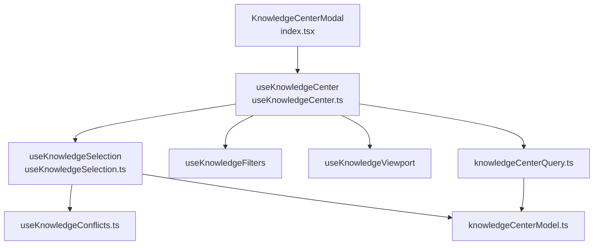
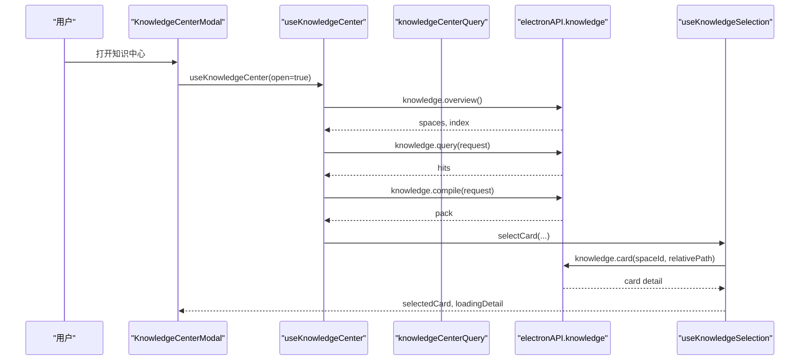
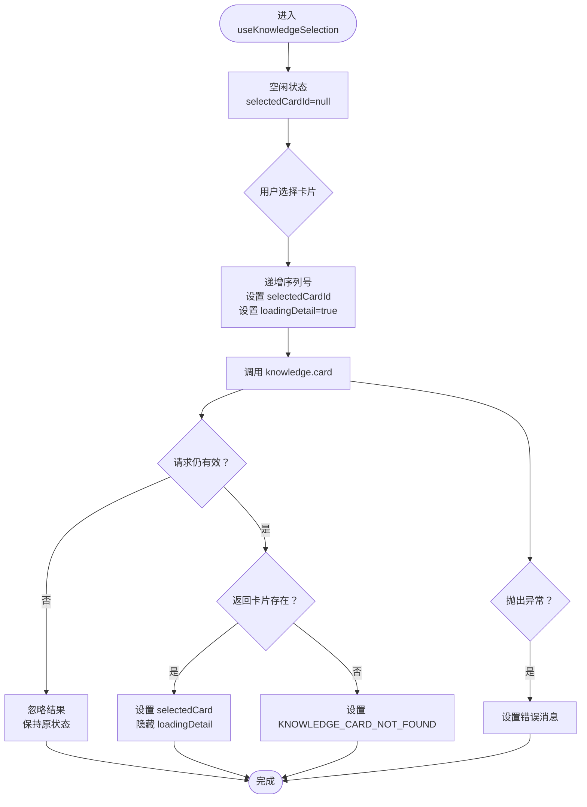
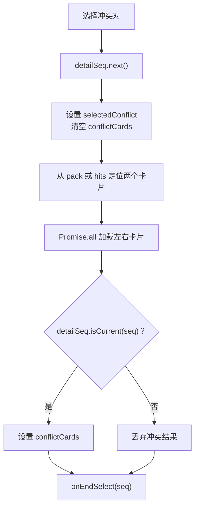
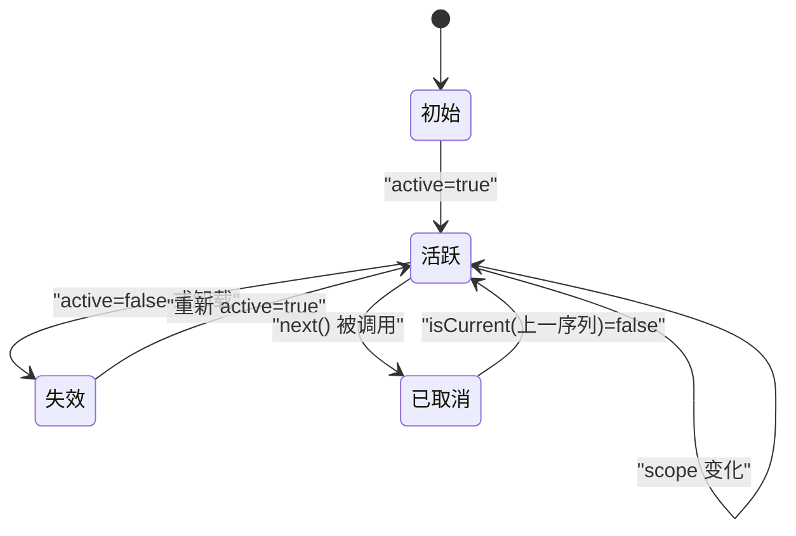
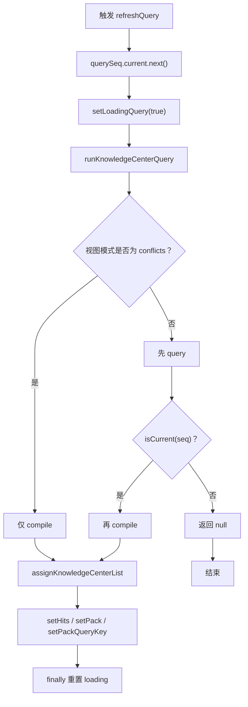
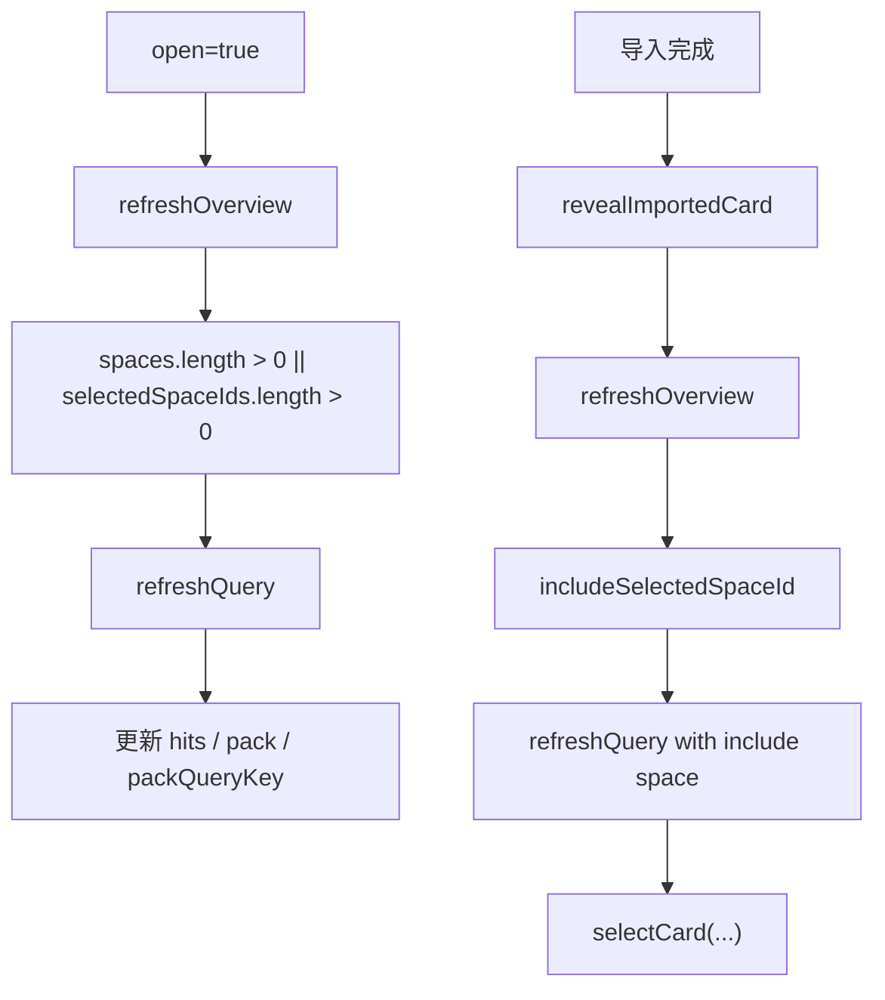
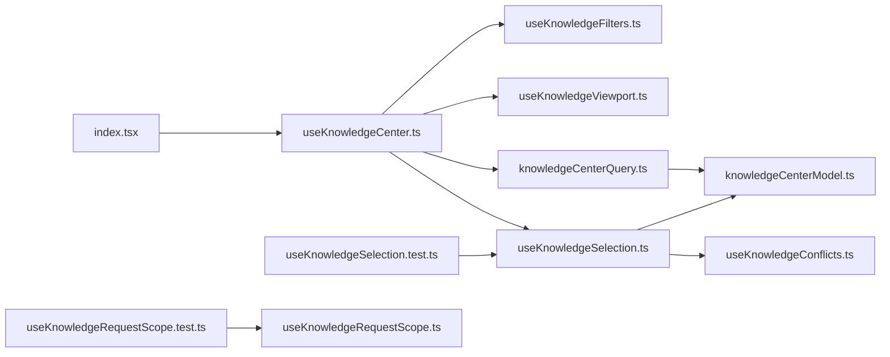

# 知识选择与请求作用域管理

<cite>
**本文引用的文件**   
- [useKnowledgeSelection.ts](file://src/renderer/features/knowledge/KnowledgeCenterModal/useKnowledgeSelection.ts)
- [useKnowledgeRequestScope.ts](file://src/renderer/features/knowledge/KnowledgeCenterModal/useKnowledgeRequestScope.ts)
- [useKnowledgeCenter.ts](file://src/renderer/features/knowledge/KnowledgeCenterModal/useKnowledgeCenter.ts)
- [knowledgeCenterModel.ts](file://src/renderer/features/knowledge/KnowledgeCenterModal/knowledgeCenterModel.ts)
- [knowledgeCenterQuery.ts](file://src/renderer/features/knowledge/KnowledgeCenterModal/knowledgeCenterQuery.ts)
- [useKnowledgeConflicts.ts](file://src/renderer/features/knowledge/KnowledgeCenterModal/useKnowledgeConflicts.ts)
- [index.tsx](file://src/renderer/features/knowledge/KnowledgeCenterModal/index.tsx)
- [useKnowledgeSelection.test.ts](file://src/renderer/features/knowledge/KnowledgeCenterModal/useKnowledgeSelection.test.ts)
- [useKnowledgeRequestScope.test.ts](file://src/renderer/features/knowledge/KnowledgeCenterModal/useKnowledgeRequestScope.test.ts)
- [useKnowledgeCenter.test.ts](file://src/renderer/features/knowledge/KnowledgeCenterModal/useKnowledgeCenter.test.ts)
</cite>

## 目录
1. [引言](#引言)
2. [项目结构定位](#项目结构定位)
3. [核心组件总览](#核心组件总览)
4. [架构概览](#架构概览)
5. [详细组件分析](#详细组件分析)
6. [依赖关系分析](#依赖关系分析)
7. [性能与并发特性](#性能与并发特性)
8. [边界条件处理](#边界条件处理)
9. [故障排查指南](#故障排查指南)
10. [最佳实践](#最佳实践)
11. [结论](#结论)

## 引言
本文围绕知识中心模态框中的三个关键 Hook：`useKnowledgeSelection`、`useKnowledgeRequestScope`、`useKnowledgeCenter`，系统化说明知识卡片的选中状态管理、查询与编译结果的作用域隔离、以及异步竞态防护机制。重点包括：
- 选中集合与详情加载的生命周期绑定；
- 单选/多选模式在列表与冲突视图中的行为差异；
- React StrictMode、作用域切换、组件卸载对未决请求的影响；
- 查询去重、结果合并、状态更新策略；
- 面向扩展的自定义选择逻辑与作用域管理建议。

## 项目结构定位
知识选择与作用域相关代码集中在渲染器侧的知识中心功能模块中，采用“Hook + 模型工具 + 查询工具”的分层组织方式：
- Hook 层负责状态、副作用和生命周期；
- `knowledgeCenterModel.ts` 提供序列号生成、错误消息转换、查询键生成等基础能力；
- `knowledgeCenterQuery.ts` 封装查询、编译、结果分配策略；
- UI 容器通过 `index.tsx` 组合导入、导出、写入确认等横向能力。

**图表来源**
- [index.tsx:1-191](file://src/renderer/features/knowledge/KnowledgeCenterModal/index.tsx#L1-L191)
- [useKnowledgeCenter.ts:1-196](file://src/renderer/features/knowledge/KnowledgeCenterModal/useKnowledgeCenter.ts#L1-L196)
- [useKnowledgeSelection.ts:1-80](file://src/renderer/features/knowledge/KnowledgeCenterModal/useKnowledgeSelection.ts#L1-L80)
- [knowledgeCenterModel.ts:1-92](file://src/renderer/features/knowledge/KnowledgeCenterModal/knowledgeCenterModel.ts#L1-L92)
- [knowledgeCenterQuery.ts:1-69](file://src/renderer/features/knowledge/KnowledgeCenterModal/knowledgeCenterQuery.ts#L1-L69)
- [useKnowledgeConflicts.ts:1-59](file://src/renderer/features/knowledge/KnowledgeCenterModal/useKnowledgeConflicts.ts#L1-L59)

**章节来源**
- [index.tsx:1-191](file://src/renderer/features/knowledge/KnowledgeCenterModal/index.tsx#L1-L191)
- [useKnowledgeCenter.ts:1-196](file://src/renderer/features/knowledge/KnowledgeCenterModal/useKnowledgeCenter.ts#L1-L196)

## 核心组件总览
- `useKnowledgeSelection`：维护当前选中卡片、详情加载状态、冲突对比状态，并负责将选中标记与详情 IPC 请求绑定到同一请求序列。
- `useKnowledgeRequestScope`：为任意开放资源或会话生命周期提供一个可递增的请求序列，确保旧请求不会覆盖新请求结果。
- `useKnowledgeCenter`：协调知识空间、筛选、搜索、查询、编译、打包、详情选择和冲突对比，是整个知识中心的控制中枢。
- `knowledgeCenterModel`：提供全局共享的基础能力，尤其是 `createRequestSeq` 序列号生成器和 `knowledgeQueryKey` 查询键生成器。
- `knowledgeCenterQuery`：定义查询去重、结果合并和视图模式下的结果来源策略。
- `useKnowledgeConflicts`：专门处理冲突视图下左右两侧卡片的选择与加载。

**章节来源**
- [useKnowledgeSelection.ts:1-80](file://src/renderer/features/knowledge/KnowledgeCenterModal/useKnowledgeSelection.ts#L1-L80)
- [useKnowledgeRequestScope.ts:1-13](file://src/renderer/features/knowledge/KnowledgeCenterModal/useKnowledgeRequestScope.ts#L1-L13)
- [useKnowledgeCenter.ts:1-196](file://src/renderer/features/knowledge/KnowledgeCenterModal/useKnowledgeCenter.ts#L1-L196)
- [knowledgeCenterModel.ts:1-92](file://src/renderer/features/knowledge/KnowledgeCenterModal/knowledgeCenterModel.ts#L1-L92)
- [knowledgeCenterQuery.ts:1-69](file://src/renderer/features/knowledge/KnowledgeCenterModal/knowledgeCenterQuery.ts#L1-L69)
- [useKnowledgeConflicts.ts:1-59](file://src/renderer/features/knowledge/KnowledgeCenterModal/useKnowledgeConflicts.ts#L1-L59)

## 架构概览
知识中心的状态流转可以理解为三层：
1. 控制层：`useKnowledgeCenter` 决定何时发起 overview、query、compile、rebuild；
2. 数据层：`knowledgeCenterQuery` 根据视图模式选择使用原始查询结果还是已编译结果；
3. 展示层：`useKnowledgeSelection` 把用户点击、冲突对比、导入后跳转等操作映射为选中状态和详情加载。

**图表来源**
- [index.tsx:1-191](file://src/renderer/features/knowledge/KnowledgeCenterModal/index.tsx#L1-L191)
- [useKnowledgeCenter.ts:1-196](file://src/renderer/features/knowledge/KnowledgeCenterModal/useKnowledgeCenter.ts#L1-L196)
- [knowledgeCenterQuery.ts:1-69](file://src/renderer/features/knowledge/KnowledgeCenterModal/knowledgeCenterQuery.ts#L1-L69)
- [useKnowledgeSelection.ts:1-80](file://src/renderer/features/knowledge/KnowledgeCenterModal/useKnowledgeSelection.ts#L1-L80)

## 详细组件分析

### `useKnowledgeSelection`：选中状态与详情加载
该 Hook 的核心职责是：
- 维护选中卡片 ID、详情对象、详情加载状态；
- 通过共享的 `detailSeq` 保证详情请求不会被后续请求覆盖；
- 与冲突选择逻辑共用同一个请求所有权；
- 在窗口关闭或查询键变化时清理选中状态。

#### 状态字段与操作
| 状态或方法 | 含义 | 关键行为 |
|---|---|---|
| `selectedCardId` | 当前选中卡片标识 | 每次选择前递增序列号，避免旧结果回填 |
| `selectedCard` | 详情内容 | 仅当请求仍有效时才更新 |
| `loadingDetail` | 详情加载中 | 开始选择时设为真，结束或失效时设为假 |
| `selectCard` | 选择单个卡片 | 调用后端接口获取详情，失败时设置错误消息 |
| `selectRecord` | 从命中记录直接选择 | 将命中记录转为详情格式，不触发额外 IPC |
| `clearCardSelection` | 清空选中 | 递增序列号并重置选中状态 |
| `selectedConflict / conflictCards` | 冲突对比状态 | 由 `useKnowledgeConflicts` 管理，但共用 `detailSeq` |

#### 选择状态流转图

**图表来源**
- [useKnowledgeSelection.ts:12-49](file://src/renderer/features/knowledge/KnowledgeCenterModal/useKnowledgeSelection.ts#L12-L49)

#### 与冲突选择的协作
冲突视图不是普通单卡片选择，而是同时加载一对矛盾卡片。`useKnowledgeConflicts` 通过传入的 `detailSeq` 确保：
- 冲突加载开始时先清空已有冲突卡片；
- 两个卡片并行加载；
- 只有当前序列号仍有效时才写入冲突卡片；
- 无论成功或失败都调用 `onEndSelect` 关闭加载状态。

**图表来源**
- [useKnowledgeConflicts.ts:18-59](file://src/renderer/features/knowledge/KnowledgeCenterModal/useKnowledgeConflicts.ts#L18-L59)
- [useKnowledgeSelection.ts:50-80](file://src/renderer/features/knowledge/KnowledgeCenterModal/useKnowledgeSelection.ts#L50-L80)

#### 生命周期清理
当 `open` 或 `queryKey` 变化时，Hook 会：
1. 清空卡片选中；
2. 清空冲突选中；
3. 在卸载回调中再次递增序列号，使尚未完成的详情请求失效。

**章节来源**
- [useKnowledgeSelection.ts:1-80](file://src/renderer/features/knowledge/KnowledgeCenterModal/useKnowledgeSelection.ts#L1-L80)
- [useKnowledgeConflicts.ts:1-59](file://src/renderer/features/knowledge/KnowledgeCenterModal/useKnowledgeConflicts.ts#L1-L59)
- [useKnowledgeSelection.test.ts:1-54](file://src/renderer/features/knowledge/KnowledgeCenterModal/useKnowledgeSelection.test.ts#L1-L54)

### `useKnowledgeRequestScope`：请求作用域与竞态防护
该 Hook 是一个轻量级作用域控制器，用于保证某段 UI 生命周期内发起的所有异步结果都属于当前活跃范围。它的关键语义是：
- 每次 `active` 或 `scope` 变化时递增序列号；
- 卸载时也递增序列号；
- 对外只暴露一个固定的 `requestRef.current`，因此整个生命周期内只有一个“请求所有者”。

**图表来源**
- [useKnowledgeRequestScope.ts:1-13](file://src/renderer/features/knowledge/KnowledgeCenterModal/useKnowledgeRequestScope.ts#L1-L13)
- [knowledgeCenterModel.ts:20-33](file://src/renderer/features/knowledge/KnowledgeCenterModal/knowledgeCenterModel.ts#L20-L33)

测试用例验证了以下行为：
- 作用域切换会使上一个序列失效；
- 关闭再打开会获得新的有效序列；
- 组件卸载会使最后一个有效序列失效；
- 整个过程中始终复用同一个引用对象。

**章节来源**
- [useKnowledgeRequestScope.ts:1-13](file://src/renderer/features/knowledge/KnowledgeCenterModal/useKnowledgeRequestScope.ts#L1-L13)
- [useKnowledgeRequestScope.test.ts:1-26](file://src/renderer/features/knowledge/KnowledgeCenterModal/useKnowledgeRequestScope.test.ts#L1-L26)
- [knowledgeCenterModel.ts:20-33](file://src/renderer/features/knowledge/KnowledgeCenterModal/knowledgeCenterModel.ts#L20-L33)

### `useKnowledgeCenter`：查询、选择与状态协调
这是知识中心的控制中枢，负责：
- 拉取知识空间索引；
- 根据筛选条件构建查询请求；
- 执行查询和编译；
- 将结果交给列表、冲突、详情等子组件；
- 处理导入后跳转到具体卡片；
- 在窗口关闭时清理所有状态。

#### 查询与编译流程

**图表来源**
- [useKnowledgeCenter.ts:63-104](file://src/renderer/features/knowledge/KnowledgeCenterModal/useKnowledgeCenter.ts#L63-L104)
- [knowledgeCenterQuery.ts:37-69](file://src/renderer/features/knowledge/KnowledgeCenterModal/knowledgeCenterQuery.ts#L37-L69)

#### 结果合并与去重策略
`knowledgeCenterQuery.assignKnowledgeCenterList` 根据视图模式决定最终展示的 `hits`：
- `cards`：保留原始查询结果的顺序；
- `candidates`：同样保留原始查询结果顺序；
- `conflicts`：使用已编译结果的顺序；
- 无论哪种模式，都会保留 `pack`，以便冲突视图和其他需要编译数据的场景使用。

这表示系统没有在整个列表层面做基于 `cardId` 的全局去重，而是通过视图模式控制数据来源，并在上层（例如导入后显式刷新）保证一致性。

#### 状态更新策略
- `refreshOverview`：拉取空间与索引，并自动修正已选空间集合；
- `refreshQuery`：根据当前筛选条件发起查询和编译；
- `revealImportedCard`：导入后先刷新空间，再把导入卡片所在空间加入选中，然后发起一次限定查询，最后选中该卡片；
- 窗口关闭时，会递增所有查询序列、清空命中、清空打包结果、清空搜索、清空选中、恢复默认面板。

**图表来源**
- [useKnowledgeCenter.ts:27-196](file://src/renderer/features/knowledge/KnowledgeCenterModal/useKnowledgeCenter.ts#L27-L196)
- [knowledgeCenterQuery.ts:1-36](file://src/renderer/features/knowledge/KnowledgeCenterModal/knowledgeCenterQuery.ts#L1-L36)

**章节来源**
- [useKnowledgeCenter.ts:1-196](file://src/renderer/features/knowledge/KnowledgeCenterModal/useKnowledgeCenter.ts#L1-L196)
- [knowledgeCenterQuery.ts:1-69](file://src/renderer/features/knowledge/KnowledgeCenterModal/knowledgeCenterQuery.ts#L1-L69)
- [useKnowledgeCenter.test.ts:1-48](file://src/renderer/features/knowledge/KnowledgeCenterModal/useKnowledgeCenter.test.ts#L1-L48)

## 依赖关系分析

**图表来源**
- [useKnowledgeCenter.ts:1-196](file://src/renderer/features/knowledge/KnowledgeCenterModal/useKnowledgeCenter.ts#L1-L196)
- [useKnowledgeSelection.ts:1-80](file://src/renderer/features/knowledge/KnowledgeCenterModal/useKnowledgeSelection.ts#L1-L80)
- [knowledgeCenterQuery.ts:1-69](file://src/renderer/features/knowledge/KnowledgeCenterModal/knowledgeCenterQuery.ts#L1-L69)
- [useKnowledgeConflicts.ts:1-59](file://src/renderer/features/knowledge/KnowledgeCenterModal/useKnowledgeConflicts.ts#L1-L59)
- [knowledgeCenterModel.ts:1-92](file://src/renderer/features/knowledge/KnowledgeCenterModal/knowledgeCenterModel.ts#L1-L92)
- [index.tsx:1-191](file://src/renderer/features/knowledge/KnowledgeCenterModal/index.tsx#L1-L191)
- [useKnowledgeSelection.test.ts:1-54](file://src/renderer/features/knowledge/KnowledgeCenterModal/useKnowledgeSelection.test.ts#L1-L54)
- [useKnowledgeRequestScope.test.ts:1-26](file://src/renderer/features/knowledge/KnowledgeCenterModal/useKnowledgeRequestScope.test.ts#L1-L26)

### 耦合性与内聚性
- `useKnowledgeCenter` 耦合较多，但它是控制中枢，职责明确：聚合筛选、查询、编译、导入、导出、写入确认。
- `useKnowledgeSelection` 内聚于“选中 + 详情”，并通过 `detailSeq` 与冲突选择解耦实现。
- `knowledgeCenterQuery` 内聚于查询与编译编排，不关心 UI 细节。
- `knowledgeCenterModel` 是纯函数和工具，几乎没有副作用，适合跨 Hook 复用。

### 外部依赖
- `window.electronAPI.knowledge.overview/query/compile/card/indexRebuild`：知识中心与主进程 IPC 的主要入口；
- `@shared/types/knowledge`：知识卡片、命中、打包、空间等类型定义；
- React Hooks：`useState`、`useEffect`、`useCallback`、`useMemo`、`useRef`。

**章节来源**
- [useKnowledgeCenter.ts:1-196](file://src/renderer/features/knowledge/KnowledgeCenterModal/useKnowledgeCenter.ts#L1-L196)
- [useKnowledgeSelection.ts:1-80](file://src/renderer/features/knowledge/KnowledgeCenterModal/useKnowledgeSelection.ts#L1-L80)
- [knowledgeCenterQuery.ts:1-69](file://src/renderer/features/knowledge/KnowledgeCenterModal/knowledgeCenterQuery.ts#L1-L69)

## 性能与并发特性

### 查询去重与防抖
- 搜索输入使用 `SEARCH_DEBOUNCE_MS` 防抖，默认值为 300 毫秒；
- 每次查询都会递增 `querySeq`，并通过 `isCurrent` 判断是否仍应应用结果；
- 编译结果仅在必要时更新 `pack` 和 `packQueryKey`，避免无关重渲染。

### 详情加载竞态
- 每次 `selectCard` 调用都会创建新的序列号；
- 旧请求完成后若不再是当前序列，则直接忽略；
- 测试覆盖了“先选第一个卡片，再选第二个卡片，第一个结果延迟到达”的场景。

### 列表与冲突的结果来源
- 非冲突模式下优先使用原始查询结果，保证搜索结果排序；
- 冲突模式使用编译后的结果，因为冲突检测依赖编译阶段信息；
- 这样避免了在高频搜索时反复用编译结果替换用户期望的搜索结果。

### 内存泄漏风险
- 未决 Promise 不会主动取消；
- 通过序列号失效阻止脏结果写回；
- 窗口关闭、作用域切换、组件卸载都会递增序列号，从而让后续回调跳过状态更新；
- 这与测试中 React StrictMode 的行为一致：挂载、卸载、重新挂载之间不会产生非法状态覆盖。

**章节来源**
- [useKnowledgeCenter.ts:27-104](file://src/renderer/features/knowledge/KnowledgeCenterModal/useKnowledgeCenter.ts#L27-L104)
- [knowledgeCenterQuery.ts:1-69](file://src/renderer/features/knowledge/KnowledgeCenterModal/knowledgeCenterQuery.ts#L1-L69)
- [useKnowledgeSelection.ts:12-80](file://src/renderer/features/knowledge/KnowledgeCenterModal/useKnowledgeSelection.ts#L12-L80)
- [useKnowledgeSelection.test.ts:18-54](file://src/renderer/features/knowledge/KnowledgeCenterModal/useKnowledgeSelection.test.ts#L18-L54)
- [useKnowledgeRequestScope.test.ts:8-26](file://src/renderer/features/knowledge/KnowledgeCenterModal/useKnowledgeRequestScope.test.ts#L8-L26)

## 边界条件处理

### React StrictMode
StrictMode 会双调 effect 和 cleanup，这对基于序列号的竞态保护非常友好：
- 每个 effect 都会递增序列号；
- cleanup 也会递增序列号；
- 因此即使 React 模拟二次挂载，旧请求也不会污染新挂载状态。

测试明确断言：在 StrictMode 下，作用域切换、关闭、卸载都能正确标记旧请求无效，同时保持同一个 `request` 引用不变。

**章节来源**
- [useKnowledgeRequestScope.test.ts:1-26](file://src/renderer/features/knowledge/KnowledgeCenterModal/useKnowledgeRequestScope.test.ts#L1-L26)

### 作用域切换
当 `active` 或 `scope` 变化时，`useKnowledgeRequestScope` 会立即递增序列号。这意味着：
- 上一个 scope 的所有未决请求都会失效；
- 新 scope 的第一个请求会是有效的；
- 如果新 scope 没有立即发起请求，后续发起的第一个请求会自动成为当前请求。

### 组件关闭与卸载
`useKnowledgeCenter` 在 `open=false` 时执行完整清理：
- 递增所有查询、概览、重建序列；
- 清空 loading 状态；
- 清空 `hits`、`pack`、`packQueryKey`；
- 清空搜索词；
- 清空卡片选择和冲突选择；
- 恢复默认视图模式和窄屏面板。

这保证了知识中心再次打开时不会残留上一次会话的数据。

**章节来源**
- [useKnowledgeCenter.ts:105-196](file://src/renderer/features/knowledge/KnowledgeCenterModal/useKnowledgeCenter.ts#L105-L196)

### 单选与多选模式
这里的“单选”和“多选”需要区分概念：
- **详情展示是单选**：`selectedCardId` 和 `selectedCard` 只能保存一个详情；
- **空间选择是多选**：`selectedSpaceIds` 是一个字符串数组，支持新增、移除、自动归一化；
- **冲突视图是成对加载**：不是简单多选，而是按冲突对加载两个卡片进行对比。

| 场景 | 选择行为 | 是否持久化 |
|---|---|---|
| 点击卡片列表项 | 单选详情 | 不持久化到本地存储，属于会话状态 |
| 选择知识空间 | 多选空间 ID | 随会话生命周期存在，关闭后清空 |
| 查看冲突 | 成对卡片 | 不持久化，冲突选择清空时会重置 |
| 导入后跳转 | 临时选中并聚焦 | 不持久化，属于导入流程的一部分 |

**章节来源**
- [useKnowledgeSelection.ts:12-80](file://src/renderer/features/knowledge/KnowledgeCenterModal/useKnowledgeSelection.ts#L12-L80)
- [useKnowledgeCenter.ts:27-196](file://src/renderer/features/knowledge/KnowledgeCenterModal/useKnowledgeCenter.ts#L27-L196)
- [useKnowledgeConflicts.ts:1-59](file://src/renderer/features/knowledge/KnowledgeCenterModal/useKnowledgeConflicts.ts#L1-L59)

## 故障排查指南

### 问题：点击不同卡片后，旧卡片详情覆盖新卡片详情
**可能原因**
- 没有使用 `detailSeq` 判断请求有效性；
- 在 finally 分支外直接设置状态；
- 多个 Hook 共享了错误的序列号。

**排查建议**
- 检查 `selectCard` 是否在设置详情前调用 `detailSeq.current.isCurrent(seq)`；
- 检查 `finally` 中是否也做了有效性判断；
- 确认冲突加载是否复用同一个 `detailSeq`。

**参考实现位置**
- [useKnowledgeSelection.ts:20-49](file://src/renderer/features/knowledge/KnowledgeCenterModal/useKnowledgeSelection.ts#L20-L49)
- [useKnowledgeSelection.test.ts:18-41](file://src/renderer/features/knowledge/KnowledgeCenterModal/useKnowledgeSelection.test.ts#L18-L41)

### 问题：切换知识空间或关闭知识中心后仍有网络请求写回状态
**可能原因**
- 没有在作用域变化或清理时递增序列号；
- 使用了过期的 `querySeq`、`overviewSeq`、`rebuildSeq`；
- 异步链路中没有传递 `isCurrent` 回调。

**排查建议**
- 检查 `refreshOverview`、`refreshQuery`、`rebuildIndex` 是否各自持有独立序列号；
- 检查 `runKnowledgeCenterQuery` 内部是否在每个 await 后检查 `stale()`；
- 检查知识中心关闭分支是否递增全部序列号。

**参考实现位置**
- [useKnowledgeCenter.ts:34-196](file://src/renderer/features/knowledge/KnowledgeCenterModal/useKnowledgeCenter.ts#L34-L196)
- [knowledgeCenterQuery.ts:37-69](file://src/renderer/features/knowledge/KnowledgeCenterModal/knowledgeCenterQuery.ts#L37-L69)

### 问题：React StrictMode 下出现状态闪烁或意外覆盖
**可能原因**
- 依赖 effect 的执行次数而不是序列号；
- 在 cleanup 之外清理状态；
- 多个作用域共享同一个可变引用但未递增序列号。

**排查建议**
- 优先使用 `createRequestSeq` 的 `next` 和 `isCurrent`；
- 不要假设 effect 只执行一次；
- 确保组件卸载时总是能标记旧请求失效。

**参考实现位置**
- [knowledgeCenterModel.ts:20-33](file://src/renderer/features/knowledge/KnowledgeCenterModal/knowledgeCenterModel.ts#L20-L33)
- [useKnowledgeRequestScope.test.ts:8-26](file://src/renderer/features/knowledge/KnowledgeCenterModal/useKnowledgeRequestScope.test.ts#L8-L26)

### 问题：导入卡片后看不到对应结果
**可能原因**
- 导入后没有把导入卡片所在空间加入 `selectedSpaceIds`；
- 查询请求没有包含该空间；
- 导入跳转逻辑被提前中断。

**排查建议**
- 检查 `revealImportedCard` 是否调用 `includeSelectedSpaceId`；
- 检查 `refreshQuery` 是否使用最新 `queryRequest`；
- 检查 `index.tsx` 中导入回调是否正确调用 `revealImportedCard`。

**参考实现位置**
- [useKnowledgeCenter.ts:132-196](file://src/renderer/features/knowledge/KnowledgeCenterModal/useKnowledgeCenter.ts#L132-L196)
- [index.tsx:33-63](file://src/renderer/features/knowledge/KnowledgeCenterModal/index.tsx#L33-L63)
- [knowledgeCenterQuery.ts:29-36](file://src/renderer/features/knowledge/KnowledgeCenterModal/knowledgeCenterQuery.ts#L29-L36)

## 最佳实践

### 自定义选择逻辑的最佳实践
1. **始终使用序列号判断请求有效性**  
   不要在 async 函数中直接使用闭包中的状态变量作为唯一依据；应使用 `isCurrent(seq)`。
2. **详情加载与选中状态分离**  
   选中 ID 可以快速反映用户意图，详情对象只在请求有效时更新。
3. **统一错误处理**  
   使用 `knowledgeErrorMessage` 将底层错误转换为 UI 可读的错误码或消息。
4. **冲突选择复用详情序列号**  
   如果扩展冲突视图，请继续复用 `detailSeq`，避免冲突加载覆盖正常详情。

**参考实现位置**
- [useKnowledgeSelection.ts:12-80](file://src/renderer/features/knowledge/KnowledgeCenterModal/useKnowledgeSelection.ts#L12-L80)
- [useKnowledgeConflicts.ts:18-59](file://src/renderer/features/knowledge/KnowledgeCenterModal/useKnowledgeConflicts.ts#L18-L59)
- [knowledgeCenterModel.ts:20-33](file://src/renderer/features/knowledge/KnowledgeCenterModal/knowledgeCenterModel.ts#L20-L33)

### 作用域管理的最佳实践
1. **为每个 UI 生命周期创建独立序列号**  
   例如：概览、查询、重建、详情、作用域。
2. **在 effect 和 cleanup 中都递增序列号**  
   以兼容 React StrictMode 和 Suspense 的未来行为。
3. **不要在卸载后访问状态**  
   如果必须等待异步结果，先检查 `isCurrent`。
4. **将作用域与业务上下文绑定**  
   例如 session、space、queryKey，确保上下文变化时旧请求失效。

**参考实现位置**
- [useKnowledgeRequestScope.ts:1-13](file://src/renderer/features/knowledge/KnowledgeCenterModal/useKnowledgeRequestScope.ts#L1-L13)
- [useKnowledgeCenter.ts:27-196](file://src/renderer/features/knowledge/KnowledgeCenterModal/useKnowledgeCenter.ts#L27-L196)
- [useKnowledgeRequestScope.test.ts:8-26](file://src/renderer/features/knowledge/KnowledgeCenterModal/useKnowledgeRequestScope.test.ts#L8-L26)

### 查询与结果合并的最佳实践
1. **区分查询结果与编译结果**  
   查询结果用于排序和快速反馈，编译结果用于冲突检测和结构化数据。
2. **根据视图模式选择数据来源**  
   非冲突模式保留查询顺序，冲突模式使用编译顺序。
3. **始终携带 `pack`**  
   即使当前视图不需要，也可能被冲突、导出、写入确认等模块使用。
4. **使用 `knowledgeQueryKey` 作为缓存或选择键**  
   避免相同查询参数产生重复状态。

**参考实现位置**
- [knowledgeCenterQuery.ts:1-69](file://src/renderer/features/knowledge/KnowledgeCenterModal/knowledgeCenterQuery.ts#L1-L69)
- [knowledgeCenterModel.ts:35-53](file://src/renderer/features/knowledge/KnowledgeCenterModal/knowledgeCenterModel.ts#L35-L53)
- [useKnowledgeCenter.test.ts:1-48](file://src/renderer/features/knowledge/KnowledgeCenterModal/useKnowledgeCenter.test.ts#L1-L48)

## 结论
知识选择与作用域管理通过“序列号 + 生命周期 Hook + 视图模式结果策略”实现了可靠的前端异步状态管理。`useKnowledgeSelection` 保证详情加载不被旧请求覆盖；`useKnowledgeRequestScope` 提供通用的作用域失效机制；`useKnowledgeCenter` 协调概览、查询、编译、选择、冲突和导入流程。配合测试对 React StrictMode、作用域切换和组件卸载的验证，这套设计能够有效防止竞态条件和内存泄漏，并为后续扩展提供清晰、可预测的状态边界。