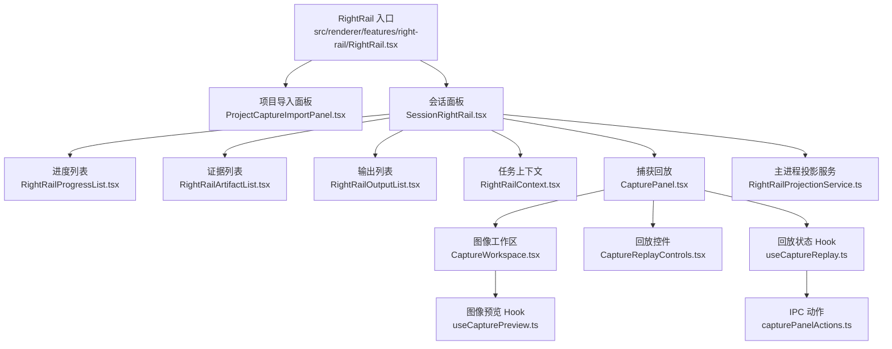
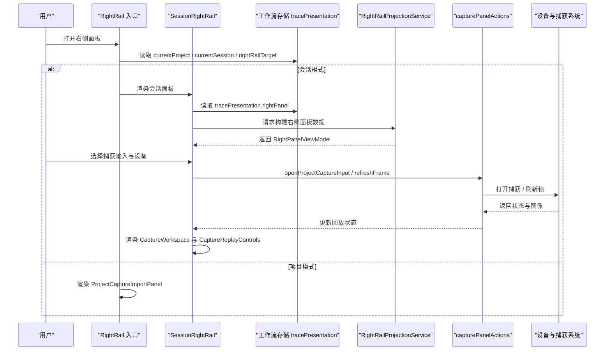
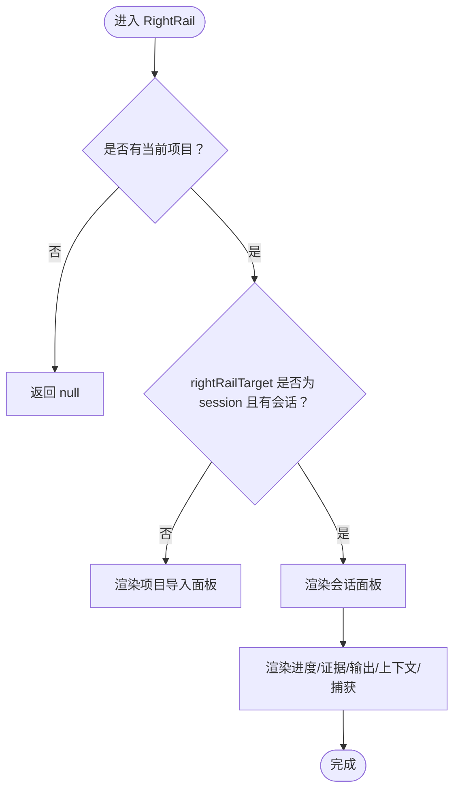
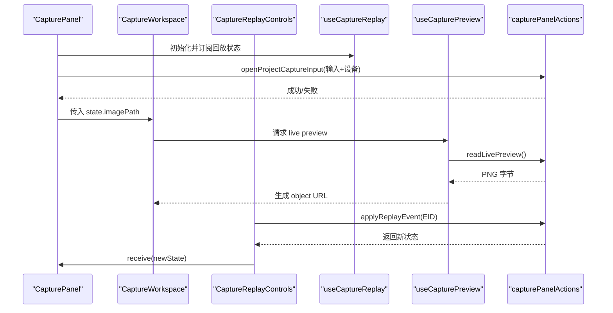
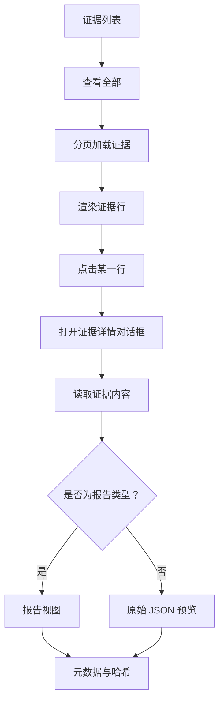
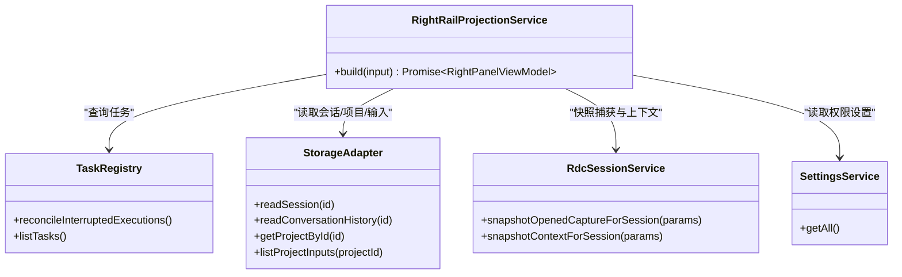
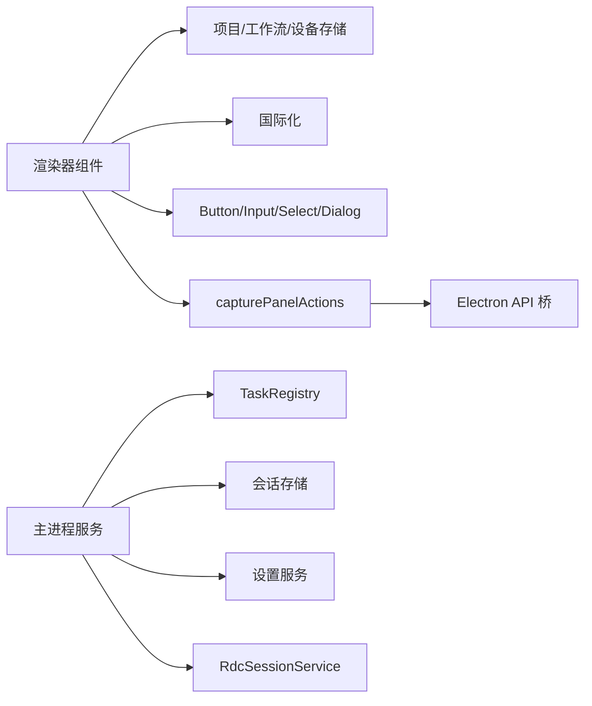
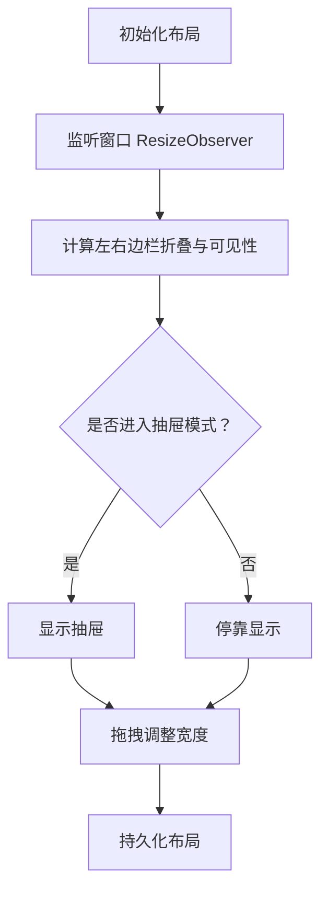

# Right Rail 右侧面板

<cite>
**本文引用的文件**   
- [RightRail.tsx](file://src/renderer/features/right-rail/RightRail.tsx)
- [SessionRightRail.tsx](file://src/renderer/features/right-rail/SessionRightRail.tsx)
- [RightRailContext.tsx](file://src/renderer/features/right-rail/RightRailContext.tsx)
- [CapturePanel.tsx](file://src/renderer/features/right-rail/CapturePanel.tsx)
- [CaptureWorkspace.tsx](file://src/renderer/features/right-rail/CaptureWorkspace.tsx)
- [useCaptureReplay.ts](file://src/renderer/features/right-rail/useCaptureReplay.ts)
- [useCapturePreview.ts](file://src/renderer/features/right-rail/useCapturePreview.ts)
- [capturePanelActions.ts](file://src/renderer/features/right-rail/capturePanelActions.ts)
- [CaptureReplayControls.tsx](file://src/renderer/features/right-rail/CaptureReplayControls.tsx)
- [RightRailArtifactList.tsx](file://src/renderer/features/right-rail/RightRailArtifactList.tsx)
- [RightRailInvestigationPreview.tsx](file://src/renderer/features/right-rail/RightRailInvestigationPreview.tsx)
- [RightRailOutputList.tsx](file://src/renderer/features/right-rail/RightRailOutputList.tsx)
- [RightRailProgressList.tsx](file://src/renderer/features/right-rail/RightRailProgressList.tsx)
- [RightRailProjectionService.ts](file://src/main/agent-trace/RightRailProjectionService.ts)
- [RightRail.css](file://src/renderer/features/right-rail/RightRail.css)
- [CaptureReplay.css](file://src/renderer/features/right-rail/CaptureReplay.css)
- [README.md](file://src/renderer/features/right-rail/README.md)
- [check-right-rail.mjs](file://scripts/check-right-rail.mjs)
- [useWorkbenchLayout.ts](file://src/renderer/app/useWorkbenchLayout.ts)
- [ResizeHandle.tsx](file://src/renderer/shell/ResizeHandle.tsx)
</cite>

## 目录
1. [简介](#简介)
2. [项目结构](#项目结构)
3. [核心组件](#核心组件)
4. [架构总览](#架构总览)
5. [详细组件分析](#详细组件分析)
6. [依赖关系分析](#依赖关系分析)
7. [性能与可维护性](#性能与可维护性)
8. [故障排查指南](#故障排查指南)
9. [结论](#结论)
10. [附录：自定义面板开发指南](#附录自定义面板开发指南)

## 简介
Right Rail 是 RDC Agent 渲染器中的右侧信息面板，负责展示会话进度、调查证据、输出产物、任务上下文以及捕获回放。它根据当前项目和会话状态在“项目导入视图”和“会话视图”之间切换；会话视图固定包含进度、证据、输出、上下文、捕获五个内容区域，并通过主进程投影服务获取数据，通过 IPC 通道与设备、捕获系统交互。

该文档聚焦以下目标：
- 解释右侧面板的切换逻辑、内容区域管理与状态同步机制。
- 详细说明捕获回放功能：设备选择、播放控制、时间轴导航、图像预览。
- 说明证据查看器的列表、详情预览、分页浏览与哈希校验。
- 说明内存查看器的概念边界：当前代码库未提供独立内存查看器，需扩展时如何复用现有模式。
- 补充面板尺寸调整、键盘导航、可访问性与样式定制方法。
- 提供扩展或替换面板内容的开发指南。

## 项目结构
Right Rail 位于 `src/renderer/features/right-rail`，由入口组件、会话面板、捕获回放、证据列表、输出列表、上下文视图、样式与辅助 Hook 组成。主进程的投影服务位于 `src/main/agent-trace/RightRailProjectionService.ts`，用于组装右侧面板的数据模型。

**图示来源**
- [RightRail.tsx:1-18](file://src/renderer/features/right-rail/RightRail.tsx#L1-L18)
- [SessionRightRail.tsx:1-73](file://src/renderer/features/right-rail/SessionRightRail.tsx#L1-L73)
- [CapturePanel.tsx:1-129](file://src/renderer/features/right-rail/CapturePanel.tsx#L1-L129)
- [CaptureWorkspace.tsx:1-47](file://src/renderer/features/right-rail/CaptureWorkspace.tsx#L1-L47)
- [CaptureReplayControls.tsx:1-65](file://src/renderer/features/right-rail/CaptureReplayControls.tsx#L1-L65)
- [useCapturePreview.ts:1-42](file://src/renderer/features/right-rail/useCapturePreview.ts#L1-L42)
- [useCaptureReplay.ts:1-32](file://src/renderer/features/right-rail/useCaptureReplay.ts#L1-L32)
- [capturePanelActions.ts:1-21](file://src/renderer/features/right-rail/capturePanelActions.ts#L1-L21)
- [RightRailProjectionService.ts:1-96](file://src/main/agent-trace/RightRailProjectionService.ts#L1-L96)

**章节来源**
- [README.md:1-13](file://src/renderer/features/right-rail/README.md#L1-L13)
- [RightRail.tsx:1-18](file://src/renderer/features/right-rail/RightRail.tsx#L1-L18)
- [SessionRightRail.tsx:1-73](file://src/renderer/features/right-rail/SessionRightRail.tsx#L1-L73)

## 核心组件
- **RightRail 入口**：根据当前项目与会话决定显示“项目导入面板”还是“会话面板”。
- **SessionRightRail**：渲染进度、证据、输出、上下文、捕获五个区域，并处理空态与有内容状态的统一卡片外壳。
- **CapturePanel**：管理捕获输入选择、设备选择、打开/关闭捕获、刷新投影与图像帧，并将错误提示、警告与状态徽章呈现给用户。
- **CaptureWorkspace**：拥有唯一图像视口，显示图像 URL、加载状态、错误反馈与工作区所有权提示。
- **CaptureReplayControls**：提供事件序列导航、EID 输入、颜色目标选择与滑动条时间轴。
- **RightRailArtifactList**：展示调查证据行，支持全量浏览、分页加载与详情预览。
- **RightRailInvestigationPreview**：以对话框形式展示证据详情、元数据、原始 JSON 与报告视图。
- **RightRailOutputList**：列出当前与历史输出，提供打开路径与复制路径操作。
- **RightRailProgressList**：展示任务顺序与状态，并提供定位到工作进程任务的交互。
- **RightRailContext**：展示任务资源列表，支持展开更多项与资源详情对话框。

**章节来源**
- [SessionRightRail.tsx:1-73](file://src/renderer/features/right-rail/SessionRightRail.tsx#L1-L73)
- [CapturePanel.tsx:1-129](file://src/renderer/features/right-rail/CapturePanel.tsx#L1-L129)
- [CaptureWorkspace.tsx:1-47](file://src/renderer/features/right-rail/CaptureWorkspace.tsx#L1-L47)
- [CaptureReplayControls.tsx:1-65](file://src/renderer/features/right-rail/CaptureReplayControls.tsx#L1-L65)
- [RightRailArtifactList.tsx:1-67](file://src/renderer/features/right-rail/RightRailArtifactList.tsx#L1-L67)
- [RightRailInvestigationPreview.tsx:1-141](file://src/renderer/features/right-rail/RightRailInvestigationPreview.tsx#L1-L141)
- [RightRailOutputList.tsx:1-39](file://src/renderer/features/right-rail/RightRailOutputList.tsx#L1-L39)
- [RightRailProgressList.tsx:1-30](file://src/renderer/features/right-rail/RightRailProgressList.tsx#L1-L30)
- [RightRailContext.tsx:1-64](file://src/renderer/features/right-rail/RightRailContext.tsx#L1-L64)

## 架构总览
右侧面板采用“渲染器 UI + 主进程投影服务 + IPC 桥”的分层架构：
- 渲染器侧：React 组件与 Hook 负责状态展示、用户交互与本地缓存（例如对象 URL）。
- 主进程侧：`RightRailProjectionService` 聚合会话、任务、输出、调查证据、上下文快照与项目捕获输入，生成 `RightPanelViewModel`。
- IPC 侧：`capturePanelActions.ts` 暴露捕获相关 API，包括打开捕获、应用回放事件、刷新帧、订阅状态变更等。

**图示来源**
- [RightRail.tsx:1-18](file://src/renderer/features/right-rail/RightRail.tsx#L1-L18)
- [SessionRightRail.tsx:1-73](file://src/renderer/features/right-rail/SessionRightRail.tsx#L1-L73)
- [RightRailProjectionService.ts:1-96](file://src/main/agent-trace/RightRailProjectionService.ts#L1-L96)
- [capturePanelActions.ts:1-21](file://src/renderer/features/right-rail/capturePanelActions.ts#L1-L21)

## 详细组件分析

### 面板切换与内容区域管理
RightRail 根据 `currentProject` 与 `rightRailTarget` 决定显示项目导入面板或会话面板。会话面板通过 `tracePresentation.rightPanel` 获取数据，并按固定顺序渲染五个区域：进度、证据、输出、上下文、捕获。每个区域使用统一的卡片外壳，即使为空也保持结构一致。

关键实现要点：
- 入口组件仅做路由式判断，不持有业务状态。
- 会话面板从工作流存储读取数据，并在无内容时显示对应空态。
- 捕获区域在有可用捕获且具备任务上下文时显示完整控制面板，否则显示占位区域。

**图示来源**
- [RightRail.tsx:1-18](file://src/renderer/features/right-rail/RightRail.tsx#L1-L18)
- [SessionRightRail.tsx:1-73](file://src/renderer/features/right-rail/SessionRightRail.tsx#L1-L73)

**章节来源**
- [RightRail.tsx:1-18](file://src/renderer/features/right-rail/RightRail.tsx#L1-L18)
- [SessionRightRail.tsx:1-73](file://src/renderer/features/right-rail/SessionRightRail.tsx#L1-L73)
- [check-right-rail.mjs:120-200](file://scripts/check-right-rail.mjs#L120-L200)

### 捕获回放功能
捕获回放由 `CapturePanel`、`CaptureWorkspace`、`CaptureReplayControls`、`useCaptureReplay`、`useCapturePreview` 与 `capturePanelActions` 共同实现。

#### 设备选择与输入绑定
- `CapturePanel` 从 `RdcContextPanelViewModel` 获取可用捕获输入，并从设备存储中获取设备列表。
- 用户可通过下拉框选择输入文件和回放设备；若输入或设备变化，则进入 pending 状态并等待确认。
- 点击“打开”后调用 `openProjectCaptureInput`，失败时设置错误并允许重试；点击“关闭”调用 `clearOpenedState`。

#### 播放控制与时间轴导航
- `CaptureReplayControls` 提供上一个/下一个事件按钮、EID 输入框、颜色目标下拉框与滑动条。
- 所有回放请求通过队列串行执行，避免并发冲突；成功后调用 `receive` 更新本地状态。
- 当设备处于已呈现状态时，界面显示同步提示；不可用时显示原因。

#### 图像预览与生命周期
- `CaptureWorkspace` 将 `state.imagePath` 交给 `useCapturePreview`。
- `useCapturePreview` 调用 `readLivePreview` 获取 PNG 字节，创建对象 URL 并挂载到 ``；卸载时释放 URL。
- 如果后端返回空图像或读取失败，显示相应错误与重试按钮。

**图示来源**
- [CapturePanel.tsx:1-129](file://src/renderer/features/right-rail/CapturePanel.tsx#L1-L129)
- [CaptureWorkspace.tsx:1-47](file://src/renderer/features/right-rail/CaptureWorkspace.tsx#L1-L47)
- [CaptureReplayControls.tsx:1-65](file://src/renderer/features/right-rail/CaptureReplayControls.tsx#L1-L65)
- [useCaptureReplay.ts:1-32](file://src/renderer/features/right-rail/useCaptureReplay.ts#L1-L32)
- [useCapturePreview.ts:1-42](file://src/renderer/features/right-rail/useCapturePreview.ts#L1-L42)
- [capturePanelActions.ts:1-21](file://src/renderer/features/right-rail/capturePanelActions.ts#L1-L21)

**章节来源**
- [CapturePanel.tsx:1-129](file://src/renderer/features/right-rail/CapturePanel.tsx#L1-L129)
- [CaptureWorkspace.tsx:1-47](file://src/renderer/features/right-rail/CaptureWorkspace.tsx#L1-L47)
- [CaptureReplayControls.tsx:1-65](file://src/renderer/features/right-rail/CaptureReplayControls.tsx#L1-L65)
- [useCaptureReplay.ts:1-32](file://src/renderer/features/right-rail/useCaptureReplay.ts#L1-L32)
- [useCapturePreview.ts:1-42](file://src/renderer/features/right-rail/useCapturePreview.ts#L1-L42)
- [capturePanelActions.ts:1-21](file://src/renderer/features/right-rail/capturePanelActions.ts#L1-L21)

### 证据查看器
证据查看器由 `RightRailArtifactList` 与 `RightRailInvestigationPreview` 组成，基于 `InvestigationArtifactRow` 与 `InvestigationReport` 类型进行展示。

- **列表展示**：按行显示证据标题、图标与 ID；超过五项时提供“查看全部”按钮。
- **分页浏览**：点击“查看全部”后异步加载证据列表，支持追加下一页与重试。
- **详情预览**：打开对话框展示证据 ID、版本、状态、是否降级、哈希值与原始记录；报告类型证据使用专用报告视图，原始 JSON 放在次级折叠区。
- **哈希校验**：预览组件接收预期哈希，缺失时标记为空内容，加载失败时标记为错误状态。

**图示来源**
- [RightRailArtifactList.tsx:1-67](file://src/renderer/features/right-rail/RightRailArtifactList.tsx#L1-L67)
- [RightRailInvestigationPreview.tsx:1-141](file://src/renderer/features/right-rail/RightRailInvestigationPreview.tsx#L1-L141)

**章节来源**
- [RightRailArtifactList.tsx:1-67](file://src/renderer/features/right-rail/RightRailArtifactList.tsx#L1-L67)
- [RightRailInvestigationPreview.tsx:1-141](file://src/renderer/features/right-rail/RightRailInvestigationPreview.tsx#L1-L141)
- [check-right-rail.mjs:160-200](file://scripts/check-right-rail.mjs#L160-L200)

### 输出与进度
- **输出列表**：合并当前与历史输出，显示文件名、大小、状态；失败输出禁用打开操作，始终允许复制路径。
- **进度列表**：展示任务顺序与状态标记，点击按钮触发定位事件，使工作进程中高亮对应任务元素。

**章节来源**
- [RightRailOutputList.tsx:1-39](file://src/renderer/features/right-rail/RightRailOutputList.tsx#L1-L39)
- [RightRailProgressList.tsx:1-30](file://src/renderer/features/right-rail/RightRailProgressList.tsx#L1-L30)

### 任务上下文
任务上下文视图展示当前任务关联的资源列表，支持：
- 前五项快速浏览。
- “查看全部”弹窗加载更多资源。
- 点击资源尝试打开本地路径；失败时在详情对话框中显示错误。
- 不同类型资源（目录、MCP、Web、Skill、附件）使用不同图标。

**章节来源**
- [RightRailContext.tsx:1-64](file://src/renderer/features/right-rail/RightRailContext.tsx#L1-L64)

### 主进程投影服务
`RightRailProjectionService.build` 负责组装右侧面板所需的全部数据：
- 读取会话与项目。
- 列出会话证据源、任务记录、对话历史、提示片段、调查证据。
- 快照当前打开的捕获与上下文。
- 映射进度、输出、任务上下文与 RDC 上下文。
- 返回 `RightPanelViewModel`，供渲染器消费。

**图示来源**
- [RightRailProjectionService.ts:1-96](file://src/main/agent-trace/RightRailProjectionService.ts#L1-L96)

**章节来源**
- [RightRailProjectionService.ts:1-96](file://src/main/agent-trace/RightRailProjectionService.ts#L1-L96)

### 内存查看器
当前仓库中没有独立的“内存查看器”组件。右侧面板的证据与输出分别承载调查证据与工具输出；如果需要扩展内存变量浏览、值格式化与结构展开能力，建议复用以下模式：
- 新增一个数据列表组件，类似 `RightRailArtifactList`，负责分页与详情对话框。
- 新增详情预览组件，类似 `RightRailInvestigationPreview`，负责字段格式化与原始数据折叠展示。
- 在主进程侧新增投影映射函数，将内存快照数据映射到右侧面板视图模型。
- 通过 IPC 动作封装读取与刷新逻辑，与现有 `capturePanelActions` 风格保持一致。

此部分为概念性扩展建议，不直接分析具体文件。

## 依赖关系分析
右侧面板的依赖关系如下：
- 渲染器组件依赖共享类型、UI 组件、i18n、项目与工作流存储。
- 捕获回放依赖设备存储与 IPC 桥。
- 主进程服务依赖任务注册表、会话存储、设置服务与 RDC 会话服务。
- 样式入口集中管理，按 shell、共享行、调查内容、资源、项目捕获导入、drawer 的顺序引入。

**图示来源**
- [capturePanelActions.ts:1-21](file://src/renderer/features/right-rail/capturePanelActions.ts#L1-L21)
- [RightRailProjectionService.ts:1-96](file://src/main/agent-trace/RightRailProjectionService.ts#L1-L96)

**章节来源**
- [RightRail.css:1-6](file://src/renderer/features/right-rail/RightRail.css#L1-L6)
- [check-right-rail.mjs:1-120](file://scripts/check-right-rail.mjs#L1-L120)

## 性能与可维护性
- **列表与预览优化**：输出列表使用 `React.memo`，减少重复渲染；证据列表分页加载，避免一次性加载全部证据。
- **图像预览优化**：`useCapturePreview` 在卸载时释放对象 URL，防止内存泄漏；通过 `key` 与 `attempt` 区分不同预览实例。
- **回放请求序列化**：回放事件通过队列执行，避免并发导致的状态不一致。
- **样式约束**：脚本检查确保 CSS 类名、布局结构与旧样式不再混用，保证视觉一致性。
- **组件规模限制**：脚本对关键组件行数进行上限检查，防止单文件过大。

**章节来源**
- [RightRailOutputList.tsx:1-39](file://src/renderer/features/right-rail/RightRailOutputList.tsx#L1-L39)
- [useCapturePreview.ts:1-42](file://src/renderer/features/right-rail/useCapturePreview.ts#L1-L42)
- [CaptureReplayControls.tsx:1-65](file://src/renderer/features/right-rail/CaptureReplayControls.tsx#L1-L65)
- [check-right-rail.mjs:120-325](file://scripts/check-right-rail.mjs#L120-L325)

## 故障排查指南
- **捕获无法打开**：检查设备列表是否加载完成，确认输入文件是否存在，查看连接错误与重试标签。
- **图像读取失败**：确认 `imagePath` 有效，点击重试按钮重新读取；检查对象 URL 是否正确释放。
- **回放事件未生效**：检查事件 ID 是否在可用事件列表中，观察反馈区域显示的请求与应用 EID。
- **证据预览为空**：检查预期哈希是否存在，确认 IPC 读取是否返回内容，查看降级与错误状态。
- **输出路径无法打开**：失败输出的打开按钮会被禁用，优先使用复制路径操作。
- **右侧面板未显示**：确认当前项目与会话状态，以及 `rightRailTarget` 是否为 `session`。

**章节来源**
- [CapturePanel.tsx:1-129](file://src/renderer/features/right-rail/CapturePanel.tsx#L1-L129)
- [CaptureWorkspace.tsx:1-47](file://src/renderer/features/right-rail/CaptureWorkspace.tsx#L1-L47)
- [RightRailInvestigationPreview.tsx:1-141](file://src/renderer/features/right-rail/RightRailInvestigationPreview.tsx#L1-L141)
- [RightRailOutputList.tsx:1-39](file://src/renderer/features/right-rail/RightRailOutputList.tsx#L1-L39)

## 结论
Right Rail 右侧面板通过清晰的入口切换、固定的会话区域划分、主进程数据投影与 IPC 捕获回放通道，实现了调试与分析过程中的多模态信息展示。其设计强调状态同步、可访问性与样式契约，便于扩展新的内容区域，例如未来的内存查看器。开发者在新增面板内容时应遵循现有组件职责、IPC 封装方式与样式约定，确保行为稳定、可测试且易于维护。

## 附录：自定义面板开发指南

### 面板尺寸调整与抽屉模式
右侧面板宽度由工作台布局 Hook 管理，支持拖拽调整、响应式自动折叠与窄屏抽屉模式。调整逻辑包括：
- 计算应用主体宽度。
- 根据左右边栏状态计算有效折叠状态。
- 在窄屏或自动折叠时切换到抽屉模式。
- 监听指针移动与抬起事件，更新左右面板宽度并持久化布局。

**图示来源**
- [useWorkbenchLayout.ts:1-200](file://src/renderer/app/useWorkbenchLayout.ts#L1-L200)
- [ResizeHandle.tsx:1-45](file://src/renderer/shell/ResizeHandle.tsx#L1-L45)

**章节来源**
- [useWorkbenchLayout.ts:1-200](file://src/renderer/app/useWorkbenchLayout.ts#L1-L200)
- [ResizeHandle.tsx:1-45](file://src/renderer/shell/ResizeHandle.tsx#L1-L45)

### 键盘导航与可访问性
- 回放控件的滑动条支持方向键、Home、End、PageUp、PageDown 等键，并在按键事件中触发队列刷新。
- 回放控件的 EID 输入框在 Enter 时失焦并应用输入值。
- 各区域通过 `aria-label`、`role="status"`、`role="alert"`、`aria-busy`、`aria-expanded`、`aria-disabled` 提供语义信息。
- 空态与错误反馈使用标准 ARIA 属性，便于屏幕阅读器朗读。

**章节来源**
- [CaptureReplayControls.tsx:1-65](file://src/renderer/features/right-rail/CaptureReplayControls.tsx#L1-L65)
- [CaptureReplay.css:1-99](file://src/renderer/features/right-rail/CaptureReplay.css#L1-L99)

### 样式定制方法
- 主样式入口 `RightRail.css` 按职责顺序引入子样式，新增模块应遵循该顺序。
- 捕获回放样式集中在 `CaptureReplay.css`，使用设计令牌变量定义边框、背景、字体与间距。
- 修改样式时需同时验证空态与有内容状态，避免只检查标题或默认卡片。
- 禁止混用旧样式类名，脚本会检查必需类名与禁止类名。

**章节来源**
- [RightRail.css:1-6](file://src/renderer/features/right-rail/RightRail.css#L1-L6)
- [CaptureReplay.css:1-99](file://src/renderer/features/right-rail/CaptureReplay.css#L1-L99)
- [check-right-rail.mjs:200-325](file://scripts/check-right-rail.mjs#L200-L325)

### 扩展新面板内容的步骤
1. 确定数据来源：是否需要新增主进程投影映射或复用现有 `RightRailProjectionService`。
2. 新建渲染器组件：参照 `RightRailArtifactList` 或 `RightRailOutputList` 的职责边界。
3. 如需要详情预览：参照 `RightRailInvestigationPreview`，使用对话框与原始数据折叠区。
4. 如需 IPC 交互：参照 `capturePanelActions`，封装 IPC 调用并返回结果。
5. 将新区域嵌入 `SessionRightRail`，并确保空态与有内容状态共用卡片外壳。
6. 添加必要样式与可访问性属性，并通过 `check:right-rail` 脚本校验。

**章节来源**
- [SessionRightRail.tsx:1-73](file://src/renderer/features/right-rail/SessionRightRail.tsx#L1-L73)
- [RightRailArtifactList.tsx:1-67](file://src/renderer/features/right-rail/RightRailArtifactList.tsx#L1-L67)
- [RightRailInvestigationPreview.tsx:1-141](file://src/renderer/features/right-rail/RightRailInvestigationPreview.tsx#L1-L141)
- [capturePanelActions.ts:1-21](file://src/renderer/features/right-rail/capturePanelActions.ts#L1-L21)