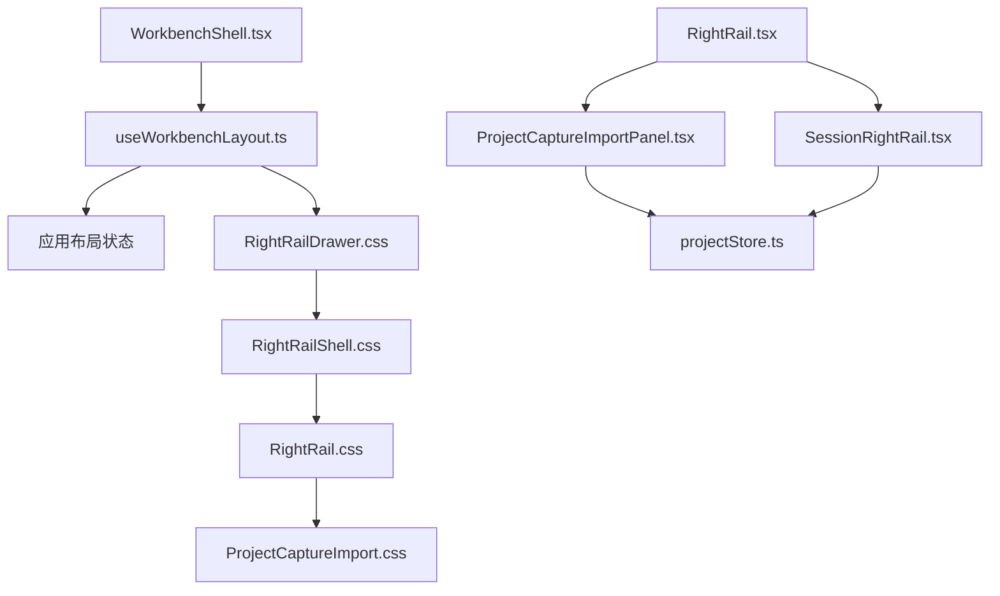
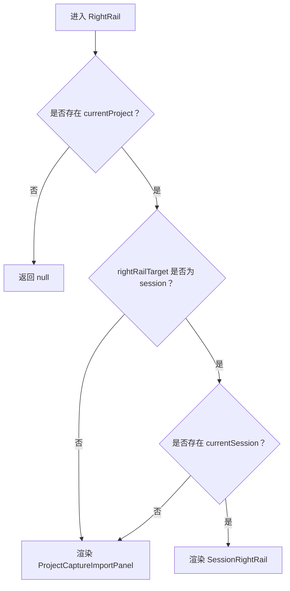
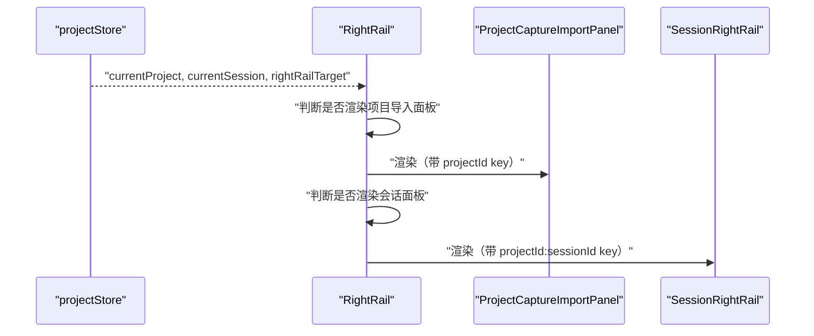
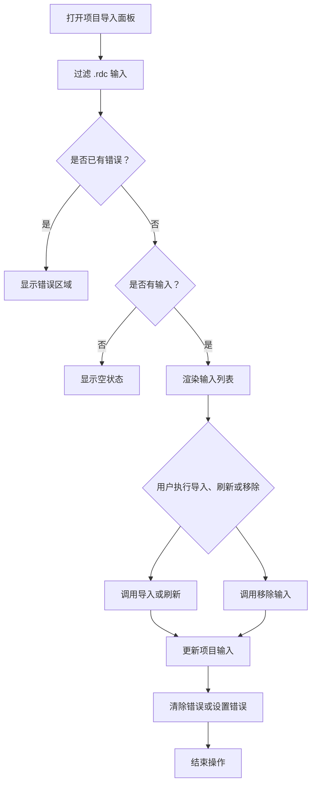
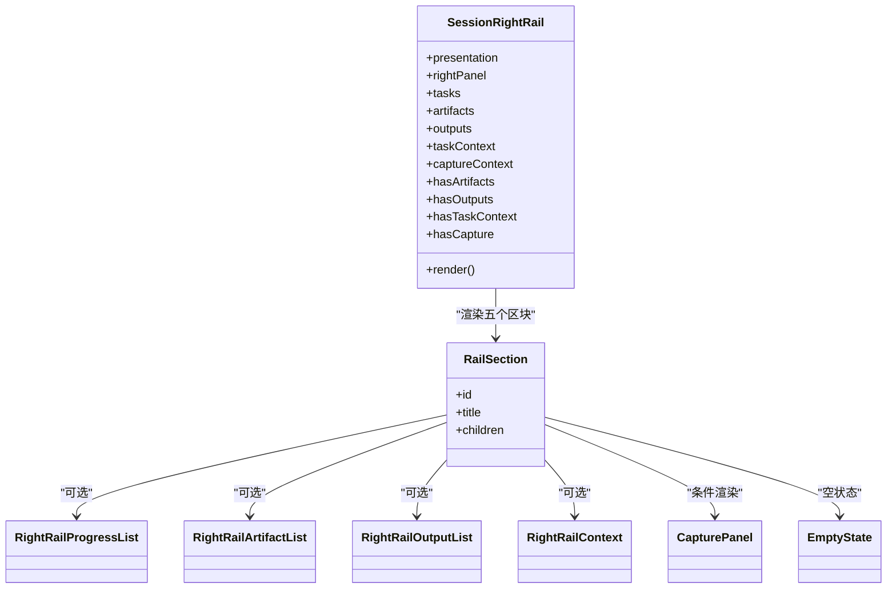
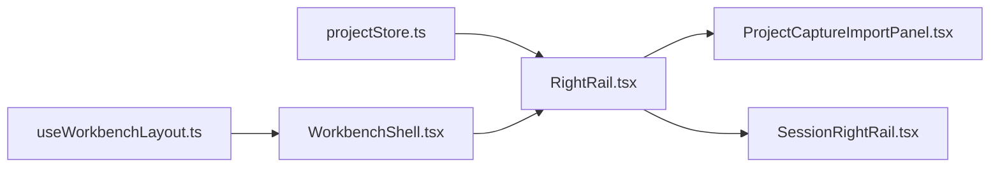
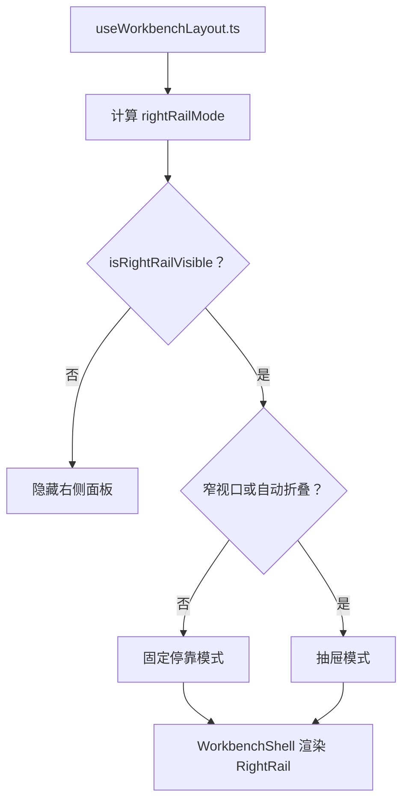

# Right Rail 外壳与路由

<cite>
**本文引用的文件**   
- [RightRail.tsx](file://src/renderer/features/right-rail/RightRail.tsx)
- [ProjectCaptureImportPanel.tsx](file://src/renderer/features/right-rail/ProjectCaptureImportPanel.tsx)
- [SessionRightRail.tsx](file://src/renderer/features/right-rail/SessionRightRail.tsx)
- [RightRail.css](file://src/renderer/features/right-rail/RightRail.css)
- [RightRailShell.css](file://src/renderer/features/right-rail/RightRailShell.css)
- [ProjectCaptureImport.css](file://src/renderer/features/right-rail/ProjectCaptureImport.css)
- [RightRailDrawer.css](file://src/renderer/features/right-rail/RightRailDrawer.css)
- [useWorkbenchLayout.ts](file://src/renderer/app/useWorkbenchLayout.ts)
- [usePanelDrawer.ts](file://src/renderer/app/usePanelDrawer.ts)
- [WorkbenchShell.tsx](file://src/renderer/app/WorkbenchShell.tsx)
- [projectStore.ts](file://src/renderer/stores/projectStore.ts)
- [check-right-rail.mjs](file://scripts/check-right-rail.mjs)
</cite>

## 目录
1. [简介](#简介)
2. [项目结构](#项目结构)
3. [核心组件](#核心组件)
4. [架构总览](#架构总览)
5. [详细组件分析](#详细组件分析)
6. [依赖关系分析](#依赖关系分析)
7. [性能与可维护性](#性能与可维护性)
8. [样式加载顺序、主题适配与可访问性](#样式加载顺序主题适配与可访问性)
9. [面板尺寸调整与响应式行为](#面板尺寸调整与响应式行为)
10. [扩展指南与样式定制](#扩展指南与样式定制)
11. [故障排查](#故障排查)
12. [结论](#结论)

## 简介
Right Rail 是工作区右侧的信息与操作面板。它承担两个主要职责：
- 在项目导入模式下，展示并管理项目捕获输入文件；
- 在会话模式下，展示任务进度、工件、输出、上下文和捕获回放等会话相关视图。

Right Rail 的“路由”并非传统意义上的浏览器路由，而是基于当前项目、当前会话以及 `rightRailTarget` 状态值的条件渲染逻辑。该逻辑由顶层 `RightRail` 组件实现，并由布局系统决定它是固定停靠还是抽屉模式显示。

## 项目结构
Right Rail 的代码组织采用功能内聚的方式：
- 路由与容器：`RightRail.tsx`
- 项目导入面板：`ProjectCaptureImportPanel.tsx`
- 会话面板：`SessionRightRail.tsx`
- 样式分层：`RightRail.css` 作为入口，按模块拆分为 Shell、行级、调查列表、资源、项目捕获、抽屉等样式文件
- 布局与抽屉控制：`useWorkbenchLayout.ts`、`usePanelDrawer.ts`、`WorkbenchShell.tsx`
- 状态来源：`projectStore.ts`
- 质量检查脚本：`scripts/check-right-rail.mjs`

**图表来源**
- [WorkbenchShell.tsx:88-246](file://src/renderer/app/WorkbenchShell.tsx#L88-L246)
- [useWorkbenchLayout.ts:1-66](file://src/renderer/app/useWorkbenchLayout.ts#L1-L66)
- [RightRail.css:1-6](file://src/renderer/features/right-rail/RightRail.css#L1-L6)
- [RightRailShell.css:1-30](file://src/renderer/features/right-rail/RightRailShell.css#L1-L30)
- [ProjectCaptureImport.css:1-12](file://src/renderer/features/right-rail/ProjectCaptureImport.css#L1-L12)
- [RightRail.tsx:1-18](file://src/renderer/features/right-rail/RightRail.tsx#L1-L18)

**章节来源**
- [RightRail.tsx:1-18](file://src/renderer/features/right-rail/RightRail.tsx#L1-L18)
- [RightRail.css:1-6](file://src/renderer/features/right-rail/RightRail.css#L1-L6)
- [useWorkbenchLayout.ts:1-66](file://src/renderer/app/useWorkbenchLayout.ts#L1-L66)

## 核心组件
Right Rail 的核心由三个 React 组件构成：
- `RightRail`：根据 `currentProject`、`currentSession`、`rightRailTarget` 选择渲染项目导入面板或会话面板。
- `ProjectCaptureImportPanel`：项目导入面板，负责列出 `.rdc` 输入、导入、刷新、移除、外部引用注册和错误提示。
- `SessionRightRail`：会话面板，按固定顺序渲染进度、工件、输出、上下文、捕获五个区块。

它们共享以下数据源：
- `currentProject`：当前项目对象；
- `currentSession`：当前会话对象；
- `rightRailTarget`：目标值，用于指示期望的面板类型；
- `projectInputs`：项目输入记录集合。

**章节来源**
- [RightRail.tsx:1-18](file://src/renderer/features/right-rail/RightRail.tsx#L1-L18)
- [ProjectCaptureImportPanel.tsx:1-135](file://src/renderer/features/right-rail/ProjectCaptureImportPanel.tsx#L1-L135)
- [SessionRightRail.tsx:1-73](file://src/renderer/features/right-rail/SessionRightRail.tsx#L1-L73)
- [projectStore.ts:28-54](file://src/renderer/stores/projectStore.ts#L28-L54)

## 架构总览
Right Rail 的渲染决策位于 `RightRail` 组件中。其判断顺序如下：
1. 如果不存在 `currentProject`，则直接返回空节点，不渲染任何内容；
2. 如果 `rightRailTarget` 不是 `'session'`，或者存在 `rightRailTarget === 'session'` 但缺少 `currentSession`，则渲染项目导入面板；
3. 否则渲染会话面板。

**图表来源**
- [RightRail.tsx:4-18](file://src/renderer/features/right-rail/RightRail.tsx#L4-L18)

**章节来源**
- [RightRail.tsx:4-18](file://src/renderer/features/right-rail/RightRail.tsx#L4-L18)

## 详细组件分析

### RightRail 路由逻辑
`RightRail` 通过 `useProjectStore` 订阅三个关键状态：
- `currentProject`；
- `currentSession`；
- `rightRailTarget`。

它的渲染条件可以理解为：
- 项目导入模式：`rightRailTarget !== 'session'`，或者未选中会话；
- 会话模式：`rightRailTarget === 'session'` 且存在 `currentSession`。

此外，每个子组件都带有一个 `key`：
- 项目导入面板使用 `currentProject.projectId`；
- 会话面板使用 `currentProject.projectId` 与 `currentSession.sessionId` 的组合。

设计目的：
- 当项目切换时，React 会销毁并重建对应项目的面板实例，避免残留状态；
- 会话面板在会话切换时重建，确保进度、工件、输出、上下文等视图重新绑定到新会话的数据；
- 将 `projectId` 加入 key，有助于区分不同项目的导入面板，防止跨项目复用导致的状态错乱。

**图表来源**
- [RightRail.tsx:4-18](file://src/renderer/features/right-rail/RightRail.tsx#L4-L18)

**章节来源**
- [RightRail.tsx:4-18](file://src/renderer/features/right-rail/RightRail.tsx#L4-L18)

### ProjectCaptureImportPanel 项目导入面板
项目导入面板的职责包括：
- 过滤出扩展名为 `.rdc` 的项目输入；
- 提供导入、刷新、移除操作；
- 处理导入失败、会话过期、移除失败等错误；
- 支持外部引用对话框，将其他项目的输入注册到当前项目；
- 通过无障碍属性暴露文件名、大小、路径和操作语义。

关键实现细节：
- 使用 `useMemo` 缓存 `.rdc` 输入列表；
- 使用 `useState` 管理当前活跃操作、错误信息和参考项目 ID；
- 异步操作通过 `setActiveAction` 设置按钮禁用和 `aria-busy`，保证交互状态一致；
- 错误消息中对 `unauthorized` 进行特殊处理，映射为会话过期提示；
- 列表项使用 `role="list"` 和 `role="listitem"`，并为删除按钮提供可访问标签。

**图表来源**
- [ProjectCaptureImportPanel.tsx:14-135](file://src/renderer/features/right-rail/ProjectCaptureImportPanel.tsx#L14-L135)

**章节来源**
- [ProjectCaptureImportPanel.tsx:14-135](file://src/renderer/features/right-rail/ProjectCaptureImportPanel.tsx#L14-L135)

### SessionRightRail 会话面板
会话面板从工作流存储中读取 trace 呈现模型，并将其投影为五个固定区块：
1. 进度；
2. 工件；
3. 输出；
4. 上下文；
5. 捕获。

每个区块都使用统一的 `RailSection` 封装，包含标题和内容容器。即使内容为空，也会保留卡片外壳，并通过 `EmptyState` 显示空状态文案。

关键行为：
- 进度区块对任务列表进行条件渲染，并使用 `progressSessionId` 作为 `RightRailProgressList` 的 `key`，以在会话切换时重建进度列表；
- 工件区块根据 `totalCount` 判断是否显示列表，并在 store 降级时给出退化提示；
- 输出区块合并当前输出和历史输出；
- 上下文区块仅在有任务资源时显示真实上下文；
- 捕获区块在任务上下文和资源同时可用时显示 `CapturePanel`，否则显示占位卡片。

**图表来源**
- [SessionRightRail.tsx:9-73](file://src/renderer/features/right-rail/SessionRightRail.tsx#L9-L73)

**章节来源**
- [SessionRightRail.tsx:9-73](file://src/renderer/features/right-rail/SessionRightRail.tsx#L9-L73)

## 依赖关系分析
Right Rail 的依赖可以分为三类：
- 状态依赖：来自 `projectStore` 的 `currentProject`、`currentSession`、`rightRailTarget`、`projectInputs`；
- 视图依赖：`RightRail` 依赖 `ProjectCaptureImportPanel` 和 `SessionRightRail`；
- 布局依赖：`WorkbenchShell` 和 `useWorkbenchLayout` 决定面板是否可见、是否处于抽屉模式，并控制宽度与拖拽。

**图表来源**
- [projectStore.ts:28-54](file://src/renderer/stores/projectStore.ts#L28-L54)
- [RightRail.tsx:1-18](file://src/renderer/features/right-rail/RightRail.tsx#L1-L18)
- [useWorkbenchLayout.ts:1-66](file://src/renderer/app/useWorkbenchLayout.ts#L1-L66)
- [WorkbenchShell.tsx:88-246](file://src/renderer/app/WorkbenchShell.tsx#L88-L246)

**章节来源**
- [projectStore.ts:28-54](file://src/renderer/stores/projectStore.ts#L28-L54)
- [RightRail.tsx:1-18](file://src/renderer/features/right-rail/RightRail.tsx#L1-L18)
- [useWorkbenchLayout.ts:1-66](file://src/renderer/app/useWorkbenchLayout.ts#L1-L66)
- [WorkbenchShell.tsx:88-246](file://src/renderer/app/WorkbenchShell.tsx#L88-L246)

## 性能与可维护性
Right Rail 的性能优化主要体现在：
- 条件渲染：仅在必要时渲染项目导入面板或会话面板，避免无意义 DOM；
- `key` 稳定策略：使用项目 ID 与会话 ID 组合，确保状态隔离；
- 列表缓存：项目导入面板对 `.rdc` 输入使用 `useMemo` 缓存；
- 区块最小化：会话面板始终渲染卡片外壳，避免内容变化时频繁重排；
- 脚本约束：`check-right-rail.mjs` 限制组件行数、强制保留必要区块顺序、禁止遗留旧类名和旧状态模式。

可维护性要点：
- 新增会话区块时应遵循 `check-right-rail.mjs` 的检查规则；
- 不要引入旧版会话控制面板、旧状态变量或未迁移的文件系统 API；
- 保持面板壳层结构稳定，便于自动化测试和质量检查。

**章节来源**
- [ProjectCaptureImportPanel.tsx:20-22](file://src/renderer/features/right-rail/ProjectCaptureImportPanel.tsx#L20-L22)
- [RightRail.tsx:11-18](file://src/renderer/features/right-rail/RightRail.tsx#L11-L18)
- [check-right-rail.mjs:1-200](file://scripts/check-right-rail.mjs#L1-L200)

## 样式加载顺序、主题适配与可访问性

### 样式加载顺序
`RightRail.tsx` 引入 `RightRail.css`，后者通过 `@import` 按以下顺序加载样式：
1. `RightRailShell.css`：定义 `.right-rail` 外壳、区块、标题、空状态；
2. `RightRailRows.css`：行级样式；
3. `RightRailInvestigations.css`：调查工件列表样式；
4. `RightRailResources.css`：资源列表样式；
5. `ProjectCaptureImport.css`：项目导入面板样式；
6. `RightRailDrawer.css`：抽屉模式样式。

这种分层方式使外壳样式与具体面板样式解耦，便于单独扩展。

### 主题适配
样式大量使用设计令牌变量：
- 背景色：`var(--token-bg-shell)`、`var(--token-bg-panel)`；
- 文本色：`var(--token-text-body)`、`var(--token-text-heading)`、`var(--token-text-caption)`；
- 边框色：`var(--token-border-card)`、`var(--token-border-subtle)`；
- 间距：`var(--space-1)` 至 `var(--space-12)`；
- 字体尺寸：`var(--text-sm)`、`var(--text-xs)`、`var(--text-md)`；
- 阴影：`var(--shadow-popover)`。

因此，主题变更只需修改 token，无需逐个组件替换颜色值。

### 可访问性属性
- `RightRail` 外壳在会话模式下使用 `aside` 元素，并带有 `aria-label`；
- `ProjectCaptureImportPanel` 同样使用 `aside`，并提供 `data-testid`、`role="alert"` 的错误区域、`aria-busy` 的异步操作按钮；
- 输入列表使用 `role="list"` 和 `role="listitem"`，删除按钮具有描述性 `aria-label`；
- 文件图标使用 `aria-hidden="true"`，避免辅助技术重复朗读；
- 会话面板各区块使用语义化 `section` 和 `h2`，配合 `data-testid` 便于自动化测试。

**章节来源**
- [RightRail.css:1-6](file://src/renderer/features/right-rail/RightRail.css#L1-L6)
- [RightRailShell.css:1-87](file://src/renderer/features/right-rail/RightRailShell.css#L1-L87)
- [ProjectCaptureImport.css:1-55](file://src/renderer/features/right-rail/ProjectCaptureImport.css#L1-L55)
- [RightRailDrawer.css:1-54](file://src/renderer/features/right-rail/RightRailDrawer.css#L1-L54)
- [ProjectCaptureImportPanel.tsx:14-135](file://src/renderer/features/right-rail/ProjectCaptureImportPanel.tsx#L14-L135)
- [SessionRightRail.tsx:9-73](file://src/renderer/features/right-rail/SessionRightRail.tsx#L9-L73)

## 面板尺寸调整与响应式行为

### 可见性与模式
`useWorkbenchLayout.ts` 计算 `rightRailMode`：
- 没有 `currentProject` 时为 `hidden`；
- `rightRailTarget === 'session'` 且存在 `currentSession` 时为 `session`；
- 其他情况为 `project`。

`isRightRailVisible` 表示面板是否应参与布局。

### 抽屉模式
当满足以下条件之一时，右侧面板进入抽屉模式：
- 视口小于 `RIGHT_RAIL_DRAWER_BREAKPOINT`；
- 自动折叠状态下右侧面板被折叠。

抽屉开关由 `usePanelDrawer` 管理，提供 `isOpen`、`close`、`toggle`。

### 宽度与拖拽
- 左侧边栏和右侧面板宽度通过 `resolveSidebarWidths` 计算；
- 拖拽事件监听指针移动，限制左右侧边栏的最小和最大宽度；
- 拖拽结束后持久化布局；
- 最终返回 `workbenchRailMaxWidth`、`resolvedWidths`、`startDragging` 等给上层使用。

### 渲染位置
`WorkbenchShell.tsx` 根据 `isRightRailVisible` 和 `isRightRailDrawerMode` 决定：
- 固定停靠模式下直接渲染 `RightRail`；
- 抽屉模式下通过 `WorkbenchPanelDrawer` 包裹 `RightRail`。

**图表来源**
- [useWorkbenchLayout.ts:19-66](file://src/renderer/app/useWorkbenchLayout.ts#L19-L66)
- [usePanelDrawer.ts:1-16](file://src/renderer/app/usePanelDrawer.ts#L1-L16)
- [WorkbenchShell.tsx:88-246](file://src/renderer/app/WorkbenchShell.tsx#L88-L246)

**章节来源**
- [useWorkbenchLayout.ts:19-66](file://src/renderer/app/useWorkbenchLayout.ts#L19-L66)
- [useWorkbenchLayout.ts:201-209](file://src/renderer/app/useWorkbenchLayout.ts#L201-L209)
- [usePanelDrawer.ts:1-16](file://src/renderer/app/usePanelDrawer.ts#L1-L16)
- [WorkbenchShell.tsx:88-246](file://src/renderer/app/WorkbenchShell.tsx#L88-L246)

## 扩展指南与样式定制

### 如何新增一个会话面板区块
1. 在 `SessionRightRail.tsx` 中新增一个 `RailSection`，并保持固定顺序：进度、工件、输出、上下文、捕获；
2. 为该区块添加唯一 `id` 和国际化标题；
3. 若需要新数据，从 `useWorkflowStore` 或现有 store 中读取，而不是直接访问内部字段；
4. 如需空状态，复用 `EmptyState` 并传入对应 `kind`；
5. 运行 `check:right-rail` 脚本，确保区块顺序、国际化键、组件引用未被破坏。

### 如何扩展项目导入面板
1. 在 `ProjectCaptureImportPanel.tsx` 中新增输入类型或操作；
2. 若涉及异步操作，沿用 `activeAction` 与 `aria-busy` 模式；
3. 若涉及错误，复用 `formatImportError` 的错误分类逻辑；
4. 若需要新的 UI 结构，在 `ProjectCaptureImport.css` 中添加类名；
5. 不要引入已废弃的捕获存储或会话控制组件。

### 样式定制方法
- 优先覆盖设计令牌，例如背景、文本、边框、间距；
- 针对特定面板，在对应的 CSS 文件中添加类名，例如 `ProjectCaptureImport.css`；
- 若需要抽屉行为，参考 `RightRailDrawer.css` 中的栅格、动画和断点；
- 不要直接复制旧版 `.control-panel`、`.cp-section` 等已被脚本禁止的类名；
- 所有空白状态必须使用 `ui-empty-state` 相关结构，以保持视觉一致性。

### 开发注意事项
- 不要修改 `RightRail` 的路由判断顺序；
- 不要在 `SessionRightRail` 中使用 `useState` 管理区块显隐；
- 不要移除 `.right-rail` 外壳规则；
- 不要改变会话面板五个区块的 HTML 顺序；
- 项目导入面板应保持单卡片间距为 `gap: 0`，会话面板保持卡片间距为 `gap: var(--space-3)`。

**章节来源**
- [SessionRightRail.tsx:9-73](file://src/renderer/features/right-rail/SessionRightRail.tsx#L9-L73)
- [ProjectCaptureImportPanel.tsx:14-135](file://src/renderer/features/right-rail/ProjectCaptureImportPanel.tsx#L14-L135)
- [ProjectCaptureImport.css:1-12](file://src/renderer/features/right-rail/ProjectCaptureImport.css#L1-L12)
- [RightRailDrawer.css:1-54](file://src/renderer/features/right-rail/RightRailDrawer.css#L1-L54)
- [check-right-rail.mjs:120-200](file://scripts/check-right-rail.mjs#L120-L200)

## 故障排查

### 右侧面板完全不显示
可能原因：
- `currentProject` 为空；
- `rightRailTarget` 不是 `'session'`；
- `rightRailTarget === 'session'` 但 `currentSession` 为空；
- 布局系统将面板折叠且未启用抽屉。

排查步骤：
1. 检查 `projectStore` 中的 `currentProject` 和 `currentSession`；
2. 检查 `rightRailTarget` 的值；
3. 检查 `useWorkbenchLayout.ts` 返回的 `isRightRailVisible` 和 `isRightRailDrawerMode`；
4. 确认 `WorkbenchShell.tsx` 是否渲染了 `RightRail`。

**章节来源**
- [RightRail.tsx:4-18](file://src/renderer/features/right-rail/RightRail.tsx#L4-L18)
- [projectStore.ts:28-54](file://src/renderer/stores/projectStore.ts#L28-L54)
- [useWorkbenchLayout.ts:19-66](file://src/renderer/app/useWorkbenchLayout.ts#L19-L66)
- [WorkbenchShell.tsx:88-246](file://src/renderer/app/WorkbenchShell.tsx#L88-L246)

### 项目导入面板状态错乱
可能原因：
- 项目切换后 `key` 未正确包含 `projectId`；
- 多个项目共用同一个面板实例；
- 异步操作未完成时用户再次触发操作。

排查步骤：
1. 确认 `RightRail` 渲染项目导入面板时使用了 `currentProject.projectId` 作为 key；
2. 检查是否在项目切换后重建了面板；
3. 检查 `activeAction` 是否正确阻止并发操作。

**章节来源**
- [RightRail.tsx:11-18](file://src/renderer/features/right-rail/RightRail.tsx#L11-L18)
- [ProjectCaptureImportPanel.tsx:34-72](file://src/renderer/features/right-rail/ProjectCaptureImportPanel.tsx#L34-L72)

### 会话面板区块顺序不符合预期
可能原因：
- 手动调整了 `SessionRightRail.tsx` 中区块顺序；
- 新增了区块但未放在正确位置；
- 自动化检查脚本未通过。

排查步骤：
1. 确认区块顺序为进度、工件、输出、上下文、捕获；
2. 运行 `check:right-rail`；
3. 检查是否保留了必要的 `id`、标题和空状态。

**章节来源**
- [SessionRightRail.tsx:9-73](file://src/renderer/features/right-rail/SessionRightRail.tsx#L9-L73)
- [check-right-rail.mjs:100-140](file://scripts/check-right-rail.mjs#L100-L140)

### 主题颜色不正确
可能原因：
- 自定义样式覆盖了设计令牌；
- 使用了硬编码颜色而非 token；
- 新样式未在 `RightRail.css` 的导入链中生效。

排查步骤：
1. 检查是否修改了 token；
2. 检查组件是否引入了正确的 CSS 文件；
3. 检查浏览器开发者工具中 CSS 加载顺序。

**章节来源**
- [RightRail.css:1-6](file://src/renderer/features/right-rail/RightRail.css#L1-L6)
- [RightRailShell.css:1-30](file://src/renderer/features/right-rail/RightRailShell.css#L1-L30)

## 结论
Right Rail 的外壳与路由是一个轻量但结构严谨的界面子系统。它以 `currentProject`、`currentSession` 和 `rightRailTarget` 为驱动，在导入面板与会话面板之间切换；以 `RightRailShell.css` 为基础，通过 `RightRail.css` 的 `@import` 链组织样式；以 `useWorkbenchLayout.ts` 和 `WorkbenchShell.tsx` 协调固定停靠与抽屉模式；以 `check-right-rail.mjs` 保障长期可维护性。

对于扩展者而言，最重要的原则是：
- 保持路由判断简单明确；
- 保持会话面板区块顺序不变；
- 使用设计令牌和现有空状态组件；
- 使用稳定的 `key` 管理面板实例；
- 遵守脚本约束，避免引入已废弃的实现模式。