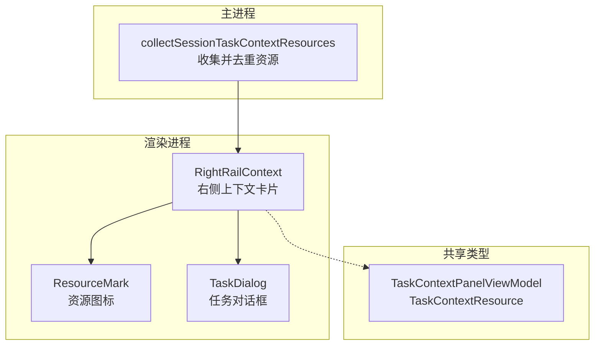
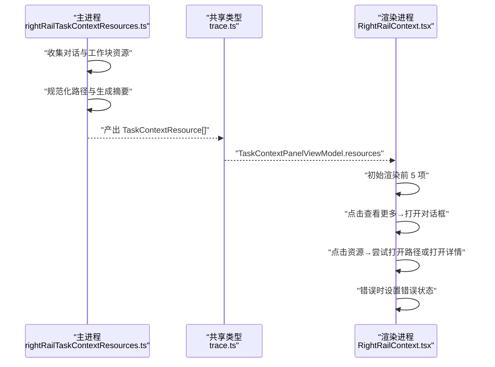
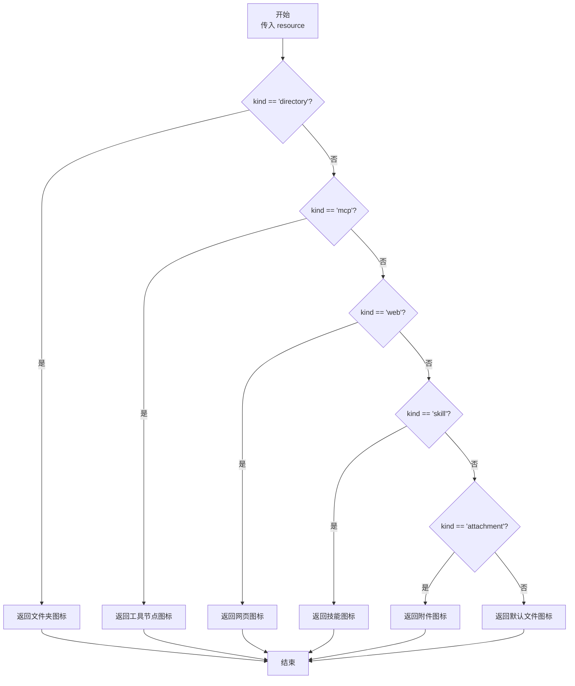
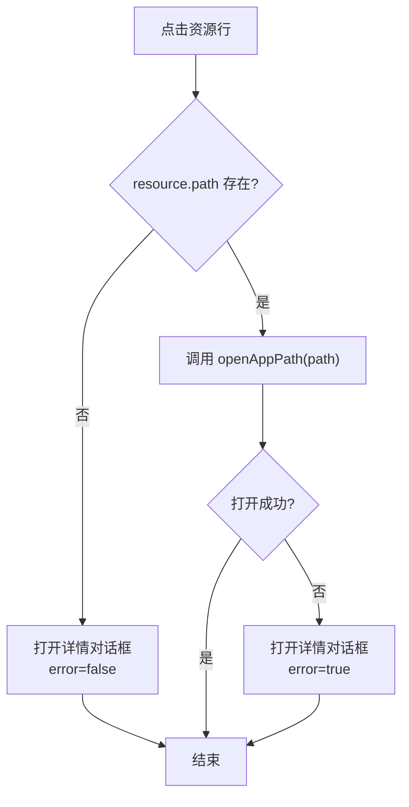
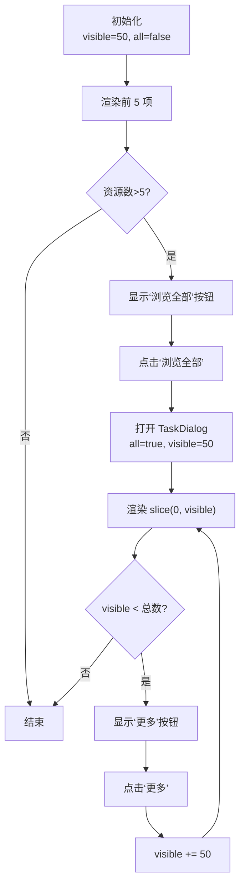
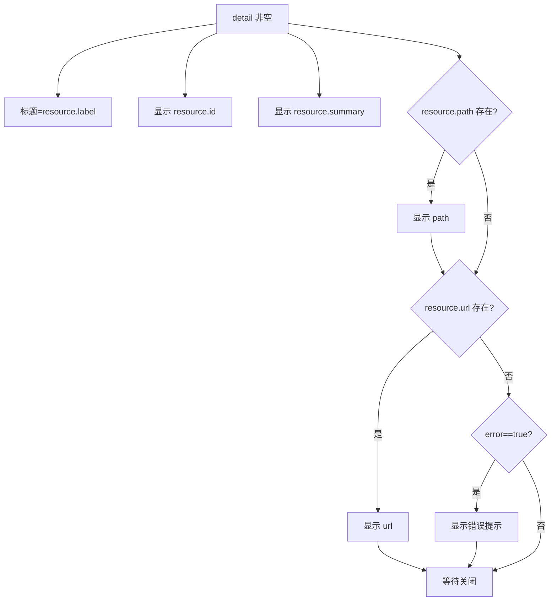
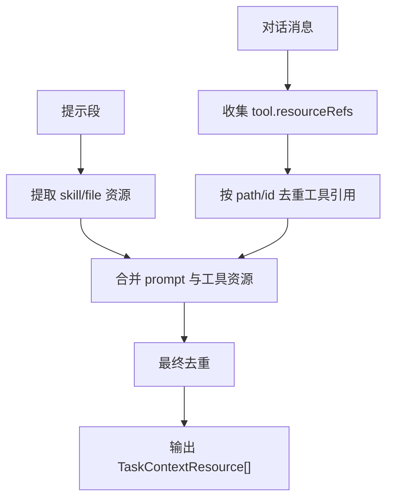
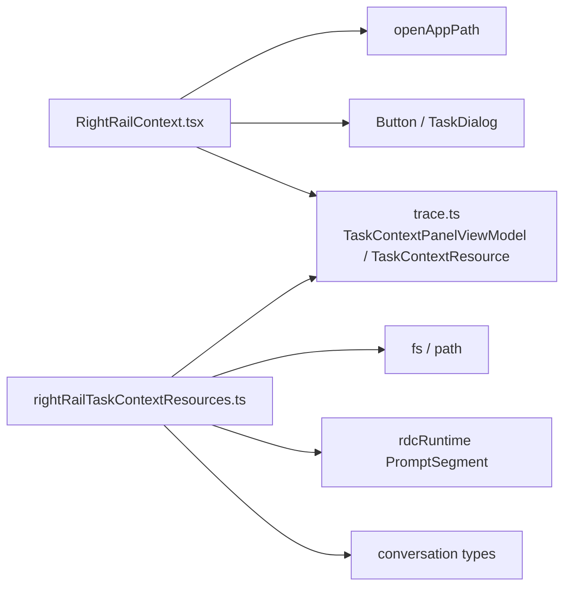

# 上下文卡片

<cite>
**本文引用的文件**   
- [RightRailContext.tsx](file://src/renderer/features/right-rail/RightRailContext.tsx)
- [trace.ts](file://src/shared/types/trace.ts)
- [rightRailTaskContextResources.ts](file://src/main/agent-trace/rightRailTaskContextResources.ts)
</cite>

## 目录
1. [简介](#简介)
2. [项目结构定位](#项目结构定位)
3. [核心组件与数据模型](#核心组件与数据模型)
4. [架构总览](#架构总览)
5. [详细组件分析](#详细组件分析)
6. [依赖关系分析](#依赖关系分析)
7. [性能与懒加载特性](#性能与懒加载特性)
8. [可访问性与交互说明](#可访问性与交互说明)
9. [常见问题排查](#常见问题排查)
10. [结论](#结论)

## 简介
本文聚焦“上下文卡片”在右侧面板中的实现，围绕以下目标展开：
- RightRailContext 组件如何渲染 TaskContextPanelViewModel 中的资源列表。
- ResourceMark 组件如何根据资源 kind（directory、mcp、web、skill、attachment）显示不同图标。
- 懒加载机制：初始展示前 5 个资源，点击“查看更多”后展开到最多 50 条并支持渐进式加载更多。
- 资源详情对话框的显示逻辑：路径打开失败时进入错误状态；URL 与摘要信息在详情中展示。
- 资源 ID、摘要信息的展示方式与可访问性支持。

该文档同时说明资源数据如何在主进程侧生成，并通过共享类型约束前端渲染行为。

## 项目结构定位
上下文卡片位于右侧会话面板中，由渲染进程 React 组件负责展示，而任务上下文资源数据在主进程侧从对话与工作块中提取并去重。

**图表来源**
- [RightRailContext.tsx:1-64](file://src/renderer/features/right-rail/RightRailContext.tsx#L1-L64)
- [trace.ts:150-210](file://src/shared/types/trace.ts#L150-L210)
- [rightRailTaskContextResources.ts:1-121](file://src/main/agent-trace/rightRailTaskContextResources.ts#L1-L121)

**章节来源**
- [RightRailContext.tsx:1-64](file://src/renderer/features/right-rail/RightRailContext.tsx#L1-L64)
- [trace.ts:150-210](file://src/shared/types/trace.ts#L150-L210)
- [rightRailTaskContextResources.ts:1-121](file://src/main/agent-trace/rightRailTaskContextResources.ts#L1-L121)

## 核心组件与数据模型
### RightRailContext
RightRailContext 是上下文卡片的入口组件，内部维护以下状态：
- all：是否打开“浏览全部”对话框。
- visible：当前对话框内可见资源数量，初始为 50，后续通过按钮递增。
- detail：当前选中的资源详情对象。
- error：当尝试打开本地路径失败时标记错误状态。

它对外暴露的 props 为 TaskContextPanelViewModel，包含：
- projectId、sessionId、sessionTitle、projectName、workingDirectory、configurationPhase、agentProfile、permission、resources。

**章节来源**
- [RightRailContext.tsx:1-64](file://src/renderer/features/right-rail/RightRailContext.tsx#L1-L64)
- [trace.ts:180-210](file://src/shared/types/trace.ts#L180-L210)

### ResourceMark
ResourceMark 是一个轻量级 SVG 图标组件，根据 resource.kind 返回对应图标：
- directory：文件夹图标。
- mcp：工具节点图。
- web：地球网络图标。
- skill：技能书图标。
- attachment：附件折线图标。
- 其他：默认文件图标。

**章节来源**
- [RightRailContext.tsx:5-25](file://src/renderer/features/right-rail/RightRailContext.tsx#L5-L25)

### TaskContextPanelViewModel 与 TaskContextResource
- TaskContextResource：描述单个上下文资源，包括 id、kind、label、summary、state、path、url。
- TaskContextPanelViewModel：描述一个任务上下文面板视图，包含 resources 数组和会话元数据。

**章节来源**
- [trace.ts:150-210](file://src/shared/types/trace.ts#L150-L210)

## 架构总览
上下文卡片的数据流分两层：
1. 主进程侧从对话消息、工作块、提示段中收集资源，计算 path 摘要、过滤无效路径并去重，最终产出 TaskContextResource[]。
2. 渲染进程侧接收 TaskContextPanelViewModel，渲染紧凑列表、展开对话框与详情对话框，处理用户点击与懒加载。

**图表来源**
- [rightRailTaskContextResources.ts:1-121](file://src/main/agent-trace/rightRailTaskContextResources.ts#L1-L121)
- [trace.ts:150-210](file://src/shared/types/trace.ts#L150-L210)
- [RightRailContext.tsx:1-64](file://src/renderer/features/right-rail/RightRailContext.tsx#L1-L64)

## 详细组件分析

### ResourceMark 图标选择逻辑
ResourceMark 使用 if-else 分支匹配 resource.kind，并按顺序判断 directory、mcp、web、skill、attachment，最后回退到默认文件图标。其渲染产物是纯 SVG 元素，不携带额外文本，因此通过 aria-hidden 隐藏，避免读屏重复朗读。

**图表来源**
- [RightRailContext.tsx:5-25](file://src/renderer/features/right-rail/RightRailContext.tsx#L5-L25)

**章节来源**
- [RightRailContext.tsx:5-25](file://src/renderer/features/right-rail/RightRailContext.tsx#L5-L25)

### 资源列表渲染与行点击行为
- 紧凑列表只渲染 task.resources.slice(0, 5)。
- 当资源总数大于 5 时，显示“浏览全部”按钮，文案动态显示资源数量。
- 每行使用 Button 包裹，标题为 resource.label，点击触发 select 回调。
- select 回调优先尝试打开 resource.path；若打开失败则打开详情对话框并标记 error；若无 path 则直接打开详情且不标记错误。

**图表来源**
- [RightRailContext.tsx:27-40](file://src/renderer/features/right-rail/RightRailContext.tsx#L27-L40)

**章节来源**
- [RightRailContext.tsx:27-40](file://src/renderer/features/right-rail/RightRailContext.tsx#L27-L40)

### 懒加载与“查看更多”机制
- 初始：compact 列表仅展示前 5 项。
- 点击“浏览全部”：打开 TaskDialog，visible 设为 50，all 设为 true。
- 对话框内展示 task.resources.slice(0, visible)，即最多 50 项。
- 如果 visible 小于实际资源总数，显示“更多”按钮，点击将 visible 增加 50，实现渐进式加载。
- 注意：即使 visible 继续增加，受 slice(0, visible) 限制，不会一次性渲染超过当前 visible 的资源。

**图表来源**
- [RightRailContext.tsx:31-48](file://src/renderer/features/right-rail/RightRailContext.tsx#L31-L48)

**章节来源**
- [RightRailContext.tsx:31-48](file://src/renderer/features/right-rail/RightRailContext.tsx#L31-L48)

### 资源详情对话框
详情对话框由 detail 状态控制：
- 打开条件：select 回调失败或无 path 时设置 detail。
- 标题：detail?.label。
- 内容：
  - 始终显示资源 ID（code 标签）。
  - 显示摘要 summary（p 标签）。
  - 若存在 path，则以 code 标签显示路径。
  - 若存在 url，则以 code 标签显示 URL。
  - 若 error 为真，显示 role="alert" 的错误提示。
- 关闭：点击关闭按钮或外部遮罩时清除 detail。

**图表来源**
- [RightRailContext.tsx:42-62](file://src/renderer/features/right-rail/RightRailContext.tsx#L42-L62)

**章节来源**
- [RightRailContext.tsx:42-62](file://src/renderer/features/right-rail/RightRailContext.tsx#L42-L62)

### 资源数据生成与去重
主进程侧 collectSessionTaskContextResources 负责：
- 遍历 assistant 消息的 workTrace.blocks，收集已完成 toolCall 的 resourceRefs。
- 从 PromptSegment 中提取 preloaded-skill 与 scoped-instruction 对应的资源。
- 对每个 ref 计算 path 摘要，清理不可打开路径，设置 state 为 used 或 preloaded。
- 对 prompt 资源与工具引用分别去重，再合并并再次去重，过滤 plans 相关路径。

**图表来源**
- [rightRailTaskContextResources.ts:7-121](file://src/main/agent-trace/rightRailTaskContextResources.ts#L7-L121)

**章节来源**
- [rightRailTaskContextResources.ts:7-121](file://src/main/agent-trace/rightRailTaskContextResources.ts#L7-L121)

## 依赖关系分析
RightRailContext 依赖：
- TaskContextPanelViewModel 与 TaskContextResource：来自 shared/types/trace.ts。
- openAppPath：用于打开本地路径。
- useI18n：用于国际化文案。
- Button、TaskDialog：UI 基础组件。

主进程 rightRailTaskContextResources 依赖：
- ConversationMessage、ConversationWorkBlock、ConversationToolResourceRef：对话与工作块数据结构。
- PromptSegment：提示段结构。
- fs、path：文件系统与路径工具。

**图表来源**
- [RightRailContext.tsx:1-10](file://src/renderer/features/right-rail/RightRailContext.tsx#L1-L10)
- [trace.ts:150-210](file://src/shared/types/trace.ts#L150-L210)
- [rightRailTaskContextResources.ts:1-6](file://src/main/agent-trace/rightRailTaskContextResources.ts#L1-L6)

**章节来源**
- [RightRailContext.tsx:1-10](file://src/renderer/features/right-rail/RightRailContext.tsx#L1-L10)
- [trace.ts:150-210](file://src/shared/types/trace.ts#L150-L210)
- [rightRailTaskContextResources.ts:1-6](file://src/main/agent-trace/rightRailTaskContextResources.ts#L1-L6)

## 性能与懒加载特性
- 初始渲染开销低：compact 列表仅渲染前 5 项。
- 首次展开：点击“浏览全部”后渲染前 50 项，避免一次渲染超长列表。
- 渐进式加载：每次点击“更多”增加 50 项，直到覆盖全部资源。
- 关键优化点：
  - 使用 slice(0, visible) 控制 DOM 节点数量。
  - key 使用 resource.id，确保列表稳定更新。
  - 图标组件 ResourceMark 轻量且无副作用。
- 潜在改进方向：
  - 当资源总量很大时，可考虑虚拟滚动以进一步降低渲染压力。
  - 可将 visible 增量配置化，便于在不同密度场景下调整体验。

[本节为通用性能讨论，不直接分析具体代码片段]

## 可访问性与交互说明
- 列表容器使用 aria-label 表达“资源”语义，便于读屏识别区域。
- 图标通过 aria-hidden 隐藏，避免重复朗读。
- 错误提示使用 role="alert"，确保错误出现时被辅助技术及时播报。
- 所有交互按钮具备清晰标题 title，指向资源 label。
- 详情对话框标题使用资源 label，内容包含 id、summary、可选 path/url 与错误提示。

**章节来源**
- [RightRailContext.tsx:26-62](file://src/renderer/features/right-rail/RightRailContext.tsx#L26-L62)

## 常见问题排查
- 点击资源无法打开本地路径：
  - 现象：详情对话框打开并显示错误提示。
  - 原因：openAppPath 抛出异常，通常因路径不存在或权限不足。
  - 处理：检查 resource.path 是否有效，或在主进程侧已做 existsSync 校验但仍可能因运行环境差异失败。
- 没有 path 但希望查看资源：
  - 现象：直接打开详情对话框，不标记错误。
  - 适用：web、mcp、skill 等资源可能仅有 url 或 summary。
- “查看更多”未生效：
  - 现象：对话框内资源数量不增加。
  - 原因：visible 初始为 50，若资源少于 50，不会再显示“更多”按钮。
  - 处理：确认资源总数与 visible 的关系。
- 资源重复显示：
  - 现象：相同文件或工具多次出现。
  - 原因：主进程已在收集阶段进行去重，但若来源数据本身包含重复 identity，需检查上游数据来源。
  - 参考：主进程按 path 或 id 去重。

**章节来源**
- [RightRailContext.tsx:27-62](file://src/renderer/features/right-rail/RightRailContext.tsx#L27-L62)
- [rightRailTaskContextResources.ts:63-121](file://src/main/agent-trace/rightRailTaskContextResources.ts#L63-L121)

## 结论
RightRailContext 以简洁的状态管理实现了上下文卡片的紧凑列表、展开浏览与详情展示。ResourceMark 根据资源 kind 提供一致的视觉标识。懒加载机制通过初始 5 项与对话框内逐步展开至 50+ 的方式，平衡了首屏性能与交互体验。主进程侧的数据收集与去重确保了资源数据的稳定性与准确性。整体方案在可访问性、错误处理和可扩展性方面具备良好的工程实践基础。

[本节为总结性内容，不直接分析具体代码片段]