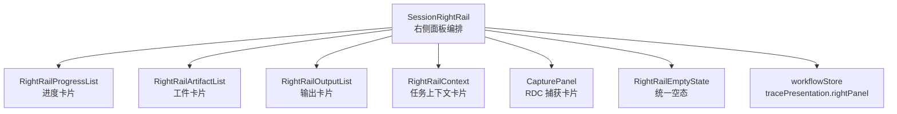
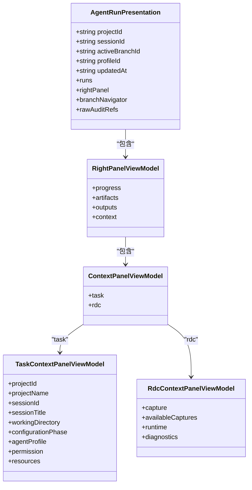
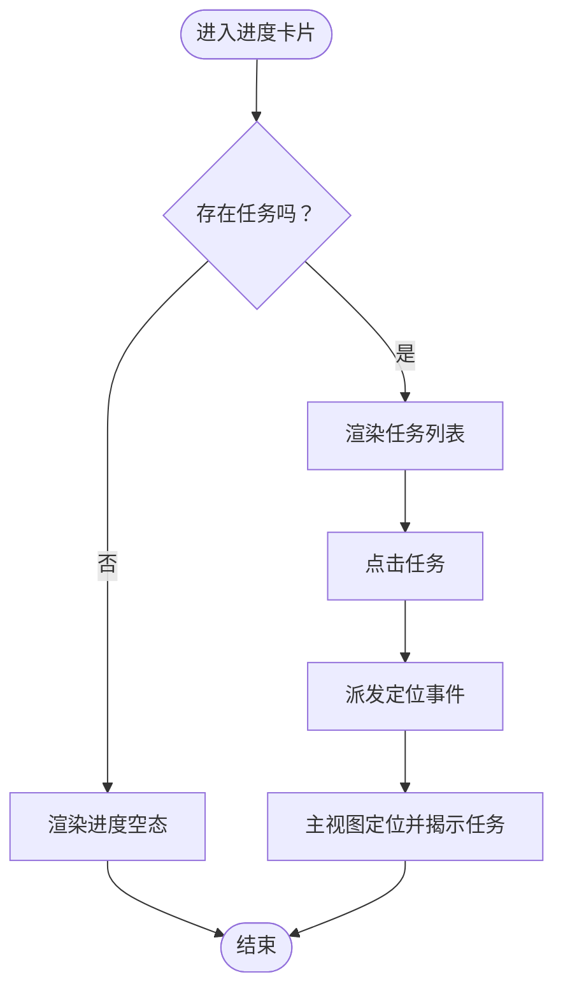
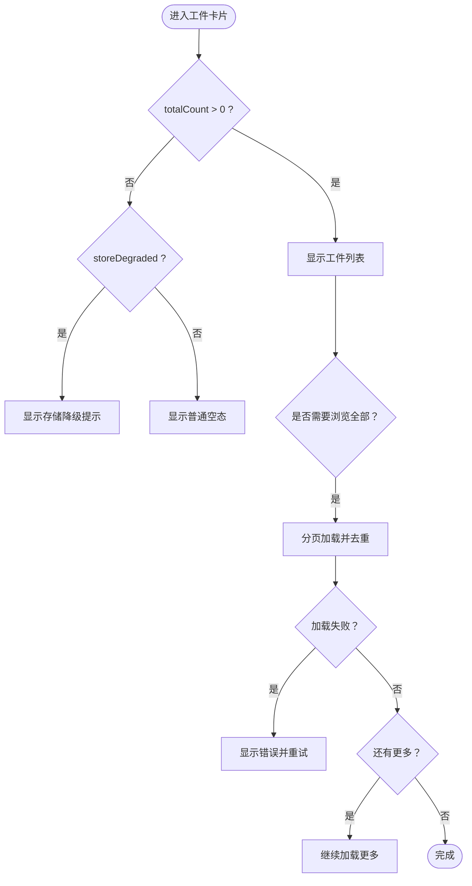
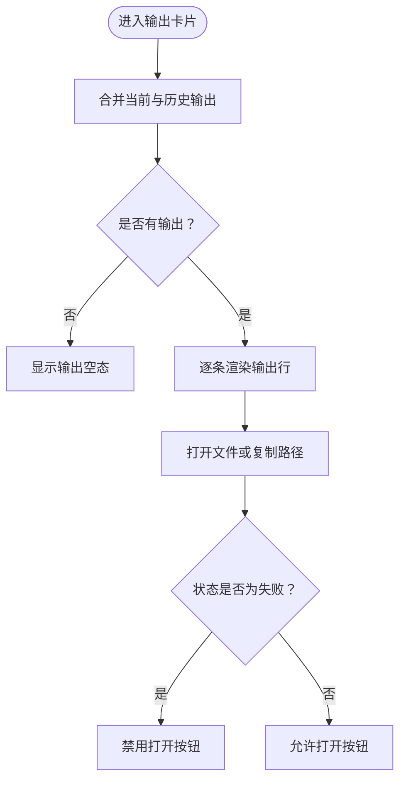
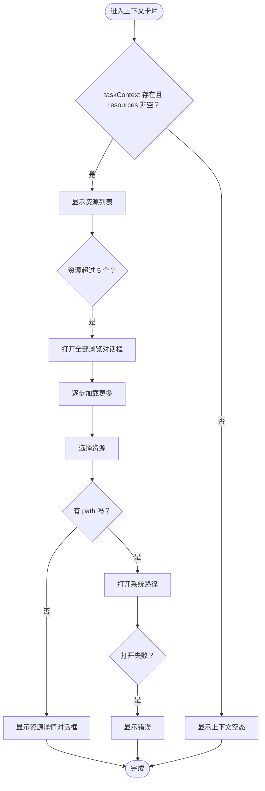
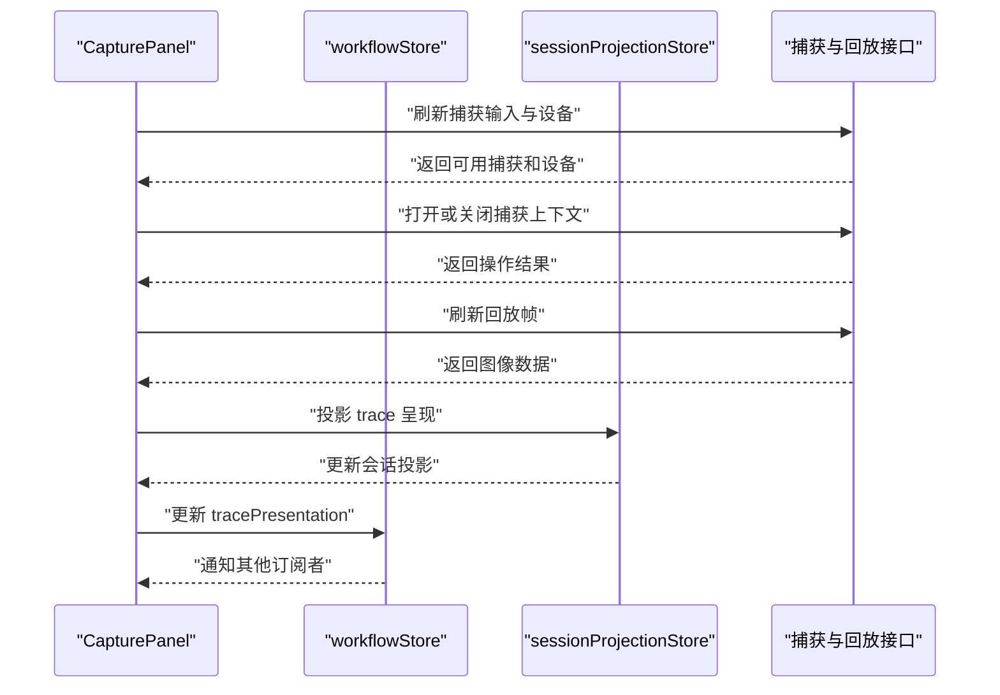
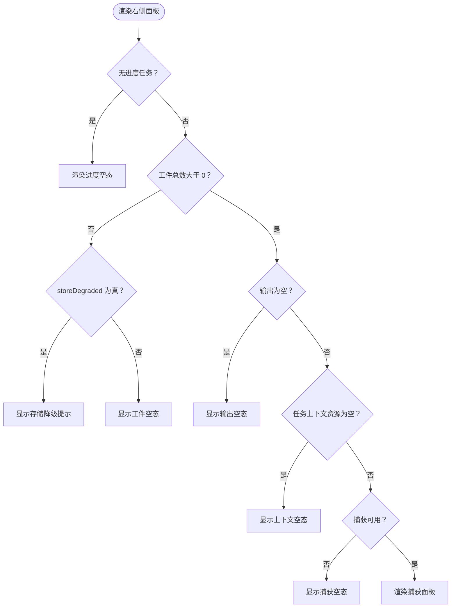
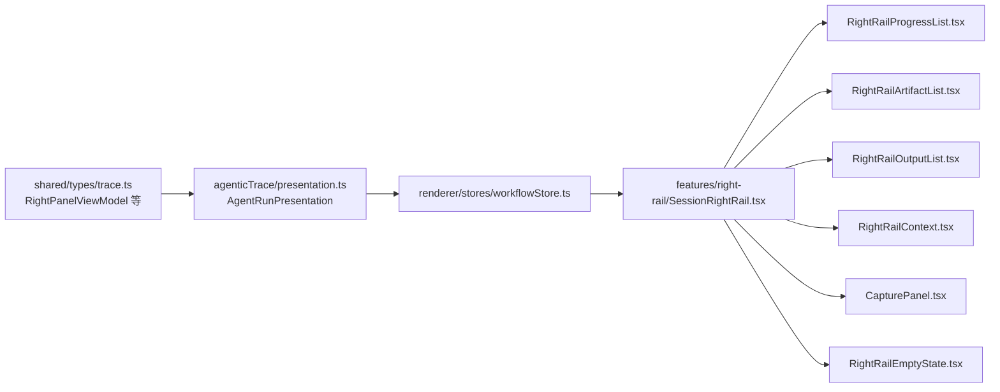

# 会话右侧面板

<cite>
**本文引用的文件**
- [SessionRightRail.tsx](file://src/renderer/features/right-rail/SessionRightRail.tsx)
- [workflowStore.ts](file://src/renderer/stores/workflowStore.ts)
- [presentation.ts](file://shared/types/agenticTrace/presentation.ts)
- [trace.ts](file://shared/types/trace.ts)
- [RightRailEmptyState.tsx](file://src/renderer/features/right-rail/RightRailEmptyState.tsx)
- [RightRailProgressList.tsx](file://src/renderer/features/right-rail/RightRailProgressList.tsx)
- [RightRailArtifactList.tsx](file://src/renderer/features/right-rail/RightRailArtifactList.tsx)
- [RightRailOutputList.tsx](file://src/renderer/features/right-rail/RightRailOutputList.tsx)
- [RightRailContext.tsx](file://src/renderer/features/right-rail/RightRailContext.tsx)
- [CapturePanel.tsx](file://src/renderer/features/right-rail/CapturePanel.tsx)
</cite>

## 目录
1. [引言](#引言)
2. [项目结构与定位](#项目结构与定位)
3. [核心组件总览](#核心组件总览)
4. [数据模型与绑定](#数据模型与绑定)
5. [五大卡片详解](#五大卡片详解)
6. [任务上下文与 RDC 上下文组合逻辑](#任务上下文与-rdc-上下文组合逻辑)
7. [空态处理与降级提示](#空态处理与降级提示)
8. [标题、内容与国际化结构](#标题内容与国际化结构)
9. [新增自定义卡片开发指南](#新增自定义卡片开发指南)
10. [依赖关系分析](#依赖关系分析)
11. [性能与渲染特性](#性能与渲染特性)
12. [故障排查](#故障排查)
13. [结论](#结论)

## 引言
本文件面向需要理解或扩展“会话右侧面板”的前端开发者。该面板由 `SessionRightRail` 组件负责，从 `workflowStore.tracePresentation.rightPanel` 读取展示数据，并渲染五个核心区域：进度、工件、输出、上下文和捕获。文档重点说明数据来源、空态与降级处理、任务上下文与 RDC 上下文的组合展示模式、标题与内容结构设计，以及新增自定义卡片的推荐实现方式。

## 项目结构与定位
会话右侧面板位于渲染进程的前端功能模块中，主要代码集中在 `src/renderer/features/right-rail` 目录下。顶层容器 `SessionRightRail` 只承担布局编排、状态解构和五类卡片的选择渲染；具体列表、详情、交互分别交给专用子组件处理。

**图表来源**
- [SessionRightRail.tsx:1-73](file://src/renderer/features/right-rail/SessionRightRail.tsx#L1-L73)
- [workflowStore.ts:1-43](file://src/renderer/stores/workflowStore.ts#L1-L43)

**章节来源**
- [SessionRightRail.tsx:1-73](file://src/renderer/features/right-rail/SessionRightRail.tsx#L1-L73)

## 核心组件总览
`SessionRightRail` 是右侧面板的入口组件。它不直接渲染每个卡片的详细内容，而是：
- 从 `useWorkflowStore` 订阅 `tracePresentation`。
- 安全解构 `rightPanel`，并为缺失字段提供默认值。
- 根据数据是否存在决定渲染对应卡片或统一空态。
- 为每个区域创建带语义化 `data-testid` 的 `<section>`，并使用统一的标题样式和内容容器。

| 区域 | 对应子组件 | 关键数据源 | 是否可空 | 典型空态文案键 |
|---|---|---|---:|---|
| 进度 | `RightRailProgressList` | `rightPanel.progress` | 是 | `control.rightRail.progress.empty` |
| 工件 | `RightRailArtifactList` | `rightPanel.artifacts` | 是 | `control.rightRail.artifacts.empty` 或 `storeDegraded` |
| 输出 | `RightRailOutputList` | `rightPanel.outputs` | 是 | `control.rightRail.outputs.empty` |
| 上下文 | `RightRailContext` | `rightPanel.context.task.resources` | 是 | `control.rightRail.context.empty` |
| 捕获 | `CapturePanel` | `rightPanel.context.rdc.availableCaptures` | 条件显示 | `control.rightRail.capture.empty` |

**章节来源**
- [SessionRightRail.tsx:1-73](file://src/renderer/features/right-rail/SessionRightRail.tsx#L1-L73)

## 数据模型与绑定
右侧面板的数据契约定义在共享类型中，并通过 `AgentRunPresentation` 暴露给渲染层。

### 数据结构关系

**图表来源**
- [presentation.ts:1-40](file://shared/types/agenticTrace/presentation.ts#L1-L40)
- [trace.ts:174-242](file://shared/types/trace.ts#L174-L242)

### Store 绑定与防抖策略
`workflowStore` 通过 Zustand 管理 `tracePresentation`，并在更新时比较当前与新的呈现对象：
- 如果引用相同，则不触发更新。
- 如果任一为 `null`，视为不同。
- 若两者都存在，会比较 `sessionId`、`updatedAt` 以及 `rightPanel` 的四部分：`progress`、`artifacts`、`outputs`、`context`。
- 只有变化时才写入 store，从而减少不必要的 React 重渲染。

这意味着即使后端返回完整的新对象，只要这五个字段没有变化，右侧面板也不会重新计算。

**章节来源**
- [workflowStore.ts:1-43](file://src/renderer/stores/workflowStore.ts#L1-L43)
- [presentation.ts:1-40](file://shared/types/agenticTrace/presentation.ts#L1-L40)
- [trace.ts:237-242](file://shared/types/trace.ts#L237-L242)

## 五大卡片详解

### 进度卡片
进度卡片展示工作流中的任务队列。它接收 `tasks` 数组和用于定位任务的本地化标签，并按顺序渲染任务行。每项包含：
- 任务序号（基于 `order + 1`）。
- 任务状态标记。
- 任务标题。
- 点击后向工作进程派发定位事件，使主视图滚动到对应任务。

当没有任务时，渲染 `RightRailEmptyState`，类型为 `progress`，并使用 `control.rightRail.progress.empty` 作为标题文案。

**图表来源**
- [SessionRightRail.tsx:20-42](file://src/renderer/features/right-rail/SessionRightRail.tsx#L20-L42)
- [RightRailProgressList.tsx:1-30](file://src/renderer/features/right-rail/RightRailProgressList.tsx#L1-L30)

**章节来源**
- [SessionRightRail.tsx:20-42](file://src/renderer/features/right-rail/SessionRightRail.tsx#L20-L42)
- [RightRailProgressList.tsx:1-30](file://src/renderer/features/right-rail/RightRailProgressList.tsx#L1-L30)

### 工件卡片
工件卡片展示调查相关工件列表，包括：
- 初始可见行：`artifacts.rows`。
- 总数：`artifacts.totalCount`。
- 存储降级标志：`artifacts.storeDegraded`。

交互行为包括：
- 点击工件行打开预览。
- 超过一定数量时提供“浏览全部”按钮。
- 分页加载更多工件。
- 加载失败时显示错误并提供重试。
- 使用 `storeDegraded` 区分后端服务不可用与普通空列表。

空态判断优先看 `hasArtifacts = artifacts.totalCount > 0`。若为空：
- `storeDegraded` 为真时，显示“存储降级”提示。
- 否则显示普通空列表提示。

**图表来源**
- [SessionRightRail.tsx:42-50](file://src/renderer/features/right-rail/SessionRightRail.tsx#L42-L50)
- [RightRailArtifactList.tsx:1-67](file://src/renderer/features/right-rail/RightRailArtifactList.tsx#L1-L67)

**章节来源**
- [SessionRightRail.tsx:42-50](file://src/renderer/features/right-rail/SessionRightRail.tsx#L42-L50)
- [RightRailArtifactList.tsx:1-67](file://src/renderer/features/right-rail/RightRailArtifactList.tsx#L1-L67)

### 输出卡片
输出卡片合并“当前输出”和“历史输出”，按固定顺序渲染。每条输出记录支持：
- 显示文件名和文件大小。
- 打开文件路径。
- 复制文件路径。
- 对失败状态的输出禁用打开操作，并给出友好文案。

当 `current` 与 `previous` 合计为空时，显示 `outputs.empty` 空态。

**图表来源**
- [SessionRightRail.tsx:50-58](file://src/renderer/features/right-rail/SessionRightRail.tsx#L50-L58)
- [RightRailOutputList.tsx:1-39](file://src/renderer/features/right-rail/RightRailOutputList.tsx#L1-L39)

**章节来源**
- [SessionRightRail.tsx:50-58](file://src/renderer/features/right-rail/SessionRightRail.tsx#L50-L58)
- [RightRailOutputList.tsx:1-39](file://src/renderer/features/right-rail/RightRailOutputList.tsx#L1-L39)

### 上下文卡片
上下文卡片展示任务上下文，即 `rightPanel.context.task`。其显示条件是：
- `taskContext` 存在。
- `taskContext.resources` 非空。

渲染内容包括：
- 资源列表，每种资源类型有独立图标。
- 前 5 项直接显示。
- 超过 5 项时提供“浏览全部”对话框。
- 对话框内支持逐步加载更多。
- 点击资源尝试打开路径；若无路径则打开详情对话框，显示 ID、摘要、路径和 URL。
- 打开失败时显示错误提示。

空态条件是任务上下文不存在或资源为空，此时显示 `context.empty`。

**图表来源**
- [SessionRightRail.tsx:58-62](file://src/renderer/features/right-rail/SessionRightRail.tsx#L58-L62)
- [RightRailContext.tsx:1-64](file://src/renderer/features/right-rail/RightRailContext.tsx#L1-L64)

**章节来源**
- [SessionRightRail.tsx:58-62](file://src/renderer/features/right-rail/SessionRightRail.tsx#L58-L62)
- [RightRailContext.tsx:1-64](file://src/renderer/features/right-rail/RightRailContext.tsx#L1-L64)

### 捕获卡片
捕获卡片是右侧面板中最复杂的交互区域，用于关联 RDC 录制文件与回放设备。它的显示逻辑与其他卡片不同：
- 仅当 `taskContext` 存在，且 `captureContext.availableCaptures` 非空时，才替换普通捕获占位区。
- 否则，渲染一个空的捕获区域，并显示 `capture.empty`。

捕获面板内部负责：
- 选择可用捕获输入。
- 选择回放设备。
- 打开或关闭捕获上下文。
- 刷新投影和设备列表。
- 显示连接、传输、加载图片等阶段状态。
- 汇总警告、最终呈现不可用、动作错误、连接错误等提示信息。
- 将捕获上下文与当前会话的 trace 投影同步回 `useWorkflowStore`。

**图表来源**
- [SessionRightRail.tsx:62-73](file://src/renderer/features/right-rail/SessionRightRail.tsx#L62-L73)
- [CapturePanel.tsx:1-129](file://src/renderer/features/right-rail/CapturePanel.tsx#L1-L129)

**章节来源**
- [SessionRightRail.tsx:62-73](file://src/renderer/features/right-rail/SessionRightRail.tsx#L62-L73)
- [CapturePanel.tsx:1-129](file://src/renderer/features/right-rail/CapturePanel.tsx#L1-L129)

## 任务上下文与 RDC 上下文组合逻辑
`rightPanel.context` 同时包含两个维度：
- `task`：任务上下文，描述当前工作进程任务的项目、会话、工作目录、配置阶段、权限和资源集合。
- `rdc`：RDC 捕获上下文，描述可用的捕获输入、当前捕获状态、运行时信息和诊断信息。

`SessionRightRail` 的决策逻辑如下：
1. 先取 `taskContext = rightPanel.context.task`。
2. 再取 `captureContext = rightPanel.context.rdc`。
3. 上下文卡片只显示 `taskContext.resources` 非空的情况。
4. 捕获卡片只在 `taskContext` 存在且 `captureContext.availableCaptures` 非空时，才替换默认捕获区域。
5. 否则，保留捕获区域的空态，避免用户误以为缺少其他能力。

这种设计把“任务能力”和“捕获回放能力”分开：任务上下文可能始终存在，但 RDC 捕获需要额外数据才能启用完整交互。

**章节来源**
- [SessionRightRail.tsx:24-34](file://src/renderer/features/right-rail/SessionRightRail.tsx#L24-L34)
- [SessionRightRail.tsx:58-73](file://src/renderer/features/right-rail/SessionRightRail.tsx#L58-L73)
- [trace.ts:174-242](file://shared/types/trace.ts#L174-L242)

## 空态处理与降级提示
右侧面板使用统一的空态组件 `RightRailEmptyState`，它接收 `kind` 和 `copy`：
- `kind` 决定视觉类别，可选值为 `progress`、`artifacts`、`outputs`、`context`、`capture`。
- `copy` 作为空态标题文案。

各卡片空态触发条件：
- 进度：`tasks.length === 0`。
- 工件：`artifacts.totalCount === 0`，并根据 `storeDegraded` 切换文案。
- 输出：`current` 与 `previous` 合计长度为 0。
- 上下文：`taskContext` 不存在或 `resources` 为空。
- 捕获：未满足 `taskContext && captureContext && availableCaptures` 条件。

`storeDegraded` 是一个重要的降级信号：
- 表示工件列表所在的存储服务不可用或处于退化状态。
- 不应简单显示“没有工件”，而应提示用户后端能力受限。
- 工件卡片在浏览模式下也会根据 `next.storeDegraded` 设置错误状态。

**图表来源**
- [SessionRightRail.tsx:24-73](file://src/renderer/features/right-rail/SessionRightRail.tsx#L24-L73)
- [RightRailEmptyState.tsx:1-15](file://src/renderer/features/right-rail/RightRailEmptyState.tsx#L1-L15)
- [RightRailArtifactList.tsx:1-67](file://src/renderer/features/right-rail/RightRailArtifactList.tsx#L1-L67)

**章节来源**
- [SessionRightRail.tsx:24-73](file://src/renderer/features/right-rail/SessionRightRail.tsx#L24-L73)
- [RightRailEmptyState.tsx:1-15](file://src/renderer/features/right-rail/RightRailEmptyState.tsx#L1-L15)

## 标题、内容与国际化结构
每个卡片都包裹在一个 `RailSection` 中，结构一致：
- 外层使用 `<section>`，并带有语义化 `data-testid="right-rail-{id}"`。
- 标题来自 `t('control.rightRail.{area}.title')`。
- 内容区域使用统一的 `right-rail-section-content` 容器。

所有用户可见文案均通过 `useI18n()` 的 `t` 函数获取，避免硬编码字符串。常见键空间包括：
- `control.rightRail.progress.title / empty`
- `control.rightRail.artifacts.title / empty / storeDegraded`
- `control.rightRail.outputs.title / empty / open / copy / missing`
- `control.rightRail.context.title / empty / resources`
- `control.rightRail.capture.title / empty / controls`
- `control.rightRail.browse.all / more / close / loading / error`

这种结构使得新增卡片时可以直接复用 `RailSection`，只需提供 id、标题和子内容。

**章节来源**
- [SessionRightRail.tsx:9-23](file://src/renderer/features/right-rail/SessionRightRail.tsx#L9-L23)
- [SessionRightRail.tsx:24-73](file://src/renderer/features/right-rail/SessionRightRail.tsx#L24-L73)

## 新增自定义卡片开发指南
如果要新增第六个卡片，建议遵循以下模式：

### 第一步：确认数据模型
在 `RightPanelViewModel` 或相关上下文中增加新字段。例如：
- 新增 `customField`。
- 若属于上下文，放入 `context.custom`。
- 确保后端投影服务能够填充默认值和空值。

### 第二步：在 `SessionRightRail` 中解构
参考现有模式：
- 从 `rightPanel` 中取出新字段。
- 为缺失值提供默认值，尤其是数组、对象和布尔标志。
- 计算 `hasCustom` 等显隐条件。

### 第三步：创建卡片区域
使用 `RailSection`：
- 传入稳定 id，如 `custom`。
- 使用 `t('control.rightRail.custom.title')` 作为标题。
- 在内容区域渲染新卡片组件或空态。

### 第四步：实现空态
使用 `RightRailEmptyState`：
- 指定 `kind`，例如新增 `'custom'`。
- 使用独立的空态文案键，例如 `control.rightRail.custom.empty`。
- 若有后端降级标志，参考工件卡片，提供降级文案。

### 第五步：绑定 workflowStore
- 确保新字段被纳入 `sameRightPanel` 比较逻辑，否则 store 不会感知变更。
- 如果新字段属于 `context`，需检查 `context` 引用是否变化。
- 如果新字段会改变 `sessionId` 或 `updatedAt`，也要考虑是否影响整体呈现稳定性。

### 第六步：添加测试与可视化
- 为新增卡片编写单元测试，覆盖空态、正常态、降级态。
- 使用 `data-testid="right-rail-custom"` 定位元素。
- 为新文案添加国际化键，并确保中英文翻译一致。

**章节来源**
- [SessionRightRail.tsx:9-73](file://src/renderer/features/right-rail/SessionRightRail.tsx#L9-L73)
- [workflowStore.ts:15-23](file://src/renderer/stores/workflowStore.ts#L15-L23)
- [RightRailEmptyState.tsx:1-15](file://src/renderer/features/right-rail/RightRailEmptyState.tsx#L1-L15)
- [RightRailArtifactList.tsx:1-67](file://src/renderer/features/right-rail/RightRailArtifactList.tsx#L1-L67)

## 依赖关系分析
右侧面板的依赖可以分为三层：
- 数据层：`@shared/types/trace` 与 `@shared/types/agenticTrace/presentation`。
- 状态层：`workflowStore` 提供 `tracePresentation`。
- 表现层：五个卡片组件和统一空态组件。

**图表来源**
- [trace.ts:174-242](file://shared/types/trace.ts#L174-L242)
- [presentation.ts:1-40](file://shared/types/agenticTrace/presentation.ts#L1-L40)
- [workflowStore.ts:1-43](file://src/renderer/stores/workflowStore.ts#L1-L43)
- [SessionRightRail.tsx:1-73](file://src/renderer/features/right-rail/SessionRightRail.tsx#L1-L73)

**章节来源**
- [trace.ts:174-242](file://shared/types/trace.ts#L174-L242)
- [presentation.ts:1-40](file://shared/types/agenticTrace/presentation.ts#L1-L40)
- [workflowStore.ts:1-43](file://src/renderer/stores/workflowStore.ts#L1-L43)
- [SessionRightRail.tsx:1-73](file://src/renderer/features/right-rail/SessionRightRail.tsx#L1-L73)

## 性能与渲染特性
- `SessionRightRail` 本身没有复杂计算，主要职责是解构数据和选择子组件。
- 进度列表使用 `React.memo` 包装，避免任务数组不变时重复渲染。
- 工件列表和上下文列表内部自行管理分页、加载、错误和预览状态。
- 捕获面板维护较多状态，包括回放阶段、设备、草稿选择和错误，因此适合独立组件封装。
- `workflowStore` 的 `sameRightPanel` 比较可以防止无关字段变化导致的整棵右侧面板树重建。

优化建议：
- 新增卡片时应尽量保持轻量，避免在 `SessionRightRail` 中放置业务逻辑。
- 对长列表使用分页或虚拟滚动，参考工件和上下文组件的分页模式。
- 对于可能频繁变化的捕获状态，避免让父组件参与重渲染，只传递必要 props。
- 在 store 比较中加入新字段，确保增量更新正确生效。

[本节为通用性能指导，不直接分析具体代码片段]

## 故障排查
常见问题及排查方向：

| 现象 | 可能原因 | 排查步骤 |
|---|---|---|
| 右侧面板完全不更新 | `tracePresentation` 未被更新或 `sameRightPanel` 认为相等 | 检查 `workflowStore.setTracePresentation` 调用；确认 `sessionId`、`updatedAt` 或 `rightPanel` 四部分是否真正变化 |
| 工件显示“没有工件”但后端有数据 | `artifacts.totalCount` 为 0 或 `rows` 为空 | 检查投影服务是否正确填充 `totalCoun`t 和 `rows` |
| 工件提示存储降级 | `storeDegraded` 为真 | 查看后端工件列表接口或投影服务返回值 |
| 上下文卡片不显示 | `taskContext.resources` 为空或 `taskContext` 不存在 | 检查 `rightPanel.context.task` 是否完整 |
| 捕获卡片一直显示空态 | `taskContext` 不存在或 `captureContext.availableCaptures` 为空 | 检查 RDC 上下文数据源 |
| 捕获面板报错 | 打开、关闭、刷新或加载图像失败 | 查看 `CapturePanel` 中的错误状态与回调 |
| 国际化文案缺失 | 翻译键未添加或拼写不一致 | 搜索 `control.rightRail.*` 键并补充对应语言文件 |

**章节来源**
- [workflowStore.ts:15-23](file://src/renderer/stores/workflowStore.ts#L15-L23)
- [RightRailArtifactList.tsx:1-67](file://src/renderer/features/right-rail/RightRailArtifactList.tsx#L1-L67)
- [RightRailContext.tsx:1-64](file://src/renderer/features/right-rail/RightRailContext.tsx#L1-L64)
- [CapturePanel.tsx:1-129](file://src/renderer/features/right-rail/CapturePanel.tsx#L1-L129)

## 结论
`SessionRightRail` 是会话右侧面板的统一编排器。它从 `workflowStore.tracePresentation.rightPanel` 拉取进度、工件、输出、上下文和捕获数据，并以一致的 `RailSection` 结构渲染。每个卡片都有明确的空态策略，其中工件卡片还承担了 `storeDegraded` 这一重要降级信号。任务上下文与 RDC 上下文分离设计，既保证了基础上下文始终可读，又让捕获回放在具备完整数据时才启用。新增卡片时，应遵循现有数据解构、空态渲染、国际化键和 store 比较模式，以保证右侧面板的一致性和可维护性。