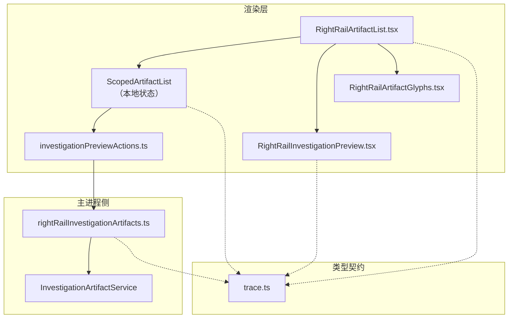
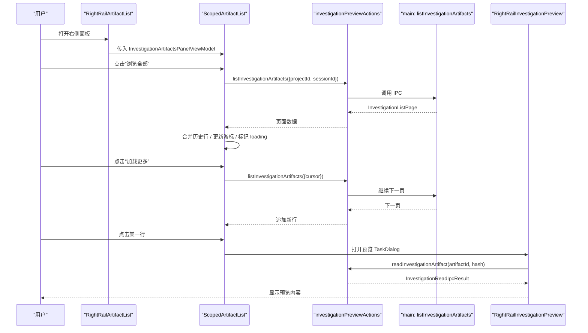
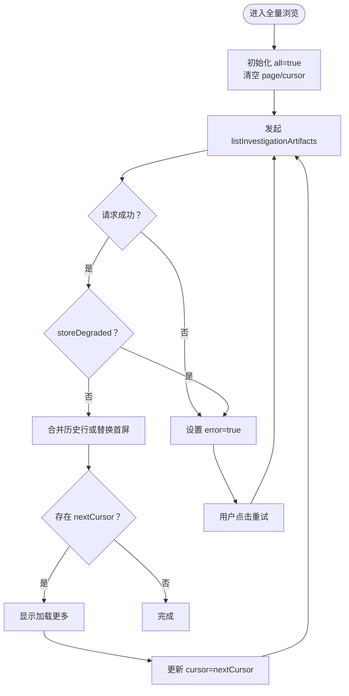
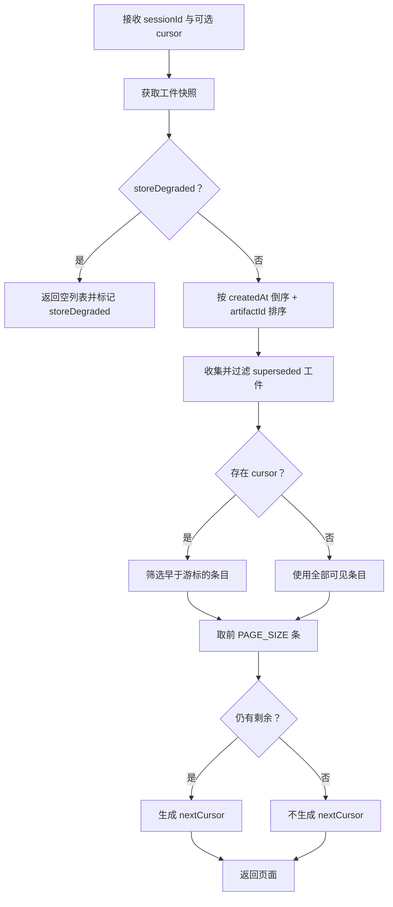
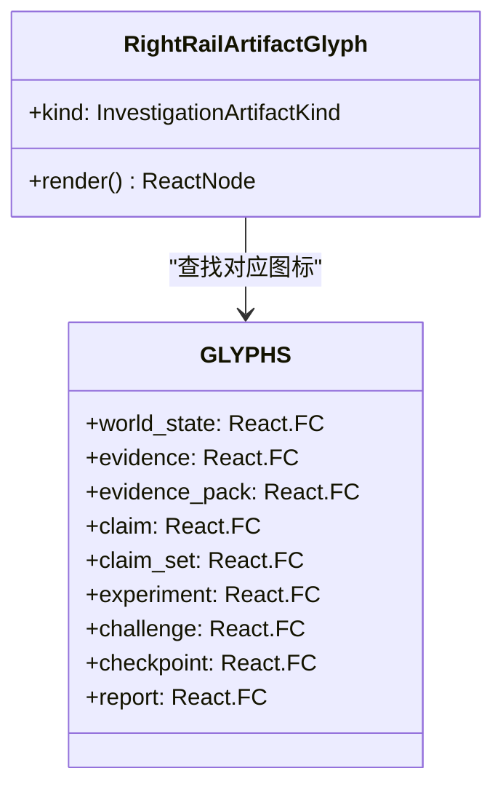
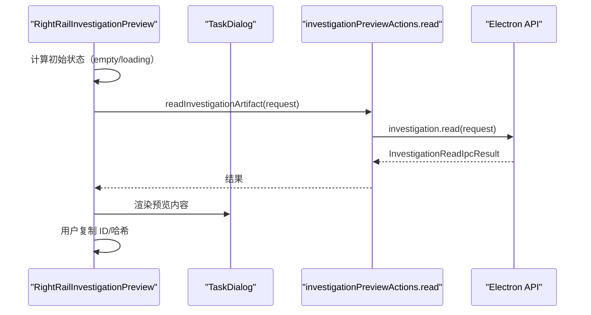
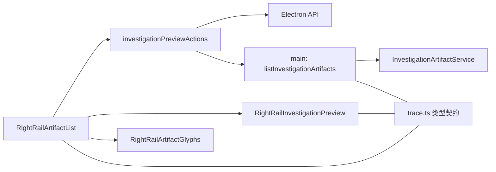

# 工件卡片

<cite>
**本文引用的文件**   
- [RightRailArtifactList.tsx](file://src/renderer/features/right-rail/RightRailArtifactList.tsx)
- [RightRailInvestigationPreview.tsx](file://src/renderer/features/right-rail/RightRailInvestigationPreview.tsx)
- [investigationPreviewActions.ts](file://src/renderer/features/right-rail/investigationPreviewActions.ts)
- [rightRailInvestigationArtifacts.ts](file://src/main/agent-trace/rightRailInvestigationArtifacts.ts)
- [trace.ts](file://src/shared/types/trace.ts)
- [RightRailArtifactGlyphs.tsx](file://src/renderer/features/right-rail/RightRailArtifactGlyphs.tsx)
</cite>

## 目录
1. [引言](#引言)
2. [项目结构](#项目结构)
3. [核心组件](#核心组件)
4. [架构总览](#架构总览)
5. [详细组件分析](#详细组件分析)
6. [依赖关系分析](#依赖关系分析)
7. [性能与分页特性](#性能与分页特性)
8. [故障排查指南](#故障排查指南)
9. [结论](#结论)

## 引言
本文围绕“工件卡片”相关的前端右侧面板与后端投影逻辑展开，重点说明：
- `RightRailArtifactList` 如何消费 `InvestigationArtifactsPanelViewModel`，并在有限行展示和全量浏览模式之间切换。
- `ScopedArtifactList` 的复杂状态管理：分页加载、预览对话框、错误处理、重试机制。
- `listInvestigationArtifacts` 的调用模式与游标分页算法。
- `RightRailArtifactGlyphs` 中不同工件类型的图标映射策略。
- `RightRailInvestigationPreview` 的预览流程及与 `TaskDialog` 的集成。
- `storeDegraded` 降级状态的传播与用户反馈。

## 项目结构
工件卡片功能横跨渲染层、主进程代理层以及共享类型定义：
- 渲染层负责 UI 交互、局部状态、预览弹窗。
- 主进程侧负责聚合调查工件索引、去重、排序、分页并返回投影视图模型。
- 共享类型定义了列表项、面板视图模型、分页游标等契约。

**图示来源**
- [RightRailArtifactList.tsx:1-67](file://src/renderer/features/right-rail/RightRailArtifactList.tsx#L1-L67)
- [RightRailInvestigationPreview.tsx:1-141](file://src/renderer/features/right-rail/RightRailInvestigationPreview.tsx#L1-L141)
- [investigationPreviewActions.ts:1-15](file://src/renderer/features/right-rail/investigationPreviewActions.ts#L1-L15)
- [rightRailInvestigationArtifacts.ts:1-112](file://src/main/agent-trace/rightRailInvestigationArtifacts.ts#L1-L112)
- [trace.ts:1-270](file://src/shared/types/trace.ts#L1-L270)

**章节来源**
- [RightRailArtifactList.tsx:1-67](file://src/renderer/features/right-rail/RightRailArtifactList.tsx#L1-L67)
- [rightRailInvestigationArtifacts.ts:1-112](file://src/main/agent-trave/rightRailInvestigationArtifacts.ts#L1-L112)
- [trace.ts:1-270](file://src/shared/types/trace.ts#L1-L270)

## 核心组件
- `RightRailArtifactList`：入口组件，从全局项目存储读取当前会话信息，将 `InvestigationArtifactsPanelViewModel` 传给内部实现。
- `ScopedArtifactList`：承载“前五行 + 全量浏览”的状态机，包含分页、预览、错误、重试、空结果等分支。
- `RightRailInvestigationPreview`：以 `TaskDialog` 打开的工件详情预览，支持报告渲染、原始记录、哈希校验与复制。
- `investigationPreviewActions`：封装 Electron IPC 调用，暴露 `listInvestigationArtifacts` 与 `readInvestigationArtifact`。
- `rightRailInvestigationArtifacts`：主进程侧数据聚合器，提供 `listInvestigationArtifacts` 与 `mapRightRailInvestigationArtifacts`。
- `RightRailArtifactGlyphs`：按工件种类映射 SVG 图标。
- `trace.ts`：定义 `InvestigationArtifactRow`、`InvestigationArtifactsPanelViewModel`、`InvestigationListPage`、`InvestigationListCursor` 等类型。

**章节来源**
- [RightRailArtifactList.tsx:1-67](file://src/renderer/features/right-rail/RightRailArtifactList.tsx#L1-L67)
- [RightRailInvestigationPreview.tsx:1-141](file://src/renderer/features/right-rail/RightRailInvestigationPreview.tsx#L1-L141)
- [investigationPreviewActions.ts:1-15](file://src/renderer/features/right-rail/investigationPreviewActions.ts#L1-L15)
- [rightRailInvestigationArtifacts.ts:1-112](file://src/main/agent-trace/rightRailInvestigationArtifacts.ts#L1-L112)
- [RightRailArtifactGlyphs.tsx:1-72](file://src/renderer/features/right-rail/RightRailArtifactGlyphs.tsx#L1-L72)
- [trace.ts:1-270](file://src/shared/types/trace.ts#L1-L270)

## 架构总览
渲染层通过 IPC 调用主进程的 `listInvestigationArtifacts`，获取分页后的工件列表；点击某一行后，再通过 `readInvestigationArtifact` 拉取具体内容进行预览。主进程侧对底层工件索引进行去重、排序、游标分页，并将退化状态向上透传。

**图示来源**
- [RightRailArtifactList.tsx:1-67](file://src/renderer/features/right-rail/RightRailArtifactList.tsx#L1-L67)
- [investigationPreviewActions.ts:1-15](file://src/renderer/features/right-rail/investigationPreviewActions.ts#L1-L15)
- [rightRailInvestigationArtifacts.ts:1-112](file://src/main/agent-trace/rightRailInvestigationArtifacts.ts#L1-L112)
- [RightRailInvestigationPreview.tsx:1-141](file://src/renderer/features/right-rail/RightRailInvestigationPreview.tsx#L1-L141)

## 详细组件分析

### RightRailArtifactList：有限行与全量浏览
- 行为要点：
  - 从项目存储获取当前会话的 `projectId` 与 `sessionId`，作为后续 IPC 调用的上下文。
  - 渲染 `artifacts.rows`（通常为主进程限定的前五行）。
  - 当 `totalCount > 5` 时显示“浏览全部”按钮，进入全量浏览模式。
  - 全量模式下使用 `TaskDialog` 承载分页列表，并提供加载、错误、重试、空结果与更多加载按钮。
  - 点击任一行打开 `RightRailInvestigationPreview` 预览。

- 关键交互路径：
  - “浏览全部” -> 初始化 `all=true`、清空 `page/cursor`。
  - 首次加载 -> 调用 `listInvestigationArtifacts`，根据返回值设置 `page`。
  - 点击“加载更多” -> 更新 `cursor` 为 `nextCursor`，触发下一次请求。
  - 预览关闭 -> 清除预览行。

**章节来源**
- [RightRailArtifactList.tsx:1-67](file://src/renderer/features/right-rail/RightRailArtifactList.tsx#L1-L67)

### ScopedArtifactList：复杂状态管理
`ScopedArtifactList` 是工件卡片的核心状态机，负责：
- 浏览开关 `all`：控制是否进入全量浏览模式。
- 预览行 `preview`：当前选中的工件行。
- 分页数据 `page`：保存当前页的行、总数、`nextCursor`。
- 加载态 `loading`：防止重复请求。
- 错误态 `error`：网络或主进程异常。
- 重试计数 `attempt`：用于重新触发副作用。
- 游标 `cursor`：分页锚点，由 `createdAt` 与 `artifactId` 构成。

状态流转规则：
- 仅在 `all=true` 时发起分页请求。
- 请求成功：
  - 若 `storeDegraded=true`，则置错并提示降级。
  - 否则根据是否有 `cursor` 决定是否合并历史行，避免重复条目。
- 请求失败：置 `error=true`，用户可点击重试。
- 无更多数据：不显示“加载更多”。

**图示来源**
- [RightRailArtifactList.tsx:1-67](file://src/renderer/features/right-rail/RightRailArtifactList.tsx#L1-L67)

**章节来源**
- [RightRailArtifactList.tsx:1-67](file://src/renderer/features/right-rail/RightRailArtifactList.tsx#L1-L67)

### listInvestigationArtifacts：调用模式与游标分页
- 调用模式：
  - 前端通过 `investigationPreviewActions.listInvestigationArtifacts` 调用 IPC。
  - 入参为 `InvestigationListRequest`，包含 `projectId`、`sessionId` 与可选 `cursor`。
  - 返回 `InvestigationListPage`，包含 `rows`、`totalCount`、`nextCursor` 与 `storeDegraded`。

- 游标分页逻辑（主进程侧）：
  - 先获取工件快照，若 `storeDegraded=true` 直接返回空列表并标记降级。
  - 对工件索引按创建时间倒序、再按 `artifactId` 排序。
  - 收集被替代工件 ID 并过滤掉这些行。
  - 若有 `cursor`，仅保留早于游标的条目（先比较时间，再比较 ID）。
  - 取前 `PAGE_SIZE` 条作为一页，若剩余超过一页则生成 `nextCursor`。
  - 最终返回带分页信息的投影行数组。

- 前五行限制：
  - `mapRightRailInvestigationArtifacts` 会调用一次分页函数并截断前五行，作为右侧面板默认展示。

**图示来源**
- [rightRailInvestigationArtifacts.ts:1-112](file://src/main/agent-trace/rightRailInvestigationArtifacts.ts#L1-L112)

**章节来源**
- [investigationPreviewActions.ts:1-15](file://src/renderer/features/right-rail/investigationPreviewActions.ts#L1-L15)
- [rightRailInvestigationArtifacts.ts:1-112](file://src/main/agent-trace/rightRailInvestigationArtifacts.ts#L1-L112)
- [trace.ts:268-270](file://src/shared/types/trace.ts#L268-L270)

### RightRailArtifactGlyphs：图标映射
该模块维护 `GLYPHS` 映射表，将 `InvestigationArtifactKind` 转换为对应的 SVG 组件：
- `world_state`：世界状态图标。
- `evidence` / `evidence_pack`：证据类图标。
- `claim` / `claim_set`：主张类图标。
- `experiment`：实验图标。
- `challenge`：挑战图标。
- `checkpoint`：检查点图标。
- `report`：报告图标。

未识别的工件种类会回退到 `ReportGlyph`，保证 UI 不会空白。

**图示来源**
- [RightRailArtifactGlyphs.tsx:1-72](file://src/renderer/features/right-rail/RightRailArtifactGlyphs.tsx#L1-L72)

**章节来源**
- [RightRailArtifactGlyphs.tsx:1-72](file://src/renderer/features/right-rail/RightRailArtifactGlyphs.tsx#L1-L72)

### RightRailInvestigationPreview：预览与 TaskDialog 集成
- 打开条件：
  - 若工件行已有 `contentHash`，进入加载状态；否则直接进入空状态。
- 数据读取：
  - 调用 `readInvestigationArtifact`，传入 `sessionId`、`artifactId`、`expectedHash`。
  - 若 IPC 不可用或拒绝访问，返回错误状态。
  - 若服务端返回降级状态，UI 显示“已降级”标签。
- UI 展示：
  - 使用 `TaskDialog` 展示标题、ID、版本号、状态、是否降级、哈希值、错误消息与正文。
  - 对 `kind='report'` 的报告类型，渲染专用报告视图并附带原始 JSON。
  - 支持复制工件 ID 与哈希值。
- 生命周期：
  - 每次 `row`、`sessionId` 或 `contentHash` 变化时重新拉取内容。
  - 组件卸载时取消异步操作。

**图示来源**
- [RightRailInvestigationPreview.tsx:1-141](file://src/renderer/features/right-rail/RightRailInvestigationPreview.tsx#L1-L141)
- [investigationPreviewActions.ts:1-15](file://src/renderer/features/right-rail/investigationPreviewActions.ts#L1-L15)

**章节来源**
- [RightRailInvestigationPreview.tsx:1-141](file://src/renderer/features/right-rail/RightRailInvestigationPreview.tsx#L1-L141)

### storeDegraded：降级处理与用户反馈
- 主进程侧：
  - 若底层工件存储处于退化状态，`listInvestigationArtifacts` 返回空列表并设置 `storeDegraded=true`。
  - 异常捕获也会返回退化空列表，确保 UI 不会因为崩溃而中断。
- 渲染层：
  - `ScopedArtifactList` 在分页响应中检测 `storeDegraded`，将其视为错误状态，显示错误提示。
  - 同时提供“重试”按钮，通过递增 `attempt` 重新触发副作用。
  - 在预览层面，若工件本身标记 `degraded` 或预览结果为 `degraded`，会明确告知用户“已降级”。

用户反馈链路：
- 列表页：错误区域提示 + 重试按钮。
- 预览页：元数据中显示“是否降级”，并给出相应文案。

**章节来源**
- [rightRailInvestigationArtifacts.ts:1-112](file://src/main/agent-trace/rightRailInvestigationArtifacts.ts#L1-L112)
- [RightRailArtifactList.tsx:1-67](file://src/renderer/features/right-rail/RightRailArtifactList.tsx#L1-L67)
- [RightRailInvestigationPreview.tsx:1-141](file://src/renderer/features/right-rail/RightRailInvestigationPreview.tsx#L1-L141)

## 依赖关系分析
- 组件耦合：
  - `RightRailArtifactList` 依赖项目存储、i18n、`TaskDialog`、`RightRailArtifactGlyphs`、`RightRailInvestigationPreview` 与 IPC 动作。
  - `ScopedArtifactList` 内部管理分页与预览，但不直接感知主进程实现细节。
  - `investigationPreviewActions` 是渲染层与主进程 IPC 的唯一桥梁。
  - 主进程侧 `rightRailInvestigationArtifacts` 依赖 `InvestigationArtifactService` 与共享类型。
- 类型契约：
  - `InvestigationArtifactRow`、`InvestigationArtifactsPanelViewModel`、`InvestigationListPage`、`InvestigationListCursor` 定义前后端交互边界。
- 外部依赖：
  - Electron IPC（通过 `getElectronApi()`）。
  - 国际化资源键名（如 `control.rightRail.*`）。

**图示来源**
- [RightRailArtifactList.tsx:1-67](file://src/renderer/features/right-rail/RightRailArtifactList.tsx#L1-L67)
- [investigationPreviewActions.ts:1-15](file://src/renderer/features/right-rail/investigationPreviewActions.ts#L1-L15)
- [rightRailInvestigationArtifacts.ts:1-112](file://src/main/agent-trace/rightRailInvestigationArtifacts.ts#L1-L112)
- [trace.ts:1-270](file://src/shared/types/trace.ts#L1-L270)

**章节来源**
- [RightRailArtifactList.tsx:1-67](file://src/renderer/features/right-rail/RightRailArtifactList.tsx#L1-L67)
- [investigationPreviewActions.ts:1-15](file://src/renderer/features/right-rail/investigationPreviewActions.ts#L1-L15)
- [rightRailInvestigationArtifacts.ts:1-112](file://src/main/agent-trace/rightRailInvestigationArtifacts.ts#L1-L112)
- [trace.ts:1-270](file://src/shared/types/trace.ts#L1-L270)

## 性能与分页特性
- 前五行快速展示：
  - 主进程侧 `mapRightRailInvestigationArtifacts` 直接截断前五行，减少首屏渲染压力。
- 游标分页：
  - 使用 `{ createdAt, artifactId }` 组合游标，避免偏移分页的性能问题与重复数据。
  - 分页大小固定为 50，便于批量渲染与内存控制。
- 行去重：
  - 前端在合并历史行时按 `artifactId` 去重，避免“加载更多”导致重复。
- 降级短路：
  - 一旦检测到 `storeDegraded`，不再拉取具体工件内容，降低后端压力。

[本节为通用性能讨论，不直接分析具体代码文件]

## 故障排查指南
常见问题与定位建议：
- 列表为空但存在工件：
  - 检查主进程是否返回 `storeDegraded=true`，此时列表会被清空。
  - 确认是否因“被替代工件”被过滤，例如 `superseded` 状态或链式替代。
- “加载更多”无效：
  - 检查是否存在 `nextCursor`，若无则不会再触发加载。
  - 检查 `cursor` 是否正确更新为上一页末尾项。
- 预览无法打开：
  - 检查 IPC 是否可用（`getElectronApi()` 是否为空）。
  - 查看预览错误消息，确认是否权限不足或工件不存在。
- 图标缺失：
  - 检查 `kind` 是否在 `GLYPHS` 中定义，未定义时会回退到报告图标。
- 国际化文案缺失：
  - 检查 i18n 键名是否与 `control.rightRail.*` 一致，特别是预览状态、错误与复制提示。

**章节来源**
- [rightRailInvestigationArtifacts.ts:1-112](file://src/main/agent-trace/rightRailInvestigationArtifacts.ts#L1-L112)
- [RightRailArtifactList.tsx:1-67](file://src/renderer/features/right-rail/RightRailArtifactList.tsx#L1-L67)
- [RightRailInvestigationPreview.tsx:1-141](file://src/renderer/features/right-rail/RightRailInvestigationPreview.tsx#L1-L141)
- [RightRailArtifactGlyphs.tsx:1-72](file://src/renderer/features/right-rail/RightRailArtifactGlyphs.tsx#L1-L72)

## 结论
工件卡片通过清晰的职责分层与明确的类型契约，实现了：
- 前五行快速展示与无限分页的全量浏览。
- 稳健的错误与降级处理，配合重试与友好提示。
- 可插拔的图标映射与报告预览能力。
- 以游标为核心的高效分页算法，兼顾性能与一致性。

整体设计适合扩展新的工件种类与预览形式，同时保持前后端交互的稳定与可控。