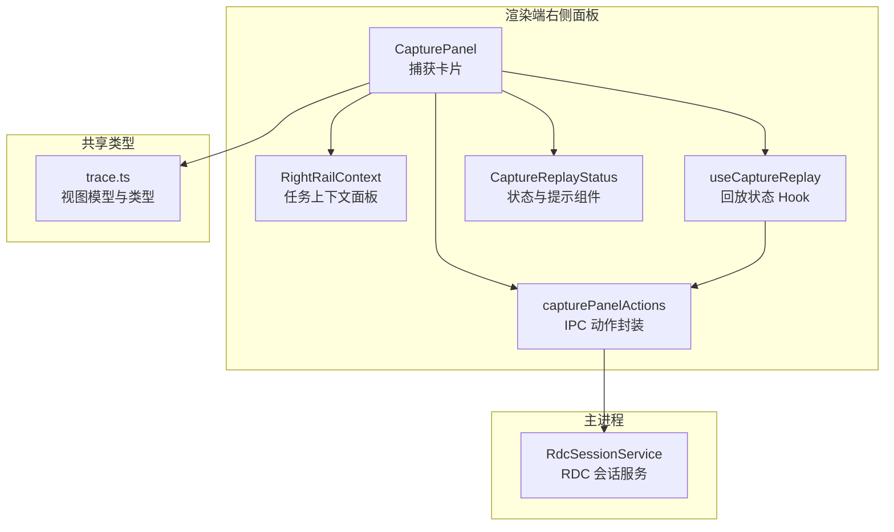
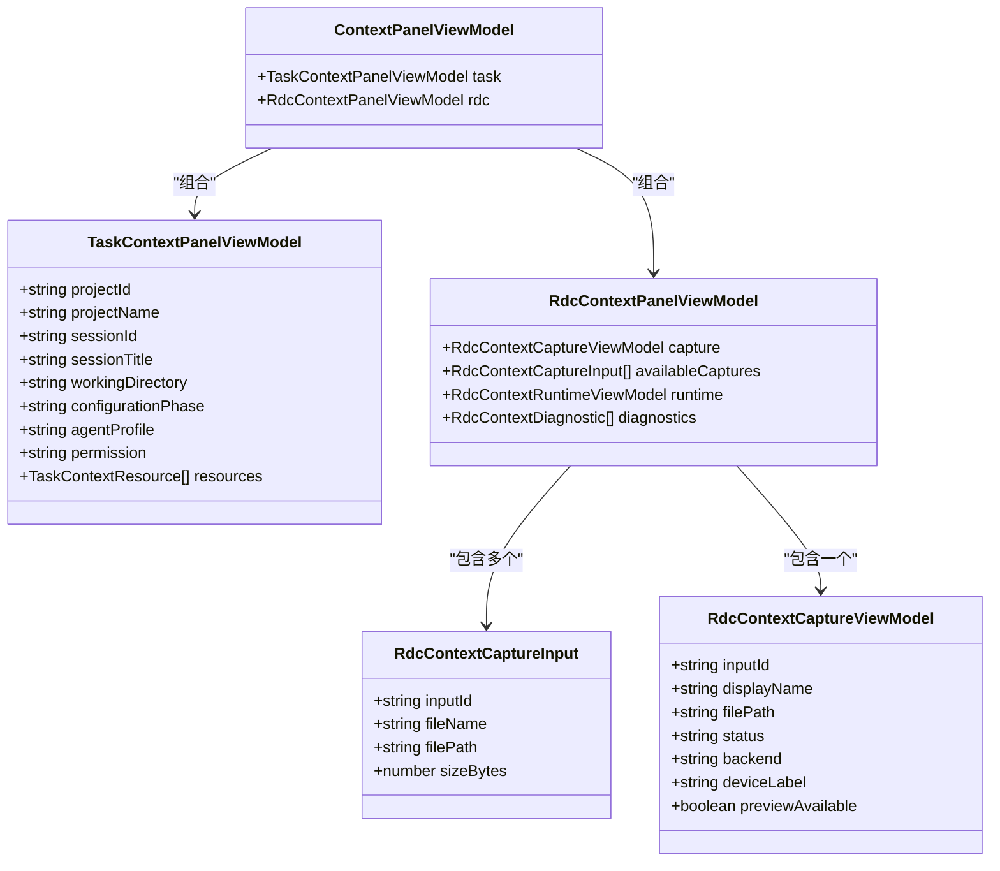
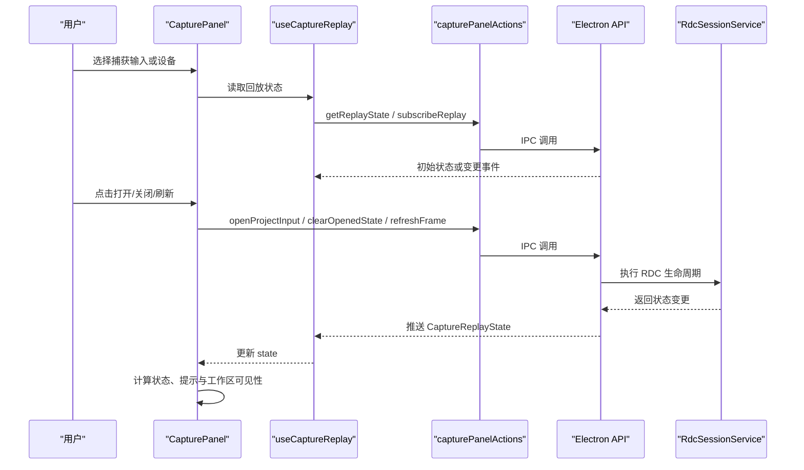
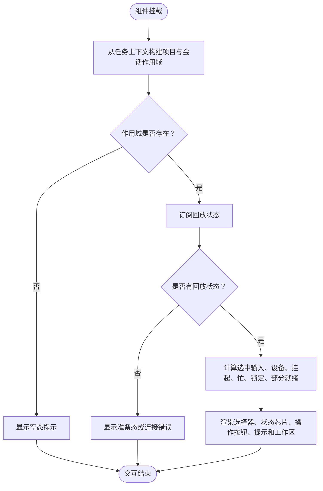
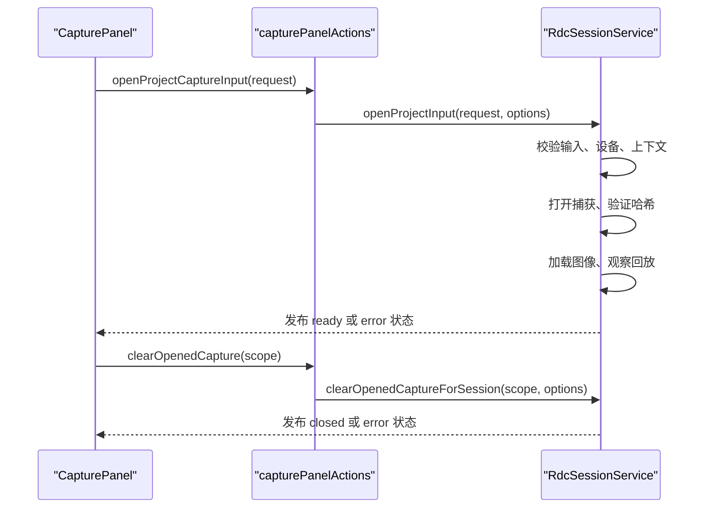
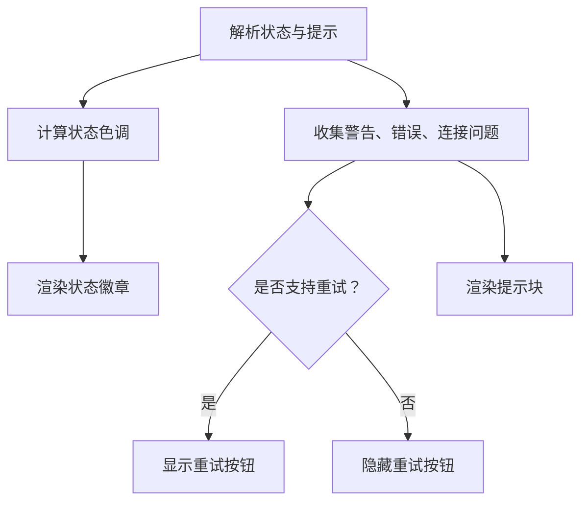
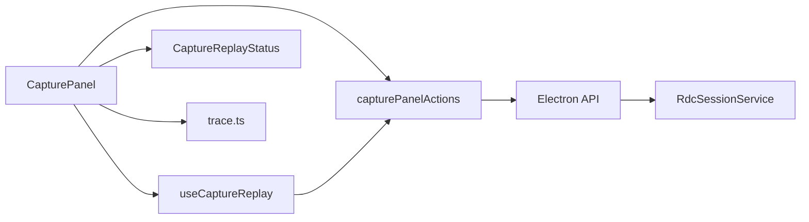

# 捕获卡片

<cite>
**本文引用的文件**   
- [CapturePanel.tsx](file://src/renderer/features/right-rail/CapturePanel.tsx)
- [RightRailContext.tsx](file://src/renderer/features/right-rail/RightRailContext.tsx)
- [capturePanelActions.ts](file://src/renderer/features/right-rail/capturePanelActions.ts)
- [useCaptureReplay.ts](file://src/renderer/features/right-rail/useCaptureReplay.ts)
- [CaptureReplayStatus.tsx](file://src/renderer/features/right-rail/CaptureReplayStatus.tsx)
- [trace.ts](file://src/shared/types/trace.ts)
- [RdcSessionService.ts](file://src/main/sessions/RdcSessionService.ts)
</cite>

## 目录
1. [简介](#简介)
2. [项目结构定位](#项目结构定位)
3. [核心组件与数据模型](#核心组件与数据模型)
4. [架构总览](#架构总览)
5. [详细组件分析](#详细组件分析)
6. [依赖关系分析](#依赖关系分析)
7. [性能与可靠性特性](#性能与可靠性特性)
8. [故障排查指南](#故障排查指南)
9. [结论与扩展建议](#结论与扩展建议)

## 简介
捕获卡片是右侧面板中用于展示和交互 RDC（RenderDoc Capture）回放能力的 UI 容器。它通过 `CapturePanel` 组件将两类视图模型组合在一起：
- `TaskContextPanelViewModel`：描述当前任务、项目、会话及上下文资源，由 `RightRailContext` 负责渲染。
- `RdcContextPanelViewModel`：描述可用捕获输入、已打开捕获状态、RDC 运行时信息和诊断项。

捕获面板的条件渲染逻辑为：当来自任务上下文的 `projectId` 和 `sessionId` 存在时，显示完整的捕获控制面板；否则仅显示“无会话”空态提示。完整面板内部进一步根据是否成功订阅到回放状态来决定是否渲染实际工作区；若没有有效回放状态，则呈现准备态或错误提示。

## 项目结构定位
捕获卡片位于渲染端右侧面板功能模块中，主要代码集中在 `src/renderer/features/right-rail`，并与共享类型定义和主进程的 RDC 会话服务协作。

**图表来源**
- [CapturePanel.tsx:1-129](file://src/renderer/features/right-rail/CapturePanel.tsx#L1-L129)
- [RightRailContext.tsx:1-64](file://src/renderer/features/right-rail/RightRailContext.tsx#L1-L64)
- [useCaptureReplay.ts:1-32](file://src/renderer/features/right-rail/useCaptureReplay.ts#L1-L32)
- [capturePanelActions.ts:1-21](file://src/renderer/features/right-rail/capturePanelActions.ts#L1-L21)
- [CaptureReplayStatus.tsx:1-133](file://src/renderer/features/right-rail/CaptureReplayStatus.tsx#L1-L133)
- [trace.ts:1-270](file://src/shared/types/trace.ts#L1-L270)
- [RdcSessionService.ts:1-291](file://src/main/sessions/RdcSessionService.ts#L1-L291)

**章节来源**
- [CapturePanel.tsx:1-129](file://src/renderer/features/right-rail/CapturePanel.tsx#L1-L129)
- [RightRailContext.tsx:1-64](file://src/renderer/features/right-rail/RightRailContext.tsx#L1-L64)
- [trace.ts:1-270](file://src/shared/types/trace.ts#L1-L270)

## 核心组件与数据模型
### 捕获卡片入口
`CapturePanel` 接收两个视图模型：
- `task: TaskContextPanelViewModel`
- `capture: RdcContextPanelViewModel`

它根据任务上下文中的项目与会话标识构造作用域；如果作用域不存在，返回空态文案。如果作用域存在，则进入 `ScopedCapturePanel`，完成设备选择、捕获输入选择、打开/关闭捕获、刷新帧、更新投影等交互。

### 任务上下文面板
`RightRailContext` 渲染任务相关的资源列表，包括文件、目录、技能、MCP、Web 等资源项，并提供浏览全部资源和查看资源详情的能力。该组件不直接参与 RDC 回放，但与 `CapturePanel` 在同一右侧面板上下文中共同提供任务背景信息。

### RDC 相关视图模型
共享类型中定义了 RDC 捕获所需的核心数据结构：
- `RdcContextCaptureInput`：每个可用捕获输入的标识、文件名、路径和大小。
- `RdcContextCaptureViewModel`：当前已打开捕获的显示名、路径、状态、后端类型和设备标签。
- `RdcContextRuntimeViewModel`：RDC 运行时上下文、远程状态、租约信息等。
- `RdcContextDiagnostic`：诊断项，包含可重试、切换设备、复制、设置等操作。
- `RdcContextPanelViewModel`：聚合 `capture`、`availableCaptures`、`runtime`、`diagnostics`。
- `TaskContextPanelViewModel`：任务上下文，包含项目、会话、工作目录、权限、资源列表等。
- `ContextPanelViewModel`：组合 `task` 和 `rdc`，供右侧面板使用。

**图表来源**
- [trace.ts:120-270](file://src/shared/types/trace.ts#L120-L270)

**章节来源**
- [trace.ts:120-270](file://src/shared/types/trace.ts#L120-L270)
- [RightRailContext.tsx:1-64](file://src/renderer/features/right-rail/RightRailContext.tsx#L1-L64)

## 架构总览
捕获卡片的整体数据流如下：

**图表来源**
- [CapturePanel.tsx:20-129](file://src/renderer/features/right-rail/CapturePanel.tsx#L20-L129)
- [useCaptureReplay.ts:1-32](file://src/renderer/features/right-rail/useCaptureReplay.ts#L1-L32)
- [capturePanelActions.ts:1-21](file://src/renderer/features/right-rail/capturePanelActions.ts#L1-L21)
- [RdcSessionService.ts:1-291](file://src/main/sessions/RdcSessionService.ts#L1-L291)

**章节来源**
- [CapturePanel.tsx:20-129](file://src/renderer/features/right-rail/CapturePanel.tsx#L20-L129)
- [useCaptureReplay.ts:1-32](file://src/renderer/features/right-rail/useCaptureReplay.ts#L1-L32)
- [capturePanelActions.ts:1-21](file://src/renderer/features/right-rail/capturePanelActions.ts#L1-L21)

## 详细组件分析

### 捕获面板条件渲染逻辑
`CapturePanel` 首先从 `task` 中提取 `projectId` 和 `sessionId`，并据此构建 `scope`。如果 `scope` 为空，则返回空态文本；否则渲染 `ScopedCapturePanel`。

在 `ScopedCapturePanel` 中，捕获状态来源于 `useCaptureReplay`。组件维护本地草稿选择、操作按钮状态、错误消息、展开菜单、复制状态等。关键渲染分支包括：
- 没有回放状态时，不渲染 `CaptureWorkspace`。
- 有回放状态但尚未打开捕获时，显示选择捕获输入、选择设备、打开捕获等控件。
- 已打开捕获后，显示关闭、刷新帧、复制上下文 ID、工作区等控件。
- 当处于挂起切换或忙状态时，禁用大部分操作并显示等待提示。

**图表来源**
- [CapturePanel.tsx:20-129](file://src/renderer/features/right-rail/CapturePanel.tsx#L20-L129)
- [useCaptureReplay.ts:1-32](file://src/renderer/features/right-rail/useCaptureReplay.ts#L1-L32)

**章节来源**
- [CapturePanel.tsx:20-129](file://src/renderer/features/right-rail/CapturePanel.tsx#L20-L129)

### 捕获上下文的数据绑定
捕获面板将以下数据源绑定到界面：
- `capture.availableCaptures`：用于下拉选择可用捕获输入。
- `devices`：来自设备存储，用于回放设备选择。
- `state.inputId` 与 `state.replayDeviceId`：当前回放状态的输入和设备标识。
- `selection.inputId` 与 `selection.deviceId`：记忆的选择，优先于默认值。
- `draft`：用户临时选择的输入和设备，用于“切换”操作的草稿。
- `state.contextId`：表示已打开捕获的上下文标识，用于判断是否已打开。
- `state.phase`：回放阶段，决定忙碌、部分就绪或错误状态。
- `state.error` 与 `state.warning`：状态错误与警告，用于收集 callout 提示。
- `state.generation` 与 `state.revision`：用于校验状态版本，避免过时更新。

这些绑定确保了 UI 始终反映主进程 RDC 会话服务的最新状态，同时保留用户临时选择以支持切换操作。

**章节来源**
- [CapturePanel.tsx:20-129](file://src/renderer/features/right-rail/CapturePanel.tsx#L20-L129)
- [useCaptureReplay.ts:1-32](file://src/renderer/features/right-rail/useCaptureReplay.ts#L1-L32)
- [capturePanelActions.ts:1-21](file://src/renderer/features/right-rail/capturePanelActions.ts#L1-L21)

### RDC 相关功能的集成方式
捕获面板通过 `capturePanelActions` 封装所有 IPC 调用，包括：
- 获取回放状态和选择
- 订阅回放状态变更
- 打开项目捕获输入
- 清除已打开捕获
- 刷新回放帧
- 刷新项目捕获输入与回放设备
- 获取追踪投影并更新工作流展示

这些动作最终映射到 Electron API，并由主进程的 `RdcSessionService` 执行 RDC 生命周期管理。服务负责：
- 按会话绑定回放状态
- 串行化生命周期操作
- 校验交互锁、生成版本、设备占用
- 验证捕获哈希并防止文件变化
- 加载图像、观察回放、记录历史
- 发布状态变更并通知监听者

**图表来源**
- [capturePanelActions.ts:1-21](file://src/renderer/features/right-rail/capturePanelActions.ts#L1-L21)
- [RdcSessionService.ts:1-291](file://src/main/sessions/RdcSessionService.ts#L1-L291)

**章节来源**
- [capturePanelActions.ts:1-21](file://src/renderer/features/right-rail/capturePanelActions.ts#L1-L21)
- [RdcSessionService.ts:1-291](file://src/main/sessions/RdcSessionService.ts#L1-L291)

### 捕获状态显示与用户操作接口
状态显示由 `CaptureReplayStatus` 模块提供：
- `isCapturePartialReady`：判断是否为“部分就绪”，即状态为 `ready` 但存在错误、警告或设备不可用。
- `resolveCaptureStatusTone`：根据挂起、忙碌、错误、部分就绪、就绪等阶段确定状态色调。
- `collectCaptureCallouts`：汇总警告、操作错误、连接错误、状态错误，并生成可重试的提示条目。
- `captureStatusLabelKey`：将状态映射为国际化键。
- `CaptureReplayStatusChip` 与 `CaptureReplayCallouts`：渲染状态徽章与提示块。

用户操作接口包括：
- 选择捕获输入
- 选择回放设备
- 打开或关闭捕获
- 切换捕获（草稿模式）
- 刷新捕获输入和设备列表
- 刷新回放帧
- 复制上下文 ID
- 重试失败操作

**图表来源**
- [CaptureReplayStatus.tsx:1-133](file://src/renderer/features/right-rail/CaptureReplayStatus.tsx#L1-L133)

**章节来源**
- [CapturePanel.tsx:20-129](file://src/renderer/features/right-rail/CapturePanel.tsx#L20-L129)
- [CaptureReplayStatus.tsx:1-133](file://src/renderer/features/right-rail/CaptureReplayStatus.tsx#L1-L133)

### 任务上下文与捕获面板的组合
右侧面板通常同时渲染任务上下文和 RDC 捕获信息。`RightRailContext` 负责任务资源的浏览与详情，而 `CapturePanel` 负责 RDC 捕获的回放控制。两者共享 `TaskContextPanelViewModel`，但职责分离：
- 任务上下文：只读展示资源、打开路径、浏览更多。
- 捕获面板：读写 RDC 回放状态、打开/关闭捕获、刷新预览、更新追踪投影。

这种组合使右侧面板既能提供任务背景，又能提供调试回放能力，形成一致的上下文体验。

**章节来源**
- [RightRailContext.tsx:1-64](file://src/renderer/features/right-rail/RightRailContext.tsx#L1-L64)
- [CapturePanel.tsx:1-129](file://src/renderer/features/right-rail/CapturePanel.tsx#L1-L129)

## 依赖关系分析
捕获卡片依赖以下层次：
- 渲染层：`CapturePanel`、`useCaptureReplay`、`CaptureReplayStatus`、`RightRailContext`。
- IPC 层：`capturePanelActions` 统一封装 Electron API。
- 共享类型：`trace.ts` 定义视图模型与 RDC 数据结构。
- 主进程服务：`RdcSessionService` 管理 RDC 会话、设备、回放生命周期和状态发布。

**图表来源**
- [CapturePanel.tsx:1-129](file://src/renderer/features/right-rail/CapturePanel.tsx#L1-L129)
- [useCaptureReplay.ts:1-32](file://src/renderer/features/right-rail/useCaptureReplay.ts#L1-L32)
- [capturePanelActions.ts:1-21](file://src/renderer/features/right-rail/capturePanelActions.ts#L1-L21)
- [trace.ts:1-270](file://src/shared/types/trace.ts#L1-L270)
- [RdcSessionService.ts:1-291](file://src/main/sessions/RdcSessionService.ts#L1-L291)

**章节来源**
- [CapturePanel.tsx:1-129](file://src/renderer/features/right-rail/CapturePanel.tsx#L1-L129)
- [capturePanelActions.ts:1-21](file://src/renderer/features/right-rail/capturePanelActions.ts#L1-L21)
- [RdcSessionService.ts:1-291](file://src/main/sessions/RdcSessionService.ts#L1-L291)

## 性能与可靠性特性
- 回放状态订阅采用增量过滤机制，仅接受更高 generation 或 revision 的状态，避免过时更新覆盖当前状态。
- 主进程对每个会话的生命周期操作进行串行化，保证同一会话内打开、关闭、观察等操作不会并发冲突。
- 设备占用通过设备 ID 与会话绑定，防止多个会话抢占同一远程设备。
- 捕获文件哈希在打开前后两次校验，防止文件内容在打开过程中被替换。
- 交互锁检测会阻止在代理运行、原生进程未确认退出等场景下的人类交互。
- 状态发布时对错误、设备不可用等场景自动补充设备展示信息，确保 UI 一致性。

这些机制提升了捕获回放的稳定性，减少竞态条件导致的 UI 错乱或状态不一致。

**章节来源**
- [useCaptureReplay.ts:1-32](file://src/renderer/features/right-rail/useCaptureReplay.ts#L1-L32)
- [RdcSessionService.ts:1-291](file://src/main/sessions/RdcSessionService.ts#L1-L291)

## 故障排查指南
常见问题与处理建议：
- 无法打开捕获：检查捕获文件路径、外部引用有效性、哈希校验结果；查看 `RDC_OPEN_FAILED` 错误与重试选项。
- 捕获文件变化：若打开过程中文件内容变化，服务会抛出捕获变化错误，需重新打开捕获。
- 设备被占用：远程设备已被其他会话占用时，需要释放设备或切换到本地设备。
- 交互被锁定：代理运行或未确认原生进程退出时会阻止人类操作，应等待代理完成或关闭相关会话。
- 回放不可用：设备状态为 `not_applicable` 或 `unavailable` 时，UI 会显示部分就绪提示，可能需要调整设备或刷新。
- 上下文隔离：当 RDC 上下文被隔离时，服务会将状态置为错误并建议关闭后重新打开。

建议在排查时关注：
- `CaptureReplayStatus.collectCaptureCallouts` 生成的提示项及其重试动作。
- `RdcSessionService` 的错误码与 `retry` 字段。
- 回放阶段的忙碌状态与挂起切换状态。
- 设备列表刷新与项目输入刷新后的状态变化。

**章节来源**
- [CaptureReplayStatus.tsx:1-133](file://src/renderer/features/right-rail/CaptureReplayStatus.tsx#L1-L133)
- [RdcSessionService.ts:1-291](file://src/main/sessions/RdcSessionService.ts#L1-L291)

## 结论与扩展建议
捕获卡片通过清晰的视图模型组合和分层架构，将任务上下文与 RDC 回放能力整合到右侧面板中。`CapturePanel` 负责条件渲染、状态绑定和用户操作，`useCaptureReplay` 负责回放状态订阅与版本过滤，`capturePanelActions` 统一 IPC 调用，`RdcSessionService` 负责主进程生命周期与状态发布。

扩展点与配置建议：
- 新增捕获输入类型：在 `RdcContextCaptureInput` 基础上扩展字段，并在选择器中适配显示。
- 新增回放设备类型：在设备列表中增加新设备类型，并在 `RdcSessionService` 中处理设备占用与连接逻辑。
- 扩展状态提示：在 `CaptureReplayStatus.collectCaptureCallouts` 中增加新的错误码与提示文案。
- 扩展交互锁策略：在 `RdcSessionService.lock` 中增加新的锁定原因，影响人类操作是否被禁止。
- 扩展回放观察流程：在 `observeAgentOperation` 或 `observe` 中增加新的回放产物记录或预览逻辑。
- 扩展投影集成：在刷新捕获后更新追踪投影时，扩展工作流展示逻辑以支持新的回放产物。

通过这些扩展点，可以在不破坏现有契约的前提下增强捕获卡片的显示能力与 RDC 集成深度。