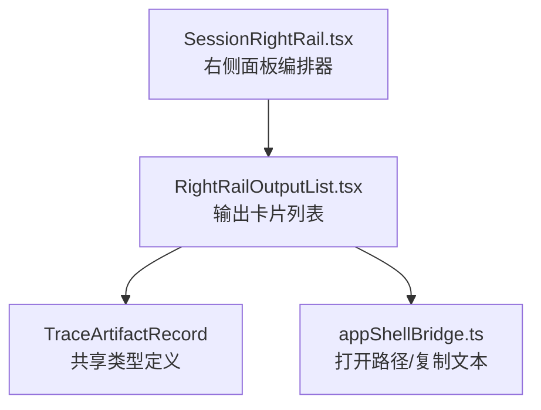
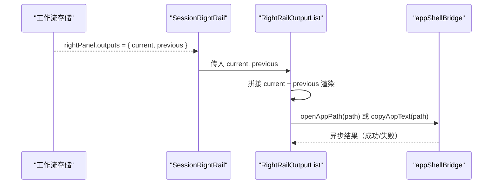
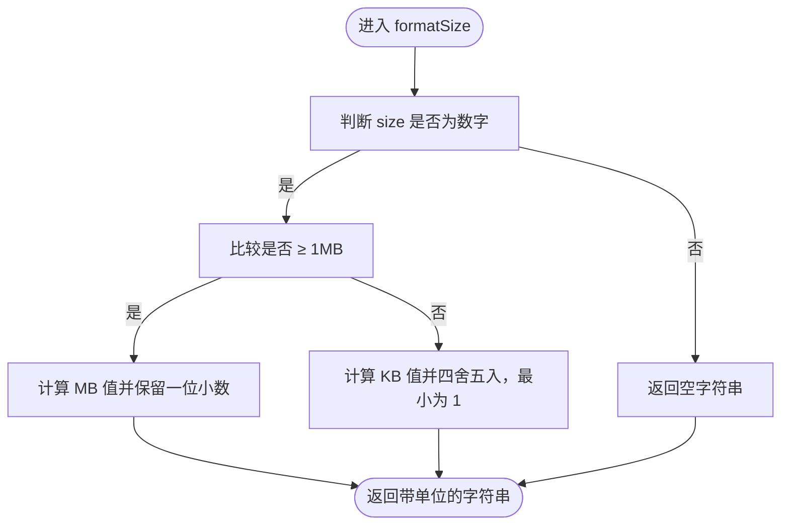
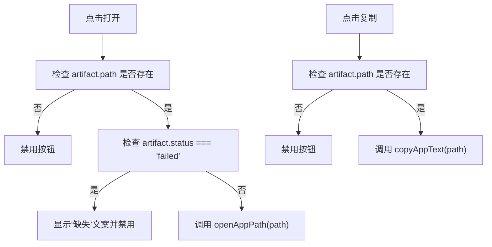
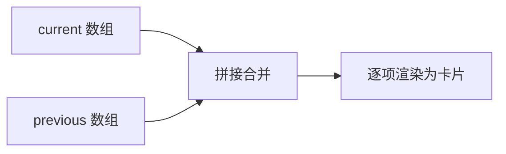
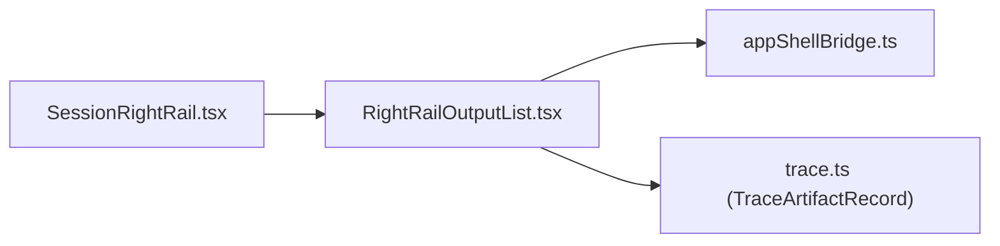

# 输出卡片

<cite>
**本文引用的文件**
- [RightRailOutputList.tsx](file://src/renderer/features/right-rail/RightRailOutputList.tsx)
- [SessionRightRail.tsx](file://src/renderer/features/right-rail/SessionRightRail.tsx)
- [trace.ts](file://src/shared/types/trace.ts)
- [appShellBridge.ts](file://src/renderer/hooks/appShellBridge.ts)
</cite>

## 目录
1. [简介](#简介)
2. [项目结构中的位置](#项目结构中的位置)
3. [核心组件：RightRailOutputList](#核心组件rightrailoutputlist)
4. [架构总览](#架构总览)
5. [详细组件分析](#详细组件分析)
6. [依赖关系分析](#依赖关系分析)
7. [性能与可维护性](#性能与可维护性)
8. [故障排查](#故障排查)
9. [扩展指南](#扩展指南)
10. [结论](#结论)

## 简介
输出卡片用于在右侧面板的“输出”区域展示会话产生的 TraceArtifactRecord，区分当前轮次的 current 输出和 previous 历史输出。每个输出项以卡片形式显示文件名、可选文件大小、以及打开路径或复制路径的操作按钮。失败状态的输出会禁用打开操作并提示缺失。

## 项目结构中的位置
- 输出卡片组件位于渲染端右侧面板特性模块中，由 SessionRightRail 统一编排不同区块（进度、工件、输出、上下文、捕获）。
- 数据模型 TraceArtifactRecord 定义在共享类型文件中，被右侧面板消费。
- 系统级能力（打开路径、复制文本）通过 appShellBridge 桥接到 Electron API。

**图表来源**
- [SessionRightRail.tsx:1-73](file://src/renderer/features/right-rail/SessionRightRail.tsx#L1-L73)
- [RightRailOutputList.tsx:1-39](file://src/renderer/features/right-rail/RightRailOutputList.tsx#L1-L39)
- [trace.ts:49-84](file://src/shared/types/trace.ts#L49-L84)
- [appShellBridge.ts:1-12](file://src/renderer/hooks/appShellBridge.ts#L1-L12)

**章节来源**
- [SessionRightRail.tsx:1-73](file://src/renderer/features/right-rail/SessionRightRail.tsx#L1-L73)
- [RightRailOutputList.tsx:1-39](file://src/renderer/features/right-rail/RightRailOutputList.tsx#L1-L39)
- [trace.ts:49-84](file://src/shared/types/trace.ts#L49-L84)
- [appShellBridge.ts:1-12](file://src/renderer/hooks/appShellBridge.ts#L1-L12)

## 核心组件：RightRailOutputList
- 输入属性：
  - current: 当前轮次输出数组
  - previous: 历史轮次输出数组
- 渲染策略：
  - 将 current 与 previous 拼接后逐项渲染为 article 卡片。
  - 每项使用 className `right-rail-artifact-row status-${artifact.status}` 表达状态样式。
  - 图标采用 OutputFileGlyph SVG。
  - 标题显示 artifact.displayName；当存在 sizeBytes 时追加格式化后的单位大小。
  - 操作区包含两个 Button：
    - “打开”：调用 openAppPath(artifact.path)，当 path 为空或 artifact.status === 'failed' 时禁用；失败时文案改为“缺失”。
    - “复制”：调用 copyAppText(artifact.path)，仅当 path 为空时禁用。
- 国际化：
  - 按钮文案来自 i18n key：control.rightRail.outputs.open / missing / copy。

**章节来源**
- [RightRailOutputList.tsx:1-39](file://src/renderer/features/right-rail/RightRailOutputList.tsx#L1-L39)

## 架构总览
输出卡片的数据流从工作流存储到 UI 层如下：

**图表来源**
- [SessionRightRail.tsx:17-48](file://src/renderer/features/right-rail/SessionRightRail.tsx#L17-L48)
- [RightRailOutputList.tsx:14-33](file://src/renderer/features/right-rail/RightRailOutputList.tsx#L14-L33)
- [appShellBridge.ts:3-11](file://src/renderer/hooks/appShellBridge.ts#L3-L11)

## 详细组件分析

### 数据模型 TraceArtifactRecord
- 关键字段：
  - id：唯一标识
  - displayName：用户可见名称
  - path：本地文件路径（可选）
  - uri/mimeType：资源地址与 MIME（可选）
  - sizeBytes：字节数（可选）
  - status：draft / ready / failed / superseded
- 用途：
  - RightRailOutputList 基于该记录渲染输出卡片，并根据 status 控制交互与样式。

**章节来源**
- [trace.ts:49-84](file://src/shared/types/trace.ts#L49-L84)

### 文件大小格式化函数 formatSize
- 行为规则：
  - 非数字返回空字符串，不显示任何单位。
  - 大于等于 1MB（1024*1024）按 MB 显示，保留一位小数。
  - 小于 1MB 按 KB 显示，四舍五入并保证最小值为 1KB。
- 复杂度：
  - 时间复杂度 O(1)，空间复杂度 O(1)。
- 边界情况：
  - sizeBytes 为 undefined/null 或非 number 时不显示单位。
  - 小于 1KB 的值会向上取整为 1KB，避免显示 0KB。

**图表来源**
- [RightRailOutputList.tsx:9-10](file://src/renderer/features/right-rail/RightRailOutputList.tsx#L9-L10)

**章节来源**
- [RightRailOutputList.tsx:9-10](file://src/renderer/features/right-rail/RightRailOutputList.tsx#L9-L10)

### 输出文件操作按钮
- “打开路径”
  - 触发 openAppPath(artifact.path)。
  - 禁用条件：path 不存在 或 artifact.status 为 failed。
  - 失败文案：当 failed 时显示“缺失”，否则显示“打开”。
- “复制路径”
  - 触发 copyAppText(artifact.path)。
  - 禁用条件：path 不存在。
- 底层桥接：
  - openAppPath/copyAppText 调用 Electron API，未显式 catch 错误，因此失败表现为静默失败；UI 上不会回显错误消息。

**图表来源**
- [RightRailOutputList.tsx:26-31](file://src/renderer/features/right-rail/RightRailOutputList.tsx#L26-L31)
- [appShellBridge.ts:3-11](file://src/renderer/hooks/appShellBridge.ts#L3-L11)

**章节来源**
- [RightRailOutputList.tsx:26-31](file://src/renderer/features/right-rail/RightRailOutputList.tsx#L26-L31)
- [appShellBridge.ts:3-11](file://src/renderer/hooks/appShellBridge.ts#L3-L11)

### OutputFileGlyph SVG 图标
- 组件 OutputFileGlyph 内联一个 viewBox=0 0 24 24 的 SVG，表示文档/输出文件图标。
- 作为 aria-hidden 装饰元素，配合外层 .right-rail-artifact-icon 容器。

**章节来源**
- [RightRailOutputList.tsx:11-15](file://src/renderer/features/right-rail/RightRailOutputList.tsx#L11-L15)

### 样式类 status-${artifact.status}
- 每个 article 根节点附加 className `status-${artifact.status}`，以便通过 CSS 针对 draft/ready/failed/superseded 等状态提供差异化样式。
- 同时具备基础行样式类 right-rail-artifact-row。

**章节来源**
- [RightRailOutputList.tsx:21-25](file://src/renderer/features/right-rail/RightRailOutputList.tsx#L21-L25)

### 渲染顺序：current 与 previous
- current 在前，previous 在后，通过 [...current, ...previous] 拼接。
- SessionRightRail 将 outputs.current 与 outputs.previous 透传给 RightRailOutputList。

**图表来源**
- [RightRailOutputList.tsx:17-20](file://src/renderer/features/right-rail/RightRailOutputList.tsx#L17-L20)
- [SessionRightRail.tsx:28-48](file://src/renderer/features/right-rail/SessionRightRail.tsx#L28-L48)

**章节来源**
- [RightRailOutputList.tsx:17-20](file://src/renderer/features/right-rail/RightRailOutputList.tsx#L17-L20)
- [SessionRightRail.tsx:28-48](file://src/renderer/features/right-rail/SessionRightRail.tsx#L28-L48)

## 依赖关系分析
- RightRailOutputList 依赖：
  - React.memo、useI18n
  - Button 组件
  - appShellBridge 的 openAppPath、copyAppText
  - TraceArtifactRecord 类型
- SessionRightRail 负责：
  - 从工作流存储读取 rightPanel.outputs
  - 根据是否有输出决定渲染 RightRailOutputList 或空状态

**图表来源**
- [RightRailOutputList.tsx:1-6](file://src/renderer/features/right-rail/RightRailOutputList.tsx#L1-L6)
- [appShellBridge.ts:1-11](file://src/renderer/hooks/appShellBridge.ts#L1-L11)
- [trace.ts:49-84](file://src/shared/types/trace.ts#L49-L84)
- [SessionRightRail.tsx:17-48](file://src/renderer/features/right-rail/SessionRightRail.tsx#L17-L48)

**章节来源**
- [RightRailOutputList.tsx:1-39](file://src/renderer/features/right-rail/RightRailOutputList.tsx#L1-L39)
- [SessionRightRail.tsx:17-48](file://src/renderer/features/right-rail/SessionRightRail.tsx#L17-L48)
- [appShellBridge.ts:1-11](file://src/renderer/hooks/appShellBridge.ts#L1-L11)
- [trace.ts:49-84](file://src/shared/types/trace.ts#L49-L84)

## 性能与可维护性
- 渲染优化：
  - RightRailOutputList 使用 React.memo 包裹，减少父级重渲染时的子树重建开销。
- 算法复杂度：
  - formatSize 为 O(1)，无额外内存分配。
  - 列表渲染为 O(n)，其中 n = current.length + previous.length。
- 可维护性建议：
  - 若未来需要支持更多单位（GB），可在 formatSize 中扩展分级逻辑。
  - 如需处理 open/copy 的错误反馈，可在按钮层增加 try/catch 并展示轻量提示。

[本节为通用指导，不涉及具体代码片段]

## 故障排查
- 按钮始终禁用：
  - 检查 artifact.path 是否为空。
  - 检查 artifact.status 是否为 failed（导致“打开”按钮禁用且文案变为“缺失”）。
- 点击“打开”无效：
  - 确认 Electron 环境可用，openAppPath 正确桥接到 appShell.openPath。
  - 路径格式是否正确（相对路径或绝对路径取决于宿主实现）。
- 点击“复制”无效：
  - 确认 copyAppText 已桥接到 appShell.copyText。
  - 浏览器/桌面环境剪贴板权限可能影响复制。
- 大小未显示：
  - 检查 artifact.sizeBytes 是否为有效数字；非数字或 undefined 将不显示单位。

**章节来源**
- [RightRailOutputList.tsx:17-31](file://src/renderer/features/right-rail/RightRailOutputList.tsx#L17-L31)
- [appShellBridge.ts:3-11](file://src/renderer/hooks/appShellBridge.ts#L3-L11)

## 扩展指南
- 新增输出类型：
  - 在 TraceArtifactRecord.type 中添加新枚举值（如 'video'、'archive' 等）。
  - 在 RightRailOutputList 中可根据 type 切换图标或布局。
- 新增操作按钮：
  - 在 RightRailOutputList 的“操作区”增加新 Button。
  - 复用 appShellBridge 提供的系统能力，或在 hooks 中新增自定义操作。
  - 考虑失败状态文案与禁用条件，保持与现有“打开/复制”一致的用户体验。
- 新增状态样式：
  - 在 status-${artifact.status} 基础上，结合 CSS 对新增状态提供视觉差异。
- 国际化：
  - 为新文案补充 i18n key，并在 useI18n() 下引用。

[本节为通用指导，不涉及具体代码片段]

## 结论
RightRailOutputList 以简洁的方式将 current 与 previous 输出统一渲染为卡片，借助 formatSize 提供友好的文件大小展示，并通过 appShellBridge 实现系统级的打开与复制能力。通过 status-${artifact.status} 和 OutputFileGlyph，组件具备良好的可扩展性与可维护性，便于后续扩展新的输出类型与操作。