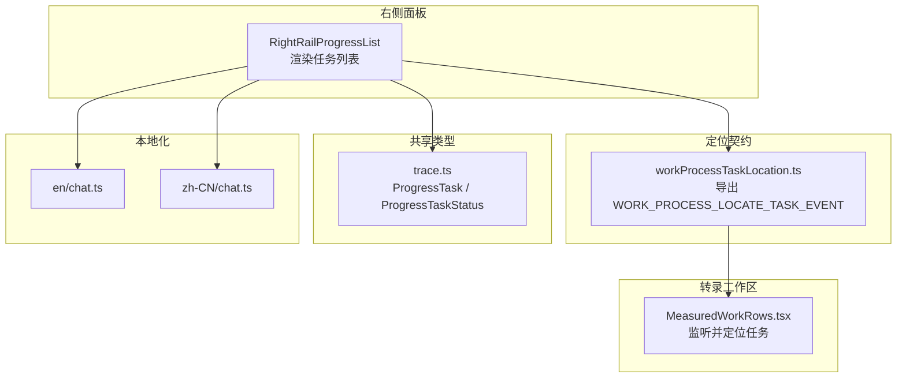
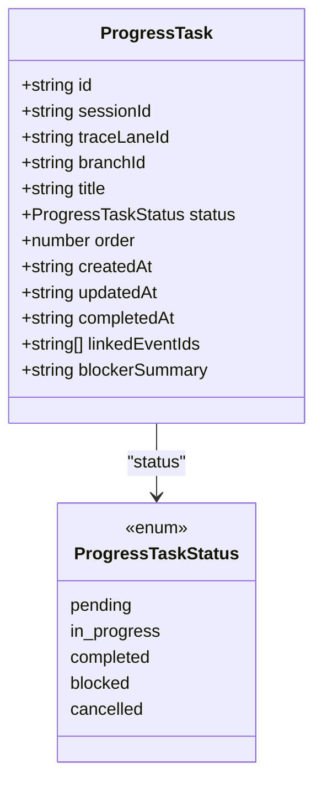
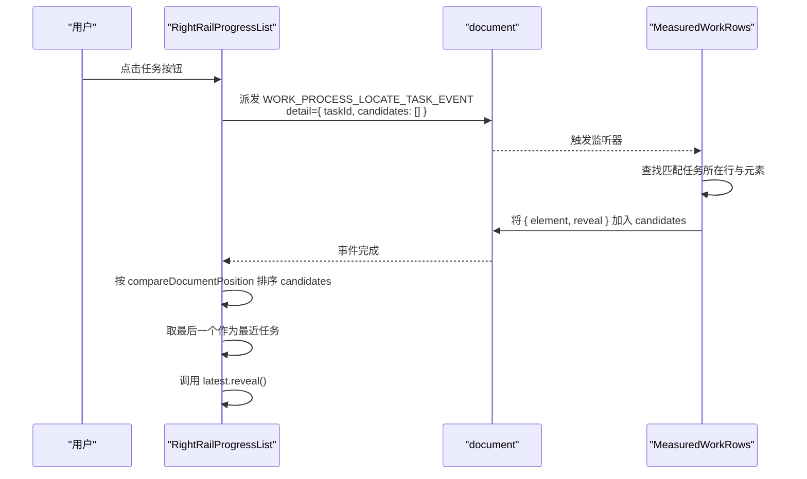
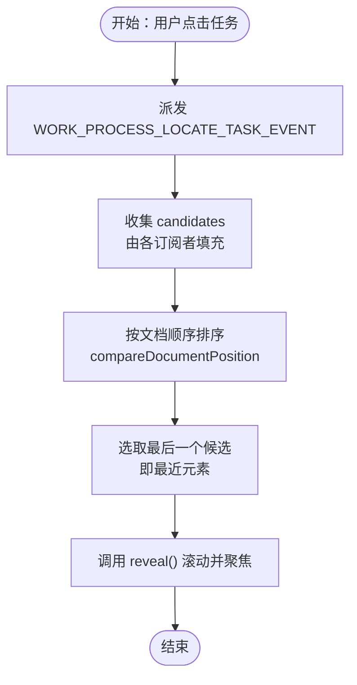
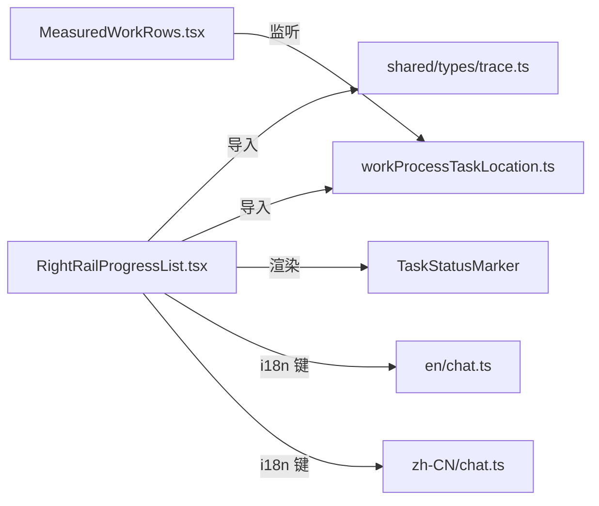

# 进度卡片

<cite>
**本文引用的文件**   
- [RightRailProgressList.tsx](file://src/renderer/features/right-rail/RightRailProgressList.tsx)
- [workProcessTaskLocation.ts](file://src/renderer/lib/workProcessTaskLocation.ts)
- [trace.ts](file://src/shared/types/trace.ts)
- [MeasuredWorkRows.tsx](file://src/renderer/features/transcript/MeasuredWorkRows.tsx)
- [chat.ts（英文本地化）](file://src/renderer/i18n/locales/en/chat.ts)
- [chat.ts（中文本地化）](file://src/renderer/i18n/locales/zh-CN/chat.ts)
</cite>

## 目录
1. [简介](#简介)
2. [项目结构中的位置](#项目结构中的位置)
3. [核心组件与数据结构](#核心组件与数据结构)
4. [架构总览](#架构总览)
5. [详细组件分析](#详细组件分析)
6. [依赖关系分析](#依赖关系分析)
7. [性能考虑](#性能考虑)
8. [故障排查指南](#故障排查指南)
9. [新增任务状态类型的开发指南](#新增任务状态类型的开发指南)
10. [结论](#结论)

## 简介
本文件聚焦右侧面板的“进度卡片”能力，说明 `RightRailProgressList` 如何渲染工作进程任务列表、如何定位并滚动到对应任务、每个任务行的样式类名和可访问性属性，以及国际化标签的来源。同时解释通过 `WORK_PROCESS_LOCATE_TASK_EVENT` 自定义事件触发 work process 的任务定位机制，包括候选元素排序与最近任务元素 reveal 的流程。

## 项目结构中的位置
- 组件实现：`src/renderer/features/right-rail/RightRailProgressList.tsx`
- 任务定位事件契约：`src/renderer/lib/workProcessTaskLocation.ts`
- 任务类型定义：`src/shared/types/trace.ts`
- 工作区转录列表监听方：`src/renderer/features/transcript/MeasuredWorkRows.tsx`
- 任务状态文案：`src/renderer/i18n/locales/en/chat.ts`、`src/renderer/i18n/locales/zh-CN/chat.ts`

**图示来源**
- [RightRailProgressList.tsx:1-30](file://src/renderer/features/right-rail/RightRailProgressList.tsx#L1-L30)
- [workProcessTaskLocation.ts:1-12](file://src/renderer/lib/workProcessTaskLocation.ts#L1-L12)
- [trace.ts:1-60](file://src/shared/types/trace.ts#L1-L60)
- [MeasuredWorkRows.tsx:1-158](file://src/renderer/features/transcript/MeasuredWorkRows.tsx#L1-L158)
- [chat.ts（英文本地化）:202-206](file://src/renderer/i18n/locales/en/chat.ts#L202-L206)
- [chat.ts（中文本地化）:186-190](file://src/renderer/i18n/locales/zh-CN/chat.ts#L186-L190)

**章节来源**
- [RightRailProgressList.tsx:1-30](file://src/renderer/features/right-rail/RightRailProgressList.tsx#L1-L30)
- [workProcessTaskLocation.ts:1-12](file://src/renderer/lib/workProcessTaskLocation.ts#L1-L12)
- [trace.ts:1-60](file://src/shared/types/trace.ts#L1-L60)
- [MeasuredWorkRows.tsx:1-158](file://src/renderer/features/transcript/MeasuredWorkRows.tsx#L1-L158)
- [chat.ts（英文本地化）:202-206](file://src/renderer/i18n/locales/en/chat.ts#L202-L206)
- [chat.ts（中文本地化）:186-190](file://src/renderer/i18n/locales/zh-CN/chat.ts#L186-L190)

## 核心组件与数据结构

### RightRailProgressList 组件
- 输入
  - `tasks: ProgressTask[]`：由外部 store 或父组件传入的任务数组。
  - `locateLabel: string`：用于按钮标题的“定位”文案，来自外层 i18n。
- 行为
  - 渲染有序列表 `<ol className="right-rail-progress">`。
  - 每个任务渲染为 `<li>`，并通过 `className={`right-rail-task-row status-${task.status}`}` 附加状态样式类。
  - 每个任务行包含一个 `<button>`：
    - 点击时调用 `focusWorkProcessTask(task.id)`，触发任务定位。
    - 按钮 `title` 为 `${task.title} — ${locateLabel}`，提供可访问提示。
  - 任务序号显示为 `task.order + 1`，使用类名 `right-rail-task-order`。
  - 任务状态图标通过 `TaskStatusMarker` 渲染，其屏幕阅读器标签为 `t('chat.workProcessTaskStatus.${task.status}')`。
  - 任务标题文本包裹在 `<strong>`，并使用类名 `right-rail-task-copy`。

**章节来源**
- [RightRailProgressList.tsx:1-30](file://src/renderer/features/right-rail/RightRailProgressList.tsx#L1-L30)

### ProgressTask 数据结构
- 字段摘要
  - `id`：任务唯一标识。
  - `sessionId`、`traceLaneId`、`branchId`：会话与工作流上下文。
  - `title`：用户可见标题。
  - `status`：任务状态枚举值。
  - `order`：零基顺序号；UI 显示为 `order + 1`。
  - `createdAt`、`updatedAt`、可选 `completedAt`：时间戳。
  - 可选扩展字段：`linkedEventIds`、`blockerSummary`。
- 状态枚举
  - `ProgressTaskStatus`：`pending` | `in_progress` | `completed` | `blocked` | `cancelled`。

**图示来源**
- [trace.ts:1-60](file://src/shared/types/trace.ts#L1-L60)

**章节来源**
- [trace.ts:1-60](file://src/shared/types/trace.ts#L1-L60)

## 架构总览
进度卡片的任务定位采用“发布-订阅”模式：
- 发布者：`RightRailProgressList` 在用户点击任务按钮时，派发 `WORK_PROCESS_LOCATE_TASK_EVENT` 自定义事件，携带目标 `taskId` 和空 `candidates` 数组。
- 订阅者：转录工作区的 `MeasuredWorkRows` 监听该事件，查找匹配任务所在的行与 DOM 节点，将元素及其 `reveal()` 回调填充进 `candidates`。
- 选择策略：发布者收到事件后，对 `candidates` 按文档顺序排序，取最后一个作为“最近”任务，并调用其 `reveal()` 滚动至可视区域。

**图示来源**
- [RightRailProgressList.tsx:1-30](file://src/renderer/features/right-rail/RightRailProgressList.tsx#L1-L30)
- [workProcessTaskLocation.ts:1-12](file://src/renderer/lib/workProcessTaskLocation.ts#L1-L12)
- [MeasuredWorkRows.tsx:90-140](file://src/renderer/features/transcript/MeasuredWorkRows.tsx#L90-L140)

**章节来源**
- [RightRailProgressList.tsx:1-30](file://src/renderer/features/right-rail/RightRailProgressList.tsx#L1-L30)
- [MeasuredWorkRows.tsx:90-140](file://src/renderer/features/transcript/MeasuredWorkRows.tsx#L90-L140)
- [workProcessTaskLocation.ts:1-12](file://src/renderer/lib/workProcessTaskLocation.ts#L1-L12)

## 详细组件分析

### 任务定位流程与算法
点击任务按钮后的关键步骤如下：
1. 构造 `WorkProcessTaskLocationRequest`，仅填入 `taskId`，`candidates` 初始为空数组。
2. 派发 `WORK_PROCESS_LOCATE_TASK_EVENT`。
3. 所有监听该事件的模块可将自身能定位到的元素及 `reveal()` 方法追加到 `candidates`。
4. 发布者对所有候选元素执行基于 `compareDocumentPosition` 的排序：若左元素跟随右元素，则将其排在前面，最终取末尾元素作为“最近”元素。
5. 调用最近元素的 `reveal()`，通常负责滚动到视口中心并聚焦。

**图示来源**
- [RightRailProgressList.tsx:1-30](file://src/renderer/features/right-rail/RightRailProgressList.tsx#L1-L30)

**章节来源**
- [RightRailProgressList.tsx:1-30](file://src/renderer/features/right-rail/RightRailProgressList.tsx#L1-L30)
- [workProcessTaskLocation.ts:1-12](file://src/renderer/lib/workProcessTaskLocation.ts#L1-L12)
- [MeasuredWorkRows.tsx:90-140](file://src/renderer/features/transcript/MeasuredWorkRows.tsx#L90-L140)

### 任务行的样式与可访问性
- 列表容器：`<ol className="right-rail-progress">`。
- 任务行：`<li className="right-rail-task-row status-${task.status}">`，其中状态类名为 `status-pending`、`status-in_progress`、`status-completed`、`status-blocked`、`status-cancelled`。
- 序号：``，内容为 `task.order + 1`。
- 状态标记：`TaskStatusMarker` 的 `label` 取自 `t('chat.workProcessTaskStatus.${task.status}')`。
- 标题文本：`<strong className="right-rail-task-copy">`。
- 交互控件：
  - 每行是一个 `<button type="button">`，具备天然的可访问性与键盘操作能力。
  - 按钮 `title` 为 `${task.title} — ${locateLabel}`，便于屏幕阅读器与工具提示理解。
  - 焦点管理由 `reveal()` 实现，通常在转录工作区中会聚焦到具体任务条目。

**章节来源**
- [RightRailProgressList.tsx:1-30](file://src/renderer/features/right-rail/RightRailProgressList.tsx#L1-L30)

### 国际化支持
- 任务状态文本键：`chat.workProcessTaskStatus.${task.status}`。
- 英文本地化键值：
  - `chat.workProcessTaskStatus.pending`
  - `chat.workProcessTaskStatus.in_progress`
  - `chat.workProcessTaskStatus.blocked`
  - `chat.workProcessTaskStatus.completed`
  - `chat.workProcessTaskStatus.cancelled`
- 中文本地化键值：
  - `chat.workProcessTaskStatus.pending`
  - `chat.workProcessTaskStatus.in_progress`
  - `chat.workProcessTaskStatus.blocked`
  - `chat.workProcessTaskStatus.completed`
  - `chat.workProcessTaskStatus.cancelled`
- 定位按钮标题中的“定位”文案由父组件传入的 `locateLabel` 决定，不在组件内部硬编码。

**章节来源**
- [RightRailProgressList.tsx:1-30](file://src/renderer/features/right-rail/RightRailProgressList.tsx#L1-L30)
- [chat.ts（英文本地化）:202-206](file://src/renderer/i18n/locales/en/chat.ts#L202-L206)
- [chat.ts（中文本地化）:186-190](file://src/renderer/i18n/locales/zh-CN/chat.ts#L186-L190)

## 依赖关系分析
- `RightRailProgressList` 依赖：
  - React 与 i18n。
  - `TaskStatusMarker` 用于展示状态图标与可读标签。
  - `WORK_PROCESS_LOCATE_TASK_EVENT` 事件常量与请求类型。
  - `ProgressTask` 类型。
- `MeasuredWorkRows` 依赖：
  - 同一事件常量，负责监听并将实际 DOM 元素注入 `candidates`。
- 共享类型：
  - `ProgressTask`、`ProgressTaskStatus` 定义于 `shared/types/trace.ts`。
- 本地化：
  - 任务状态文案分别维护在英文与中文语言包中。

**图示来源**
- [RightRailProgressList.tsx:1-30](file://src/renderer/features/right-rail/RightRailProgressList.tsx#L1-L30)
- [workProcessTaskLocation.ts:1-12](file://src/renderer/lib/workProcessTaskLocation.ts#L1-L12)
- [trace.ts:1-60](file://src/shared/types/trace.ts#L1-L60)
- [MeasuredWorkRows.tsx:1-158](file://src/renderer/features/transcript/MeasuredWorkRows.tsx#L1-L158)
- [chat.ts（英文本地化）:202-206](file://src/renderer/i18n/locales/en/chat.ts#L202-L206)
- [chat.ts（中文本地化）:186-190](file://src/renderer/i18n/locales/zh-CN/chat.ts#L186-L190)

**章节来源**
- [RightRailProgressList.tsx:1-30](file://src/renderer/features/right-rail/RightRailProgressList.tsx#L1-L30)
- [MeasuredWorkRows.tsx:1-158](file://src/renderer/features/transcript/MeasuredWorkRows.tsx#L1-L158)
- [workProcessTaskLocation.ts:1-12](file://src/renderer/lib/workProcessTaskLocation.ts#L1-L12)
- [trace.ts:1-60](file://src/shared/types/trace.ts#L1-L60)

## 性能考虑
- 列表渲染：`RightRailProgressList` 直接映射任务数组，适合数量较小的右侧面板场景。
- 排序开销：每次定位时对 `candidates` 进行排序，候选数通常很小，影响可忽略。
- 滚动与聚焦：`reveal()` 的实现可能涉及滚动、展开与动画闪烁效果；在长列表中应避免频繁重排。
- 事件监听：`MeasuredWorkRows` 在挂载时注册一次监听器，卸载时移除，避免内存泄漏。

[本节为通用性能建议，不直接分析特定代码片段]

## 故障排查指南
- 点击任务无响应
  - 确认是否成功派发 `WORK_PROCESS_LOCATE_TASK_EVENT`。
  - 检查是否有订阅者监听该事件。
  - 检查 `candidates` 是否被正确填充。
- 定位不到任务
  - 检查 `taskId` 是否与转录工作区中的任务 ID 一致。
  - 检查订阅者是否正确找到匹配的 `data-work-process-task-id` 节点。
- 未滚动到可视区域
  - 检查 `reveal()` 是否调用滚动逻辑。
  - 检查外层容器是否存在 `.chat-messages` 等滚动容器。
- 样式异常
  - 检查任务行是否应用了 `status-${task.status}` 类名。
  - 检查状态枚举值是否属于 `ProgressTaskStatus`。
- 本地化缺失
  - 确认 `chat.workProcessTaskStatus.${task.status}` 是否在当前语言包中存在。

**章节来源**
- [RightRailProgressList.tsx:1-30](file://src/renderer/features/right-rail/RightRailProgressList.tsx#L1-L30)
- [MeasuredWorkRows.tsx:90-140](file://src/renderer/features/transcript/MeasuredWorkRows.tsx#L90-L140)
- [trace.ts:1-60](file://src/shared/types/trace.ts#L1-L60)
- [chat.ts（英文本地化）:202-206](file://src/renderer/i18n/locales/en/chat.ts#L202-L206)
- [chat.ts（中文本地化）:186-190](file://src/renderer/i18n/locales/zh-CN/chat.ts#L186-L190)

## 新增任务状态类型的开发指南
若需要新增任务状态类型，请依次完成以下改动：

1. 扩展状态枚举
   - 在 `src/shared/types/trace.ts` 中向 `ProgressTaskStatus` 添加新字符串字面量。
   - 示例新增值：`'paused'`（仅为示意，非仓库现有值）。

2. 添加本地化文案
   - 在英文语言包中添加键：`chat.workProcessTaskStatus.<新状态>`。
   - 在中文语言包中添加相同键对应的翻译。
   - 确保键名与新状态枚举值完全一致。

3. 更新 UI 行为
   - 如果新状态需要不同视觉表现，在样式文件中添加 `status-<新状态>` 规则。
   - 若新状态需要不同的交互或图标，更新 `TaskStatusMarker` 或相关样式。

4. 验证定位与排序
   - 确认新增状态的任务仍能正常派发 `WORK_PROCESS_LOCATE_TASK_EVENT`。
   - 确认 `candidates` 排序与 `reveal()` 对新状态任务生效。

5. 测试建议
   - 新增覆盖新状态的单元测试或快照测试。
   - 验证按钮 `title`、屏幕阅读器标签、样式类名是否符合预期。

**章节来源**
- [trace.ts:1-60](file://src/shared/types/trace.ts#L1-L60)
- [chat.ts（英文本地化）:202-206](file://src/renderer/i18n/locales/en/chat.ts#L202-L206)
- [chat.ts（中文本地化）:186-190](file://src/renderer/i18n/locales/zh-CN/chat.ts#L186-L190)
- [RightRailProgressList.tsx:1-30](file://src/renderer/features/right-rail/RightRailProgressList.tsx#L1-L30)

## 结论
`RightRailProgressList` 以简洁的 React 组件形式渲染工作进程任务列表，结合 `WORK_PROCESS_LOCATE_TASK_EVENT` 与 `MeasuredWorkRows` 的订阅机制，实现了跨区域的精确定位与滚动。任务行通过 `status-${task.status}` 类名驱动样式，通过 `title` 与状态标记的 i18n label 提升可访问性。新增任务状态类型只需扩展共享枚举、补充本地化文案，并在必要时扩展样式与交互逻辑。